# 1 Agent 工程基础

## 开始之前：加入我们 Discord 上的 GenAI & LLM 社区

在我们的 Discord 服务器上向作者提供反馈，并与其他早期读者聊天。


[`packt.link/4Bbd9`](https://packt.link/4Bbd9)

> *未来属于那些能够利用人工智能的组织，不是将其作为人类智能的替代，而是作为其增强。*

— 吴恩达（Andrew Ng），AI 研究员，Coursera 联合创始人

**人工智能**（**AI**）正处于一个变革性的边缘，这是由于**自主 Agent**的出现。它们代表了自从过程化转向面向对象编程以来，计算领域最重要的架构进步——对数字系统运行及其与其环境交互方式的根本性重构。这些 Agent 不仅仅是增强的算法，而是能够感知周围、维持持久状态、对复杂目标进行战略性推理并根据经验调整其行为的认知实体。这种演变的影响远超技术实现细节，它挑战了我们对人类意图与计算行为之间关系的根本观念。

本章为理解 **Agent 工程** 奠定了概念性基础，将其既视为一门理论学科，也视为一个实战框架。我们探索了从简单的反应式系统到复杂的认知架构的演变轨迹，研究了实现自主行为的结构性组件，并引入了桥接理论原理与生产实现的开发方法论。通过这种探索，我们旨在为您提供一个概念化 Agent 系统的全面框架，并为有效设计、开发和部署它们提供实践见解——无论您是构建自主工作流的软件工程师，还是将智能助手集成到旧系统中的企业架构师，或是探索基于 Agent 的平台如何提供可扩展的客户支持或合规自动化的产品领导者。

这里概述的原则不仅仅是学术的——它们代表了寻求利用基于 Agent 的系统的变革潜力的组织的关键知识。无论是自动化复杂工作流、增强人类能力，还是实现全新类别的应用程序，自主 Agent 正日益成为数字版图中不可或缺的。然而，实现它们的全部潜力通常涉及应对复杂的集成挑战，例如稳健的工具编排、安全的数据隐私和伦理对齐。理解它们的本质和架构要求，为成功实施提供了基础，并通过这些基础可以有效解决这些挑战。

在本章中，我们将涵盖以下主题：

* 介绍 Agent
* Agent 架构
* 互操作性协议
* Agent 开发生命周期
* Agent 交互范式的演进
* Agent AI 演进框架（Agentic AI Progression Framework）
* 现实世界的业务影响

## 介绍 Agent

我们正处于计算史上的一个关键转折点。从传统软件系统到自主 Agent 的转变代表了场根本性的范式转移，改变了数字系统运行及其与其环境交互的方式。传统程序在显式指令定义的预测路径内运行，而基于 Agent 的系统表现出以目标为引导的行为，维持持久状态，并根据环境反馈调整其策略。这种转变挑战了既有的软件工程原则，并为概念化计算系统的智能引入了新的框架。

传统软件与基于 Agent 的方法之间的区别不仅是语义上的，更是架构上的。传统系统处理离散输入以生成可预测输出，而 Agent 在动态环境中持续运行，形成内部表示，在不确定下做出决策并从经验中学习。对于接受过确定性编程模型训练的从业人员来说，这种转变不仅需要新的技能，还需要对智能系统如何运作和演进进行重新概念。

区分智能 Agent 与传统软件的关键特征包括：

* **自主性（Autonomy）**：无需持续人类指导即可运行的能力。
* **持久性（Persistence）**：跨交互维持状态和记忆。
* **反应性（Reactivity）**：实时响应环境的变化。
* **主动性（Proactiveness）**：根据内部目标发起行动，而不仅仅是由于外部触发。
* **适应性（Adaptability）**：从经验中学习并相应修改行为。
* **目标导向（Goal-orientation）**：在不确定下通过规划和推理追求目标。

在常用用法中，Agent 是*采取行动或施加力量的*（Merriam-Webster）。在 AI 领域，这个定义演变为一个更技术的构造：AI Agent 是一种感知环境、处理内部状态并采取行动以实现定义目标的计算系统。这些系统表现出自主性、适应性和反应性——这些是区别于传统软件程序的关键属性。Agent 的运行不仅是对输入做出反应，而是通过维持上下文、管理目标并根据反馈调整策略。这种动态行为源于**情境人工智能（situated AI）**范式，智能源于与环境的持续交互。Franklin 和 Graesser (1997) 概括了这一概念：

> *自主 Agent 是一个位于环境中并成为环境一部分的系统，它随时间对环境进行感知并采取行动，以追求自己的议程。*

这一定义为整合感知、规划、行动和学习的架构奠定了基础。在企业应用中，代理（agents）越来越多地部署为数字员工——处理客户入职、处理发票、管理工作流——每个代理都具有持久状态、内存和反馈机制。AI 代理的发展史可以分为不同的技术时代：

* **1970s–1980s**：基于规则的专家系统，例如`MYCIN`（斯坦福大学开发的一种用于诊断血液感染和推荐抗生素的系统），使用基于逻辑的推理引擎来解决定义狭义的问题。尽管具有确定性的精度，但这些系统是脆弱且缺乏灵活性的。
* **1990s**：决策树和`SVMs`等经典机器学习方法引入了模式识别能力。虽然比规则系统更具适应性，但它们仍然是特定任务的且无状态的。
* **2010s**：深度学习彻底改变了数据感知。语音识别、图像分析和翻译达到了人类水平。然而，这些模型在很大程度上是响应式的，设计用于输入输出预测，而非自主行为。
* **2020s 及以后**：`大语言模型`（`LLMs`——在海量文本数据集上训练以理解和生成人类语言的 AI 系统）以及`transformers`（擅长处理顺序数据的神经网络架构）的出现，引入了涌现推理、自然语言生成和少样本学习。然而，早期的`LLMs`受限于上下文大小、缺乏内存和工具集成。

虽然 AI 领域的许多最新进展——例如`检索增强生成`（`RAG`）、外部工具使用、API 编排和内存系统——其本身具有至关重要的作用，但它们也是构建更强大的自主代理的关键赋能者。诸如`LangGraph`、`CrewAI`和`AutoGen`等框架支持规划、决策和实时交互，使代理能够在开放式环境中完成多步目标。例如，在客户支持领域，这种演变是巨大的：

* **2010**：静态 FAQ 脚本为常见问题提供预定义的答复，任何偏离都需要人工干预。
* **2018**：基于机器学习的工单路由系统可以分类并将支持请求分配给相应部门，但仍需人工解决。
* **2025**：先进的多代理系统现在在生产部署中已显示出 70-85% 的解决率（基于 Zendesk、Intercom 和 ServiceNow 等公司的实现），集成了用于自然对话的`LLMs`、用于个性化上下文的账户系统以及当前信息的实时知识库。

这种演进轨迹（*图 1.1* 所示）强调了传统 AI 应用与真正的自主代理系统之间根本的架构和哲学区别——这些差异远超技术实现，延伸到这些系统运行、学习以及与环境交互的方式。这些架构转变不仅是学术上的——它们转化为可衡量的业务成果，如降低支持成本、提高首次接触解决率、更快的入职以及跨客户触点的扩展扩展性。

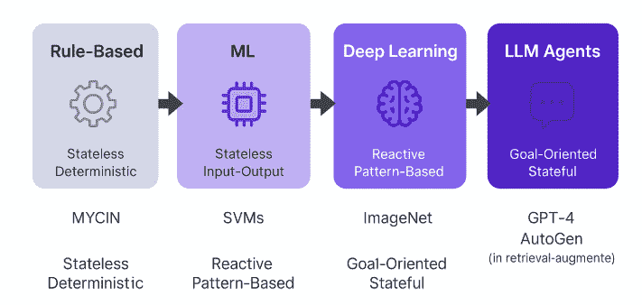

图 1.1 – AI 代理技术的演进

在追踪了 AI 代理从基于规则系统到今天复杂的自主实体的历史演变后，我们现在转向研究这种智能行为的结构基础。理解代理是如何构建的——认知循环、通信模式以及将计算系统转换为目标导向实体的设计选择——对于构建有效的代理解决方案至关重要。

## 代理的架构

智能代理的架构设计标志着从过程化逻辑向认知驱动计算的根本转变。与响应定义输入而执行静态指令的传统软件系统不同，代理在动态环境中持续运行，做出实时决策，维持持久内存并随着时间调整其策略。核心在于，代理的架构必须将关键认知功能——`感知`、`推理`、`规划`、`行动`和`学习`集成到一个模块化的、有状态的框架中，该框架同时支持响应和深思。这通常从已有的 AI 范式中汲取灵感：例如`BDI`（信念-愿望-意图）等模型为代理管理其对世界的信念、愿望（目标）和意图（选定的计划）提供了一个框架。同样，将符号推理（处理显式知识和逻辑规则，通常用于规划和决策）与神经网络（擅长模式识别和从数据中学习）相结合的混合方法，使代理形成稳健的内部表示，对复杂目标进行有效推理，并在追求长期目标的过程中协调复杂的工具使用。在实践中，这意味着设计分离关注点的系统：感知模块与传感器或 API 接口；规划引擎分解目标；内存子系统管理历史和语义上下文；执行层与工具、服务或其他代理接口。诸如`LangGraph`和`CrewAI`等框架通过提供可组合的运行时环境实现了这些原则，代理可以在这些环境中跨会话维护状态、使用图编排工作流并自主运行。这种架构的凝聚力是将代理从响应式机器人转变为能够应对开放现实世界复杂的智能系统的关键。为了理解这种架构愿景如何转化为实际实现，我们检查了三个基础要素：驱动代理决策的认知循环、实现组件间无缝交互的通信模式，以及决定代理如何将感知转化为行动的设计模式。

### 认知循环

智能代理的认知架构定义了感知如何通过结构化、可重复的过程转化为有目的的行动。这种设计的内核是`认知循环`（cognitive loop）——感知、推理、规划、行动和学习的持续循环——它使代理能够在动态环境中运行。正如*图 1.2* 所示，这个循环形成了智能代理行为的骨干，提供了做出决策、执行行动以及随时间积累知识的支架。

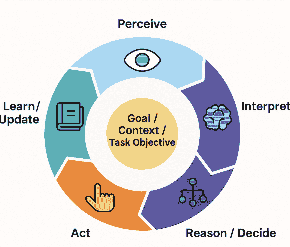

图 1.2 – 智能代理的认知架构

为了理解这种架构在实践中如何运作，让我们详细探索认知循环的每个阶段——从`感知`开始，这是塑造后续所有步骤的关键第一步：

1. **感知**通过从环境中捕获数据（无论是通过用户输入、API、传感器还是外部系统）并将其转换为适合处理的结构化格式启动循环。这些原始输入形成了后续认知步骤的基础，并决定了代理情境感知范围。

```
## Example：客户服务代理中的感知
def perceive_input(user_message, context):
    return {
        "message": user_message,
        "timestamp": datetime.now(),
        "user_id": context.get("user_id"),
        "session_state": context.get("session"),
        "sentiment": analyze_sentiment(user_message)
    }
```

### 1. 推理

`Reasoning` 随后通过对感知到的信息进行上下文化，应用模式识别、推理引擎或统计模型来提取含义和相关性。这一阶段将信号转化为洞察，使代理不仅能够理解发生了什么，还能理解其重要性。

```python
# Example: Reasoning about customer intent
def reason_about_intent(perception_data):
    intent = classify_intent(perception_data["message"])
    priority = determine_priority(
        intent,
        perception_data["sentiment"],
        user_history=get_user_history(perception_data["user_id"])
    )
    return {"intent": intent, "priority": priority, "context": perception_data}
```

### 2. 规划

`Planning` 将这些洞察协调成连贯的操作序列。无论是使用确定性规则链还是概率模型，代理都会将目标分解为任务，评估选项，并根据预定义的目标和环境条件对步骤进行排序。

```python
## Example: Planning response strategy
def create_action_plan(reasoning_result):
    if reasoning_result["intent"] == "billing_issue":
        return [
            "fetch_account_details",
            "analyze_billing_history",
            "generate_explanation",
            "offer_resolution"
        ]
    elif reasoning_result["priority"] == "urgent":
        return ["escalate_to_human", "log_urgent_case"]
```

### 3. 行动

`Action` 随后执行选定的步骤，与外部工具、API、数据库或系统接口，以使代理的决策落地。这一阶段通常使用函数调用框架或工具编排层来实现，如在`LangChain`或`LangGraph`中发现的层。

```python
## Example: Action execution
def execute_action(action_plan, context):
    results = []
    for action in action_plan:
        if action == "fetch_account_details":
            result = billing_api.get_account(context["user_id"])
        elif action == "generate_explanation":
            result = llm.generate_response(context, results)
        results.append(result)
    return results
```

### 4. 学习

`Learning` 通过分析结果、衡量操作的成功率以及更新内部模型或存储器来完成闭环。这种反馈机制允许代理随着时间的推移完善其行为，根据成功和失败改进性能。

```python
## Example: Learning from interaction
def learn_from_outcome(interaction_data, user_feedback):
    success_score = calculate_success(user_feedback)
    update_user_preferences(interaction_data["user_id"], success_score)
    if success_score < 0.7:
        flag_for_model_improvement(interaction_data)
```

如`图 1.2`所示，这些阶段形成了一个反馈驱动的系统，而不是线性流水线。每个组件相互影响并受彼此影响，使代理能够适应新数据、不可预见的情况和不断演的目标。在实践中，这种架构支持广泛的应用，从根据先前的交互定制响应的客户参与代理，到根据不断变化的约束持续调整运营的供应链代理。这种模块化但相互依赖的结构——感知导致理解，规划导致执行，学习完成闭环——是让代理从自动化脚本提升为智能自适应系统的关键。理解这种架构对于设计能够处理长周期目标、上下文决策和现实世界自主性的代理至关重要。

### 组件之间的通信模式

一个智能代理的定义不仅取决于其推理引擎的复杂性或输出的准确性，还取决于绑定其内部组件的通信路径的完整性。这些路径（在`图 1.3`中所示）构成了认的神经系统，将分散的子系统转化为统一的、自适应智能。

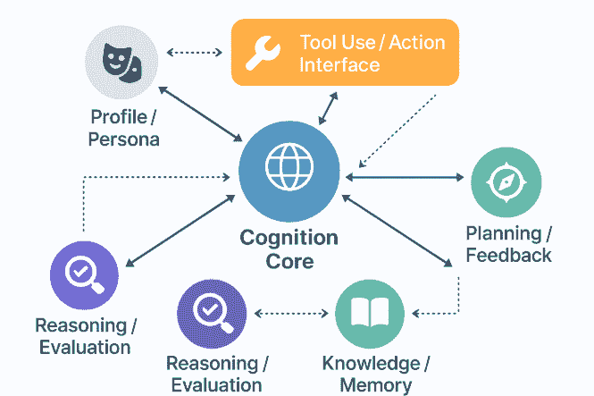

图 1.3 – 代理认知架构中的通信模式


该架构的核心是认知核心（Cognition Core），它是执行协调器，负责综合来自其他模块的输入、解决冲突、协调操作并维护代理状态的一致性。每个主要功能——推理、规划、内存和交互都通过这个核心进行调节，它的作用与其说是一个中央命令，不如说是一个任务相关的动态经纪人。

> 在现实部署中，这种中心角色可能会引发单点故障的担忧。健壮的实现通常通过冗余、分布式协调层和健康检查机制来解决这些问题，确保`Cognition Core`能够从崩溃、负载或组件退化中恢复。某些框架实现了备用节点、心跳信号或云原生编排，以保证生产环境中的可用性和响应速度。

核心周围环绕着五个基础通信层，每层代表一个不同的功能角色：

* **画像/人设（Profile/Persona）**：这一层定义了代理的性格——其语气、行为约束以及与用户意图的系统级对齐。在实现方面，这可能以系统提示词或角色模板的形式存在，作为初始化边界，告知代理如何解释歧义、执行护栏以及与用户通信。值得注意的是，这一层不是静态的；它会响应不断变化的上下文，并可以在运行时更新以反映受众、任务或伦理参数的变化。

* **工具使用/操作接口（Tool Use/Action Interface）**：将代理的内部思考与外部世界连接起来。推理意图在此转化为工具调用、API 调用或系统命令。该通道处理操作的分发和结果的解释，将执行反馈回认知循环。在生产系统中，这通常是对延迟最敏感的组件，需要健壮的错误处理、重试逻辑和可观测性流水线。

* **规划/反馈（Planning/Feedback）**：该模块提供前瞻性策略和回顾性修正。目标被分解为任务图，根据约束进行优先级排序，并监控成功或失败。当结果偏离预期时（例如，预订失败或 API 超时），此层会触发重新规划。这种反馈循环对于长周期自主性至关重要，通常使用`LangGraph`等框架进行编排。

* **知识/内存（Knowledge/Memory）**：这一层是代理的时间基质。它包含短期工作内存、长期知识存储和情节回溯系统。这些组件允许代理基于历史落实行为、召回之前的任务、复用上下文约束，并随时间提供连贯的行为。在架构上，内存是异步访问的，使代理在后台检索深度上下文的同时保持实时响应能力。为了最小化延迟并确保一致的实时响应，生产级代理通常对频繁访问的知识（例如用户配置文件或近期交互）采用缓存策略，以及向量索引预取或近似最近邻（ANN）搜索技术。此外，内存系统可能会实施生存时间（TTL）缓存、请求批处理和分层内存（例如短期与长期），以平衡上下文检索的深度与速度。

- **推理/评估**：这些组件在策略性地分布在`Figure 1.3`的边缘，以提供多个验证检查点和专业的评估能力。许多系统并不依赖单一的推理引擎，而是将评估分布在多个专门的验证器上——例如，安全检查器、事实准确性审计器或领域特定评审员。这种分布式方法通过多层验证确保了鲁棒性，并允许对不同的推理任务进行并行处理。这些推理模块与认知核心交换结构化消息，支持如自反思、置信度评分和迭代输出优化等机制。

总体来看，这些通信层不仅仅是一个功能性方案——它们代表了一种模块化、可组合的哲学。`Figure 1.3`中的双向流和虚线回调强调了认知不是线性的，而是循环的、反射的且反馈驱动的。随着条件的改变，记忆影响规划，评估重定向行动，而人格塑造了理解。这种网络化的相互依赖确保了智能体能够适应复杂的动态环境，而不会丢失连贯性或目标对齐。健壮的通信设计还支持工程优先事项：模块化允许团队并行构建组件；可观测性有助于调试和信任，通常在智能体生态系统中使用`Prometheus`、`Grafana`或`LangSmith`等工具跟踪智能体状态、操作成功率、延迟和错误事件；关注点分离则促进了扩展性和可测试性。此外，通过将推理与执行分离、将状态与策略分离，智能体系统获得了应对不确定性和部分故障的韧性——使其适用于企业自动化、自适应学习、客户服务等真实世界的部署。最终，定义智能体智能的不仅是它知道什么或做了什么，而是其内部系统之间交流得有多好。组件之间的通信是认知成型的地方——它不是逻辑的独白，而是目的的对话。

## 选择智能体大脑：从感知到行动的模式

决定智能体如何将感知转化为行动的架构定义其智能的核心。这种`perception-to-action`循环——无论是反射的还是推理的——决定了智能体如何与环境交互、处理不确定性，并平衡时效与策略。与遵循固定逻辑路径的传统软件系统不同，自主智能体需要支持灵活、上下文感知决策的认知支架。选择“智能体大脑”——其推理模式——不仅仅是一个实现细节，而是一种塑造长期性能、适应性和系统行为的结构性承诺。

智能体设计模式可以分为三种主流范式，每种范式代表了建模智能行为的不同方法：反应式、思考性和混合式。这些模式并不是相互排斥的；它们为开发者提供了一个设计调色板，将认知结构与特定任务的需求、用户预期和操作环境对齐。理解这些模式对于构建在现实条件下能够可靠运行的系统至关重要。部署在面向客户的工作流中的智能体可能依赖反应模型进行低延迟交互，而知识密集型系统则需要深思考以确保上下文的准确性和合规性。在两者都需要领域（例如企业自动化或医疗诊断），混合模型提供了一条极具韧性的中间路径。接下来的章节将深入探讨每种模式，根据架构权衡、环境复杂性和智能体目标提供何时以及如何应用它们的指导。

### 反应式智能体：反射性响应

反应式智能体代表了最简单、最直接的智能系统。这些智能体通过直接的刺激-响应机制运行，将环境输入映射到预定义的动作，而不维护内部状态或参与高阶推理。它们的设计灵感来自反射行为的概念——快速、自动的响应，为了效率和可预测性而跳过思考。

为了理解反应行为的本质，考虑恒温器。当温度下降到阈值以下时，它会立即激活加热系统。它不会评估趋势、考虑外部天气数据，或为了能源效率进行优化。相反，它根据单一规则运行：如果温度低，就打开加热。这种感知与动作的直接耦合是管理反应式智能体的核心原理。

这些智能体无状态且无记忆。每个决策都完全基于当前的感官输入，不参考过去的观察或积累的知识。这种内部状态的缺失使得反应式智能体极其快速且计算高效，使其能够在延迟不可接受的环境中实现实时响应。如车辆中的防抱锁制动机制或火灾报警器系统说明了即时性的价值——对环境中的关键变化毫不犹豫地做出反应。

在实现方面，反应式智能体依赖于简单的条件-动作规则。这些规则被持续评估，当满足特定的环境条件时，就会触发相应的动作：

```
IF stimulus_1 detected THEN execute action_1
IF stimulus_2 detected THEN execute action_2
```

这种极简的架构导致了高度确定性的行为，这在需要在严格的操作限制下保持稳健性能的场景中是一个巨大的优势。当然，反应式智能体的简单性是有代价的。它们缺乏记忆、学习或预见能力。它们无法在规则集之外进行泛化，也无法在复杂的部分观测环境中进行提前规划。当遇到不符合其预定义条件的未知情况时，它们的性能会下降，且在没有外部修改的情况下无法适应。例如，反应式灭火系统可能会由于烹饪产生的蒸汽而反复激活，在没有额外上下文或学习机制的情况下无法区分火灾和虚假报警。

尽管有这些局限性，反应式智能体在各行业中得到了广泛应用。在机器人领域，简单的碰撞传感器允许移动智能体在不需要映射或定位的情况下避开障碍。在智能家居系统中，恒温器、运动感应灯和烟雾检测器等设备依赖于反应原理。在游戏中，非玩家角色通常采用简单的基于规则的行为来创造智能幻觉，同时保持性能效率。应急系统也经常采用反应式逻辑，在突破关键阈值时执行快速关闭或警报。

尽管如此，它们的确定性本质使其在条件定义良好且延迟成本高的场景中异常可靠。虽然反应式智能体处于智能架构层级结构的最底层，但它们是构建更高级智能体模型的基础基石。在许多实际应用中，它们的速度、简单性和稳健性不仅是够用的，而且是最优的。

### 思考型智能体：战略思考者

审慎代理体体现了一种根植于远见、规划和结构化推理的智能行为模型。与对刺激做出即时反应的反应代理不同，审慎代理体在决定行动方案之前会停顿、分析环境并预测潜在结果。它们的架构遵循`Sense–Model–Plan–Act`（`SMPA`）范式，使其能够进行策略性操作而非冲动行为。

审慎代理体设计的核心是使用内部世界模型——一种对环境和目标动态更新的表示。这种内部状态允许代理体不仅对当前刺激做出反应，还能对未来的可能性进行推理并相应制定计划。如`Figure 1.4`所示，这种范式通过 AI 驱动的旅行助手示例得到了展示。

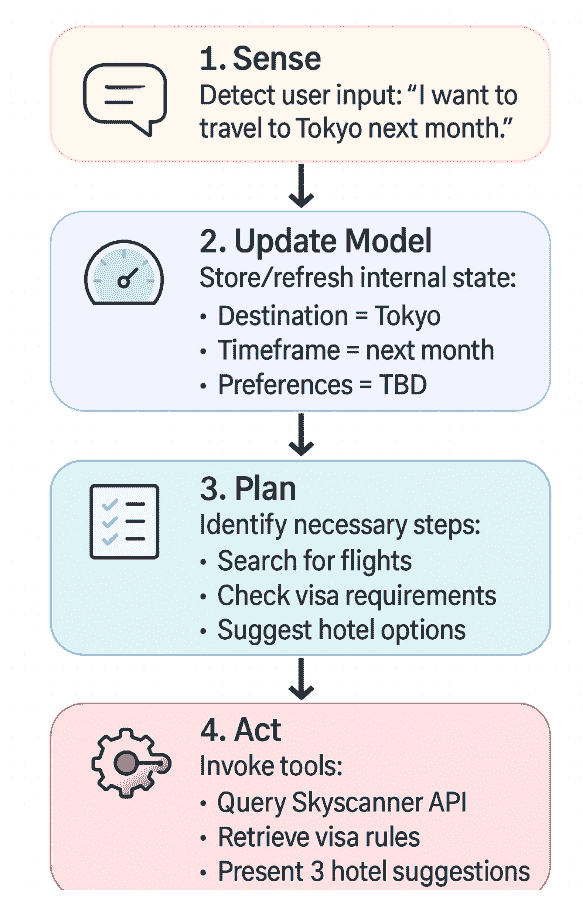

图 1.4 – 审慎代理体

### 审慎决策循环

过程始于感知，代理体感知其环境或接收输入。在图中，该输入以自然语言指令的形式出现：“我想下个月去东京。”这标志着一个复杂的决策循环的起点。代理体并没有立即反应，而是过渡到建模阶段，将用户输入解析为结构化数据。如目的地（“东京”）和时间范围（`next month`）等关键元素被提取并存储。某些偏好被标记为未知或待定，表明代理体必须在该领域寻求澄清或推断默认值。

接下来，代理体进入规划阶段。根据其内部状态和用户意图，它将高级目标分解为可执行的步骤。如图所示，代理体识别出搜索航班、验证签证要求以及建议酒店选项的需求。每个子任务都构建在一个更大的策略框架内，允许代理体评估各种路径，并选择既满足约束又符合目标的最佳行动序列。

最后，代理体执行操作。这一执行步骤并非盲目触发，而是审慎计算的结果。代理体查询 API——例如，通过 Skyscanner 获取航班选项、检查签证政策并提供个性化的酒店建议。这些行动是推理过程的结晶，而不仅仅是对提示的反应。

### 生产与安全

在生产环境中，这些输出通常受监控和验证流水线的约束，以确保它们是准确、合规且安全的。通常会采用输出过滤、事后验证模型和护栏（guardrails）等技术，在结果呈现给用户或下游系统之前检测幻觉或违反策略的行为。

### 优势与局限性

这种策略架构提供了许多优势。审慎代理体可以处理时间推理、模拟未来状态，并通过生成新的解决方案而非依赖预定义的规则来适应新情况。因此，它们在需要复杂多步决策的领域具有极高价值。应用包括车辆自动导航、财务规划工具、智能个人助手以及协调复杂组装序列的制造机器人。

在现实部署中，这些代理体通常配备了回退策略——例如默认的规则程序、到人工操作员的升级协议或简单的决策树——以处理规划失败或环境中的不确定性。这些安全措施确保了即使在策略计算崩溃时也能实现降级运行和持续的服务。

然而，这些能力引入了某些局限性。维护和更新内部模型需要大量的计算资源，规划阶段会引入延迟。如果代理体的内部模型准确不完整，其决策可能会下降；在某些边缘情况下，当面对超出其训练或假设的未知场景时，它可能会完全失败。

尽管如此，在决策质量高于即时性的背景下，审慎代理体的表现始终优于简单的架构。`Figure 1.4`中的示例说明了这些代理体如何整合感知、记忆、推理和执行，以跨多个子系统提供协调的响应。这使得审慎代理体在任何需要智能、自适应且目标一致的行为之处都是不可或缺的。

### 混合代理体：行动的分层智能

混合代理体代表了一类智能系统，它们将反应行为的快速响应能力与审慎推理的策略远见相结合。混合代理体不依赖于单一决策模型，而是采用分层架构，不同的子系统专门负责快速且独立上下文的响应或较慢的以目标为导向的规划。`Figure 1.5`显示了一个典型的混合架构，输入刺激同时通过反应和审慎处理层。

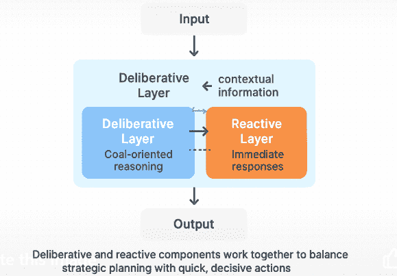

图 1.5 – 混合代理体

输入最初通过优先级分类机制进行处理和紧急性评估，该机制会评估时间限制、安全影响和任务关键性等因素。时间敏感型事件被直接路由到橙色所示的反应层，该层通过预定义的刺激-响应映射执行动作。这能够实现诸如避障、安全关或告警处理等即时行为。

在工程实践中，这种路由逻辑通常使用异步模式实现，事件总线（如`Kafka`、`NATS`）或消息队列（如`RabbitMQ`、`AWS SQS`），这允许代理将输入分类与响应执行解耦，同时在负载下确保可靠的交付和优先级排序。

与此同时，表现为蓝色的深思层从战略角度监控环境。它维护了关于目标、状态信息和资源限制的内部模型。该层负责高阶推理任务，如路径规划、多步执行、未来状态预测以及跨时间范围的优化。它可以通过调整阈值、修改程序或根据持续评估引入新目标，来影响或覆盖反应层的行为。

至关重要的是，这些层之间的通信是双向的。考虑一个正在导航投送包裹的仓库机器人：当机器人遇到意外障碍物（如掉落的箱子）时，其反应层会停止移动并启动避障动作。同时，这种障碍检测会触发到深思层的中断，深思层重新评估最佳投送路线，更新其内部地图，并在障碍物代表持续阻塞时可能决定请求人工协助。在此期间，深思层持续更新上下文信息——例如投送优先级或电池电量——这些信息会告知反应系统的参数，可能会根据紧急程度或剩余电量调整移动速度。`Figure 1.5`通过反馈箭头和在此类动态情境下激活的虚线路径强调了这些相互作用。

这种架构支持一种协调的输出机制，平衡了快速决策与长期目标之间的关系。最终动作作为一种协商的结果产生，通常根据当前的运行上下文从两个层综合得出。仓库机器人的示例展示了反应性避障如何与深思性路由优化并行运行，创建既安全又高效的无缝导航。

存在不同的实现模型来实现混合行为。基于抑制的系统可能将反应控制置于核心，并由战略规划层增强。其他设计使用仲裁机制，多个子系统提出动作，由控制模块根据优先级和环境条件选择最合适的动作。黑板架构（一种不同推理组件向公共工作空间贡献知识的共享内存系统）通过使用共享内存存储库进一步支持混合化，每个层都为集体决策空间做出贡献。

混合代理在需要灵活性的复杂环境中特别有效。在工业机器人领域，它们协调了即时停止机制与生产调度。在自动驾驶车辆中，它们在进行导航规划的同时管理避障。在网络安全中，新兴的混合代理模型旨在阻止实时威胁的同时评估更长期系统完整性——尽管大多数目前的实现侧重于基于规则的检测，自适应协调有限。混合方法代表了迈向动态、自我调节防御的下一步。智能助手也受益于这种模型，在提供即时用户响应的同时，保持上下文的连续性和任务记忆。

在这些场景中，性能限制通常是不可逾越的：机器人和自动驾驶车辆中，响应延迟必须保持在`100 ms`以内以避免安全风险，而网络安全代理必须在毫秒内检测并处理威胁以防止被利用。即使是智能助手也面临各种限制，例如在内存限制下维持会话一致性，以及在实时对话中平衡准确性与速度。

混合架构的模块化本质也支持维护性和可扩展性。每一层都可以独立地设计、测试和更新。然而，这种灵活性也引入了复杂性。层之间的协调需要仔细的资源分配、冲突解决协议和大量的测试，以确保在各种运行条件下行为稳定。调试混合系统可能具有挑战性，因为问题可能源于层交互而非单个组件。此外，维护多个推理系统的开销可能会影响性能并增加计算成本。

如`Figure 1.5`所示，混合代理代表了反应效率与深思深度的平衡。分层结构使系统在不牺牲结构化推理能力的情况下迅速行动——这是现代 AI 部署中的一项基本能力。在探索了使单个代理感知、推理和行动的基础架构后，我们现在转向使这些智能系统协同工作并与现有企业基础设施无缝集成的关键挑战。

## 互操作性协议

随着代理系统从孤立工具演变为分布式生态系统，它们与外部服务以及同类代理互操作的能力变得至关重要。`Interoperability protocols`通过为通信、委托和协调提供清晰的、合约驱动的接口，成为可扩展、模块化代理架构的基础。这些协议将代理与特定工具的逻辑解耦，支持异步编排，并允许分布式组件之间进行协作决策——即使这些组件是独立开发或维护的。

本节探讨了支撑代理互操作的两个基础协议类别：

* `Model Context Protocol (MCP)`：标准化了代理与工具、API 和数据源的交互。与其将特定工具的逻辑硬编码到每个代理中，`MCP`定义了一个通用接口层，允许代理动态地发现、评估和调用外部服务。工具通过元数据和能力定义进行注册，代理使用这些定义在运行时查询可用操作。这种抽象使得在不修改代理逻辑的情况下更换或升级工具成为可能。

* `Agent-to-Agent (A2A) Protocols`：定义了去中心系统中协作代理之间的消息传递接口。这些协议规定了代理如何通信意图、共享状态、交换角色以及同步任务进度。A2A 协议在多代理环境中特别重要，在这些环境中协调必须在没有中央控制的情况下进行。

这些协议共同构建了动态、可插拔且具韧性的系统，能够在跨能力和组织边界进行扩展。在真实的生产系统中，`versioning and schema management`对于确保长期稳定性至关重要。`MCP`和`A2A`等协议通常依赖于`contract-based designs`，使用`OpenAPI`规范、`Protocol Buffers`或`JSON Schema`等技术来定义消息格式和服务能力。对这些契约进行显式版本控制允许系统保持向后兼容，在代理与服务之间协商能力，并优雅地处理更新引起的不匹配。这确保了新版本的代理可以与旧组件及外部 API 安全地交互——这对于随着时间推移维护健壮且演化的系统至关重要。

## 模型上下文协议（MCP）

`MCP`定义了一个通用框架，代理通过该框架发现、评估并调用外部能力。如图 1.6 所示，`MCP`引入了一个`universal interface layer`来抽象外部服务，通过三个关键操作将其暴露：

* **能力描述**：每个工具都以机器可读的格式注册其功能和元数据（输入、输出、约束）。例如，一个简单的`JSON schema`可以定义天气检索工具的能力：


### 工具发现与调用

代理通过查询通用层，根据当前任务需求和能力元数据来识别合适的工具。具体流程包括：

- **发现**：代理查询通用层，根据当前任务需求和能力元数据识别合适的工具。
- **调用**：一旦选定工具，代理通过标准化协议调用它，而无需特定工具的集成。

```
{
  "name": "SearchFlights",
  "description": "Retrieve available flight options based on input parameters",
  "input_schema": {
    "type": "object",
    "properties": {
      "origin": { "type": "string" },
      "destination": { "type": "string" },
      "departure_date": { "type": "string", "format": "date" }
    },
    "required": ["origin", "destination", "departure_date"]
  },
  "output_schema": {
    "type": "array",
    "items": {
      "type": "object",
      "properties": {
        "airline": { "type": "string" },
        "price": { "type": "number" },
        "duration": { "type": "string" }
      }
    }
  }
}
```

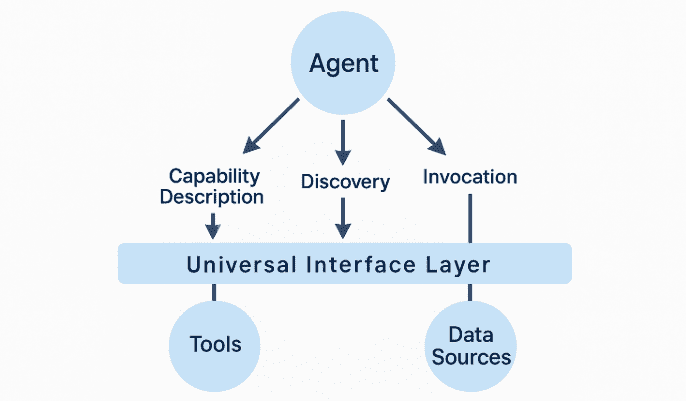

Figure 1.6 – 模型上下文协议

这种架构使得代理能够独立于硬编码的服务逻辑运行，实现了即插即用的集成。可以动态引入新工具，并在不影响代理核心逻辑的情况下更新旧工具。例如，执行产品研究的代理可以查询市场数据 API、评估情感分析器或调用摘要引擎——所有操作都通过同一种接口模式实现。`MCP` 还促进了跨代理的工具复用，确保工具注册不会在代理网络中重复。这创建了全组织范围的能力注册表，促进了标准化、治理和更快的集成周期。

### 代理到代理 (A2A) 协议

虽然 `MCP` 管理的是代理与服务之间的垂直交互，但 `A2A` 协议促进了对等之间的协作。这些协议格式化了在共享环境中运行的代理之间的消息交换，它们能够共享状态、分配角色并异步协调任务。在设计此类系统时，考虑各种一致性模型（例如强一致性、最终一致性）至关重要，以确保共享状态在代理之间得到适当同步，平衡数据完整性与性能需求。如图 1.7 所示，代理使用包含以下内容的结构化消息包进行通信：

- **状态 (State)**：包含代理共享的上下文数据和中间结果，以维持团队的情境感知。
- **角色 (Role)**：包含功能性定义和职责，定义了每个代理在协作工作流中的位置和能力。
- **状态 (Status)**：包含生命周期更新，包括成功、失败或就绪指示，让所有代理了解任务进度和系统健康。

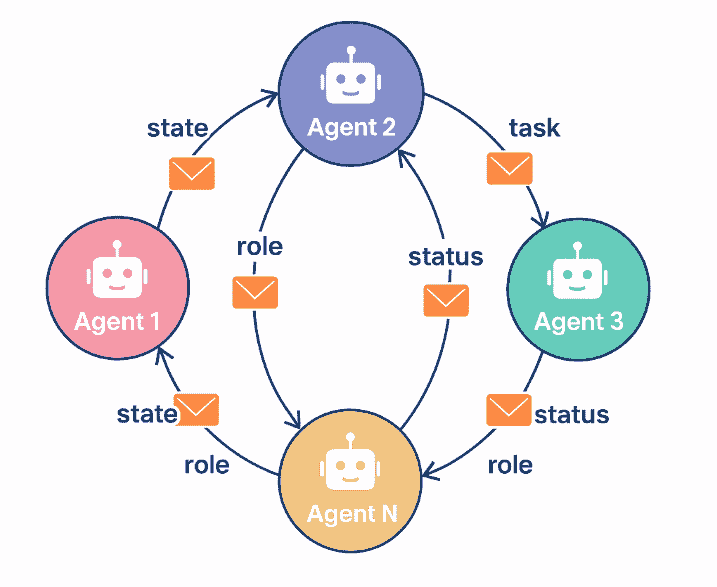

Figure 1.7 – 代理到代理协议

这种架构允许代理团队：

- 分配专门任务（例如研究、验证、质量保证）。
- 在保持协调的同时进行异步操作。
- 通过动态向备份代理分配角色来从故障中恢复。

例如，在客户服务自动化流水线中，分拣代理可能会将订单传递给账单专家，后者随后将案件转发给合规性验证器。这些交互在没有中心化编排的情况下发生——代理使用共享协议规则做出局部决策，促进了容错性、并行性和自愈工作流。诸如 `CrewAI` 和 `LangGraph` 等框架提供了对 `A2A` 模式的原支持，通过基于 Actor 模型、状态通道和发布/订阅消息实现结构化交互。流行的开源系统如 `NATS`、`RabbitMQ` 和 `Apache Kafka` 通常用于实现这些消息层，实现分布式代理之间可靠且可扩展的通信。在建立了对代理架构和通信协议的稳固理解后，我们现在检查通过结构化开发方法论将这些智能系统从概念推向生产的实际过程。

### 代理开发生命周期

自主代理的发展遵循一个结构化的迭代生命周期，这作为一个路线图——但它从根本上区别于传统的软件工程实践。与依赖静态逻辑和预定义行为的过程系统不同，智能代理必须在动态、不确定的环境中运行。它们解释模糊的输入，在不确定的情况下做出决策，调用外部工具并通过反馈不断完善其行为。这些演化的、目标导向的行为需要不仅是迭代的，而且是深度适应的生命周期模型——支持推理、学习、记忆和编排。代理开发生命周期（`ADL`）的设计是为了满足这一需求，提供了一个镜像现代基于代理系统操作复杂性的灵活框架。本节概述了 `ADL`——一个从早期概念化到部署后完善的实用框架。它为开发者和组织构建健壮、目标导向且随时间不断改进的代理系统提供了路线图。

接下来的子章节将详细探讨该生命周期的每个阶段，研究代理开发与传统软件工程方法不同的独特考虑和最佳实践。

#### 概念化与需求分析

智能体（Agent）开发始于定义问题空间并在上下文中阐述智能体的目标。这不仅仅是需求收集——它是一种对认知负荷的建模练习，意味着智能体为了智能运行而必须模拟或管理的心理过程。这包括跟踪用户意图、解释环境信号、选择合适的策略以及根据反馈更新计划——这些功能在传统上与人类认知相关。开发者必须分析特定领域，理解用户意图，并评估智能体有效运行所需的能力。与静态应用程序不同，智能体的目标可能会发生演变，并且必须具有足够的灵活性，以适应环境变化和新出现的需求。

在这一阶段，开发者会识别运行环境，将目标映射为可实现的子目标，并确定伦理、技术和操作边界。例如，一个协助合规的智能体可能需要对行为进行显式约束，这些约束既被编码到规则中，又在执行期间受到监控。重要的是，此阶段还包括评估成功指标——性能、对齐和用户信任——所有这些指标都指导未来架构和实施的决策。总而言之，概念化阶段的关键活动包括：

- 定义清晰的高层级智能体目标。
- 将这些目标映射为可实现的子目标或任务。
- 设定可衡量的成功指标（例如：性能、对齐、用户信任）以指导开发和评估。

#### 架构与设计

一旦目标界定清楚范围，就会设计智能体的内部架构来支持这些目标。正如在 `Architecture of agents` 部分讨论的，这包括在认知模型之间进行选择——例如 `ReAct`、`plan-and-execute` 或 `BDI`——并指定负责感知、计划、行动和学习的组件。架构必须在模块化、自主性和扩展性之间取得平衡。在此阶段，智能体设计师定义内存策略（短期、长期、事件性）、内部通信流以及与外部系统的交互点。同样重要的是，他们确保智能体能够通过既定协议进行互操作，并在会话之间持久化状态。安全和防护机制从一开始就被集成，而不是事后考虑。这一设计阶段形成了整个系统的概念和技术骨干。为了确保可追溯性和信息化迭代，许多团队采用`架构决策记录`（`ADRs`）来记录关键设计决策——例如选择特定内存模型、编排策略或协议框架的原因。这有助于未来的贡献者理解权衡，重新审视过去的假设，并在不丢失组织知识的情况下演进智能体架构。

#### 实现与集成

实现阶段使用 `LangChain`、`CrewAI` 或 `LangGraph` 等开发框架使架构恢复活力。开发者构建用于推理、感知、计划和内存的模块，并通过工作流图或事件驱动引擎将它们绑定。函数调用 API、内存数据库和编排层通过开源工具链缝合在一起。这里的重点是内聚性和正确性——模块必须以可预测的方式交互，智能体的行为必须符合定义的目标。开发者运行本地模拟或分阶段部署，以测试负载下认知组件的交互。正是在此时，真实世界的约束开始显现——延迟、上下文限制、token 使用率——并需要工程权衡来平衡能力与成本。为了支持稳健迭代，团队通常将智能体行为测试集成到 CI/CD 流水线中。这些流水线使用自动化测试框架、合成提示词和模拟失败案例来验证认知工作流（例如推理链、工具调用、内存使用），确保跨部署的稳定性并尽早发现回归。

#### 评估与优化

在测试或受控环境中部署后，必须对智能体进行严格评估。与传统系统不同，成功并非总是二元的。性能指标包括任务完成率、决策质量和在模糊情况下的稳健性。评估可能涉及合成环境或生产影子，并配有完善的日志记录和遥测管道。来自内部反思机制的反馈（如信心评分或批判循环）与用户满意度和工具性能等外部信号相结合。这些见解反馈回架构，实现自适应更改。此阶段的优化可能包括完善计划深度、调整上下文窗口策略或提高内存相关性评分。典型的优化指标包括`任务成功率`、`平均响应时间`、`用户满意度评分`、`工具调用延迟`和回退频率（智能体延迟或失败的频率）。跟踪这些指标允许团队根据性能和用户信任信号迭代改进智能体质量。

#### 治理与生命周期管理

部署不是智能体开发的结束，而是持续改进循环的开始。生命周期管理包括主动监控、日志审计、模型更新和故障恢复。治理还涵盖了安全补丁、合规审计和伦理监督——确保智能体保持可靠、透明并符合人类意图。此阶段涵盖监控和迭代改进过程。大规模部署的智能体必须支持可观测性和应急响应。诸如 `LangSmith` 或 `Prometheus` 等工具提供了对智能体性能和健康的实时洞察。此外，模型重训、版本控制和回滚策略确保系统更改是经过深思熟虑且可恢复的。基于性能数据、用户反馈和不断变化的需求持续迭代，确保了智能体在其运行生命周期内演进和改进。这对于金融、法律或医疗等任务关键领域至关重要，意外的行为可能会产生严重后果。例如，`LangSmith` 或 `Prometheus` 的日志可能会显示工具调用成功率下降或幻觉输出增加。这可以触发告警、启动人工审查，并导致提示词设计、微调甚至底层模型重训的调整。纳入这种循环——从`可观测性到审计到重训`——对于构建生产环境中韧性的智能体至关重要。

### 交互范式的演进

随着 AI 系统日益融入我们的日常生活和企业工作流，理解智能体交互的级别对于设计稳健、可扩展且智能的架构变得至关重要。这些级别代表了智能体能力的演进——从基础的提示响应交互到协作的分布式智能体网络。五级交互范式框架为沿三个关键维度分析智能体设计提供了一种结构化方法：操作自主性、上下文感知和决策权限。它帮助系统架构师、开发者和利益相关者就哪种智能体架构最适合其用例做出明智决策。以下五个模型说明了这种演进，每个模型都基于一个代表性图形，并由其交互模式、处理能力和架构复杂度定义。为了帮助系统设计师快速评估和比较不同层级的智能体复杂度，下表在自主性、上下文感知和决策权限等关键维度上总结了五种智能体交互范式。

| **级别** | **代理类型** | **操作自主性** | **上下文感知** | **决策权限** | **典型用例** |
| :--- | :--- | :--- | :--- | :--- | :--- |
| 1 | 直接 LLM 交互 | 无状态 / 无 | 无 | 人类主导 | 一次性问答、创意生成 |
| 2 | 代理代理 (Proxy Agent) | 低 | 轻量级上下文化 | 基于指令 | API 参数化、语义翻译 |
| 3 | 助手系统 | 中等 | 基于会话 | 用户引导 | 数字化助手、工具增强型聊天 |
| 4 | 自主代理 | 高 | 持久化内存 | 部分自主 | 任务规划、研究助手 |
| 5 | 多代理系统 (MAS) | 极高 | 共享 + 分布式 | 分布式自主性 | 供应链、编排、仿真 |

表 1.1 – 跨关键架构维度的智能体交互范式对比

#### 直接 LLM 交互：无状态的对话者

这一基础层代表了代理参与的最基本形式，用户通过自然语言提示直接与 `LLM` 交互。这些交互是无状态的，没有对之前输入的记忆，且跨轮对话没有持久上下文。如 `Figure 1.9` 所示，用户输入类似“加拿大的首都是？”的查询，`LLM` 立即回答“渥特华”。图表通过禁止图标强调了内存的缺失，表明模型孤立地处理每个提示。它没有内部上下文跟踪，没有任务历史，也没有对话线程。

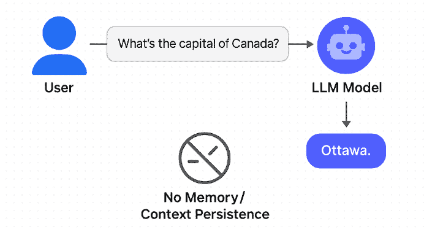

图 1.9 – 直接 LLM 交互

这种方法在事实性问答、创意内容生成或一次性辅助等轻量级场景中表现出色。然而，它管理多步交互、维护用户状态或完成目标驱动的工作流方面存在局限性。缺乏内存或自适应反馈机制意味着这些系统无法构建长期上下文或参与真正的对话行为。典型的无状态 `LLM` 交互看起来是单个提示产生一次性响应，且对之前的查询没有记忆：

```python
from openai import OpenAI
client = OpenAI()
response = client.chat.completions.create( model="gpt-3.5-turbo", messages=[ {"role": "user", "content": "What is the capital of Canada?" ] )
print(response.choices[0].message.content)
```

直接 `LLM` 交互的现实示例包括：

- **基于聊天的问答系统**：例如零售网站上回答事实问题的聊天机器人——“你们的营业时间是什么？”或“我的订单在哪里？”。
- **创意写作工具**：如 `Jasper` 或 `Sudowrite` 等应用程序，它们根据提示生成单段落或想法。
- **教育闪卡助手**：回答离散学术问题的系统，例如“解释牛顿第一定律”，用于快速学习参考。

#### 代理代理 (Proxy agent)：智能中介

代理代理代表了智能系统架构中一种基础但往往被低估的模式。与维护状态或调用外部工具的自主或多轮代理不同，代理代理关注一个更窄但至关重要的责任：将非结构化的用户输入转换为适用于后端系统的结构化可执行格式。其核心，代理代理充当了语义中介。当用户提交如“寻找我附近的餐厅”之类的请求时，代理代理不会立即将其转发到服务端点。相反，它充当翻译器——注入额外的上下文、消除模糊术语、清理输入，并将查询重新格式化为结构化表示。这种设计不仅提高了精确性和可靠性，还保护了依赖于严格模式或预定义参数集的下游系统。

代理代理遵循定义良好的处理流程。首先，它捕获用户输入。这些输入通常是自由格式的自然语言，本质上具有模糊性或不完整。然后代理将此输入集成到结构化的提示模板中。该模板包含了对底层语言模型的指令以及动态数据（如用户查询或上下文元数据）的占位符。完成提示后，代理调用语言模型（例如 `OpenAI` 的 `GPT` 或 `Anthropic` 的 `Claude`），并接收结构化响应——通常是 `JSON` 或 `SQL` 格式。最后，将此结构化结果转发到目标服务或执行层。为了更好地理解其工作原理，请考虑以下示例场景：用户问道：“寻找我附近正在营业的餐厅。”

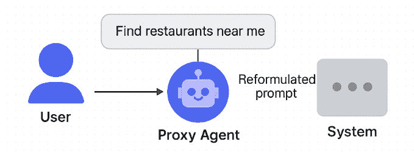

图 1.10 – 代理代理

代理代理不会直接将此消息传递给餐厅发现 API。相反，它通过结构化转换流水线处理请求，将自然语言转换为机器可读的格式。

##### 实现示例

以下代码演示了代理代理如何实现从自然语言到结构化数据的转换：

```python
from langchain.prompts import PromptTemplate
from langchain.chains import LLMChain
template = """
You are a proxy agent responsible for translating natural language into structured queries.
User input: "{query}"
Return a JSON object with the following fields:
- intent: 要执行的操作。
- location: 推断或陈述的位置。
- time_filter: 指明查询是否包含时间限制。
- format: 响应格式（例如，'list'）。
仅用 JSON 回答。
"""
prompt = PromptTemplate(input_variables=["query"], template=template)
chain = LLMChain(prompt=prompt, llm=openai_chat)
response = chain.run({"query": "Find restaurants near me that are open now"})
```

##### 结构化输出

执行时，该实现产生一个干净、结构化的响应，下游系统可以可靠地处理：

```json
{
    "intent": "search_restaurants",
    "location": "current_user_location",
    "time_filter": "open_now",
    "format": "list"
}
```

此结果现在是干净、上下文丰富且完全结构化的——非常适合调用 API 或传递给下游规划器。模板确保了一致性，而语言模型提供了语义推理，以推断缺失的信息（如位置元数据或时间过滤器“正在营业”）。对于生产环境，其他考虑因素至关重要：

- **输入清理**：实施稳健的输入清理，以防止提示注入攻击或恶意/格式错误的用户输入导致意外模型行为。
- **日志记录**：提示、响应和执行时间的详细记录对于调试、审计和理解代理在现实场景中的行为至关重要。
- **监控提示响应时间**：持续监控 LLM 调用的延迟，以确保代理符合性能 SLA 并提供响应的用户体验。


# 代理系统

代理代理（proxy agents）能够在自然用户意图与硬性系统需求之间充当控制层，这使得它们在安全关键或受模式限制（schema-bound）系统中成为理想选择。例如，它们被广泛应用于金融服务平台以验证和转换客户端指令，应用于医疗系统将患者查询处理为结构化的分诊协议，并在客户服务工具中执行后端操作之前对请求进行清洗。重要的是，代理代理还能缓解与提示词注入（prompt injection）或指令操控相关的风险。由于提示词模板定义了清晰的结构并将用户内容与系统指令隔离开，开发者可以对模型解释和处理每个输入的方式实施严格边界限制。虽然代理代理不管理内存或启动长期计划，但它们作为输入优化器的角色对于构建稳健、可信且达到生产级的 AI 系统至关重要。在任何后端服务期望严格输入但用户以自然方式通信的架构中，代理代理都能以清晰的控制力弥补这其中的差距。

代理代理充当翻译员的角色，将自然语言输入转换为后端执行的结构化数据。它们的现实应用场景包括：

- **语音转命令处理**：如`Google Assistant`等虚拟助手，将“播放我的健身歌列表”转换为指向音乐服务的结构化 API 调用。
- **表单填写与处理机器人**：医疗机器人接收患者的自由文本症状，并将其重新格式化为医生提供的结构化分诊报告。

## 助手系统：工具增强型帮手

助手系统代表了智能系统的一次重大进步，它结合了会话级内存、工具调用和用户引导的自主性。这些代理不仅能够解释用户请求，还可以访问外部工具或服务，并调用它们来完成任务。在`Figure 1.11`中，用户请求“预订去巴黎的机票”。助手系统解释此指令并调用相应的服务——如机票 API、预订数据库或日历工具——来执行任务。图中显示助手作为一个`task orchestrator`，能够通过工具调用路径与外部系统交互。

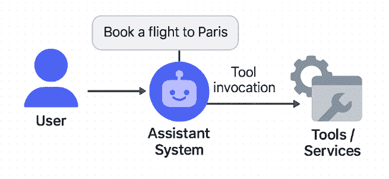

图 1.11 – 助手系统

助手在多个回合之间维持会话状态，实现了对话的连续性、澄清处理和结果总结。然而，它通常在“用户参与（user-in-the-loop）”的批准模式下运行，在采取完成预订或启动交易等影响性行动之前寻求确认。例如，如果用户先说“我想下周五飞往巴黎”，随后补充说“再订一个埃菲尔铁塔附近的酒店”，助手在处理新命令时会保留早的机票请求和目的地上下文。这种跨回合跟踪和应用会话变量（如目的地和日期）的能力允许助手以连续且精确的方式完成多步任务。这种模型对于企业级数字助手、智能客服机器人以及需要受控自主和操作透明的个人生产力代理非常理想。助手系统将自然语言理解与工具调用及有限会话内存相结合。它们在实践中的示例包括：

- **企业级数字助手**：如`Microsoft Cortana for Business`，它可以帮助跨不同的企业系统安排会议、管理电子邮件并获取文档。
- **客户服务机器人**：银行中的智能虚拟助手，可以访问用户账户数据，处理简单交易（如余额查询、资金转账），并在需要时升级人工人工服务。
- **Notion AI 及类似的生产力代理**：这些工具可以搜索数据库、总结项目笔记或创建结构化内容模板，超越了单次交互限制以支持真正的生产力。

## 自主代理：独立的问题解决者

自主代理标志着智能系统设计中的关键演变。自主代理超越了依赖分步用户输入的响应式工具或助手式界面，它们具备独立行动的能力——解释目标、对策略进行推理、调用工具并根据变化动态调整行为。这种独立性使它们能够以类似于人类认知解决问题的方式执行复杂的、长期的任务。然而，自主性的增加也引入了风险——在缺乏足够监督运行的代理可能会误解目标、追求意料之外的策略或触发不良操作。因此，此类策略约束、人工参与（human-in-the-loop）检查点或行为监控机制对于确保敏感领域的可靠性至关重要。

它们架构的核心是`SMPA loop`——这是一个镜像智能决策过程的概念框架。在这个循环中，代理首先感知其环境，这可能包括用户输入、内部状态变化或外部 API 响应。这些信息馈入一个维护上下文内存、跟踪历史操作并表示代理对任务空间理解的模型中。随后，代理通过将高级目标分解为可操作的步骤来制定计划，并根据依赖关系和约束进行排序。最后，它通过执行这些步骤、与外部系统、API 或工具交互并根据需要调整方法来采取行动。

考虑用户发出指令“规划我的巴黎之行”的情景。传统的助手可能会回复一个静态的机票列表或酒店选项，而自主代理会将此请求解释为多阶段目标。它启动一个包含行程生成、酒店选择、签证资格评估和旅游保险购买在内的过程。该代理不是孤立地处理每项任务，而是构建一个连贯的计划，识别依赖关系——例如，在确定机票订单之前确定签证要求——并端到端执行工作流。

在整个过程中，代理维持着持久的内部内存。它记住了用户的偏好（例如偏好的航空公司或住宿类型），并利用这些知识来完善决策。如果首选酒店已满，它会搜索符合相似标准的替代住宿。如果签证申请过程出现意外延迟，代理将相应地重新安排行程中的相关元素。这些调整并非硬编码的，而是源于评估成败并实时修订策略的反馈循环。

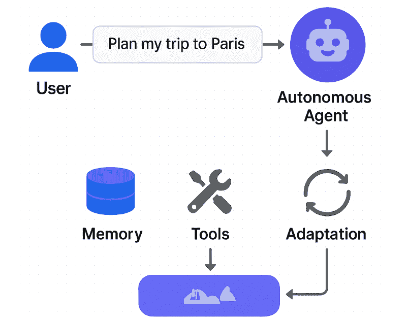

图 1.12 – 自主代理

从技术角度来说，这类智能体在使用`LangGraph`、`LangChain`和`CrewAI`等现代框架构建。`LangGraph`允许开发者将智能体的推理结构化为有向图，并带有状态转换和上下文保留。`LangChain`提供了抽象，将语言模型与工具连接起来，使智能体能够搜索网络、调用 API 或与数据库交互。`CrewAI`则促进了专门智能体之间的协作——一个处理物流，另一个专注于合规性，还有另一个负责管理通信。这些框架共同支持了异步执行、健壮的错误处理以及现实世界中的扩展性。

在实践中，自主智能体正越来越多地部署在广泛的领域。在研究领域，它们实现了文献综述的自动化、实验方案的生成并将发现合成报告。在业务领域，它们协调多步工作流、管理入职流程或执行营销活动。在自适应学习环境中，它们制定个性化学习计划、监控进度，并根据学习者的表现调整节奏。它们持久上下文和自主改进行动的能力，使其在那些需要持续关注、动态响应和以结果为导向的执行的系统中特别有价值。

因此，自主智能体不仅仅是能力更强的助手——它们是独立的解决者。凭借在长时间跨度并在极少监督下进行计划、推理、行动和适应的能力，它们代表了向不仅遵循指令而且理解目标的系统迈出的一步。随着这种能力的成熟，自主智能体正准备重塑数字工作的格局，改变我们处理各行业复杂问题的方式。

自主智能体在长的工作流中独立地创建计划、做出决策并执行任务。它们的能力涵盖了目标设定、工具调用、内存管理和自适应行为。在现实世界，我们越来越多看到这些智能体部署在不同的领域。一些显著示例包括：

- **研究助手**：能够自主进行文献综述、总结关键发现并生成详细报告的 AI 系统——释放研究人员从事更高层次的分析。这些智能体减少了人工开销，并能够跨数千篇论文或来源扩展研究合成。
- **客户支持机器人**：对入入的用户请求进行分类，访问数据库或 CRM 系统检索答案，并在必要时将未解决的问题升级。这些机器人在帮助减轻人类工作负载的同时，提高了首次响应的效率。
- **金融分析师**：自主智能体收集市场数据，应用基于规则的模型或机器学习预测，并准备投资摘要或警报——支持时间敏感环境中的决策支持。
- **IT 运维智能体**：部署在 DevOps 环境中，这些智能体监控系统指标、检测异常，并根据预设的阈值和模式启动修复操作（例如重启服务或扩展基础设施）。

为了评估这些智能体在生产环境中的有效性，使用了几个`关键性能指标`（`KPIs`）：

- **任务完成率**：在无人工干预的情况下完成的任务的百分比。
- **平均响应时间**：完成任务或响应请求所需的时间。
- **事实准确性/一致性**：在研究和数据密集型领域尤为重要。
- **升级率**：需要人工兜底的任务百分比。
- **用户满意度评分**：基于调查、星级评分或重复使用等行为信号。

这些指标不仅有助于衡量成功，还为优化周期和信任校准提供信息——确保自主性不仅强大，而且是可靠、负责任且符合用户需求的。

### 智能体系统：协作智能

智能体交互的顶点是`多智能体系统 (MAS)`——这是一个分布式框架，其中多个自主或半自主智能体协作以实现复杂目标。这些系统将认知责任分配给专门的智能体，每个智能体都具有特定领域的角色、能力和通信协议。

在`图 1.13`中，用户提交了一个任务——`分析数据`，该任务被分配到智能体网络中：`Agent A`（数据检索）、`Agent B`（数据清洗）和`Agent C`（数据可视化）。中心显示了一个共享状态存储，允许智能体进行通信、交换结果并维护整个系统的一致性：

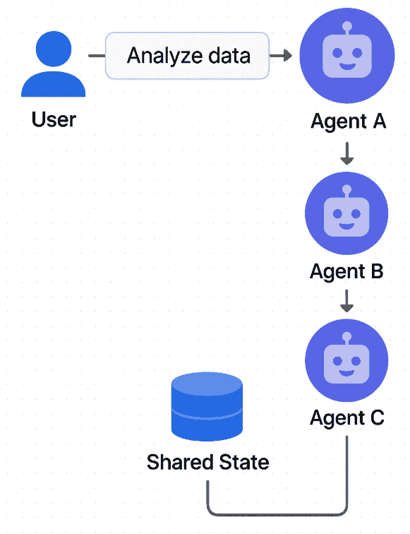

图 1.3 – 多智能体系统

这种协作模型实现了并行、冗余和领域专门化。MAS 架构通常依赖`发布-订阅消息系统`（智能体向感兴趣的订阅者广播更新）、`共享内存模型`（所有智能体可访问的中心化数据存储）或`任务调度协议`（将工作分配给可用智能体的系统方法）来管理交互。根据系统设计目标，智能体可能由中央主管协调，或作为完全去中心化的节点运行。

为了确保健壮性，这些架构通常包含容错机制，例如智能体健康检查、看门计时器，或在智能体崩溃或无响应时重新分配任务。某些系统在关键角色上采用冗余智能体或兜底智能体，以确保长时间工作流的连续性。这种弹性在现实世界的部署中至关重要，因为硬件、网络或软件故障可能会意外地发生。

多智能体系统是企业编排、科学研究平台、智能供应链网络和分布式 AI 基础设施的理想选择，在这些领域模块化、扩展性和健壮性关键。多智能体系统的特点是专门智能体团队协作处理单一智能体无法处理的广泛或动态的复杂任务。示例包括：

- **自动驾驶汽车**：如 Waymo 车队中的系统，感知（检测障碍物）、导航（寻找路线）和安全（避免碰撞）智能体协同工作。
- **金融交易平台**：如`Citadel`等对冲基金使用协调的 AI 智能体——市场分析、风险管理、情感分析——每秒执行数千次交易。
- **智能家居编排**：AI 统一控制恒控器、灯光和安全——根据温度变化或安全状态调整灯光。
- **医疗诊断**：`IBM Watson for Oncology`，多个 AI 智能体分析患者数据、建议治疗方案并标记可能的药物相互作用。

# 智能体成熟度

这种演进模型使技术人员和业务负责人能够评估当前的实施情况，识别能力差距，并规划向日益复杂的智能体系统迈进的战略。该框架建立了五个不同的智能体成熟度级别，每个级别都代表了智能系统运行方式及其交付价值的质变。

## 级别 0：手动操作 — 非智能体系统

在这一基础阶段，系统内部不存在任何智能或自动化。所有操作都需要人类直接启动、执行和监督。上下文解释、决策和执行完全取决于人类的认知努力，数字系统仅作为工具，而不是工作流中的活跃参与者。**示例**：财务分析师手动准备月报、人力资源人员手动输入新员工数据，以及客服代表逐一回复每封邮件。

## 级别 1：响应式智能体 — 基于规则的自动化

响应式智能体引入了由简单条件逻辑管理的预定义确定性行为。这些系统根据特定触发通过预设动作做出响应，以无状态、无上下文的方式运行。虽然对于参数明确的常规任务有效，但响应式智能体缺乏对新情况的适应能力，或从经验中学习的能力。**示例**：发送模板回复的自动邮件响应器、提取数据并输入表单的机器人流程自动化（RPA）机器人，以及根据语音命令控制智能家居的基本语音助手（如 Amazon Echo）。

## 级别 2：工具型智能体 — 增强执行

在此级别，智能体变成了半智能协调器，能够与外部服务接口并调用专用工具。这些系统可以解析自然语言指令，根据上下文选择合适的工具，并链联多个操作以完成定义的目标。虽然仍限于基于会话的上下文和明确指令，但它们通过工具组合展示了涌现能力。**示例**：从扫描 PDF 中提取信息并上传到数据库的文档处理系统、从多个源汇总数据的自动报告生成器，以及从广泛知识库中提取答案的智能帮助台系统。

## 级别 3：规划型智能体 — 上下文与目标导向

规划型智能体引入了复杂的推理能力和目标驱动行为。这些系统将高级目标分解为结构化的任务序列，结合中间步骤的反，遇到障碍时调整计划，并在长时间的操作中保持持续感知。这一级别代表了自主决策和战略思维的重大进步。**示例**：动态预订机票、酒店和活动的自主旅行规划智能体；为新员工协调文档提交和培训计划的数字入职助理；以及根据团队可用性和进度调整时间表的智能项目管理系统。

## 级别 4：学习型智能体 — 自适应与进化

学习型智能体代表了演进框架中最高级别的别。这些系统不仅执行复杂计划，还通过经验随时间进化其能力。它们整合过去的交互反馈，为个人用户或场景开发个性化模型，适应环境变化，并根据观察结果和明确指导不断完善策略。

该演进框架为组织提供了一种结构化方法，用于评估当前的智能体能力，识别战略开发优先级，并规划符合业务目标的能力路线图。通过了解系统在成熟度模型中的位置，领导者可以对技术投资、开发优先级和智能体 AI 的实施策略做出明智决策。**示例**：学习用户偏好并随时间不断改进的个性化推荐引擎；随攻击模式变化而进化的高级欺诈检测系统；以及设计并进行科学实验、根据实验结果完善其假设和方法的自主研究智能体。

该框架为理解智能体演变提供了概念基础，并为实施提供了战术蓝图。对于研究人员来说，它与响应式系统、分层规划和强化学习等范式保持一致。对于从业者来说，它提供了清晰的示例和部署考虑，阐明了从手动流程向智能自适应系统过渡的路线图。通过了解系统在成熟度模型中的位置，领导者可以对技术投资、开发优先级和智能体 AI 的实施策略做出明智决策。

在建立了智能体工程的理论基础和评估智能体成熟度的框架后，我们现在检查这些概念如何转化为切实的业务价值。以下真实世界的案例研究表明，自主智能体不是未来的可能，而是当今的收入驱动力，从根本上改变了组织在各自市场中运营和竞争的方式。同时，**伦理护栏**——如透明性、问责制、公平安全——必须引导此类智能体的部署。随着自主性的增加，意外行为、偏差传播或违反法规的风险随之增加。将这些原则整合到设计和治理中，可以确保智能体不仅产生影响，而且以符合组织价值观和社会预期的方式来实现。

# 现实世界的业务影响

忘记理论抽象吧——自主智能体正在重塑各行业，为早期采用者带来可衡量的回报和竞争优势。这些不是实验性原型或学术奇事，而是产生收入的系统，正在改变业务运营、服务客户以及将其能力扩展到传统限制之外的方式。

## Quandri：自动化保险革命

保险处理曾意味着大量人员在纸质森林中挣扎。Quandri 通过部署自主智能体网络打破了这一范式，该每天处理数千份保单。以前需要数小时熟练劳动力的工作现在在 15 分钟内解决，系统保持着惊人的 99.9% 准确率。这不是渐进式的改进——而是规模化的转型，每月产生超过 30,000 美元的经常收入，而竞争对手仍陷入劳动力密集型的工作流中。配备智能体技术的精简团队现在系统性地优于其规模数倍的传统运营，从根本上重写了保险处理的经济学。

## My AskAI：30 支持奇迹

金融服务支持通常意味着令人沮丧的等待、不一致的答案和升级地狱。My AskAI 的智能体架构通过将专用组件（文档分析、合规验证和实时数据检索）协调为一个统一的认知系统，在 30 秒内解决复杂的查询。这不仅仅是更快的服务；这是一种不同类别的体验，驱动了每月 25,000 美元的经常收入和超过 99% 的客户满意度评分。系统的战略智能确切知道何时自主处理问题，以及何时升级给人类专家，为习惯于传统服务模式的用户创造了感觉超自然的无缝支持体验。

企业机器人通过多智能体协作从根本上重新定义了销售运营。它们不再仅仅自动化孤立的任务，而是部署了专业的智能体团队来处理整个销售周期——从线索富化和筛选到个性化触达和会议协调。结果极具说服力：合格线索的生成增加了三倍，而获取成本下降了 50%，推动年度经常性收入超过 200 万美元。这不仅仅是自动化；这是能力的倍增，让人类销售人员能够完全专注于高价值的关系建立，而他们的数字孪生则全天候、有条理地追求机会。正如这些案例所示，智能体技术不是未来的考虑因素，而是当下的竞争决定因素。利用复杂的智能体系统的组织与依赖传统自动化的组织之间的差距不断扩大，这形成了一种市场动态：传统方法无论执行质量如何，都无法与智能体驱动的方案在经济效益、速度和扩展性上竞争。信息很明确：这关非渐进式的改进，而是现代业务运营可能性的根本性转变。

# 总结

本章确定了现代智能体工程的基础概念。我们探索了 AI 智能体如何从简单的响应式系统演变为能够感知、推理、规划、行动和学习的复杂自主实体。通过对智能体架构的审查，我们看到了模块化组件如何协作创建出能够有效导航并响应复杂环境的系统。我们介绍智能体开发周期提供了一种设计、实现和持续改进的结构化方法，而我们对智能体能力的探索阐明了实现目标导向行为的认知功能。我们引入了根据交互水平和开发成熟度对智能体分类分类框架，为理解和推进智能体技术提供了路线图。通过研究设计模式、机器教学方法和现实业务应用，我们将理论原理与实际实现联系起来。我们概述的智能体类型分类法——从响应型到学习型智能体——展示了智能体架构的多样方法，并突显了基于智能体的解决方案的灵活性。随着我们的推进，这些基础将成为后续章节中讨论的更高级概念和实现的重要基石。智能系统的未来将越来越具有智能体化（agentic），自主 AI 准备改变我们在人类活动几乎每一个领域中工作、创造和解决复杂问题的方式。在建立了智能体工程的概念基础后，我们将转向使这些概念变为现实的实用工具、框架和模型。`第 2 章`将探索快速发展的智能体开发技术生态系统，提供为您的特定智能体实现需求选择和利用正确组件的全面指南。从`LangChain`和`AutoGPT`等开发框架，到语言模型选择策略和基础基础设施组件，接下来的章节提供了一个将智能体理论转化为工作系统的实用工具包。
