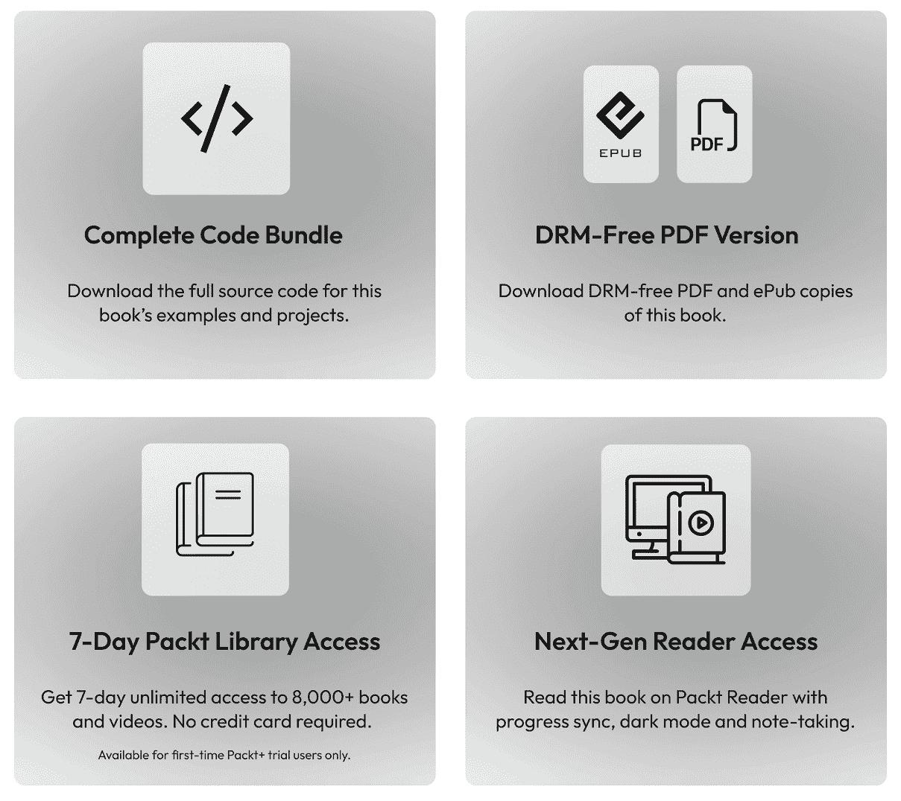

# 贡献者

# 作者简介

Eden Marco 是 Google Cloud 的 LLM 专家和 LangChain 大使，拥有多年软件工程和云架构经验。他是 Orca Security 的首批工程师之一，拥有以色列理工学院计算机科学学士学位，并在 Reichman University 任教。Eden 基于真实世界的经验创建实用的、生产就绪的课程。

# 审稿人简介

Pablo Garner 是 Champions (UK) plc 的 IT 和 AI 主管，负责基础设施建设和 AI 驱动的内部平台开发。他在 IT 和计算领域拥有八年以上经验，专注于应用 AI、自动化和云架构。他正在完成 NVIDIA AI 工程师六级课程，并作为外部红队研究员为 Anthropic 的 AI 安全研究项目做出过贡献。Pablo 构建智能体驱动系统，并在 p4blo.dev 分享他的工作，专注于实际 AI 实施。

> 感谢 Packt 团队给我担任技术审稿人的机会，也感谢我的伴侣 Jade 和孩子们 Storm 与 Saint 的支持与鼓励。

Iago Cavalcante 是一名充满热情的软件开发者，关注技术对人们生活和业务产生的影响。他使用 Elixir、React、React Native、Vue.js 和 TypeScript 进行开发，专注于可扩展性和代码质量。他居住在巴西贝伦，共同创立了 DevsNorte，这是一个致力于发展当地技术生态系统的社区。他相信回馈社区：分享和向他人学习越多，作为专业人士和个体成长得就越多。他参与开源项目协作并撰写技术文章以分享知识。他是 Enzo 的骄傲父亲，也是 Karla 的丈夫，他将家庭视为每一项成就背后的基石。他热爱交流想法、倾听不同观点并持续学习。

# 通过实战学习更进一步

如果您想超越从书籍中学习基础知识，请查看我们的实战研讨会，它们提供来自全球知名讲师的清晰、实时、实用的指导，并有机会解答您的疑惑。

新研讨会每两周新增一次。

扫描下方二维码查看即将举办的研讨会并注册以获取独家优惠和折扣。


# 前言

生成式 AI 和编码代理正在迅速改变软件的构建方式。Claude Code、Cursor 和 LangChain 深度代理等工具不再局限于简单的基于提示词的交互。它们可以在整个代码库中操作，集成外部工具，并执行长时间运行的多步骤工作流。随着这些系统变得越来越强大，理解它们如何工作以及如何控制它们变得至关重要。

本书专注于建立对 `Claude Code`、代理工作流以及使现代编码代理高效运行的底层概念的深刻且实用的理解。贯穿全书的核心主题是上下文工程，它解释了代理在推理和行动时如何构建、管理和使用上下文。随着代理变得更加复杂和工具驱动，恰当的上下文处理直接影响性能、成本、可靠性和一致性。

在本书中，您将学习 `Claude Code` 如何与代码库交互，如何对其进行配置以供日常使用，以及如何使用 `Model Context Protocol` (`MCP`) 对其进行扩展。您将探索 `GitHub Actions` 自动化、结构化规划、多代理工作流、子代理、输出样式和代理技能。本书还深入探讨了架构层面的主题，包括深度代理如何运作以及长时程工作流在实践中如何实现。

本书不仅关注表层用法，更旨在帮助您理解这些系统的设计原理以及它们为何会表现出此类行为。通过将实用示例与深层架构洞察相结合，旨在赋予您有效使用现代编码代理的技能，以及随着领域持续演进所需的适应性理解。

# 本书适读对象

本书面向希望超越基于聊天的 AI，利用 `Claude Code` 和 `MCP` 构建代理化、自动化开发工作流的开发人员和工程师。适合具有软件工程经验的应用程序开发人员，他们希望将上下文感知的 AI 代理集成到终端和 IDE 中，自动化复杂的编码任务，并设计可扩展的多代理系统。

对于与现代开发工作流紧密协作的 AI 工程师和生成式 AI 从业者，本书也将大有裨益。

为了最大程度地利用本书，您应具有使用 `Python` 或 `TypeScript` 编写和调试代码的经验，熟悉 `Git` 和开发环境的使用，并理解 `LLMs`、`RAG` 和代理等核心生成式 AI 概念。本书非入门级读物，假设读者具备软件开发经验。

# 本书内容

* 第 1 章，《上下文工程》，介绍上下文工程并解释其在构建现代 AI 代理时为何至关重要。涵盖上下文如何从提示词工程演变而来，如何在复杂系统中增长，以及不当的上下文处理如何影响性能和成本。本章还探讨系统提示词以及使用 `Claude Code` 进行实用上下文管理的方法。

* 第 2 章，《`Claude Code` 要点》，提供 `Claude Code` 的实用介绍，并解释其如何与代码库交互。涵盖项目初始化、`CLAUDE.md` 文件、权限和上下文管理。本章还介绍 `MCP`、规格驱动设计，并开始构建贯穿全书的 HookHub 项目。

* 第 3 章，《`Claude Code` 入门——核心命令速览》，专注于配置 `Claude Code` 以供日常使用。涵盖定价和认证、斜杠命令、用户级和项目级配置，以及与 `Cursor` 的集成。本章还探讨钩子、检查点、自定义命令，以及语言服务器协议的作用。

* 第 4 章，《使用 `MCP` 服务器和插件扩展 `Claude Code`》，解释 `Model Context Protocol` 及其如何标准化 AI 应用程序与外部工具之间的集成。涵盖 `MCP` 架构，包括主机、客户端和服务器，并演示如何配置本地和远程 `MCP` 服务器。本章还涉及上下文管理、性能考量和基于插件的扩展。

* 第 5 章，《使用 `Claude Code` 和 `GitHub` 自动化开发工作流》，探讨 `Claude Code` 与 `GitHub` 之间的集成。涵盖仓库配置、拉取请求和议题自动化，以及用于工作流执行的 `GitHub Actions`。本章还解释 `YAML` 工作流文件如何定义事件驱动的自动化。

* 第 6 章，《`Claude Code` 规划与多代理工作流》，探讨使用规划和协调多代理执行的结构化代理工作流。解释规格驱动开发如何提高可预测性，以及多个代理如何在同一代码库中协作。

* 第 7 章，《使用 `Claude Code` 子代理》，介绍 `Claude Code` 子代理，并解释它们如何实现结构化和隔离的工作流。涵盖自定义子代理配置、上下文流，以及使用无限代理循环模式进行并发执行。

* 第 8 章，《创建和自定义输出样式》，探讨输出样式如何塑造 `Claude Code` 的响应。涵盖创建和限定自定义样式的作用域、诸如 `YAML` 之类的结构化格式，以及在样式定义中自动化行为。本章还解释如何管理角色和会话配置。

* 第 9 章，《理解代理技能》，探讨代理技能作为扩展 AI 代理能力的机制。涵盖基础概念、在 `Claude Code` 和 `LangChain DeepAgent` 中的实用用法，以及调用技能时的内部上下文流。本章以一个真实的实现示例结束。

* 第 10 章，《使用 `Claude Code` 桌面版》，解释如何在桌面应用程序中使用 `Claude Code`。涵盖本地模式和云模式之间的切换、使用 `Git` 工作树运行并行代理，以及跨环境协调特性分支。

* 第 11 章，《理解深度代理》，探讨深度代理及其在长时程任务执行中的作用。定义深度代理的特征，并分析 `LangChain` 深度代理框架，包括其架构和执行模型。

# 如何最大程度利用本书

本书假设读者具备软件开发经验和生成式 AI 概念。开始阅读前，您应能熟练使用 `Python` 或 `TypeScript` 编写和调试代码，从终端运行程序，并操作代码库。需要具备基本的 `Git` 知识，如克隆仓库和提交更改。您还应了解虚拟环境和环境变量。

需要熟悉 `大语言模型` (`LLMs`) 以及代理、`RAG` 和 `ReAct` 等核心概念。您应曾与 `LLM` 交互过，并至少构建过一个简单的代理。本书不涵盖入门级编程或生成式 AI 入门主题。

为跟随实操示例，您需要一个配备 `Node.js` 和简单 `Next.js` 设置的开发环境（早期章节会介绍）。您还需要访问 `Claude Code` 并完成相应的认证和定价配置。部分需要安装和配置 `GitHub CLI`、操作 `GitHub` 仓库并使用 `GitHub Actions`。后续章节涉及配置本地和远程 `MCP` 服务器，以及在 `Cursor` 和 `Claude` 桌面应用程序中运行 `Claude Code`。


建议您按照示例逐步操作，并在介绍配置时进行尝试。本书内容循序渐进，多章依赖于前文建立的项目和设置（包括 HookHub 项目）。

本书包含的示例和截图改编自作者的原始课程材料，引用了为教学目的创建的代码库。

## 免责声明

本书为独立出版物，与 Anthropic, PBC 或其任何子公司或关联公司无任何关联、背书、赞助或官方关联关系。“Claude”、“Claude Code” 和 “Anthropic” 为 Anthropic, PBC 的商标或注册商标。书中提及的所有其他商标均为其各自所有者的财产。

作者为 Google LLC 员工。然而，本书为个人项目，不代表 Google LLC、Google Cloud、Alphabet Inc. 或其任何子公司或关联公司的观点、意见或官方立场。本书未获 Google 以任何形式背书、赞助或官方关联。“Google”、“Google Cloud” 及相关标识为 Google LLC 的商标。

本书内容仅基于作者的个人经验、独立研究和公开文档。书中表达的观点、意见和解读仅代表作者个人，不代表 Anthropic PBC、Google LLC 或任何其他组织的官方立场、策略或意见。

尽管已尽最大努力确保所呈现信息的准确性和完整性，作者不对内容的完整性、准确性、可靠性或适用性作出任何明示或暗示的保证或陈述。AI 工具及其相关 API、功能和特性发展迅速，本书信息出版后可能过时。

对于因使用或依赖本书所含信息而直接或间接引起的任何损害、损失或后果，作者和出版商概不负责。建议读者查阅 Anthropic 官方文档 [`docs.anthropic.com`](https://docs.anthropic.com) 以获取最新、最权威的信息。

## 下载示例代码文件

本书包含完整的可下载代码包，涵盖所有章节使用的示例项目和文件。建议下载该代码包，以便顺利跟随学习并试验示例。

将该代码包作为实践起点。对其进行修改、扩展，并在阅读各章节的过程中应用所学，创建自己的变体。

### 获取代码包

**如果您直接从 Packt 购买了本书：**

1. 访问 `packtpub.com`
2. 点击 **个人资料图片** 并选择 **您的订单**
3. 找到本书并点击 **下载代码**

**如果您从 Amazon 或任何其他渠道合作伙伴处购买了本书：**

1. 访问 [packtpub.com/unlock](https://packtpub.com/unlock) 或扫描以下二维码

   

2. 搜索本书
3. 注册或登录您的免费 Packt 账号
4. 上传购买凭证并在本地下载代码包

**使用须知：** 您可自由使用和修改此代码用于个人学习和非商业项目。

## 下载彩色图片

我们还提供包含本书所用截图和图表彩色版本的 PDF 文件。您可在此下载：[`packt.link/gbp/9781806022595`](https://packt.link/gbp/9781806022595)。

## 本书约定

本书使用多种文本约定。

`CodeInText`：表示文本中的代码词、数据库表名、文件夹名、文件名、文件扩展名、路径名、虚拟 URL、用户输入和 X/Twitter 账号。例如：“通过初始化 `CLAUDE.md` 文件来完成此操作，以便将其添加到项目上下文中。”

代码块如下所示：

```
add_context() {
  local context_ref="$1"
  grep -qxF "$context_ref" "$CLAUDE_MD" || echo "$context_ref" >>
    "$CLAUDE_MD"
}
```

任何命令行输入或输出均按如下方式书写：

```
npx create-next-app@latest
```

**粗体**：表示新术语、重要单词或屏幕上出现的单词。例如，菜单或对话框中的单词会以此形式出现在文本中。例如：“暂时选择 **Yes**，并选择本会话期间不再询问。”

> **警告/重要提示**
>
> 警告或重要说明显示为此样式。

> **提示/技巧**
>
> 提示和技巧显示为此样式。

# 联系我们

欢迎读者反馈。

**一般反馈**：若您对本书任何方面有疑问或有一般性反馈，请发送邮件至 `customercare@packt.com`，并在邮件主题中注明书名。

**勘误**：尽管我们已竭尽全力确保内容准确，但错误难免。若您发现本书有误，烦请报告给我们。请访问 [`www.packt.com/submit-errata`](http://www.packt.com/submit-errata)，点击 **提交勘误** 并填写表单。

**盗版**：若您在互联网上发现我方作品的任何非法副本，烦请提供网址或网站名称。请联系 `copyright@packt.com` 并附上相关链接。

**有意成为作者**：若您在某主题有专长，并有意撰写或参与著作，请访问 Packt 官网了解详情。

## 分享您的想法

读完《Agentic Coding with Claude Code》后，我们非常期待听到您的想法！扫描下方二维码直达本书的 Amazon 评价页面，分享您的反馈。


[`packt.link/r/1806022591`](https://packt.link/r/1806022591)

您的评价对我们和技术社区至关重要，将帮助我们确保持续提供优质内容。

# 随书免费福利

本书附带免费福利，旨在支持您的学习并帮助您有效应用所学知识。立即激活以获取即时访问权限（激活步骤见“如何解锁”部分）。

以下是购买本书可即时解锁的福利速览：



## 如何解锁

扫描二维码（或访问 [packtpub.com/unlock](https://packtpub.com/unlock)），按书名搜索，确认版本，然后按照页面步骤操作。


