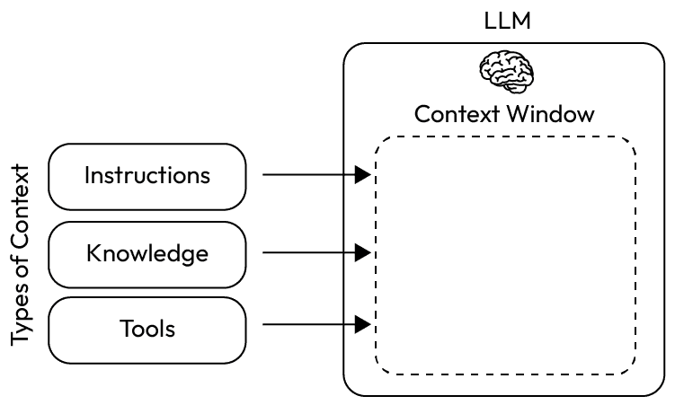
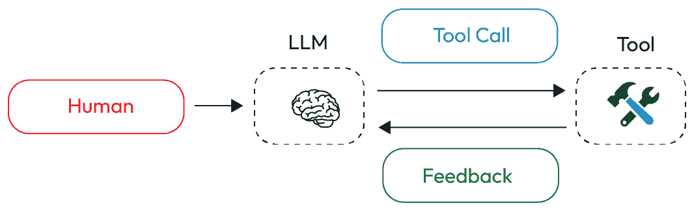
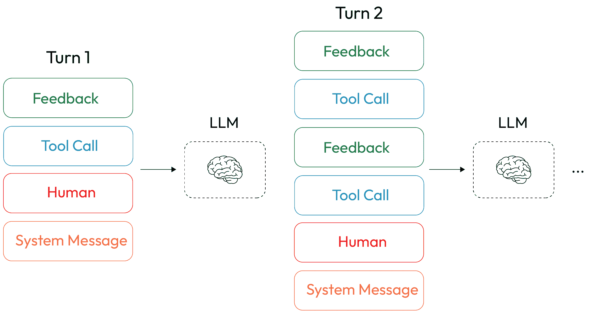
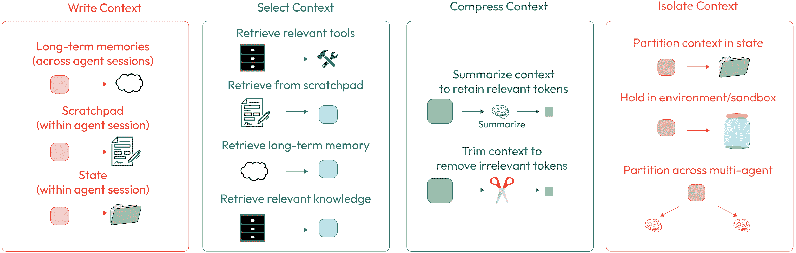

# 1 上下文工程


# 上下文工程简介

在本节中，我们将深入探讨什么是上下文工程。如果你一直在使用 AI 代理，可能还涉及 `Cursor` 和 `Claude Code` 等编码代理，或者你甚至为公司或个人用途开发过 AI 代理，你可能知道这一切归根结底就是向 LLM 发送一个提示词，并在其周围进行大量的工程化工作。

称 `Cursor` 和 `Claude Code` 等应用仅仅是围绕 LLM 的*封装*确实有几分道理。然而，构建真正优秀的封装需要大量的深度知识和大量的工程工作。另一个常用于指代这种环绕系统的术语是 *agent harness*（代理框架/挽具）。框架是围绕 LLM 的编排层。它负责管理工具调用、控制代理循环、处理错误、执行护栏机制，以及**最重要的是**，决定在每一步将什么上下文发送给模型。

在实践中，大多数真正的工程工作并不在 LLM 调用本身内部，而是在其周围。模型调用通常很简单。决定代理能否可靠工作的是周围系统如何管理状态、工具、记忆和上下文。这是因为对 LLM 的调用总是伴随着上下文，而这些上下文来自各种来源和正在进行的进程。

例如，上下文可能来自多个地方：

*   它可以来自应用程序的开发者
*   它可以来自用户
*   它可以来自用户的过往交互、工具调用或其他外部数据

每天都会增加新的上下文来源，上下文的数量也在不断增加。将正确且相关的上下文发送给 LLM 并不像早期我们想象的那么简单。

## 从提示词工程到上下文工程

在早期，我们认为提示词工程就足够了。我们以为编写一些花哨的提示词就能解决问题，给我们想要的结果。然而，问题在于提示词是静态的，而上下文是极其动态的。

如果上下文是动态的，那么构建正确的上下文也需要一个动态系统。这不再仅仅关乎编写静态提示词。这就是我们进入**上下文工程**领域的原因。它是提示词工程的自然演进，但它是一个深得多的概念。

### 为什么上下文对代理至关重要

我们都知道 “*垃圾进，垃圾出*” 这句格言。这是代理系统表现不如预期的最常见原因之一。它们只是没有被提供正确的上下文。

LLM 无法读取我们的思想。我们需要给它们正确的信息。顺便说一句，这不总是仅指信息或数据。有时我们需要给它们正确的工具，以便它们获取其他信息、采取行动并为我们执行任务。



图 1.1 – LLM 上下文窗口（改编自 LangChain 讨论的概念，www.langchain.com）

LLM 在推理方面变得越来越强。我们有了工具调用，并且可以构建运行工具、调用工具、获取输出并循环直到任务完成的 AI 代理。



图 1.2 – LLM 工具调用循环（改编自 LangChain 讨论的概念，www.langchain.com）

然而，当涉及到长期运行和复杂的任务时，我们经常会累积来自工具调用的反馈。

这导致上下文窗口不断增长，被工具调用结果和中间输出填满。



图 1.3 – 多轮对话中的上下文增长（改编自 LangChain 讨论的概念，www.langchain.com）

这会导致几个问题：

*   上下文窗口可能超出其大小限制
*   成本和延迟增加
*   代理性能开始下降

如果不采取措施，这种退化是不可避免的。最近的讨论探讨了长上下文在实践中为何会失败，以及随着无关或冲突信息的累积，退化如何逐渐显现。欲了解更深入的讨论，请参阅 Dan Breunig 的这篇优秀博客 “*How Long Contexts Fail*” ([`www.dbreunig.com/2025/06/22/how-contexts-fail-and-how-to-fix-them.html`](https://www.dbreunig.com/2025/06/22/how-contexts-fail-and-how-to-fix-them.html))。如果允许上下文在没有结构、选择或控制的情况下增长，代理系统中将开始出现各种问题，例如：

*   **上下文中毒**：当工具调用或 LLM 调用产生的幻觉进入上下文并开始影响未来的输出
*   **上下文混淆**：当不必要的上下文影响响应，即使它与任务无关
*   **上下文冲突**：当上下文的不同部分相互矛盾

在下一节中，我们将讨论更好的上下文工程技术。其中一些技术由应用程序开发者实现，例如在 `Claude Code` 等工具中。其他技术则在用户端。

作为 `Claude Code` 的用户，我们对最终发送给 LLM 的上下文以及我们收到的回答有很大影响。这意味着即使是非开发人员，如果想从 AI 系统和 AI 代理获得更好的响应，也需要理解上下文工程。

`Claude Code` 等编码代理是上下文工程技术如何同时应用于开发者端和用户端的绝佳例证。这正是我们将在下一节中探讨的内容，以及如何更好地设计我们的上下文。

# Claude Code 及其上下文工程策略

在本节中，我们将讨论 `Claude Code`、其上下文工程理念，以及 `Claude Code` 如何应对这些挑战。`Claude Code` 通过实现所有四种方法来应用这些上下文工程策略，它们如下：

*   **编写上下文**：持久化记忆系统
*   **选择上下文**：智能上下文检索与注入
*   **压缩上下文**：高效的上下文表示与摘要
*   **隔离上下文**：多代理与作用域上下文管理




Figure 1.4 – Categories of context engineering (adapted from concepts discussed by LangChain, www.langchain.com)

让我们从第一个策略开始。

## 策略 1：编写上下文与持久化记忆

第一个策略是**编写上下文及其持久化记忆架构**。Claude 拥有多层记忆系统，Claude Code 实现了三层记忆层级，在使用 Claude Code 编码时，能跨会话持久化上下文。

*   首先是**项目记忆** (`./CLAUDE.md`)。这是团队共享的上下文，包含项目架构、规范或与特定项目相关的任何内容。这类记忆受版本控制，所有团队成员均可访问。

    ```
    # Project Context
    
    ## Architecture Overview
    This is a microservices application using:
    - Node.js with Express for API services
    - React with TypeScript for frontend
    - PostgreSQL with Prisma ORM
    - Redis for caching
    
    ## Coding Standards
    - Use functional components with hooks
    - Implement error boundaries for all route components
    - Follow RESTful API conventions
    - Write unit tests for all business logic
    ```

*   然后是**用户记忆** (`~/.claude/CLAUDE.md`)。这存储在用户的主目录下的 `claude` 目录中的 `CLAUDE.md` 文件内。它包含该用户在所有项目中的个人偏好和快捷方式。它不会提交到 GitHub，且专属于特定用户。每个用户在此处的值都不同，且会跨越所有 Claude Code 会话持久保存。

    ```
    # Personal Development Preferences
    
    ## Code Style
    - Always use explicit return types in TypeScript
    - Prefer const assertions over type annotations
    - Use descriptive variable names, avoid abbreviations
    
    ## Workflow Shortcuts
    - When writing tests, use Jest with React Testing Library
    - Always run `npm run lint` before commits
    - Prefer composition over inheritance
    ```

*   最后是**动态记忆导入**。这些允许我们使用 `@` 符号和语法从其他记忆文件导入内容。这类似于将常规上下文加载到 Claude Code 中，但这一次我们可以拥有包含特定信息的专用记忆文件，并在我们的记忆文件中引用它们。

    ```
    # In any CLAUDE.md file
    @path/to/memory/file.md
    @./relative/path/context.md
    @~/global/user/context.md
    ```

我们还可以通过编写脚本，根据 Git 分支动态更新上下文来自定义行为。然后将此脚本连接到上下文切换钩子，构建更具适应性的工作流。

一个需要牢记的重要细节是，我们应避免重复向 `CLAUDE.md` 追加相同的上下文引用。如果脚本在每次运行时仅使用 `>>`，文件将因重复条目而无限增长。为防止这种情况，我们添加了一个小的保护措施，在追加前检查上下文引用是否已存在。

以下是避免重复导入的改进版脚本：

```
# Script to dynamically update context based on git branch
#!/bin/bash
# context-switcher.sh
# Dynamically load relevant context based on user query
# Safe against duplicate imports

CLAUDE_MD="CLAUDE.md"

# Create CLAUDE.md if it doesn't exist
touch "$CLAUDE_MD"

add_context() {
  local context_ref="$1"
  grep -qxF "$context_ref" "$CLAUDE_MD" || echo "$context_ref" >> "$CLAUDE_MD"
}

# --- Branch-based context ---
branch=$(git branch --show-current 2>/dev/null)

case $branch in
  "feature/auth-"*)
    add_context "@./context/auth-system.md"
    ;;
  "feature/payment-"*)
    add_context "@./context/payment-flow.md"
    ;;
  "hotfix/"*)
    add_context "@./context/production-hotfix.md"
    ;;
esac

# --- Query-based context ---
user_input="$1"

if [[ -n "$user_input" ]]; then
  if [[ $user_input == *"database"* || $user_input == *"migration"* ]]; then
    add_context "@./context/database-context.md"
  elif [[ $user_input == *"API"* || $user_input == *"endpoint"* ]]; then
    add_context "@./context/api-context.md"
  elif [[ $user_input == *"frontend"* || $user_input == *"component"* ]]; then
    add_context "@./context/frontend-context.md"
  fi
fi
```

关键变化在于 `add_context` 辅助函数。它使用 `grep -qxF` 检查上下文引用是否已存在于 `CLAUDE.md` 中。如果存在，则不追加任何内容。这使得脚本具有幂等性，可安全地在每次提交提示词时运行。

然后我们将此脚本连接到钩子：

```
{
  "hooks": {
    "UserPromptSubmit": {
      "command": "./scripts/context-switcher.sh \"$PROMPT\"",
      "description": "Dynamically load relevant context based on branch and user query"
    }
  }
}
```

通过此设置，上下文切换变得动态，且随时间推移保持稳定。

## 策略 2：智能上下文检索

第二个策略是**智能上下文检索**，通常通过动态上下文发现实现。

Claude 会自动浏览文件夹以查找有用的上下文文件。如果我们位于子文件夹中，它也会从父文件夹拉取上下文，但在有更具体信息可用时，会优先使用具体信息。它还会优先考虑最近使用和频繁访问的信息。

这是应用层面的上下文工程，由 Claude Code 开发者实现此逻辑。不过，用户也可以使用 `/memory` 命令自行添加持久化上下文。例如：

```
/memory add Always use descriptive variable names
```

Claude 会提示询问此记忆应存储在项目级还是用户级，并自动更新相应的 `CLAUDE.md` 文件。这使用户无需手动编辑上下文文件即可影响未来行为。

根据所使用的工具，不同的上下文会被传播给 LLM。例如，当 Claude Code 即将编辑文件时，它会自动记起先检查现有代码风格、在创建新函数前查找现有函数等事项。这是与编辑工具相关的上下文。

另一个例子是，当 Claude Code 即将运行终端命令时，它会记起不同的事项，例如在运行命令前检查是否有现有的 `npm` 脚本，或在执行前确保文件路径存在。

## 策略 3：上下文压缩

第三个策略是**上下文压缩**，关乎高效的上下文表示。Claude Code 包含内置压缩命令。

*   `/clear` 命令重置当前上下文窗口的对话历史，同时保留底层的项目记忆和用户记忆。当正在进行的对话走向无益，或您想在不丢失系统已学到的项目知识的情况下开启全新交互时，这非常有用。

*   `/compact` 命令将现有对话总结为更短的形式。它保留关键决策和重要信息，丢弃次要细节，而不是抛弃所有内容。这种压缩后的历史占用更少的上下文窗口，从而降低成本和延迟，并为模型腾出更多空间处理新输入。

## 策略 4：使用子代理隔离上下文

第四个策略是上下文隔离。为此，Claude Code 使用子代理。每个子代理在其独立的上下文窗口中运行，不会继承主代理完整的对话历史。此策略旨在为不同任务提供不同的专业版 Claude Code，每个版本拥有自己的聚焦知识库。


与其让 Claude Code 试图一次性用所有信息处理所有事情，不如创建专门的子代理，作为不同领域的专家。我们可以有一个主 Claude 代理，充当管理者并委派任务。我们可以有一个代码审查代理，专注于代码质量和安全；一个测试代理，专注于编写和运行测试；还有一个研究代理，专注于查找信息和最佳实践。示例如下：

```
// 代码审查代理 – 聚焦上下文
Task(
  description: "Code review",
  prompt: "Review this PR focusing only on security and performance",
  subagent_type: "code-reviewer"
)

// 研究代理 – 广泛上下文
Task(
  description: "Research implementation",
  prompt: "Find best practices for OAuth2 implementation",
  subagent_type: "general-purpose"
)
```

这很有帮助，因为如果没有隔离，Claude Code 会试图一次性用所有可能的信息处理所有事情而感到困惑。有了隔离，每个专家都有特定的知识范围，并利用它有效地完成工作。

上述语法仅为演示目的的说明性简化。Claude Code 目前并不使用这种确切格式。实际上，定义子代理需要包含前言部分的 YAML 配置，我们将在本书后面介绍。

# 系统提示词及其重要性

在本节中，我们将讨论系统提示词及其在上下文工程中的重要性。您可能在 X 和 LinkedIn 上读过无数遍：系统提示词很重要，您应该研究它们、迭代它们，使其变得非常好。说“拥有一个好的系统提示词”可能是 AI 工程中最通用的建议。

有几个公开仓库收集了知名 AI 代理使用的系统提示词示例。这些仓库通常汇总公开共享或公开讨论过的提示词。许多示例聚焦于编码代理，如 `Claude Code`、`Cursor` 和 `Devin`，但也可能包含其他代理风格系统的提示词。

引用这些仓库的目的不是为了验证每个提示词的真实性，而是为了说明在实践中，大型、结构化且经过精心设计的系统提示词通常是什么样子。

本节的目标不是详细分析每个提示词或解释每种使用的技术。我们可以专门写一整本书或开一门课程来讲系统提示词。

我的重点是向您展示系统提示词很重要。系统提示词在不断演进。随着 LLM 演进，系统提示词也随之演进。大量工程精力投入到了策划这些提示词并使其变得越来越好。这是一个迭代过程。

## 编写系统提示词的最佳实践

让我们谈谈策划和编写系统提示词时的一些最佳实践。这就像给某人指路。

如果我们说“往那边走”，他们会困惑，不知道该去哪里。但如果我们给他们一本 50 页的手册，里面有每一个可能的转弯和街道，我们用信息淹没了他们，他们仍然到不了需要去的地方。

所以，我们要清晰、具体，并给予刚好足够的信息让他们到达目的地。困难的部分在于找到那个最佳平衡点。

### 系统提示词的“黄金区间”

编写系统提示词时，我们要寻找 Anthropic 所谓的 **黄金区间**。不要太模糊，也不要太详细，恰到好处。

您可以把这想象成一个刻度。在最左边，提示词太具体。在最右边，提示词太模糊。我们想要的正是正中间。


Figure 1.5 – 系统提示词的黄金区间（来源：Anthropic, "Effective Context Engineering for AI Agents," https://www.anthropic.com/engineering/effective-context-engineering-for-ai-agents）

让我们细分分析。

#### 过度具体提示词的问题

在最左边，我们有非常具体的提示词。这里的核心问题是我们将 LLM 视为确定性状态机，而不是智能代理。我们硬编码逻辑。

例如，我们可能会说：如果用户意图是事故解决，问三个后续问题。*为什么恰好是三个？两个够不够？万一需要五个呢？*

我们还看到穷举枚举，试图列出每一种可能的升级场景。这不可能完成，且强迫模型走预设路径，可能与实际输入不匹配。这也变成了维护噩梦，因为每个新边缘情况都需要修改提示词。

那时，如果一切都是预设的，也许我们甚至不需要自主代理。也许确定性工作流就足够了。

#### 过度模糊提示词的问题

在光谱的另一端，我们有非常模糊的提示词。这里的核心问题是它们为一致性行为提供的信号不足。

在这些提示词中，我们经常看到没有可执行的指导。例如，考虑以下提示词：

> *你是一家面包店的助手。你应该以符合公司品牌原则和精髓的方式尝试解决客户的问题。如果需要，升级给人工。*

那些原则是什么？

还有错误的共享上下文假设。提示词假设模型了解公司、品牌和客户服务规范，但实际上它并不了解。

我们还看到未定义的边界，如“如果需要，升级给人工。”何时需要？模型无从得知。

没有系统地解决问题的框架或结构。这导致行为不一致，同一个问题在不同运行中产生截然不同的处理方式。本质上，提示词在说“做正确的事”，却不定义什么是“正确”。

#### 优秀的中间地带提示词长什么样

现在看看中间地带。考虑以下示例：

> *你是 Claude 面包店的客户支持代理。*
>
> *你专门协助客户处理订单和回答关于面包店的基本问题。使用可用工具高效且专业地解决问题。*
>
> *你可以访问订单管理系统、产品目录和店铺政策。你的目标是在可能的情况下快速解决问题。在提出解决方案前，先通过理解完整情况开始，如果不理解，请提出后续问题。*
>
> *响应框架：*
>
> 1. *识别核心问题 – 透过表面投诉，理解客户真正需要什么*
> 2. *收集必要上下文 – 在响应前，使用可用工具验证订单详情、检查库存或审查政策*
> 3. *提供清晰解决方案 – 提供具有现实时间线的具体后续步骤*
> 4. *确认满意度 – 确保客户理解解决方案，并知道如果需要如何跟进*
>
> *指导原则：*
>
> *   *当存在多种解决方案时，选择最简单且能完全解决问题的一个*
> *   *如果用户提到订单，在建议后续步骤前检查订单状态*
> *   *调用 `human assistance tool`*
> *   *对于法律问题、健康/过敏紧急情况，或需要超出标准政策的财务调整的情况，调用 `human assistance tool`*
> *   *察觉用户语气中的沮丧或紧迫感，并以适当的同理心回应*

您可以看到以下几点：

*   这里我们首先提供清晰的身份和范围。这立即建立了边界。是客户支持，不是市场或销售。涵盖订单和基本问题，不涉及复杂业务运营。


