# 2 Claude Code 要点

本章将通过演示其在实践中的工作方式，帮助您熟悉 Claude Code。我们不会直接跳入高级功能，而是从构建对系统本身的理解、它所使用的术语以及它与代码库交互的方式入手。在此过程中，您将看到 Claude Code 如何观察项目、构建上下文，并利用该上下文来协助编码任务。

## 核心原则

*   **我们也赋能而非限制。** 我们不规定在每种情况下必须使用的确切工具，而是定义一个目标，例如高效且专业的解决方案。这里的启发式方法是，我们信任代理在需要时选择合适的工具。
*   **我们也提供推理框架而非流程图。** 此处遵循一个四步响应框架：识别核心问题、收集必要上下文、提供清晰的解决方案、确认客户满意度。这种框架应适用于各种场景，而非僵化的分支逻辑。
*   **最后，我们也确立了清晰的边界和原则。** 例如，如果有多种解决方案，选择最简单的一个。这是一种启发式方法，而非规则，类似于计算机科学中的贪婪算法。

过于具体的提示词试图替 LLM 思考，且在情况不符合脚本时会失效。模糊的提示词则没有给 LLM 提供足够的工作素材。

中庸的提示词利用了现代 LLM 真正擅长的能力：识别模式并将通用原则应用于特定情境。它能很好地处理新情况，因为它教授的是原则而非规则。它很高效，因为它不浪费词汇。每条准则都涵盖多种场景。原则经过压缩，且不存在重叠或相互矛盾的指令。

# 摘要

在本章中，我们介绍了上下文工程，并解释了为什么它对于构建可靠且可扩展的 AI 代理至关重要。我们探讨了上下文与静态提示词的区别、上下文的来源，以及为何不管理上下文会导致性能下降、幻觉和行为不一致等问题。以 Claude Code 为实际案例，我们探讨了四种核心上下文工程策略：通过持久化记忆写入上下文、动态选择相关上下文、压缩上下文以保持可控、以及使用专用子代理隔离上下文。我们还讨论了系统提示词的作用，展示了有效的提示词如何在过于僵化和过于模糊之间取得平衡。至此，您应该对现代 AI 代理如何管理上下文以及开发者和用户如何影响其行为有一定了解。在下一章中，我们将在此基础上进一步构建，开始处理更高级的代理工作流，使用 HookHub 项目来探索 Claude Code 如何协调任务、管理上下文，以及超越简单的单步交互进行操作。

在下一章中，我们将深入了解 Claude Code 及其与代码库的交互方式。

# 获取本书的 PDF 副本、代码包等

扫描二维码（或访问 <https://packtpub.com/unlock>）。按名称搜索本书，确认版本，然后按照页面上的步骤操作。


> **注意：** 请准备好发票。直接从 Packt 网站购买不需要发票。

# 2 Claude Code 要点

本章将通过演示其实际工作方式，帮助您熟悉 Claude Code。我们不会直接跳入高级功能，而是从构建对系统本身的理解、它所使用的术语以及它与代码库交互的方式入手。在此过程中，您将看到 Claude Code 如何观察项目、构建上下文，并利用该上下文来协助编码任务。

我们首先设置一个简单的 Next.js 项目并将其与 Claude Code 集成。这为我们探索 `CLAUDE.md` 文件、权限系统以及为何有意识地管理上下文至关重要等概念提供了实用途径。我们还将探讨如何通过 `Model Context Protocol (MCP)` 使用外部工具扩展 Claude Code，以及这在日常工作流中能实现什么。

本章还介绍了规格驱动设计，作为在编写任何代码之前指导 Claude 行为的一种方式。通过创建和引用规格说明，我们可以影响所获得结果的质量和一致性。作为这一过程的一部分，我们开始构建一个名为 HookHub 的项目。您在此构建的 HookHub 项目将贯穿全书，并在我们后续进入更高级的代理工作流时充当共享参考点。

本章将涵盖以下主题：

*   设置 Next.js 项目
*   将 Playwright MCP 连接到 Claude Code
*   使用规格驱动设计
*   使用规格驱动设计实现主页面

好了，让我们开始吧！

## 安装 Claude Code

在继续之前，请确保您的机器上已安装 Claude Code。

Claude Code 现在提供原生安装程序，可检测您的操作系统并自动安装相应版本。请遵循官方安装指南：

<https://code.claude.com/docs/en/setup#native-install-recommended>

安装程序会根据您的机器类型处理设置和更新。安装完成后，您可以通过运行以下命令进行验证：

```
claude --version
```

确认 Claude Code 安装正确后，继续进行下面的 Next.js 设置。

本章中的所有终端命令均在 macOS 上演示。如果您使用 Windows，应在 `WSL`（`Windows Subsystem for Linux`）或同等的类 Unix Shell 环境中运行这些命令。这可确保 `npx`、`npm`、`claude` 和其他 CLI 工具等命令按示例所示运行。

## 设置 Next.js 项目

在本节中，我们将手动设置 Next.js 项目。虽然可以提示 Claude 创建 Next.js 项目，但我由于本地权限问题和需要预先处理的配置，选择手动操作。对于倾向于让 Claude 操作的读者，只要给予正确的语法，Claude 完全有能力运行这些 Bash 命令。

我们首先设置一个 Next.js 项目。您可以遵循官方 Next.js 安装指南 (<https://nextjs.org/docs/app/getting-started/installation>) 或粘贴以下命令：

```
npx create-next-app@latest
```

从以下截图可以看出，我们位于 `project/HookHub` 分支。

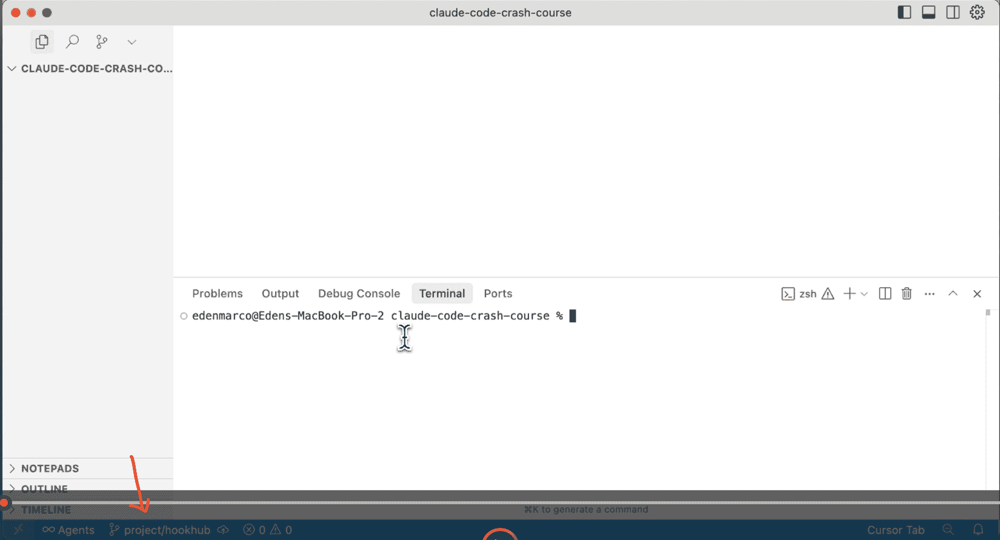

我们粘贴命令并搭建 Next.js 项目。您将看到如下所示的继续选项：

```
edenmarco@Edens-MacBook-Pro-2 claude-code-crash-course % npx create-next-app@latest
Need to install the following packages:
create-next-app@15.4.6
Ok to proceed? (y)
```

粘贴命令后，您可能会遇到错误。这是因为当前用户没有在系统上全局安装包所需的权限。

有两种解决方法。一种是使用 `sudo` 运行命令。另一种是调整 `npm` 权限，以便在无需提升权限的情况下进行安装。为求简便，我们使用 `sudo` 重新运行命令，这将授予必要的权限。

使用正确权限执行后，Next.js 项目搭建成功进行。系统将提示您确认配置选项。选择默认选项并继续。随后将安装依赖项并生成 Next.js 项目的样板代码。

安装完成后，进入新创建的项目目录：

```
cd hookhub
```

现在启动开发服务器：

```
npm run dev
```

如果您尝试从错误的目录运行服务器，命令将会失败。请确保在运行命令前位于项目目录内。

服务器成功启动后，在浏览器中打开 `http://localhost:3000`。您应该会看到默认的 Next.js 样板应用程序。


此时 Next.js 项目已在本地运行，准备好与 Claude Code 集成。再次运行命令后，我们创建 `hookhub` 项目。对提示选择 **Yes** 并安装所有必需依赖。设置完成后，你将看到 Next.js 项目的样板代码。

## 运行并验证应用

一切就绪后，我们进入 `hookhub` 目录并使用 `npm run dev` 运行项目。

Next.js 应用现已运行。打开 `localhost:3000`，你将看到标准的 Next.js 样板应用程序，如下图所示：

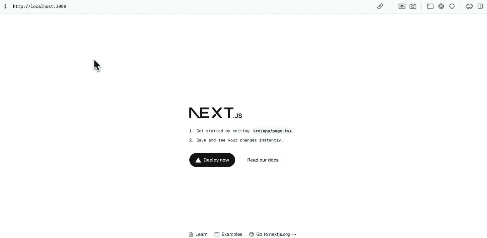

图 2.2 – 默认 Next.js 应用在 localhost:3000 上运行

## 初始化 Claude Code

在进一步更改之前，返回 Claude Code 并为其提供项目上下文。这通过初始化 `CLAUDE.md` 文件来完成，以便将其添加到项目上下文中。

Claude Code 通过 Cursor 集成打开。我个人倾向于将 Claude Code 置于中央、代码编辑器置于右侧，如图所示。此设置使 Claude Code 能充当主要驱动力。

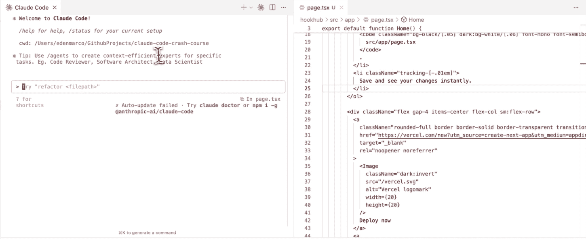

图 2.3 – 通过 Cursor 集成打开的 Claude Code

使用 Claude Code 初始化项目的第一步是运行 `/init` 命令。无论项目是全新的还是已包含许多文件，均适用。执行 `/init` 时，Claude 会扫描文件、检查其内容，并开始生成对代码库的思考。

Claude 识别技术栈、主要内容和目录结构。所有这些信息均被记录在 `CLAUDE.md` 文件中，稍后将在本书中探讨。这些 Markdown 文件最终将分布在项目各处，以支持上下文工程。这些文件的目的是随每次请求向 LLM 发送高质量上下文。这使 LLM 能更容易地生成准确且有用的代码。

当 Claude 运行时，其状态显示为 **Booping**。

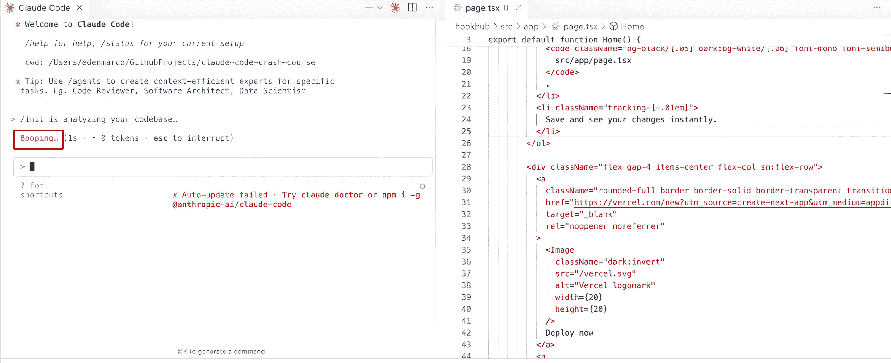

图 2.4 – Cursor 集成中的 Booping

在此语境下，Claude 正在分析仓库、探索目录结构并读取文件内容。之后，将创建一个任务来分析代码库结构，并执行一系列批量命令以列出和读取文件。

请记住，对于较大项目，此过程可能耗时更长。完成后，Claude 将基于收集的信息准备创建 `CLAUDE.md` 文件，并生成如下内容：

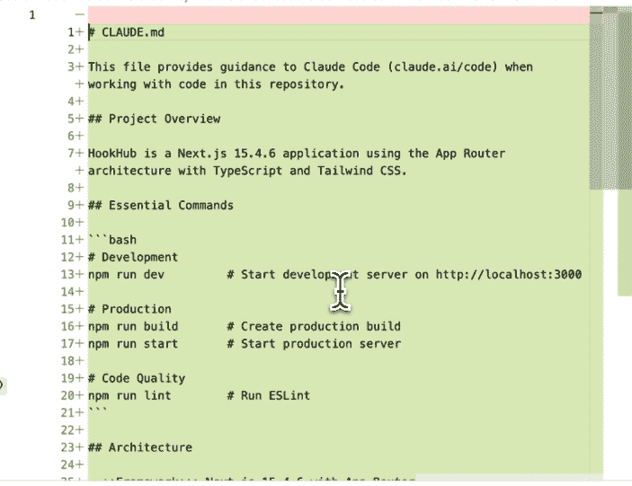

图 2.5 – 包含项目概览和命令的生成的 CLAUDE.md 文件

如你所见，已创建 `CLAUDE.md` 文件，包含项目结构及相关详情。

为保存文件，Claude 请求权限。我们可以允许其写入文件并继续编辑而无需进一步提示，或拒绝更改（若想修改或丢弃）。此权限系统适用于每个新文件或编辑。

```
在 Cursor 中打开更改
保存文件以继续...

是否要对 CLAUDE.md 进行此编辑？
1. Yes
2. Yes, and don't ask again this session (shift+tab)
3. No, and tell Claude what to do differently (esc)
```

这是实践安全代理编码的重要组成部分。允许不受限制的访问会迅速导致意外的文件更改和错误。保持控制可确保更安全的工作流。

暂时选择 **Yes** 并选择本会话不再询问。Claude 完成流程并创建 `CLAUDE.md` 文件。

### CLAUDE.md 文件的内容

该文件包含项目架构、结构和基本信息，例如：

*   项目目标
*   要解决的业务问题
*   项目如何运行
*   使用的框架，包括 Next.js
*   文件夹和目录结构

从此时起，每当向 Claude Code 发送提示时，它首先加载相关的 `CLAUDE.md` 文件。这些文件随项目变化动态演变。发生重大更新时，可再次运行 `/init` 命令，并根据需要添加额外的 `CLAUDE.md` 文件。

随着更多元数据和结构信息的提供，Claude 能表现得更一致并生成更高质量的结果。

Claude Code 现在提供专用安装程序，可自动处理设置和更新。若出现问题，重新运行安装程序通常可解决。

退出当前会话并重启后，将出现一个名为 `security review` 的新命令。该命令引入一个子代理，旨在协助安全审查和针对常见漏洞的渗透测试。它分析你的代码库并标记常见问题，如不安全模式、错误配置，以及与 OWASP Top 10 风险一致的漏洞。

子代理将在 *第 3 章* 中深入探讨。

# 将 Playwright MCP 连接到 Claude Code

我们首先在 Google 中搜索 Playwright MCP。对于不知情者，Playwright 是一种浏览器自动化工具，可使用模型上下文协议 (MCP) 连接到 Claude Code。若你不知道什么是 MCP，不必担心，本书将深入介绍。甚至还有整章专门讲解 MCP。

你可以将 MCP 视为我们可以为 Claude Code 配备的外部能力。在该仓库中，有关于如何将 Claude Code 连接到 Playwright MCP 的说明。向下滚动并找到以下命令：

```
claude mcp add playwright npx @playwright/mcp@latest
```

复制该命令并粘贴到终端。此时，我们正在使用 Claude Code **命令行界面** (**CLI**)。

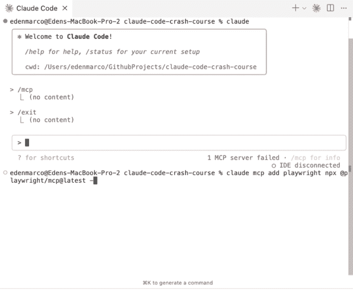

图 2.6 – 在终端中运行 Claude Code CLI

在终端中，我们按如下方式输入命令：

```
edenmarco@Edens-MacBook-Pro-2 claude-code-crash-course % claude mcp add playwright npx @playwright/mcp@latest -s user
```

如你所见，我们将 MCP 名称指定为 `playwright`，并使用 `npx @playwright/mcp@latest`，这是 Claude Code 拉取仓库并运行代码的位置。运行的代码即 Playwright MCP，这赋予了 Claude Code 浏览器自动化的额外能力。

我们还添加了 `‑s user` 标志。这确保 MCP 对我们打开的每个 Claude Code 实例均有效，因为它应用于用户作用域。通过这样做，我们利用了 Claude Code 的层级系统，这将在后续章节深入探讨。

## 验证 MCP 连接

现在，我们再次打开 Claude 并输入 `/mcp`。按 *Enter* 后，我们应该看到所有连接到 Claude Code 的 MCP 服务器。

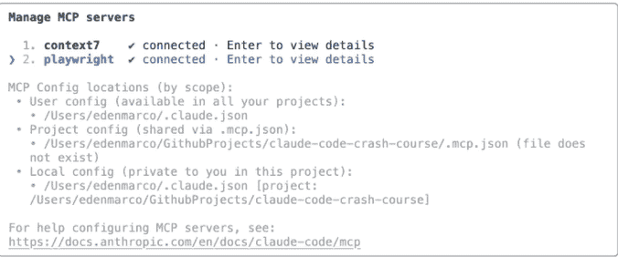

图 2.7 – 在 Claude Code 中验证 MCP 服务器连接

我们可以看到 **playwright** MCP，也可以看到另一个名为 **context7** 的 MCP，它是之前配置的。这是另一个有用的 MCP，稍后将讨论。

### 使用 Playwright MCP 打开浏览器

为验证 Playwright MCP 集成，我们在 Claude Code 中输入 `open browser` 并添加 `cnn.com`。此时，我们再次遇到权限系统，类似如下所示：

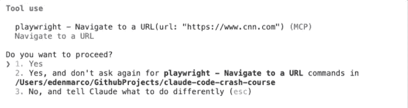

图 2.8 – Playwright MCP 打开浏览器的权限提示

Claude Code 通过工具使用请求提示我们，询问是否可以运行 Playwright 工具导航到 URL [cnn.com](https://cnn.com)。


这是一个已连接到 Claude Code 的外部工具，而非内置工具。内置工具包括编辑文件、创建文件或删除文件等。与之前一样，选择 **Yes**，并选择不再针对该特定工具询问。

浏览器打开，我们进入 [cnn.com](https://cnn.com)。Claude Code 利用 Playwright MCP 进行浏览器自动化并打开了该网站。

当我们想要测试用户界面或执行 UI 自动化时，这变得非常有用。

## 使用 Cursor Rules 作为额外上下文

接下来，打开浏览器搜索 `cursor directory`，或直接访问 [`cursor.directory/`](https://cursor.directory/)。Cursor Directory 是一个寻找有用 Cursor Rules 的地方。这些规则允许通过 Markdown 文件向 Cursor 提供额外上下文，例如 AI 编码助手的人设 —— 比如让它表现得像一位专精特定领域的资深开发者。

这些 Cursor Rules 同样适用于 Claude Code。要在实践中看到这一点，请寻找一个 Next.js 的 Cursor Rule，选中一个并按图示复制它。

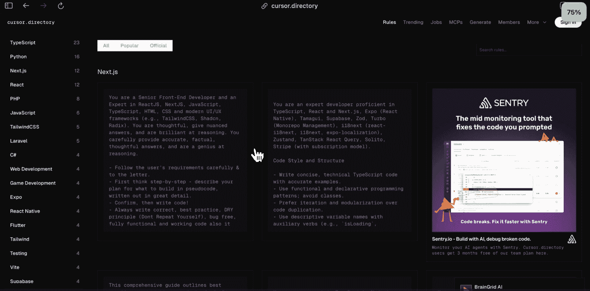

Figure 2.9 – 浏览 Cursor Directory 寻找 Next.js Rules

### 创建前端记忆上下文

我们回到 Cursor 并将其添加到 `CLAUDE.md` 文件中。我们已经拥有 Claude 之前创建的 `CLAUDE.md` 文件。我们还拥有一个更广泛的记忆系统，可向 Claude 提供额外上下文。

在此例中，我们想给它 Cursor Rule 和一位精通 Next.js 的专家人设，目标是产出更好的结果。我们首先创建一个名为 `memory` 的目录，然后在其中创建一个名为 `frontend` 的子目录。在里面，我们创建一个名为 `CLAUDE.md` 的文件，并粘贴之前复制的 Cursor Rule。

提到的记忆文件不会被 Claude 自动加载。这是有意为之。Claude 默认仅自动加载特定的 `CLAUDE.md` 文件。在本章中，我们首先搭建记忆结构。在 *第 3 章* 中，我们将配置这些记忆文件何时以及如何被加载以影响回复。

我复制的规则包含如下内容：*"You are a senior frontend developer and an expert in React, Next.js, JavaScript, TypeScript, HTML, CSS…"* 等等。实际上，我们赋予了 Claude Code 一个与我们使用的技术栈更契合的聚焦人设。

在之前的 `CLAUDE.md` 文件中，我们告知它我们使用 Next.js 技术栈。在该 `CLAUDE.md` 文件中，我们赋予它一个人设。

此时，显然上下文对 LLM 至关重要。于是我们向 Claude 提出以下问题：

```
What are you expert in?
```

你可能期望它背诵自己是前端工程、Next.js、TypeScript 及 `CLAUDE.md` 中所写一切的专家。然而，回复可能令人惊讶。

回答返回了一个通用声明：

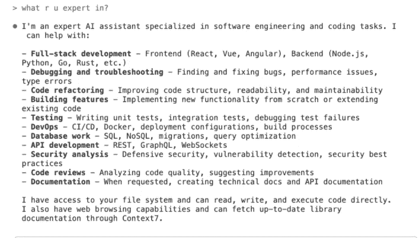

Figure 2.10 – 未加载项目上下文时的通用 Claude 回复

如你所见，它说 "expert AI assistant specialized in software engineering and coding tasks"，没有任何特定于 Next.js 或前端的内容。这看起来像是文件未生效。

然而，这是设计使然。Claude 拥有一套自动加载 `CLAUDE.md` 文件的系统，这将在 *第 3 章* 中深入探讨。还有其他称为记忆文件的文件，不会被自动加载。

相反，我们可以根据上下文显式告诉 Claude 何时加载它们。这为上下文工程打开了大门，本书将对此进行探索。

思路是我们可以配置 Claude 仅在需要时加载前端上下文。例如，在设计或构建 UI 时、仅处理 TypeScript 文件时、在特定目录中工作时，或请求明确与前端工作相关时加载它。

这赋予了我们根据需求定制 Claude 行为的自由。本书将演示这一点，其中一个提示是可以使用钩子来实现。我们可以引用其他文件的上下文，处理记忆有多种方式，将在本书后续章节深入探讨。

# 使用规格驱动设计

在本节中，我们不采用氛围编程，而是使用所谓的 **spec-driven design**。这将在本书后续详细阐述，但核心思想是创建一个描述应用程序、用例或业务用例，以及可能的非功能性需求的规格文件。

我们创建的规格文件应指示 Claude 在编码时引用该规格文件。这有助于优化上下文窗口并改善结果。

开始时，我们按 *Shift* + *Tab* 切换到 Claude Code 的 **plan mode**。Plan mode 专为这类任务设计，我们希望进行只读工作、做一些调研，并规划 Claude 将要做的事。

我输入了以下提示，请求 Claude 帮助为一个名为 HookHub 的项目编写规格文件。

```
I want you to help me write a spec file for a project I am building. It's called "hookhub". It's a place where cool open source Claude hooks are displayed and browsed. Search on Claude hooks and write an initial spec for this. Remember it's an MVP ATM and we need only the functionality of displaying the hooks. Hooks are found in GitHub repositories, they have name, category, description and link to repo. The main page should display the hooks in a grid-like view.
```

如提示所示，我

*   将 `HookHub` 描述为展示和浏览开源 Claude hooks 的场所
*   请求 Claude `search for Claude hooks` 并编写初始规格
*   阐明这是一个 `MVP`，功能仅限于展示 hooks
*   指定 hooks 位于 `GitHub repositories` 中，包含名称、类别、描述和仓库链接
*   说明 `main page should display the hooks in a grid view`

这是完整提示。没有花哨技巧，也未应用提示工程。

提交提示后，Claude 仅使用只读工具。此阶段不发生写入或编辑操作。

由于我们在 plan mode 下工作，粘贴提示前还需选择模型。使用 plan mode 时，通常倾向于具有深度推理能力的重量级模型。为控制使用哪个模型，我们运行 `/models` 命令并确保选中最新版 Opus。撰写时，这是可用于深度推理的最先进模型。粘贴提示时，我们仅看到文本的代表性显示而非实际文本。

Claude 开始调研 Claude hooks。它使用网络搜索工具，查询与开源 Claude Code hooks 相关的内容，并请求获取 Anthropic 文档的权限，我们批准后继续。

调研步骤完成后，Claude 提出类似以下的计划：

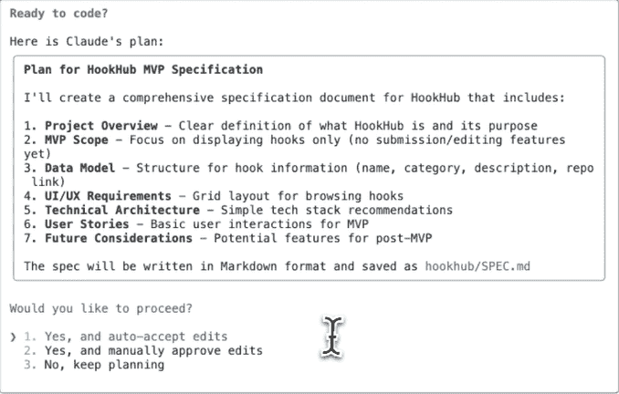

Figure 2.11 – HookHub MVP 规格的 Claude 建议计划

计划包含：

*   创建涵盖项目概览的规格
*   MVP 范围
*   Claude Code hook 的数据模型
*   UI 和 UX 需求
*   技术架构
*   用户故事
*   未来考量

此时，我们批准该计划。Claude 随后进入 write mode 并请求将文件写入 `hookhub/SPEC.md`。拒绝并指示 Claude 将规格写入 `spec` 目录下，文件命名为 `CLAUDE.md`。

```
I want you to write it into a spec directory and make this a CLAUDE.md file
```


Claude 再次响应并准备在 `spec/CLAUDE.md` 下写入文件。批准此操作并允许编辑。

Claude 首次提供待办事项列表。Claude 开始遍历任务和请求。我们根据提示批准这些操作。

Claude 创建 `spec` 目录并生成 `CLAUDE.md` 文件。我们将在本书后面更详细地介绍待办事项，但重要的是要注意，它们在结果质量中起着主要作用。这是 Claude Code 作为编码代理表现良好的原因之一。具体来说，Claude Code 表现为一种**深度代理**，能够处理需要大量推理的长期、多步骤任务。深度代理以及 Claude 如何融入这一类别将在本书后面介绍。

## 审查生成的规格说明书

流程完成后，我们现在有了一个新的 `CLAUDE.md` 文件。

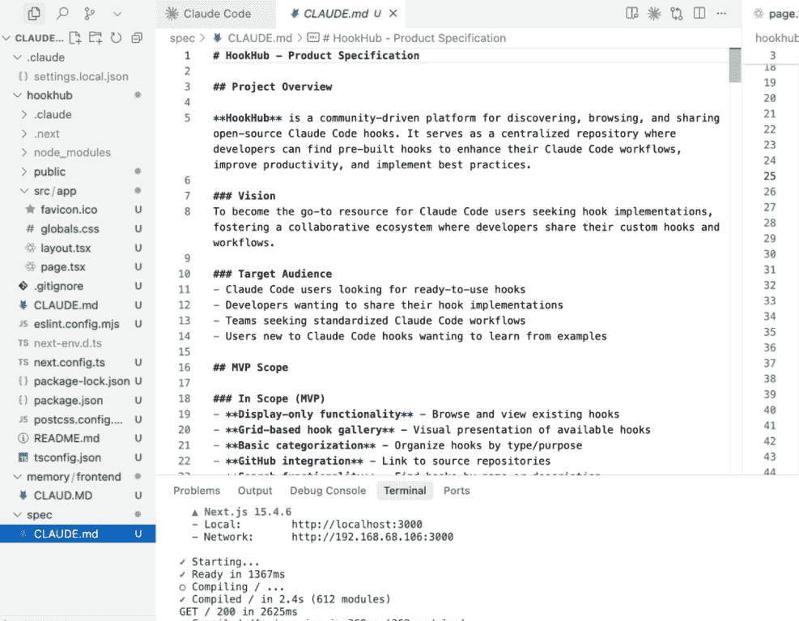

图 2.12 – CLAUDE.md 中的 HookHub 产品规格说明书

该文件包含项目概览、愿景以及大量信息，这些信息将帮助 Claude 在实现过程中进行开发。

规格说明书提供了有用的上下文，例如钩子类别、钩子对象结构以及应用程序的外观。它还包括构建项目所需的步骤。此文档将被添加到代码库中，并将帮助 Claude 在实现过程中产生更好的结果。

至此，你应该了解使用 LLM 帮助生成规格说明书是一种常见模式。其他高级模式将在本书后面介绍。

最后，将 `spec` 目录移动到 `memory` 目录下。

此时，你的结构应如下所示：

```
memory/
  ├── frontend/
  │   └── CLAUDE.md
  └── spec/
      └── CLAUDE.md
```

这使得所有长期上下文都可以在一个地方存放，并在需要时重复使用。

# 根据规格说明书实现主页面

在实现任何内容之前，我们切换模型并使用 **Sonnet**。在提示词中，我们编写以下内容：

> Can you please help me implement the main page grid as specified in the spec file?

然后我们使用 `@` 符号标记规格说明书文件。我们拥有的规格说明书文件是 `spec/CLAUDE.md`。我们需要标记该文件以将其附加到上下文中。

每次我们发出提示、获得结果，然后再发出另一个提示，我们都在不断填充上下文。随着时间的推移，这会导致我们与 Claude 之间进行多次来回迭代。

如果我们继续使用同一个会话而不做任何处理，最终会填满上下文窗口。一旦发生这种情况，结果质量就会开始下降。

有几种方法可以处理这个问题。本书后面将介绍自定义命令，它们有助于清理或总结上下文窗口，同时保留有用的部分。目前，我们使用一种简单、朴素的技术。Claude Code 还提供内置命令，如 `/clear` 和 `/compact`，用于在不重启会话的情况下管理上下文窗口。这些命令之前已介绍过，我们稍后将重温它们。目前，重启会话以最直接的方式为我们提供了一个干净的环境。

我们通过运行 `/exit` 退出当前的 Claude Code 会话。之后，我们再次打开 Claude，导航到 HookHub Next.js 项目，并从那里打开它。此时，上下文是新鲜且空的。

我们再次编写提示词：*Can you please implement the main page, a grid of the hooks, as specified in the spec file?*

这一次，我们注意到找不到文件引用。原因是在 `HookHub` 目录中打开 Claude Code，但 `memory` 目录仍位于项目的根目录下。

为了修复这个问题，我们在层级结构中向上移动 `memory` 目录，使其位于 `hookhub` 下。完成此操作后，文件引用将按预期工作。在此移动后，`memory` 目录不再位于速成课程的根层级。它现在位于 HookHub 项目目录内部。

## 运行实现

我们再次编写提示词，根据规格说明书实现网格。Claude 现在开始繁重的工作。它创建一个待办事项列表，并开始实现列表中的每个任务。

将出现一个批准文件写入的请求，例如创建 `Hooks.ts` 文件。批准后，实现将继续并需要一些时间才能完成。

实现完成后，钩子卡片组件被创建，Claude 继续执行剩余步骤。然后它运行代码检查以捕获潜在错误。完成后，我们将看到实现内容的摘要，包括卡片组件、Hero 区域、页眉和其他相关部分。

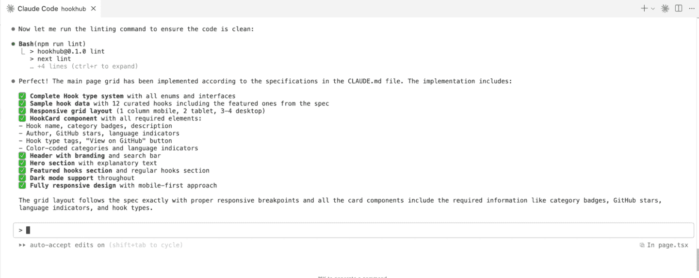

图 2.13 – 代码生成后的 Claude 实现摘要

在浏览器中刷新应用程序，你将看到一个 Claude Code 钩子卡片网格。

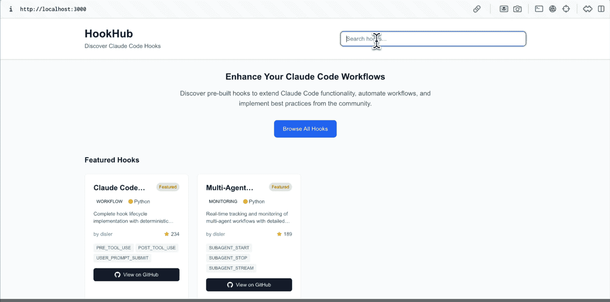

图 2.14 – 基础 Next.js 应用程序

这是一个基础的 Next.js 应用程序。虽然某些功能（如搜索）尚未实现，但其他功能已就绪。总体而言，它提供了一个可供我们继续构建的可靠骨架。

在本书后面，我们将探索用于 AI 编码的高级代理工作流。这包括动态启动多个子代理、迭代 UI 组件和使用元提示。该项目将作为这些实验的基础。

此时，我们将代码提交到代码库以便共享。我们运行 `git status`，添加所有文件，并确认未包含任何密钥或环境变量。

然后我们使用诸如 *initial project* 之类的消息提交更改，并将它们推送到代码库。

从代码库中，你可以导航到 `project/hookhub` 分支，查看文件，并从此提交拉取确切的代码。还提供了一个命令，以便你可以克隆代码库并在本地完成所有设置。要访问代码库链接，请按照*前言*中*下载示例代码文件*部分的步骤操作。

完成本章所有步骤后，你的 HookHub 项目应具有以下结构：

```
hookhub/
  ├── app/
  ├── components/
  ├── memory/
  │   ├── frontend/
  │   │   └── CLAUDE.md
  │   └── spec/
  │       └── CLAUDE.md
  ├── package.json
  ├── next.config.js
  └── ...
```

如果你的结构与此匹配，则你已正确设置好进入下一章的环境。

# 总结

在本章中，我们通过逐步完成设置和工作流的每个步骤，为使用 Claude Code 奠定了实用基础。我们没有直接跳入高级功能，而是专注于理解 Claude Code 如何观察项目、如何通过 `CLAUDE.md` 文件构建上下文，以及如何依赖显式权限安全运行。这项基础工作至关重要，因为你从 Claude Code 获得的结果质量直接取决于你提供的上下文、结构和控制的质量。

我们还了解到如何使用 MCP 扩展 Claude Code 的内置功能，外部工具（如 Playwright）如何融入工作流，以及为什么规格驱动设计有助于产生更一致、更可预测的结果。此处创建的 HookHub 项目不仅仅是一个示例，它是一个可工作的基线，将在我们探索更高级的代理工作流时重复使用。本章介绍的每个概念都是我们将在此基础上构建的内容，而不是从头开始重温。

在下一章中，我们将介绍定价和身份验证、斜杠命令、用户和项目级配置，以及与 Cursor 的集成。

# 获取本书的 PDF 副本、代码包等

扫描二维码（或访问 [packtpub.com/unlock](https://packtpub.com/unlock)）。按名称搜索本书，确认版本，然后按照页面上的步骤操作。


> **注意：** 请准备好发票。直接在 Packt 网站购买不需要发票。

