# 3 Claude Code 入门——核心命令速览

在本章中，我们将从开始使用 Claude Code 过渡到为其配置日常用途。目标是帮助您熟悉 Claude Code 在实践中的行为方式、如何在会话中控制它，以及如何对其进行设置，使其在各个项目中保持一致。

我们将简要介绍定价和认证，以便您在开始前选择合适的设置。之后，我们将重点关注您将持续使用的部分：用于管理会话和上下文的斜杠命令、用户级和项目级的配置，以及直接在 Cursor 等 IDE 中运行 Claude Code。然后，我们将在这些基础之上构建使长流程更安全、更可靠的功能，包括用于自动化的钩子、通过 `CLAUDE.md` 文件实现的记忆、通过检查点实现的回溯，以及用于可重复、定义明确的工作流的自定义斜杠命令（技能）。

技能可以使用 `/技能名` 语法手动调用，这也是旧版文档有时将其称为*技能*的原因。在内部，它们现在统一归属于 **Skills** 系统。

本章将涵盖以下主题：

*   Claude Code 的定价和计划
*   使用斜杠命令控制 Claude Code
*   在 Claude Code 中使用钩子
*   理解 Claude Code 中的记忆
*   Claude Code 中的回溯功能
*   Claude Code 中的技能

# Claude Code 的定价和计划

在本节中，我们将讨论运行和使用 Claude Code 的定价选项及不同计划。我们从认证开始，因为您的认证方式也决定了代币使用的计费方式。

本节提到的定价和计划详情在撰写时是准确的。由于订阅层级、使用限制和计费政策可能会发生变化，请始终参考官方 Claude 定价页面以获取最新信息：[`claude.com/pricing`](https://claude.com/pricing)

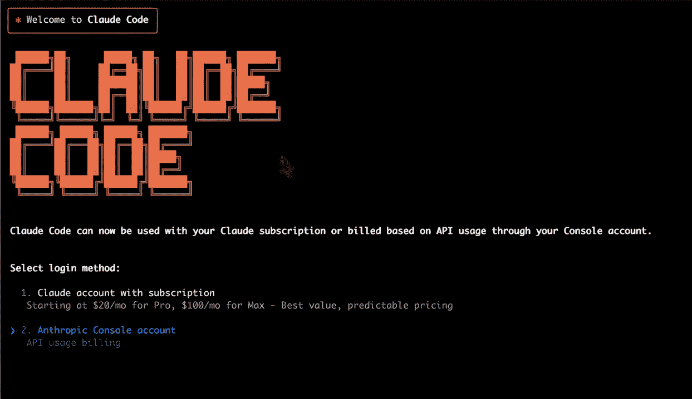

**图 3.1 – Claude Code 认证选项屏幕**

Claude Code 提供三种主要的认证和支付代币使用的方式。

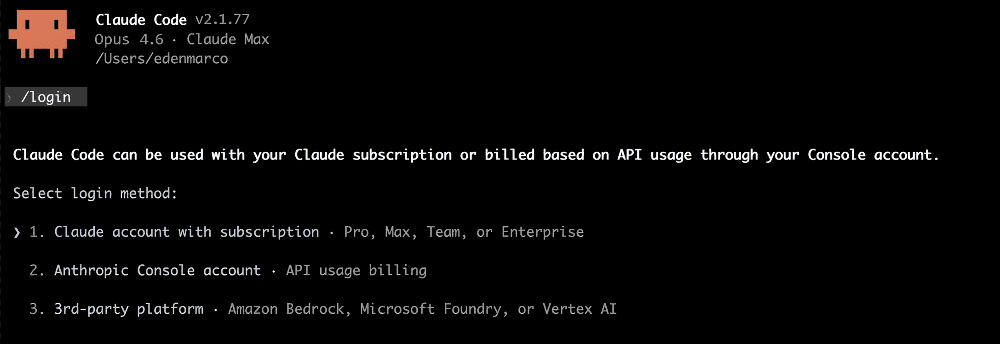

**图 3.2 – Claude Code 订阅和 API 计费的登录方式**

## 选项 1：使用 Anthropic API 密钥

其中一种选择是使用 Anthropic API 密钥进行认证。这采用按量付费的计费模式，用量通过 Anthropic 控制台追踪。此选项适合偏好基于用量计费，或希望在订阅前评估 Claude Code 的用户。

在遵循本书内容时，若使用 Anthropic API 密钥方式，用量将取决于调用 Claude Code 的频率以及所使用的模型。

如果您选择此选项，请选择 API 密钥认证方式，并通过您的 Anthropic 组织授权 Claude Code。随后，Claude Code 将自动在终端中生成并配置 API 密钥。完成后，Claude Code 将按按量付费模式运行。

### 使用 Anthropic API 时需注意的事项

使用 API 密钥时，监控代币消耗非常重要。这可以直接在 Claude Code 内部通过 `/cost` 命令完成。该命令仅在 Claude Code 使用 Anthropic API 密钥认证时可用。它会显示消耗的代币数量及其分布情况。

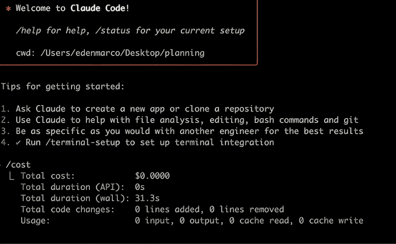

**图 3.3 – 使用 `/cost` 命令监控代币用量**

相同信息也可通过 Anthropic 控制台获取。费用为零是因为尚未使用任何代币。只需输入任意内容，收到输出后，再次输入 `/cost` 即可。

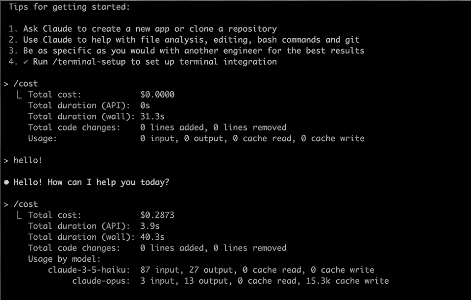

**图 3.4 – 运行提示词后的更新代币用量**

请记住，定价因所用模型而异。例如，使用 Opus 产生的代币成本高于其他模型。

### 使用 API 密钥时的重要注意事项

使用 API 密钥需要谨慎。存在意外泄露密钥的风险，这可能允许他人以您的名义消耗代币。极端情况下，这可能导致意外的高额费用。

此外，本书涉及代理、子代理和编排模式的使用，所有这些都可能消耗大量代币。如果配置错误，可能会同时触发许多代理，从而显著增加成本。

降低此风险的一种方法是在 Anthropic 控制台中设置支出限额。Anthropic 允许您为账户定义使用限额，超出后将不再提供服务。有关配置这些限额的详细信息，请参阅 Anthropic 设置页面（[`platform.claude.com/settings/limits`](https://platform.claude.com/settings/limits)）。

## 选项 2：使用 Claude 订阅

如果您遵循了 *第 2 章* 中的设置，您正在使用选项 2，即通过 Claude 订阅进行认证。我们将在本书中始终使用此选项，即通过 Claude 订阅进行认证。通过这种方式，您可以将现有的 Claude 订阅直接连接到 Claude Code。这提供了无缝集成，并具有可预测的月度计费。

Claude 目前提供以下订阅层级：

*   免费版 – 0 美元/月（不包含 Claude Code 访问权限）
*   专业版 – 20 美元/月
*   Max 5x – 100 美元/月
*   Max 20x – 200 美元/月

Claude Code 访问权限从专业版及以上计划开始提供。

在本书中，我使用的是 Max 5x 计划，它提供比专业版更高的使用限额，同时对于常规开发工作流仍具成本效益。

现在，与前一个选项不同，使用订阅计划时，费用监控的行为也不同。由于 Claude Code 的使用包含在订阅中，因此无需使用 `/cost` 追踪代币级别的成本。定价是固定的，尽管根据计划不同，使用限额仍然适用。

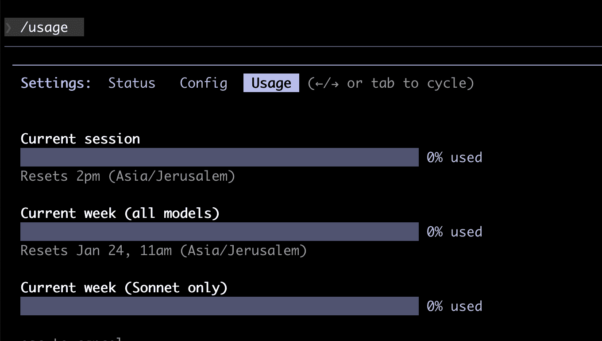

**图 3.5 – 使用 `/usage` 命令查看订阅用量**

### 此选项下的可用模型

使用 `/models` 命令可查看可用模型。Claude Code 目前支持 Opus、Sonnet 和 Haiku：

*   **Claude Opus**：Claude Opus 是能力最强的模型，非常适合复杂任务和深度推理。它拥有 200K 代币的上下文窗口，通常用于深度规划或研究任务。由于成本较高，Opus 通常不用于编写大量代码。
*   **Claude Sonnet**：Claude Sonnet 在智能、速度和成本之间取得了平衡。它同样拥有 200K 代币的上下文窗口，是本书中用于代码生成的主要模型。凭借其平衡性，Sonnet 在编写和修改代码时承担了大部分繁重工作。
*   **Claude Haiku**：速度最快、最轻量的模型。它非常适合简单任务、快速迭代以及速度比深度推理更重要的低延迟工作流。

模型本身由 Anthropic 托管和提供服务。对于企业环境，也可以通过受支持的第三方云提供商访问，例如 AWS Bedrock、Google Cloud Vertex AI 或 Microsoft Azure。这种设置通常被需要集中计费、云特定的合规控制、区域部署选项或通过现有云基础设施进行治理的组织所使用。

### 订阅计划和定价

Claude 提供多个订阅层级。

*   免费计划


# 定价计划

*   Pro 计划
*   Max 5x 计划
*   Max 20x 计划

引入速率限制是为了防止滥用，例如共享凭证或滥用系统。这些限制适用于 Pro 和 Max 计划。

对于大多数用户，尤其是爱好者，建议从 Pro 计划开始。只有在需要更高使用量时，升级到 Max 计划才有意义。

确切的使用限制难以量化，这并非 `Claude Code` 独有。AI 编码代理的定价是整个行业持续面临的挑战。定价模式的变化导致开发者社区感到沮丧，这一领域仍在不断演变。

本节旨在阐明可用的定价选项，帮助您了解使用 `Claude Code` 时的计费方式，以便选择最适合您需求的方案。

## 选项 3：使用第三方云服务商

`Claude Code` 还可以通过受支持的第三方云平台进行身份验证，例如 `Amazon Bedrock`、`Microsoft Azure AI` 或 `Google Cloud Vertex AI`。在这种情况下，计费和用量管理由所选云服务商管理，而非通过 `Claude` 订阅或 `Anthropic API key`。有关支持的第三方集成详情，请参阅官方文档：<https://code.claude.com/docs/en/third-party-integrations>

# 使用斜杠命令控制 Claude Code

**斜杠命令** 是在 `Claude Code` 聊天中控制 `Claude Code` 功能和设置的主要方式。当我们输入 `/` 时，`Claude Code` 会显示可用命令列表，如下图所示：

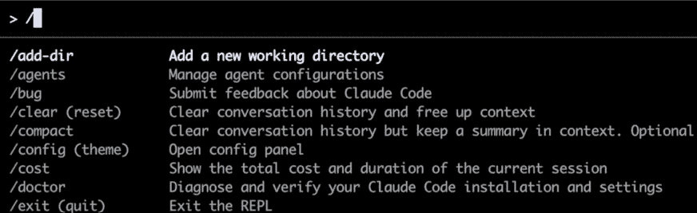

Figure 3.6 – Listing available slash commands in Claude Code

当我们与 `Claude Code` 进行大量对话时，对话历史会变得非常长，这会拖慢速度并导致上下文腐烂，这将在书中后面讨论。这也会花费更多费用，甚至如果 `Claude` 需要记住太多内容而感到困惑。

为了应对这种情况，有两个命令：

*   `/clear`，它擦除一切并重新开始，就像一张白纸
*   `/compact`，它创建重要内容的简短摘要，保留关键信息，并移除额外细节

使用 `/clear` 和 `/compact` 有助于 `Claude` 保持专注并随时间推移更好地工作。这就是上下文工程的实际应用（参见 *Chapter 1*）。

让我们从零开始会话。为此，我们需要运行 `/clear`。

另一个值得注意的命令是 `/agents`，它有助于管理专用子代理。**子代理** 可以被视为为特定任务创建的专家助手，例如代码审查员、调试员或架构师。

它们拥有自己的上下文和工具，并作为多代理工作流的一部分使用。子代理和这些工作流将在后面的实操部分中介绍。

接下来是 `/config` 命令。`/config` 命令打开 `Claude Code` 的配置面板，显示设置和偏好。运行此命令后，您将看到如下所示的设置：

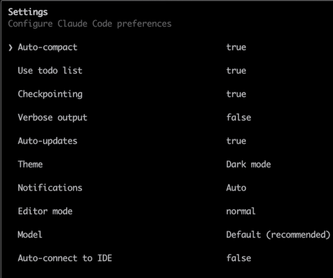

Figure 3.7 – Claude Code settings panel with configuration options

例如，我们可以看到 **Auto-compact** 已启用。这意味着当 `Claude` 检测到对话接近令牌限制或判断这是压缩上下文的好时机时，会自动运行 `/compact`。还有使用待办列表、检查点等设置。我们不会在此逐一介绍；完整且最新的设置列表请参阅官方 `Claude Code` 文档（<https://code.claude.com/docs/en/settings>）。

除了各个选项本身，重要的是这些设置如何被组织和应用。`Claude Code` 提供了一个细粒度的配置系统：

*   用户级设置，存储在主目录下的 `.claude/settings`，适用于每个 `Claude Code` 实例
*   项目级设置，存储在项目目录中的 `.claude/settings.json`，仅适用于该项目，可与团队共享
*   本地设置，允许个人微调而不影响共享的项目设置

这种结构使得维护全局默认值、应用项目级指南并保留个人偏好成为可能。全书中展示的设置均可根据个人和团队需求通过这些设置文件进行配置。

最后，我们来看 `/cost`。由于此设置使用 `Claude Pro` 订阅，因此此处不显示成本监控，因为订阅包含 `Claude Code` 使用量。`/cost` 命令在您使用 `Anthropic API key` 时变得更加相关。

## 将 Claude Code 与 IDE 集成

在结束本节之前，让我们看看如何将 `Claude Code` 与 IDE 集成。在本例中，我们将把它与 `Cursor IDE` 集成。打开斜杠菜单并选择 **IDE** 以将 `Claude Code` 集成到 `Cursor` 中。这将直接在 IDE 中安装 `Claude Code` 扩展。

安装完成后，我们可以在 `Cursor` 中看到 `Claude Code` 扩展。


Figure 3.8 – Claude Code extension inside the Cursor editor

您会注意到右上角的 `Claude Code` 图标。这是大多数开发者在实践中使用 `Claude Code` 的方式。`Claude Code` 通常通过 `Cursor` 扩展打开，因此它直接在 IDE 内部运行。这使我们能在编辑器中工作，更清晰地查看差异，并将所有内容保持在一个地方。我们将在全书中使用此设置。

我们还有 `/mcp` 命令，用于管理 MCP 服务器。通过此命令，我们可以添加、移除和列出所有已配置的 MCP 服务器。

此时，尚未配置任何 MCP 服务器。MCP 服务器提供可添加到 `Claude Code` 的额外功能。它们可能来自经过验证的供应商或开源项目，并能有效地用额外的工具和能力扩展 `Claude Code`。

MCP 本身是一个深度话题。全书中，我们将把 MCP 服务器的集成和使用作为工作流的一部分。目前，假设您熟悉 MCP 服务器的基本概念。

# 在 Claude Code 中使用钩子

钩子是 `Claude Code` 中的一项强大功能。它们是在 `Claude Code` 工作流的特定节点自动运行的逻辑。

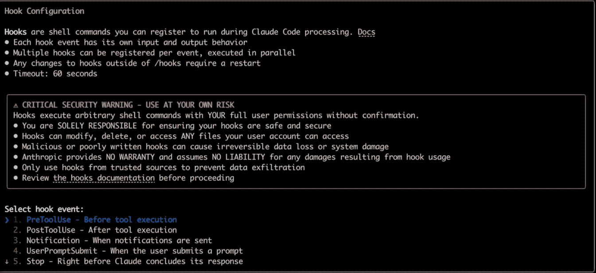

Figure 3.9 – Hook configuration and security warning in Claude Code

例如，钩子可以在工具使用前或后运行，或在 `Claude` 完成工作时运行。它们有助于自动执行诸如格式化代码、运行测试或阻止不安全编辑等任务。通过这种方式，钩子确保这些操作无需人工干预即可一致地发生。

钩子是构建可靠工作流的关键部分，我们将在本书后面花费大量时间进行实操。简要预览一下，钩子还可以用于触发 `Claude` 的子代理。每个子代理都在自己的上下文中运行，并拥有自己的工具集，这为更复杂和强大的工作流打开了大门。

## 创建通知钩子

现在让我们配置第一个钩子。在本节中，我们将构建一个简单的通知钩子，每当 `Claude` 完成输出生成时播放声音。

所有相关代码均可在仓库的 `project/hooks‑notification` 下找到。在继续之前，请克隆仓库并检出 `project/hooks‑notification` 分支。

### 初始化环境

请按以下步骤操作：

1.  确保仓库包含所有必需工件，包括声音文件。除音频记录外移除所有内容，以便从头开始设置。


# 初始化 Python 环境并配置 Hook

## 2. 初始化 Python 环境

由于 Hook 是 Python 脚本，需要初始化 Python 环境并安装依赖。使用 `uv` 初始化环境：

> **提示**  
> 此处使用 `uv`，这是 Astral 公司开发的快速 Python 包和环境管理器。若未安装 `uv`，请参考官方文档安装：[`docs.astral.sh/uv/.`](https://docs.astral.sh/uv/.)

```bash
uv init
```

此命令会创建虚拟环境和主文件。

## 3. 重命名并运行主文件

将主文件重命名为 `play_sound.py`，然后运行：

```bash
uv run play_sound.py
```

这将确认环境设置正确。

## 4. 重新打开 Claude Code 并验证 Hook 尚不存在

运行一个提示词，确认会产生响应但**不播放声音**。

## 5. 让 Claude Code 编写 Hook 脚本

使用以下提示词：

```
I want you to please write a python script that is going to play the sound @ulala.wav, every time the script runs.
```

让 Claude 编写一个每次运行时都播放录制声音的 Python 脚本。

### 自定义通知声音

Hook 不依赖特定的声音文件，它只是播放脚本指向的任何文件。本节示例引用 `@ulala.wav`，但你可以替换为任何你喜欢的音频文件。

如果选择其他文件，请将其放在项目中（例如 `hooks/` 或 `assets/` 文件夹下），并更新脚本以使用新的文件名或路径。

查看建议的更改。

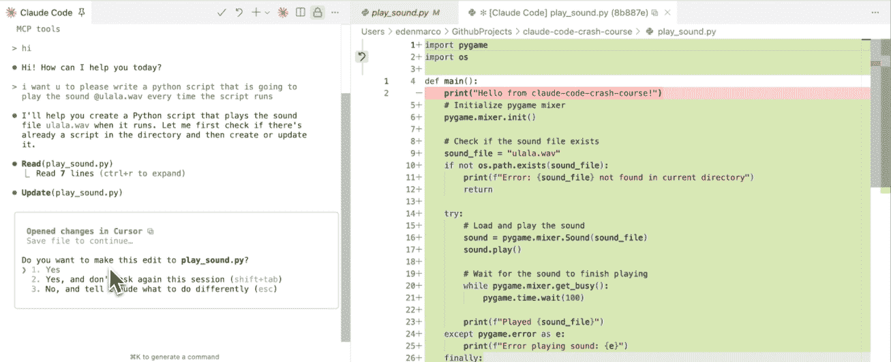

*Figure 3.10 – Reviewing and approving hook file changes in diff view*

## 6. 批准文件编辑

Claude 显示 `diff` 视图，高亮显示新增和删除的行，并请求编辑 `play_sound.py` 的权限。选择批准选项：

```
Choose one of the approval options:
1. Approve once
2. Approve for the rest of the session
3. Reject and provide different instructions
```

选择“Approve for the rest of the session”会更新本地设置，使 Claude 在本会话中不再针对该文件请求权限。此权限步骤是一项安全措施，因为 Claude Code 会直接修改文件。

## 7. 安装所需依赖

脚本使用 `pygame` 播放音频。运行以下命令安装：

```bash
uv add pygame
```

## 8. 测试脚本

再次运行脚本，确认声音播放正常：

```bash
uv run play_sound.py
```

## 9. 打开 Hook 配置，将脚本注册为自动化动作

打开斜杠菜单，输入 `/hooks`，从提供的列表中添加新 Hook：

*   **PreToolUse** – 工具执行前
*   **PostToolUse** – 工具执行后
*   **Notification** – 发送通知时
*   **UserPromptSubmit** – 用户提交提示词时
*   **Stop** – Claude 结束响应前

此步骤是必需的，以便 Claude Code 知道何时以及如何自动运行脚本，而不必每次手动执行。

## 10. 选择 Hook 事件

选择 **Stop** 事件，它在 Claude 完成响应前触发。这确保脚本在输出生成后立即运行，适合通知风格的 Hook。虽然存在其他事件，但目前该事件符合我们的需求。

## 11. 配置 Hook 命令

将命令设置为：

```bash
uv run play_sound.py
```

如果脚本在文件夹中（如 `hooks/`）：

```bash
your/path/to/play_sound.py
```

这确保脚本在虚拟环境中运行。选择项目作用域，使 Hook 仅应用于此项目。

## 12. 查看生成的配置

系统将创建一个 `.claude` 目录，其中包含一个设置文件，Hook 配置以 JSON 格式存储：

```json
{
  "hooks": {
    "Stop": [
      {
        "matcher": "",
        "hooks": [
          {
            "type": "command",
            "command": "uv run /Users/edenmarco/GithubProjects/claude-code-crash-course/play_sound.py"
          }
        ]
      }
    ]
  }
}
```

空的 `"matcher": ""` 字段表示该 Hook 适用于该类型的所有匹配事件。在此例中，它会在每个 Stop 事件上触发，无需额外过滤。

配置指定了事件类型、可选的匹配器，以及 Claude 完成输出时要运行的命令。

## 13. 重新加载 Claude Code

退出并重新打开 Claude Code，以加载新设置。

## 14. 验证 Hook

输入任意提示词，确认每当 Claude 完成响应时都会播放声音。这确认了 Hook 按预期工作。

此时，Hook 已完全配置。在 Cursor 中打开 Claude Code 并输入任意提示词：

```
hello how are you?
```

一旦 Claude 完成响应，通知声音应自动播放。

这确认了：

*   Python 环境已正确初始化
*   脚本执行成功
*   Hook 已注册并在 Stop 事件上触发

如果没有声音播放，请重新检查 Hook 配置，确保命令路径正确。

### 关于 Hook 与可扩展性的说明

此 Hook 不接收任何参数，但 Hook 可以配置为接收上下文信息。这可能包括用户输入、工具调用或其他运行时细节。Hook 最好组织在专用的 hooks 目录中，因为它们的功能类似于可复用的工具。

Hook 还可以产生影响 Claude Code 后续行为的输出。它们可以阻止动作、修改行为，甚至触发子代理。更高级的 Hook 用法将在本书后面介绍。此示例仅作为简单入门。

技能继续按前文描述工作。内部上，命令已统一在技能的概念下。现有的 `.claude/commands/` 文件完全受支持，而 `.claude/skills/` 下的等效技能定义行为相同。技能增加了可选结构、支持文件，并提供了对何时以及如何调用 Claude 的更多控制。更多关于技能的内容将在 *Chapter 9* 中介绍。

在继续之前，值得注意的是 Hook 是 Claude Code 提供的几种扩展行为机制之一。虽然 Hook 在特定执行点运行，但其他功能侧重于控制上下文和持久化，我们将通过记忆系统进一步探索这些功能。

> **最佳实践**  
> **保持生产环境 Hook 轻量级。** Hook 会自动运行并可能频繁执行，因此繁重的脚本可能引入不必要的延迟。对于简单通知，极简的系统命令（如 macOS 的 `afplay sound.wav` 或 Linux 的 `aplay sound.wav`）通常比加载带有外部依赖的完整 Python 运行时更快。如果可能，请为高频 Hook 优先选择轻量级命令。

# 理解 Claude Code 中的记忆

在 Claude Code 中，记忆是指一种系统，允许 AI 保留并重用重要信息（如设置、规则和上下文细节）跨编码会话。记忆的目的是提高工作流效率并随时间保持一致性。

记忆主要通过称为 `CLAUDE.md` 的特殊文件来管理。这些文件存储指令和偏好，Claude Code 在每个会话开始时加载它们，并用于指导整个交互过程中的行为。

## 记忆类型

Claude Code 中的记忆是细粒度的，可以在不同层级定义：


# 存储层级

## 用户内存
用户级内存存储在用户的主目录下的 `~/.claude/CLAUDE.md` 中。此文件通常包含适用于所有项目的个人偏好，例如编码风格偏好、常用工作流、快捷方式及其他应保持一致的习惯，无论项目如何变化。

## 项目内存
项目级内存存储为项目目录中的 `./CLAUDE.md` 文件。此内存通常包含团队共享的规则和项目特定上下文，如编码标准、架构决策及仅适用于该项目的常用工作流。

## 托管策略（组织级内存）
由 IT 或 DevOps 团队管理的组织级指令。这些文件存储在系统级路径中（例如 macOS 上的 `/Library/Application Support/ClaudeCode/CLAUDE.md`，Linux/WSL 上的 `/etc/claude‑code/CLAUDE.md`，或 Windows 上的 `C:\Program Files\ClaudeCode\CLAUDE.md`）。此内存用于公司级编码标准、安全策略和合规要求，适用于组织内的所有用户。

# Claude Code 如何读取内存？

Claude Code 采用分层方法加载内存。从当前工作目录开始，它会递归向上搜索父目录以定位相关内存文件。所有发现的适用内存文件都会被加载到会话中并组合形成工作上下文。

这种设计允许 Claude Code 支持分层配置。全局偏好设置可与项目级规则共存，发生冲突时，更具体的指令会覆盖更宽泛的默认设置。

## Claude Code 内存层级

Claude Code 将内存组织为多个层级，每个层级服务于不同目的。较高层级优先级更高，不能被较低层级覆盖：

### Level 1 – 托管策略（最高优先级）
组织级规则，由 IT 或 DevOps 团队管理

*   **位置**：系统管理路径（例如 macOS 上的 `/Library/Application Support/ClaudeCode/CLAUDE.md`）
*   **范围**：整个组织
*   **覆盖行为**：不可被覆盖

### Level 2 – 用户内存
此文件记录适用于所有项目的个人偏好

*   **位置**：`~/.claude/CLAUDE.md`
*   **范围**：仅个人

### Level 3 – 项目内存
此文件定义项目的共享规则和约定

*   **位置**：`./CLAUDE.md` 或 `./.claude/CLAUDE.md`
*   **范围**：团队共享并提交至版本控制

### Level 4 – 项目规则
对于大型项目，内存可拆分为特定主题的规则文件

*   **位置**：`./.claude/rules/*.md`
*   **范围**：团队共享并提交至版本控制

### Level 5 – 项目本地内存
允许对特定项目进行个人覆盖

*   **位置**：`./CLAUDE.local.md`
*   **范围**：仅个人，自动被 Git 忽略

同一层级发生冲突时，更具体的文件（更接近当前工作目录）优先级更高。

## 向上发现机制

启动时，Claude Code 从当前工作目录开始搜索内存文件，并继续向文件系统根目录方向搜索。

例如，以下目录结构：

```
/Users/edenmarco/
├── .claude/
│   └── CLAUDE.md
└── Desktop/
    └── my-company/
        ├── CLAUDE.md
        └── frontend/
            └── CLAUDE.md
```

若从以下路径启动 Claude Code：

```
/Users/edenmarco/Desktop/my-company/frontend/
```

会加载以下内存文件：

```
frontend/CLAUDE.md（当前目录）
my-company/CLAUDE.md（父目录）
~/.claude/CLAUDE.md（用户级内存）
```

这三个文件组合形成有效上下文。

## 嵌套内存文件的懒加载

位于当前工作目录下方的内存文件不会立即加载。只有当 Claude Code 访问这些子目录中的文件时，才会懒加载这些内存文件。

例如，若在项目根目录启动 Claude Code，`backend/` 目录内的内存文件不会被加载，直到 Claude Code 开始处理该目录下的文件。

## 在 Claude Code 中添加和编辑内存

可使用井号（`#`）字符添加内存，这会提示 Claude Code 将信息存储在相应内存文件中。对于较大幅度的修改，可使用 `/memory` 命令直接在代码编辑器中打开内存文件。

建议的最佳实践是保持内存文件简洁明确。过度填充模糊或过多信息会浪费 Token、引入困惑并降低结果质量。

使用内存可减少重复指令，确保跨会话输出一致。这使交互更高效、更聚焦，同时保留重要上下文。

若曾使用过 Cursor，此概念类似于 Cursor 规则。

## 使用 /init 初始化内存

Claude Code 还提供 `/init` 命令，可基于现有代码库初始化新的 `CLAUDE.md` 文件。运行时，Claude 会检查项目文件并生成包含相关上下文信息的 `CLAUDE.md` 文件，以支持未来交互。

本节主要侧重概念而非实操示例，后续章节将演示实际用法，帮助理解内存在真实工作流中的运作方式。

# 实操示例：在现有项目中使用内存

为进一步说明内存的实际工作原理，我使用一个为 LangChain 项目创建的现有仓库。该项目旨在从 LinkedIn 和 X 平台抓取信息并生成破冰话术。更多详情请访问 [`github.com/emarco177/IceBreaker`](https://github.com/emarco177/IceBreaker)。这是一个使用 LangChain Agent 构建的实用示例，非常适合演示 Claude Code 的能力。

我们首先将仓库克隆到新目录并在 Cursor 中打开。本示例中目录命名为 `tmp3`。打开后可查看完整项目结构，这是一个基于 LangChain 技术栈构建的 Python 项目。

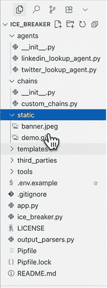

Figure 3.11 – Cloned IceBreaker repository opened in Cursor

随后打开 Claude Code 并将其固定在界面中。当提示时，批准 Claude Code 访问和分析项目文件的请求。

第一步是运行 `/init` 命令为项目创建 `CLAUDE.md` 文件。运行初始化过程会导致 Claude 扫描仓库中的所有文件。它会识别技术栈、已安装包、所需环境变量及整体结构。基于此分析，Claude 生成捕获此信息的 `CLAUDE.md` 文件作为项目内存。

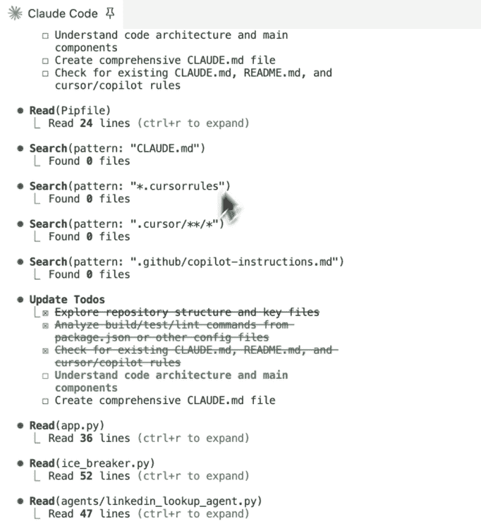

Figure 3.12 – Claude scanning repository files to generate CLAUDE.md

此过程中，Claude 会列出目录、搜索文件，并通过模式匹配和内容检查快速分析。读取文件后，它会生成建议的 `CLAUDE.md` 文件。

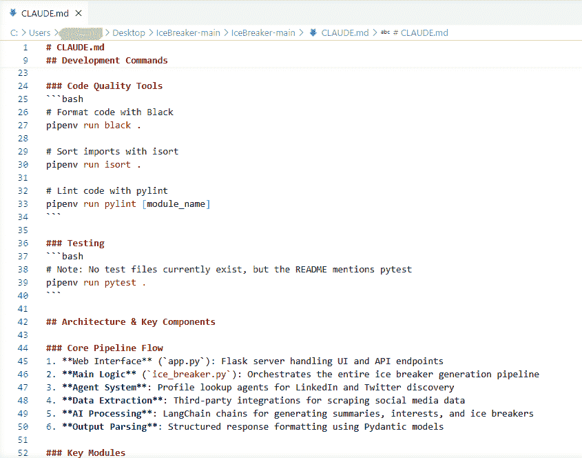

Figure 3.13 – Generated CLAUDE.md file with project overview and architecture details


生成的文件包含诸如如何使用 `pip` 安装依赖、如何运行项目以及主要组件概览等详细信息，包括抓取、摘要和代理逻辑。一经批准，该文件将成为项目记忆的一部分。

从现在起，发送给 Claude 的每个提示词都将包含此 `CLAUDE.md` 文件的内容作为上下文的一部分。

### 验证项目记忆

为确认记忆功能正常工作，我们首先重置对话以消除先前聊天记录的任何影响。使用 `/clear` 命令，然后再次提问。例如，我曾询问 Claude 项目使用的技术栈：

```
What stack am I using for this project?
```

输出应如下所示：

```
Based on the codebase analysis, your project uses this tech stack:

Backend Framework: Flask (Python web framework)
AI/LLM Framework: LangChain with OpenAI GPT models (GPT-4o-mini for agents, GPT-3.5-turbo for content generation)
Data Sources: Scraping (LinkedIn), Twitter API, Tavily (web search)
Package Management: Pipenv
Code Quality: Black (formatting), isort (import sorting), pylint (linting)
Testing: pytest
Output Parsing: Pydantic models
Frontend: HTML templates with Flask templating
Environment: Python 3.10+
The core architecture is a LangChain-powered AI pipeline that combines social media data scraping with LLM-based content generation.
```

Claude 在无需调用任何工具的情况下提供了准确的回答。这些信息是在初始化期间 Claude 分析文件时推断出来的。

至此，我们可以确认 Claude 依赖的是存储的记忆，而非聊天记录。

### 添加和使用记忆条目

现在让我们看看如何添加新的记忆条目。此时，如果我们提出一个问题，例如 *What do I like to eat?*，Claude 会生成类似以下的回答：

```
> what do i like to eat?

I don't have any information about what you like to eat. I can only see your codebase files and project structure, but there's no personal information about your food preferences in this ice breaker application repository.
If you'd like to share what you like to eat, I'd be happy to help with any related coding tasks!
```

为了让 Claude 能够回答这个问题，我们使用井号语法添加一条记忆条目。在本例中，我们声明我们喜欢吃披萨，并将该条目存储在项目记忆中：

```
# I like to eat pizza
```

添加此信息后，清除对话并再次提出相同的问题，Claude 现在将能够利用存储的记忆正确回答：

```
> what do i like to eat?
Pizza
```

如果我们想添加另一条记忆条目，重复相同的过程并添加一条声明偏爱汉堡的新条目。这一次，该条目被存储在用户记忆中，位于 `~/.claude/CLAUDE.md`。清除对话并再次尝试提问。Claude 将正确回忆起这两种偏好：

```
> what do i like to eat?
Based on your CLAUDE.md files, you like to eat both Hamburger (from your global preferences) and Pizza (from your project-specific memory).
```

同样的方法可用于其他类型的持久化信息，例如偏好的编码风格、常用工具，或我们希望 Claude 在跨项目和跨会话中记住的反复出现的工作流约定。

### 使用多个记忆文件

随着项目的增长，单个 `CLAUDE.md` 文件可能会变得庞大且难以管理。Claude Code 支持在代码库中分布使用多个 `CLAUDE.md` 文件。Claude 会递归遍历目录结构，并将所有相关的记忆文件加载到上下文中。

这使得记忆能够以结构化的方式进行组织。例如，服务端上下文可以位于一个区域，前端上下文位于另一个区域，而 DevOps 或 Claude 专用规则则位于别处。这种方法使记忆更易于维护且更具针对性。

结合钩子使用时，这种设置能实现更高级的行为。例如，根据正在进行的工作类型，可以附加不同的记忆文件。上下文切换钩子可以在处理数据库代码时附加数据库相关的记忆、在处理 UI 组件时附加前端上下文、或在处理后端逻辑时附加 API 相关的记忆。

这种级别的控制允许根据用户输入和工作流需求动态定制记忆，为更高级和灵活的上下文管理模式打开了大门。

# Claude Code 中的倒带功能

在本节中，我们将探讨 Claude Code 的检查点和倒带功能，该功能允许您在编码会话中安全地撤销更改。Claude Code 会自动跟踪每个提示词创建的文件修改，使得在需要时可以回滚不需要的编辑。

要触发倒带，请按两次 `Esc` 键或使用 `/rewind` 命令。

## 倒带功能的优势与重要性

该功能的价值显而易见：

*   在尝试更大或更激进的更改时提供安全网
*   允许在不丢失工作代码的情况下探索替代实现
*   使从错误中恢复变得快速且可预测
*   通过让撤销操作变得简单，降低了纠正 AI 生成错误的成本
*   增强了用户在使用 AI 辅助编码时的信心
*   通过降低使用 AI 工具的感知风险，鼓励更广泛的采用
*   它与 **AI 恢复成本 (CAIR)** 指标密切相关（[`www.blog.langchain.com/the-hidden-metric-that-determines-ai-product-success/`](https://www.blog.langchain.com/the-hidden-metric-that-determines-ai-product-success/)），该指标衡量用户从 AI 错误中恢复的难易程度，并在课程后面重新探讨

倒带功能在 Claude Code 最初发布几个月后引入。

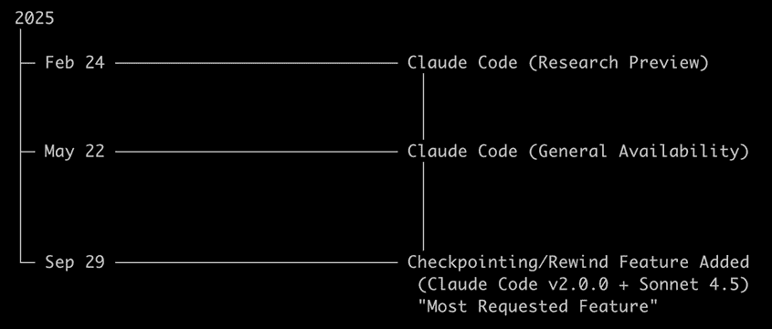

图 3.14 – Claude Code 发布时间线及倒带功能引入

社区强烈呼吁倒带功能，且在它成为原生功能之前，已有多个开源工具尝试提供类似功能。如今，倒带功能直接内置于 Claude Code 中，且直观易用，几乎无需解释。为了解实际上倒带功能是如何显示和工作的，让我们简要回顾一下使用它的界面上下文。

## 实战中的倒带使用

在撰写本书时，Claude Code 运行的是 2.1 版本。界面包含若干近期更新，包括视觉优化和 Sonnet 4.5 的使用，后者是 Anthropic 针对编码任务优化的最新模型。您还会注意到界面底部有一个自定义状态行。这是用户自定义的，将在本书后面介绍。

为了演示倒带功能，我们从一个简单的 Next.js 示例开始：

1.  向 Claude Code 提问，例如：

```
How do I bootstrap a Next.js project?
```

提示词在本地执行。设置完成后，使用 `npm run dev` 运行应用程序并在浏览器中打开。正如预期的那样，这将生成标准的 Next.js 样板应用程序。

2.  然后我们有意对代码库应用一系列简短的增量更改。此处的目的不是评估用户界面的质量，而是模拟一个真实的开发工作流，其中更改可能稍后需要撤销。在我的示例中，我将执行以下操作：

    1.  首先，提示 Claude Code 为 HooksHub 创建一个具有视觉差异化风格的着陆页
    2.  接着，提示 Claude Code 添加一个常见问题解答 (FAQ) 部分
    3.  最后，提示 Claude Code 添加一个页脚部分


## 图 3.15 – 使用 Claude Code 生成的 HooksHub 着陆页

每个提示词都会导致文件编辑，这些编辑可通过 `diff` 视图查看，且每项更改都会即时反映在正在运行的应用程序中。

添加页脚后，显而易见，尽管该功能正常工作，但结果比预期更沉重、视觉上更具主导性。这是一个自然的节点，此时撤销更改比手动编辑代码或发出修正提示词更为合适。

### 3. 要还原更改，请使用 `/rewind` 命令调用倒带功能

这将打开当前会话的时间线，显示迄今为止发出的所有提示词，并指示哪些提示词导致了文件修改。

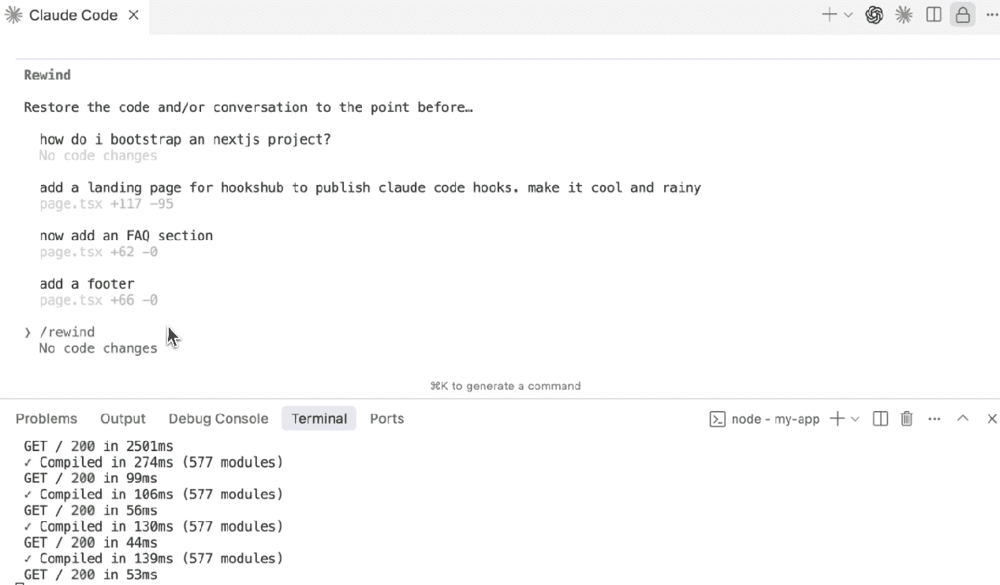

**图 3.16 – 使用 /rewind 命令查看会话历史记录和文件更改**

仅生成解释的提示词显示时不带关联的文件更改，而修改文件的提示词则清晰地显示受影响的文件和行。

### 4. 为您的示例选择最后添加的提示词

在本例中，选择添加页脚的那个提示词。将向您显示三个选项：

*   **还原代码和对话**，将文件和聊天上下文同时重置至该时间点
*   **还原对话**，保留文件更改不变
*   **还原代码**，保留对话历史不变

在实践中，同时还原代码和对话是最常见的选择，因为它能将项目恢复到干净一致的状态。仅还原代码在您希望保留对话上下文并重新处理实现时很有用。

### 5. 为了演示这一点，仅还原与页脚相关的代码更改

页脚立即从应用程序中移除。之所以有效，是因为 `Claude Code` 在应用任何文件编辑之前会自动创建一个检查点。

每个导致代码更改的提示词都会创建一个新的检查点。这些检查点跨会话持久化，并保留长达 30 天，为实验和迭代提供了安全网。

由于对话历史仍然存在，现在可以发出后续提示词，例如 `create a footer, make it minimalistic`（创建一个页脚，使其极简化）。`Claude Code` 利用现有上下文正确解析引用，并生成了更轻量的实现。刷新应用程序确认更新后的页脚更符合预期设计。

### 虽然倒带功能强大，但它也有局限性

*   `Claude Code` 执行的 `Bash` 命令不被跟踪，无法还原
*   在 `Claude Code` 外部进行的手动编辑不会被检查点捕获
*   倒带功能不能替代 `Git` 等版本控制系统
*   检查点应被视为本地、短期的撤销功能，而非永久历史记录

正确使用时，倒带功能能显著降低实验成本。它鼓励探索，降低更改风险，并使与 `Claude Code` 的迭代开发更安全、更高效。

# Claude Code 中的自定义斜杠命令（由 Skills 提供支持）

在本节中，我们将回顾如何在 `Claude Code` 中创建自定义斜杠命令。此功能非常强大，因为它赋予了开发者高度的灵活性，可定制和扩展 `Claude Code`。我们将通过定义一个用于创建 `Git` 提交信息的技能来创建一个自定义斜杠命令。更高级的技能将在 *第 7 章* 中介绍。

## 创建技能

我们将从一个干净的项目开始，并切换到 `custom‑commands` 分支。要创建技能，首先在项目中创建一个 `.claude` 目录（如果尚不存在）。在其中创建一个 `skills` 目录。

1.  每个技能都定义为其自己的目录：

    ```
    .claude/skills/commit-code/
    ```

2.  在该目录中，创建一个名为以下内容的必需文件：

    ```
    SKILL.md
    ```

    技能定义为 Markdown 文件。元数据使用位于 `SKILL.md` 顶部的 YAML 前言声明，包含在 `---` 分隔符之间。文件正文包含实际的提示词，以 Markdown 编写。

3.  为文件添加标题。此标题显示在斜杠命令菜单中。

4.  编写命令提示词：

    ```
    Review the files that have changed, and create a commit with a commit message summarizing the changes made. Always try to give short and concise messages that convey the business logic.
    ```

    我请求 `Claude Code` 查看已更改的文件，并创建一个提交，其提交信息总结所做更改，始终尝试给出简短且简洁的信息以传达业务逻辑。

虽然提示词本身很短，但 `Claude Code` 能够推断并执行多项操作。它可以使用 `Git` 命令检查已更改的文件，审查差异，并创建提交。这演示了单个技能如何封装一系列动作。

## 执行技能

要测试该命令，打开 `Claude Code` 并输入 `/`。新的 `commit‑code` 命令应出现在列表中。执行它将导致 `Claude Code` 运行 Markdown 文件中定义的提示词。

`Claude Code` 还会检测 `.claude` 目录中的未跟踪文件，并询问是否应添加它们。任何批准的决定将存储在 `settings.local` 中。随后 `Claude` 将根据检测到的更改提出提交信息，并显示相应的 `Git` 命令。

但如果生成的提交信息不够描述性怎么办？我们不继续执行，而是停下来改进技能。

## 使用 $ARGUMENTS 改进技能

前往开头添加的初始提示词并更新命令提示词。在我的示例中，我要求 `Claude Code` 通过引入 `$ARGUMENTS` 占位符来接受用户提供的提示。

我们在调用技能时可以传递参数。参数通过 `$ARGUMENTS` 占位符获取。

调用技能时，技能名称后面跟随的任何内容都将替换 `$ARGUMENTS` 占位符。更多相关内容将在 *第 9 章* 中介绍。

```
Review the files that have changed, and create a commit with a commit message summarizing the changes made. Always try to give short and concise messages that convey the business logic.

Use user hints to be the message main subject $ARGUMENTS
```

进行此更改后，再次执行 `/commit‑code` 并提供与技能相关的主题提示：

```
/commit-code custom code
```

`Claude Code` 现在应生成更具描述性的提交信息，反映请求的更改。

批准后，提交被创建，由 `Claude` 共同编写。然后我们通过运行 `git push` 将更改推送到远程仓库，并在项目的 `custom‑commands` 分支中验证提交。

您也可以通过以下步骤创建并执行额外的技能：

1.  创建一个带有适当标题的新命令文件
2.  定义一个基于用户输入产生输出的提示词
3.  附加参数，以便命令可在运行时接受动态值

重启 `Claude Code` 后，新命令变为可用，并可使用用户提供的输入执行。这展示了技能如何支持动态和灵活的行为。

# 通过上下文工程改进自动生成的提交信息

早些时候，我们讨论了上下文工程。为了使其更具体，让我们看一个直接取自 `Claude Code` 文档的具体用例：

```
---
allowed-tools: Bash(git add:*), Bash(git status:*), Bash(git commit:*)
description: Create a git commit
---

## Context

- Current git status: !`git status`
- Current git diff (staged and unstaged changes): !`git diff HEAD`
- Current branch: !`git branch --show-current`
- Recent commits: !`git log --oneline -10`

## Your task

Based on the above changes, create a single git commit.
```


# 此示例展示了一种技能，它执行与生成提交消息相同的任务，但方式更稳健、更安全、功能更丰富。理解这种方法为何更好，有助于阐明上下文工程、工具控制和代理设计在实践中是如何结合在一起的。

在技能中，我们可以运行 Shell 和 Bash 脚本。这意味着我们可以将任意代码作为命令的一部分来执行。因此，我们可以发起 HTTP 请求、运行容器，或执行任何可用代码表达的其他操作。这实际上消除了技能能力的大多数限制。

在这个特定的斜杠命令示例中，配置首先定义了一组允许使用的工具。这通过限制代理被允许使用的工具来限制其范围。

如果你有实现代理的经验，这符合最小权限原则。其理念是界定代理的范围，使其仅拥有执行任务所需的最小能力集合。对于生成提交消息的情况，必要的操作仅限于诸如 `git add`、`git status` 和 `git commit` 等命令。

以这种方式限制工具集可以提高安全性。在早期较简单的 `commit-message` 命令中，未应用此类限制，这意味着代理可以访问 Claude Code 中所有可用的工具。在这种情况下，如果上下文被污染（例如，通过恶意输入），代理可能会在系统上执行意外操作。这是文档示例成为更强大、更安全设计的原因之一。

此示例还演示了深思熟虑的提示工程。上下文被显式定义并精心构建。在生成提交消息之前，命令会执行一系列 Git 命令，例如 `git status`、`git branch` 和 `git log`。这些命令提供了关于仓库状态和待提交变更的精确上下文。

从这个角度来看，该工作流与检索增强生成非常相似。首先，系统通过运行 Git 命令收集上下文来检索相关信息。一旦该上下文可用，生成步骤就会产出提交消息。

这说明了检索和生成是如何在一个定义良好的单一命令中结合的。它还展示了前面讨论的多个概念，包括上下文工程、工具限制和代理设计，是如何以实用且可扩展的方式结合在一起的。

总体而言，这种方法为利用 Claude Code 中的技能构建更安全、更强大的工作流开辟了广阔的可能性。

位于 `---` 分隔符之间的部分称为前置元数据，并在提示词主体之前进行求值。

# 总结

在本章中，你学习了如何在基础之上配置和使用 Claude Code。我们从高层介绍了认证和定价，如何使用斜杠命令控制 Claude Code，以及如何将其直接集成到 IDE 中以获得更流畅的工作流。你探索了配置选项、用于自动化的钩子、通过 `CLAUDE.md` 文件实现的记忆，以及上下文如何在会话间加载和复用。我们还考察了用于安全撤销变更的检查点和倒带功能，以及用于封装可重复工作流并进行适当工具作用域划分的技能。至此，你应该了解 Claude Code 在实践中是如何运作的，如何使其保持安全和可预测，以及如何塑造其行为以支持更高级、长期运行的开发工作流。

在下一章中，我们将探讨**模型上下文协议** 以及它如何标准化 AI 应用程序与外部工具之间的集成。

# 获取本书的 PDF 副本、代码包等

扫描二维码（或访问 [packtpub.com/unlock](https://packtpub.com/unlock)）。按名称搜索本书，确认版本，然后按照页面上的步骤操作。


*注意：请准备好发票。直接从 Packt 网站购买不需要发票。*

