# 4 使用 MCP 服务器和插件扩展 Claude Code

**模型上下文协议 (MCP)** 为 AI 应用程序提供了一种标准化方式，通过通用接口连接到工具、数据源和服务。开发者无需为每个宿主应用程序构建单独的集成，只需在 MCP 服务器中实现一次功能，即可跨任何兼容 MCP 的客户端复用。MCP 的引入旨在解决这一集成挑战。这一抽象层实现了互操作性、可移植性和生态系统增长。在 Claude Code 的语境下，MCP 变得尤为重要，因为它使开发者能够以结构化且可复用的方式，为编码代理扩展额外的工具、能力和集成。

在本章中，你将了解什么是 MCP、为何创建它以及它在实践中如何工作。你将探索 MCP 解决的集成问题，并考察其核心架构组件：宿主、客户端和服务器。通过实际演示，你将把 MCP 服务器连接到 Claude 和 Cursor 等 AI 应用程序，配置本地和远程 MCP 服务器，并理解工具如何通过协议暴露和调用。

你还将考察重要的运维因素。尽管 MCP 功能强大，但它也带来了与上下文管理、性能和执行效率相关的挑战。本章探讨了减少上下文污染的上下文工程策略、合理界定 MCP 配置作用域，以及在会话中动态管理服务器的方法。此外，你将了解 Claude Code 插件如何将 MCP 服务器和相关组件打包成可复用、可共享的单元，从而实现团队级的标准化。

本章的总体目标是帮助你建立扎实的 MCP 概念和实践基础。在最后，你将不仅理解 MCP 如何实现跨平台工具集成，还将掌握如何在真实世界的 AI 系统中负责任地配置和管理它。

这一知识很重要，因为 MCP 正迅速成为基于代理架构中的基础层。随着 AI 开发转向工具增强和自主系统，理解 MCP 的架构、优势和权衡，将使你能够设计可扩展、高效且可互操作的 AI 应用程序。

在本章中，我们涵盖以下主题：

*   为什么需要 MCP？
*   MCP 核心架构
*   MCP 实战
*   将 Claude Code 连接到 MCP 服务器
*   MCP 作用域速查表
*   MCP 生态系统中的上下文工程


### 项目级 MCP 配置

# MCP 的当前局限性

# 使用 Claude Code 插件管理配置

虽然本书以 Claude Code 为核心，但 MCP 是一个跨平台协议，受多种 AI 开发工具支持。为了演示方便，本章在部分示例中使用了 Cursor。其底层概念保持一致，适用于使用 Claude Code 的场景。

# 为什么需要 MCP？

MCP 得到了快速普及，引发了广泛讨论，并涌现了大量 MCP 服务器实现。许多 AI 应用（包括 `Claude Code` 和 `Cursor` 等工具）都在其系统中集成了 MCP。

在详细定义 MCP 之前，了解它所解决的需求至关重要。

## 集成问题

设想一个 AI 智能体，设计用于执行发送 Slack 消息、读取和发送电子邮件、查询数据库等操作。要启用这些能力，必须直接实现所需功能。这涉及使用 Slack 或 Gmail 等 API，并编写自定义代码将这些集成封装为智能体可访问的工具。

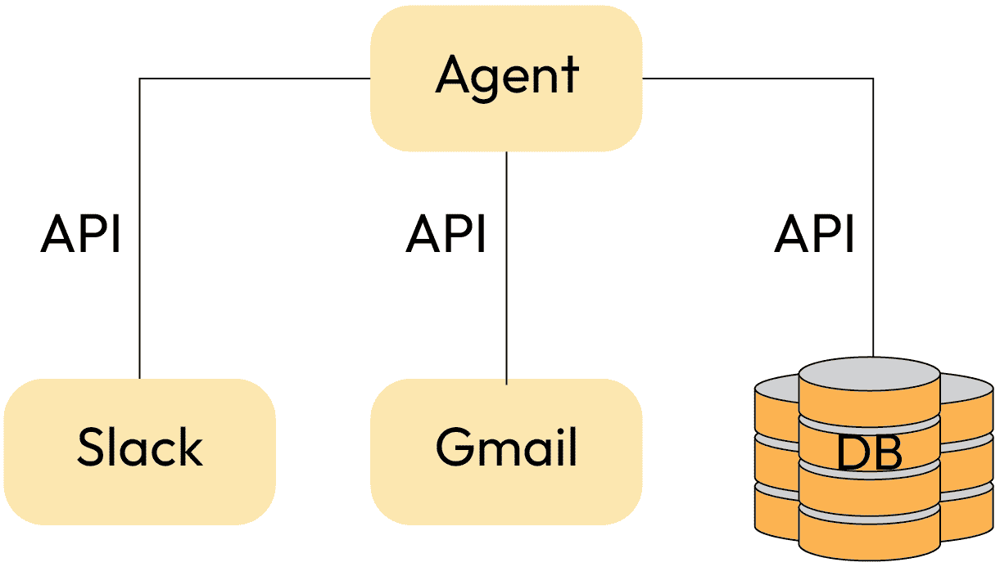

**图 4.1 – 智能体通过 API 与 Slack、Gmail 和数据库集成**

在许多情况下，需要自定义实现。例如，电子邮件集成可能会有意排除 Gmail API 的删除端点，以防止意外数据丢失。因此，集成逻辑是根据特定需求量身定制并手动实现的。

框架可能提供内置工具。例如，框架可能包含一个涵盖完整 API 接口的预实现 Gmail 集成。此类工具可开箱即用，满足通用需求。然而，无论使用内置工具还是自定义工具，都必须在特定的智能体环境中集成功能。

一旦实现，智能体就能发送邮件、发布 Slack 消息或执行数据库查询。该集成在该特定智能体内生效。

## 可移植性挑战

假设该智能体被广泛采用，其他团队希望在不同环境中使用其功能。

例如，考虑一个最初构建用于在 `Cursor` 环境中运行的智能体。在此设置中，智能体通过各自的 API 与 Slack、Gmail 和数据库等外部服务集成。下图说明了这种架构。

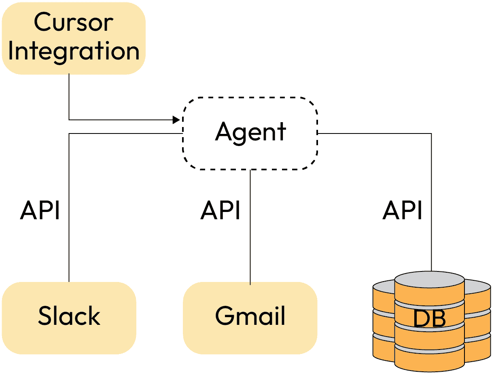

**图 4.2 – 智能体与 Cursor 环境及其 API 集成耦合**

在这种情况下，智能体与 `Cursor` 环境紧密耦合。与 Slack、Gmail 和数据库的集成是专门为该设置实现的。

现在假设我们要将相同的智能体能力集成到 `Claude Code` 中。尽管功能在概念上相同，但集成无法直接复用。因为实现是专门为我们的智能体编写的，所以必须为 `Claude Code` 重新创建集成。

因此，发送 Slack 消息、与 Gmail 交互或执行数据库查询等类似能力需要为新环境重新实现。如果我们想集成到 `Cursor` 怎么办？

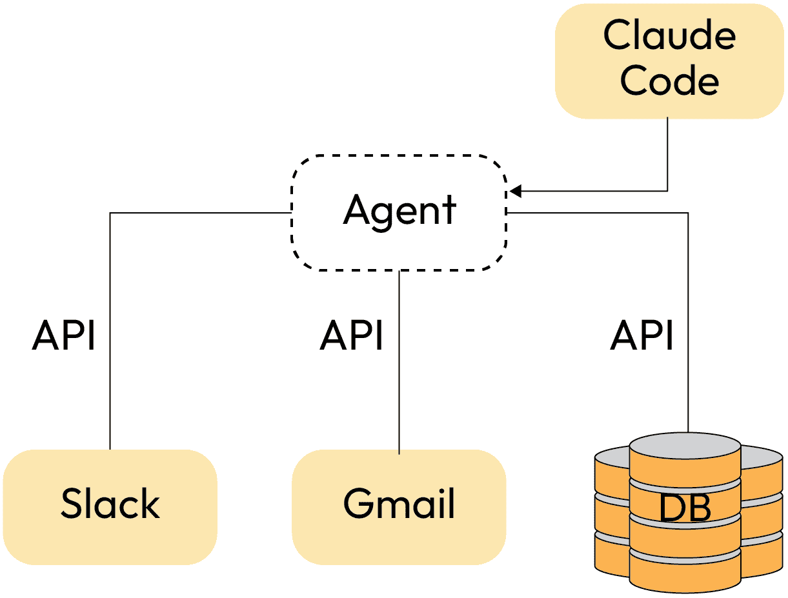

**图 4.3 – 为 Claude Code 环境重新实现智能体集成**

扩展对 `Cursor`、`Bolt`、`GitHub Copilot` 或其他 AI 代码助手等其他环境的支持需要重复此过程。每次新增集成都会引入额外的实现工作。相同的功能必须为每个目标系统单独适配。

## MCP 作为抽象层

可移植性挑战造成了一个反复出现的集成问题。每当相同功能需要在不同环境中使用时，开发人员都必须从头重建集成。

MCP 通过引入额外的抽象层来解决这一问题。软件工程中有一条著名原则：

> “我们可以通过引入一个额外的间接层来解决任何问题。”
>
> —— Andrew Koenig

这一想法与软件工程基本定理密切相关，该定理指出，许多复杂的系统问题可以通过增加一个抽象层来简化。MCP 服务器即服务于此目的。

开发人员不再将功能分别集成到每个智能体中，而是将实现一次性集成到 MCP 服务器中。支持 MCP 的智能体随后可以直接连接到该 MCP 服务器。

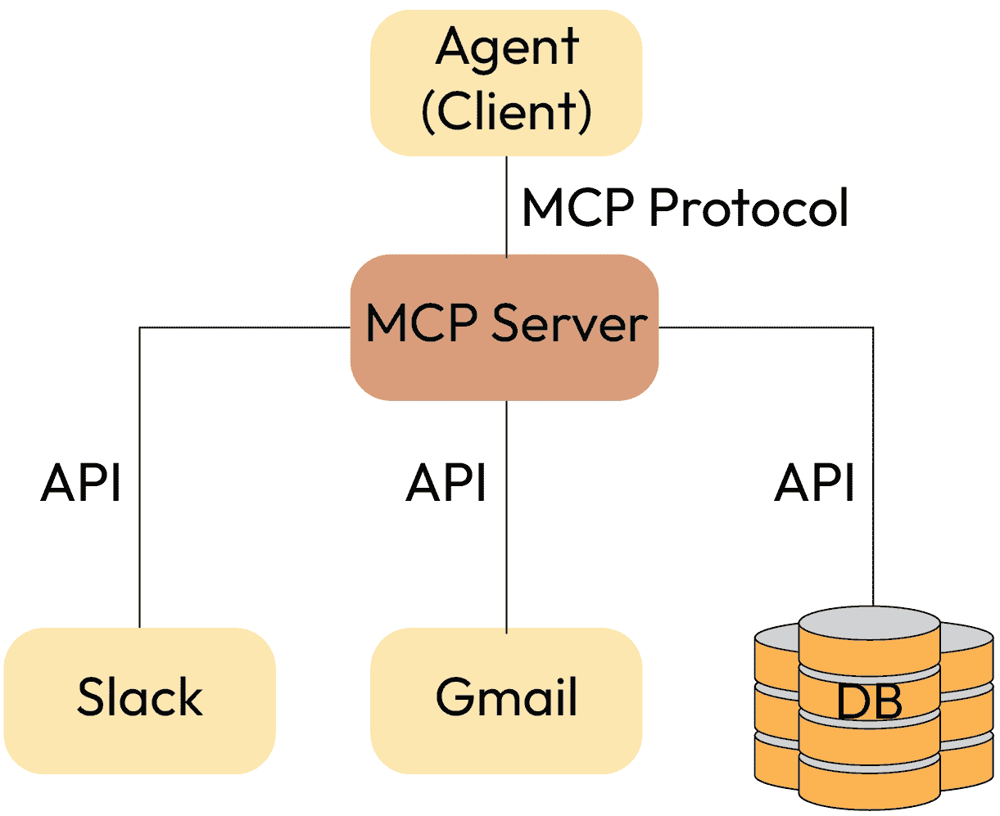

**图 4.4 – MCP 服务器作为外部服务的统一集成层**

采用这种方法，兼容性只需实现一次。一旦能力通过 MCP 服务器暴露，它们就可以在任何支持该协议的平台上使用。最初为 `Cursor` 实现的能力可兼容 `Claude Code` 和其他支持 MCP 的环境，无需额外的集成逻辑。

开发人员无需为每个平台重写或复制集成代码。任何支持 MCP 的系统都可以连接并无缝使用该功能。

### 网络效应与生态增长

MCP 的增长反映了类似社交平台的网络效应。用户基数较小的社交应用提供的价值有限。随着采用率提高和用户贡献内容，系统变得更有价值，形成增长的强化循环。

MCP 也出现了类似动态。随着采用率提高和更多 MCP 服务器的开发，生态系统不断扩大。不断增加的实现拓宽了可用集成和能力的范围，提升了协议的整体效用。

奠定这一基础后，下一步是探究 MCP 的核心架构及其在实践中的运作方式。

# MCP 核心架构

MCP 标准化了应用程序向 `大语言模型` (`LLMs`) 提供上下文的方式。上下文可以采取多种形式。它可能包含追加到提示词的额外信息、要调用的工具规范，甚至提示词本身。

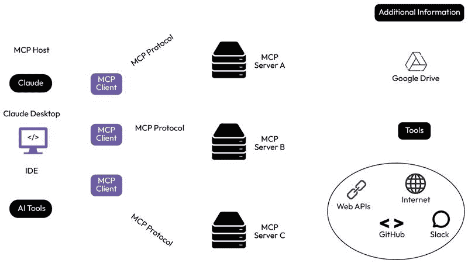

**图 4.5 – 连接主机、客户端和 MCP 服务器的 MCP 核心架构**

从这个意义上讲，上下文涵盖了塑造 LLM 响应方式的支持数据和操作指令。

一旦此类标准被广泛采用，它就能在 AI 应用中实现强大且可扩展的集成开发。

## MCP 的优势

MCP 文档 ([`modelcontextprotocol.io/`](https://modelcontextprotocol.io/)) 强调了采用 MCP 的几大优势：

*   首先，MCP 支持广泛的集成、工具和数据源生态系统，可模块化地连接到由 LLM 驱动的应用程序。例如，作为 AI 驱动的编码智能体，`Claude Code` 利用 MCP 通过结构化工具集成扩展其能力。

*   其次，MCP 降低了对特定 LLM 供应商或 AI 应用提供商的耦合。开发人员可以将核心功能实现为工具，并通过 MCP 服务器暴露它们。这些工具随后可跨不同供应商和主机应用程序复用，无需修改。


*   开源框架（如 LangChain）解决了 AI 工程中一些重叠的挑战。然而，MCP 与 LangChain 处理这些问题的方式不同，且它们的解决方案并不直接重叠。例如，两者都可能支持可扩展性，但其机制和架构含义有所不同。

# MCP 的核心组件

MCP 架构由三个主要组件组成：MCP 主机、MCP 服务器和 MCP 客户端。

## MCP 主机

`MCP` `host` 是支持 MCP 的 AI 应用程序。示例包括 Claude Desktop、开发环境（如 Claude Code 或 Cursor）以及专用 AI 代理。这些应用程序通过 MCP 进行增强，将它们连接到原生不可用的额外工具、数据源或产品。

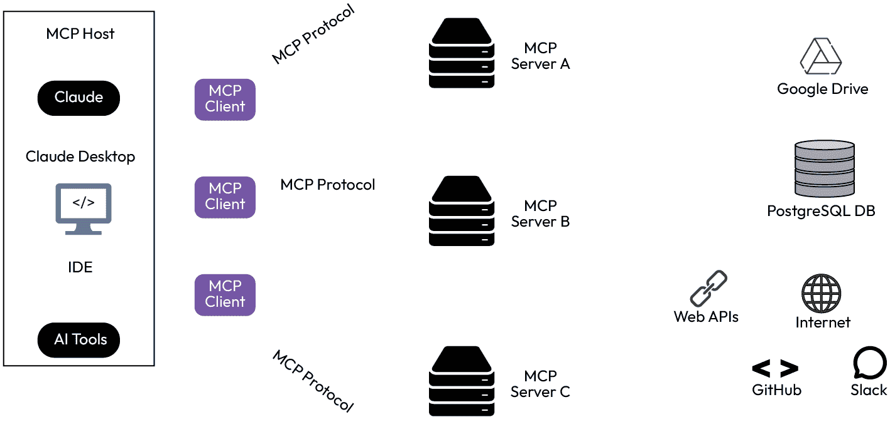

图 4.6 – MCP 主机通过 MCP 客户端连接到 MCP 服务器

## MCP 服务器

`MCP` `servers` 向 MCP 主机暴露功能。这些功能可能包括以下内容：

*   访问外部工具，例如调用 API 以检索天气信息
*   数据库搜索功能
*   知识资源，如 PDF 或大型文本

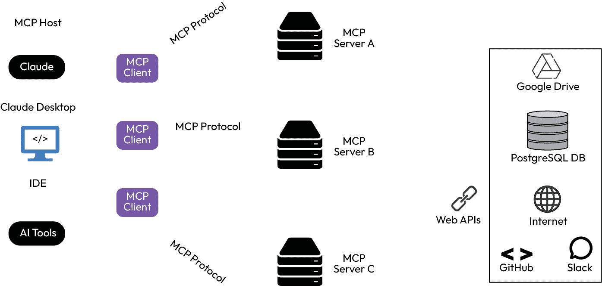

图 4.7 – MCP 服务器向 MCP 主机暴露工具、数据库和外部 API

MCP 服务器充当网关或代理，根据 MCP 规范暴露这些工具、资源和提示。

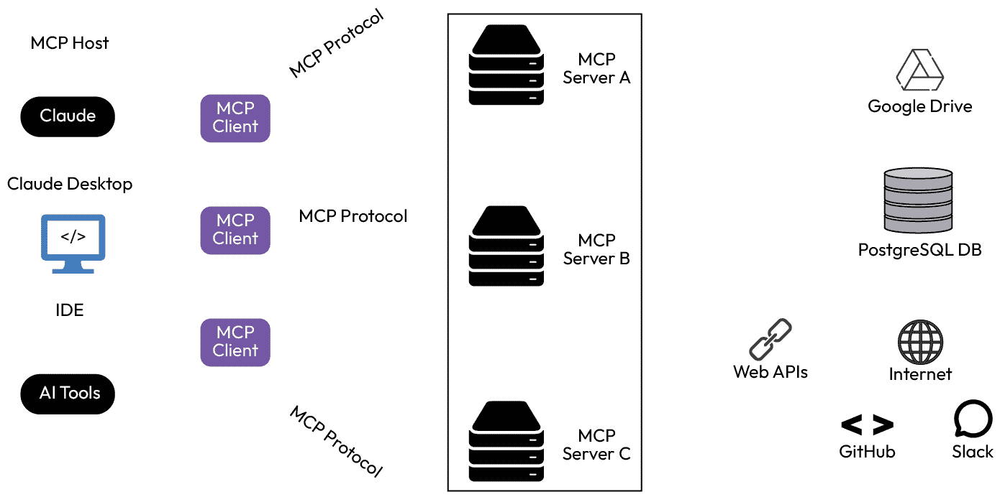

图 4.8 – MCP 服务器充当网关，提供对外部资源的标准化访问

为了符合协议，MCP 服务器会实现特定的方法，例如以下方法：

*   `listPrompts`
*   `getPrompt`
*   `listTools`
*   `callTool`
*   `listResourceTemplates`
*   进度通知机制

一旦实现，MCP 服务器即可连接到任何支持该协议的 MCP 主机。因此，一次编写的功能可跨多个主机应用程序复用。这种可复用性是 MCP 的核心架构优势。

## MCP 客户端

MCP 客户端位于 MCP 主机内部。它使用 MCP 实现主机与 MCP 服务器之间的通信。

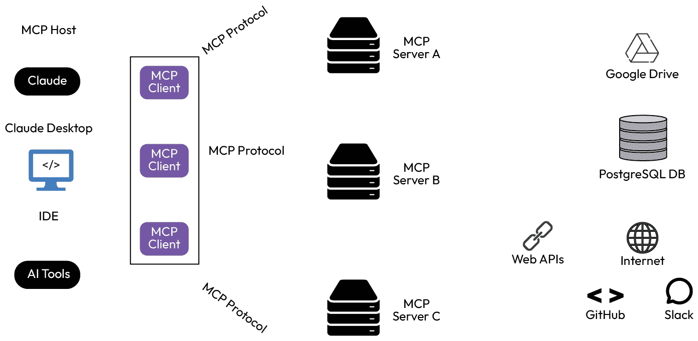

图 4.9 – 主机内的 MCP 客户端管理与 MCP 服务器的通信

例如，要将天气 MCP 服务器连接到 Claude Desktop，Claude Desktop 内部的 MCP 客户端会管理与该服务器的交互。客户端和服务器完全通过定义的协议进行通信。

MCP 客户端与 MCP 服务器之间存在一对一关系。单个 MCP 客户端无法与多个 MCP 服务器通信。因此，如果 MCP 主机需要连接到多个 MCP 服务器，它必须为每个服务器实例化多个 MCP 客户端，每个服务器一个。

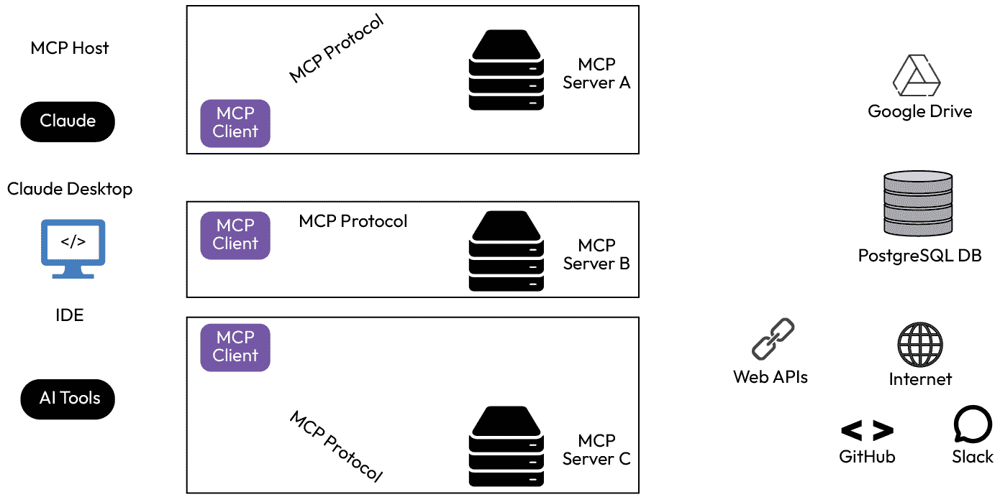

图 4.10 – 多个 MCP 客户端将主机连接到不同的 MCP 服务器

这种结构完成了 MCP 的核心架构，并为构建可互操作、可扩展的 AI 应用程序奠定了基础。

# MCP 实战

现在让我们演练一个添加和配置 MCP 服务器的实际示例。该演示展示了 MCP 启用的功能以及这些功能在实践中如何运作。该示例将实现天气检索功能的 MCP 服务器连接到两个不同的客户端：Claude Desktop 和 Cursor。

这两种情况使用的是同一个 MCP 服务器。配置细节单独讨论；此处重点关注服务器连接后的结果行为。任何支持 MCP 协议的客户端都可以使用此功能，包括 Claude Code、Claude Desktop、Cursor、Claude Code、Lovable 和其他兼容客户端。

## 未连接 MCP 服务器时的行为

在 Claude Desktop 中，开发者设置中最初未配置 MCP 服务器。例如，在未连接 MCP 服务器的情况下查询旧金山的天气时，语言模型通常会回答它无法访问实时天气信息。在某些情况下，它可能会尝试调用搜索工具以检索摘要信息。

没有 MCP，模型仅限于其训练数据，无法直接检索实时数据，除非通过通用的内置工具（如搜索）。

## 连接 MCP 服务器

配置天气 MCP 服务器后，它会出现在 Claude 的开发者设置中，并显示其运行时详情。

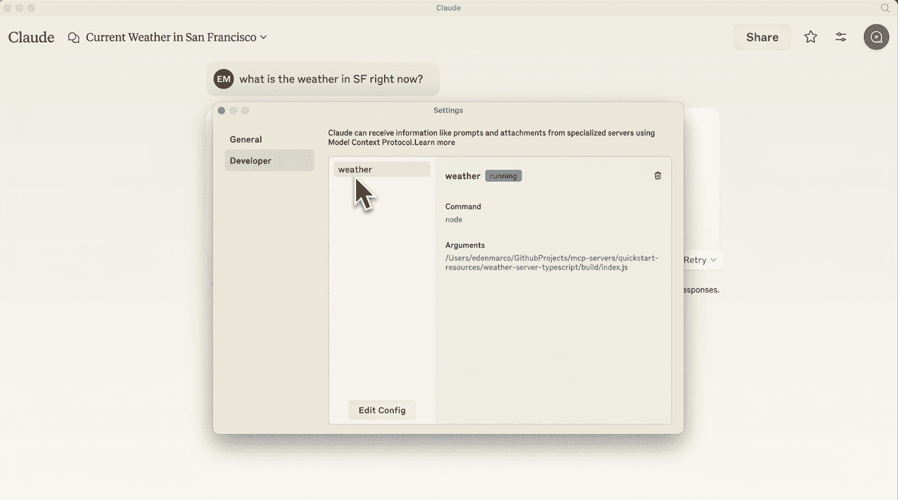

图 4.11 – 天气 MCP 服务器在 Claude 开发者设置中已配置

当再次查询旧金山的天气时，系统会提示请求权限在本地执行天气工具。工具执行需要批准，因为它可能涉及运行本地代码。与工具执行相关的安全考量将单独讨论。

**安全警告：** `MCP` `servers can run code on your machine`

MCP 服务器在本地运行代码，拥有与您的用户账户相同的权限。这意味着它们可以访问您系统上的文件、环境变量和网络资源。

添加 MCP 服务器前，请注意以下风险：

*   MCP 服务器可以在您的机器上执行命令，包括读取、修改或删除文件。
*   恶意服务器可能将敏感信息（如源代码、环境变量或 API 密钥）发送到外部服务。
*   来自 MCP 服务器的工具响应可能包含隐藏指令，从而影响模型行为。

像对待任何第三方依赖一样对待 MCP 服务器。尽可能审查源代码，从可信维护者处安装服务器，并避免使用提升的权限运行 MCP 服务器。

一旦授予 Claude Code 调用 MCP 工具的权限，将发生以下序列：

1.  MCP 服务器包含检索天气数据的逻辑
2.  服务器暴露一个名为 `getForecast` 的函数
3.  `getForecast` 函数接受两个参数：纬度和经度
4.  语言模型（Claude Sonnet 3.7）确定对应旧金山的纬度和经度
5.  模型向 `getForecast` 函数发出 MCP 调用
6.  MCP 服务器执行该函数并返回响应
7.  语言模型处理响应并生成最终答案：

    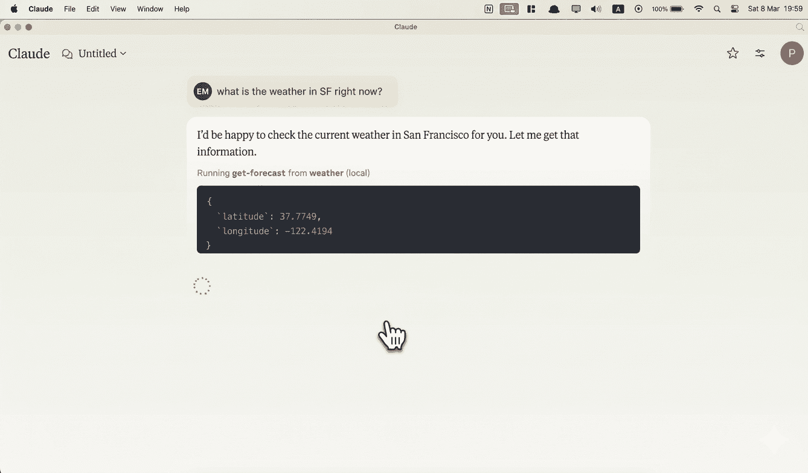

    图 4.12 – Claude 调用 MCP 天气工具并返回预测响应

结果是基于通过 MCP 服务器检索的实时数据生成的天气报告。

虽然检索天气数据是一个简单的示例，但底层机制支持任意逻辑。任何功能都可以在 MCP 服务器中实现。通过实现 MCP 协议，开发者使兼容的客户端能够通过工具调用来调用该功能。这将 AI 代理扩展到静态模型能力之外，并允许它们执行外部逻辑。

## 跨客户端复用同一 MCP 服务器

同一个天气 MCP 服务器可以连接到 Cursor。配置后，MCP 服务器会出现在 Cursor 设置的 MCP 选项卡中。

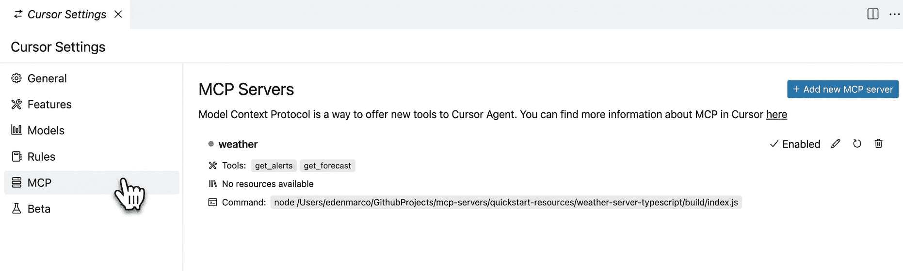

图 4.13 – Claude 调用 MCP 天气工具并返回预测响应

连接的服务器及其暴露的工具将被列出：

*   `GetAlerts`
*   `GetForecast`


该配置还显示了用于运行服务器的命令，在本例中为 Node.js 服务器。在 Cursor Chat 中，使用代理模式时可使用 MCP 功能。

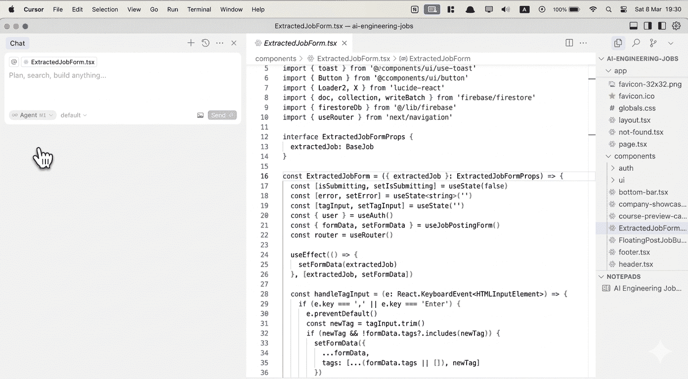

图 4.14 – 在代理模式下从 Cursor 调用 MCP 天气工具

当查询旧金山天气时代理会使用适当的参数调用 `GetForecast` 工具。在此配置中，Cursor 以 YOLO 模式运行，意味着工具会自动执行，无需人工批准。虽然这种方法很方便，但会带来安全隐患。

代理执行以下操作：

1.  使用纬度和经度参数调用 `GetForecast` 工具。
2.  从 MCP 服务器接收天气数据。
3.  判断天气预警可能也相关。
4.  调用 `GetAlerts` 工具检查旧金山的预警情况。
5.  将响应编译成最终答案，同时包含天气状况和任何活动预警。

在本例中，单个提示词中调用了两个工具。代理自主决定调用哪些工具以及如何将其结果整合为连贯的回复。

天气示例演示了一种通用模式：MCP 使 AI 代理能够执行 MCP 服务器中定义的外部逻辑。支持 MCP 的客户端可以连接到这些服务器并调用其工具。

通过在服务器中实现 MCP 协议，开发者使其功能可被任何兼容的 MCP 客户端访问。这消除了静态模型知识施加的限制，并允许代理执行动态、实时和自定义操作。

# 将 Claude Code 连接到 MCP 服务器

我们从一个空项目和本书 GitHub 仓库中一个名为 `project/MCP` 的空分支开始。要访问该仓库，请遵循*前言*中*下载示例代码文件*部分的步骤。然后我们使用 `/mcp` 斜杠命令列出可用的 MCP 服务器。此时，未列出任何 MCP 服务器。

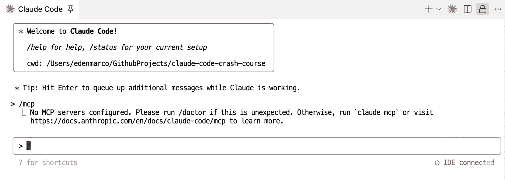

图 4.15 – 使用 /mcp 命令在 Claude Code 中列出可用的 MCP 服务器

有一个链接可通往 MCP 文档，其中解释了如何添加 MCP 服务器。有多种方法可以做到这一点：

*   通过文件添加 MCP 服务器
*   使用 CLI 添加 MCP 服务器

MCP 服务器可以通过文件添加；不过，推荐使用 CLI。CLI 通常是最新的，如果格式发生变化或 API 失效，使用 CLI 可确保兼容性。

## 通过 CLI 添加 Context7 MCP 服务器

**Context7** ([`context7.com/`](https://context7.com/)) 为大量包提供最新文档。许多包（尤其是 AI 生态系统中的包，如 LangGraph）更新频繁，拥有最新文档可确保生成的代码与最新 API 保持一致。

Context7 索引了近 30,000 个 ([`github.com/upstash/context7`](https://github.com/upstash/context7)) 包。

撰写本文时，该仓库拥有约 49,200 颗星。

要将 Context7 与 Claude Code 结合使用，需要 Claude Code 集成。命令如下：

```
claude mcp add --transport http context7 https://mcp.context7.com/mcp
```

该命令执行以下操作：

*   使用 `claude mcp add`
*   指定 HTTP 作为传输方式
*   分配 MCP 名称 `context7`
*   提供 MCP 服务器的 URL

这是一个远程 MCP 服务器，意味着服务器不在本地运行。相反，它运行在 Context7 服务器上。

每次调用都会向远程服务器发送请求。这种方法具有以下优势：

*   服务可以轻松扩展
*   MCP 可从多个客户端访问

HTTP 传输和远程 MCP 服务器在以下 MCP 课程中有更详细的解释：[`www.udemy.com/course/model-context-protocol/`](https://www.udemy.com/course/model-context-protocol/)。

将该命令复制并粘贴到终端中。执行前，添加 `--help` 标志以便您查看可用选项。

## MCP 服务器作用域与配置

帮助输出显示可以配置 MCP 服务器的作用域。MCP 服务器可以存在于以下作用域：

*   用户作用域
*   项目作用域
*   会话作用域

也可以为环境变量或 HTTP 标头提供可选值。

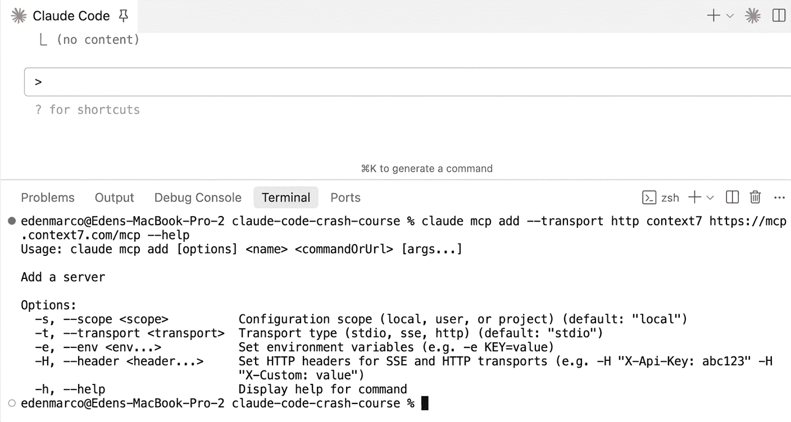

图 4.16 – 使用 mcp add 命令向项目添加 MCP 服务器

在本例中，添加 MCP 服务器时选择了项目作用域。

执行后，将创建一个包含 Context7 MCP 配置的新文件。该配置指定了 HTTP 传输类型和 MCP 服务器的 URL。

```
{
  "mcpServers": {
    "context7": {
      "type": "http",
      "url": "https://mcp.context7.com/mcp"
    }
  }
}
```

要在本地运行 MCP 服务器而非远程运行，可以使用以下替代命令：

```
claude mcp add context7 -- npx -y @upstash/context7-mcp
```

该命令使用 `npx` 下载仓库并在本地执行。

## 重启 Claude Code 并启用 MCP 服务器

安装 MCP 服务器后，必须重启 Claude Code。退出会话，清空终端，再次启动 Claude。

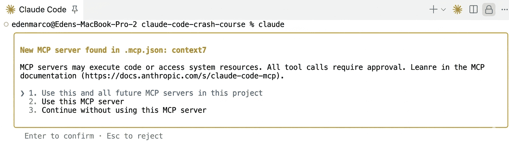

图 4.17 – 重启后 Claude Code 检测并启用已配置的 MCP 服务器

启动时，Claude 将检测 `mcp.json` 文件并提示请求连接到已配置 MCP 服务器的权限。选择第一个选项以允许连接。

随后，Claude 会为当前用户会话创建一个 `settings.local.json` 文件。打开该文件可确认 Context7 MCP 服务器已启用，允许 Claude 在需要时查询它。

# 列出并检查已安装的 MCP 服务器

现在可以列出 MCP 服务器。我们可以看到 Context7 MCP 服务器已连接。

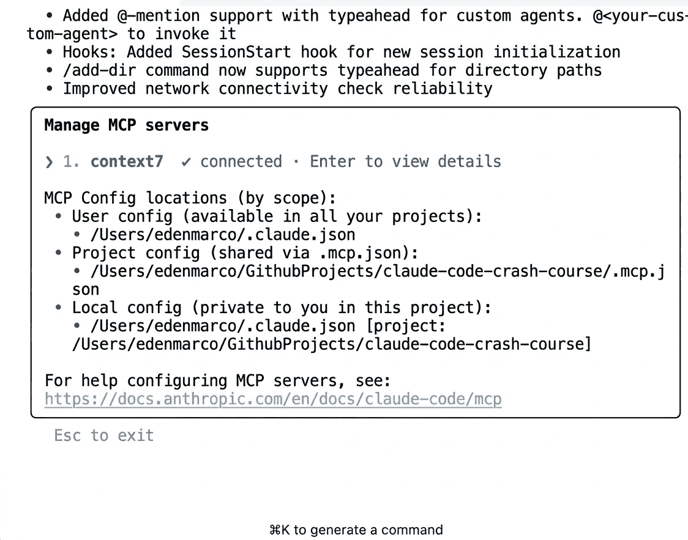

图 4.18 – 列出已安装的 MCP 服务器并检查已连接的 Context7 服务器

点击进入可看到它暴露了两个工具：

*   `resolve-library-id`
*   `get-library-docs`

这些工具描述成为代理上下文的一部分，允许代理根据需要动态调用工具。例如，当请求最新的 LangGraph 文档时，代理首先调用 `resolve-library-id` 以获取适当的上下文 ID，然后调用 `get-library-docs` 以检索最新文档。

## 使用 Context7 MCP 服务器查询 LangGraph

我们可以提出以下问题，并指定应使用 Context7 MCP 服务器：

*LangGraph 的最新版本是什么？*

Claude Code 请求调用 Context7 MCP 工具的权限。我们批准该请求，权限会更新在 `settings.local.json` 中。

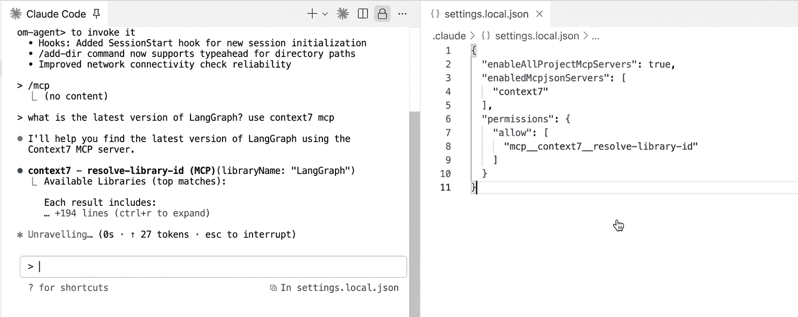

图 4.19 – 调用 Context7 MCP 工具检索最新 LangGraph 版本

MCP 服务器解析库 ID，然后发起另一个请求以检索文档。

根据 Context7 返回的文档，LangGraph 的最新版本报告为 **1.2**。

LangGraph 是一个活跃演进的框架。您可能会遇到比此处演示版本更新的版本；不过，此处讨论的架构概念和模式依然适用。

## 在项目记忆中持久化 MCP 服务器用法

我们将 Context7 配置为每次询问关于 LangGraph 的问题时都使用。为此，我们添加一条指令并将其保存到项目记忆中，以便跨会话持久化。


该指令已记录，并将创建一个`Claude.md`文件，包含以下条目：

```
When discussing LangGraph, always use context7 MCP
```

## 验证持久化 MCP 行为

我们可以重启 Claude、清除会话，并提出以下问题：

```
What is a LangGraph interrupt?
```

Claude Code 会自动选择 Context7 MCP 服务器。它会解析 LangGraph 库，检索相关文档和代码片段，并返回关于 LangGraph 中断的解释。

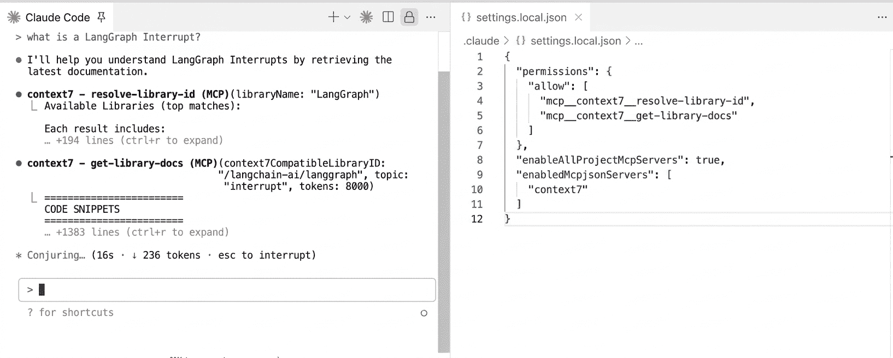

图 4.20 – Claude 自动使用 Context7 MCP 服务器解释 LangGraph 中断

由于 Context7 提供对当前文档和 API 的访问，生成的代码反映了最新的用法。

## 将 MCP 工件提交至版本控制

我们可以将生成的文件添加到 GitHub 仓库。我们使用提交信息`context7 mcp`提交更改，并通过以下命令推送到上游：

```
git commit -m "context7 mcp"
```

该提交可在本书的 GitHub 仓库中找到。要访问仓库链接，请遵循*前言*中*下载示例代码文件*部分的步骤。

# MCP 作用域速查表

选择正确的作用域有助于保持环境有序，并防止不必要的配置泄露到无关项目中。下表总结了何时使用每种 MCP 作用域：

| **方面** | **项目作用域** | **用户作用域** | **会话作用域** |
| --- | --- | --- | --- |
| **配置位置** | 项目根目录下的`.mcp.json` | `~/.claude/settings.json` | 通过`‑‑mcp‑config`标志启动或会话中途添加 |
| **可见性** | 项目中的每个人 | 仅你，跨所有项目 | 仅当前会话 |
| **提交到 Git？** | 是 | 否 | 否 |
| **跨会话持久化？** | 是 | 是 | 否 |
| **与团队共享？** | 是 | 否 | 否 |

表 4.1 – MCP 作用域对比：项目、用户和会话

## 何时使用各种 MCP 作用域

以下指南说明了各作用域的常见适用场景。

*   **项目作用域**（`.mcp.json`）
    *   当 MCP 服务器是项目共享开发环境的一部分时，使用项目作用域。
    *   特定于此项目的数据库工具（例如项目的 Postgres MCP）
    *   特定于项目的 API，如内部服务或预发布环境
    *   整个团队需要的自定义工具，如部署脚本或测试运行器
    *   与项目技术栈相关的文档服务器

*   **用户作用域**（`~/.claude/settings.json`）
    *   将用户作用域用于个人工具或与您自己的凭据相关的工具。
    *   个人生产力工具（Slack、Linear、Notion）
    *   与您的凭据相关的工具，如带有您 PAT 的 GitHub 或电子邮件访问
    *   您希望在所有项目中可用的通用服务器（例如 Tavily 搜索或 Context7 文档）
    *   依赖您不想提交到仓库的机密信息的服务器

*   **会话作用域**（`‑‑mcp‑config`/临时性）
    *   将会话作用域用于不应持久化的临时或实验性设置。
    *   一次性调试服务器，如临时代理或模拟 API
    *   您正在评估的实验性或不受信任的服务器
    *   依赖短期令牌的服务器（OAuth 会话或临时凭据）
    *   在运行期间动态启动服务器的 CI/CD 环境

# MCP 生态系统中的上下文工程

在本节中，我们将介绍 MCP 生态系统中的上下文工程。示例使用 Claude Code，但这些概念适用于任何支持 MCP 的智能体系统。

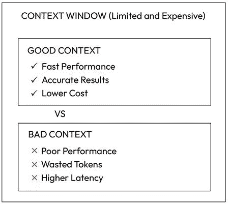

图 4.21 – 有限 LLM 上下文窗口内的良好与不良上下文使用

上下文是智能体系统中最昂贵且最有限的资源，尤其是在智能体编码工作流中。上下文直接影响智能体性能。不良的上下文会导致智能体性能不佳。本讨论仅关注性能影响，故意排除定价和延迟考量。

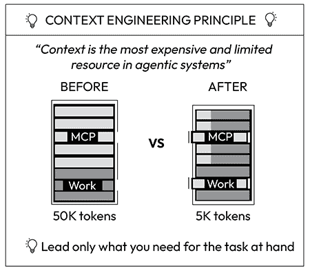

图 4.22 – 上下文工程：通过仅加载必要上下文来减少 Token

上下文低效最隐蔽但影响最大的来源之一是 MCP 配置。MCP 功能强大，但如果不小心使用，会显著降低上下文效率。主要问题是 MCP 可能会用不必要的 Token 使上下文窗口膨胀，这些 Token 属于当前任务不需要的工具。

## 问题——过于通用的 MCP 配置

上下文低效问题的根本原因是过于通用的 MCP 配置。当 MCP 服务器配置过于宽泛时，智能体会在处理任何请求之前，将所有可用工具加载到其上下文窗口中。这在任何推理开始之前就消耗了宝贵的 Token，留给实际任务的空间更少。

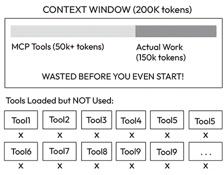

图 4.23 – 过于宽泛的 MCP 配置导致的上下文窗口浪费

在 Claude Code 中，MCP 服务器通常使用`mcp.json`文件在项目层面进行配置。该文件加载多个 MCP 服务器及其所有关联工具。

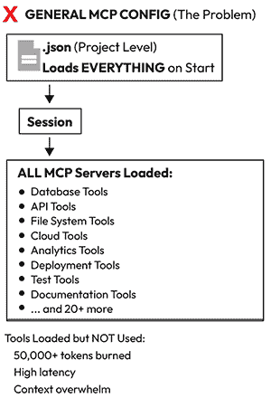

图 4.24 – 通用 MCP 配置在启动时加载所有工具

大多数设置遵循此模式。单一的通用 MCP 配置用于加载所有 MCP 服务器和工具。初衷是为智能体配备它可能需要的一切。

结果是每个会话都加载所有 MCP 服务器和所有 MCP 工具，即使它们不相关。这在编写任何提示词之前就可能消耗数万个 Token。

在本节中，我们介绍此问题并演示如何使用上下文工程技术来修复它。

## 示例仓库和 MCP 服务器

本节使用的代码可在本书 GitHub 仓库的`context‑engineering‑mcp`分支中找到。要访问仓库链接，请遵循*前言*中*下载示例代码文件*部分的步骤。我们从第一次提交开始，以便完全复现设置。

该仓库包含一个在`verbose_mcp_server.py`中实现的简单 MCP 服务器。该服务器使用 FastMCP 编写，并暴露了大量 MCP 工具，包括以下内容：

*   `add_two_numbers`
*   `subtract_two_numbers`
*   `multiply_two_numbers`

该服务器有意包含许多不需要的 MCP 工具。每个工具还包含详细描述。示例如下：

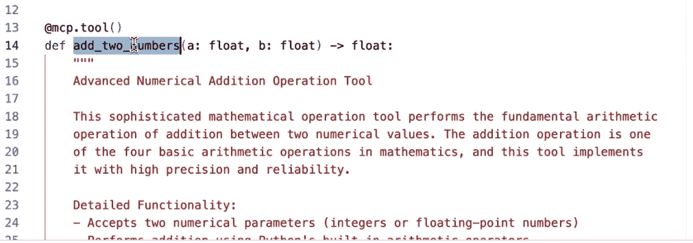

图 4.25 – 冗长的 MCP 工具定义增加上下文大小

这些描述有助于 MCP 客户端决定是否应调用工具，但它们也直接增加了上下文大小。

### 运行 MCP 服务器

MCP 服务器使用 UV 包管理器运行。仓库包含一个定义 FastMCP 依赖项（[`github.com/PrefectHQ/fastmcp`](https://github.com/PrefectHQ/fastmcp)）的`uv.lock`文件。请遵循以下步骤：

1.  运行`uv sync`并使用以下命令激活虚拟环境：

    ```
    source .venv/bin/activate
    ```

2.  环境激活后，FastMCP CLI（[`github.com/jlowin/fastmcp`](https://github.com/jlowin/fastmcp)）即可使用。我们使用`fastmcp run verbose_mcp_server.py ‑‑transport http`启动 MCP 服务器。


# 繁冗数学运算 MCP 服务器

繁冗数学运算 MCP 服务器现已使用可流式 HTTP 传输运行，并暴露在 `http://127.0.0.1:8000/mcp`。

## 将运行中的 MCP 服务器添加到 Claude Code

我们需要检查 MCP 服务器及其工具在加载到会话后如何影响上下文。在 MCP 服务器本地运行的情况下，我们打开 Claude Code 并添加此 MCP 服务器。

为此，我们创建一个项目级 MCP 配置文件，名为 `.mcp.json`。

如果我们返回仓库并检查分支，有一个标题为**添加基于项目的 MCP 配置**的提交。此配置可直接复制，按需添加 API 密钥。示例中显示的 API 密钥已进行混淆处理。

### 项目级 MCP 配置

项目级 MCP 配置定义了四个 MCP 服务器：

*   一个本地运行的繁冗 MCP 服务器
*   **Context7**，此前已介绍过 (<https://context7.com/>)
*   **Tavily** (<https://tavily.com/>)，用于搜索互联网、爬取网站和提取网页
*   **Playwright MCP**，用于浏览器自动化

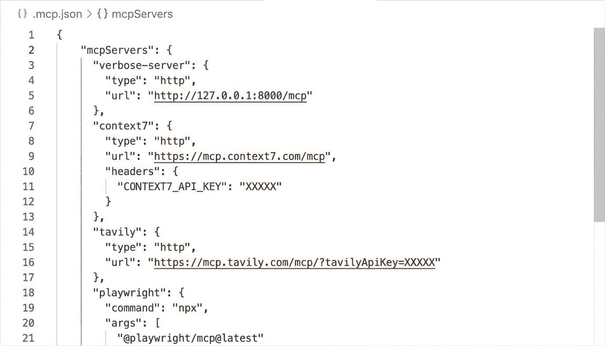

*图 4.26 – 定义在 mcp.json 中的包含多个服务器的项目级 MCP 配置*

这是一个项目级配置，意味着当从项目目录启动 Claude Code 时，所有四个 MCP 服务器都会自动加载。

配置中的 API 密钥已进行混淆处理。

要验证配置是否正确应用，请执行以下步骤：

1.  打开终端。
2.  切换目录到项目文件夹。
3.  确认你位于 `context-engineering-mcp` 分支。
4.  运行 Claude Code。
5.  运行 `/mcp` 确认所有四个 MCP 服务器均已连接。

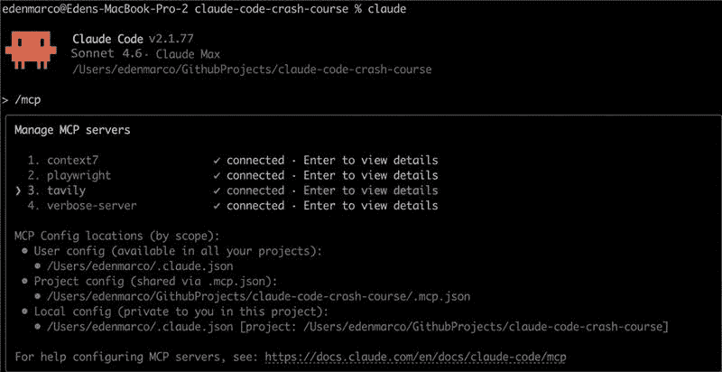

*图 4.27 – Claude Code 中连接的多个 MCP 服务器。*

## 检查上下文使用情况

接下来，我们运行 `/context` 以检查当前会话的上下文使用情况。

此时，尽管尚未编写任何提示词，我们已经接近上下文窗口的一半。`/context` 的输出揭示了可用 Token 的分布情况。

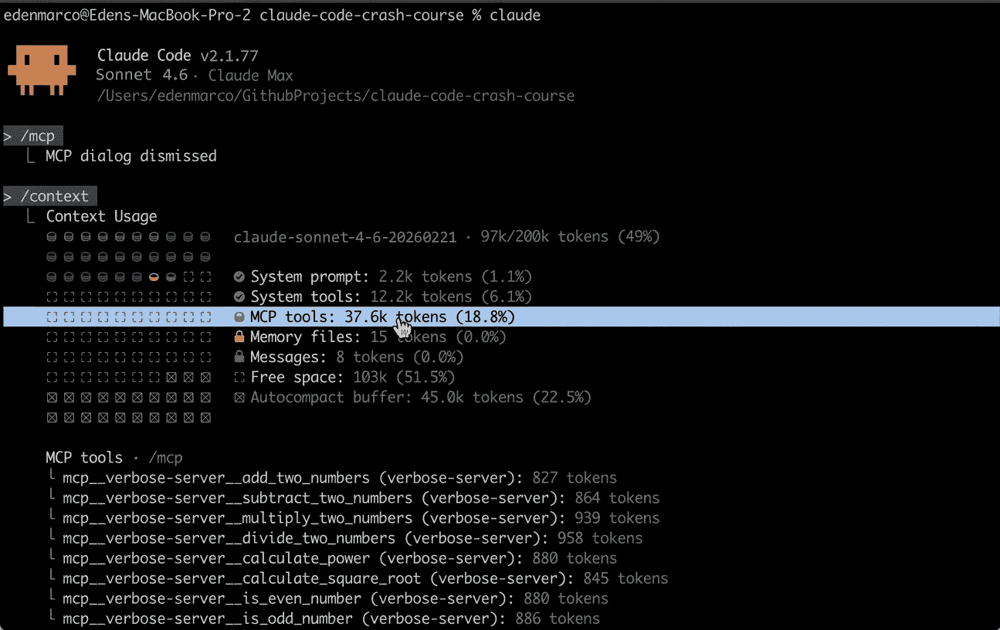

*图 4.28 – MCP 工具消耗了上下文窗口的大部分*

细分情况如下：

*   约 2,000 个 Token 用于 Claude Code 的系统提示词
*   Claude Code 的系统工具消耗了约 12,000 个 Token
*   MCP 工具描述消耗了接近 20% 的上下文窗口

没有消息。没有记忆文件。未配置子代理。

如果存在子代理，它们也会出现在上下文中，包括描述如何以及何时使用它们的说明。

在此阶段，上下文窗口已消耗近 50%。

视任务而定，许多 MCP 服务器，尤其是繁冗数学 MCP 工具，都是不必要的。

## 通过限定 MCP 配置范围来减少上下文

为减少上下文使用，必须更严格地限定 MCP 配置范围。

执行以下步骤：

1.  删除项目级 `.mcp.json` 文件。
2.  创建一个名为 `.mcp.json.tavily` 的新文件。
3.  从仓库复制 Tavily MCP 配置。
4.  将其粘贴到 `.mcp.json.tavily` 中。

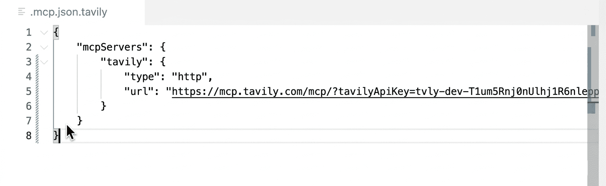

*图 4.29 – 使用 mcp.json.tavily 的限定范围 MCP 配置。*

此配置现在仅包含 Tavily MCP 服务器。

接下来，使用限定范围的配置启动 Claude Code：

返回终端并运行以下命令：

```
claude --mcp-config .mcp.json.tavily
```

`--mcp-config` 标志接受以空格分隔的 MCP 配置文件路径。

Claude 启动时，我们再次使用 `/mcp` 检查 MCP 服务器。

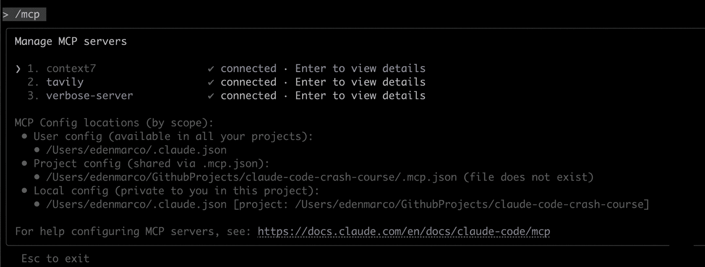

*图 4.30 – 使用限定范围配置的活动 MCP 服务器。*

此时，我们看到了预期的 Tavily MCP。然而，我们也看到了繁冗 MCP 服务器和 Context7。Playwright MCP 服务器不再存在。

发生这种情况是因为 Claude Code 仍在从用户级 MCP 配置加载 MCP 服务器，其中包含 Context7、Tavily 和繁冗 MCP 服务器。

## 强制执行严格的 MCP 配置

为确保仅加载预期的 MCP 配置，必须强制执行严格配置。

运行以下命令：

```
claude --mcp-config .mcp.json.tavily --strict-mcp-config
```

`--strict-mcp-config` 标志指示 Claude Code 忽略默认的 MCP 层级结构，仅加载指定配置文件中定义的 MCP 服务器。

让我们验证结果：

1.  运行 `/mcp` 并确认仅加载了 Tavily MCP 服务器。
2.  运行 `/context` 并验证 MCP 工具的上下文使用量显著减少，因为仅 Tavily MCP 服务器处于活动状态。

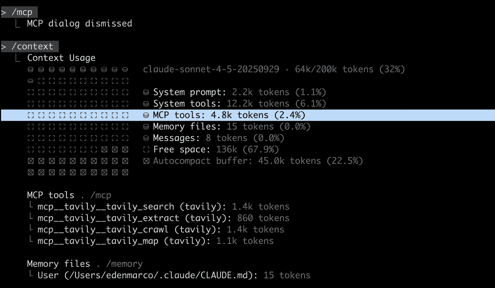

*图 4.31 – 启用严格 MCP 配置后的上下文使用情况*

MCP 相关上下文使用量从近 20% 下降至约 2.4%。

这使代理能够保持专注，并避免为当前任务（本例中为研究）携带不必要的工具上下文。

## 在会话中动态管理 MCP

除了基于配置的限定范围外，MCP 服务器还可以在会话中动态管理。

为此，请执行以下步骤：

1.  恢复通用的项目级 `.mcp.json` 配置。
2.  重启 Claude Code。
3.  禁用繁冗 MCP 服务器。
4.  禁用 Playwright MCP 服务器。
5.  运行 `/mcp` 确认两个服务器均已禁用。
6.  运行 `/context`。

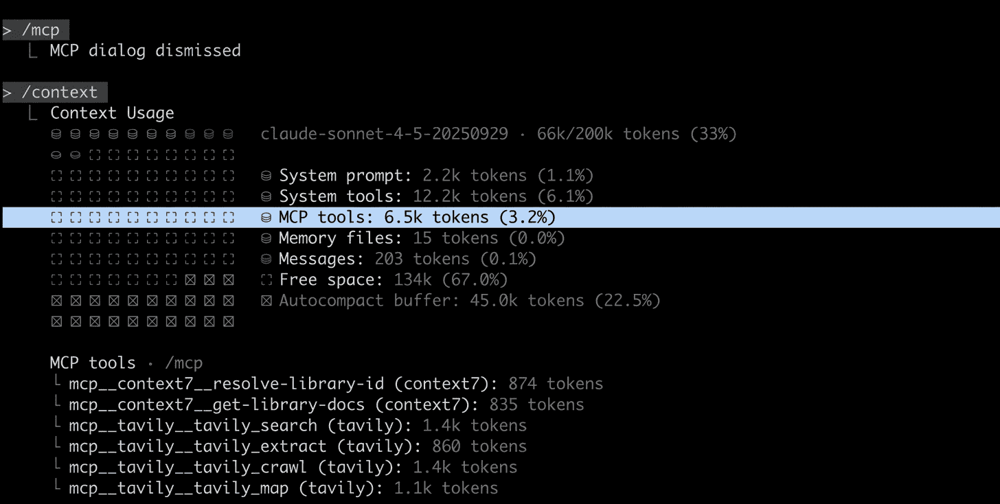

*图 4.32 – 禁用选定服务器后的 MCP 上下文使用情况*

MCP 相关上下文使用量现在约为 **3.2%**。

此方法允许使用 CLI 在会话中直接启用或禁用 MCP 服务器，而无需修改 MCP 配置文件。

# MCP 的当前局限性

MCP 旨在标准化代理连接数据的方式。然而，其当前实现引入了若干缺点。这些局限性主要源于 LLM 上下文的管理方式以及代理任务的执行方式。

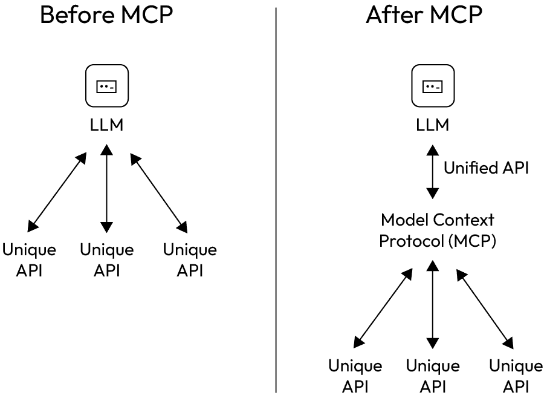

*图 4.33 – LLM 与外部 API 之间的 MCP 抽象层*

因此，代理可能比预期更慢、更昂贵且效果更差。没有完美的协议，MCP 也不例外。

## 上下文污染

MCP 最大的问题是上下文污染。MCP 要求工具定义预先加载到模型的上下文中。这些定义（包括所需参数和预期输出）被放入系统提示词中。

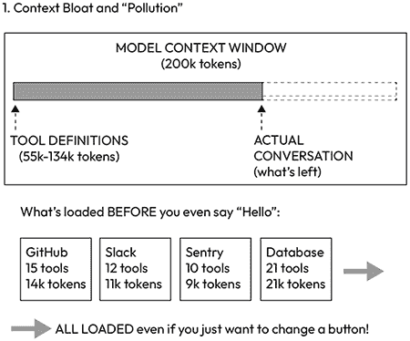

*图 4.34 – 预加载 MCP 工具定义导致的上下文污染*

由于必须预加载所有工具定义，这产生了巨大的 Token 开销。要使用 MCP 服务器，代理必须接收每个可用工具的定义。

在包含 GitHub MCP、Slack MCP 和 Central MCP 等服务器、共 58 个工具的配置中，工具定义 allein 可在对话开始前消耗 55,000 个 Token。在某些情况下，工具定义可消耗数十万 Token。

在 LLM 应用和代理系统中，上下文是必须优化的主要资源。当上下文被工具定义饱和时，代理会携带大量无关信息。


## 过多的 MCP 工具导致上下文膨胀

例如，一个负责修改前端页面的智能体，仍会携带数千行与无关工具（如数据库工具或 PDF 阅读器）相关的上下文。这些无关数据会在对话的每一步和每一次迭代中持续存在。

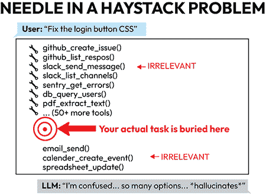

图 4.35 – 过多 MCP 工具导致的“大海捞针”问题

随着无关定义填满上下文，模型性能下降。模型必须在海量信息中搜索，导致产生幻觉、指令跟随失败或工具选择错误的可能性增加。上下文污染越严重，模型定位相关信息就越困难。

## 低效的智能体执行

除了上下文管理，MCP 还给智能体执行带来了低效问题。

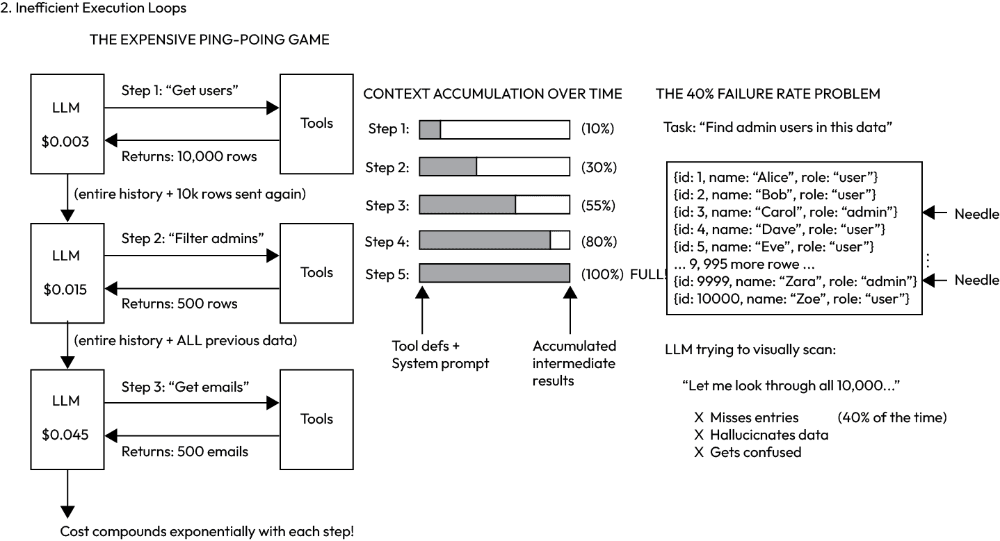

图 4.36 – 重复 MCP 工具调用导致的低效智能体执行

传统的 MCP 用法依赖“乒乓式”交互模式。每个动作都需要一个完整的往返过程：

*   模型请求工具。
*   工具执行。
*   结果被追加到对话历史中。
*   整个更新后的历史被发回模型以确定下一步。

当需要多次工具调用时，这个过程会迅速膨胀。即使中间结果对于生成最终答案并非必要，它们仍会累积在上下文窗口中。虽然其中一些结果在后续阶段本可移除，但当前的 MCP 实现会保留它们，进一步污染上下文。

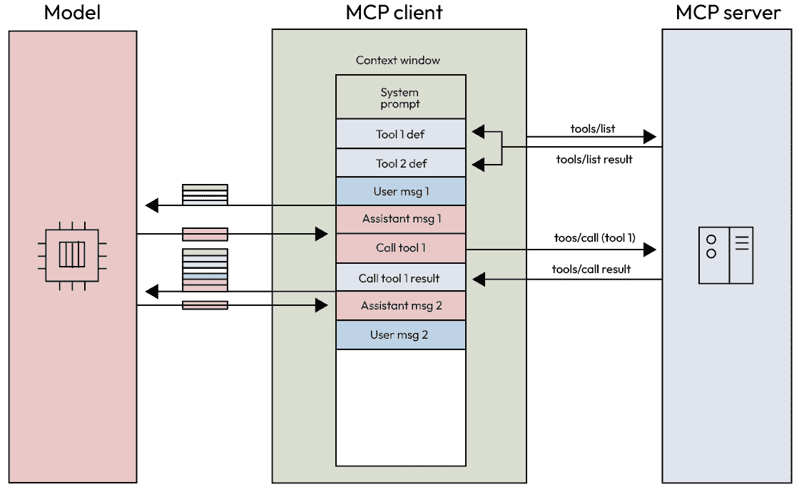

图 4.37 – 模型、客户端与服务器之间的 MCP 工具调用往返

每次往返都需要一次额外的 LLM 推理。多次推理增加了延迟和成本。随着工具调用规模扩大，模型调用次数也随之增加，导致执行变慢、开支变大。

## “母语”问题——JSON 与代码

MCP 还强迫 LLM 以一种不符合其训练方式的模式运行。

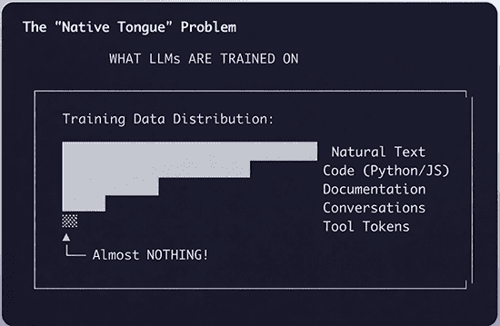

图 4.38 – LLM 训练与工具调用格式的对比

该协议严重依赖结构化的工具调用令牌和 JSON Schema。然而，LLM 主要是在自然语言文本和代码上训练的，而非专门的工具调用语法令牌上。

尽管模型厂商已提升了工具调用的可靠性，但这种格式并非模型的原生运行模式。文本和代码是 LLM 更自然的表达形式。特别是代码，比基于 JSON 的工具调用机制更贴近训练数据和模型能力。

这种错位在模型的训练分布与 MCP 要求的结构化交互风格之间制造了摩擦。

## 工具定义与 Schema 的局限性

MCP 工具定义和 JSON Schema 描述了工具的样子：其参数、输入和输出。然而，这些 Schema 无法捕捉使用模式。

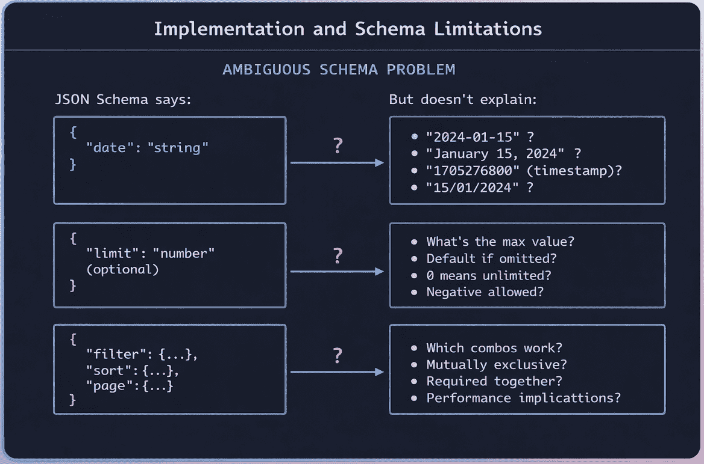

图 4.39 – JSON Schema 在工具用法上的局限

使用模式包括何时应使用工具、如何在上下文中使用工具，以及何时不应使用工具。这比单纯的结构定义是一个更深层的概念。

即使提供了指导工具使用的指令，Schema 本身也无法编码这些行为约束。因此，该协议定义了结构，却未定义意图或正确的应用模式。

# Cloudflare 的 CodeMode

Cloudflare 首先在一篇博客文章（`https://blog.cloudflare.com/code-mode/`）中推出了 **CodeMode**，这是一种旨在改变智能体与 MCP 工具交互方式的执行模型。

这一思路旨在解决前述关于 MCP 的缺点，特别是由多次 LLM 调用导致的上下文膨胀和延迟增加。

Cloudflare 建议不按常规方式使用 MCP，而是将 MCP 中的所有工具定义、工具接口和工具实现转换为 TypeScript API。LLM 不再通过工具调用来选择调用哪个工具，而是被要求生成使用该 TypeScript API 的代码。

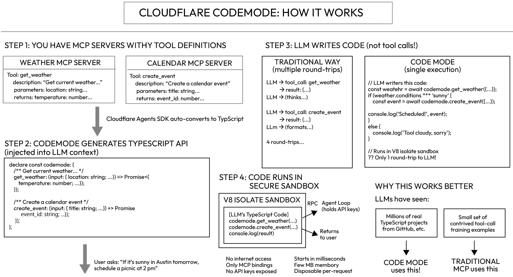

图 4.40 – Cloudflare CodeMode 以代码执行取代工具调用

在此模型中，LLM 生成需执行的完整代码。生成的代码包含多个以函数调用形式实现的工具调用。随后，该代码在沙箱中一次性执行。

这种方法减少了工具调用中的往返次数。LLM 编写代码在内部执行调用序列，而非反复进行“调用工具、接收结果、再调用工具”的循环。主要优势在于 LLM 擅长编写代码。编写代码是 LLM 的常规任务，且其拥有海量代码训练数据。因为代码只需编写一次、执行一次，工具定义无需重复发送，从而减少了 Token 消耗。

## 关键观察

Cloudflare 指出，MCP 常被用于直接向 LLM 暴露工具。在 CodeMode 中，MCP 工具被转换为 TypeScript API，LLM 编写代码来调用该 API。

据报告，智能体因此能处理更多工具和更复杂的工具。MCP 的一个问题是工具过多会增加上下文大小，进而增加成本和延迟并降低性能。当工具以 TypeScript API 而非直接工具定义的形式呈现时，性能会提升。解释在于 LLM 训练中见过大量真实的 TypeScript 代码，但仅见过极少量人为构造的工具调用示例。

当必须将多个调用串联在一起时，该方法被描述为特别有效。在传统 MCP 用法中，每次工具输出必须传回 LLM 后才能进行下一次调用。这种重复消耗时间、精力和 Token。当 LLM 编写代码时，它在内部完成所有调用，仅返回最终结果。

得出的结论是：LLM 编写代码来调用 MCP，比直接调用 MCP 表现更好。

## 工具调用及其约束

在传统 MCP 用法中，LLM 生成代表工具调用的特殊令牌。这些令牌被解析以提取函数名和参数。系统随后执行函数并返回结果。

这些特殊的工具调用令牌在真实世界数据中并不常见。它们是在训练期间引入的句法构造。尽管模型厂商显著提升了工具调用性能，但该机制本质上仍是合成的。

当暴露过多工具或过于复杂的工具时，LLM 可能难以选择正确的工具，或错误地使用它们。因此，建议 MCP 服务器设计者简化 API，使其更适合 LLM 消费。

相比之下，LLM 处理完整编程 API 更有效。它们无需简化即可分析复杂 API 并生成代码。区别在于 LLM 见过大量真实代码，却极少见到真实的工具调用。

文中提供了一个类比：让 LLM 用工具调用执行任务，相当于让莎士比亚速成中文后要求他用中文写剧本。暗示是工具调用并非模型的强项。

## MCP 的角色

MCP 依然有用，因为它提供了一种连接智能体与工具的统一方法。MCP 工具代表带有文档的 RPC 接口。大多数 MCP 服务器封装了现有的传统 API。


与其将 MCP 工具直接暴露为可调用工具，CodeMode 会将它们转换为编程语言 API。尽管传统 API 已经存在，但 MCP 提供了一种统一的方式来连接并了解这些 API，这在基于代理的系统中依然很有价值。

## 集成 CodeMode

Cloudflare 扩展了其 Agent SDK 以支持 CodeMode。在典型的 AI SDK 设置中，模型配置包含系统提示词、用户消息和工具。在 CodeMode 中，工具和提示词会使用 CodeMode 辅助函数进行封装。

例如，考虑一个使用 Cloudflare AI SDK 构建的应用程序，其代码如下：

```
const stream = streamText({
  model: openai("gpt-5.3"),
  system: "You are a helpful research assistant.
    Your job is to help the user...",
  messages: [
    { role: "user", content: "Research on deep agents" }
  ],
  tools: {
    research agent's tool definition
  }
})
```

使用 CodeMode 时，系统提示词和工具定义会在传递给应用程序之前，通过 `codemode` 辅助函数进行封装。

```
import { codemode } from "agents/codemode/ai";

const { system, tools } = codemode({
  system: " You are a helpful research assistant.
    Your job is to help the user...",
  tools: [
    research agent's tool definition
  ],
})
```

完成此更改后，应用程序会生成并执行调用所定义工具（包括 MCP 服务器）的 TypeScript 代码。

## 将 MCP 转换为 TypeScript

当在 CodeMode 中连接到 MCP 服务器时，Agent SDK 会获取 MCP 服务器的 Schema 并将其转换为 TypeScript API。生成的 API 包含源自 Schema 的 TypeScript 定义和文档注释。

这些 TypeScript 定义会被加载到代理的上下文中。目前整个 API 会一次性加载，尽管未来的改进可能允许动态搜索或浏览 API。

尽管一次性加载整个 API 仍会增加上下文大小，但这仅在初始化时发生一次。随后 LLM 读取 API 并生成代码。由于 LLM 擅长处理代码，这种方法利用了这一优势。

## 在沙箱中执行

在 CodeMode 中，代理获得的是一个用于执行 TypeScript 代码的单一工具，而不是直接呈现所有 MCP 工具。

生成的代码运行在一个与互联网隔离的安全沙箱中。沙箱只能通过代表已连接 MCP 服务器的 TypeScript API 来访问外部系统。

当沙箱代码调用 API 函数时，调用会通过 RPC 经由代理循环路由回 MCP 服务器。沙箱使用 `console.log()` 返回结果。执行完成后，日志会返回给代理。

在传统 MCP 流程中：

1.  代理从 MCP 服务器接收工具 Schema。
2.  LLM 调用包含与 MCP 工具匹配的工具定义。
3.  LLM 输出用于函数调用的特殊 Token。
4.  代理解析并执行工具调用。
5.  过程重复。

而在 CodeMode 中：

1.  代理从 MCP 服务器检索工具 Schema。
2.  LLM 调用包含源自这些 Schema 的 TypeScript API。
3.  LLM 针对该 API 编写 TypeScript 代码。
4.  代码在沙箱中执行。
5.  沙箱通过 RPC 绑定与 MCP 服务器交互。
6.  最终日志返回给代理。

下图展示了传统 MCP 执行与 CodeMode 之间的架构对比。

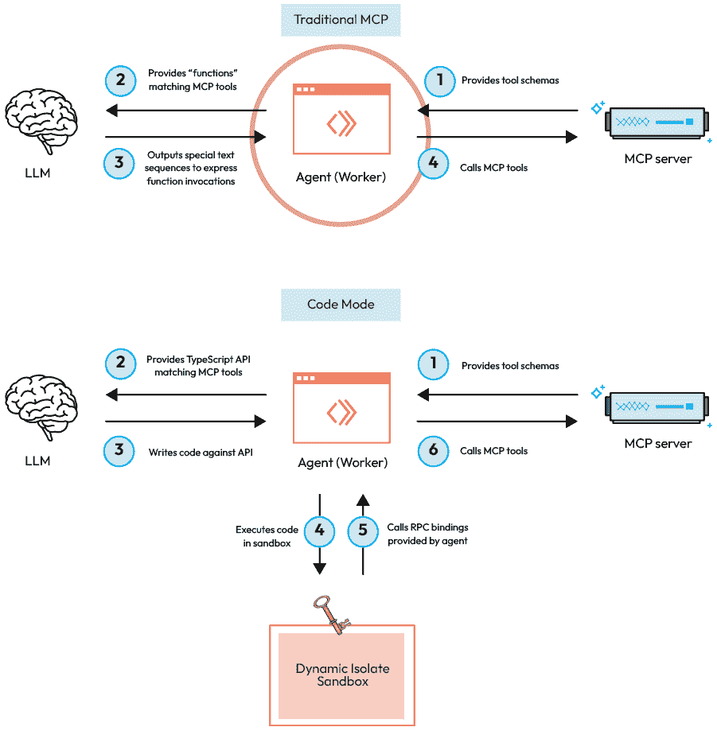

Figure 4.41 – Traditional MCP vs Code Mode execution flow

CodeMode 作为一种替代执行模型呈现，它依赖于 LLM 生成代码的能力，同时保留 MCP 作为统一的集成层。

# 使用 Claude Code 插件管理配置

请查阅官方文档参考：[`code.claude.com/docs/en/plugins`](https://code.claude.com/docs/en/plugins)。

插件将斜杠命令（技能）、子代理、MCP 服务器和钩子捆绑成一个可共享的原语。这些插件可以在团队内部共享，或发布到开源社区，从而在各环境中实现复用和一致性。

在引入插件之前，复用配置需要大量的手动工作。例如，要使用开源仓库中的一个斜杠命令，我们必须导航到该仓库，复制斜杠命令，并将其粘贴到本地 `.claude` 目录中。子代理和钩子也适用相同流程。MCP 服务器遵循不同的设置流程，但整体工作流仍然是手动且碎片化的。

Claude Code 插件通过将所有这些组件捆绑到一个可无缝安装和集成的插件中来解决此问题。插件可以来自开源仓库或内部仓库，并跨团队共享。

Claude Code 提供了一个直观且易用的基于 CLI 的插件系统。

## 插件系统的优势

插件的主要优势之一是能够跨团队共享统一的 Claude Code 设置。例如，新员工入职时，我们可能希望他们拥有与团队其他成员相同的工具、相同的代理和子代理，以及相同的 MCP 服务器。插件提供了一种标准化 Claude Code 开发环境的机制。

插件还支持细粒度安装。我们可以不安装整个插件，而仅安装特定组件，例如单个 MCP 服务器。

此外，Claude Code 引入了一个称为 marketplace（市场）的新原语。Marketplace 由一个描述可安装插件的 JSON 文件表示。

值得注意的是，Google 的 Gemini CLI 引入了一个类似的概念，称为 Gemini Extensions。Gemini Extensions 于 2025 年 10 月 8 日发布，而 Claude Code 插件于 2025 年 10 月 9 日发布。这仅差一天的时间差表明，要么是 Claude Code 团队进行了极快的迭代，要么是两个团队在同时实现同一个想法。

## 探索官方插件市场

为了了解插件如何工作，我们从 Claude Code 课程仓库开始。

在 Claude Code 开源仓库中，有一个 `.claude‑plugin` 目录。该目录内包含一个 `marketplace.json` 文件。

该文件定义了官方插件市场。它列出了可用插件，并为每个插件提供元数据和源路径。

市场中列出的插件示例包括：

*   `pr‑review‑toolkit`
*   `commit‑commands`
*   `agent‑sdk‑dev`
*   `feature‑dev`
*   Security guidelines

Marketplace 作为一个注册表，Claude Code 可以加载它以发现可用插件。

## 向 Claude Code 添加市场

在安装插件之前，必须向 Claude Code 添加一个市场。

要添加市场，请按以下步骤操作：

1.  打开 Claude Code 并运行以下命令：

    ```
    /plugin
    ```

2.  选择 **Browse** 并安装插件。

3.  由于最初未配置市场，请选择 Add Marketplace。

4.  提供以下任一项：
    *   GitHub 仓库 URL
    *   指向 `marketplace.json` 文件的直接链接

在本例中，提供了官方 Claude Code 仓库的基础 URL。Claude Code 会自动检测市场文件并加载可用插件。

市场文件加载后，插件列表及其描述将变为可见。

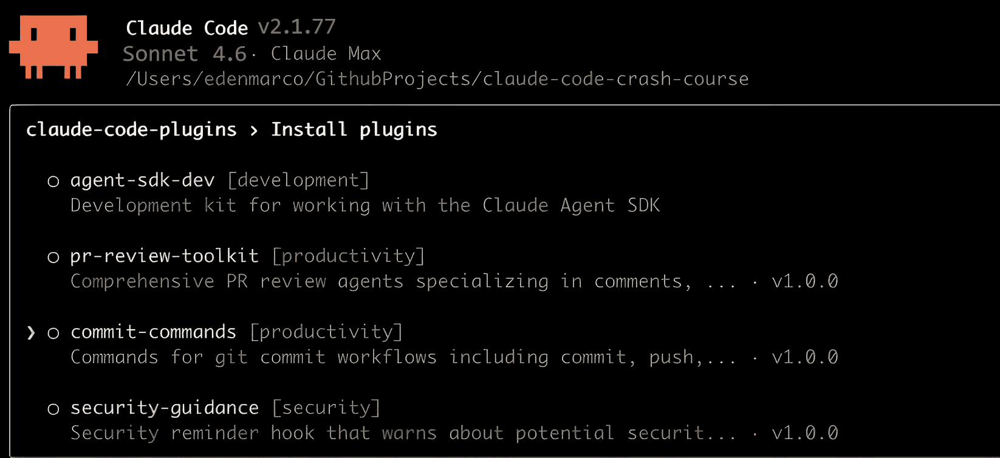

Figure 4.42 – Claude Code plugin marketplace showing available plugins

## 审查插件来源与安全考量

在此阶段，仅可见插件描述。要了解插件实际安装的内容，必须检查插件源代码。

`marketplace.json` 中的每个插件条目都包含一个 source 字段。该字段指向插件实现的位置。


# 安装插件之前

在安装插件之前，审查其来源非常重要。从安全角度来看，这类似于安装 MCP 服务器或使用他人编写的系统提示词和 Agent。在不审查实现的情况下安装插件会引入风险。

## 审查插件来源

请遵循以下步骤审查插件来源：

1.  打开 `marketplace.json` 文件。
2.  定位插件条目。
3.  识别 `source` 字段。
4.  在仓库中导航到该源路径。

例如，`agent‑sdk‑dev` 插件指向仓库内的一个目录。要检查它，请遵循以下步骤：

1.  导航到仓库。
2.  打开 `plugins/` 目录。
3.  打开 `agent‑sdk‑dev/` 目录。
4.  打开 `.claude‑plugin/` 目录。
5.  检查 `plugin.json` 文件。

`plugin.json` 文件包含插件元数据，并定义了该插件安装的 Agent 和斜杠命令（技能）。

另一个例子是 `feature-dev` 插件。该插件包含多个 Agent，例如：

*   Code reviewer（代码审查员）
*   Code explorer（代码探索员）
*   Code architect（代码架构师）

它还包含一个在 `feature‑dev.md` 中定义的斜杠命令。该斜杠命令用于描述要实现的功能并指导工作流。

# 安装和管理插件

添加市场后，即可安装和管理插件。

## 安装插件

要安装插件，请遵循以下步骤：

1.  使用 `/plugin` 打开插件界面。
2.  选择 **Browse and install plugins**（浏览并安装插件）。
3.  定位 `commit‑commands` 插件。
4.  打开插件详情。
5.  选择 **Install**（安装）。
6.  等待安装完成。

安装后，该插件会出现在已安装插件列表中。

## 验证安装

要验证插件已安装并启用，请遵循以下步骤：

1.  打开已安装插件列表。
2.  定位 `commit-commands` 插件。
3.  确认其标记为已安装。
4.  确认其已启用。

## 更新插件

插件由仓库支持，可随时间更新。要更新插件，请遵循以下步骤：

1.  选择已安装的插件。
2.  找到 **Update**（更新）选项。
3.  应用更新。

更新插件在概念上类似于针对仓库的最新版本进行变基。

## 尝试卸载插件

插件界面包含卸载选项。要尝试卸载插件，请遵循以下步骤：

1.  选择已安装的插件。
2.  找到 **Uninstall**（卸载）选项。
3.  尝试卸载插件。

在此阶段，卸载无法按预期工作。卸载操作不会移除插件。这似乎是当前的限制或 Bug。

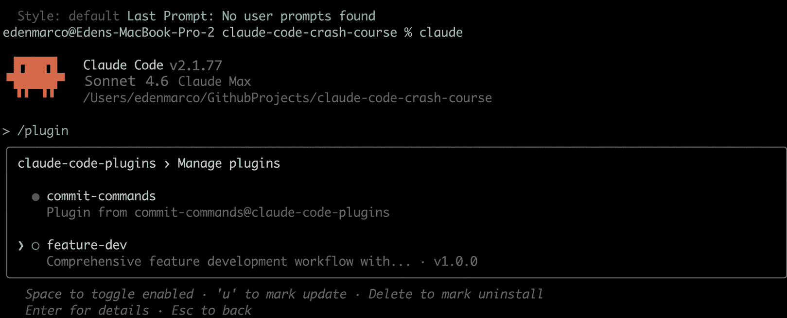

Figure 4.43 – 尝试卸载 Claude Code 插件

# 使用 feature-dev 插件

接下来，使用 `feature‑dev` 插件演示完整的工作流。

继续之前，请确保该插件已安装并启用。

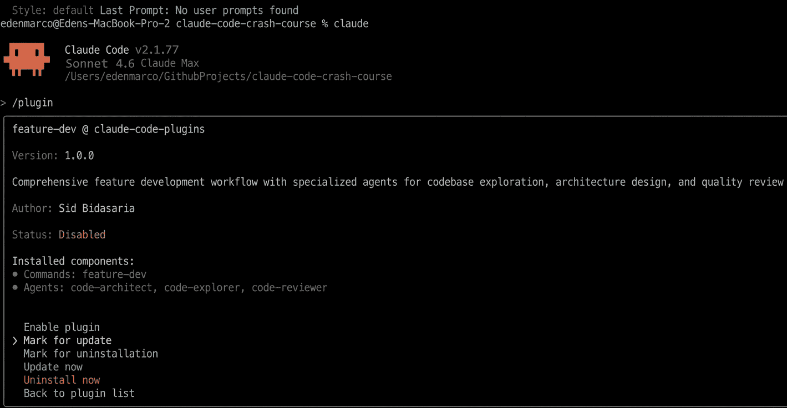

Figure 4.44 – Claude Code 中的 Feature-dev 插件详情

## 启动工作流

要启动工作流，请遵循以下步骤：

1.  打开 Claude Code 并运行以下命令：

    ```
    /feature-dev
    ```

2.  等待插件初始化。

命令执行后，Claude 进入发现阶段。此时，Claude 开始提问以了解需要实现的功能。

## 在 feature-dev 工作流期间处理 Git 状态

在切换分支之前，Claude Code 会检查仓库的当前 Git 状态。

此时，仓库可能包含**未提交的本地更改**。在不处理这些更改的情况下切换分支可能导致冲突或工作丢失。

### 检查 Git 状态

作为工作流的一部分：

*   Claude 检查当前工作树状态。
*   Claude 检测到存在本地未提交更改。
*   Claude 判断直接切换分支不安全。

这些检查作为 `feature-dev` 工作流的一部分自动发生。

### 暂存本地更改

为安全地继续，Claude 使用 `git stash` 保存当前工作状态。

在此步骤中，Claude 执行以下操作：

*   暂存当前工作目录的更改
*   确认工作树现已干净
*   继续切换分支

这确保了本地更改不会丢失。

### 切换分支并恢复状态

检查功能分支后，Claude 返回原始分支并恢复之前的 Git 状态：

1.  Claude 切回主分支。
2.  Claude 重新应用暂存的更改。
3.  Claude 确认工作目录已恢复。

此时，仓库回到原始状态，本地更改保持完好。

## 提供功能详情

本示例中的任务是更新仓库的 `README` 文件。

`README` 文件包含一个列出课程章节的表格。一个新章节存在于名为 `context‑engineering‑mcp` 的 GitHub 分支中，该分支必须添加到表格中。要访问仓库链接，请遵循 *Preface*（前言）中 *Download the example code files*（下载示例代码文件）部分的步骤。

出现提示时，请执行以下操作：

*   描述所需的更改。
*   提供 `context‑engineering‑mcp` 分支的 URL。

## 检查功能分支中的 README 文件

Claude 检查功能分支中的 `README` 文件。在此步骤中，Claude 执行以下操作：

1.  切换到 `context‑engineering‑mcp` 分支。
2.  检查 `README` 文件。
3.  识别表格结构。

    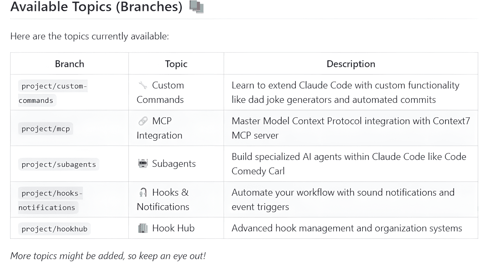

    Figure 4.45 – 在功能分支中检查 README

## 切回主分支

检查功能分支后，Claude 执行以下操作：

1.  切回主分支。
2.  准备应用更改。
3.  提出新的表格条目。

## 审查和优化建议的更改

Claude 为新表格条目生成初步描述。继续之前，请执行以下操作：

1.  审查描述。
2.  识别不准确之处。
3.  优化措辞。

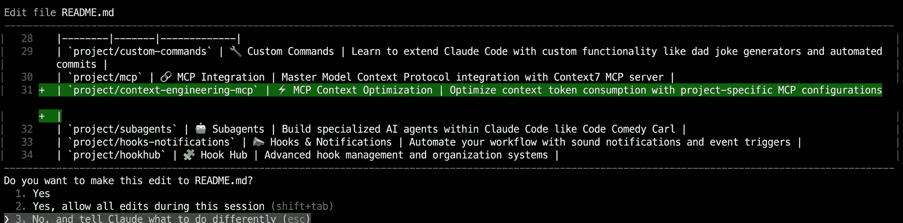

Figure 4.46 – 审查和优化建议的 README 更改

该描述基本正确，继续之前只需微调。

## 提交、推送和验证更改

变更获批后，将发生以下情况：

1.  Claude 创建提交。
2.  Claude 将提交推送到远程仓库。
3.  刷新仓库。
4.  打开 `README` 文件。
5.  验证新章节条目是否出现在表格中。

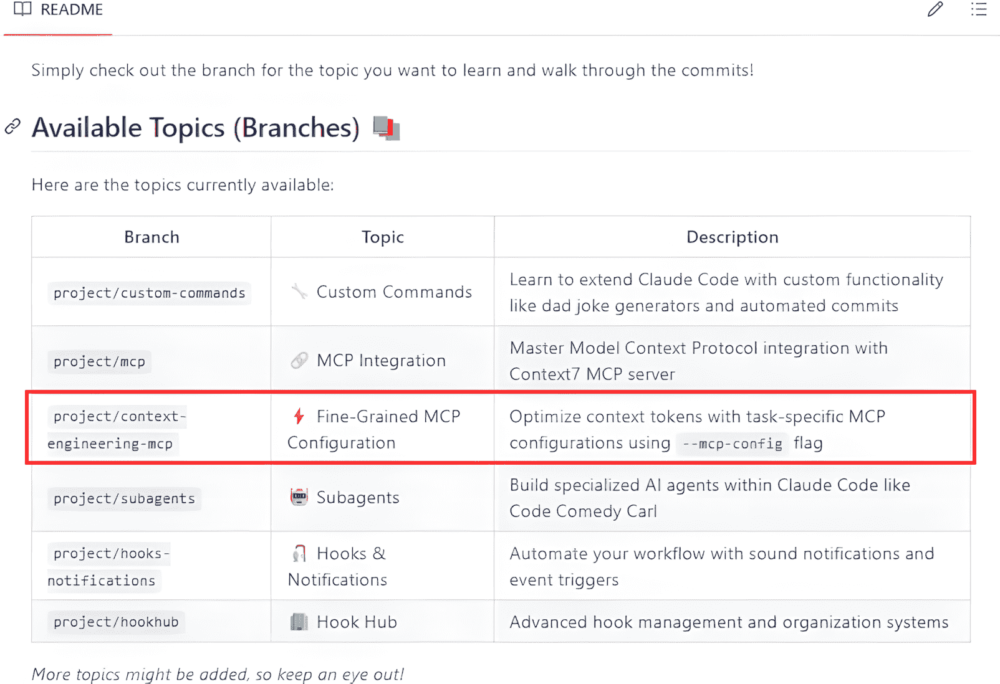

Figure 4.47 – 提交后验证 README 更新

这确认工作流成功完成。

# 插件市场与企业用例

Claude Code 支持第三方插件市场。

例如，DevOps 自动化市场可提供包含与基础设施工作流相关的斜杠命令、Agent 和 MCP 服务器的插件。组织还可创建供内部使用的私有市场。这些市场可包含特定于内部工具或团队的插件并保持私有。

平台公司（如 Supabase）很可能会发布自己的市场和插件，以改善与 Claude Code 的集成。

插件还支持细粒度安装。单个斜杠命令或 MCP 服务器等独立组件可单独安装，无需安装整个插件。该插件生态系统预计将不断发展，并在企业级 Claude Code 采用中发挥重要作用。

# 总结


在本章中，你学习了 MCP 创建的原因以及它如何解决 AI 系统中的集成问题。你探索了其核心架构：主机、客户端和服务器，并了解了 MCP 如何实现可复用的跨平台工具集成。通过实践示例，你配置并使用了 Context7 MCP，将服务器连接到 Claude，并使用 CLI 管理 MCP 设置。你还了解了糟糕的 MCP 配置如何污染上下文窗口并降低性能，以及如何通过上下文工程和作用域配置来优化使用。最后，你探索了 Claude Code 插件，考察了 MCP 的局限性，并回顾了 CodeMode 作为一种替代执行模型。

理解 MCP 非常重要，因为它正逐渐成为基于智能体 AI 开发中的基础集成层。知道如何高效地使用它以及何时对其提出质疑，将帮助你构建更具扩展性和有效性的 AI 系统。

在下一章中，我们将介绍 GitHub 仓库配置、拉取请求和议题自动化，以及 GitHub Actions 在工作流执行中的使用。

# 获取本书的 PDF 副本、代码包等

扫描二维码（或访问 [packtpub.com/unlock](https://packtpub.com/unlock)）。按名称搜索本书，确认版本，然后按照页面上的步骤操作。


*注意：请准备好发票。直接从 Packt 网站购买的不需要发票。*

