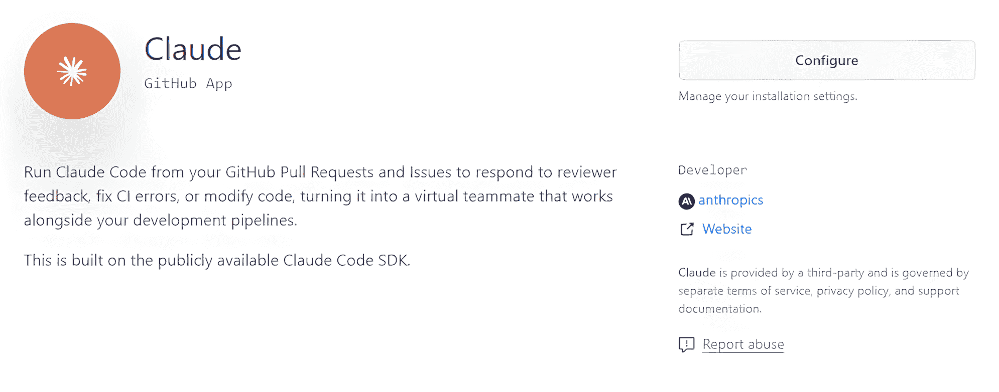
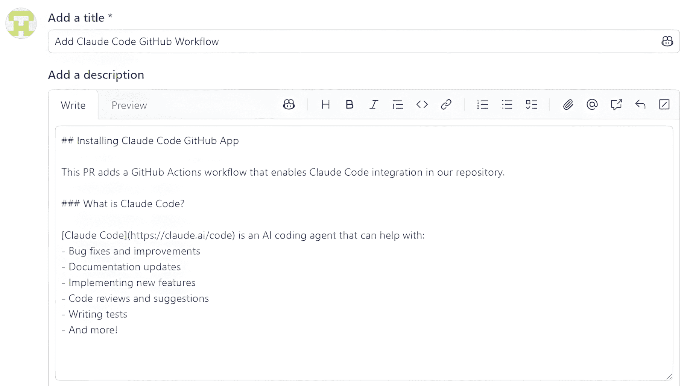
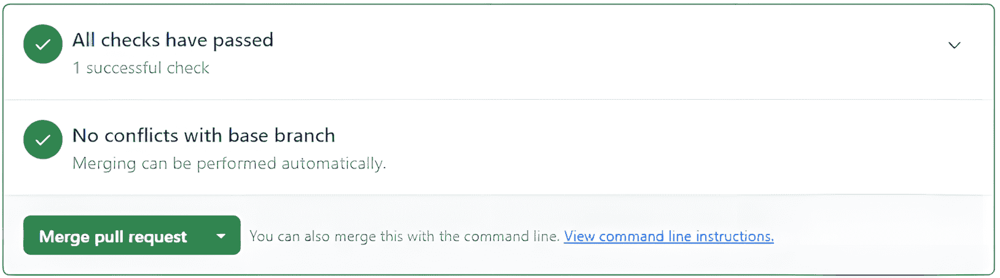
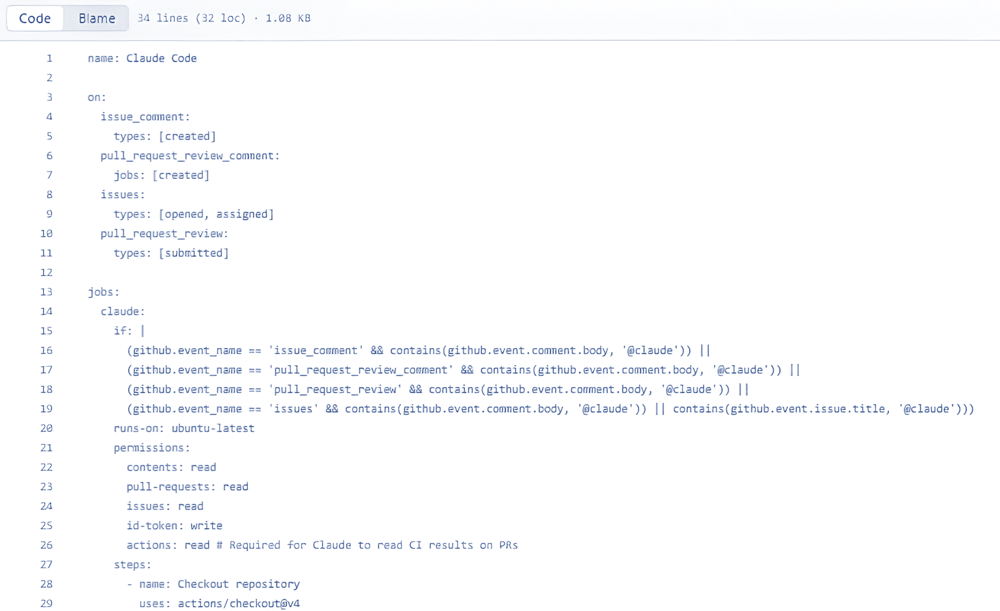
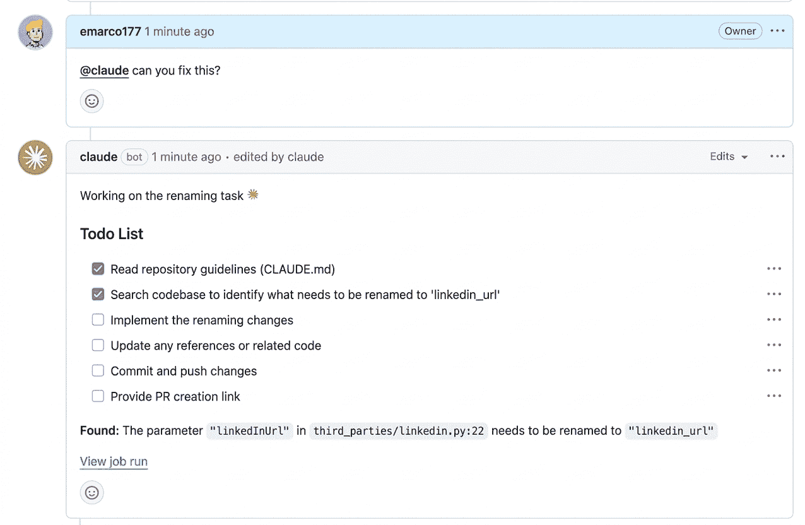
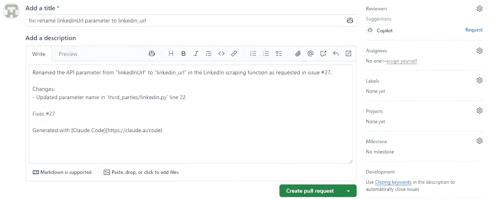
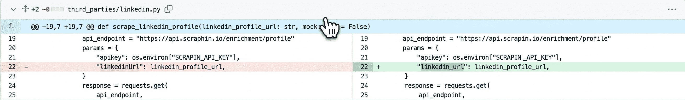
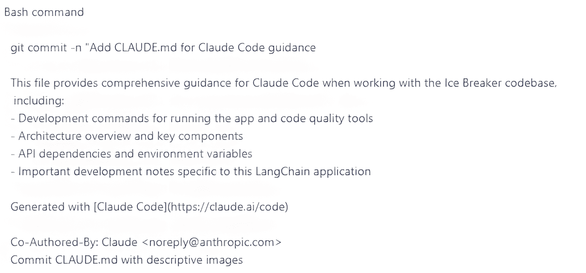
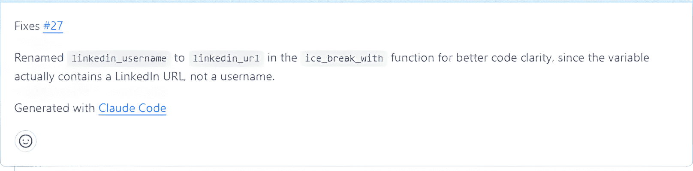

# 5 使用 Claude Code 和 GitHub 自动化你的开发工作流

在本章中，我们将深入探讨 Claude Code 与 GitHub 之间的集成。该集成涉及一系列配置步骤，包括安装 GitHub CLI、将其配置为与 Claude Code 协同工作，以及选择 Claude Code 将在其上运行的仓库。

配置完成后，Claude Code 可以直接在仓库中使用。它可以在拉取请求和议题中被 @提及，此时它会审查代码、提出修复建议并帮助解决报告的问题。Claude Code 还可以参与拉取请求工作流，在创建拉取请求时审查变更。

当打开拉取请求时，将使用 **GitHub Actions** 来运行自动化。GitHub Actions 是 GitHub 的无服务器工作流平台，通常用于 CI/CD 任务。在此设置中，GitHub Actions 执行依赖于 Claude Code CLI 和 Claude Code SDK 的工作流。

对于不熟悉 GitHub Actions 的读者，它是一个响应事件运行的自动化系统。这些事件可以包括在议题中 @提及 Claude 或打开新的拉取请求等操作。每个事件都可以根据项目需求配置为触发特定的工作流。

工作流本身使用 YAML 文件定义，通常称为 GitHub 工作流文件。这些文件描述了哪些事件应触发操作，以及响应时应执行哪些命令或脚本。

该集成已用于实际生产系统。例如，Anthropic 在其开源仓库中将 Claude Code 与 GitHub Actions 结合使用，以自动化议题处理和相关工作流。要查看公开示例，请参阅 Anthropic 的 GitHub Actions 工作流：[`github.com/anthropics/skills/actions`](https://github.com/anthropics/skills/actions)。

本章将涵盖以下主题：

*   安装和配置 Claude Code GitHub 集成
*   @提及 Claude Code 以解决 GitHub 议题
*   利用项目记忆重新运行议题解决流程

# 安装和配置 Claude Code GitHub 集成

在本节中，我们将使用一个名为 IceBreaker ([`github.com/emarco177/IceBreaker`](https://github.com/emarco177/IceBreaker)) 的不同仓库来演示集成，这是一个托管在 GitHub 上的开源项目。我们仅将此仓库用于演示目的。你可以使用任何你拥有的 GitHub 仓库跟随操作。如果你选择使用自己的仓库，请确保你拥有管理员权限，因为安装 Claude GitHub 应用和配置工作流需要管理员权限。

在开始安装之前，请确保你是在一个已经初始化并连接到 GitHub 的 Git 仓库目录中运行 Claude Code。在本章中，我们使用已经配置好的 IceBreaker 仓库。集成仅在有效的 GitHub 仓库内才能工作。

要开始 GitHub 集成，从桌面打开 Claude Code 并输入 `/git`。这将显示 `/install-github-app` 命令。选择此命令将启动设置过程。

在 Claude Code 可以与 GitHub 账户集成之前，必须满足两个先决条件：

*   首先，必须在本地安装 GitHub CLI（也称为 `gh` CLI）。此时 CLI 尚未安装，接下来我们将安装它。
*   其次，GitHub CLI 必须经过 GitHub 账户的身份验证。Claude Code 依赖此经过验证的会话与仓库进行交互。

## 安装先决条件

安装命令因操作系统而异。下面的示例展示了使用 Homebrew 的 macOS。如果你使用的是 Linux 或 Windows，请参阅官方 GitHub CLI 安装文档，获取适合你平台的相应命令：[`cli.github.com/`](https://cli.github.com/)

要安装并验证 GitHub CLI，请完成以下步骤：

1.  打开一个新的终端实例，并使用以下命令安装 GitHub CLI：

    ```
    brew install gh
    ```

2.  安装完成后，通过运行以下命令验证 CLI 是否可用：

    ```
    gh --help
    ```

3.  接下来，通过运行以下命令使用 GitHub 对 CLI 进行身份验证：

    ```
    gh auth login
    ```

在身份验证过程中，选择 **HTTPS** 作为连接方式，然后通过网页浏览器登录。系统会提供一个一次性代码，必须在浏览器中输入该代码以完成身份验证。如果启用了双因素认证，则使用配置的第二因素完成批准。

完成此步骤后，GitHub CLI 已成功通过身份验证，Claude Code 集成的所有先决条件均已就绪。

## 安装 Claude GitHub 应用

完成先决条件后，我们返回 Claude 继续安装。我们关闭不再需要的终端窗口，并按提示在 Claude 中按 `Enter` 键。此时，我们将被重定向到一个 GitHub 页面。



**Figure 5.1 – 安装 Claude GitHub 应用**

开始将 Claude Code 集成到 GitHub 账户中。此集成允许 Claude 发表评论、创建拉取请求并解决议题。我们将在本书后面演示这些功能。

点击 **Install** 后，我们被重定向回 Claude Web 应用程序。返回终端，我们再次按 `Enter` 键继续。

## 安装 GitHub 工作流

安装集成需要向仓库添加一个 GitHub 工作流。该工作流运行处理 Claude 评论和操作的管道。

将向你提供两个安装选项：

*   **Tag Claude**，允许我们在议题和拉取请求评论中 @提及 Claude，然后通过 GitHub 工作流运行。
*   **Claude Code Review**，自动审查新的拉取请求。

我们选择第一个选项。

接下来，我们选择一种身份验证方法。由于 Claude 的使用会消耗 Token，因此需要有人为这些 Token 付费。我们可以配置一个与 Claude 订阅关联的长期 Token，或者提供一个 Anthropic API 密钥。长期 Token 适用于订阅范围内的中小规模使用，而 API 密钥通常用于运行大规模或高频工作流、可能超出订阅限制的情况。在本例中，我们选择与 Claude 订阅关联的长期 Token。


确认此选择后，我们授权该集成。此授权还会跟踪 Token 消耗并将其与 Claude 订阅关联。

如果出现错误，是因为 GitHub 集成是从未连接到 GitHub 仓库的目录发起的。

要修复此问题，请在已初始化并连接到您账户的 GitHub 仓库的项目目录中打开一个新终端。在本例中，我们使用前文介绍且已配置好 GitHub 的 `IceBreaker` 目录。

重新打开 Claude，再次导航至 GitHub 安装页面，Claude 应能正确检测当前仓库。打开配置弹窗，选择相应账户，并授予仓库访问权限。确认后，返回 CLI 并使用长效 Token 再次配置 Claude Code。

### 创建 Pull Request

认证完成后，Claude 通过获取仓库信息初始化集成，并自动创建 Pull Request。



Figure 5.2 – Automatically Creating a Pull Request for Claude GitHub workflow

此 Pull Request 包含 `.github` 目录下的多个更新文件。这些是配置 GitHub 工作流的 YAML 文件。我们打开 Pull Request 进行审查。

该工作流使 Claude 能在评论和 Issue 中被 @提及，并允许其通过 GitHub Actions 运行。GitHub Actions 提供了 Claude 运行的计算环境，且工作流配置为使用与我们账户关联的 Token。

从安全角度看，API 密钥或访问 Token 作为 GitHub Actions Secret 存储。这在配置期间自动完成。只有拥有相应仓库访问权限的用户才能触发工作流。当 Claude 被 @提及 时，它可以创建分支、提交和评论。

合并 Pull Request 前，新添加的 GitHub 工作流应自动运行。在 **GitHub Actions** 选项卡中，我们将看到 Claude Code 工作流正在执行。成功完成后，继续合并。

工作流运行期间，它会更新 Pull Request。Claude 读取其添加的文件，具体为 `.github/workflows` 下的两个 YAML 文件：`claude.YAML` 和 `claude‑code‑review.YAML`。它针对安全问题和代码质量审查这些文件，并将反馈直接发布在 Pull Request 中。

审查结束时，Claude Code 批准该 Pull Request，表明它认为这些更改可接受，如下截图所示。



Figure 5.3 – Pull request approved with all checks passed

我们现在合并 Pull Request。合并后，仓库应包含一个之前不存在的新目录 `.github/workflows`。该目录下有集成添加的两个 YAML 文件：

*   `claude.YAML`
*   `claude‑code‑review.YAML`

第一个 YAML 文件将展示 Claude 工作流配置。文件将包含一个名为 **Run** **Claude Code** 的步骤。认证 Token 从名为 `CLAUDE_CODE_OAUTH_TOKEN` 的 Secret 引用。没有敏感信息直接存储在工作流文件中，这保证了设置的安全性。

```
name: Claude Code

on:
  issue_comment:
    types: [created]

jobs:
  claude:
    runs-on: ubuntu-latest

    steps:
      - name: Checkout repository
        uses: actions/checkout@v4

      - name: Run Claude Code
        id: claude
        uses: anthropics/claude-code-action@beta
        with:
          claude_code_oauth_token: ${{ secrets.CLAUDE_CODE_OAUTH_TOKEN }}
```

下方展示了工作流文件的简化摘录。



Figure 5.4 – Claude GitHub Actions Workflow YAML File

至此，集成完成。配置可进一步自定义，包括选择模型、定义 Claude 可用的工具，以及调整其他设置以匹配特定需求。

# 使用 Claude Code 解决 GitHub Issue

本节演示如何在安装集成后，通过 @提及 Claude Code 来帮助解决 GitHub 仓库中的 Issue。

我们首先导航至仓库的 **Issues** 部分。我们关注的 Issue 是一个简单的 Issue，由用户 `happyLolonly` 创建。该用户提出的问题是：通过将变量从 `linkedin_username` 重命名为 `linkedin_url` 来提高可读性，因为该变量实际存放的是 LinkedIn URL。

首先在 Issue 上 @提及 Claude 并请求其解决问题：

```
@claude, can you fix this
```

Claude 被 @提及 后，新的 GitHub Action 会自动开始运行。在本例中，该 Action 称为 **small rename**。一旦提及 Claude，即触发此 Action。

打开 Action 查看详情，实时观察流式日志。日志主要由显示工具调用、工具输入和工具输出的 JSON 输出组成。虽然此信息利于深度调试，但人类难以阅读，且难以在宏观层面跟进。

对于大多数情况，不如返回 Issue 本身，而非检查原始日志。

## Claude 的待办列表与上下文发现

回到 Issue 视图，Claude 创建一个随进度更新的待办列表。Claude 采取的第一步是尝试在仓库中定位 `CLAUDE.md` 文件。



Figure 5.5 – Claude To-Do List and Context Discovery in Issue View

`CLAUDE.md` 文件的目的是提供额外上下文。这些文件帮助 Claude 了解技术栈、项目结构、编码规范以及我们想传达的任何偏好。这属于上下文工程的一部分，即我们有意提供信息以帮助模型更有效地执行任务。

剧透预警！此仓库中没有 `CLAUDE.md` 文件。这是有意为之，旨在说明一个重要观点：在 Agentic AI 工作流中，事情并不总能正确运行，错误在所难免。

因此，仔细审查任何更改而非盲目接受至关重要。此原则贯穿所有 Agentic 工作流，不仅限于此例。

## 审查提议的更改

Claude 完成待办列表后，会更新名为 `linkedin.py` 的文件。我们随后通过创建 Pull Request 打开 **diff** 进行查看。



Figure 5.6 – Reviewing the pull request with proposed changes

乍看之下，Pull Request 描述似乎合理。然而，当你检查实际代码更改时，会发现 Claude 重命名了一个作为第三方服务 API 请求一部分的变量。



Figure 5.7 – Incorrect Variable Rename Breaking Third-Party API Contract

这是个问题。第三方 API 期望载荷遵循特定格式及特定变量名。更改此变量名会破坏与外部端点的契约，导致代码失败。

因此，该 Pull Request 不正确，不应被接受。

### 理解 Claude 的工作流

Claude 在其自动创建的新分支上执行更改。分支遵循类似 `claude/issue/<issue‑number>` 的命名约定。这是个重要细节，因为它意味着 Claude 从不直接在主分支上工作。


我们完全保留是否审查、修改或合并变更的控制权。这种分支策略也是扩展智能体工作流的基础。在实践中，我们可以并行运行多个 Claude 实例，每个实例在自己的分支上工作。

这一想法关联到更高级的工作流，例如使用 Git 工作树，我们将在本书后面介绍。

这个例子展示了使用 Claude Code 解决问题的威力和局限性。Claude 可以快速自动化变更，但如果缺乏足够的上下文，它可能会引入破坏性变更。代码审查依然至关重要，而理解 Claude 如何在分支中操作则是随着我们扩展智能体工作流而变得关键的。

# 使用 CLAUDE.md 添加仓库上下文

本节的目标是展示添加显式仓库上下文如何帮助 Claude Code 在解决问题时产生更准确、更可靠的变更。

如果 Claude 因为缺乏足够的仓库上下文，而未能解决之前涉及变量重命名的 GitHub 问题，会怎样？让我们看看如何验证这一假设。我们首先进入桌面，GitHub 项目目录就在那里。我们在 Cursor 中打开项目并运行一次快速获取以拉取最新变更。此时，我们已经拥有上一步中的 YAML 文件。接下来，我们打开 Claude。

## 初始化仓库上下文

我们在 Claude 中运行 `/init` 命令。如前所述，此命令会生成一个 `CLAUDE.md` 文件，捕获特定于仓库的上下文，包括技术栈、项目结构和其他相关细节。确认命令后，Claude 开始扫描仓库文件。这个过程只需很短的时间，Claude 就会收集所需信息。

初始化期间，Claude 会请求执行某些命令的权限，例如列出文件。我们明确允许这些操作。本地设置文件会更新以将批准的命令加入白名单，这些权限在本地会话期间持久有效。这种批准模型提供了对 Claude 允许执行操作的细粒度控制。

扫描完成后，Claude 写入 `CLAUDE.md` 文件。

### 审查并提交 CLAUDE.md

我们在源目录中找到新创建的 `CLAUDE.md` 文件并审查其内容。该文件包含仓库的结构化摘要，看起来是正确的。

然后我们指示 Claude 提交 `CLAUDE.md` 文件。Claude 准备一条提交信息，我们审查并接受。提交在本地创建，然后推送到远程仓库。提交此文件可确保仓库上下文被版本化、与团队共享，并在 Claude Code 在自动化工作流（如 GitHub Actions）中运行时可用。

在提交历史中，我们应该会看到一条新记录，表明已添加 `CLAUDE.md`。



Figure 5.8 – 将 CLAUDE.md 提交到仓库

有了可用的仓库上下文，我们回到 Claude 之前未能解决的问题。

我们再次在问题上提及 Claude，并请其解决该问题。这一次，我们提供了一个额外的提示，指明所需的变更位于特定函数内。我们提交评论：

```
@claude, can you please address this issue? Please notice that you need to edit the function `ice_break_with`
```

GitHub Actions 流水线立即启动，确认 Claude Code 已被触发。我们等待工作流完成。

### 检查 Claude 的变更

Claude 生成任务列表并开始执行。虽然由于额外的提示，该实验略有偏向性，但它仍然演示了提供适当上下文的效果。

工作流完成后，检查 Claude 创建的分支。变更显示变量名已从 `linkedin_username` 更新为 `linkedin_url`，且该更新已在函数定义和调用点处一致地应用。与上一次尝试不同，此变更保留了外部 API 契约，且未破坏集成。逻辑是正确的。

我们现在可以创建一个标题为 **Renamed `linkedin_username` to `linkedin_url`** 的拉取请求。这准确反映了变更的范围。



Figure 5.9 – 使用修正后的变量名创建拉取请求

拉取请求一打开，Claude Code 审查工作流就会自动运行。Claude 分析差异并执行代码审查，生成审查步骤和发现的清单。

该审查系统完全可配置。根据需要，可以添加额外的检查，如代码检查工具、测试执行或自定义验证规则。这种可配置性是 Claude Code 能在基于团队的工程工作流中有效运作的关键原因。

审查完成，总体评估为批准。未发现功能性问题。

审查批准后，拉取请求即可合并。

# 总结

在本章中，我们探讨了 Claude Code 如何与 GitHub 集成，以及如何将其作为真实开发工作流的一部分使用。我们演示了安装所需工具、配置 Claude GitHub 应用，以及设置允许 Claude 响应问题和拉取请求的 GitHub Actions 工作流。我们还了解了 Claude 如何通过创建分支、打开拉取请求和参与自动化审查来运作，以及为什么审查其变更至关重要。通过实际示例，我们观察到缺少仓库上下文如何导致错误变更，以及引入 `CLAUDE.md` 文件如何提高准确性。至此，您已清楚地了解如何安全地使用 Claude Code，它在何处增加价值，以及如何保留对代码库的完全控制权。

在下一章中，我们将专注于结构化智能体工作流，探讨规划模式、规格驱动开发以及并行智能体协调的实践。

# 获取本书的 PDF 副本、代码包等

扫描二维码（或访问 [packtpub.com/unlock](https://packtpub.com/unlock)）。按名称搜索本书，确认版本，然后按照页面上的步骤操作。


*注意：请准备好发票。直接从 Packt 网站购买的不需要发票。*

<!-- split --># 6 Claude Code 规划与多智能体工作流

智能体编码工作流受益于结构、规划和受控执行。随着系统变得更复杂并包含更多工具和自动化，依赖临时提示会增加意外变更和不可预测行为的风险。

本章探讨 Claude Code 如何通过规划和多智能体执行支持结构化智能体工作流。它展示了从探索性提示转向规格驱动开发如何提高安全性和可预测性，以及如何协调多个智能体高效地在同一代码库上工作。虽然示例使用的是 Claude Code，但讨论的原则广泛适用于智能体系统。

Claude Code 规划模式在官方文档中有介绍。有关规划模式如何工作及何时使用的简要概述，请参阅以下内容：

[`code.claude.com/docs/en/common-workflows#how-to-use-plan-mode`](https://code.claude.com/docs/en/common-workflows#how-to-use-plan-mode)

在本章中，我们涵盖以下主题：

*   Claude Code 规划模式
*   并行使用多个 Claude Code 智能体

# Claude Code 规划模式


