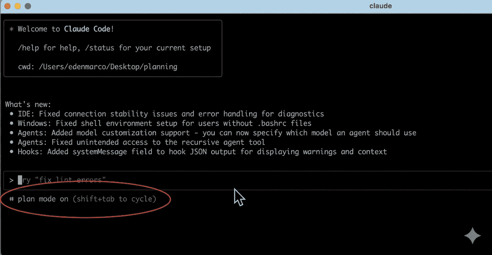
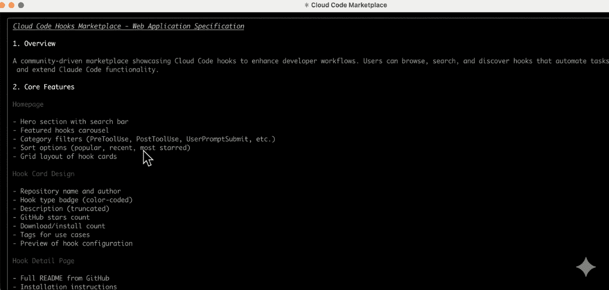
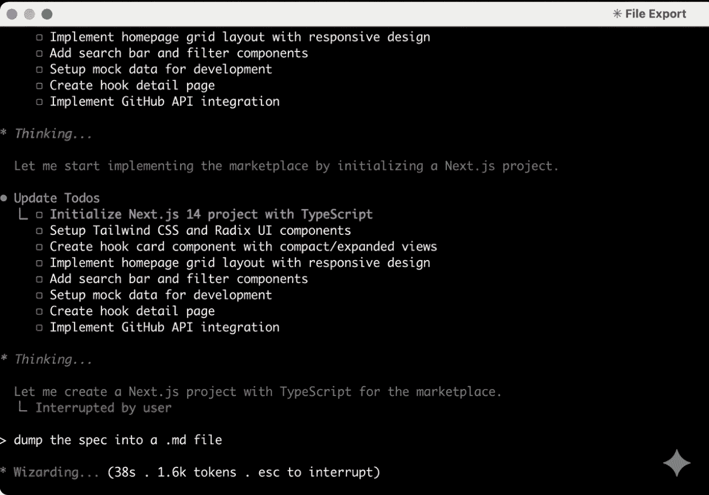
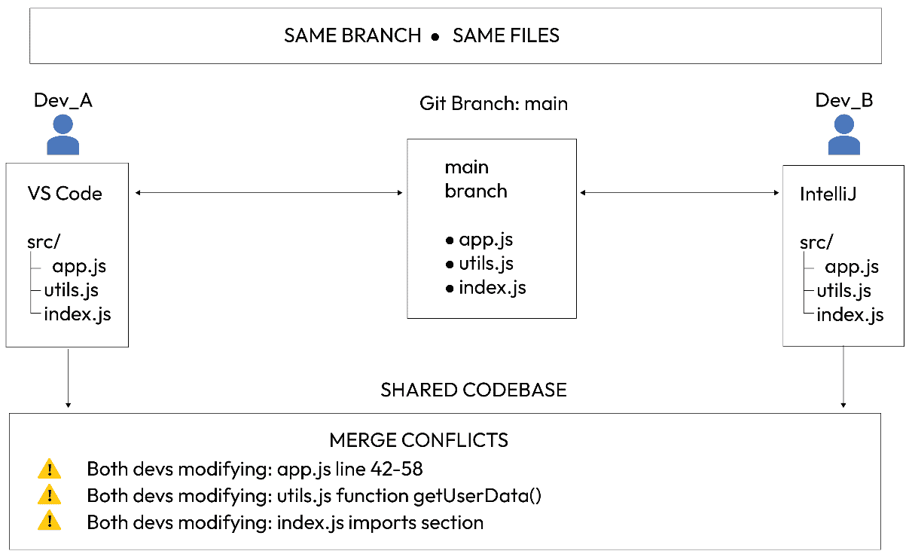
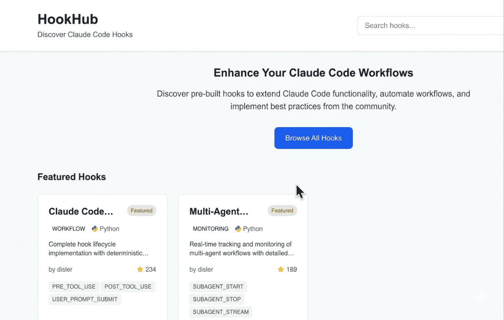
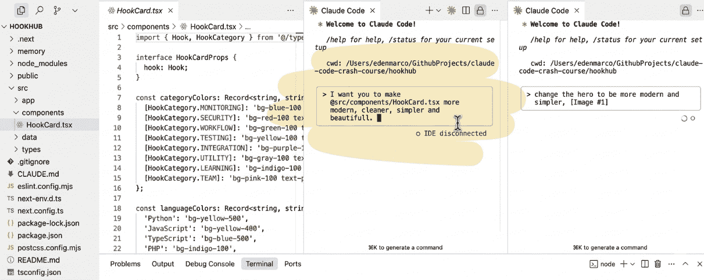
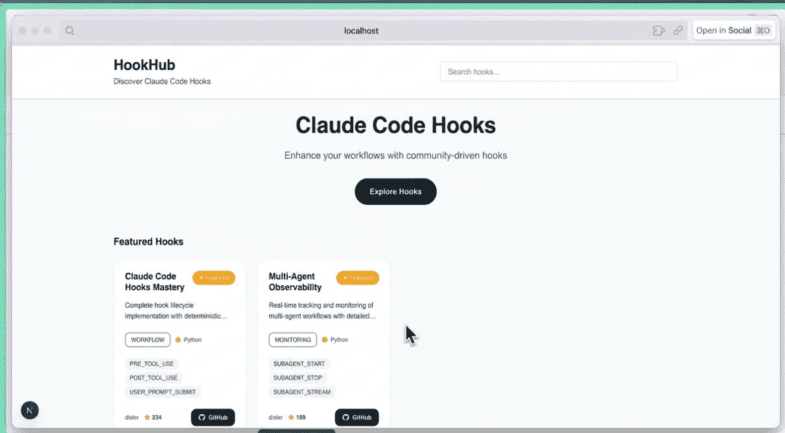

# 6 Claude Code 规划模式与并行开发

Claude Code 提供了一个**规划模式**，支持从探索式编码向**规格驱动开发**转变。该模式是智能体编码工作流中的基础原则。在规划模式下，Claude Code 仅限于只读操作，负责在进行任何代码更改之前生成规格说明或实施计划。

规划模式允许 Claude Code 对问题空间进行研究、分析和推理，随后生成详细的实施计划。在计划被明确审查并批准之前，不允许进行代码更改。

## 规划模式的特征

规划模式是一个只读阶段。Claude Code 可以读取文件、分析代码库、进行 MCP 调用、搜索文档并设计解决方案。它无法编辑、创建或删除文件，无法进行 Git 提交、安装软件包，或执行任何执行层面的操作。

该模式映射了资深软件工程师的工作流程。流程始于收集上下文、理解需求和业务约束。接下来进行规划，仅在审查和批准后才进入执行阶段。

## 规划工作流

规划工作流遵循结构化的序列：

1.  Claude Code 对现有代码库或提供的需求进行研究和分析。
2.  制定一份全面的实施计划或规格说明。
3.  提交计划供审查。
4.  批准后，Claude Code 退出规划模式并开始实施。

这种策略与执行的分离提供了一致性和安全性，特别是在处理大型或复杂代码库时。

通过建立只读规划阶段，该工作流为安全且审慎地做出实施决策创建了结构化基础。这一基础使得我们能够理解为何规划产物（如规格说明）在更可靠的开发工作流中扮演核心角色，我们将在接下来探讨这一点。

## 规格驱动开发的优势

在设计复杂系统或理解大型项目时，规划模式尤为有用。主要优势在于规划与执行的清晰分离，这能降低风险并提高可靠性。

常见的做法是将生成的计划或规格导出为 Markdown 文件。该文件可被共享、协作审查，并在项目生命周期中复用。这种方法通过使规划产物显性化和持久化，提升了 Claude Code 的整体价值。

该工作流是**规格驱动开发**的一个示例。与其立即实施功能，不如花时间定义业务问题、明确要解决的内容以及确定解决方案。这种方法能带来更好的结果，并能缩短整体实施时间，特别是结合子智能体时。

一份定义良好的规格能为语言模型界定问题空间、建立清晰边界并减少幻觉。它能防止意外副作用，例如不必要的文件更改或无关功能的回归。

以下示例演练了如何通过端到端的规划与细化工作流在实践中应用这些原则。

## 示例：迭代优化 Hook 市场规格

在本练习中，我们将使用 Claude Code 的规划模式为一个名为 **HookHub** 的新 Next.js 项目起草规格说明。我们不直接编写实现代码，而是首先将项目的结构和需求定义为规划产物。这种方法允许我们在生成代码前迭代优化设计。

```
### 实操：使用规划模式

在项目目录中打开 Claude Code：

claude

进入规划模式：

/plan
```

以下示例展示了输入 `/plan` 命令后 Claude Code 在规划模式下的运行状态。



**图 6.1 – 执行 /plan 命令后在规划模式下运行的 Claude Code**

在规划模式下，输入了以下提示词：

*   为名为 HookHub 的 Web 应用程序创建详细规格说明
*   该应用程序应：
    *   显示可用的 `Claude Code` hooks
    *   以卡片形式渲染
    *   将每张卡片链接到其 GitHub 仓库
    *   支持按 Hook 事件类型筛选

Claude Code 接收指令，为可用 `Claude Code` hooks 的市场生成一款 Web 应用程序的规格说明。该应用以卡片集合的形式展示 hooks，每张卡片链接到一个包含 `Claude Code` hook 的 GitHub 仓库，旨在支持开发者工作流。

在规划模式下，Claude Code 生成初始任务列表、收集相关信息并产出规格文档。此阶段不编写任何代码。Claude Code 执行研究、定义概念，并输出供后续实施使用的结构化规格说明。



**图 6.2 – 规划模式下生成的初始 HookHub 应用程序规格**

初始规格包含需要细化的设计和功能决策。特别是在此用例中，hooks 采用轮播布局展示，且仅包含部分可用的 hook 事件类型。

规格通过反馈进行细化。移除了基于轮播的展示方式，改为在主页显示所有 hook 卡片。向规格中添加了更多 hook 事件类型，包括代码生成后触发的事件。

## 持久化 Hook 市场规格

细化完成后，Hook 市场应用的最终规格被导出为 Markdown 文件。



**图 6.3 – 导出并保存 HookHub 规格为 Markdown 文件**

`.md` 文件可提交至代码仓库，或存储在指定位置（如 `.claude` 目录）。该规格作为持久化的项目记忆被保留，并作为后续 `Claude Code` 请求的上下文被复用。

这种持久化的规范约束了 `Claude Code` 在实施过程中的行为，并在使用子智能体时确保一致的指导。

本示例展示了如何使用规划模式和深度思考生成、细化并持久化具体的应用程序规格。通过对真实设计决策进行迭代，并将生成的规格作为项目记忆保留，该工作流为执行建立了稳定的上下文。有了规格作为基础，便可有效应用更高级的执行模式，包括并行开发。

# 并行使用多个 Claude Code 智能体

Claude Code 支持同时运行多个 AI 智能体以加速开发工作流。核心理念是并行化独立任务，从而在更短时间内完成更多工作。此方法涉及在同一项目中运行多个 `Claude Code` 实例。

该工作流可理解为多智能体编码系统的一个入门示例。虽然存在涉及子智能体的更复杂智能体工作流，但此设置演示了两个独立的 `Claude Code` 实例并行运行。



**图 6.4 – 在同一共享代码库上并行工作的 Claude Code 智能体**


多个智能体可以比作多个开发者在同一个项目、同一个 GitHub 分支上工作。每个智能体都拥有对整个代码库的读写权限。这种共享访问使得协作成为可能，但也需要仔细考虑任务分配以避免冲突。这种方法的有效性取决于分配给每个智能体的任务性质。

## 识别适合并行执行的任务

当任务相互独立时，并行执行才有效。合适任务的示例包括修复不相关的 Bug、构建独立的 UI 页面，或在组件库中创建独立的组件。这些任务可以并发执行，互不干扰。

相互依赖的任务不应并行执行。一个常见的例子是全栈功能：先实现后端 API 端点，再由前端消费。如果单独的智能体同时在前端和后端工作，前端智能体可能会尝试消费一个尚不存在的 API。这通常会导致模拟实现或做出与最终 API 不符的假设，从而引发接口差异。

多智能体工作流中的一项关键技能是识别哪些任务真正独立，哪些是顺序执行的。独立任务可以并行执行，而顺序任务必须按顺序完成。在这种工作流中，工程师的角色从直接实现转变为对 AI 智能体工作的协调与监督。

## 示例：HookHub 项目中的并行开发

本示例展示了如何利用本章前面创建的 HookHub 规范，让多个 `Claude Code` 智能体并行工作。该规范定义了应用程序的结构，并为实现提供了共享参考。

该项目基于 `project/hookhub` 分支，从某个特定提交开始，该提交包含之前构建的应用程序状态。此提交代表智能体操作的基线，并定义了要实现的更改范围。

```
### 确立起始点

此演示始于 `project/hookhub` 分支的以下提交：

<在此处插入提交哈希值>

要复现起始状态：

git checkout project/hookhub
git reset --hard <commit-hash>
npm install
npm run dev
```

此时，应用程序显示：

*   一个基础的 Hero 区域
*   以简单布局渲染的 Hook 卡片
*   无视觉优化

应用程序显示 Hook 卡片，并作为向多个智能体分配并行任务的上下文。



图 6.5 – 用于识别并行智能体执行的独立任务的 HookHub 界面

要有效使用多个智能体，我们首先需要识别真正独立的任务。独立任务可以并行执行，从而加快开发速度。

## 将独立任务分配给智能体

在当前的 HookHub 界面中，页面的两个部分可以分别改进，使它们成为并行工作的良好候选者。识别出两个独立任务：

*   更新 Hook 卡片组件以改进其视觉设计
*   更新主页的 Hero 区域



图 6.6 – 两个并行运行的 Claude Code 实例，分别更新 HookHub 界面的不同部分

每个任务分配给一个单独的 `Claude Code` 实例。一个智能体被指示修改 Hook 卡片组件文件，而另一个智能体被指示修改 Hero 区域。

```
### 运行多个 Claude Code 实例

打开两个独立的终端窗口。

终端 1 – 更新 Hook 卡片组件

claude

提示词：
改进 HookCard 组件的视觉设计。
仅修改：
src/components/HookCard.tsx
请勿修改其他文件。

终端 2 – 更新 Hero 区域

claude

提示词：

重新设计 Hero 区域。
仅修改：
src/components/Hero.tsx
请勿修改 HookCard.tsx。
```

现在两个智能体独立并行运行。

这种设置之所以有效，是因为 Hook 卡片组件和 Hero 区域是在单独的文件中实现的。如果两个组件定义在同一个文件中，并发修改将会引入冲突。

将组件分离到单独的文件中可以提高可维护性、可读性和可测试性。这是软件开发中的通用最佳实践，在使用智能体工作流时尤为重要。

## 并发执行任务

两个 `Claude Code` 实例独立运行，并行执行其分配的任务。每个智能体仅修改与其任务相关的文件。由于组件是隔离的，执行过程中不会发生文件冲突。

执行完成后，更新后的 Hook 卡片组件和更新后的 Hero 区域反映了各自分配的更改。



图 6.7 – 对 Hook 卡片和 Hero 区域进行并发更新后的 HookHub 界面

## 审查并提交更改

一旦两个智能体完成工作，将审查更改并提交到仓库。该提交记录了因多智能体工作流而对 Hook 卡片组件和 Hero 区域所做的改进。

两个智能体完成工作后，审查更改：

```
git status
git diff
```

如果更改看起来正确：

```
git add .
git commit -m "使用并行 Claude Code 智能体优化 HookCard 和 Hero"
```

本示例演示了当任务独立且范围界定得当时，如何利用多个 `Claude Code` 实例并发工作以加速开发。

本章中的示例有意演示了多智能体执行的最简单形式：多个 `Claude Code` 实例在同一分支上操作，拥有共享文件访问权限，通过修改不同文件来避免冲突。

这种设置有助于理解并行执行的核心思想。然而，在同一分支上运行多个智能体本质上是脆弱的。如果智能体修改重叠的文件或引入不兼容的更改，就会发生冲突。

在专业开发环境中，并行工作的行业标准方法是使用 Git 分支或 Git 工作树来隔离更改。使用 Git 工作树时，每个智能体在其自己的分支上、在其自己的工作目录中操作，拥有代码库的独立副本。之后以受控方式审查并合并更改。

本章侧重于概念清晰度和最简单的可复现设置。更稳健的并行化策略，包括分支隔离和结构化合并工作流，将在本书后面介绍。

# 概要

在本章中，我们探讨了 `Claude Code` 如何通过规划模式和多智能体执行来支持智能体开发工作流。我们研究了规划模式如何通过将分析与实现分离来实现规范驱动开发，以及如何利用深度思考来优化规范并将其持久化为项目记忆。我们还演示了多个 `Claude Code` 智能体如何在共享代码库中并行处理独立任务。

在下一章中，我们将探索 `Claude Code` 子智能体，以及它们如何在复杂开发任务中实现结构化、隔离且并发的工作流。

# 获取本书的 PDF 副本、代码包等

扫描二维码（或访问 [packtpub.com/unlock](https://packtpub.com/unlock)），按名称搜索本书，确认版本，然后按照页面上的步骤操作。


*注：请准备好发票。直接从 Packt 网站购买* *不需要发票。*


