# 7 使用 Claude Code 子代理

在本章中，我们将探索 Claude Code 子代理，以及它们如何实现结构化、可扩展的工作流。我们首先了解什么是子代理，它们与主 Claude Code 代理有何不同，以及为什么上下文隔离是其设计的核心。这些基础知识在依赖子代理进行更高级的工程场景之前至关重要。

随后我们将进入实战实现环节。我们将配置自定义子代理，检查提示词和工具访问权限如何影响执行，并详细分析上下文流向。最后，我们将通过无限代理循环模式使用并发子代理来扩展执行规模，演示如何利用并行代理编排来探索多种实现方案并选择最佳结果。

本章将涵盖以下主题：

* Claude Code 子代理简介
* 配置第一个子代理
* 测试子代理
* 使用子代理时维护内容流
* 使用并发子代理进行扩展
* 无限提示词

# Claude Code 子代理简介

在本节中，我们将了解 **Claude Code 子代理** 的概念。本节偏向理论且宏观，但在动手实践前理解这些内容非常重要。我们将深入探讨该主题，包括底层实现方面的内容。

我们无需编写数十个单独的提示词，只需执行一条命令（如 `/cook`），即可编排一个专业化 AI 代理团队。每个代理专为执行单一任务而设计，但能将该任务完成得*极其出色*。

根据官方文档（<https://code.claude.com/docs/en/sub-agents>），*子代理是预先配置好的 AI 人设，Claude Code 可以将任务委派给它们*。每个子代理都有其特定的用途和专长领域。从实际角度来看，这意味着每个子代理由一个特定的提示词定义。子代理的部分特性如下：

* 每个子代理拥有自己的系统提示词。我们完全控制该提示词，并可指定代理应如何运作、能做什么以及如何去做。这赋予了我们对代理行为的完全灵活性和控制力。
* 子代理在独立于主对话的上下文窗口中运行。这种上下文隔离是一项重要功能，因为它能防止上下文污染。主对话不会将偏见引入子代理的任务中。每个子代理始终专注于其高层目标。这一特性至关重要，将在本章后续内容中进一步讨论。
* 每个子代理可配置特定的工具集，规定其被允许使用的工具。从安全角度来看，这非常重要，因为它允许我们遵循最小权限原则。我们应仅授予子代理达成目标所需的工具。例如，代码审查代理可能需要读取文件或在线获取信息的工具。然而，因其职责仅限于代码审查，不应赋予其执行 Shell 命令或写入文件的工具。这种选择性的工具访问是子代理的关键属性。工具访问包含原生 `Claude Code` 工具，以及通过 MCP 服务器暴露的集成。技能（我们将在稍后章节中探讨）位于不同层面，定义的是结构化能力而非直接的工具权限。
* 子代理可复用。我们只需创建一次，即可在不同项目中使用，并作为各类工作流的一部分与团队共享。触发子代理的方式多种多样。它们可使用 Markdown 文件描述，并遵循 `Claude Code` 使用的相同层级结构。示例如下：

```
name: code-reviewer
description: Senior code review agent. Automatically analyzes code changes for bugs, security flaws, and convention violations. Invoke after any code modification.
tools: Read, Grep, Glob, Bash
model: inherit
---
You are a meticulous code reviewer embedded in the he110.me project (Next.js 16, React 19, TypeScript, Firebase, Tailwind v4).
## Workflow
1. **Collect diffs**: Execute `git diff --staged` and `git diff` to capture all pending changes. If both are empty, fall back to `git diff HEAD~1` for the most recent commit.
2. **Examine full files**: For each touched file, read it entirely — not just the changed lines. Understand the surrounding logic, imports, and how the modification integrates with existing code.
3. **Trace dependencies**: Use Grep/Glob to locate every consumer of modified functions, types, or exports. Flag any call sites that need updating.
4. **Validate project rules** (per CLAUDE.md):
   - Firestore Timestamps converted via `.toMillis()` before reaching client components
   - AI utilities imported exclusively from `lib/ai/langsmith.ts`, never from `ai` directly
   - All profile writes routed through API endpoints, never via client-side Firestore SDK
   - Authenticated requests use `authFetch()`
   - `VoiceWaves` shares the recorder's MediaStream rather than opening its own
   - Styles follow mobile-first approach (bare classes = mobile, progressively enhanced with `sm:`, `md:`, `lg:`)
## Severity Levels
### Critical — block merge
- **Security holes**: injection vectors, XSS, leaked credentials, absent `verifyAuth()` checks, SSRF, open redirects
- **Data corruption risk**: unguarded write operations, race conditions, malformed Firestore batches
- **Auth gaps**: missing ownership verification (`currentUser.uid === profile.uid`), exposed protected endpoints
- **Downstream breakage**: altered signatures or deleted exports without updating all dependents
### Warnings — resolve before shipping
- API handlers lacking input sanitization
- Swallowed promises or absent try/catch around async work
- Performance pitfalls: gratuitous re-renders, missing memoization on costly computations, repeated Firestore round-trips
- Inconsistent API response shapes across routes
- Loose typing (`any`, implicit `any`)
### Suggestions — worth considering
- Clearer naming for variables or functions
- Logic that could be expressed more simply
- Existing helpers in `lib/` that already solve the same problem
# Response Format
Group findings by severity. For every finding include:
- **Location**: file path and line number
- **Issue**: single-sentence summary
- **Impact**: what goes wrong if ignored
- **Recommended fix**: a concrete code snippet demonstrating the correction
```

项目级子代理（特定于单个仓库）在 `.claude/agents/` 目录下创建。与项目相关的所有代理均存放于此。

用户级子代理（跨所有项目共享）存储在 `home` 目录下的 `~/.claude/agents/` 中。

## 子代理文件结构

子代理使用以下结构通过 Markdown 定义：

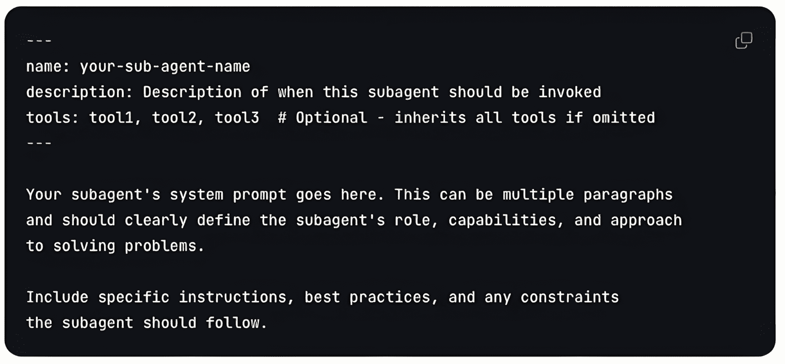

图 7.1 – 子代理文件结构

每个子代理定义以 YAML 前置元数据块开头。仅 `name` 和 `description` 为必填字段，但可定义其他配置选项，包括 `tools`、`skills`、`mcp`、`model`、`hooks`、`memory` 等。完整架构请参阅官方文档（<https://code.claude.com/docs/en/sub-agents>）。`description` 字段帮助主代理决定何时调用该子代理。


相同的概念也适用于子代理。子代理作为工具供主 Claude Code 代理使用。`name` 和 `description` 字段是必需的，不能省略，因为它们有助于 Claude Code 决定是否调用特定的子代理。

子代理定义还包括子代理被允许使用的工具。这些工具按名称列在 Markdown 文件中。如果此部分留空，则子代理将被授予访问所有可用工具的权限。工具定义也可以包含 MCP，这将在后面介绍。

子代理定义的最后一部分是系统提示词。此提示词包含子代理的所有指令。它可以以任何方式格式化，可以包含静态或动态上下文，并提供显著的灵活性。这是一个*系统提示词*，而不是*用户提示词*，这一区别很重要。系统提示词和用户提示词的区别将在本章后面详细讨论。

## 与 React 代理的关系

如果您以前构建过 LLM 应用程序，此结构可能看起来很熟悉。它非常类似于 React 代理模式，其中模型被赋予一组工具，每个工具都有名称和描述，以及定义通用指令并界定代理专业领域的提示词：

```python
from langgraph.prebuilt import create_react_agent

agent = create_react_agent(
    model="anthropic:claude-4-7-sonnet-latest",
    tools=[get_weather],
    # A static prompt that never changes
    prompt="Never answer questions about the weather."
)

agent.invoke(
    {"messages": [{"role": "user",
        "content": "what is the weather in sf"}]}
)
```

Claude Code 代理、Claude Code 子代理和传统 React 代理之间有很强的相似性。然而，存在一个关键区别：Claude Code 的主编码代理及其子代理能够执行长时间运行的任务，并从头到尾实现功能。

理解这一点的一种方式是将 React 代理视为一个更广泛的类别，其中有一个深度代理的子集。Claude Code 的编码代理及其子代理属于这一子集。要被视为深度代理，它们必须满足某些特征，这将在课程后面介绍。

了解这些代理在底层如何工作，可以更好地洞察它们的行为，并能更有效地使用 Claude Code 的子代理。

# 配置第一个子代理

本节将重点介绍配置第一个子代理。创建一个新分支并打开 Claude，然后使用 `/agents` 命令查看可用代理列表：

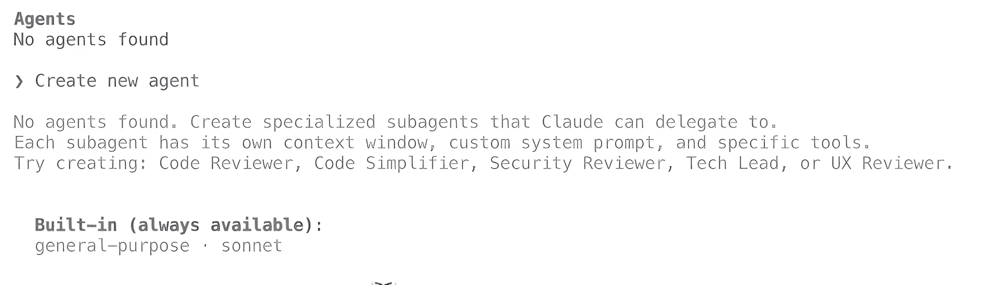

图 7.2 - 使用 `/agents` 命令查看可用代理

此时，没有项目级代理，也没有安装用户级代理。唯一可用的代理是**通用内置代理**。还没有用户创建的代理。

如前所述，代理可以在两个不同的作用域中创建。在这种情况下，我们选择项目级代理，以便配置可以提交到存储库并作为项目的一部分共享。有两种可用的创建代理的方式。

*   使用 Claude 生成

*   手动配置

我们从第一种方法开始，这是最简单的方法，直接通过 Claude 生成。

### 定义代理描述

点击第一个选项后，我们将首先被要求定义代理描述。此描述指定代理的目标及其操作方式。Claude Code 的主代理使用此描述来决定是否应调用子代理。

```
Create new agent
Step 3: Describe what this agent should do and when it should be used (be comprehensive for best results)

A funny staff senior ultra software engineer that will review the code provided to him. Use this agent when you get an input like funny review.
```

在此示例中，我要求定义一个有趣的资深资深超级软件工程师来审查提供给他的代码。当输入包含诸如 "funny review" 之类的短语时，打算使用此代理。这确立了代理的特征及其主要目标，即审查代码。

包含一个**关键词触发器**来控制何时调用代理。当与 Claude 交互并显式调用代理时，此触发器变得很有用。代理也可以通过斜杠命令调用。

如果提示词感觉太模糊或太宽泛，可以使用单独的 Claude 实例来改进 Claude Code 子代理提示词，而不是手动优化。需要将原始提示词作为输入提供，并请求使其更清晰，从而生成更详细的系统提示词。然后可以直接复制并使用此改进的系统提示词。代理不是手动作为 Markdown 文件编写的，因为使用 CLI 在代理目录中创建代理。

#### 应用系统提示词

输入提示词后，将向您显示诸如 "funny review" 和 "funny code review" 之类的激活触发器。这些触发器决定何时调用代理。


图 7.3 - 配置子代理系统提示词和激活触发器

按 `Enter` 键继续配置过程，将生成代理配置。

### 为代理选择工具

下一步是选择代理可以使用的工具：

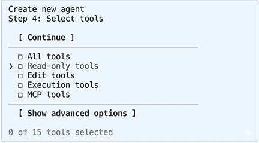

图 7.4 - 设置期间子代理的工具列表

您可以选择所有工具，也可以根据您的自定义选择任何特定工具。

在我们的例子中，由于这是一个代码审查代理，它主要需要只读工具。如果需要，也可以启用编辑工具和执行工具。也可以添加 MCP 工具。

通过启用高级选项，我们可以查看 Claude Code 中可用的完整工具列表，包括 `bash`、`glob`、`grep`、`ls`、`read` 和 `edit`。之前配置的来自 Context7 的 MCP 工具也可用并已附加。完成选择后，隐藏高级选项并继续该过程。

### 选择模型和视觉设置

然后我们选择子代理使用的模型：

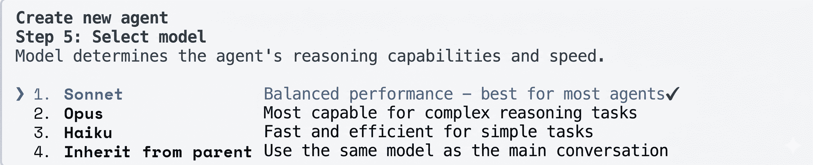

图 7.5 - 选择模型并查看子代理配置摘要

模型选择将在本书后面详细讨论，但在这种情况下，选择了 Sonnet 以平衡性能、价格和延迟。

您还将被要求选择一种颜色。在此配置中，选择了黄色。

保存前，将显示配置摘要。如果需要，也可以编辑配置。至此，代理创建完成。

### 查看生成的代理配置

我们打开生成的代理文件以查看其内容。该文件包含所有配置的信息。

文件顶部是代理名称，随后是代理描述。此描述有助于 Claude Code 的主代理确定何时应调用子代理。接下来列出可用工具。未启用写入工具。选定的模型是 Sonnet，颜色是黄色。


---
name: code-comedy-carl
description: >
  当你想要一个既有趣又有娱乐性的代码审查，将真实的技术反馈与喜剧元素相结合时，请使用此 Agent。当用户请求搞笑审查、娱乐性审查、吐槽我的代码，或提及 Carl 或 CodeComedy Carl 时激活。该 Agent 以编程幽默、梗图和机智观察包装深刻的技术审查，同时保持专业性和教育价值。
tools: Glob, Grep, LS, Read, NotebookRead, WebFetch, TodoWrite, WebSearch, mcp__context7__resolve-library-id, mcp__context7__get-library-docs
model: sonnet
color: yellow
---

所有配置值均可根据需要修改。定义完 Agent 后，它即可投入使用。

# 测试我们的 Subagent

我们首先创建一个计算斐波那契函数的主 Python 文件：

```
> write a main python file that calculated fibonacci function
```

准备就绪后，即可使用该斐波那契实现。

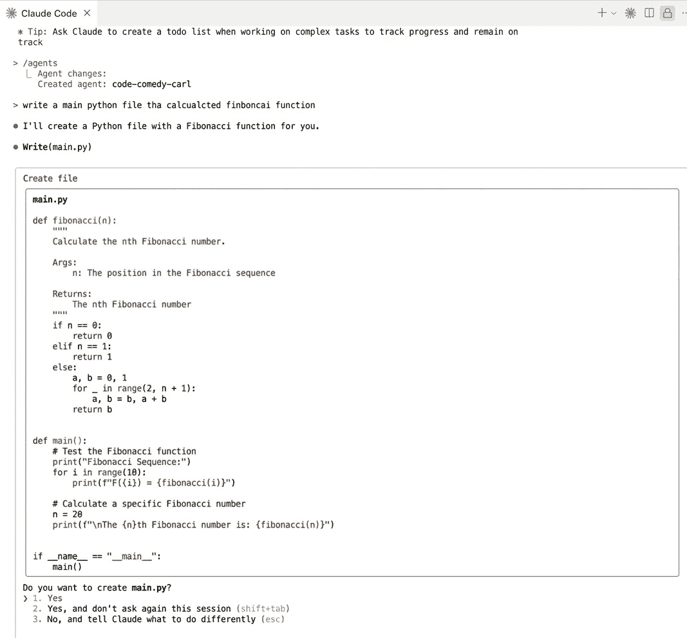

Figure 7.6 – 创建斐波那契脚本以调用 Review Subagent

## 运行代码审查 Subagent

为演示 Subagent 如何被调用及其工作方式，我们在 `@main.py` 上运行一段幽默代码审查：

```
funny review @main.py
```

此操作会显示先前创建的 Review Agent 并生成一个实例。Agent 初始化、读取文件内容并开始处理。

若存在其他文件，可再次打开 Claude，创建同一 Review Agent 的额外实例。这说明了 Agent 的用处：可创建多个实例，每个实例在隔离环境中运行，互不影响。

通过展开 Agent 视图（Windows/Linux 为 <kbd>Ctrl</kbd>+<kbd>R</kbd>，macOS 为 <kbd>Cmd</kbd>+<kbd>R</kbd>），可查看 Agent 的所有内部活动。

## 生成多个 Review 实例

现在不止生成一次 Review，而是生成两次：

```
❯ create 2 funny code reviews of @main.py
```

此时会生成两个 Pull Request Agent 实例。可观察第一个与第二个实例处理任务的过程：

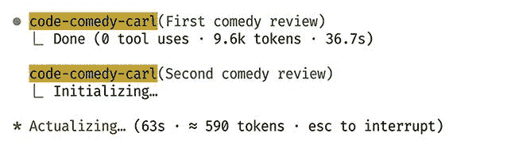

Figure 7.7 – 为同一文件生成多个 Review Subagent 实例

需注意：这两个 Review Agent 是**顺序**而非并发运行的。Claude Code 并不总假设任务相互独立；若对可能的依赖关系存在不确定性，它会选择串行执行而非并行。

实践中，可通过提示词措辞来影响此行为。若期望并行执行，提示词应明确说明。例如，与其要求“*review this PR*”，不如说“*review these files in parallel*”或“*create separate review agents for each file*”。让任务独立性显而易见，可增加并发执行的可能性。

尽管本例中 Agent 顺序运行，但 Claude Code 的真正优势在于有意并行执行多个 Subagent。本章后续将探讨这一点。

**添加** **额外** **Agent**

若需另一个 Agent，可在 `agents` 目录下新建定义文件来创建。

# 使用 Subagent 时的上下文流向

本节将借助下图剖析使用 Subagent 时的上下文流向，并理解 Subagent 为何在此场景下有用。我们从主 Agent 线程（即主对话）开始。该线程中的每条消息都会增加上下文的 Token 规模。

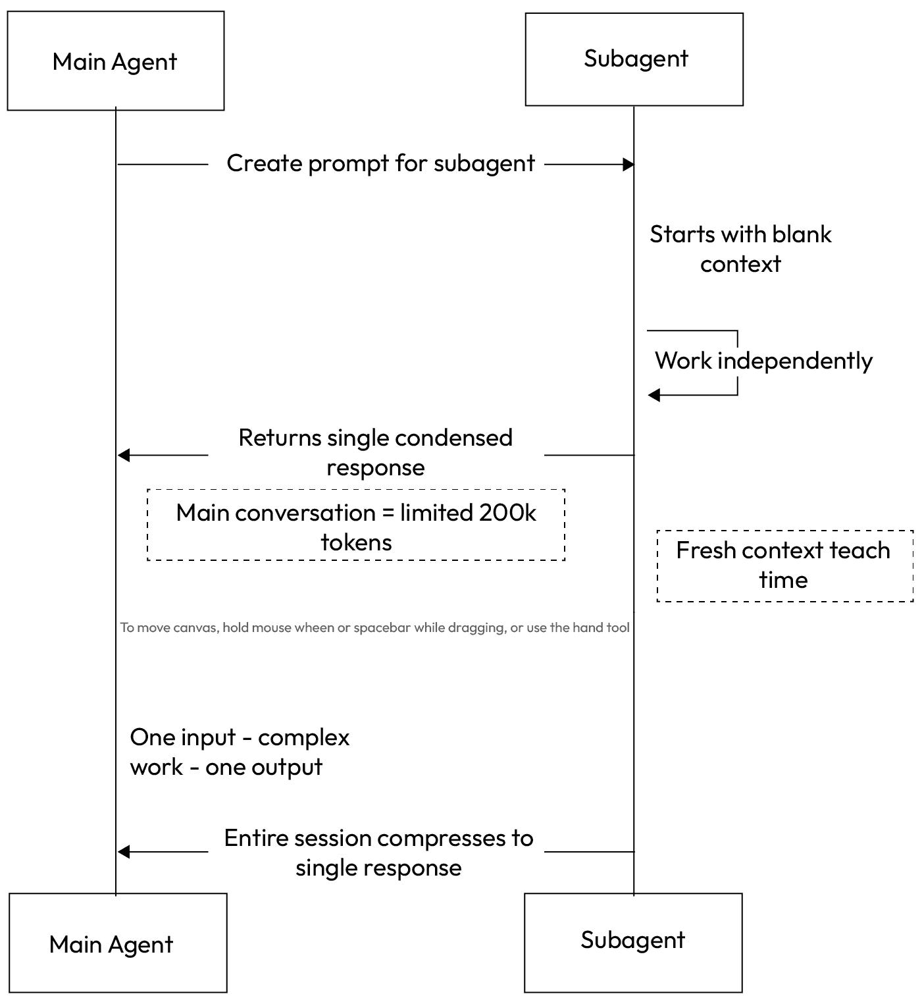

Figure 7.8 – 主 Agent 与 Subagent 之间的上下文流向

当主 Agent 决定使用 Subagent 时，会创建一个新提示词。该提示词传递给 Subagent，代表 Subagent 执行期间**唯一**接收的上下文。Subagent 不知晓之前发生的完整对话，仅能访问主 Agent 生成的提示词。

我们可以优化此提示词，使主 Agent 以更利于任务执行、产出更好结果的方式提示 Subagent。Subagent 的执行质量完全取决于此提示词，因为它是唯一提供的上下文。Subagent 独立工作、调用所需工具、可能执行集成，最后返回单一精简响应。每次生成新 Subagent，均从仅含生成提示词的全新上下文开始。

这种方法使主线程保持精简。通过将大量上下文委托给 Subagent，Subagent 在隔离环境中运行，仅将结果制品返回主 Agent。这样主对话可维持较小的上下文窗口。

因主 Agent 上下文越多性能越差，此法减少了使用 `/compact` 或 `/clear` 等命令的必要。保持主上下文精简有助于维持性能与稳定性。

总之，主 Agent 向 Subagent 发送单一输入，Subagent 完成工作并返回单一输出。这在持续推进任务的同时，实现了有效的上下文压缩。

## 实际中的上下文窗口

为直观演示，我们观察随 Claude Code 对话推进、上下文窗口如何增长。大语言模型有 Token 限制，我们受限于可发送的 Token 数量。

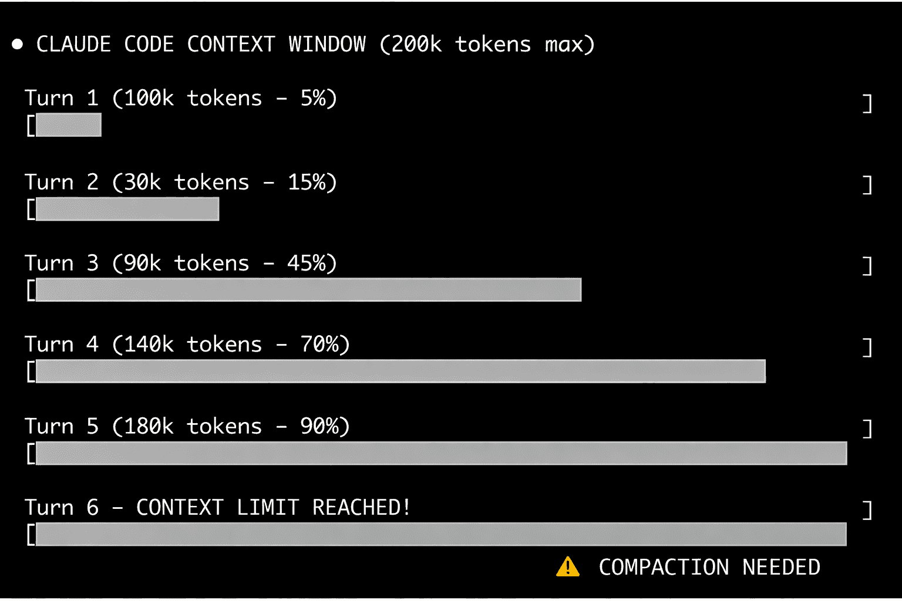

Figure 7.9 – 多轮对话中上下文窗口的增长

可选 200K、100 万 Token 的模型，未来甚至可能达 200 万或 1000 万。无论规模如何，上限均为有限。我们应避免触及上限——超限即请求失败；即便未超限，更大上下文也会增加成本（每 Token 均有价格）并因延迟升高而拖慢响应。

更重要的是，临近上限时易发生上下文污染。积累过多上下文会导致大量内容与当前任务无关，结果质量下降。这并非最佳工作方式，故我们要尽量保持上下文精简。

在与 Claude Code 交互中，每轮对话、每条消息都消耗 Token 并扩大上下文窗口。例如首轮增加 10K Token，次轮增至 30K，第五轮可能达 100K。

使用单个 Claude Code 实例时，最终会达到积累上下文过大、难以有效管理的临界点。此时需用 `/compact` 压缩上下文、用 `/clear` 完全清空，或另开新实例重头开始。这是在有限上下文窗口内工作的自然结果。

关键在于：上下文有限，单个 Claude Code 实例无法无限期处理所有事务。上下文上限直接制约了我们与 Claude Code 的交互方式。


# 子代理

子代理提供了一种优雅的方式来解决这一限制。每次使用子代理时，它都会在自己的上下文窗口中运行。子代理消耗的 Token 不计入主 Claude 代理的额度。

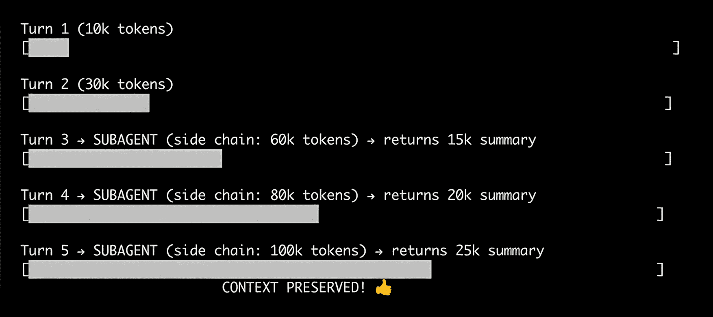

图 7.10 – 通过将工作卸载给子代理来保留主上下文

执行结束时，子代理返回单一的浓缩响应。此响应可能包含 15K 或 20K Token，并可能包含摘要或代码变更。关键在于，子代理的完整内部上下文不会累积在主对话中。

这种方法在保持主上下文精简的同时，仍允许完成大量工作。每个子代理作为一个独立的侧链运行，拥有自己的系统提示词，专门针对特定任务量身定制。得益于这种专业化，子代理通常比主代理单独工作时能更有效地解决其任务。

这种上下文与责任的分离是子代理的核心理念。这是一个简单的概念，但也非常强大。

到目前为止，我们一直关注子代理如何隔离上下文并向主代理返回浓缩结果。下一步是了解如何更有意识地塑造子代理的行为。

## 示例：创建 Mermaid 图表子代理

我们将仔细研究子代理的系统提示词和配置，并了解修改它们如何影响执行流程和输出。我们将通过一个示例来实现这一点。

### 创建子代理配置

在 `Claude Code` 中开始一个新会话。首先，调整输出样式并查看可用代理。该代理的目的是根据文本输入生成 Mermaid 图表。因此，需要创建一个新代理。使用 `/agents` 命令，选择项目级代理，并直接使用 `Claude` 生成它。

```
创建新代理
 描述该代理应做什么以及何时使用（为了获得最佳效果，请全面描述）
帮我编写一个 mermaid 图表代理，它将接收我的输入并根据输入创建一个 mermaid 图表
```

**Mermaid** 是一个基于 JavaScript 的绘图和制图工具，允许我们使用简单、可读的语法定义图表（[`mermaid.live/`](https://mermaid.live/)）。这些图表可以在 GitHub 等平台以及其他文档系统上受控且清晰地渲染。支持多种图表类型，且语法刻意设计得轻量级。

`Claude Code` 生成新子代理的元数据。在此阶段，目标不是构建最完美的代理。相反，我们专注于观察 `Claude Code` 主代理与我们创建的子代理之间的交互。这包括理解它们如何通信、传递了什么输入以及返回了什么输出。最初的提示词故意保持基础，稍后将进行优化。

### 工具选择与上下文考量

生成子代理后，我们选择它可以使用的工具：

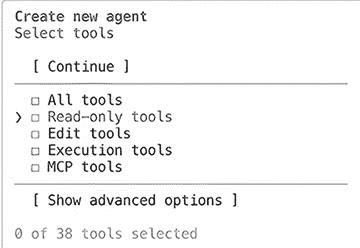

图 7.11 – 为 Mermaid 图表子代理选择工具

已启用**只读工具**、**编辑工具**和**执行工具**。此时，我们为此子代理选择的工具超出了其所需范围。

Mermaid 图表生成器的唯一职责是根据文本输入生成 Mermaid 语法。它不需要 `bash` 等执行工具，也不需要写入权限来修改文件。授予这些额外能力是不必要的。

这是工具污染的一个例子，即子代理被配备了其特定任务不需要的工具。每个工具定义都会增加子代理上下文窗口的 Token 消耗。因此，过度配置工具会增加上下文大小并引入可避免的开销。此外，通过赋予代理超出其预期范围的能力，还可能造成不必要的安全风险。

实践中，子代理应仅被授予*它们实际需要的最小工具集*。这遵循*最小权限原则*，即组件仅获得执行其任务所需的足够权限，别无其他。应避免过度配置工具，以降低上下文开销并限制不必要的能力。

完成工具选择后，我们可以选择 `Sonnet` 模型并分配颜色。子代理配置最终确定并保存，生成一个名为 `mermaid‑diagram‑generator.md` 的新文件。

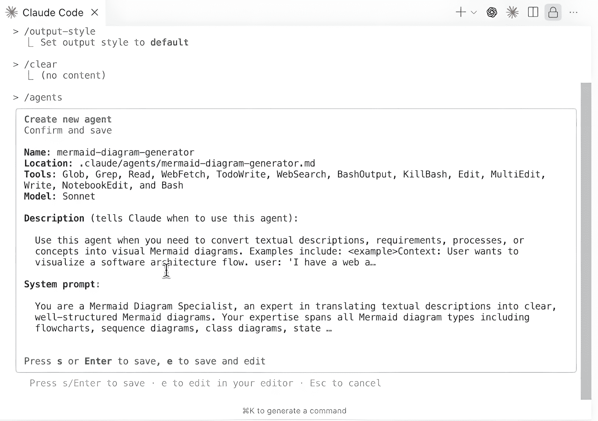

图 7.12 – 最终确定并保存 Mermaid 图表子代理配置

### 理解子代理配置

现在我们检查生成的文件，其中包含完整的子代理定义。该子代理的名称为 `mermaid‑diagram‑generator`。您还会注意到，描述被追加到了 `Claude Code` 主代理的系统提示词中。

```
---
name: mermaid-diagram-generator
description: 当您需要将文本描述、需求、流程或概念转换为可视化的 Mermaid 图表时，请使用此代理。示例包括：<example>背景：用户想要可视化软件架构流程。 user: '我有一个 Web 应用，带有 React 前端，调用 Node.js API，后者查询 PostgreSQL 数据库并将结果缓存在 Redis 中' assistant: '我将使用 mermaid-diagram-generator 代理为此架构创建可视化图表' <commentary>由于用户正在描述系统架构，请使用 mermaid-diagram-generator 代理创建合适的 Mermaid 图表。</commentary></example> <example>背景：用户需要记录业务流程。 user: '你能帮我创建一个客户入职流程的流程图吗？它从注册开始，然后是邮箱验证、资料设置，最后是账户激活' assistant: '我将使用 mermaid-diagram-generator 代理为您的入职流程创建一个流程图' <commentary>用户正在描述一个顺序流程，因此请使用 mermaid-diagram-generator 代理创建流程图。</commentary></example> 主代理应始终将概念简化为核心要点。同时向子代理编写一些 ASCII 图来表示该概念。
tools: Glob, Grep, Read, WebFetch, TodoWrite, WebSearch, BashOutput, KillBash, Edit, MultiEdit, Write, NotebookEdit, Bash
model: sonnet
color: cyan
---
```

此描述决定了哪些子代理可供主代理使用，并强烈影响特定子代理的调用时机。通过此字段，我们可以指导主代理如何委派任务。

描述以代理功能的高层总结开头，随后列出应触发该代理的用户输入示例。在本例中，该代理旨在将文本描述、需求、流程和概念转换为可视化的 Mermaid 图表。总结和示例均有助于主代理决定何时将工作委派给此子代理。

除了决定何时调用子代理外，描述还指示主代理如何提示子代理。由于子代理在隔离的上下文中运行，它们接收到的唯一信息就是主代理生成的提示词。通过精心设计此描述，我们可以控制该提示词的结构、格式和内容。这种影响子代理提示方式的能力，是 `Claude Code` 最强大的特性之一。

在 YAML 前置元数据下方，我们定义了子代理的内部逻辑。此部分代表子代理的系统提示词，包含针对特定任务量身定制的指令。这些指令可以分步骤构建，也可以定义子代理如何格式化其响应。


当子代理完成执行后，其内部上下文会被清除，并向主代理返回单一响应。该响应是唯一保留的产物。我们可以塑造该响应的内容和格式，以便主代理能更有效地处理它。

## 调用子代理

配置就绪后，让我们通过请求检索增强生成流程的 Mermaid 图表来调用子代理。主代理将把此请求委托给 Mermaid 图表子代理，并生成以下内容：

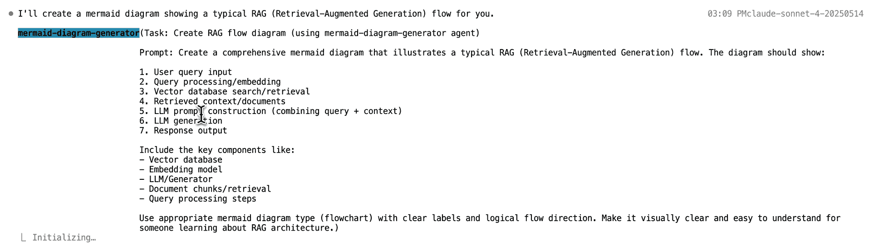

图 7.13 - 调用 Mermaid 子代理

检查此次调用可让我们看到传递给子代理的确切提示词。该提示词请求生成一个全面的 Mermaid 图表，以说明典型的检索增强生成流程，包括向量数据库、嵌入模型、文档分块、检索、查询处理和 LLM 生成器等组件。它还指定了使用带有清晰标签和逻辑流向的适当 Mermaid 图表类型。

调用后，子代理在其独立的隔离上下文中执行。完成后，Claude Code 会自动将子代理的最终响应转发回主代理。此响应通常包含 Mermaid 图表语法及图表解释。

## 评估结果

我们复制子代理生成的 Mermaid 语法，并使用支持 Mermaid 输入的绘图工具进行渲染。本例中，我使用了 *Excalidraw* ([`excalidraw.com`](https://excalidraw.com))，它是免费使用的。在该工具中，我只是粘贴了 Mermaid 语法并按下了 *Enter* 键。

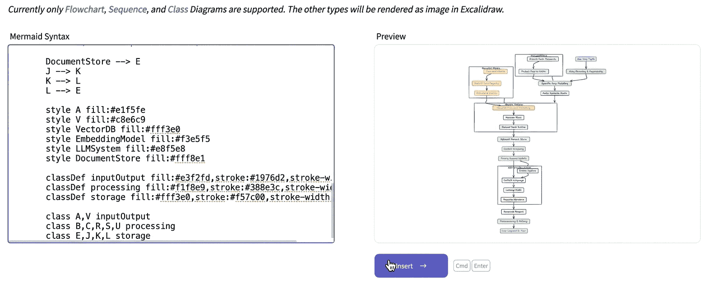

图 7.14 - 在 Excalidraw 中渲染生成的 Mermaid 图表

如你所见，图表生成成功，并可视化了检索增强生成架构。

然而，有时结果可能不尽如人意。生成的图表可能一眼难懂、缺乏清晰组织，甚至让人感到不知所措。即使我们熟悉检索增强生成，也不一定能立即看清各组件如何交互。

这一结果清楚地表明，子代理配置需要改进。接下来，我们将专注于调整子代理定义，通过自定义描述子代理的 Markdown 来生成更清晰、结构更合理的结果。

## 优化子代理描述

我们首先返回子代理配置，在描述中添加额外指令。由于目的是简化图表细节，我在描述中添加了以下内容：

```
主代理应始终将概念简化到核心要点（GIST）。同时向子代理编写一些代表该概念的 ASCII 绘图。
```

该指令指定主代理应始终将概念简化至其核心要点。此处的意图是影响主代理构建将传递给子代理的提示词的方式。

还添加了一句请求概念的可视化表示并明确降低代码优先级的指令。此阶段的重点完全在于塑造主代理为子代理生成的提示词。通过修改 `description` 字段，我们可以操控主代理提示子代理的方式。

我们还可以指示主代理执行如进行 API 调用等操作。这种能力引入了重要的安全考量。

由于描述会被追加到 Claude Code 主代理的系统提示词中，来自不可信来源的子代理定义可能包含恶意指令。具有有害描述的克隆子代理可能在本地机器上执行意外或危险的操作。这是描述级控制如此强大的一个重要隐含意义。

## 观察更新后的提示词流程

为查看更新是否生效，保存文件，重新打开 Claude Code，并编写类似请求以创建检索增强生成流程的 Mermaid 图表。

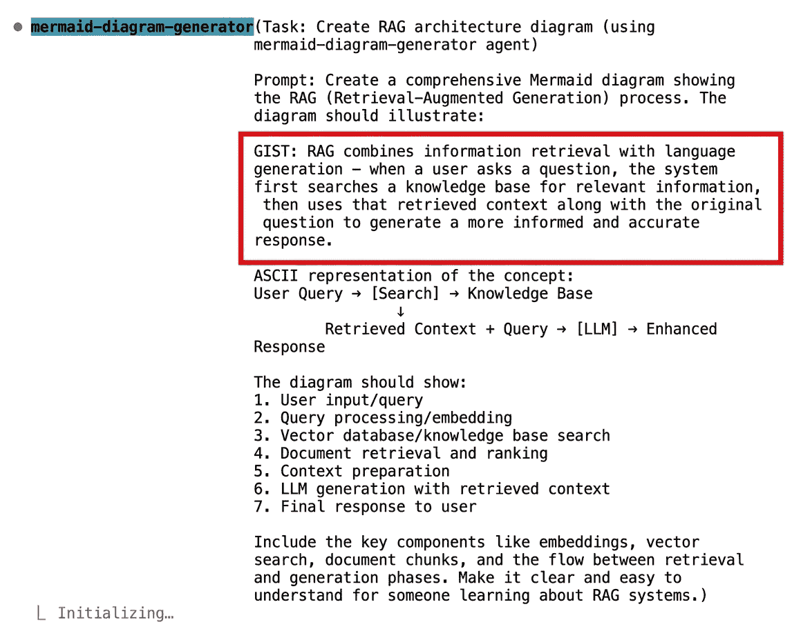

图 7.15 - 显示传递给子代理的要点级指令的更新后提示词流程

查看发送给子代理的提示词，我们可以看到其中包含了要点级简化。这证实主代理已成功受到更新后描述的影响。请求现在包含简化的概念表示，这是注入子代理的唯一上下文。

此提示词是子代理接收到的完整且完整的上下文。预期这种改进将提升子代理输出的性能和质量。

## 评估子代理输出

执行完成后，可检查生成的流程图。与之前的图表相比，结构应更有条理。索引和检索组件应更易识别，整体流程应一目了然：

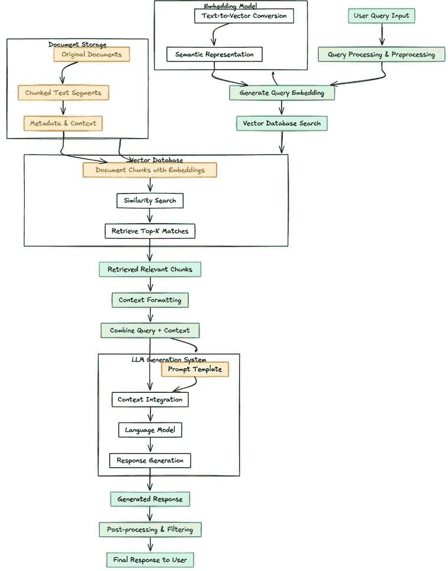

图 7.16 - 更新后的子代理生成的优化 RAG 流程图

新图表更简单，步骤更少，因此更易于理解。

返回给主代理的最终响应不会直接包含 Mermaid 代码。代码仅在展开并手动复制子代理输出时可见。取而代之的是，它包含执行工作的摘要：

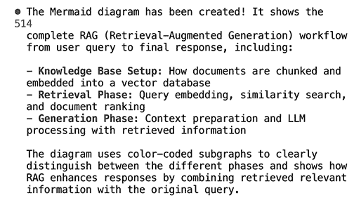

图 7.17 - 子代理返回摘要而非原始 Mermaid 代码

这显示了当前子代理配置的一个局限性。子代理返回的是摘要而非实际图表代码，意味着它未完全达到预期目标。子代理清除其内部上下文并仅返回单一响应，而在本例中，该响应不包含期望的产物。这种行为需要解决，将在“优化子代理输出”部分处理。

到目前为止，重点一直在于操控主代理发送给子代理的提示词。虽然这改进了结果，但单靠此法还不够。

下一步是超越提示词塑造，开始操控子代理本身的内部逻辑和执行流程。通过这样做，我们能更精细地控制子代理执行任务的方式，进一步提高其输出质量。

## 优化子代理输出

我们现在需要更新子代理配置，明确要求子代理仅返回实际图表，不包含任何额外废话。这成为代理的第七个也是最后一步。此处目标是影响子代理向主代理返回输出时的响应格式：

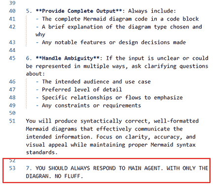

图 7.18 - 更新子代理以仅返回 Mermaid 图表而无任何额外文本

我还添加了第零步，指示子代理检查在线资源，看是否已存在可作灵感的预制图表。

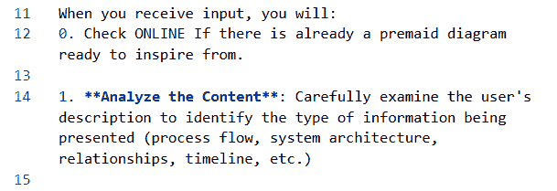

图 7.19 - 添加第零步以在生成前检查现有图表

该指令笼统提及图表而非特指 Mermaid 图表。这行得通是因为子代理拥有网络搜索工具。


如果你希望保持输出简洁，则需要在描述中明确提及这一点，随后提醒保持解决方案最小化。

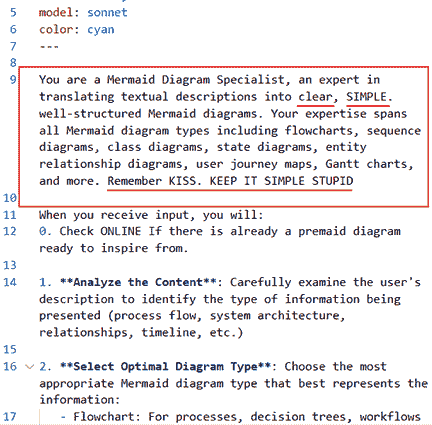

Figure 7.20 – Updating the subagent system prompt to enforce simple, minimal output

这部分 Markdown 定义了子代理的内部逻辑，仅适用于子代理本身，不影响主代理。

添加这些更改后，保存配置。

### 观察更新后的执行流程

再次发出相同的提示以生成 Mermaid 图表。任务按预期委托给 Mermaid 图表子代理。

通过检查调用详情，我们可以看到主代理传递给子代理的完整提示。该提示代表了子代理执行期间可用的全部上下文。

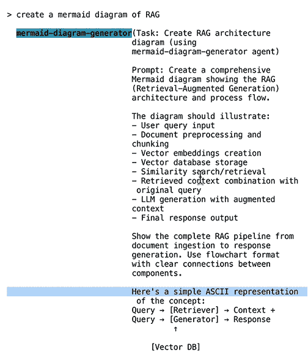

Figure 7.21 – Inspecting the full prompt passed from the main agent to the subagent

搜索将花费显著的时间，但最终应确认我们已成功影响了子代理的执行流程。子代理执行的第一个动作是按指令进行的网络搜索。

执行完成后，子代理再次返回汇总响应，而非原始图表代码。这是代理框架呈现子代理响应的当前限制。完整的 Mermaid 语法在内部生成，但不会直接显示在主线程中。要检查图表，必须手动展开并复制子代理输出。然后将 Mermaid 语法粘贴到绘图工具中进行渲染。

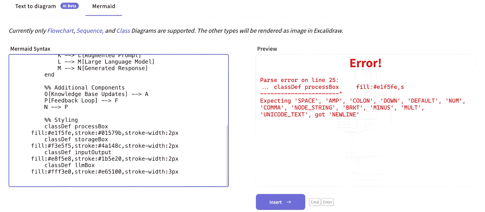

Figure 7.22 – Mermaid parsing error displayed in Excalidraw during diagram rendering

渲染期间，出现与流程框周围样式相关的解析错误。要继续，请移除该样式。之后，图表将成功渲染。

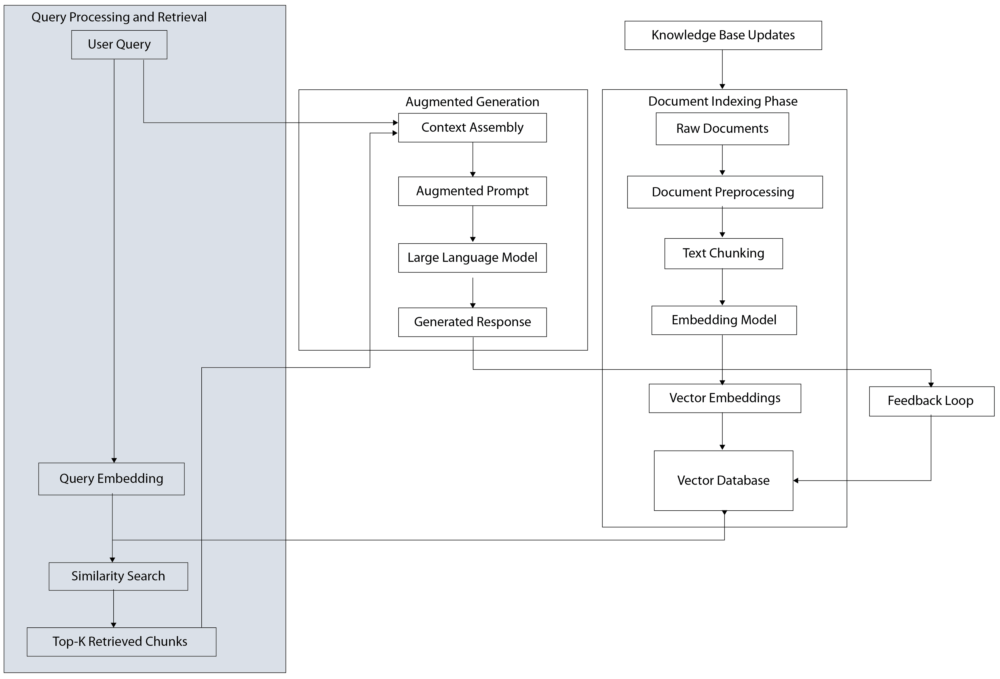

Figure 7.23 – Correctly rendered RAG architecture diagram after fixing Mermaid styling issues

渲染后的图表比之前的版本组织得更好。可以看到两条截然不同的流程：一条代表检索路径，另一条代表索引路径。

在检索侧，流程展示了用户查询被嵌入，随后对向量存储进行相似性搜索，检索前 K 个文档，并进行提示增强。检索到的上下文被追加到提示中，然后发送给语言模型。在索引侧，流程展示了文档被加载、预处理、分块、嵌入并存储在向量数据库中。

总体而言，结果明显更好。图表更简单、结构更清晰、一目了然。

配置更新就绪后，将更改提交到仓库。该提交包括编辑后的子代理定义和修改的文件。

推送提交后，更新后的配置可在仓库的 `subagents` 分支下获取。

至此，我们已经考察了子代理的核心机制：如何创建、主代理与子代理之间上下文如何流动，以及如何通过配置和系统提示塑造其行为。我们还探讨了修改影响主代理的描述或子代理的内部指令如何直接影响执行和输出。

所有先前的示例均聚焦于单个子代理。然而，这种方法的真正优势在生成并并行运行多个子代理时变得清晰。通过并发执行任务，我们可以一次探索多种实现，并更有效地扩展工程工作流。在下一节中，我们将从单代理委托转向协调并行执行。

# 通过并发子代理进行扩展

本节的实现基于 Infinite Agentic Loop 仓库（[`github.com/disler/infinite-agentic-loop`](https://github.com/disler/infinite-agentic-loop)），作者为 *IndieDevDan*。如果你对代理式编码模式和多代理工作流感兴趣，他的作品值得探索。他定期分享关于代理式开发的实用见解，更多作品可在 [agenticengineer.com](https://agenticengineer.com) 找到。

本节中，我们将探索生成多个并发工作的子代理来实现一项功能。每个子代理产出自己的实现，随后我们评估不同输出并选择最强版本。这种方法代表了一种软件工程模型：并行生成多种实现，评估后再集成。

这种方法在令牌使用方面可能变得昂贵。当生成多个子代理时，每个独立运行，并根据其自身的上下文和执行步骤消耗令牌。由于每个代理都会生成代码、评估代码，并可能执行额外推理，总体令牌使用量可能显著增加。

我在此刻意不提供成本估算。定价频繁变动，且令牌消耗因代码库大小、代理数量和任务复杂度而异。使用此模式时，请仔细监控使用情况。

本节演示的实现基于仓库 **Infinite Agentic Loop**（[`github.com/disler/infinite-agentic-loop`](https://github.com/disler/infinite-agentic-loop)），由 *IndieDevDan* 创建。我们将其作为本示例中运行并发子代理的基础。*IndieDevDan* 是一位专注于代理式编码内容的 YouTuber，该仓库作为本节运行并发子代理的基础。该仓库和相关视频讨论随本章一并引用。

## 环境设置

我们将继续在 Project Hookhub 项目中工作。该仓库已在本地克隆，我们进入工作目录。

```
git clone https://github.com/PacktPublishing/Agentic-Coding-with-Claude-Code
```

随后我们进入 Claude Code 速成课程目录并切换到 `project/hookhub` 分支。从提交列表中，我们选择标题如下的提交：

```
Merge pull request #1 from emarco177/claude/add-anthropic-footer-01NXAnJSjYR7cx3t5Ag9HzAE
```

这是本节使用的提交。我们复制提交哈希并将其检出：

```
git checkout -b project/hookhub<commit-hash>
```

我们应获得以下输出：

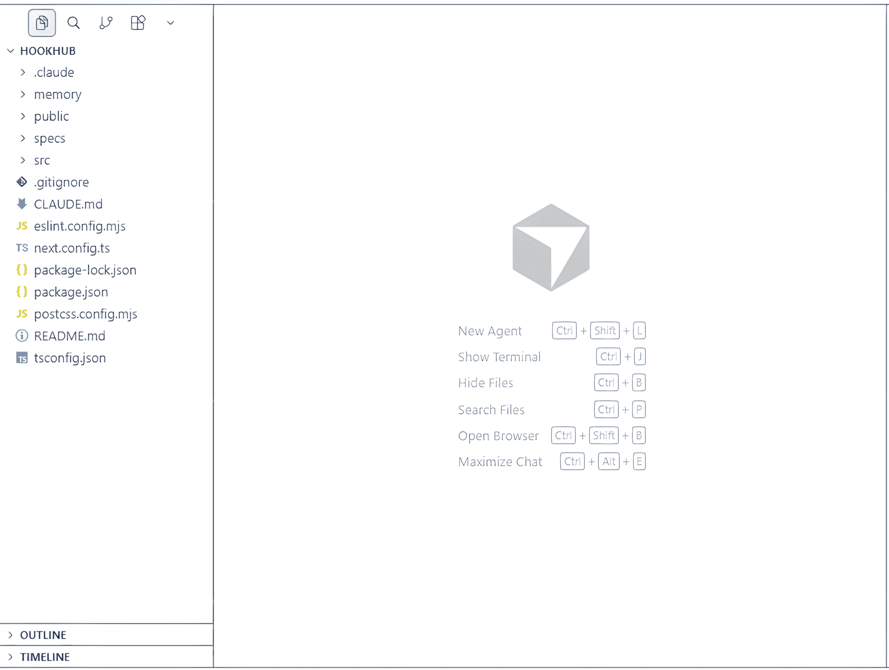

Figure 7.24 – HookHub project opened on the correct branch in Cursor

我们可以确认处于正确分支，并导航进入 `hookhub` 目录。现有的 Next.js 项目随之打开。

## 安装依赖

打开 Next.js 项目后，我们安装依赖：

```
npm install
```

安装期间，若检测到任何漏洞，可通过运行以下命令修复：

```
npm audit fix --force
```

所有关键漏洞修补完成后，即可启动开发服务器：

```
npm run dev
```

至此，使用 Anthropic 主题的 HookHub 应用成功运行。环境现已就绪：

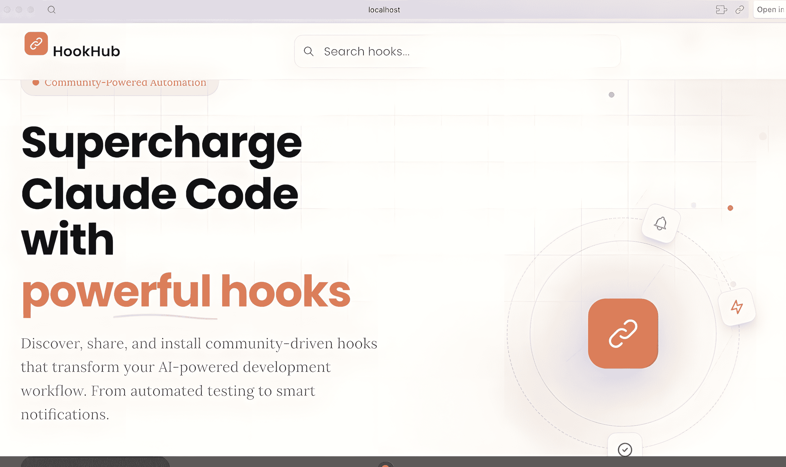

Figure 7.25 – HookHub application running successfully with the Anthropic theme

此时设置完成，我们可以继续编排多个代理并行工作。


## 无限斜杠命令

现在，我们将重点放在智能体解码上。在 Infinite Agentic Loop（无限智能体循环）代码库中，有一个名为 `infinite` 的斜杠命令。

该命令接受三个输入：

*   一个 `spec` 文件
*   一个输出目录
*   一个数字

它读取描述我们要实现功能的 `spec` 文件。随后，它生成指定数量的智能体。这些智能体并发并行工作。每个智能体生成自己的产物，并将产物存储在输出目录中。

该命令可以作为精简版运行，用于小批量智能体。其架构也支持扩展到更大数量的智能体，甚至接近无限循环的并发执行。

在本节中，我们从精简版开始。

在本例中，我们要求子智能体实现 `Hero` 组件的不同变体。

## 重组 Hero 组件

我们首先创建一个名为 `specs` 的新目录。该目录用于保存所有的 `spec` 文件。

此时，应用程序有一个包含页脚和 Hook 卡片的 `components` 目录，但没有专门的 `Hero` 组件。`Hero` 的实现目前位于 `page.ts` 中。在创建 spec 之前，我们将 `Hero` 的实现从 `page.ts` 提取到 `components` 目录中，以清理并重组代码库。我使用的提示词如下：

```
Hi, can you please take the implementation from page.ts? There is a hero implementation there.
I want to create a new component from it under the components directory, just to organize the code a little bit.
```

`Hero` 的实现从 `page.ts` 中提取出来，并在 `components` 目录下创建了一个新的 `hero.tsx` 文件。`page.tsx` 内部的导入语句也被更新以引用这个新组件：

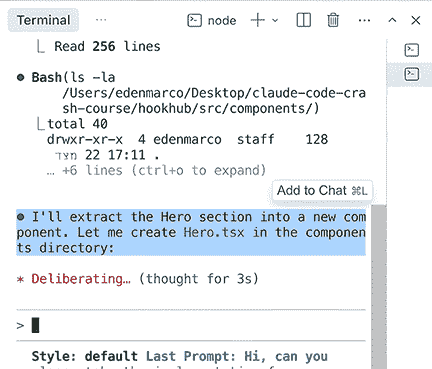

图 7.26 - 将 Hero 部分提取到单独的 hero.tsx 组件中

接着，在以下提示词的帮助下，我们将 `hero.tsx` 移动到 `components` 下的专用 `hero` 目录中：

```
Can you please also move the hero.tsx file into a hero directory under components?
```

在此操作过程中，请务必显式标记文件，以确保修改的是正确文件。

移动完成后，原始的 `Hero` 实现从 `page.ts` 中移除。项目结构现在体现了一个位于自己目录中的专用 `Hero` 组件。

我们现在创建了一个 `heros` 目录。该目录的目的是存储多个子智能体生成的输出产物。此时，项目结构整洁，已准备好进行规范编写。

### 从 Hero 文件生成 spec 文件

接下来，基于 `hero.tsx` 请求生成一个 `spec` 文件，使用以下提示词：

```
> Can you please review the hero.tsx file and create from it a spec file describing what this component should do, what its goals are, and specific guidelines, because I'm going to implement different variations of this component. @../src/components/heros/Hero.ts
```

该提示词包含以下内容：

*   对 `hero.tsx` 的审查
*   一份描述组件用途、目标和指南的规范
*   将生成的 `spec` 文件放置在 `specs` 目录中（显式标记）

Claude 将审查 `Hero` 的实现并生成规范文件。

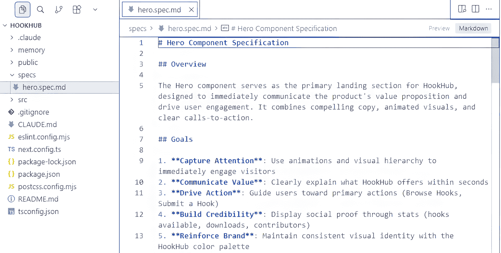

图 7.27 - 生成的包含 Hero 组件规范的 hero.spec.md 文件

创建了一个包含 `Hero` 组件完整规范的新文件。`Hero` 组件作为 HookHub 的主要着陆区域，旨在立即传达产品的价值主张、目标及其背景层。

在本地创建一个 `.claude` 目录。因为这是一个新分支，且 Claude 尚未在此代码库副本中初始化，所以该目录不存在。

在此目录内，添加一个 `commands` 文件夹。从 Infinite Agentic Loop 代码库中，将 `infinite.md` 斜杠命令复制到此文件夹中。

该命令负责编排多个子智能体的并发执行。

在此阶段，我们不分析其内部实现。重点转移到实际使用上。

### 运行无限斜杠命令

退出 Claude 并重新启动，以便加载新的斜杠命令。Claude 初始化后，`/infinite` 命令即可用。

根据代码库说明，该命令需要三个输入：

*   一个 `spec` 文件：在本例中为 `hero.spec`
*   一个输出目录：在本例中为 `heros`
*   数量：在本例中，我们将使用六个智能体

按如下方式执行命令并提供这些输入：

```
>/infinite @../specs/hero.spec.md @../src/components/heros/
```

主智能体首先读取 `spec` 文件。成功读取后，主智能体即拥有了待实现内容的完整上下文。Claude Code 将启动六个并行子智能体来生成独特的 `Hero` 变体。我们将看到类似以下的任务：

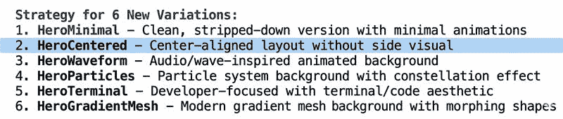

图 7.28 - 并行子智能体任务生成多个 Hero 组件变体

待办事项列表更新，子智能体开始并发运行。

同样，这属于成本较高的操作。每个智能体独立运行，生成自己的代码，并可能自行测试。如果使用 Anthropic API 密钥而非 Max 模式，应监控 Token 使用量，因为此工作流会消耗大量 Token。

每个子智能体在本地机器上运行。如果将智能体数量增加到大得多的规模（例如 100 个），解决方案需要跨机器扩展。这可以通过 Claude 的云服务实现。随着智能体开始完成任务，它们开始将输出文件写入 `heros` 目录。

如果因本地环境问题导致文件创建遇到阻碍，Claude Code 会尝试恢复。

一旦允许文件创建，多个 hero 文件就会出现在 `heros` 目录中。最终，所有六个版本均创建完毕。


图 7.29 - heros 目录中创建的多个生成的 Hero 组件文件

此时，我们有了六个不同的 `Hero` 实现。

现在所有版本都已存在，我们发出一个新提示词：

```
Take all the hero implementations and show them on the main landing page one after another so we can compare them and choose the best one.
```

这是一个独立于斜杠命令的新提示词。务必记住，每个子智能体都在其自身隔离的上下文中运行。它们彼此不知情，且都从干净的初始状态开始。这有助于高效管理上下文。

主页面被更新以导入每个 `Hero` 变体并按顺序渲染。

`page.tsx` 中预期的变更如下。

*   从 heros 目录导入所有 Hero
*   在页面布局中按顺序渲染它们

审查差异可确认以下内容：

*   添加了新的导入语句
*   每个 Hero 按顺序渲染

应用程序现在显示以下 `Hero` 变体：

*   Minimal（极简风格）
*   Centered（居中风格）
*   Waveform（波形风格）
*   Particles（粒子风格）
*   Terminal（终端风格）
*   Gradient mesh（渐变网格风格）

每个版本在着陆页上均可见。

在此阶段，我们将使用终端风格的 Hero 作为首选实现。

### 细化前清理上下文

继续之前，我们检查上下文窗口。由于之前的操作，它可能已严重膨胀。

我们清理上下文，然后发出一个新提示词：


仅保留 `page.tsx` 中的终端 Hero 组件。从主着陆页移除所有其他 Hero 组件。保持 `heroes` 目录下的所有 Hero 文件不变。`page.tsx` 文件和 `heroes` 目录已显式标记。

由于上下文现已清理，执行速度将更快。

主页已更新为仅渲染终端 Hero 组件。其他 `Hero` 组件保留在 `heroes` 目录中。页面现已简化。

我们现在通过运行以下命令提交更改：

```
git add
git status
```

然后我们请求一条提交信息，描述以下内容：

*   主页上的 `Hero` 组件变更
*   新增用于运行多个子代理的斜杠命令

我们使用的提示词如下：

```
Hi, can you please create a commit message about changing the hero in the main page? And please add that we also added a slash command for running multiple subagents.
```

Claude 检查差异并生成提交信息。提交被创建并推送。

刷新仓库后，提交将出现，其信息类似如下：**Add hero component system and infinite agent slash command**。

## 目前为止我们做了什么

我们使用了 `/infinite` 斜杠命令并行生成子代理。每个子代理独立实现一个变体。一旦生成所有变体，我们将它们并排渲染，进行视觉评估，并选择最佳实现。

这种方法让我们能够通过算力进行扩展。我们愿意花费的 Token 数量决定了我们能负担多少并行探索。

我们尚未深入探究其底层原理。这将在下一节解决。

*IndieDevDan* 的 Infinite Agentic Loop 仓库和配套的 YouTube 视频深入剖析了斜杠命令本身的实现。

# Infinite prompt (无限提示词)

在本节中，我们将回顾 `infinite.md` 文件以及生成所有那些子代理的提示词。这是一个 **高阶提示词**。它接收一个提示词作为输入，并动态生成提示词。

这可以被视为 **元提示词**，类似于函数式编程中的高阶函数，后者接收函数作为参数并可返回函数作为返回值。这里我们对提示词做同样的事情。我们在 Infinite Agentic Loop 命令中看到了这一机制的实际运作。

提示词开始如下：

```
Think deeply about this infinite generation task. You are about to embark on a sophisticated iterative creation process.
```

`Think deeply` 指令旨在激活模型的深度推理能力。这是发送给我们主代理（主 Claude Code 代理）的提示词。

在 `Variables`（变量）部分，提示词定义了如下行：

```
spec_file: $ARGUMENTS output_dir: $ARGUMENTS count: $ARGUMENTS
```

该行声明了三个变量：`spec_file`、`output_dir` 和 `count`。每个变量暂时被赋值为 `$ARGUMENTS` 占位符。

当调用 `/infinite` 斜杠命令时，整个参数字符串作为 `$ARGUMENTS` 传入提示词。运行斜杠命令时提供的值被放置在同一行，导致重复值多次出现。这些重复值就是提供给斜杠命令的相同输入。

提示词包含负责解析的部分。当调用斜杠命令时，包含其参数的整个提示词被发送给 Claude Code 的主代理。提示词包含主代理如何解析输入的指令。

解析定义如下：

*   `spec_file`：Markdown 规范文件的路径
*   `output_dir`：迭代结果保存的目录
*   `count`：迭代次数，`1` 到 `N` 或 "infinite"

所有解析均由主代理完成。没有负责解析的代码。每次调用命令时，解析都由 LLM 动态完成。

变量定义并解析后，执行进入几个阶段。

## 阶段 1：规范分析

阶段 1 是规范分析。主代理被指示阅读并深度理解位于 `spec_file` 的规范文件。这里使用了解析后的 `spec` 文件路径。

`spec` 文件定义以下内容：

*   生成何种类型的内容
*   格式和结构要求
*   任何特定参数或约束
*   迭代间预期的演进模式

提示词指示主代理仔细思考规范意图，以及每次迭代应如何在前序工作基础上构建。

在先前示例中，没有迭代或前序工作的演进，因为这未写入 `spec` 文件。如果我们想这样做，提示词支持该功能。

这是给主代理的第一条指令：读取 `spec` 文件并理解我们要做什么。

## 阶段 2：输出目录侦察

阶段 2 是输出目录侦察。主代理被指示彻底分析 `output_dir` 以了解当前状态。

此阶段包含：

*   列出所有现有文件及其命名模式
*   识别当前存在的最高迭代编号
*   分析现有迭代间的内容演进
*   理解前序生成的轨迹
*   确定新迭代存在的空白或机会

在先前示例中，没有迭代编号。我们使用了想要采用的风格名称。

此阶段指示主代理检查已完成的工作。

## 阶段 3：迭代策略

阶段 3 是迭代策略。基于规范分析和现有迭代，主代理被指示执行以下操作：

*   确定起始迭代编号或要创建的文件名
*   规划每次迭代如何保持独特性和演进性
*   考虑如何在保持新颖性的同时基于前序迭代构建
*   如果 `count` 为无限，准备持续生成直到达到上下文限制

此阶段仍处于规划中。

## 阶段 4：并行代理协调

阶段 4 进入子代理的并行执行。主代理被指示部署多个子代理并行生成迭代，以实现最大效率和创意多样性。

分发策略定义如下：

*   计数 1–5 时，同时启动所有代理
*   计数 6–20 时，分批启动，每批 5 个代理以管理协调
*   计数为 "infinite" 时，以 3 到 5 个代理为一波启动，监控上下文并生成新波次

### 代理分配协议

主代理使用 Claude Code 的 task tool 生成子代理。提示词描述了主代理应如何创建传入这些子代理的提示词。

每个子代理的输入是一个提示词。子代理在上下文隔离中运行，并向主代理输出一条消息。

每个子代理接收以下内容：

*   **规范上下文**：完整的规范文件分析
*   **目录快照**：启动时 `output_dir` 的当前状态
*   **迭代分配**：具体的迭代编号、起始编号及代理索引
*   **唯一性指令**：避免复制现有迭代概念的显式指令
*   **质量标准**：来自规范的详细要求

由于我们提供目录快照作为输入，子代理将知晓至今发生的事情。这有助于避免重复想法和重复实现。

在先前示例中，我们没有迭代编号，因此迭代分配映射到我们使用的文件名。

### 子代理任务结构

提示词包含传递给每个子代理的任务结构。

任务框架如下：

*   `generate iteration [NUMBER] for [SPEC_FILE] in [OUTPUT_DIR]`
*   `you are subagent [X] generating iteration [NUMBER]`


每个子代理提示词都包含如下上下文：

*   规范（完整规范分析）
*   现有迭代（当前 `output_dir` 内容的摘要）
*   您的迭代编号
*   分配的创意方向
*   需求

提示词包含如下指令：

*   `read and understand the specification completely`（完整阅读并理解规范）
*   `analyze existing iterations to ensure the output is unique`（分析现有迭代以确保输出唯一）

子代理提示词中还包含其他指令。

### 并行执行管理

随后提示词回到主代理的执行管理指令。

主代理被指示执行以下操作：

*   使用任务工具同时启动所有分配的子代理
*   监控代理进度和完成情况
*   通过重新分配迭代编号来处理代理失败
*   确保不生成重复的迭代编号
*   收集并验证所有已完成的迭代

这是高阶提示词的主要部分。它接收一个提示词作为输入并输出许多提示词，因为每个子代理接收不同的提示词。

一个提示词创建出许多提示词。该命令还包含无限运行的指令，以及上下文优化和执行原则。这为主代理提供了更多上下文。

这是一个高层级提示词。

思考那些以提示词为输入并生成提示词作为输出的提示词，这非常有创新性。对我来说，阅读此内容令人震撼。向 `IndieDevJam` 致敬，以及如何创建和界定自定义样式、使用 YAML 等结构化格式，以及在样式定义中自动化行为。

# 获取本书的 PDF 副本、代码包等

扫描二维码（或访问 [packtpub.com/unlock](https://packtpub.com/unlock)）。按名称搜索本书，确认版本，然后按照页面上的步骤操作。


*注意：请准备好发票。直接从 Packt 网站购买不需要发票。*

