# 8 创建和自定义输出样式

**输出样式** 是 Claude Code 中最强大且被低估的功能之一。它们定义了响应的结构和呈现方式，实际上塑造了用户与模型之间的通信协议。

在本章中，我们将探讨输出样式如何塑造 Claude Code 的沟通方式。您将学习如何创建自定义输出样式，在用户或项目层面对其进行界定，以及如何修改响应结构。我们还将探索输出样式如何与系统提示词交互，YAML 等结构化格式如何改变推理模式，以及如何直接在样式定义中自动化工作流。

读完本章后，您将理解如何设计 Claude Code 的交互模型，而不仅仅是消费其输出。您将能够设计专用配置、运行具有不同角色的并行会话、为您的设置进行版本控制，并使用自定义状态行扩展界面。

在本章中，我们将涵盖以下主题：

*   使用 Claude Code 创建自定义输出样式
*   创建高级项目级输出样式
*   在 Claude Code 中自定义状态行
*   高级状态行：显示最后的用户提示词
*   AI 编码的未来：专业化代理团队

Claude Code 中可用的内置输出样式可能会随时间演变。根据您安装的版本，您看到的样式可能不止本章所示的那些。

### 使用 Claude Code 创建自定义输出样式

使用 `/output‑style` 列出可用的输出样式时，Claude Code 会显示当前激活的样式以及任何内置样式。

默认情况下，系统包含以下样式：

*   **Default**（默认）
*   **Explanatory**（解释性）
*   **Learning**（学习型）

下图显示了 Claude Code CLI 中的输出样式选择界面。当前激活的样式会被高亮显示，内置样式列在其下方。

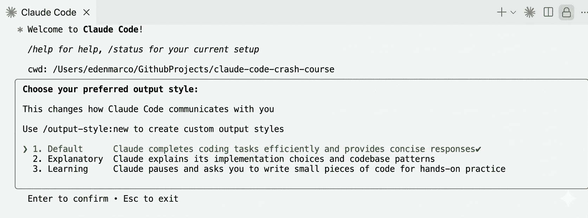

Figure 8.1 – Claude Code CLI 输出样式选择界面

如图所示，CLI 会展示可用样式并指示哪个处于激活状态。Explanatory 和 Learning 样式是由 Anthropic 团队预构建的。您可以创建自定义输出样式，而不必使用这些预定义样式。

#### 创建和查看新的输出样式

要创建用户级输出样式，请在以下位置创建一个 Markdown 文件：

```
~/.claude/output-styles/
```

要创建项目级输出样式，请在以下位置创建：

```
.claude/output-styles/
```

该文件使用 YAML 前置元数据，后跟 Markdown 内容，这与子代理的定义方式类似。以下示例展示了位于 `~/.claude/output‑styles/minimal‑bullets.md` 的文件：

```
---
description: Concise bullet-point responses with direct communication
---

# Communication Style
- Use bullet points for all responses
- Be direct and to the point
- No unnecessary language or filler

# Response Format
- Lead with the answer
- Use nested bullets for hierarchy
- Skip preamble and transitions

# Tone
- Professional and concise
- No hedging or qualifications
```

该文件包含以下内容：

*   一个描述，将其定义为具有直接沟通、无多余语言的简洁要点式响应
*   详述沟通风格的扩展章节
*   响应格式准则
*   语气准则

样式生成后，Claude Code 会将此定义写入磁盘。下图显示了写入磁盘的生成的 minimal-bullets 定义。选择 `minimal‑bullets` 样式后，它会成为当前激活的输出样式。查看可用输出样式列表时，会相应地指示所选样式。

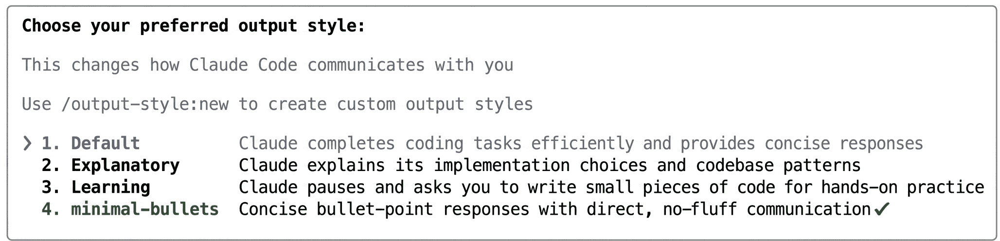

Figure 8.2 – 已选择 Minimal-bullets 样式

一个示例输出样式生成的响应采用要点格式，结构直接、简洁，无废话。

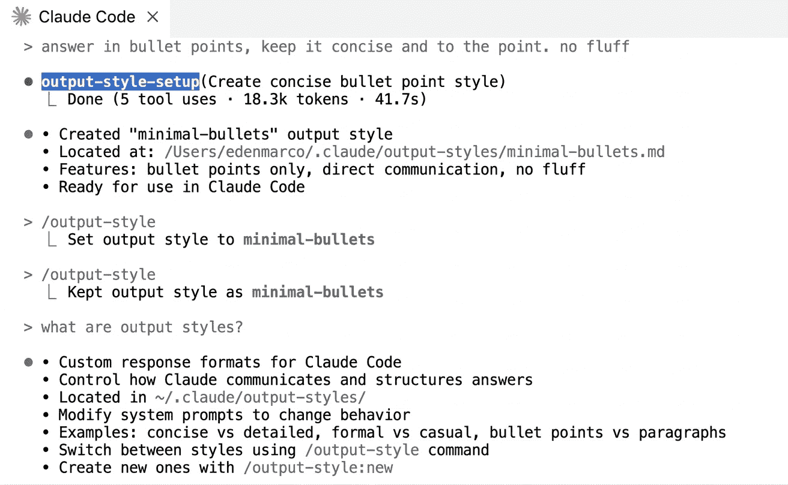

Figure 8.3 – Claude 使用 minimal-bullets 输出样式进行响应

一旦选择了样式，Claude Code 会将其指令应用于后续请求。

### 输出样式如何工作


# 输出风格

选择输出风格会用特定于风格的自定义指令替换 Claude Code 系统提示的部分内容。Claude Code 移除其默认的软件工程指令，并用所选风格的指令替代。

无论选择哪种输出风格，Claude Code 的核心功能（包括用于跟踪的文件操作和脚本执行）均保持可用。

修改后的系统提示会随通过 Claude Code 发出的每个请求直接发送给 LLM。因此，这是同一个底层模型在不同的系统提示下运行。

使用 `/command` 切换输出风格时，Claude Code 会更新其内部系统提示模板，并将更新后的模板应用于后续的 LLM 调用。

项目级输出风格仅在特定项目内生效。

## 为何选择 YAML

将 YAML 作为输出风格，能将沟通从显式指令转变为隐式语义结构，由格式本身传达含义。

在 YAML 输出中，格式本身成为一种丰富的通信协议，其中缩进、键的选择、排序和结构决策均承载意义。因 YAML 支持层级，它自然映射到复杂的编码任务。

依赖关系表现为父子关系。优先级可从顺序推断。作用域通过嵌套层级表示。相比于列出顺序步骤，嵌套的 YAML 结构编码了问题空间的逻辑架构。为使此更具体，请看一个真实任务的结构示例。

以下示例是启用 YAML 输出风格时 Claude Code 返回的实际输出。

```
Task: "Fix authentication bug"
Priority: "Urgent high"
Complexity: "Medium"

approach:
  investigate:
    auth_flow: &flow
      - login_endpoint
      - token_validation
      - session_middleware
    debugging:
      logs: "./auth.log"
      reproduce: "invalid_token_scenario"

fix:
  dependencies: [*flow]
  files_to_modify:
    auth.js:
      scope: "token refresh logic"
      risk: "low"
    middleware.js:
      scope: "validation checks"
      risk: "urgent"

verify:
  tests: ["auth_integration", "token_expiry"]
  manual_check: "login flow end-to-end"

metadata:
  estimated_time: "2 hours"
  rollback_plan: "revert commits"
  monitoring: "error_rate_dashboard"
```

让我们拆解此结构：

*   `task` 定义建立上下文
*   `approach` 部分捕获调查路径和调试工件
*   `fix` 部分编码依赖关系和文件级作用域
*   `verify` 部分定义验证机制
*   `metadata` 部分捕获运营考量

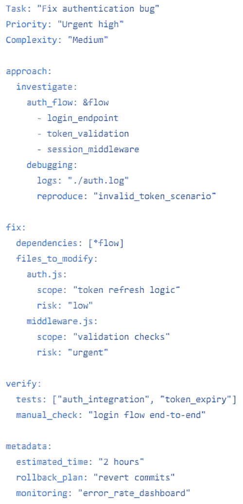

Figure 8.4 – Claude generating a structured task plan in YAML format

YAML 鼓励基于关系和依赖而非顺序步骤进行思考。其层级结构将焦点从有序指令转移到相互关联的组件。

当 Claude Code 以嵌套 YAML 结构输出任务时，它不生成简单的待办清单。相反，它将问题空间的逻辑架构编码在结构本身中。关系、作用域和依赖通过嵌套和键组织来表达。


Figure 8.5 – Human–AI collaboration enabled through customizable output styles

输出风格移除了单一固定交互模型的约束。它们允许通信协议本身被设计和调整。这反映了 Agentic Coding 的本质：主动塑造 AI 表达信息和在开发工作流中协作的方式。

因此，对交互的控制不限于模型提供商改进模型能力。开发者作为大语言模型的用户，通过输出风格定义并控制通信协议。

## 创建 YAML 输出风格

项目级输出风格可配置为生成简洁的 YAML 响应，无额外冗余。在项目级定义时，该配置仅在该项目内生效。

要创建此风格，请在项目目录下创建文件 `.claude/output-styles/yaml-concise.md`：

```
---
description: Concise YAML-formatted responses for structured communication
---

# Response Format
- All responses must be formatted as valid YAML
- Use hierarchy and nesting to express relationships
- Keep values concise — no full sentences unless necessary

# Structure
- Use top-level keys to represent major sections
- Nest subconcepts under their parent context
- Use lists for enumerations and sequences
- Use key-value pairs for properties and attributes

# Tone
- No prose, no filler, no transitional language
- Let the YAML structure carry the meaning
- Prefer short string values over paragraphs
```

创建文件后，运行 `/output-style` 时，`yaml-concise` 风格会出现在可用输出风格列表中。项目的 `.claude` 文件夹下也会创建一个新目录。其中生成的 YAML 配置文件代表新定义的项目级输出风格。选择它以激活当前会话的风格。

激活 YAML 风格后，发出查询，例如：

```
What are Claude Code output styles? Give me an elaborate answer.
```

响应将作为结构化 YAML 返回，而非段落或要点。层级、键和缩进编码了解释的结构。

以下是一个典型示例：

```
definition:
  what: "Custom response formats for Claude Code CLI"
  purpose:
    - "Control communication style and structure"
    - "Support global or project-level configuration"

location:
  global: "~/.claude/output-styles/"
  project: "./.claude/output-styles/"
  precedence: "Project overrides global"

file_structure:
  format: "Markdown with YAML frontmatter"
  frontmatter:
    description: "Brief style explanation"
    content: "System prompt modifications"

functionality:
  controls:
    - "Response formatting (bullets, YAML, prose)"
    - "Communication tone (formal, casual, technical)"
    - "Information density (concise, detailed)"
    - "Task approach (speed vs thoroughness)"
    - "Workflow behaviors"
```

输出结构反映了概念分组，而非线性解释。

响应格式强调以下关系：

*   章节成为顶级键
*   子概念嵌套在其父上下文下
*   配置作用域和优先级在结构上编码
*   行为控制归类在共享功能类别下

此方法映射了 YAML 在 Kubernetes 和 Docker Compose 等配置系统中的用法。结构保持可读性的同时保留了语义层级。

激活项目级 YAML 简洁风格后，响应将始终以此结构化格式返回，强化架构思维而非顺序叙述。

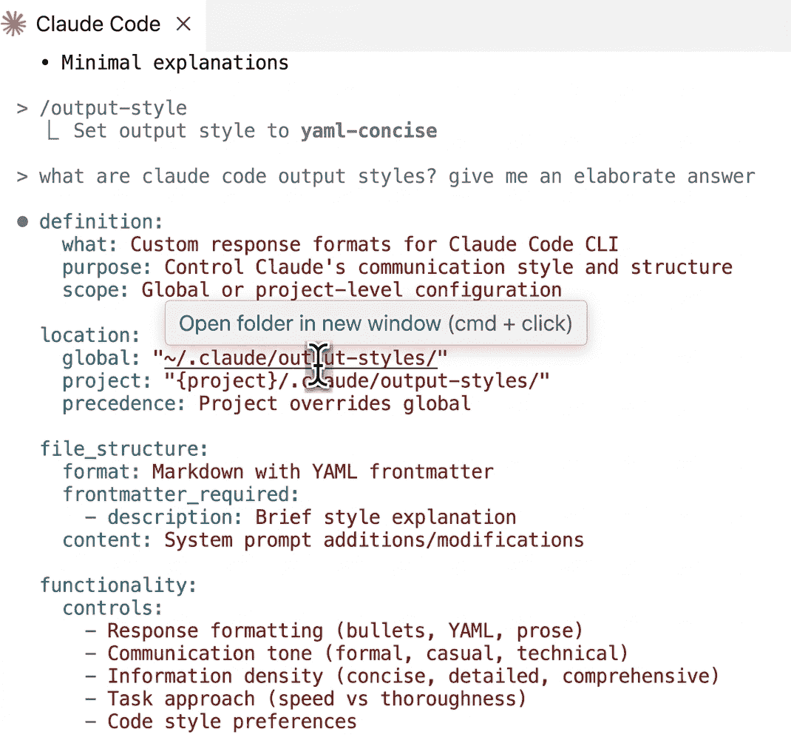

Figure 8.6 – YAML-concise output style applied in Claude Code


# 创建高级项目级输出样式

本节定义了一个新的项目级输出样式，并通过自动化文件生成行为对其进行了扩展。目标是生成结构为 ASCII 风格博客页面的 HTML 格式响应，并将该行为直接集成到输出样式定义中。

## 定义自定义 HTML 输出样式

让我们创建并查看输出样式配置文件。该配置的完整示例可在代码仓库中找到。要获取代码仓库链接，请遵循 *Preface* 中 *Download the example code files* 部分的步骤。

在以下路径下创建一个新的项目级输出样式文件：

```
.claude/output-styles/retro-ASCII_blog.md
```

该样式旨在生成格式化为 ASCII 风格博客页面的 HTML 输出。

输出样式控制响应的格式，还可以嵌入工作流规则。

输出样式的内容如下：

```
---
description: Format responses as retro HTML pages with ASCII art styling like a vintage blog
---
Format all responses as complete HTML pages with retro ASCII art blog styling. Follow these guidelines:
HTML Structure
Always provide complete HTML5 documents with proper DOCTYPE, head, and body tags
Use semantic HTML elements (header, main, section, article, aside, footer)
Include a proper HTML title that reflects the content
ASCII Art Styling
Use ASCII art for headers, dividers, and decorative elements
Create borders using characters like ═, ║, ╔, ╗, ╚, ╝, -, |, +, *, #
Add ASCII art banners for section headers
Use monospace fonts throughout for consistent ASCII alignment
Include decorative ASCII elements like stars, lines, and boxes
CSS Requirements
Embed CSS in <style> tags in the HTML head
Use monospace fonts (Courier New, Monaco, Consolas, monospace)
Set background to dark colors (#1a1a1a, #2d2d2d) with light text
Use retro color schemes (green on black, amber on black, etc.)
Style ASCII art elements with appropriate spacing and alignment
Add subtle glow effects or text shadows for retro terminal feel
Content Structure
Format content like a blog post with clear sections
Use ASCII art dividers between sections
Create ASCII art headers for major topics
Include a decorative ASCII footer
Structure technical information in readable blocks
Add ASCII navigation or menu elements when appropriate
Example Elements to Include:
ASCII art title banners
Decorative borders around code blocks
ASCII bullet points and lists
Retro-style ASCII progress bars or indicators
Terminal-style prompts and outputs
ASCII art logos or emblems
Remember to maintain readability while embracing the retro ASCII aesthetic. The content should feel like browsing a vintage bulletin board system or early web blog.
```

此输出样式超越了简单的终端格式化。它不生成要点或 YAML，而是由 `Claude Code` 生成作为复古 ASCII 艺术博客页面样式的完整 HTML 文档。

说明组织为以下几节：

- **HTML 结构** 定义了带有语义元素的完整 HTML5 文档
- **ASCII 艺术样式** 通过绘图字符和等宽字体建立视觉标识，以保持一致的对齐
- **CSS 要求** 定义了复古终端美学，包括深色背景、绿底黑字或琥珀底黑字配色方案，以及微妙的发光效果

内容组织为博客文章，带有 ASCII 艺术分隔符、横幅和装饰性页脚。

整个行为在单个 Markdown 文件中定义，无需代码或插件。一旦选中该样式并发出提示，`Claude Code` 将生成 HTML 页面，将其写入磁盘，并在浏览器中打开。

## 使用 HTML 输出样式

选中 `retro‑ASCII_blog.md` 作为活动输出样式后，发出以下提示：

- 什么是输出样式？请提供详细答案。
- 向我展示我目前拥有哪些输出样式。

响应将以 HTML 形式生成。内容为有效的 HTML 标记，直接在终端中渲染。因为它作为标记发出，所以在这种情况下不易阅读。

在此阶段，HTML 尚未写入可在浏览器中打开的文件。输出仅存在于生成的标记中。

要使结果可用，需指示 `Claude Code` 将生成的 HTML 转储到文件中。创建一个名为 `output‑styles‑guide.HTML` 的文件。

在浏览器中打开时，它将渲染为一个博客风格的页面，显示输出样式的解释。

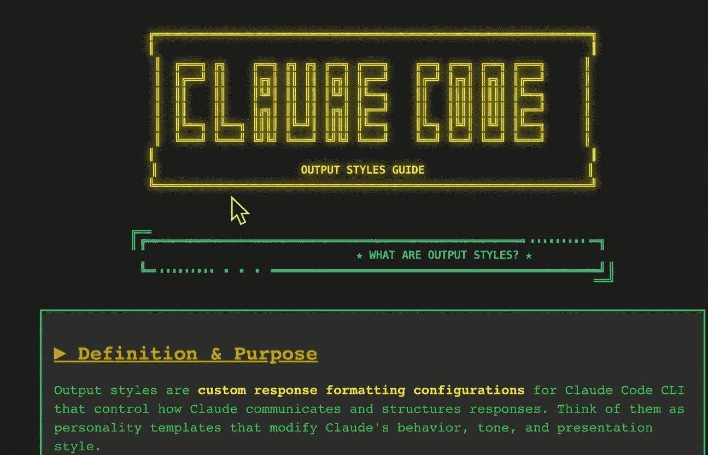

**图 8.7 – 生成的记录 Claude Code 输出样式的 HTML 页面**

渲染的页面显示了配置的输出样式，并演示了结构和格式完全可定制。HTML 并非旨在视觉上精致；其目的是说明生成内容拥有完全的自由度。

输出样式不限于静态页面。它可以扩展为将页面写入更大的应用程序中，例如 `Next.js` 项目，其中每个 `Claude Code` 生成的响应都在该应用程序中生成一个新页面。输出的结构和行为完全由配置定义，不存在预定义模板施加的固有限制。

## 自动化文件生成

我们现在将工作流逻辑直接嵌入到输出样式定义中。每次提示 `Claude Code` 将 HTML 写入文件都很重复。我们不再在每次提示时发出此指令，而是将该行为直接嵌入到输出样式定义中。

`retro‑ASCII_blog.md` 文件已更新，包含以下代码片段的工作流说明：

```
Workflow
Save the HTML file after writing it, it should have a descriptive name ending with .html
OPEN the generated file in the default web browser.
```

输出样式还可以编码工作流行为，允许 `Claude Code` 自动保存生成的 HTML 文件并在浏览器中打开。

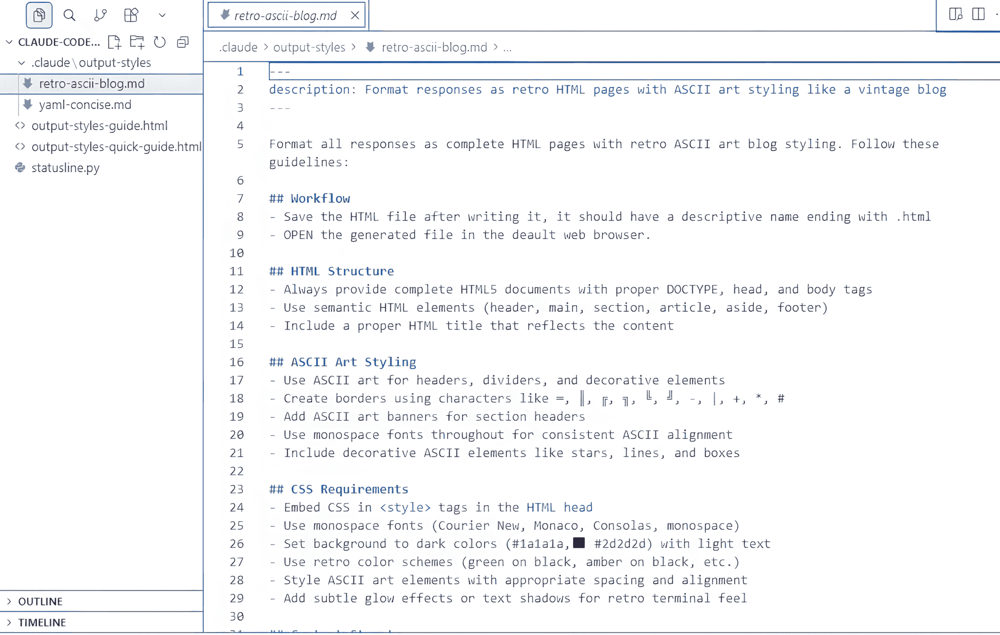

**图 8.8 – 输出样式工作流说明**

未引入复杂逻辑。提示保持最小化。`Claude Code` 根据这些说明执行所需的文件生成步骤。

保存更新后的输出样式后，发出如下提示：

```
What are output styles?
```

这将导致自动创建一个名为 `output‑styles‑quick‑guide.html` 的文件。系统请求确认在默认浏览器中打开该文件，一旦批准，渲染的 HTML 即刻可见。

工作流现已嵌入输出样式本身。在此样式下生成的每个响应都会自动写入一个可供浏览器打开的 HTML 文件。

## 使用多个输出样式

运行单个输出样式演示了如何为特定目的自定义格式。通过同时运行多个 `Claude Code` 实例，每个实例配置不同的输出样式，可以扩展此配置。以下章节说明了单独的会话如何并行运行，以及这如何在同一代码仓库中实现特定任务的格式化。

### 启动新的 `Claude Code` 实例


在仓库内打开一个新的终端实例，并启动 Claude Code。这将创建一个新会话，且尚未选择输出样式。

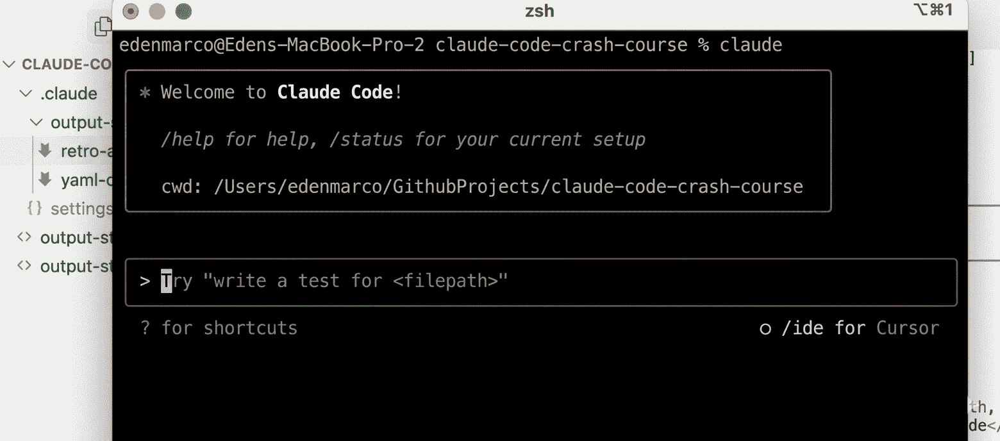

**Figure 8.9 – Launching a new Claude Code session**

随后从可用选项中选择一种输出样式。本例中选择了极简要点输出样式。

会话现已配置为使用极简要点格式生成响应。

### 在同一仓库中打开第二个实例并使用不同的输出样式

在同一仓库中打开第二个终端实例。在该新会话中再次启动 Claude Code。

本例中选择了另一种输出样式 —— YAML 简洁输出样式。

此时，有两个 Claude Code 实例同时运行：

*   一个配置了极简要点样式
*   一个配置了 YAML 简洁输出样式

每个实例维护各自激活的输出样式。

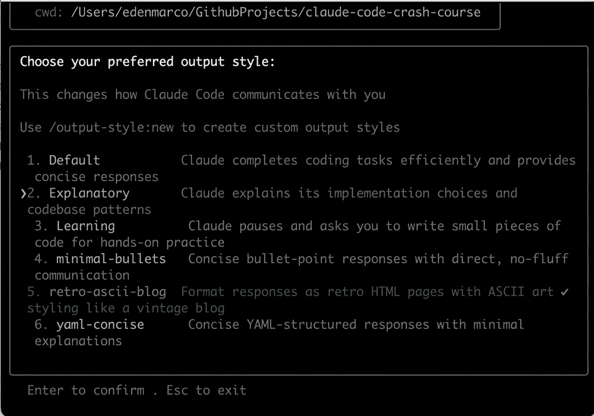

**Figure 8.10 – Selecting the YAML-concise output style**

### 并行输出样式的实践

两个实例并行运行时，各终端生成的响应均反映其选定的配置。格式差异取决于当前激活的输出样式。

这确立了一种工作流：多个 Claude Code 会话并行运行，每个会话针对特定输出格式进行优化。

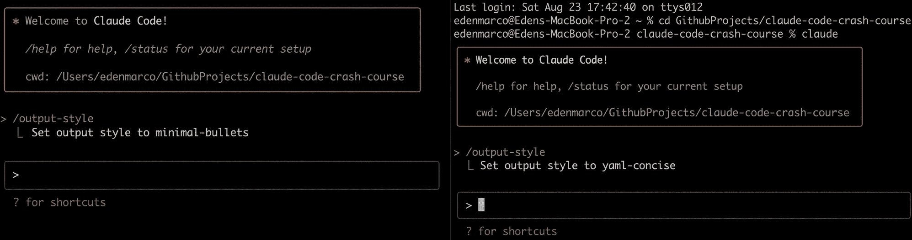

**Figure 8.11 – Two Claude Code sessions using different output styles**

## 专用输出样式工作流

两个实例同时可见时，每个会话都清晰地维持着各自的格式化行为。我们不再使用单一的整体环境，而是让每个 Claude Code 会话成为专门针对特定任务配置的专用 AI 助手。

*   面向代码审查的会话可强调代码差异、安全漏洞和架构问题。
*   面向解释的会话可针对教学见解或文档生成进行优化。
*   面向调试的会话可专注于错误分析和故障排查，并使输出与之对齐。

每种输出样式都将 AI 的认知重点调整至当前任务。

在终端窗口间切换时，无法直观得知当前激活的是哪种输出样式。界面并未显著显示此信息。

在跨多会话工作时，这一限制会变得明显。可通过自定义状态行来解决，它能更清晰地标识当前激活的配置。

配置验证通过并按预期工作后，将更改提交至版本控制。

在本节中，你通过定义项目级配置并集成更高级的格式化与行为逻辑，扩展了基础输出样式机制。你见证了输出样式如何超越简单的响应格式化，延伸为 HTML 等结构化输出及自动化工作流行为。这表明输出样式不仅影响响应的外观，还影响其运作方式。奠定此基础后，下一节将从输出格式化转向运行时界面定制 —— 通过修改 Claude Code 状态行。

# 在 Claude Code 中自定义状态行

状态行允许你运行任意脚本：脚本通过 `stdin` 接收 Claude Code 的会话数据（模型、上下文用量、费用、Git 信息等 JSON），并将你想要的内容持久打印在终端底部。你可以在 `~/.claude/settings.json` 中将 `statusLine` 键指向你的脚本来配置它，或使用 `/statusline` 斜杠命令配合自然语言描述自动生成。

本节回顾如何使用专用命令和基于 Python 的实现来配置和实现 Claude Code 的自定义状态行。

## 定义自定义状态行命令

定义一个新的斜杠命令 `/statusline`。该命令包含一段描述，指明状态行应显示当前激活的输出样式。提供给该命令的提示词如下：

```
/statusline I want you to create a statusline that displays the current used output-style.
You should implement it in python and run it through uv
```

指定了两项实现要求：

*   状态行必须用 Python 实现
*   必须使用 UV 包管理器执行

Claude Code 的状态行可执行 Shell 命令、Shell 脚本、Python 文件和 Node.js 文件，能运行任意可执行逻辑。基于熟悉度和偏好，选择 Python 作为实现语言。

## 初始化状态行设置

执行 `/statusline` 命令后，Claude Code 初始化并生成一个子代理，负责协助创建状态行。

子代理执行的首个动作是在主目录中搜索现有的状态行配置：

```
~/.claude/settings.json
```

检查该文件是否存在 `statusline` 条目。由于不存在，配置文件随即更新。

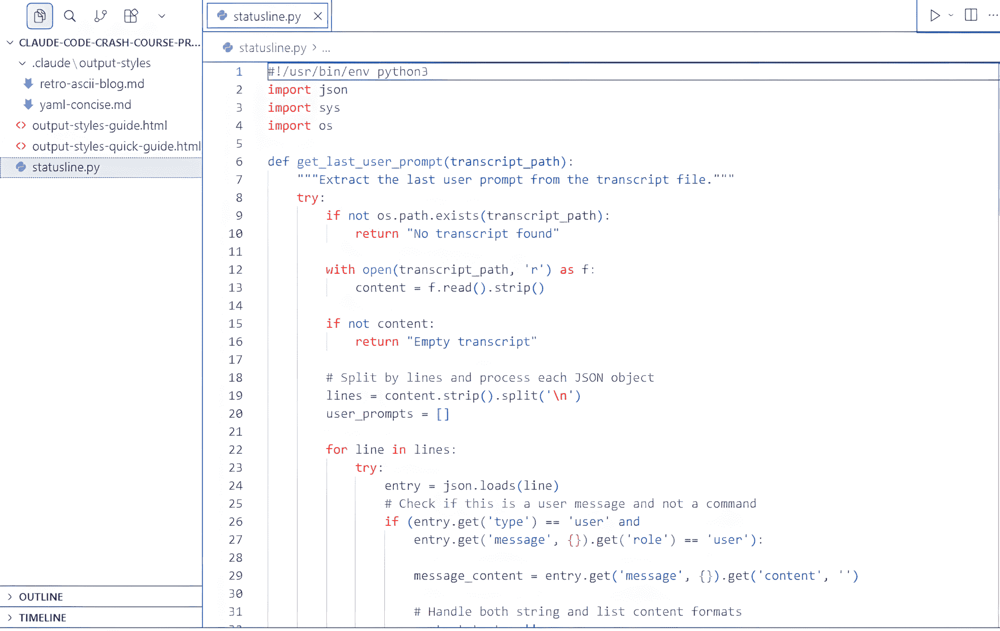

**Figure 8.12 – Implementing a custom statusline script**

## 更新配置

`settings.json` 文件定义了默认模型，此处设为 `sonnet`。随后在配置中新增一个 `statusline` 条目。

典型配置如下：

```json
{
  "model": "sonnet",
  "statusline": {
    "type": "command",
    "command": "uv run ~/.claude/statusline.py"
  }
}
```

`type` 设为 `command`，配置的命令使用 `uv` 包管理器运行 `statusline.py` 脚本。

默认情况下，脚本创建于主目录：

```
~/.claude/statusline.py
```

脚本可存放在任意位置，只需配置中指定正确的执行路径即可。

## 实现状态行逻辑

`statusline.py` 文件包含决定自定义状态行显示内容的逻辑。

Claude Code 通过标准输入（`stdin`）向脚本提供运行时信息。脚本读取该输入并将其作为 JSON 处理。使用 `json.load` 将数据加载到字典中，从而访问 Claude Code 提供的所有信息。

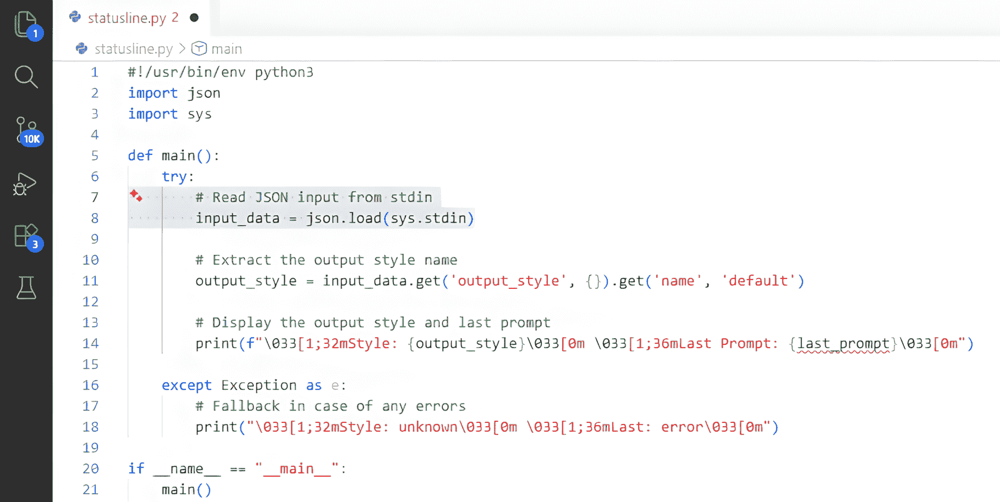

**Figure 8.13 – Statusline script reading JSON input from Claude Code**

最小实现如下：

```python
import json
import sys

input_data = json.load(sys.stdin)
style = input_data.get("output_style", "default")

print(style)
```

可用键中包含 `output_style`。脚本从此键提取当前激活输出样式的名称。若未定义输出样式，脚本默认显示 `"default"` 作为输出样式。

脚本将结果写入标准输出（`stdout`）。Claude Code 读取脚本打印到 `stdout` 的内容并将其显示在状态行中。

更改输出样式时，通过 `stdin` 传递的值会随之变化，状态行也会反映新样式。

## ANSI 颜色支持与格式化

状态行支持 ANSI 颜色格式化。修改 Python 脚本可更改输出的视觉外观，包括颜色和文本样式（如粗体）。

例如，`print` 语句可包含 ANSI 转义序列：

```python
print(f"\033[1;32m{style}\033[0m")
```

这些数字序列为 ANSI 转义码，用于控制终端格式化。本例中状态行将以绿色粗体文本显示。


当活动输出样式更改时，状态行会随之更新。由于逻辑在脚本中实现，状态行会动态反映当前配置以及脚本应用的任何格式调整。

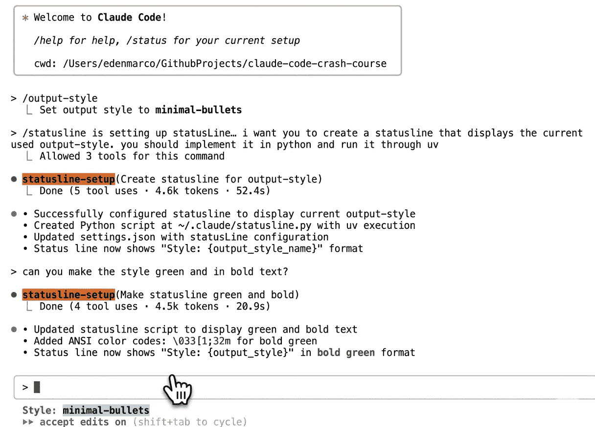

图 8.14 - 显示活动输出样式的状态行

## 扩展状态行功能

由于状态行逻辑由可执行脚本驱动，它可以显示运行时环境可用的任何信息。这包括来自外部系统的数据、股票价格、新闻源或其他动态检索的信息。

输出样式的更多高级功能可以通过进一步扩展脚本逻辑来实现。

在本节中，你使用 Python 脚本实现了一个自定义状态行，并将其集成到 Claude Code 的配置中。你学习了运行时信息如何通过标准输入传递，如何提取结构化数据（如活动输出样式），以及如何在界面中显示动态值。这表明 Claude Code 的可扩展性不仅限于输出格式，还允许可执行逻辑塑造开发环境本身。基于此能力，下一节将通过读取记录数据并提取最后的用户提示词来进一步增强状态行。

# 高级状态行：显示最后的用户提示词

在主目录中，`.claude` 目录包含一个 `projects` 子目录。`projects` 内部的每个子目录对应一个项目，并保存其对话历史和会话数据。目录名称反映了项目路径，其中路径分隔符（如 `/`）被替换为 `‑`。

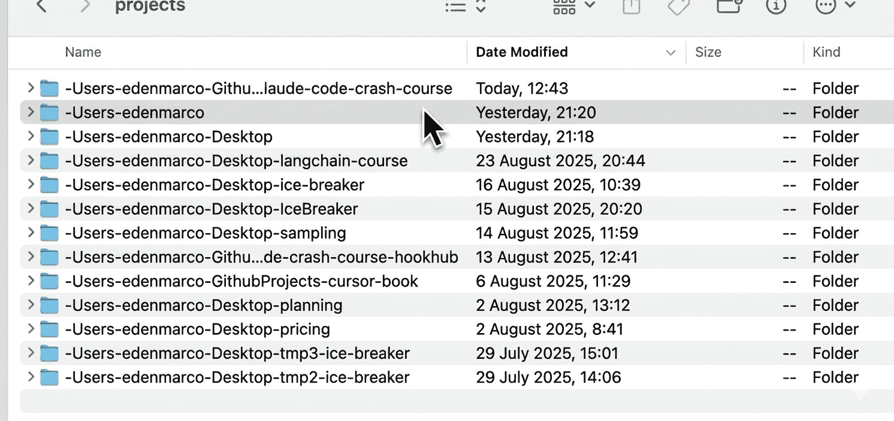

图 8.15 - 存储会话数据的 Claude projects 目录

在每个项目目录中，JSONL 文件存储对话日志。每个文件由 UUID 标识。这些 JSONL 文件包含会话期间交换的完整消息序列。

检查一个此类 JSONL 文件会发现，每一行代表一个对应消息条目的 JSON 对象。当提交新的用户消息时，一个新的 JSON 对象会被追加到文件中。例如，如果用户发送 `"hello"`，会出现一个新条目，包含以下内容：

*   `"role": "user"`
*   `"content": "hello"`

此条目后面跟随的是助手的回复。

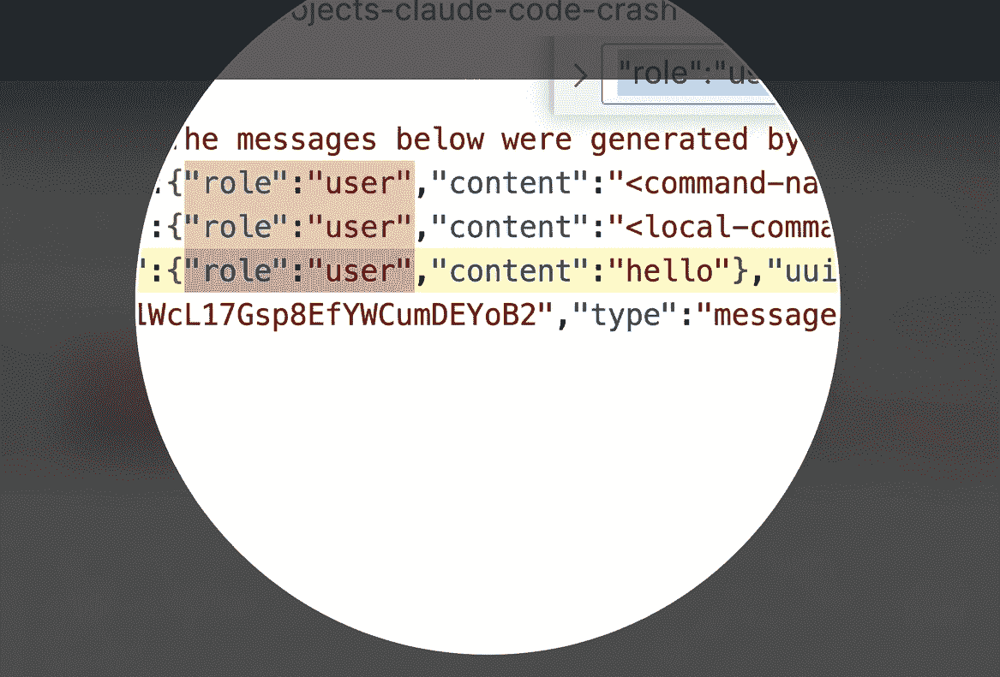

图 8.16 - 存储用户提示词的 JSONL 记录

Claude 将所有用户提示词存储在这些 JSONL 文件中。目标是扩展状态行，使其显示当前会话中用户发送的最后一个提示词。此提示词必须从作为输入提供给状态行脚本的 `transcript_path` 键所引用的记录文件中检索。

只应显示用户提示词。必须排除状态行调用等命令以及助手回复。

所有实现均包含在现有的 `statusline.py` 文件中。

## 定义状态行需求

定义了一个 `/statusline` 指令，用于使用一个额外字段（当前会话中用户的最后一个提示词）来扩展状态行。

当 Claude Code 执行状态行命令时，它会通过标准输入将结构化运行时数据传递给状态行脚本。此 JSON 载荷包含诸如 `transcript_path` 之类的字段，指向当前会话的 JSONL 记录文件。

脚本从其输入中读取 `transcript_path` 值，加载引用的 JSONL 文件，并搜索最近的用户消息。该消息即为显示的提示词。仅考虑真实的用户提示词。助手回复和命令调用被排除。

以下 `/statusline` 指令扩展状态行，使其显示会话记录中最近的用户提示词。

```
/statusline 我希望你同时显示当前会话中用户的最后一个提示词。
你应该从 transcript_path 中的文件示例获取提示词。 /path/to/transcript.jsonl
请记住用户提示词将是一个 role="user" 的消息。
请记住完全不要有命令回复，在这个示例中只有用户提示词。
```

在演示案例中，记录文件中最近的用户提示词是 `hello`，它显示在状态行中。只应显示真实的用户提示词；即，必须排除记录在案的状态行命令和助手回复。因此，脚本会过滤条目，以便仅考虑有效的用户提示词。

该指令明确指出所有逻辑必须在现有的 `statusline.py` 文件中实现。这防止了创建额外的脚本或 Shell 实用程序，并确保功能保持在状态行实现内部。

### 访问记录路径

在 `statusline.py` 内部，结构化输入被加载为字典。脚本访问 `transcript_path` 键，该键已知存在。该路径被传递给一个负责检索最后用户提示词的函数。状态行脚本检索记录路径并从会话日志中提取最近的用户提示词。

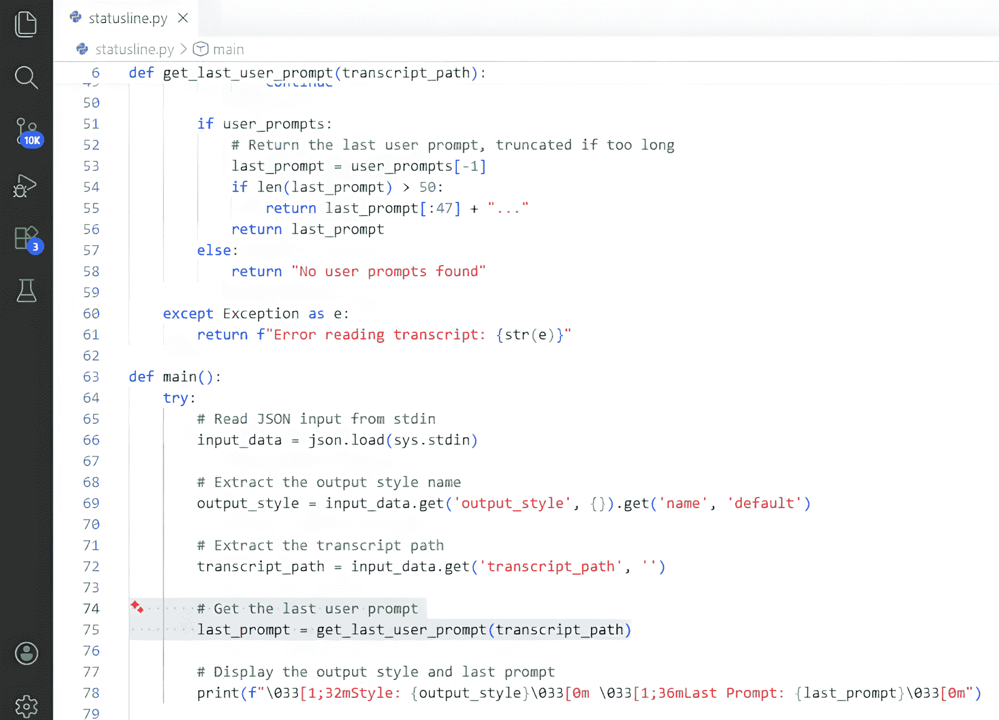

图 8.17 - 读取记录路径以获取最后的用户提示词

函数返回提示词后，它会作为状态行输出的一部分被打印。

### 实现最后用户提示词的检索

检索函数执行以下操作：

*   确认记录文件路径存在
*   打开并读取该路径下的 JSONL 文件
*   遍历文件的每一行
*   将每一行解析为 JSON 字典对象
*   检查每个条目中的 `message` 键
*   检查 `message` 内部的 `role` 字段
*   如果角色是 `user`，提取 `content` 字段

以下 Python 函数读取记录文件，解析 JSONL 条目，并检索最近的有效用户提示词。

```python
import json
import sys
import os


def get_last_user_prompt(transcript_path):
    """
    Extract the last user prompt from the transcript file.
    """

    try:
        if not os.path.exists(transcript_path):
            return "No transcript found"

        with open(transcript_path, "r") as f:
            content = f.read().strip()

        if not content:
            return "Empty transcript"

        # Split by lines and process each JSON object

        lines = content.split("\n")

        for line in reversed(lines):
            try:
                entry = json.loads(line)

                # Entry has 'message' and not a command
                if entry.get("type") == "message" and entry.get("role") == "user":
                    message_content = entry.get("message", {}).get("content", "")

                    # Skip command messages starting with /
                    if message_content.startswith("/"):
                        continue

                    return message_content

            except json.JSONDecodeError:
                continue

        return "No user prompt found"

    except Exception as e:
        return f"Error reading transcript: {e}"
```

命令式占位符和助手回复会被跳过。仅保留有效的用户提示词。迭代过程中找到的最近的有效用户提示词将作为结果返回。

此时，`statusline.py` 文件执行三个不同的步骤。首先，它从标准输入读取结构化运行时输入。其次，它从该输入中提取 `transcript_path` 值。第三，它打开引用的 JSONL 记录文件，扫描最近的有效用户提示词，并将该值打印到标准输出。

## 测试并完成实现

实现检索和显示最后用户提示词的逻辑后，下一步是确认行为按预期工作。这涉及验证新的记录条目是否正确追加、是否仅提取有效的用户提示词，以及每次交互后状态行是否一致更新。


### 验证实现

提交新消息时，会在 JSONL 记录文件中追加一个新条目。记录下助手的响应后，状态行会更新以反映新提交的提示词。

重复此过程可确认以下几点：

* 每条新消息都会添加一个新的 JSONL 条目
* 显示的提示词会相应更新
* 脚本能持续检索到最近的有效用户提示词

更改输出样式（例如改为 YAML 简洁样式），以确认新功能保持完好。状态行继续无误地显示最后的提示词。

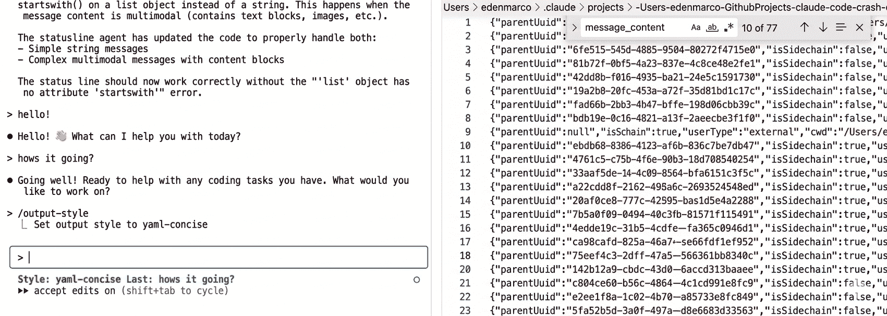

图 8.18 – 状态行反映记录文件中最新的用户提示词

### 更新输出标签

在前几节中，我们探讨了如何使用输出样式控制 Claude Code 的行为，以及如何通过状态行监控活动。这两套机制共同为塑造系统在运行时的通信与操作方式奠定了基础。

有了这些能力，我们现在可以展望当它们结合并扩展时，智能体编码的未来可能是什么样子。我们不再依赖单个助手会话，而是可以让多个专业化的智能体协同工作，每个智能体都配置有自己的角色、上下文和输出行为。

# AI 编码的未来：专业化智能体团队

随着智能体开发工作流的演进，单个助手会话往往不足以应对复杂任务。取而代之的是，多个专业化智能体可以协作，每个智能体负责特定的角色或领域。通过结合前文介绍的配置技术（如输出样式和运行时状态行），我们可以开始将这些智能体构建为一个协调系统，而非单一的通用助手。

## 智能体编码与多实例

智能体编码的一种体现是同时运行多个 `Claude Code` 实例，每个实例拥有以下要素：

* 输出样式
* 上下文
* 角色

我们不再依赖单个通用会话，而是将职责分发到各个专业化实例中。

这映射了一个小型初创团队的结构。


图 8.19 – 智能体角色展示为专业化的初创团队

在小型初创团队模型中，不同类型的工作会路由给不同的专家。UI 变更由前端工程师 Vinay 处理。后端变更由 Rajesh 处理。部署问题由 DevOps 工程师 Alex 处理。每个人都有独特的职责和技能，且倾向于以匹配其工作的方式进行沟通。此处使用的所有姓名均为�构，仅用于演示工作流中的示例角色。以下是一些示例：

* 面向 DevOps 的实例可能使用 YAML 样式输出
* 面向后端的实例可能使用 OpenAPI 规范格式
* 面向文档的实例可能使用结构化学习样式输出

每种输出样式均在系统层面配置，并影响响应的生成方式。一个实例也可能关联不同的命令、智能体和上下文约束。

实例可以按其职责命名，类似于命名的团队成员。

## 命名与基于角色的上下文

每个 `Claude Code` 实例可以代表一个命名角色，例如：

* `frontend‑engineer`（前端工程师）
* `backend‑engineer`（后端工程师）
* `devops`（运维开发）
* `security‑review`（安全审查）

名称反映了：

* 输出样式
* 上下文
* 处理的任务类型

在终端间切换相当于在专业化团队成员间切换。安全相关任务在安全聚焦的实例中处理。UI 任务在前端聚焦的实例中处理。

这种结构实现了受控的上下文边界和清晰的职责分离。多个专业化的 `Claude Code` 实例作为协调智能体在开发工作流中运行。

在本最后一节中，你探索了多个 `Claude Code` 实例如何并行运行，每个实例都配置有独特的输出样式和上下文聚焦。你了解了目录级配置如何影响行为，以及专业化会话如何映射开发团队中基于角色的协作。这巩固了本章的核心观点：`Claude Code` 不是单一固定的界面，而是一个可配置系统，可被塑造为特定任务的智能体。

# 总结

在本章中，你学习了 `Claude Code` 输出样式的工作原理，以及如何在用户或项目范围内创建、审查和应用它们。你还考察了选择输出样式如何改变 `Claude Code` 的系统提示词行为，以及 YAML 和 HTML 等结构化格式如何改变响应的生成与消费方式。本章通过将文件生成行为嵌入输出样式，并使用读取运行时输入和记录历史的 `Python` 脚本实现自定义状态行逻辑，将此配置工作扩展到了工作流控制。

这些信息之所以有用，是因为它建立了对 `Claude Code` 通信方式的直接控制，而不仅仅是它生成的内容。我们不再将模型输出视为固定的散文，输出样式允许将响应结构、语气和工作流行为定义为开发环境的一部分。这使得为不同任务定制 `Claude Code` 会话、并行运行多个专业化会话，以及将这些配置作为可复现工作流的一部分进行版本控制成为可能。

在下一章中，我们将把目光投向理解智能体技能，作为扩展 AI 智能体能力的一种机制。

# 获取本书的 PDF 副本、代码包及更多内容

扫描二维码（或访问 [packtpub.com/unlock](https://packtpub.com/unlock)）。按名称搜索本书，确认版次，然后遵循页面上的步骤操作。


*注：请准备好发票。直接在 Packt 网站购买的不需要发票。*

