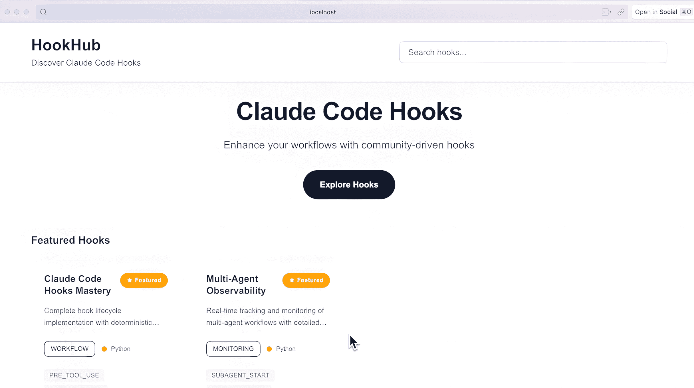
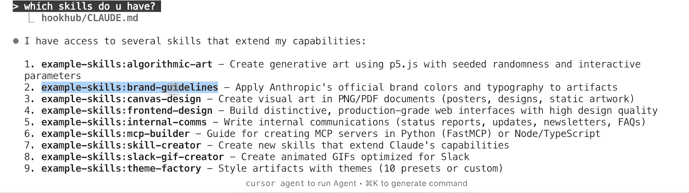
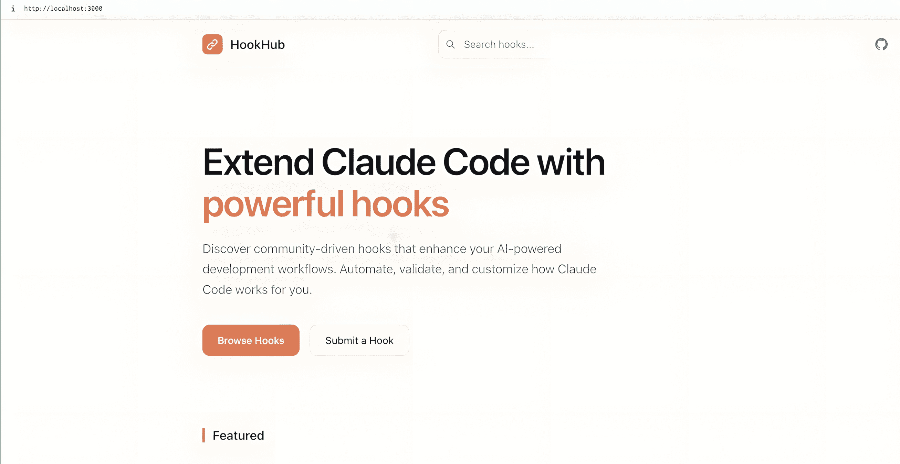
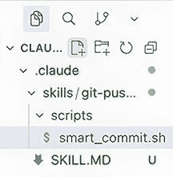
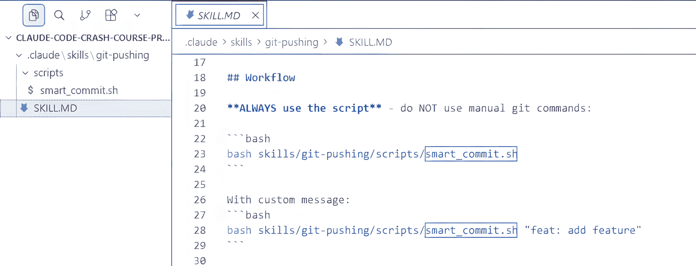
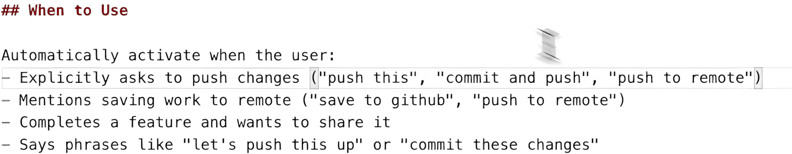
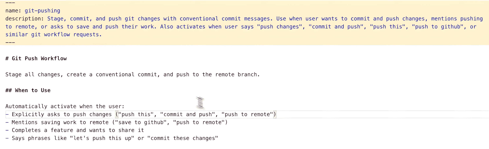
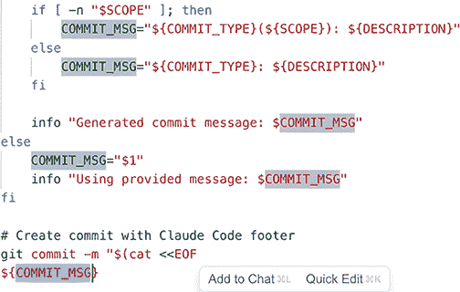

# 9 理解智能体技能

智能体技能由 Anthropic 团队于 2025 年 10 月引入，作为扩展 AI 智能体能力的一种机制。技能允许将能力打包为结构化单元，包括自定义工作流和特定任务指令，使智能体能够执行更复杂和协调的任务。通过封装定义好的行为，技能将智能体的成就扩展到了通用推理之外。`Claude` 可以根据其描述字段与对话上下文的匹配情况，自动调用技能。


# Agent 技能

本章深入探讨 Agent 技能的概念，建立清晰的理解，明确它们是什么，以及为何在设计更强大的 Agent 系统时至关重要。

本章通过层层递进的方式探索技能，从基础概念和在`Claude Code`等环境以及`LangChain DeepAgents`（[`docs.langchain.com/oss/python/deepagents/overview`](https://docs.langchain.com/oss/python/deepagents/overview)）等工具中的实际应用入手。随后我们将深入表层之下，分析调用技能时上下文在 Agent 内部如何流动，阐明系统的内部运作机制。最后，我们将通过在真实 Agent 中对技能的具体实现来整合这些视角。目标不仅是理解如何使用技能，还要掌握其底层设计与动机，从而获得全面且技术扎实的概念理解。

技能背后的核心概念是**渐进式披露**。技能不会永久加载到 Agent 的活动上下文中。相反，系统仅在技能与当前任务相关时才加载它。这种设计防止了不必要的指令进入工作上下文，有助于在推理过程中保持清晰。本章后面我们将探讨调用技能时这种动态加载是如何工作的，以及它如何影响 Agent 内部的上下文流动。

本章将涵盖以下主题：

*   Agent 技能的要点
*   深入探究 Agent 技能
*   Agent 技能与其他 Agent 原语的对比

# Agent 技能的要点

在本节中，我们将见证 Agent 技能的实际运作，并演示如何将其作为工作流的一部分加以使用。我们将对比完成同一任务的两种方法：首先不使用技能，然后使用技能，以便清晰地观察 Agent 在每种情况下的行为表现。

前往代码仓库并切换到`hookhub`分支，然后打开提交列表。选择标题为**improved hookcard and hero with multi agent working**的提交。此提交将作为我们的起点。

由于后续会添加更多提交，分支历史可能会向前推进。然而，我们必须从这个确切的提交开始。复制其哈希值，打开 IDE，并切换到该分支和提交：

```
git switch project/hookhub c125545ca118f51c07eb6defe61ba727dbf05788
```

切换后，会出现一个新的`hookhub`目录。该目录包含前几节开发的所有代码。

进入该目录并安装依赖：

```
cd hookhub
npm install
```

安装完成后，启动开发服务器：

```
npm run dev
```

HookHub 应用现已在端口`3000`上本地运行。这恢复了演示所需的确切基准环境。



图 9.1 – HookHub 在本地运行

## 场景 1：不使用技能进行样式设计

*图 9.1*所示的 UI 有意保持简洁。假设我们希望 HookHub 应用采用特定的视觉形象，并完全匹配 Anthropic 的设计语言。

不使用技能时，我们可以直接提示：

```
Make this web app Anthropic style.
```

此时，代码仓库中不包含任何关于 Anthropic 品牌指南的参考。Agent 会扫描项目文件，甚至从[anthropic.com](https://anthropic.com)获取信息。它从实时网站动态推导设计语言并开始实施更改。

这种方法行之有效。Agent 更新背景颜色、调整排版并应用视觉优化。最终结果非常接近 Anthropic 的美学风格，展现了令人印象深刻的能力。

然而，请考虑其影响。每次重复此任务时，Agent 都会再次获取并推导相同的设计语言。如果我们重复执行此工作流，每次都会重新引入冗余的上下文收集过程。

一种可能的解决方案是将设计语言直接嵌入`CLAUDE.md`文件。问题在于，该上下文随后会附加到每一个提示中，包括与之无关的后端任务。这会导致不必要的上下文膨胀并最终引起性能下降。

## 场景 2：使用技能进行样式设计

技能提供了一个更优雅的解决方案。我们可以创建一个指定 Anthropic 主题设计语言的技能。每当我们处理前端工作时，`Claude Code`即可选择该技能、加以使用，并动态加载所需的设计上下文。让我们看看具体操作方法。

打开官方 Anthropic 示例技能仓库（[`github.com/anthropics/skills`](https://github.com/anthropics/skills)）。每个技能位于各自的目录中。导航到`brand‑guidelines`技能并检查其`SKILL.md`文件。

本章中的部分示例改编自 Anthropic Skills 仓库（[`github.com/anthropics/skills`](https://github.com/anthropics/skills)），遵循 Apache License 2.0 许可证。实现和行为可能会随时间演变。

一个技能可能包含多个文件，不仅限于 Markdown。它可以包含脚本、可执行文件和结构化资源。在本例中，`SKILL.md`文件定义了 Anthropic 的官方品牌颜色、排版和设计资产。

该文件以前言开头。仅此部分在技能被选中时注入 Agent 系统提示词。Markdown 文件的其余部分包含详细的品牌指南，仅在技能被激活时才加载到提示词中。

这反映了我们之前通过子代理探索的选择性加载机制。上下文是有条件地注入，而非全局注入。

来自官方`Claude Code`市场的技能在启动时若有新的上游版本可用会自动更新。第三方市场技能可能需要手动更新，或通过`/plugin`进行显式的自动更新配置。

### 在 Claude Code 中安装技能

要为我们的编码 Agent 装备这些技能，请将 Anthropic 技能仓库作为市场插件添加：

```
/plugin add marketplace anthropic/skills
```

`Claude Code`会将仓库本地克隆到`.claude/plugins`目录中。

运行`/plugins`验证安装。浏览可用插件。出现两个类别：

*   **文档技能**，包含 Excel 和 PowerPoint 等文档处理能力
*   **示例技能**，包含前面回顾的品牌指南技能

一个值得注意的细节是，当`Claude`（而非`Claude Code`）推出创建幻灯片和文档的支持时，是与技能一同宣布的。这是因为那些功能在内部正是使用 Agent 技能构建的。换句话说，生成文档和演示文稿的能力由我们在此讨论的相同技能机制提供支持。

安装示例技能。安装后，重启`Claude Code`并询问以下内容：

```
Which skills do you have?
```

Agent 现在会列出可用技能，包括我们接下来将使用的`brand‑guidelines`。



图 9.2 – Claude 列出已安装技能，包括 brand-guidelines

### 启用技能进行样式设计

清除上下文并启动一个全新的`Claude`实例。询问以下内容：

```
Can you make sure that the logo is according to Anthropic brand?
```

Agent 扫描代码仓库，随后请求使用`brand‑guidelines`技能的权限。技能描述随即显示。批准其使用。

批准后，`Claude`将`brand‑guidelines`目录动态加载到上下文中。仅相关的 Markdown 文件被注入。这一额外上下文使 Agent 能够根据官方品牌定义应用设计变更。


关键观察在于此上下文是动态加载的。它不会永久附加到每个提示词上。这种渐进式上下文加载保持了工作上下文窗口的整洁与高效。此过程也称为渐进式披露。

如果你希望仅通过斜杠命令调用技能，请在技能前置元数据中启用 `disable‑model‑invocation: true` 标志。

应用更改后，运行构建流程：

```
npm run build
```

然后，重启开发服务器：

```
npm run dev
```

更新后的设计现应呈现细微的优化，包括排版调整和品牌对齐的样式。此处的主要目标并非视觉差异，而是展示通过技能实现的受控上下文注入。



图 9.3 – 通过技能应用品牌指南样式后的 HookHub 界面

技能不限于静态 Markdown 上下文。部分技能包含可执行脚本。

以 `skill‑creator` 为例。其目录包含多个 Python 脚本。在相应的 `SKILL.md` 中，智能体被告知可以执行这些脚本。

脚本可用 Python、Bash、JavaScript 或环境支持的任意语言编写。只要在技能定义中清晰描述其行为，智能体即可将其作为确定性工具使用。

这种方法支持结构化工作流。若特定流程可编码为确定性脚本，则可通过技能将其组合为高阶能力。智能体继而可执行脚本序列并组合其输出，以完成复杂任务。

# 深入探究智能体技能

本节我们将通过引入**自定义技能**，深入探究智能体技能。我们还将回顾一种技能，它不仅包含 `SKILL.md` 文件，还包含智能体可执行以协助完成任务的**辅助脚本**。

我们要考察的技能托管在一个在线仓库中。我们将下载它、在本地集成，随后通过修改和改进来迭代它，以契合我们的需求。这一过程演示了技能在设计结构化智能体工作流时所提供的灵活性。

## 探索 Claude 技能市场

我们从一个名为 `claude‑skills‑marketplace` ([`github.com/mhattingpete/claude-skills-marketplace/tree/main`](https://github.com/mhattingpete/claude-skills-marketplace/tree/main)) 的仓库开始，该仓库基于 Apache 2.0 许可证发布。这是包含 Claude Code 技能的众多仓库之一，这些技能可被下载并集成到 Claude Code 或任何其他支持技能的智能体中，例如 Claude Desktop 或 LangChain DeepAgents。

该仓库包含多个可安装的技能。正如上一节所示，它甚至可通过插件系统作为市场添加到 Claude Code 中。

在 `Engineering Workflows`（工程工作流）文件下，我们找到了一个名为 `git‑pushing` 的技能。该技能旨在协助将代码推送到 GitHub。

````
Apache License
Version 2.0, January 2004
http://www.apache.org/licenses/
---
name: git-pushing
description: Stage, commit, and push git changes with conventional commit messages. Use when user wants to commit and push changes, mentions pushing to remote, or asks to save and push their work. Also activates when user says "push changes", "commit and push", "push this", "push to github", or similar git workflow requests.
---

# Git Push Workflow

Stage all changes, create a conventional commit, and push to the remote branch.

## When to Use

Automatically activate when the user:
- Explicitly asks to push changes ("push this", "commit and push")
- Mentions saving work to remote ("save to github", "push to remote")
- Completes a feature and wants to share it
- Says phrases like "let's push this up" or "commit these changes"

## Workflow

**ALWAYS use the script** - do NOT use manual git commands:

```bash

bash skills/git-pushing/scripts/smart_commit.sh

```

With custom message:
```bash

bash skills/git-pushing/scripts/smart_commit.sh "feat: add feature"

```
Script handles: staging, conventional commit message, Claude footer, push with -u flag
````

打开该技能的 `SKILL.md` 文件，可见如下描述：

*   使用规范提交信息暂存、提交并推送 Git 变更
*   当用户想要提交并推送变更、提及推送到远程或要求保存工作时使用

文件顶部的 YAML 前置元数据是唯一加载到 Claude Code 智能体系统提示词中的部分。文件其余部分仅在技能被选中执行时读取。

### 技能中的既定工作流

在 `SKILL.md` 的工作流部分，我们看到智能体被指示始终使用名为 `smart_commit.sh` 的脚本。

````
Apache License
Version 2.0, January 2004
http://www.apache.org/licenses/
---
name: git-pushing
description: Stage, commit, and push git changes with conventional commit messages. Use when user wants to commit and push changes, mentions pushing to remote, or asks to save and push their work. Also activates when user says "push changes", "commit and push", "push this", "push to github", or similar git workflow requests.
---

# Git Push Workflow

Stage all changes, create a conventional commit, and push to the remote branch.

## When to Use

Automatically activate when the user:
- Explicitly asks to push changes ("push this", "commit and push")
- Mentions saving work to remote ("save to github", "push to remote")
- Completes a feature and wants to share it
- Says phrases like "let's push this up" or "commit these changes"

## Workflow

**ALWAYS use the script** - do NOT use manual git commands:

```bash

bash skills/git-pushing/scripts/smart_commit.sh

```

With custom message:
```bash

bash skills/git-pushing/scripts/smart_commit.sh "feat: add feature"

```
Script handles: staging, conventional commit message, Claude footer, push with -u flag
````

该脚本包含实际的 Git 逻辑，包括 `git add`、`git status` 和 `git commit` 操作。技能作者有意限制主智能体发出原始 Git 命令。取而代之，智能体必须使用指定脚本。

这阐释了一个核心概念。技能编码的是既定工作流。若团队希望提交遵循特定结构或流程，可将该逻辑打包进技能。智能体随即以受控方式获得该能力。

## 审查脚本

在 `scripts` 目录中，我们找到了 `smart_commit.sh`。该脚本定义了 Git 执行流程。智能体仅在决定使用 `git‑pushing` 技能时才能运行此脚本。

此脚本包含实际执行逻辑。它运行一系列 Git 命令，如暂存变更、检查状态、使用特定信息提交。主智能体在使用 `git‑pushing` 技能时预期运行此脚本。关键在于，智能体仅在决定使用该技能后才知晓此脚本。脚本仅在技能被选中后成为可用上下文的一部分。

与我们之前见到的品牌指南技能相比，此技能不仅提供参考内容。它包含智能体可执行以协助完成任务的**辅助脚本**，此处任务即提交并推送代码到 GitHub。

这种脚本运行能力赋予了我们极大灵活性。若我们有想要以代码形式确定性定义的工作流，可将其打包进技能。智能体随后可将运行这些脚本作为完成工作流的一部分，而非即兴发出一系列手动命令。

尽管这可能类似于 MCP，但机制不同。MCP 实现 API 调用和与外部服务的通信。技能则通过注入结构化上下文并可选暴露脚本来运作。

## 创建项目级自定义技能


# 切换到 `project/skills` 分支

要创建项目级技能，我们需要在 `.claude` 目录下定义它，使其作用域限定在该仓库内。

创建以下结构：

```
.claude/
  skills/git-pushing/
    scripts/
      smart_commit.sh
    SKILL.md
```

结构如下所示：



**图 9.4 – git-pushing 技能的本地技能目录结构**

这与市场技能的结构相同。

将 GitHub 仓库中 `SKILL.md` 和 `smart_commit.sh` 的内容复制到对应的本地文件中。`SKILL.md` 文件引用了 `scripts/smart_commit.sh`，因此保持相同的目录结构可确保兼容性。

此时，技能已在本地完全复刻。



**图 9.5 – 引用 smart_commit.sh 自动化脚本的本地 SKILL.md**

虽然本可通过插件系统安装，但手动复制能提供对定制的完全控制。

## 使用自定义技能

从项目目录打开 Claude Code 会话并添加以下提示词：

```
List available skills.
```

新创建的项目级 `git-pushing` 技能将与先前安装的市场技能一同显示。

输入以下内容：

```
push changes
```

Claude 将询问是否使用 `git-pushing` 技能。批准后，它会加载 `SKILL.md` 并确定必须执行 `smart_commit.sh`。

Agent 不会发出单独的 Git 命令，而是运行该脚本。在某些情况下，脚本可能因 Git 错误而失败。若发生这种情况，Claude 不会停止，而是回退到其默认推理模式。它会分析仓库状态，建议运行 `git add -A`，使用自己的逻辑创建提交，然后手动推送变更。

这意味着 Claude 能利用其默认行为解决问题并完成推送。这一点很重要，因为技能并不取代 Agent 的推理能力。当技能失败时，Claude 能回退到默认行为并继续任务。

如果脚本执行失败，生成的提交将不是通过技能产生的，而是通过 Claude 的默认行为产生的。这一区别很重要。技能提供结构化工作流，但不会剥夺 Agent 的通用推理能力。如果脚本化工作流失败，Agent 仍可尝试利用其基础能力恢复并完成任务。

澄清这一点后，我们现在可以着手定制技能行为本身。

### 编辑技能行为

在 `SKILL.md` 的 `When to Use`（使用时机）部分添加一个额外的触发短语，例如 `"push to remote"`。

```
 ## When to Use

Automatically activate when the user:
- Explicitly asks to push changes ("push this", "commit and push", "push to remote")
- Mentions saving work to remote ("save to github", "push to remote")
- Completes a feature and wants to share it
- Says phrases like "let's push this up" or "commit these changes"
```

结束 `---` 分隔符上方的所有内容均为 YAML 前言，会被注入到 Agent 的系统提示词中。分隔符下方的内容仅在技能被激活时加载。

```
---
name: git-pushing
description: Stage, commit, and push git changes with conventional commit messages. Use when user wants to commit and push changes, mentions pushing to remote, or asks to save and push their work. Also activates when user says "push changes", "commit and push", "push this", "push to github", or similar git workflow requests.
---

# Git Push Workflow

Stage all changes, create a conventional commit, and push to the remote branch.

## When to Use

Automatically activate when the user:
- Explicitly asks to push changes ("push this", "commit and push", "push to remote")
- Mentions saving work to remote ("save to github", "push to remote")
- Completes a feature and wants to share it
- Says phrases like "let's push this up" or "commit these changes"
```

为什么会这样？我们编辑了 `SKILL.md` 内的 `When to Use` 部分并添加了 `"push to remote"` 短语。然而，该部分并不属于 YAML 前言。

只有文件顶部的 YAML 前言会在每次请求时被注入到 Agent 的系统提示词中。除非技能已被选中，否则分隔符下方的所有内容对 Agent 不可见。

这意味着我们所做的修改完全不会影响技能选择决策。

现在我们清除上下文以确保会话全新，并输入以下内容：

```
push to remote
```

Claude 仍会询问是否使用 `git-pushing` 技能。这并非因为我们添加的短语。而是因为原始前言已将该技能描述为处理提交和推送操作。`"push to remote"` 的意图在语义上足够接近前言中已涵盖的 `"push changes"` 或 `"push to GitHub"`。

因此，这里发生的情况非常重要。

技能选择完全由前言驱动。Agent 根据该 YAML 块中的 `name` 和 `description` 字段匹配用户意图。文件的其余部分在选择阶段不起任何作用。

只有技能被选中后，Claude 才会加载 `SKILL.md` 的其余部分，包括工作流指令和脚本引用。

这就是**渐进式披露模型**：

1.  Agent 始终看到前言。
2.  基于前言，它决定是否激活技能。
3.  只有那时，它才会加载完整的技能上下文和任何辅助指令。

这就是为什么我们的修改是多余的。它被放置在了不参与选择过程的文件部分之外。

澄清这一点后，让我们继续修改脚本本身的行为。

### 启用自动技能批准

既然我们了解了技能选择的工作原理，请考虑以下场景。

如果技能触发正确，但每次使用时 Claude 都会暂停并请求批准才执行脚本，该怎么办？

在这种情况下，尽管工作流封装在技能内，我们仍引入了摩擦。每次提交和推送操作都需要手动确认。如果目标是创建一个流畅、有主见的工作流，重复的提示将违背初衷。

因此，下一步合乎逻辑的做法是改变的不是技能的*选择方式*，而是其*执行方式*。如果允许技能无需每次询问权限即可运行，会怎样？

确认技能触发正确后，选择允许 Claude Code 在无需每次询问批准的情况下使用此技能的选项。

执行此操作时，Claude 会更新 `settings.local.json`。

这很关键。

实际改变的不是技能本身。技能定义保持不变。取而代之的是，Claude 更新了本地配置，以便在选择该特定技能时，可无需交互式确认即可执行。

这意味着涉及两个独立的权限：

*   激活技能的权限
*   执行技能内定义脚本的权限

通过启用自动批准，我们消除了在未来运行中手动确认这两个步骤的需求。

现在，当我们运行 `"push to remote"` 时，Claude 将立即加载技能并执行 `smart_commit.sh` 而无提示。技能内定义的工作流将实现全自动化。

脚本成功运行后，我们检查生成的提交。



**图 9.6 – 由 smart_commit.sh 自动化脚本生成的提交信息**

如你所见，提交信息极简。它仅报告更新了特定数量的文件。

这并非 AI 生成的信息。


如果我们检查 `smart_commit.sh`，会发现提交信息是使用静态逻辑构建的。它统计修改过的文件数量，并将该数字插入到一个预定义的信息模板中。脚本内部没有调用 Claude。因此，尽管工作流被包装在一个技能中，但该工作流的智能水平完全由脚本的实现决定。这是一个重要的区别。**技能并不自动意味着 AI 驱动的逻辑**。技能只是一种打包机制。它可以包含确定性脚本、AI 调用，或两者兼有。

目前，我们的工作流是确定性且简单的。所以，我们要改进它。

## 修改脚本以使用 Claude CLI

我们现在请求 Claude 编辑 `smart_commit.sh`，使其调用 Claude CLI 来生成提交信息。

提示词如下：

```
can u please edit @.claude/skills/git-pushing/scripts/smart_commit.sh to use Claude Code cli to create the commit message like a pirate?
```

这将改变工作流的性质。

以前，脚本使用静态 shell 逻辑生成提交信息。

现在，它执行以下操作：

1.  脚本应使用提示词调用 `claude -p`。`-p` 标志以提示模式运行 Claude：它发送查询，将响应打印到 `stdout`，然后退出。
2.  Claude CLI 将动态生成提交信息。
3.  脚本将在 `git commit` 命令中使用该输出。

我们在这里创建了一个分层系统：

1.  主 Claude Code 代理选择技能。
2.  技能运行 `smart_commit.sh`。
3.  脚本本身调用 Claude CLI。
4.  Claude CLI 生成提交信息。
5.  脚本完成提交和推送。

这就是组合。技能协调确定性执行。脚本协调 AI 调用。AI 调用生成结构化输出。脚本消费该输出。

我们可以运行以下命令：

```
push to remote
```

我们现在可以在提交信息中看到海盗风格的语言。



Figure 9.7 – Skill invoking the Claude CLI to generate an AI commit message

这证实了脚本成功在内部调用了 Claude CLI。

因此，我们已经从静态工作流转移到了混合确定性和 AI 工作流。

## 破坏预期结构

现在，如果目录结构不再与技能预期的一致，会怎样？为了探究这一点，请考虑此场景。我们回到 IDE 并有意破坏结构。我们将 `smart_commit.sh` 脚本从 `scripts` 目录移动到 `git-pushing` 目录的根目录。然后，我们完全删除 `scripts` 目录。

此时，结构不再与 `SKILL.md` 指定的内容匹配。技能定义期望脚本位于 `skills/git-pushing/scripts/` 下，但文件现在直接位于 `skills/git-pushing/` 下。这创建了一个不一致的设置。技能中描述的路径不再准确，且仓库结构在技术上现在是不正确的。

### 在结构不匹配后执行技能

清除上下文以确保一个全新的会话。

然后，输入以下内容：

```
push to remote
```

Claude Code 选择 `git-pushing` 技能并继续执行脚本。

即使目录结构不再与 `SKILL.md` 中描述的路径匹配，脚本仍然成功运行。



Figure 9.8 – Running the git-pushing skill after modifying the directory structure

这种行为很重要。技能之所以仍能工作，是因为技能最终将上下文和指令注入代理。即使 `SKILL.md` 内部的路径引用不准确，代理也会推理仓库结构并在新位置找到 `smart_commit.sh`。不匹配并未阻止执行。代理解析运行 `smart_commit.sh` 的指令，搜索项目，找到文件，并执行它。

因此，即使破坏了声明的结构，工作流仍然成功完成。

但为什么技能仍然有效？

之所以有效，是因为技能不是绑定到确切文件路径的刚性绑定。它们提供上下文指令。即使上下文包含不准确的路径，代理也能通过检查项目结构来解析它。执行之所以成功，是因为文件仍然存在于仓库中的某个位置。代理进行了适应。

现在考虑一个略微不同的场景。如果 `smart_commit.sh` 被完全删除会怎样？

此时，没有文件供代理定位。工作流无法执行，因为所需的工件不再存在。这说明了边界：如果结构不一致但文件存在，代理可以恢复。如果文件不存在，执行就会失败。

## 在隔离的子代理上下文中运行技能

默认情况下，技能在当前对话上下文中运行。但是，可以通过设置以下内容在隔离的子代理上下文中执行它：

```
---
context: fork
agent: Explore
---
```

当 context 设置为 fork 时，Claude 在单独的执行分支中运行技能。这将中间推理和工具使用与主对话隔离开来。

agent 字段决定哪种子代理类型处理执行（例如，Explore 或 Plan）。

为了确保技能仅通过斜杠命令（例如，`/skill-name`）触发，而不被 Claude Code 自动调用，请在前置元数据中添加 `disable-model-invocation: true`。

# 将代理技能与其他代理基元进行比较

在本节中，我们将代理技能与其他代理基元进行比较，例如 MCP、子代理、记忆和斜杠命令。比较重点关注上下文管理、上下文工程和执行流程。

## 代理技能与 MCP

代理技能和 MCP 服务器都是现代代理工具包中的重要工具，但它们解决不同的问题，并在上下文架构的不同层面上运行。代理技能是程序性知识容器。它们是包含指令、脚本和资源的文件夹，用于教导 AI 代理如何一致地执行专门任务。**一致性**是关键思想。通过代理技能，我们打包一个工作流并将其交给代理，以便它以预定义的方式执行任务。从上下文工程的角度来看，技能基于渐进式披露。

当与编码代理（或任何支持技能的代理）的会话开始时，代理仅加载可用技能的简短描述和名称。此阶段的上下文成本很低。通常，无论技能内部多么复杂，每个技能消耗约 100 到 200 个 token。

当技能与任务相关时（此决定由代理做出），从 `SKILL.md` 文件衍生出的完整指令会被加载到上下文中。只有当技能被主动使用且代理决定执行脚本时，该脚本才会被加载。如果技能包含多个脚本，未被使用的脚本不会被加载到上下文中。由于这种渐进式加载机制，技能具有很高的上下文效率。

现在考虑 MCP。在 MCP 架构中，工具定义和服务器规范在对话开始时预先配置。这影响上下文效率。例如，五个 MCP 服务器可能在发送第一个提示词之前就消耗 50,000 个 token。

MCP 解决不同的问题。它将代理连接到外部资源。这是 MCP 服务器的目的。

技能解决不同的问题。它们赋予代理以一致的方式执行专门任务的能力。

因此，虽然两者都是代理基元，但它们处理系统的不同层面。

### 调用和执行差异


技能和 MCP 工具都是基于智能体的判断来调用的。智能体会根据各自的描述决定是使用技能还是 MCP 工具。

因此，调用机制是相似的。在两种情况下，智能体都会评估该能力是否与任务相关。

一个有趣的实验是将同一个能力实现两次：一次作为技能，一次作为由 MCP 服务器暴露的 MCP 工具。观察智能体在实践中选择哪一个，将揭示它是如何对这些基元进行推理的。

然而，执行方式有所不同。对于 MCP，执行发生在 MCP 服务器内部。服务器可以在本地运行，也可以部署在云端。对于技能，执行通常发生在主智能体线程的本地环境中。技能中定义的脚本作为智能体主要执行流的一部分来执行。但是，如果技能前置元数据指定了 `context: fork`，则技能会在隔离的子智能体上下文中运行，而不是在主智能体中。

在推理架构时，这种执行位置的区别非常重要。

## 智能体技能与子智能体

智能体技能与子智能体的相似之处在于，它们都允许我们为特定任务定义专门的指令。技能包含结构化指令和可选脚本。子智能体也可以定义自己的指令。

关键区别在于上下文隔离。子智能体在其自己隔离且全新的上下文窗口中运行。它们非常适合长时任务，否则这些任务会显著扩展主智能体的上下文窗口。相比之下，技能在智能体的主上下文中运行。当调用技能时，其指令会被加载到现有的上下文窗口中，而不是一个单独的窗口。

技能和子智能体都是由主智能体调用的。主智能体决定是将任务委托给子智能体，还是使用技能来执行。

在灵活性和控制方面，子智能体提供了更多的灵活性。使用子智能体时，系统提示词可以动态调整并针对特定需求进行定制。而使用技能时，系统提示词保持为主智能体的提示词，这通常由供应商管理，不易修改。

作为经验法则，请注意以下几点：

*   如果任务繁重且有膨胀主上下文窗口的风险，子智能体是合适的选择。
*   如果目标是赋予智能体自动专业知识或为重复性任务强制执行特定方法论，技能是更好的选择。

两者都是有价值的基元，但它们在不同的上下文和执行模型下运行。默认情况下，技能在主智能体内联运行，而子智能体在隔离的上下文中执行。然而，技能可以指定 `context: fork`，这使其在类似子智能体的轻量级隔离上下文中运行，尽管配置控制较少。

为了将技能和子智能体置于更广泛的 Claude Code 模型中，下表将它们与 MCP 服务器和斜杠命令进行了比较。

| **维度** | **技能** | **MCP** | **子智能体** | **斜杠命令** |
| :--- | :--- | :--- | :--- | :--- |
| **目的** | 标准化任务执行方式 | 连接外部服务 | 将工作委托给隔离智能体 | 用户触发的快捷方式 |
| **上下文加载** | 先加载前置元数据，使用时加载完整内容 | 会话开始时加载工具 | 每次运行全新上下文 | 注入完整提示词 |
| **触发方式** | 智能体决策 | 智能体决策 | 智能体委托 | 用户运行 `/command` |
| **执行位置** | 主智能体线程 | MCP 服务器（本地或远程） | 隔离的子智能体上下文 | 主智能体线程 |
| **上下文隔离** | 共享主上下文 | 外部执行 | 完全隔离 | 共享主上下文 |
| **脚本支持** | 是 | 否 | 是 | 否 |
| **失败处理** | 智能体回退到推理 | 智能体处理服务器错误 | 主智能体重试或适应 | 无 |
| **最佳用例** | 可重复的工作流 | 外部 API 或服务 | 长时任务 | 快速操作 |
| **上下文效率** | 高（懒加载） | 低（工具预先加载） | 高（工作卸载） | 低（每次全量提示词） |
| **定制化** | 完全控制 | 服务器定义 | 灵活 | 有限 |

表 9.1 – 智能体基元对比

# 总结

在本章中，我们从实践和架构两个角度探讨了智能体技能。我们首先通过直接提示智能体与使用技能封装结构化行为的实操对比，理解了智能体技能的核心要义。通过 HookHub 示例，我们观察到技能如何实现渐进式上下文加载，使智能体能在需要时动态注入仅相关的指令，而非膨胀主上下文窗口。随后我们通过创建自定义项目级技能、集成辅助脚本、修改其行为，甚至增强其以调用 Claude CLI，进行了更深入的探索。这让我们看到技能如何打包固化的工作流，将确定性执行与 AI 生成输出相结合，并在脚本失败时仍允许回退行为。最后，我们通过将技能与 MCP 和子智能体对比，将其置于更广泛的智能体领域中，阐明了每个基元在上下文架构、执行流和控制方面的运作方式。

我们不仅掌握了使用技能的能力，还建立了清晰的内部运作心智模型，明确了在设计更强大、更上下文高效的智能体系统时何时应用它们。

在下一章中，我们将学习如何在桌面应用程序中使用 Claude Code。

# 获取本书的 PDF 副本、代码包等

扫描二维码（或访问 [packtpub.com/unlock](https://packtpub.com/unlock)）。按名称搜索本书，确认版本，然后按照页面上的步骤操作。


> **注意：** 请准备好发票。直接从 Packt 网站购买不需要发票。

<!-- split --># 10 使用 Claude Code 桌面版

在本章中，您将学习如何在 Claude 桌面应用程序中使用 Claude Code，在本地模式和云模式之间切换，并使用 Git Worktrees 并行运行多个编码智能体。您将了解如何协调独立的功能分支、管理后台智能体，并将独立开发的变更合并到单一代码库中。

本章的目标是展示如何使用 Claude Code 在本地和云环境中编排并行开发。

这很重要，因为它将开发从顺序的单线程工作转变为协调的多智能体工作流，使您能够扩展生产力，更快、更高效地构建功能。

在本章中，我们将涵盖以下主题：

*   介绍 Claude Code 桌面集成与后台智能体
*   运行模式：本地与云端
*   编排并行的本地和云智能体
*   理解 Claude Code 中的 Git Worktrees
*   合并并行功能分支
*   通过移动端在云端运行 Claude Code

