# 10 介绍 Claude Code 桌面集成与后台智能体

在本节中，我们将探讨 Claude Code 桌面集成。Anthropic 已将 Claude Code 直接集成到 Claude 桌面应用程序和移动应用程序中，使开发任务和日常对话推理能在同一环境中进行。这减少了上下文切换的摩擦，实现了更流畅的工作流。除此之外，该集成还提供了开箱即用的基于云的后台智能体，直接在 Claude 中运行。

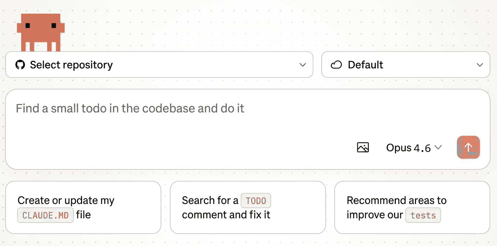

图 10.1 – Claude 桌面仓库选择界面


# 后台代理与并行开发

后台代理使得多个功能能够并发开发，而非顺序开发。在准备本演示时，这种工作流转变的影响立即变得清晰。无缝桌面集成与后台代理的结合，创造了一种与以往设置截然不同的开发体验。

此处演示的工作流涉及多个同时进行的操作，逐步跟进并不现实。取而代之的是，目标是专注于概念，并观察集成在实践中如何运作。重点在于理解这些能力如何结合以提升生产力，并重塑我们构建功能的方式。

# Claude Code 安装与运行模式：本地与云端

Claude Desktop 应用包含一个 **Code** 标签页，可通过图形界面运行 `Claude Code`。它们共享相同的底层引擎和配置（`CLAUDE.md`、MCP 服务器、钩子等）。

以下屏幕截图显示了带有 **Code** 标签页的 Claude Desktop 界面。

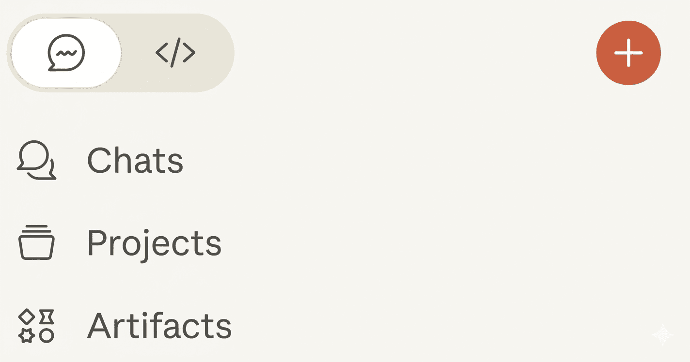

**图 10.2 – Claude Desktop Code 标签页界面**

打开 **Code** 标签页后，`Claude Code` 工作区随即出现，允许你选择项目文件夹并开始与代码库交互。

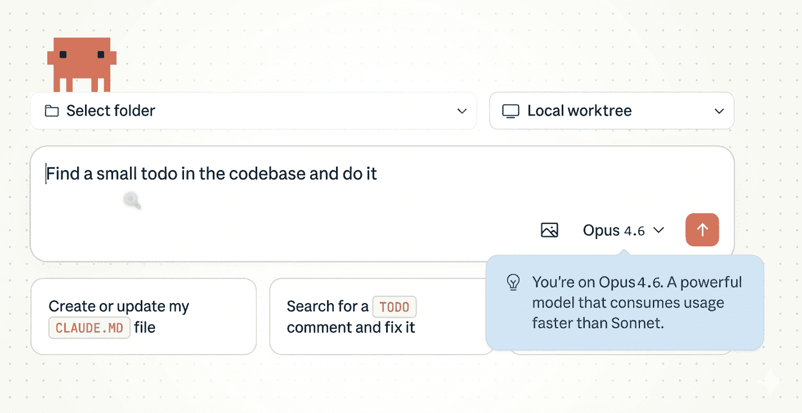

**图 10.3 – Claude Desktop 中的 Claude Code 工作区**

## 选择工作区文件夹（本地工作树模式）

在开始任何工作前，请先选择一个文件夹。该文件夹将成为 `Claude Code` 操作的工作区。在大多数情况下，此文件夹包含一个代码仓库，最好是 GitHub 仓库。

此处的重要细节是我们选择的是一个*文件夹*。

当工作方式设置为 **Local worktree（本地工作树）** 时，`Claude Code` 会在本地机器上启动 Git 工作树（稍后讨论）。所有操作均在本地进行。此模式下无任何内容在云端运行。

由于工作在本地机器上进行，`Claude Code` 需要一个目录来创建和管理这些工作树。这就是我们提供文件夹位置的原因，它将在此处执行工作。

我们打开工作方式选择器，并确认 **Local worktree** 已被标记。

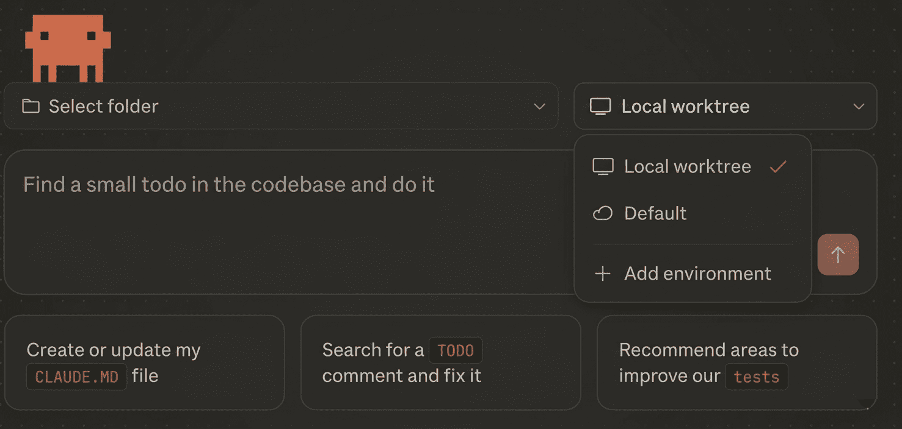

**图 10.4 – 在本地工作树模式下选择工作区文件夹**

选定后，我们打开 `Agentic‑Coding‑with‑Claude‑Code` 目录。该目录现在是所有操作将运行的工作区。此时，`Claude Code` 正使用 Git 工作树在本地运行。

## 切换至 Claude Code Web（云端模式）

现在将工作方式切换至默认选项，即标有云图标的选项。当我们切换到此模式时，`Claude Code` 将作为 Anthropic 基础设施上的托管实例运行。这被称为 **Claude Code web / remote workers / background agents（Claude Code 网页版 / 远程工作器 / 后台代理）**。

在此模型中，Anthropic 在其环境中运行容器化的 `Claude Code` 实例。这些实例需要访问我们的代码。我们通过授予 `Claude Code` web 访问我们 GitHub 仓库的权限来提供该访问权。

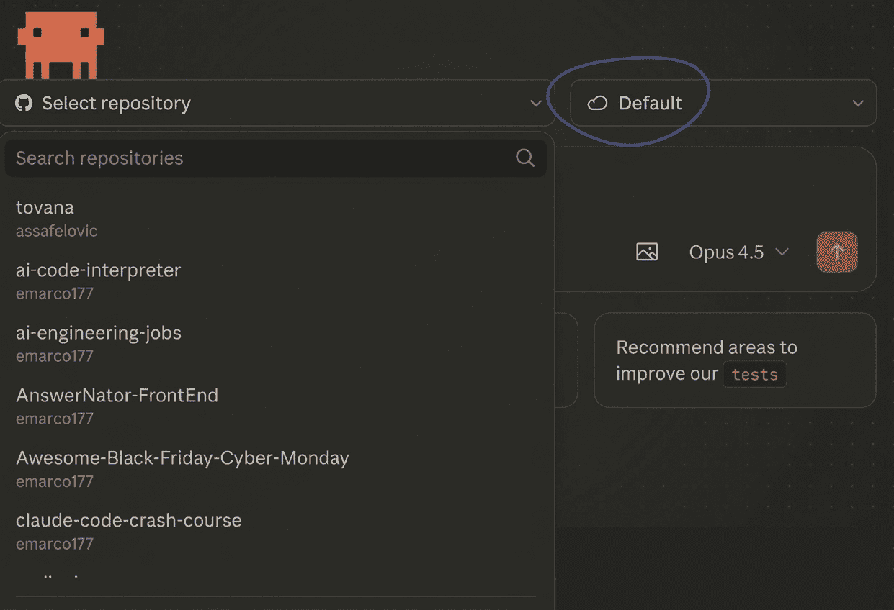

**图 10.5 – 在 Claude Code Web（云端模式）中选择仓库**

授权访问后，提示时工作流按顺序进行：

1.  Anthropic 将启动一个 `Claude Code` 实例。
2.  该实例克隆仓库。
3.  它直接在代码上工作。
4.  它可以提交更改。
5.  它可以创建拉取请求。

由于实例拥有仓库访问权，其运作方式如同项目中的任何其他开发者。此模型提供了规模优势。你可以并行运行多个 `Claude` 实例，每个实例同时处理不同的任务。并发实例的数量取决于你所配置和付费的额度。我们稍后将在本节中看到这种并行能力的实际演示。

## Git 工作树如何实现并行开发

在 **Local worktree（本地工作树）** 模式下，`Claude Code` 依赖 **Git Worktrees（Git 工作树）**。Git 工作树允许我们将同一仓库的多个分支同时检出到不同的目录中，而无需多次克隆仓库。

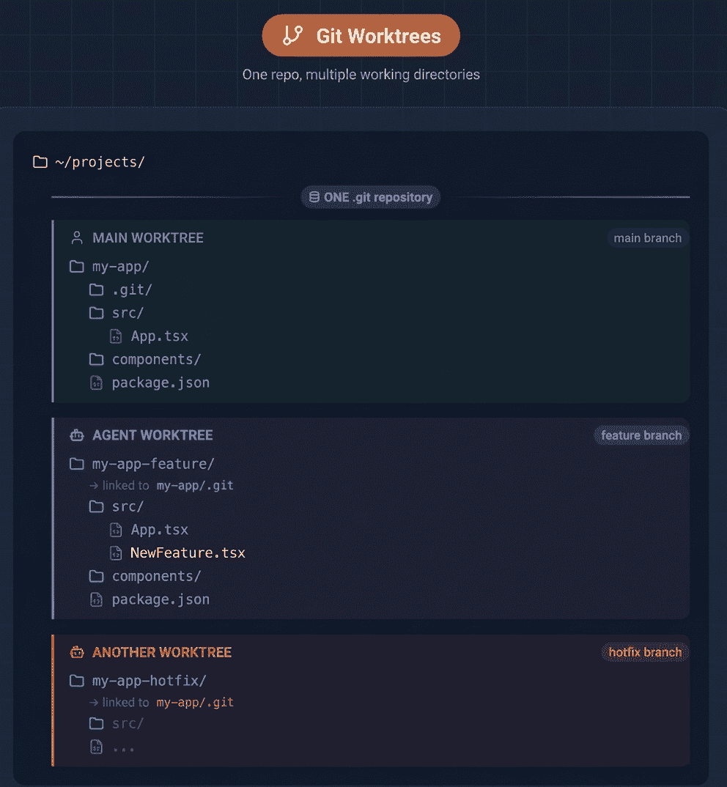

**图 10.6 – Git 工作树在本地模式下支持并行开发**

当多个编码代理同时工作时，这变得尤为有用。

每个代理可在其自己的工作树中操作自己的分支。我们无需频繁暂存更改或在分支间切换。隔离通过文件系统中的独立目录来处理。

我们无需深入了解 Git 工作树即可进行此工作流。只需知道它们允许多个分支同时保持活动状态，且 `Claude Code` 利用此机制支持并行开发即可。

工作区选定且工作模式选定后，我们即可继续进行。

# 编排并行本地与云端代理

为建立上下文，`Claude Code` 的工作目录指向 `Agentic‑Coding‑with‑Claude‑Code` 仓库。

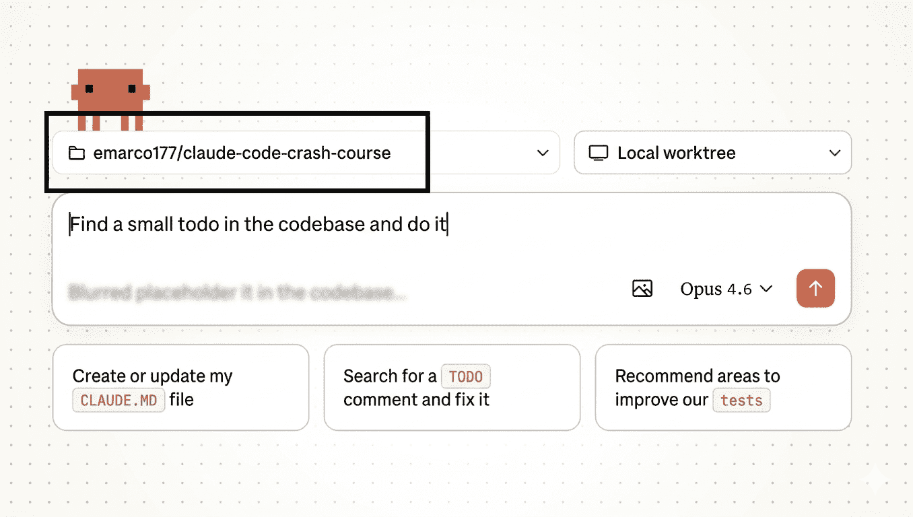

**图 10.7 – 为编排本地与云端代理配置工作目录**

此阶段的所有操作均在本地机器上运行。该仓库当前已检出至现有实现中使用的 `hookhub` 分支。

## 在本地运行 Next.js 应用

我们首先提示 `Claude Code` 在本地运行 Next.js 应用。

由于工作目录已配置，无需克隆任何内容。`Claude Code` 检查目录结构，检测到 `hookhub` 目录，进入该目录并列出文件。`package.json` 文件的存在表明这是一个 Next.js 项目。

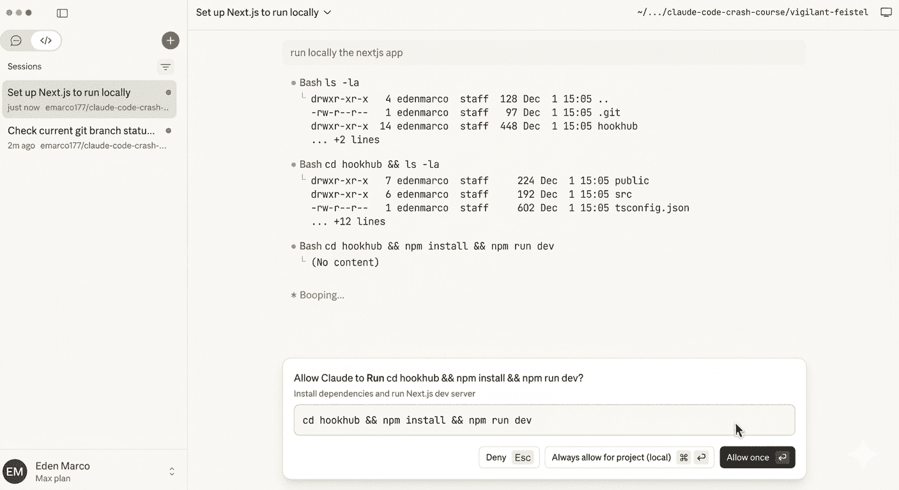

**图 10.8 – 使用 Claude Code 在本地运行 Next.js 应用**

随后，它确定正确的执行顺序：

1.  安装依赖：
    ```
    npm install
    ```
2.  启动开发服务器：
    ```
    npm run dev
    ```

开发服务器在后台运行。部分输出未显示，但进程成功完成。执行期间，`Claude Code` 检查 npm 版本。片刻后，Next.js 应用在端口 `3001` 启动，因端口 `3000` 已被占用而自动选择该端口。

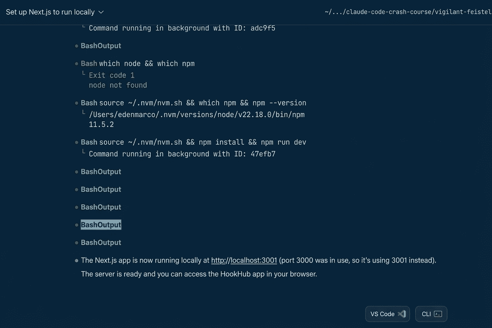

**图 10.9 – Next.js 开发服务器通过 Claude Code 在本地运行**

## 协调并行本地与云端工作

在此阶段，我们扩展实现以演示如何跨本地与云端环境并行开发功能。

从 `Claude Code` 标签页切换至 Claude 应用，将其作为一个独立的研究环境，独立于你的本地 `Claude Code` 会话。通过打开新聊天并指示其搜索实现 `Claude Code` 钩子的在线仓库（重点关注 GitHub 星标数高的仓库），为其分配一个仓库发现任务。

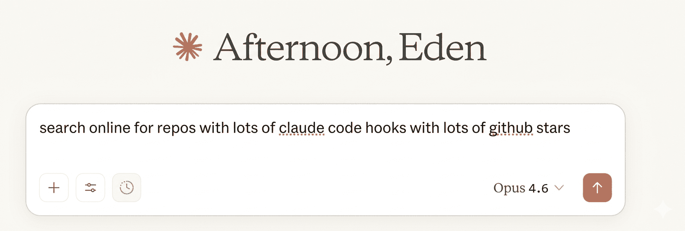

**图 10.10 – 在 Claude Code 中分配仓库发现任务**

意图很明确：一旦确定仓库，结果将被传回 `Claude Code` 并集成到 HookHub 数据库中。

## 执行并发功能开发

当研究任务在云端运行时，我们返回当前在本地运行的 `Claude Code` 会话并请求一个新功能：

```
Add animations to the application
```


# 使用 Claude Code 进行并行开发：本地与云端工作流

本会话完全在您的本地机器上运行。您创建一个新实例，选择 `Agentic‑Coding‑with‑Claude‑Code` 仓库，并直接针对本地代码库实现功能。

接下来，在其运行时，我们创建另一个 Claude Code 实例，这次保持默认的云端选项。这将激活在 Anthropic 云端运行的后台代理。输入以下提示词：

```
Add to the project/hookhub branch a much cooler hero, make it anthropic style
```

这可以在以下截图中看到。

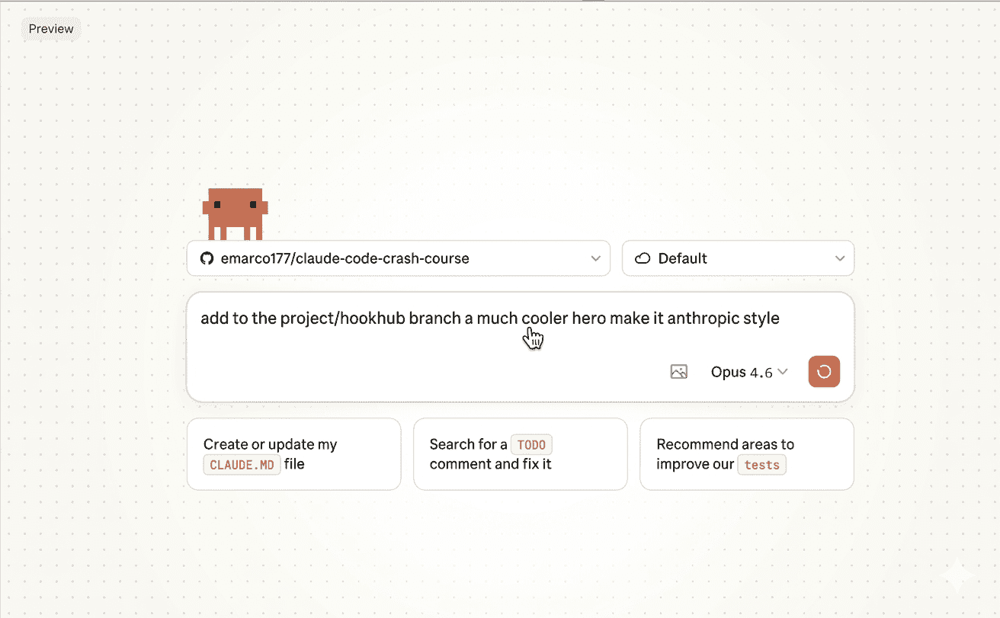

图 10.11 – 提示 Claude Code 在并行开发期间实现新功能

在提示词中，我们明确指示它执行以下操作：

* 在 `project/hookhub` 分支上工作
* 添加一个显著改进的 Hero 区域
* 以 Anthropic 风格对其进行设计

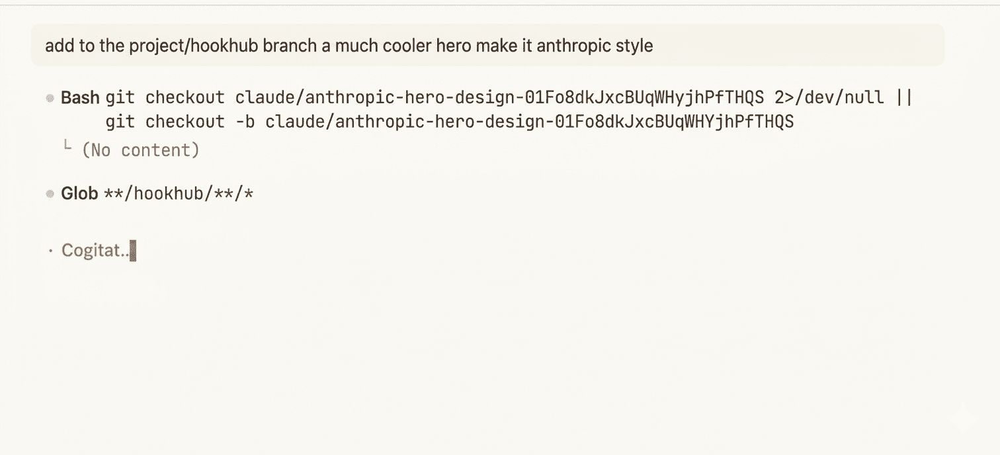

图 10.12 – Claude Code 执行并发功能实现任务

在此阶段，所有三个任务都在本地和云端环境中并发执行：

* 一个云端研究进程，用于识别高星标的 Claude Code Hook 仓库
* 一个本地 Claude Code 会话，为 UI 添加动画（`vigilant fiestal`）
* 一个远程后台代理，在特定分支上重新设计 Hero 区域（`claude/anthropic‑hero‑design‑01Fo8dkJxcBUqWHyjhPfTHQS`）

其中两个在本地执行，一个在 Anthropic 云端执行。

本地 Claude Code 实例完成动画功能并提出变更供审批。代理提出的变更需要批准。允许这些变更以便实施得以继续。

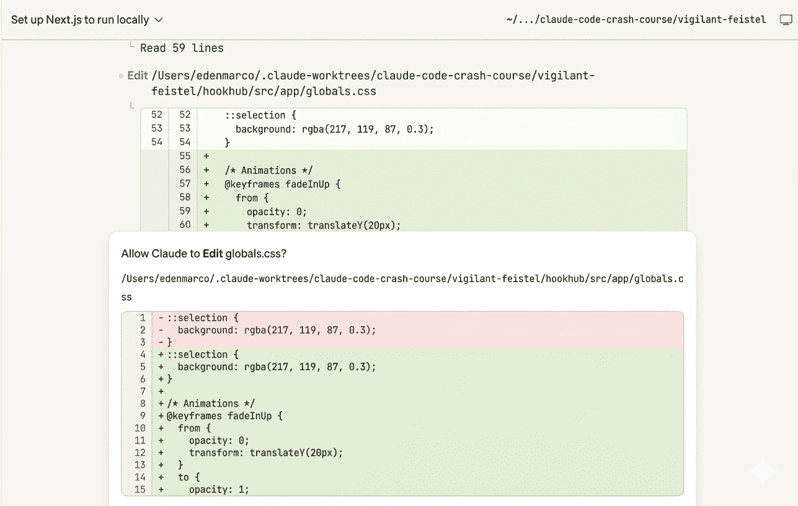

图 10.13 – 审查并批准 Claude Code 生成的本地代码变更

这完成了本地的动画任务，更新后的 UI 反映了新的动画效果。

## 观察远程分支创建

接下来，切换到云端运行的远程后台代理。代理在 Anthropic 云端环境中创建一个新分支。最初，它从 main 分支检出，而不是 `project/hookhub`。

这一点很重要，因为该功能旨在 `project/hookhub` 上实现。如果从 `main` 继续开发，可能会导致稍后合并时出现不一致。

不久之后，代理通过执行以下命令修正了分支上下文：

```
git checkout origin/project/hookhub
```

以下截图显示代理执行此命令以切换到正确的分支：

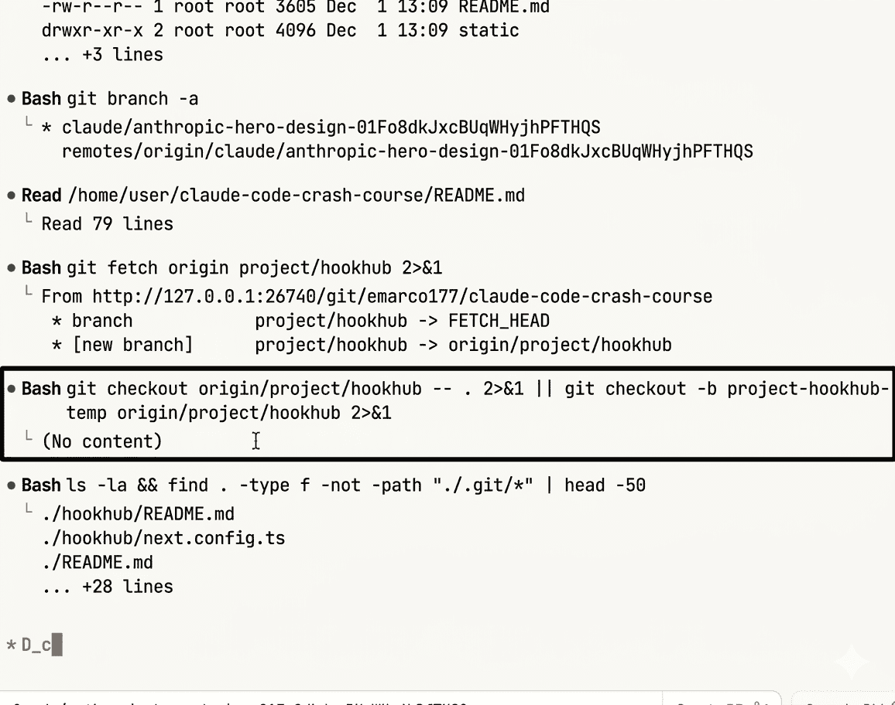

图 10.14 – 云端代理切换到正确的功能分支

这确保它现在正在针对正确的分支工作。它获取相关代码并再次列出项目文件，在继续进行 Hero 区域重新设计之前恢复完整上下文。

## 处理研究结果

与此同时，Claude Desktop 研究任务完成并返回高星标的 Claude Code Hook 仓库列表。输出包含多个 GitHub 仓库链接。

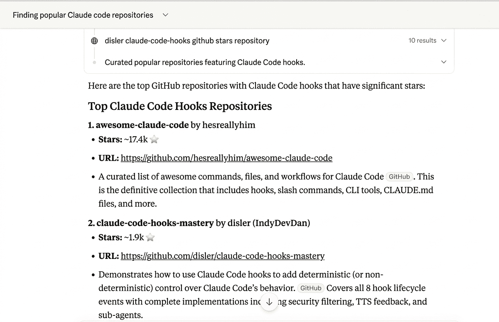

图 10.15 – Claude Code 显示精选的 Hook 仓库结果

复制完整的 URL 集合并将仓库信息粘贴到新的本地 Worktree 会话中，然后指示代理将这些链接添加到 HookHub 列表中。

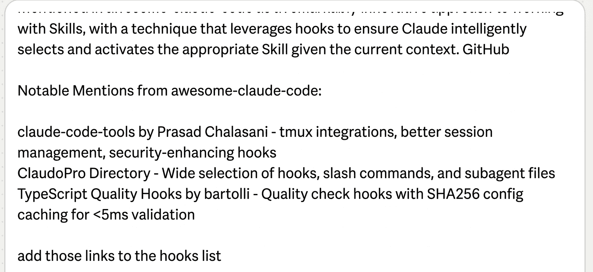

图 10.16 – 将发现的仓库添加到 HookHub 配置

由于使用了 Git Worktree，此修改发生在与其特定分支关联的独立工作目录中。代理映射这些仓库并使用新条目更新 `hooks.json` 文件。

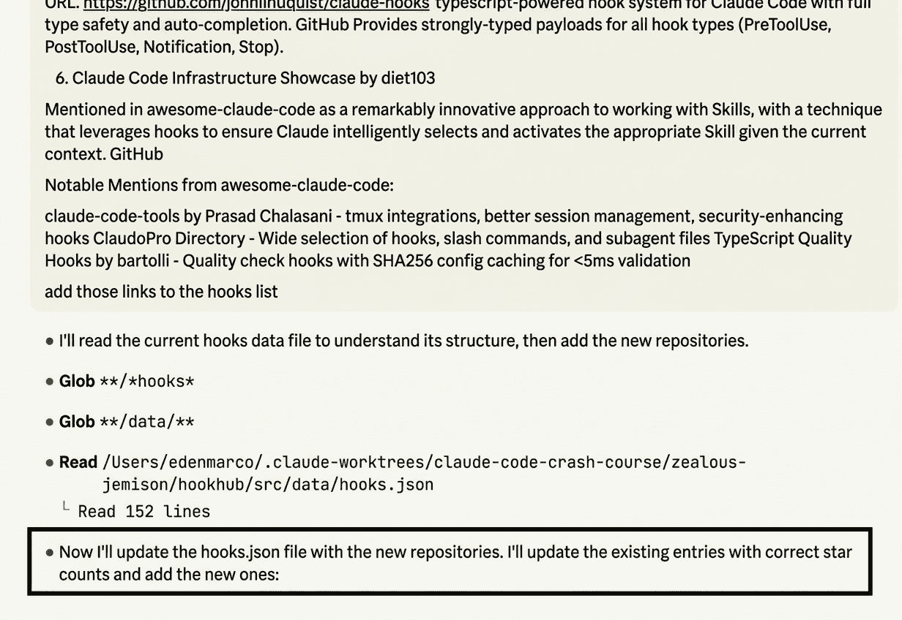

图 10.17 – 使用发现的仓库更新 hooks.json 配置

生成变更后，审查并接受它们。

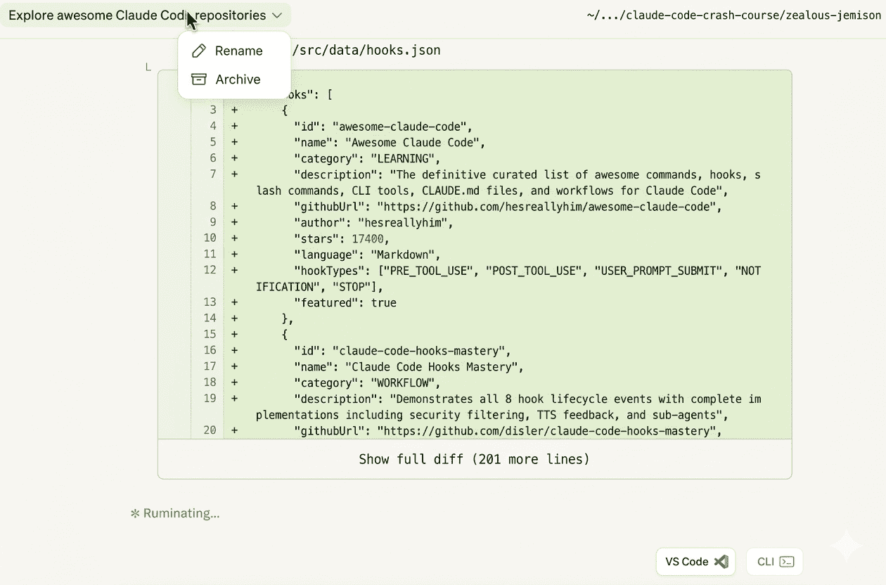

图 10.18 – 审查并批准 hooks.json 配置的更新

此时，请注意以下几点：

* 动画功能已在本地完成并在 UI 中可见
* 数据库更新任务已使用新的仓库链接修改了 `hooks.json`
* 远程云端代理在正确切换到 `project/hookhub` 后正在处理 Hero 区域

以下截图显示了更新后的仓库链接并确认变更已应用。

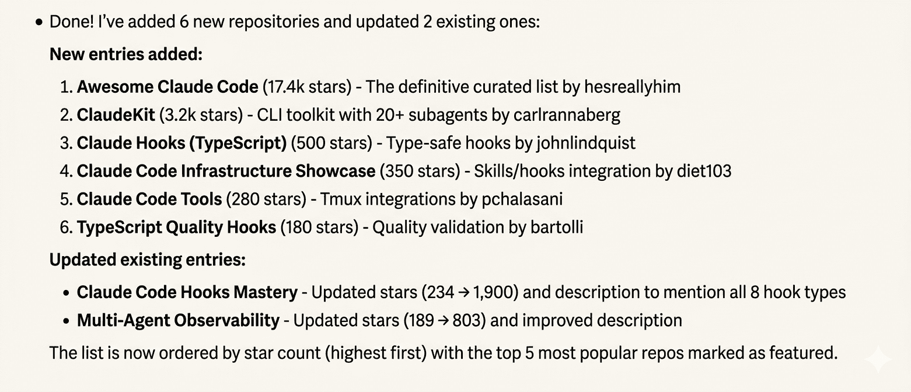

图 10.19 – 确认更新后的 HookHub 仓库链接

## 理解 Git Worktree 布局

由于使用了 Git Worktree，单独的目录代表不同的活动分支。

主仓库目录保持完整。在此旁边，还有一个额外的 Worktree 目录：例如 `zealous‑jemison`（由 Claude Code 自动生成）对应另一个分支。每个并行任务都在自己的 Worktree 上下文中运行，这防止了功能实现之间的干扰。

在本例中，三个独立功能同时开发：应用程序的 UI 动画、Hook 仓库数据库的更新以及 Hero 区域的重新设计。每个功能都在单独的分支中实现，稍后再合并到单个分支中。

## 准备合并工件

剩下的挑战是整合所有工件。您有三个分支需要汇总：一个由云端代理更新的远程分支，以及两个包含动画变更和数据库更新的本地 Worktree 分支。

这些变更必须合并到一个单一、连贯的代码库中。因为一个分支存在于远程，而其他分支通过 Git Worktree 存在于本地，因此合并需要显式协调。

下一步是指示 Claude Code 合并这些分支，以便包括动画、更新的 Hook 仓库和重新设计的 Hero 区域在内的所有工件都合并到单个统一分支中，如以下提示词所示。

```
Merge all the commits here to branch project/hookub
```

从并行执行到受控集成的这一转变，完成了本地和基于云端的开发工作流的编排。

# 理解 Claude Code 中的 Git Worktree

在继续合并之前，我们需要了解 Git Worktree 的底层原理以及这种设置下版本控制的行为。目标是对 Claude Code 创建隔离工作副本时发生的情况建立正确的直觉。

当 Claude Code 创建 Worktree 时，它会创建一个与仓库关联但检出到不同分支的独立工作目录。

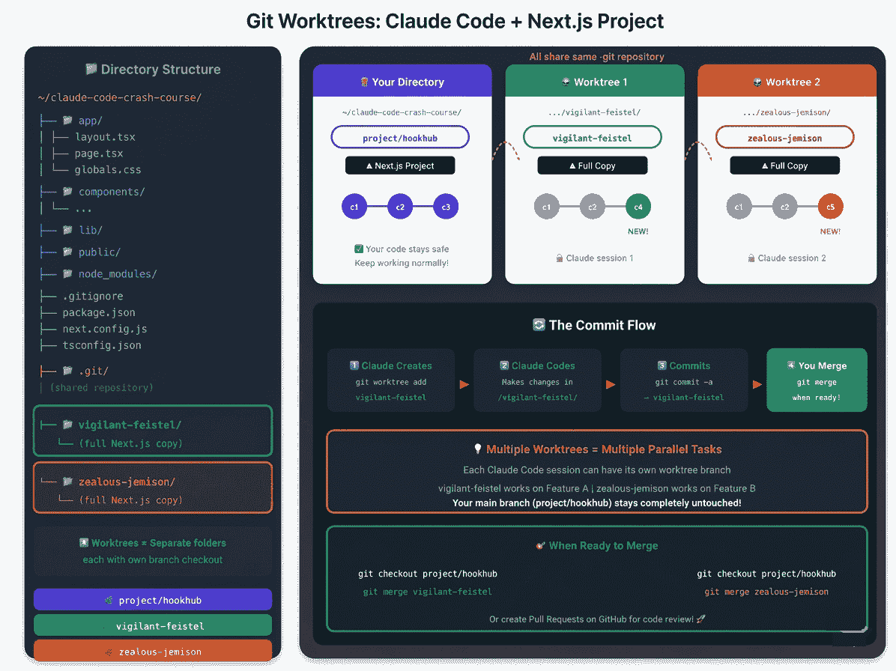

图 10.20 – Claude Code 用于并行开发的 Git Worktree 架构

## Claude Code 如何使用 Worktree

当我们逐步查看时，流程更容易理解。以下是 Claude Code 创建并开始在 Worktree 内工作时发生的确切操作序列：

1. Claude Code 创建一个带有新分支的 Worktree。例如，我们可以将 Worktree 命名为 `vigilant feistel`（由 Claude Code 自动生成）。
2. 所有代码和所有变更都发生在 Worktree 目录内。
3. 当我们提交代码时，提交存在于 `vigilant feistel` 分支中。
4. 原始分支 `project/hookhub` 保持完全未被触动。


## 5. 合并或放弃 Worktree 更改

5. 如果我们对 Claude Code 的构建成果满意，则进行合并。

6. 如果不满意，则删除 Worktree 和分支，不留任何烂摊子。

## 并行使用多个 Worktree

在**图 10.20**中，有两个 Worktree——`vigilant feistel` 和 `zealous jemison`：

1. 我们打开编辑器，看到常规的 `hookhub` 目录结构。
2. 我们还看到两个额外的目录，其中每个目录都包含原始分支代码库的完全副本。
3. 尽管目录结构匹配，但 Git 分支是分离的；`vigilant feistel` 和 `zealous jemison` 是独立的 GitHub 分支，不同于 `project/hookhub`。
4. 这允许执行多个并行任务，每个 Claude 实例在完全不同的分支中工作，并使用原始代码的全新副本。

使用多个代理进行工作需要编排，这意味着开发者必须协调多个工作上下文、分支和任务。Git Worktree 为管理这种协调提供了便捷的机制。

# 合并并行功能分支

本地 Claude Code 实例在 `vigilant feistel` 目录中实现了动画。该目录是一个链接到主仓库但检出到不同分支的 Git Worktree。

即使目标分支是 `project/hookhub`，所有实际工作都发生在 `vigilant feistel` 目录中。这正是 Git Worktree 的运作方式。它们允许在隔离的目录中进行开发，同时仍指向同一个仓库。

现在我们想要获取那里生成的代码并提交它。指示 Claude 创建一个提交，并在提交信息中明确说明更改是通过 Claude Code Desktop 生成的。

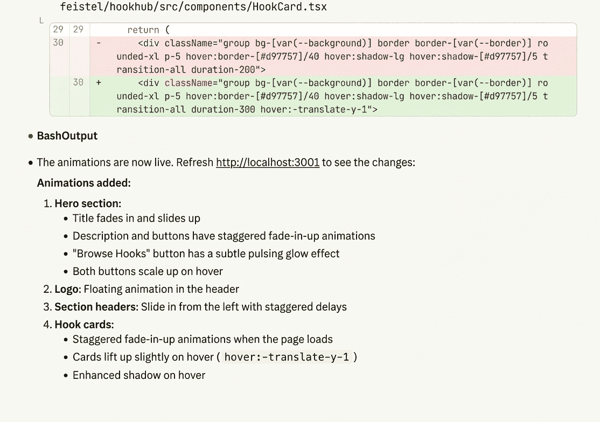

**图 10.21 – 查看在 vigilant_fiestal worktree 中生成的动画功能更改**

当该进程（`vigilant fiestal`）运行时，另一个本地 Claude 实例正在一个名为 `zealous jemison` 的独立 Worktree 中，使用 JSON 文件更新 GitHub URL。两个实例独立运行。Claude 准备暂存命令。

下面的屏幕截图显示 Claude Code 正在准备提交并提交审批。

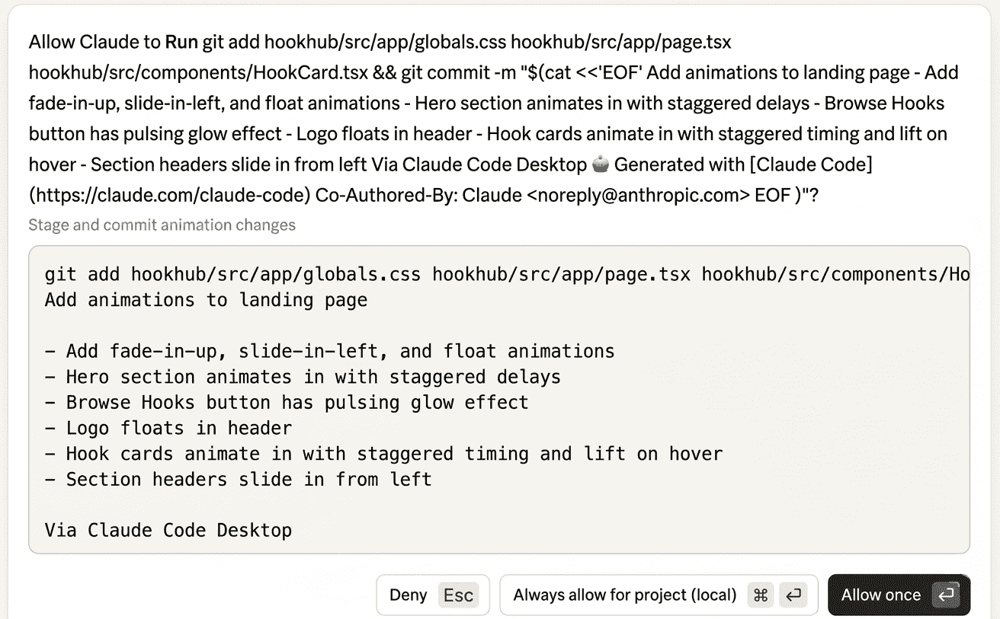

**图 10.22 – Claude Code 正在为动画功能更改准备提交**

批准它。提交信息清楚地表明更改是使用 Claude Desktop 生成的。批准后，一个重要细节变得可见。活动分支不是 `project/hookhub`。而是 `vigilant‑fiestel`。

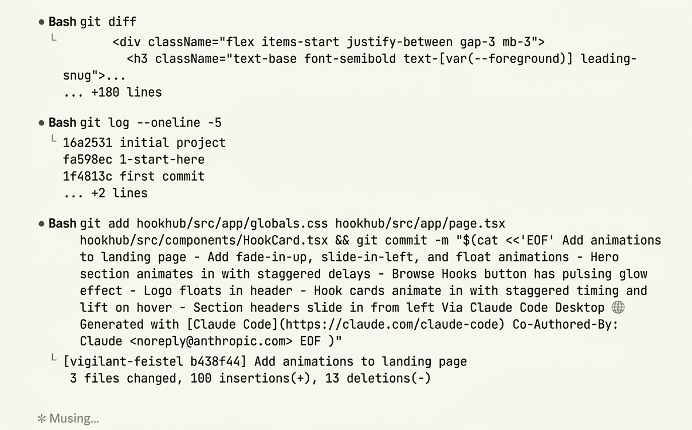

**图 10.23 – 提交已应用到 vigilant-fiestel Git worktree 分支**

这证实了 Worktree 的行为方式。当在 Worktree 内部创建提交时，它会应用到该 Worktree 的分支——而不是原始分支。提交成功添加到了 `vigilant‑fiestel`。

## 推送 Worktree 分支

现在我们推送更改。切换到 `zealous jemison` Worktree。该分支已经包含其提交。将其也推送上去。

Claude 将请求推送权限。下面的屏幕截图显示了 `zealous‑jemison` 的情况，它实现了数据库更新，将新的 Claude Code 仓库条目添加到 `hooks.json` 中。

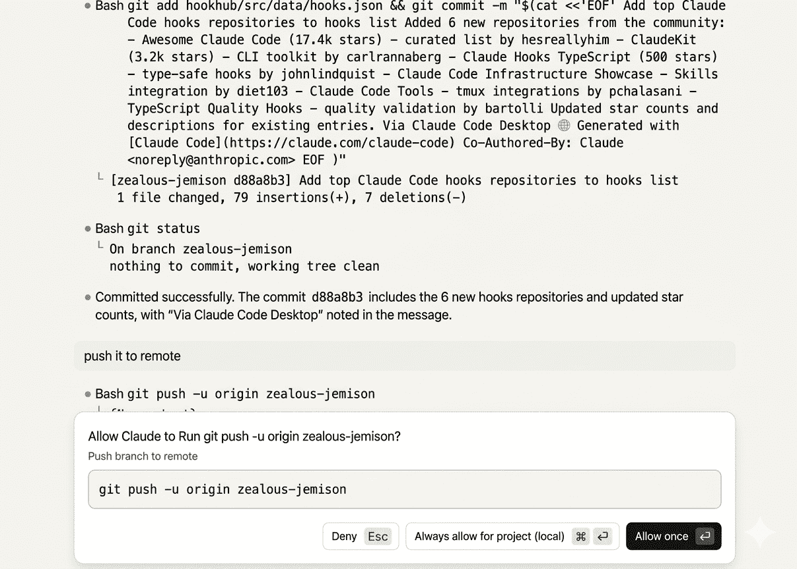

**图 10.24 – 将 zealous-jemison worktree 分支推送到远程仓库**

`vigilant‑fiestel` 的情况如下：实现了着陆页 hero 区域的 UI 动画功能。

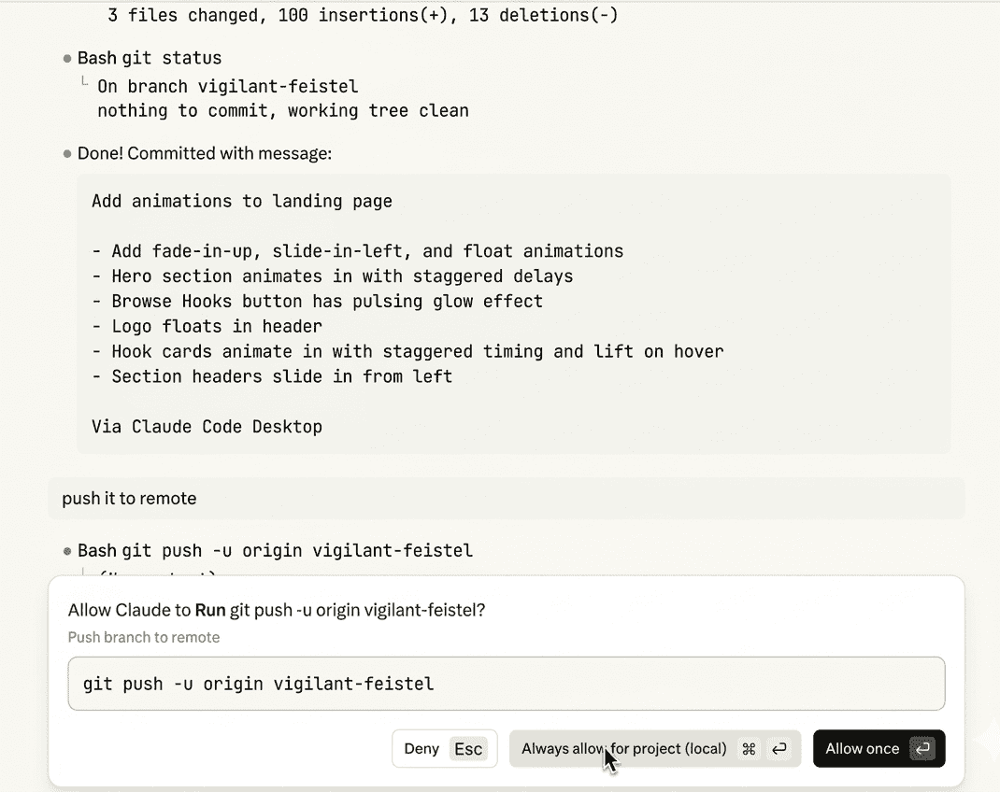

**图 10.25 – 将 vigilant-fiestel worktree 分支推送到远程仓库**

两个都批准。`project/hookhub` 分支仍然不显示新提交。这是预期的。每个 Worktree 维护自己的分支。

还有一个由远程 Claude Code 实例创建的第三个分支，称为 `claude/anthropic‑hero‑design/<id>`。

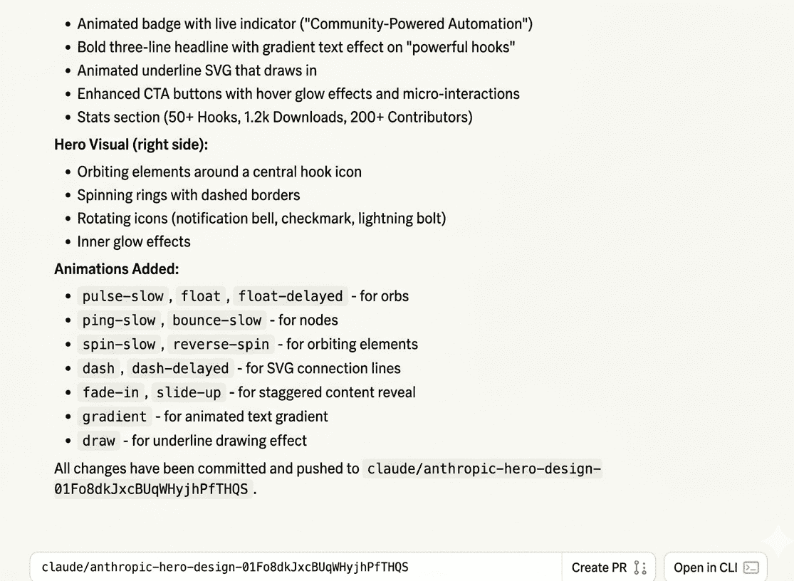

**图 10.26 – 远程 Claude Code 代理完成 hero 区域重新设计**

该分支中的所有更改已经提交并远程推送。

刷新仓库确认有三个新分支：

*   `vigilant fiestel`
*   `zealous jemison`
*   `Anthropic Hero Design`

下面的屏幕截图显示了仓库视图，其中可见这些新创建的分支。

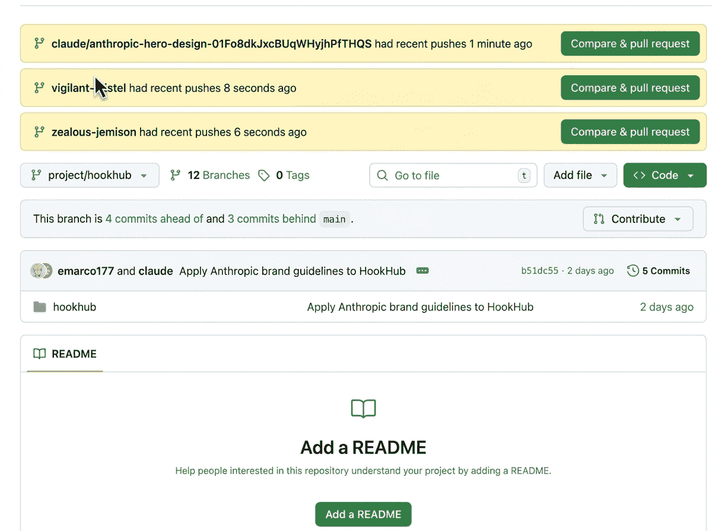

**图 10.27 – 显示新创建功能分支的 GitHub 仓库视图**

每个分支代表一个独立开发的功能。

## 将所有内容合并到 `project/hookhub`

现在我们想将所有这些实现汇总到 `project/hookhub` 中。

我们不手动检出并合并每个分支，而是将任务委托给 Claude Code。

我们提供分支名称，并指示 Claude 将所有提交合并到 `project/hookhub`。

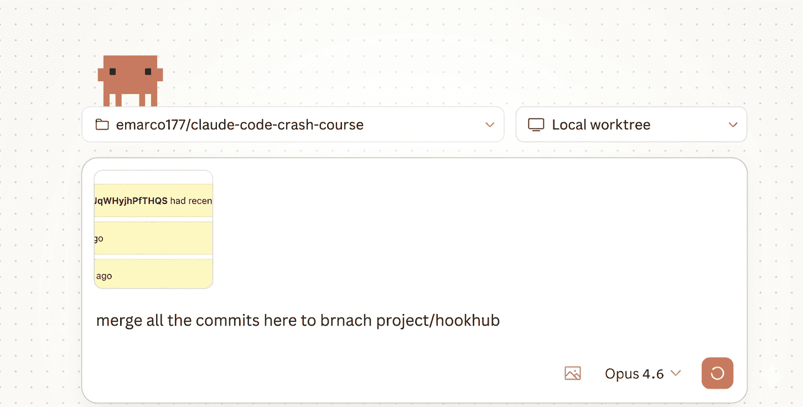

**图 10.28 – 提示 Claude Code 将所有功能分支合并到 project/hookhub**

Claude 开始在本地工作并创建另一个名为 `suspicious‑bassi` 的 Worktree。

它没有直接合并到 `project/hookhub`，而是创建了一个临时集成分支 `project/hookhub‑merge`。

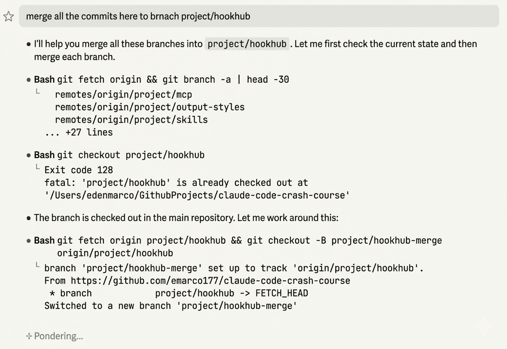

**图 10.29 – 创建临时 project/hookhub-merge 集成分支**

这允许在接触主开发分支之前进行整合。

## 执行合并

Claude Code 开始合并过程。操作期间出现合并冲突。

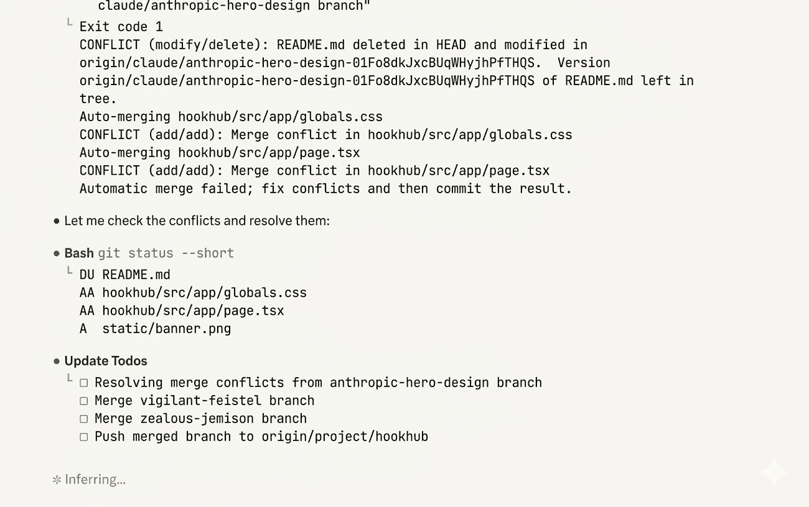

**图 10.30 – 分支整合期间检测到合并冲突**

Claude 准备了一个解决方案：

1.  解决来自 `anthropic‑hero‑design` 的冲突。
2.  合并 `vigilant‑fiestel`。
3.  合并 `zealous‑jemison`。
4.  将所有内容推送到 `project/hookhub`。
5.  冲突涉及全局 CSS 文件。
6.  Claude 提出编辑建议。我们批准它们。
7.  创建合并提交。
8.  Claude 继续：

    ```
    git merge vigilant-fiestel
    ```

9.  然后运行以下命令：

    ```
    git merge zealous-jemison
    ```

下面的屏幕截图显示 Claude Code 正在执行合并并提交合并提交以供审批。

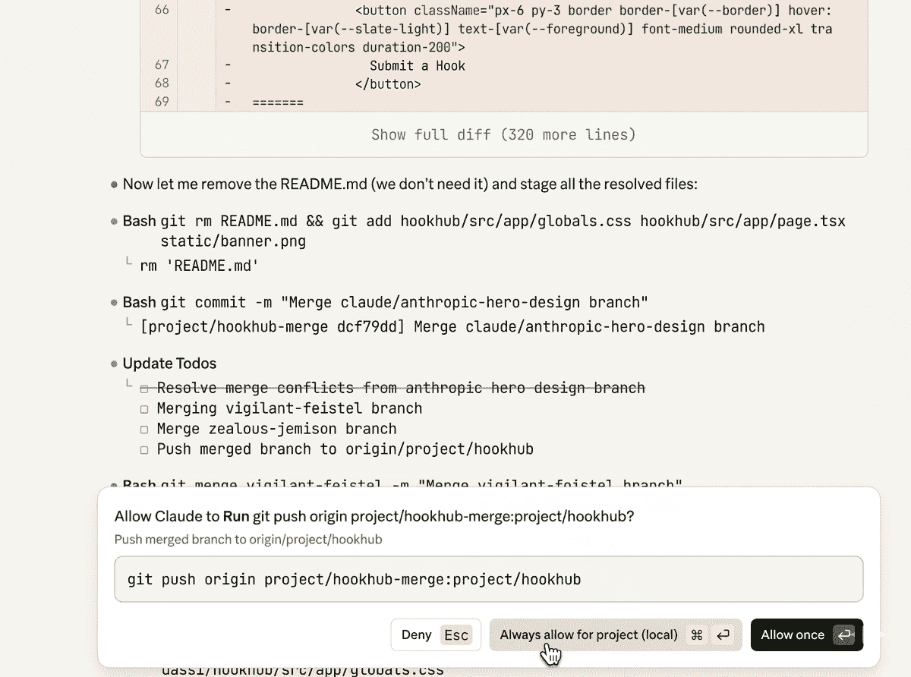

**图 10.31 – Claude Code 提交最终合并提交以供审批**

此时，所有功能分支已整合到 `project/hookhub‑merge` 中。

## 推送到 `project/hookhub` 前进行测试

Claude 请求权限将合并结果推送到 `project/hookhub`。

暂时不要批准。推送前，先在本地测试。

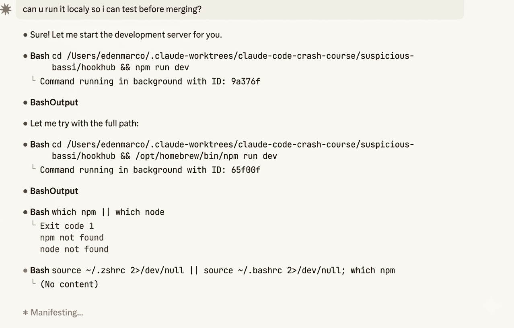

**图 10.32 – 推送到主分支前在本地测试合并后的项目**

指示 Claude 启动开发服务器：

```
npm run dev
```

可能会出现错误：

```
npm is not found
```

Claude 通过 source `.zshrc` 配置文件来加载环境并再次尝试。

然后它确定缺少依赖并运行以下命令：

```
npm install
```

现在有两个进程正在运行：

*   `npm install`
*   `npm run dev`

依赖安装完成后，开发服务器成功在端口 `3002` 上启动。合并后的实现现在正在本地运行。


## 验证集成结果

打开运行在端口 `3002` 上的应用程序，并将其与原始实现进行比较。

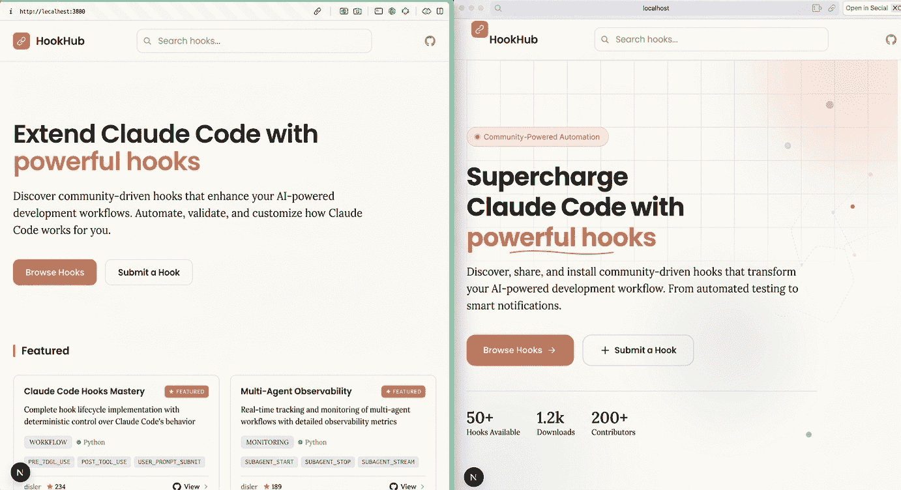

**图 10.33 – 对比原始与增强后的 HookHub Hero 部分**

差异立竿见影。新的 Hero 部分现在包含以下内容：

*   网格背景
*   横幅元素
*   曲折线条
*   仓库统计数据
*   动画效果

仓库列表包含的条目比以前更多。这些是由 Claude Code 调研并添加的。动画遍布整个网站，而不仅仅局限于孤立的组件。与原始的静态版本相比，体验感觉更具动态感。

所有三个独立开发的功能都能正确共存。

## 完成合并

验证完成后，我们批准推送。Claude 将 `project/hookhub‑merge` 合并到 `project/hookhub` 中。

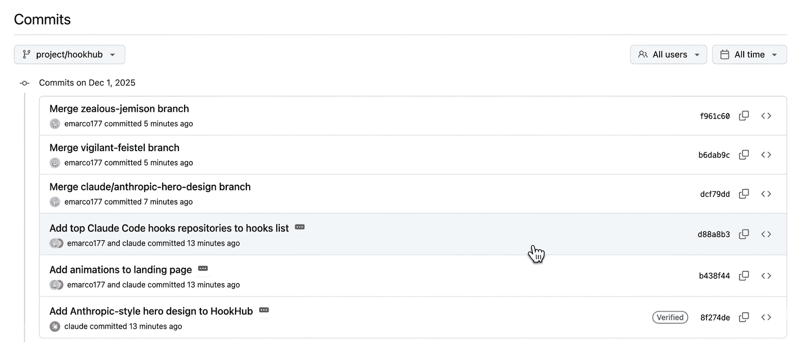

**图 10.34 – 将所有功能分支合并到 project/hookhub 后的最终提交历史**

刷新仓库确认结果。该分支现在包含三次提交。每次提交合并一个不同的分支，这些分支源自由 Claude Code 创建的独立 Worktree。每个分支代表一个独立实现的功能。

这种设置凸显了开发扩展方式的一个重要转变。三个独立的功能由不同的 Claude Code 实例并行开发，同时运行。除了两个本地实例外，另一个 Claude Code 实例在远程运行。

看到这三条独立的开发线汇聚到一个分支中，其意义显而易见。我们通过委托并行功能实现，实际上实现了作为开发者的自我扩展。

同样值得注意的是，此过程中涉及的前端经验有限。为这些实现提供支持的 Claude Code 模型处理了前端工作，并证明了其能够生成所需代码。

# 通过移动端在云端运行 Claude Code

Claude Code 现已集成到移动应用程序中。桌面端使用的相同工作流可直接从手机发起。在此例中，从移动界面选择 `claude‑code‑crash‑course` 仓库，会话由此开始。

由于移动环境不在本地执行代码，所有操作均在 Anthropic 云端运行。不依赖本地机器。仓库在远程克隆，分支在远程检出，更改在远程提交。

我们首先指示 Claude 切换到 `project/hookhub` 分支并实现一个 Anthropic 风格的页脚。

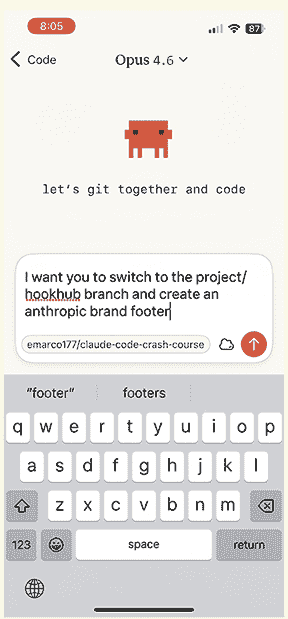

**图 10.35 – 从移动应用程序界面运行 Claude Code**

工作流与桌面体验一致：Claude 克隆仓库，检出目标分支，检查项目结构，实现功能，提交更改，并准备拉取请求。

过程逐步展开。仓库被获取。分支被切换。文件被检查。系统指令确认分支已切换至 `project/hookhub`。

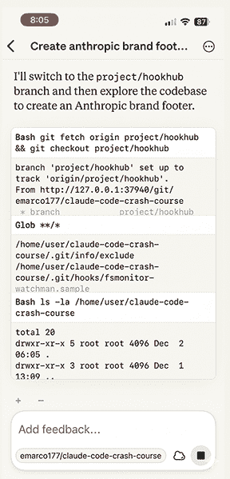

**图 10.36 – 从移动会话中 Claude Code 分析仓库**

理解项目上下文后，Claude 识别出该仓库是一个具有 Anthropic 风格品牌的 Next.js 应用程序，并据此进行操作。

值得注意的是，默认云配置不包含 MCP、自定义钩子或输出样式。环境使用默认设置运行。自定义配置可单独添加，但此会话在无此类配置下运行。

## 实现页脚组件

Claude 在 `components` 目录下生成一个新的 `footer.tsx` 文件。

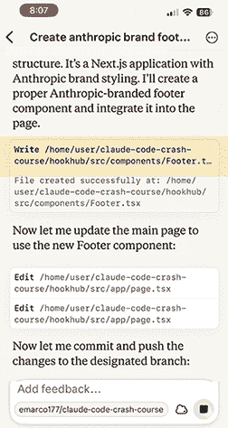

**图 10.37 – 从移动端 Claude Code 会话创建并集成页脚组件**

页脚组件体现了 Anthropic 视觉风格。创建组件后，Claude 通过导入并将其渲染在主页面中，将其集成到 `page.tsx` 中。

版本控制操作随之自动进行。更改被暂存并提交。由于请求指定将更改推送到 `project/hookhub`，且 Claude Code 内部使用 Git worktree，因此会在后台发生额外的 Git 操作，以将 worktree 提交合并到正确的分支。

Git 日志确认了早期工作的先前合并和提交。新的页脚组件和页面修改现已成为分支历史的一部分。

## 审查拉取请求

在 GitHub 上打开仓库可看到新创建的拉取请求。最初，拉取请求针对 `main` 分支，这并非预期的基础分支。基础分支被更正为 `project/hookhub`。

调整分支后，拉取请求反映了两个修改过的文件：

*   `page.tsx`
*   `footer.tsx`

差异显示了符合预期的页脚组件集成。

在此阶段，Claude 也可直接在 GitHub 上被 @ 提及以审查拉取请求。由于该分支未配置 GitHub 工作流，自动检查不会触发。

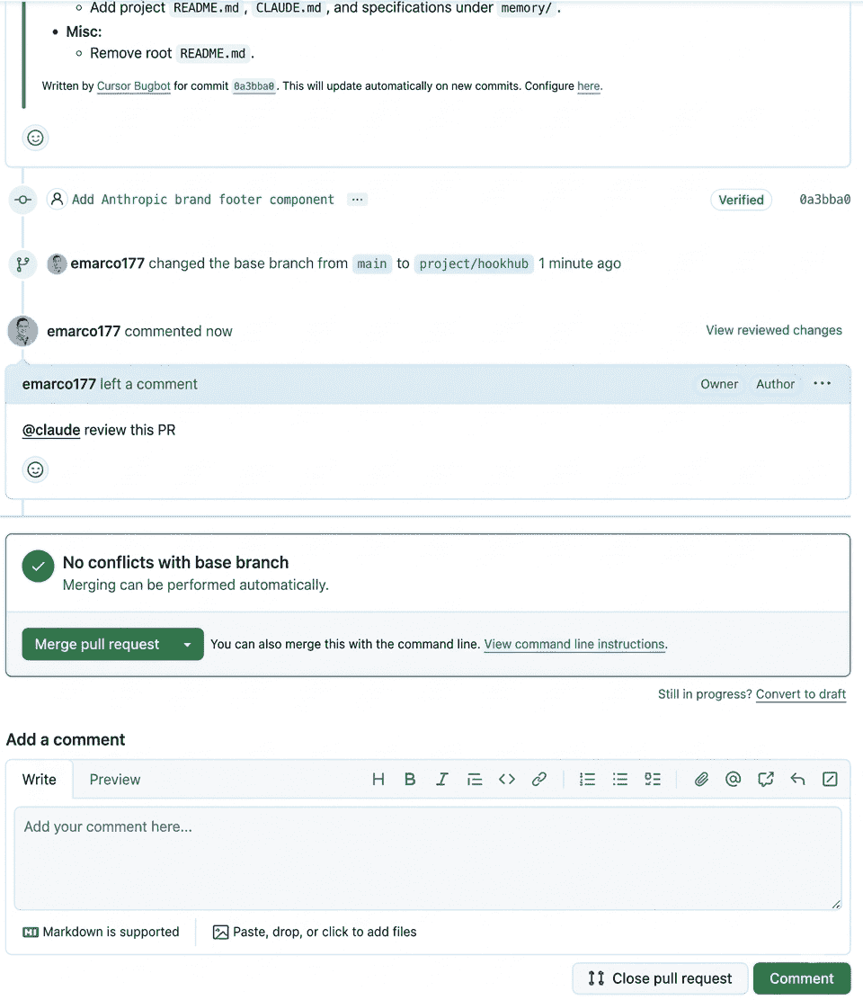

**图 10.38 – 在 GitHub 上审查由 Claude Code 创建的拉取请求**

审查仍为手动进行。

## 本地验证更改

为验证集成，请运行以下命令：

```
git fetch
git pull
npm run dev
```

启动开发服务器后，应用程序加载并在页面上渲染新的页脚。品牌标语 **Built with love for Claude Code powered by Anthropic** 出现在底部。

布局需要微调，可委托给 Claude Code 进一步优化。重要的是，整个工作流——从克隆到创建拉取请求——均从移动设备发起，并在云端完全执行。

工程模型保持一致：指定意图，允许 Claude 推理仓库，审查输出，并迭代。界面变了，但底层开发流程未变。

# 并行 Agent 适得其反的情况

并行编码 Agent 很有用，但并非总是正确的选择。以下是并行运行 Agent 往往事与愿违的情况。

*   **紧密耦合的功能**：当任务修改相同文件或相互依赖彼此输出时，并行 Agent 会产生合并冲突或无声地覆盖彼此的工作。如果功能 B 需要功能 A 的接口先存在，请按顺序运行它们。
*   **共享状态和排序约束**：数据库迁移、配置文件更改和共享类型定义会产生隐式依赖。两个 Agent 向同一配置、模式或路由文件添加条目会发生冲突。解决这些冲突的成本往往超过并行运行节省的时间。
*   **微小任务**：每个 Agent 会话都带来开销：启动上下文、阅读代码库和规划工作。对于顺序执行只需两分钟的任务，将其拆分到多个 Agent 然后审查和合并结果反而可能耗时更长。如果任务舒适地适合单个会话，请保持原样。
*   **高昂的协调成本**：如果你发现自己编写详细、明确的规范只是为了防止 Agent 互相干扰，这是一个信号。你花在定义边界上的时间越多，从并行性中获得的收益就越少。


*   **探索性或不确定性工作**：当你尚未知道正确的方法时，例如调试棘手的问题或为不明确的设计制作原型，并行代理只会增加不确定性。一次专注的迭代会话比多个代理同时探索死胡同更有效。

**专业提示**：

心智模型：当任务独立、定义明确且涉及代码库的不同部分时，并行代理效果最佳。拿不准时，先按顺序执行，确认任务间无交互后再并行化。

**并行开发检查清单**：

1.  确保每个任务操作独立的文件/组件
2.  验证每个代理提示词中的起始分支是否正确
3.  推送到目标分支前测试合并结果
4.  合并后清理工作树目录

# 总结

在本章中，你学习了如何在桌面应用程序中使用 `Claude Code`，在 `Local` `worktree` 和云模式之间切换，并行运行多个编码代理。你了解了 Git 工作树如何隔离功能开发，后台代理如何在云端运行，以及如何将独立开发的分支合并、测试并整合到单一的工作代码库中。你还探索了相同的工作流如何延伸到移动端，在那里所有执行都发生在云端。

这些信息很有用，因为它演示了如何从顺序开发转向编排的、多代理工作流。通过理解如何管理并行分支、协调本地和远程代理以及安全地合并它们的输出，你可以在保持对代码库控制的同时，显著提高开发吞吐量。

在下一章中，我们将探讨深度代理及其在长时程任务执行中的作用。我们将定义深度代理的特征并分析 `LangChain` 深度代理框架，包括其架构和执行模型。

# 获取本书的 PDF 副本、代码包等

扫描二维码（或访问 [packtpub.com/unlock](https://packtpub.com/unlock)）。按名称搜索本书，确认版本，然后按照页面上的步骤操作。


*注意：请准备好发票。直接从 Packt 网站购买的不需要发票。*

<!-- split --># 11 理解深度代理

在本章中，我们将深入探讨深度代理。深度代理是具有能力、实用性，并被设计用于执行各种任务的代理，特指那些需要跨多个步骤进行持续推理和行动的长时程任务。像 `Claude Code`、`Cursor CLI` 和 `LangChain Deep Agents` 这样的编码代理就属于这一类。这些系统不局限于单步工具使用；它们在扩展的工作流中运行，做出决策、调整计划，并迭代行动，直到达成更广泛的目标。

我们首先对深度代理进行分类，确定什么样的代理符合“深度”资格，并识别出将它们与简单代理模式区分开来的决定性特征。由此，我们在高层定义什么使代理成为深度代理，并考察那些支持长时程执行的属性。

这为像 `Claude Code` 这样的最先进编码代理是如何实现的提供了一个实用的视角，将我们的理解建立在真实工程基础之上。

本章将涵盖以下主题：

*   生产系统中的代理分类
*   什么使代理成为深度代理

