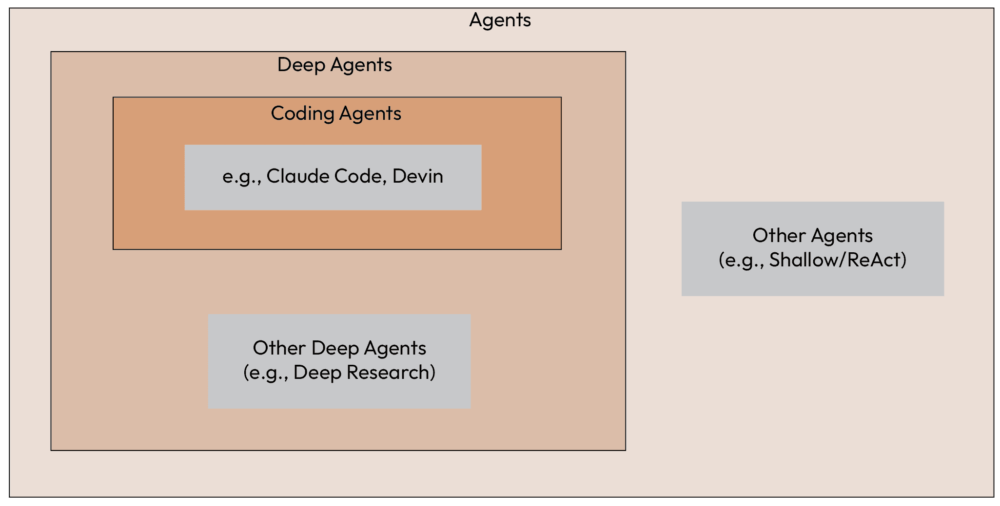
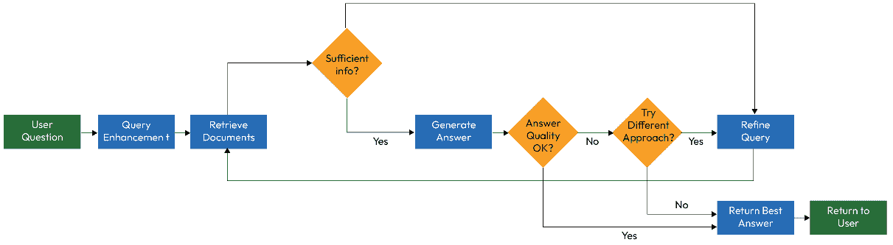
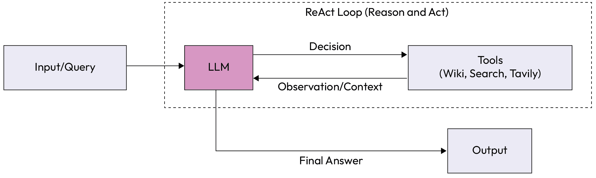
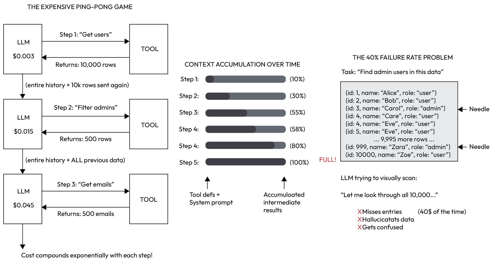
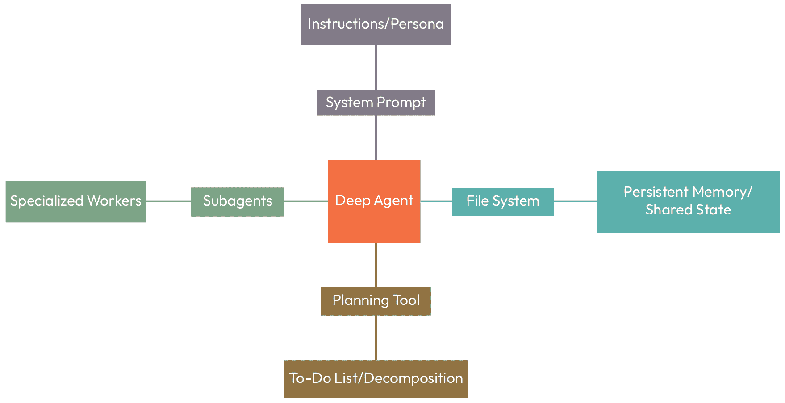
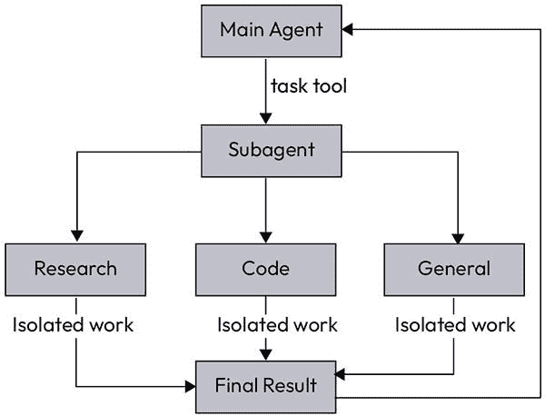
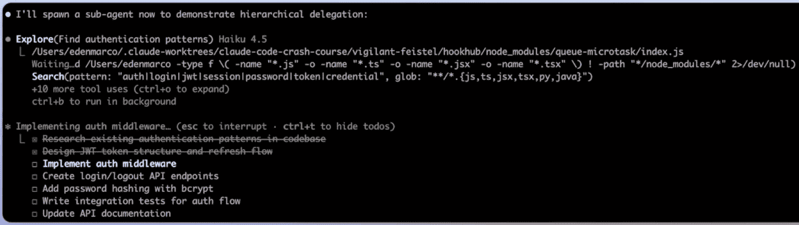
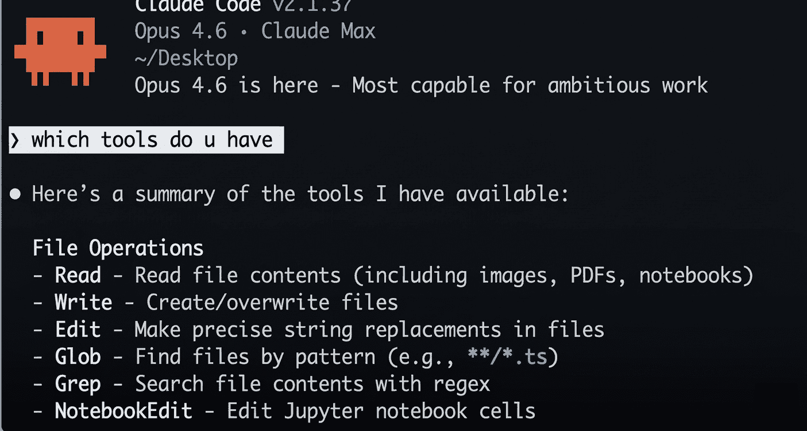
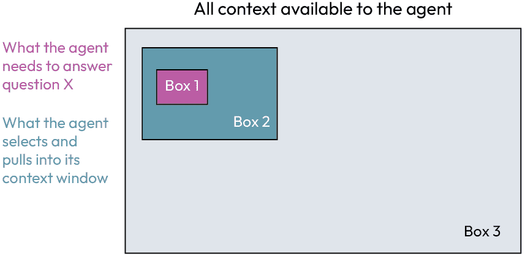
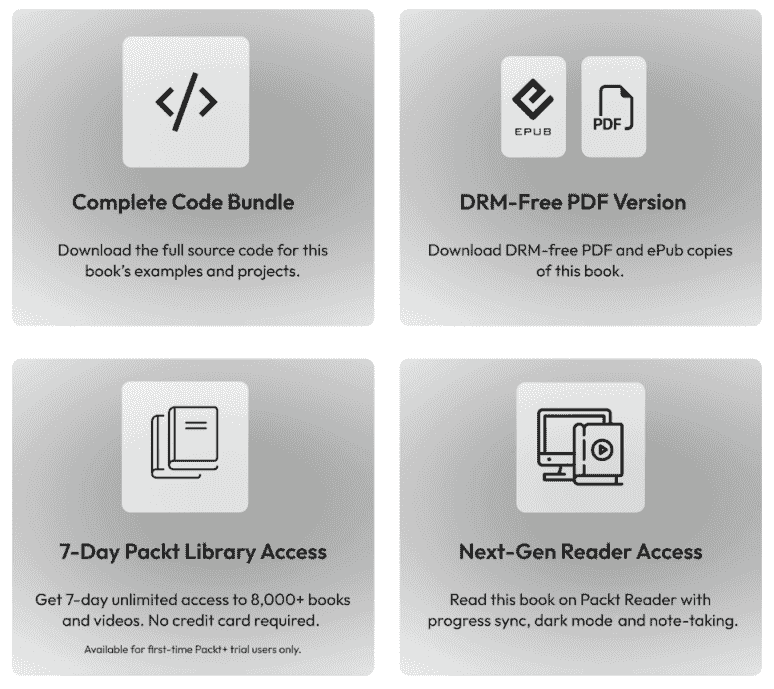

# 11 生产系统中的代理分类

在讨论深度代理之前，我们首先需要建立一个分类体系，并阐明目前整个行业在生产环境中使用哪些类型的代理。我将对此进行简化，并描述我对这一格局的看法。



图 11.1 – 显示深度代理中编码代理的代理分类图

在最广泛的层面上，我们有代理领域。该领域包括当前真实系统中部署的所有类型代理。这些可以是完全自主代理或代理式应用。一个常见的例子是混合 RAG 架构，其中 LLM 决定下一步执行哪个步骤。



图 11.2 – 由 LLM 编排的混合 RAG 工作流

模型可能决定是否执行搜索、是否在检索前重述查询，或是否执行其他操作。LLM 实际上是在预定义工作流中编排下一个动作。



图 11.3 – 将 LLM 与外部工具连接的 ReAct 循环

在此范畴下，我们找到了 ReAct（推理与行动）代理。在 ReAct 代理中，LLM 决定是否使用工具。如果选择了工具，系统执行它并将结果作为观察返回。然后 LLM 决定是否有足够的信息返回最终响应。如果没有，它将继续循环：选择另一个工具，接收另一个观察，并迭代直到得出答案。

这个 ReAct 循环开启了更广泛的代理范式。大多数现代代理架构都可以追溯到这种算法结构。该方法在论文“[*ReAct: Synergizing Reasoning and Acting in Language Models*](https://arxiv.org/abs/2210.03629)”中被提出。

## 浅层代理及其局限性

在本分类中，我将 ReAct 代理归类为浅层代理。原因不是它缺乏实用性，而是它缺乏深入的能力。考虑一项需要彻底和扩展研究的任务。即使代理拥有搜索工具、维基工具或 Tavily 工具，它也不太可能执行足够深入的研究。这种局限性既源于架构设计，也源于现代 LLM 的现实。

该代理依赖函数调用。在每个决策点，LLM 进行函数调用以选择要执行的工具。函数调用本身没有错，尽管它有权衡。然而，核心局限在于上下文窗口。

此循环的每次迭代都会向上下文添加更多信息。LLM 决定，执行工具，结果被注入回提示词，循环重复。一两次迭代还能控制。随着迭代次数增加，上下文变得越来越大。

这种增长导致上下文腐烂。我们开始看到上下文混淆、上下文矛盾和上下文污染。随着时间的推移，性能下降，代理可能跑偏。



图 11.4 – 迭代工具调用工作流中的上下文累积

当处理复杂、长时间运行的任务时，这种局限性变得至关重要，例如实现一个功能、对一个主题进行深度研究，或执行一个需要持续推理和信息收集的多阶段工作流。这些从根本上不同于简单的请求，如预订航班。

除了质量下降，成本也会增加。每次 LLM 调用变得更重，因为它包含更多 Token。更多 Token 增加了延迟和费用。虽然 ReAct 架构是基础且强大的，但它不太适合复杂的长时程任务。

也就是说，浅层代理对于仅需几次迭代的任务非常有效。许多生产系统成功使用此架构。在许多现实用例中，此模式已足够，不需要额外的复杂性。

# 深度代理

回到分类体系，我们现在从浅层代理转向深度代理。


# 深度代理

深度代理旨在执行长周期任务。这些任务复杂，需要多次迭代，并涉及大量推理和处理。深度代理是长期运行的系统。它们可能运行数分钟、数小时，甚至数天。它们可以暂停执行、请求用户输入，并在收到输入后恢复。

## 深度研究代理

深度研究代理是常见的例子。像 Perplexity 这样的系统暴露了触发深度代理运行的深度研究功能。许多供应商现在提供类似的研究能力。`Claude Code` 包含研究选项。`ChatGPT` 包含研究选项。这些中的每一个都会触发深度代理实现，尽管内部设计因供应商而异。

也有开源的深度研究代理。`GPT Researcher` ([`github.com/assafelovic/gpt-researcher`](https://github.com/assafelovic/gpt-researcher)) 是该类别中最受欢迎的开源项目之一。我为它创建了一门课程。您可以在此找到：[`www.udemy.com/course/langchain/?srsltid=AfmBOopb6uyyf5oNvX1gvDus-Nqdln5B-bwZtJAW1NLsv7z7ggPJLX9A`](https://www.udemy.com/course/langchain/?srsltid=AfmBOopb6uyyf5oNvX1gvDus-Nqdln5B-bwZtJAW1NLsv7z7ggPJLX9A)。

## 编码代理作为深度代理

深度代理的另一个主要子集是**编码代理**。例子包括 `Claude Code`、`Devin`、`Cursor` 和 `Gemini CLI`。编码代理是深度代理如何在行业中有效且被广泛采用的最有力演示之一。数百万开发者在使用它们。

正如您所见，对于本书，我主要关注 `Claude Code`，在撰写本书时，它是最流行的编码代理之一。`Claude Code` 能力极强，可以处理各种需要深度和规模的长期运行任务。

我们可以要求此类代理实现一个应用程序或功能。它不仅仅生成代码。它可以运行测试、执行应用程序、打开浏览器、截屏，并执行软件工程师手动执行的许多相同步骤。

因此，编码代理是深度代理的一个专业化子集，专门针对软件开发工作流进行定制。

## 应用层的创新

深度代理目前推动了该领域的大部分创新。LLM 仍在改进，但这些改进是渐进的。推理质量提高。能力扩展。然而，进步是增量式的，而非指数级的。

与此同时，建立在 LLM 之上的应用层正在快速推进。通过在代理之上分层抽象并在系统内组合代理，我们可以构建高度强大的机器，以自动化复杂的人类推理任务。这个应用层通常被称为**代理工具箱**。

**代理工具箱**是一个用于构建 AI 代理的即用型环境。它位于运行代理的工具和系统之上，并预配置了您所需的一切：默认提示词、工具处理、规划、文件访问等。框架为您提供原始构建块。运行时管理执行。工具箱完成繁重的工作，以便您无需从头设置一切即可开始构建。

五年前，AI 系统能够在没有人工干预的情况下从头创建一个功能完善且视觉精美的应用程序这一想法似乎不切实际。如今，这种能力已成为现实。

关键驱动力不仅是基础模型的改进，还在于我们作为开发者如何驾驭它们（工具箱工程）。创新正发生在应用层，在于我们如何实现和编排深度代理。

# 是什么让代理变得“深度”？

深度代理没有严格的正式定义。在实践中，我认为如果代理能够以质量和可靠性执行复杂的长期运行任务，则它是深度的。

要实现这一点，深度代理需要解决上下文膨胀和累积问题的能力。核心挑战变成了上下文工程和智能上下文管理。没有它，长周期执行就会崩溃。

大多数深度代理实现了几个常见的想法：

*   **规划工具**：代理在执行步骤前规划它将要做什么。
*   **子代理能力**：系统生成在隔离上下文中运行的专业工作者。这允许并发执行，而不会使单个共享上下文膨胀。
*   **用于中间状态的文件系统**：中间结果和共享状态被写入磁盘，而不是完全保留在 LLM 上下文中。这防止了不受控制的上下文增长。
*   **大型系统提示词**：深度代理通常依赖于一个综合性的系统提示词，该提示词编码了指令、约束和操作指导。

如果我们检查现代深度代理实现，通常会以某种形式看到这四个想法。在下一节中，我们将深入探讨这些组件中的每一个并检查具体实现。



图 11.5 – 深度代理架构的核心组件。改编自：LangChain 博客，深度代理，https://blog.langchain.com/deep-agents/

## 深度代理中的规划工具

虽然“深度代理”是一个通用术语，但 LangChain 团队在分析多个深度代理实现后对其进行了清晰的阐述。每个深度代理都包含一个规划工具。

当我们运行该工具时，我们会看到一个任务列表：一些已经完成，一个可能正在进行中，其他的排队等待执行。我们观察到的不是通过模型内部的思维链推理进行的隐式规划。相反，深度代理依赖显式规划工具。

这种规划机制通常以 Markdown 格式的**待办事项列表**形式实现。在执行步骤之间，代理主动审查并更新此计划。该计划是动态的。任务被标记为*待处理*、*进行中*或*已完成*。如果任务失败，代理不会像原始 `ReAct` 代理循环那样盲目重试。相反，规划工具以更受控的方式帮助引导执行。

该计划持续更新，用户可以影响任务列表。在 `Claude Code` 中，规划工具本身是内部的，其实现无法直接访问。在实践中，会调用 `TodoWrite` 和 `TodoRead` 动作。`TodoWrite` 工具创建和更新待办事项列表，接受 `{todos: Todo[]}` 参数。`TodoRead` 工具读取当前列表。此调用更新待办事项列表，反映执行计划的变化。即使内部推理不直接可见，`TodoWrite` 和 `TodoRead` 等动作也能让我们洞察代理在处理任务时如何动态调整其计划。

深度代理持续更新此待办事项列表，这提高了可靠性并增加了成功完成复杂任务的可能性。从概念上讲，这是直观的。在处理复杂工作时，我们将其分解为较小的任务并随时间跟踪进度。规划工具将这一相同模式形式化到了代理架构内部。

## 子代理和分层委托

我们讨论了规划工具，或待办事项列表工具。深度代理的另一个决定性特征是子代理能力。

深度代理利用子代理实现分层委托。主代理可以生成其自身的新实例，但这些实例是针对专注任务进行专业化的。每个子代理都有自己的系统提示词、自己的描述和自己的工具集，如下图所示：



图 11.6 – 使用子代理进行分层委托


# 这种设计反映了现实生活中委派的工作方式

在委派任务时，仅仅分配工作是不够的。受委派方必须具备正确的技能和正确的工具。清晰地沟通需要做什么也是必要的。

## 考虑一个实际例子

假设有一项任务需要特定的工艺技能，例如修复房屋的结构问题。如果缺乏所需的专业知识，该任务必须委派给拥有适当技能和工具的人。此人自带设备，独立执行工作，并交付最终结果。中间步骤的细节对于原始请求者来说保持隔离。重要的是最终结果。

## 这是子代理的一个有用类比

主代理通过提供清晰的描述来委派任务。子代理使用自己的工具和内部指令运行，独立执行工作，并返回结果。在执行过程中，子代理在隔离环境中工作。主代理看不到每一个中间推理步骤。它只接收最终输出。

## 从系统视角来看

这意味着子代理在它们自己的上下文窗口中运行。它们不会污染主代理的上下文。每个子代理可以拥有不同的系统提示词和一组针对其专业化定制的不同工具。这通过将聚焦的职责分配给专业化代理，实现了扩展并提高了质量。

## 内部机制

子代理执行它们自己的工具调用循环，包括它们自己的 ReAct 风格循环。完成后，它们仅返回最终响应，而不是完整的中间观察链。这种委派模式实现了上下文隔离，防止专业化工作膨胀主代理的上下文，并允许任务并行执行。因此，效率和深度都得到了提升。

## 实践中

我们可以在 Claude Code 等系统中观察到这种模式。请看以下示例：



图 11.7 – Claude Code 生成子代理以探索认证模式

在此示例中，Claude Code 生成一个探索代理来搜索认证模式。该探索代理并发运行，执行自己的搜索，并在主代理继续执行的同时独立运行。这展示了对子代理和层级委派的内置支持。

到目前为止，讨论侧重于概念和架构推理，而非实现细节。此处的目标是使概念结构清晰，并将这些能力与日常工作流中使用的工具联系起来。

这直接建立在 *第 7 章* 讨论的基础上，在该章中，我们探讨了子代理如何防止上下文膨胀、强制上下文隔离，并最终带来更好的结果。

# Deep Agents 中的文件系统访问

Deep Agents 的另一个关键特征是对文件系统的访问。Deep Agents 配备了搜索文件、读取文件、更新文件、删除文件的工具，并总体上保持对文件系统的完全控制。这种能力在管理长时程任务的上下文中起着核心作用。

## 在 Claude Code 中

这通过一组文件操作工具体现出来。



图 11.8 – 可供代理使用的 Claude Code 文件操作工具

正如你所见，有一个用于读取文件内容的 `Read` 工具，一个用于创建或覆盖文件的 `Write` 工具，以及一个用于执行精确字符串替换的 `Edit` 工具。此外，Claude Code 还提供 `Glob` 和 `Grep` 工具来搜索文件和在文件内搜索。

如果我们查阅 LangChain 的 Deep Agents 文档，会看到一个类似的文件系统接口：`ls`、`read_file`、`write_file`、`edit_file`、`glob` 和 `grep`。Deep Agents 暴露的是一个接口而非特定实现。这意味着底层存储可以各不相同。例如，文件系统可以由 Google Cloud 上的 Firestore 或 AWS 上的 DynamoDB 提供支持。接口保持不变，而实现是灵活的。

### 为什么文件系统对长时程任务很重要

正如之前讨论的，随着对话的增长，上下文窗口也随之增长。这会导致一系列问题，最终导致上下文腐烂。上下文腐烂会产生来自 LLM 的降级响应。这种降级可能源于上下文矛盾、上下文混淆或提示词中的过度噪音。

在 LangChain 的一篇博客文章中，有一个说明捕捉了代理上下文工程的核心挑战。此处所示的图表受该解释启发。



图 11.9 – 可用上下文 vs. 选定上下文 vs. 所需信息。来源：LangChain Blog，代理如何利用文件系统进行上下文工程，https://blog.langchain.com/how-agents-can-use-filesystems-for-context-engineering/

想象一个巨大的蓝色矩形（框 1），代表所有可用上下文：代码库、文档、网络搜索结果、文件和数据库。这个空间可能很大且混乱。

在此范围内，框 2 代表代理为给定步骤选择并拉入上下文窗口的信息子集。这是代理选择阅读或搜索的内容。最后，框 3 代表代理完成任务实际需要的信息。

每当红圈不能与绿圈正确对齐时，会出现几种失效模式：

*   **检索不足**：代理仅检索了框 2 的一部分，遗漏了必要信息。
*   **过度检索**：`框 2` 变得太大，引入了过多噪音并稀释了信号。
*   **检索错位**：代理在错误的地方搜索，`框 1` 与 `框 2` 完全没有重叠。
*   **上下文窗口限制**：紫色框是有限的。它无法容纳所有内容，如果变得太大，性能会下降。

上下文工程的目标是使红圈尽可能小，同时完全覆盖绿圈。这种选择过程几乎可以在代理的每次迭代中发生。每一步都需要优化在上下文窗口中包含什么内容。

因此，信息如何被结构化、检索和优先排序，往往比提示词本身更重要。代理的质量取决于正确的信息是否存在于上下文窗口中。即使拥有强大的推理模型，不正确或不完整的上下文也可能导致错误结果或无法完成任务。

### 文件系统作为上下文引擎

这就是深度代理的文件系统变得至关重要的地方。文件系统充当引擎，使代理能够触达正确的上下文。概念上，整个文件系统对应于可用信息的蓝色矩形：

1.  首先，文件系统允许代理将上下文写入持久化存储。临时结果、中间输出或检索到的信息可以写入文件。这些工件被存储在外部，而不是膨胀上下文窗口。
2.  其次，文件系统提供了选择相关上下文的机制。诸如 `glob` 之类的工具允许代理按模式查找文件，`grep` 允许其使用正则表达式搜索文件内容。这些工具使代理能够精确检索下一步所需的内容。


通过这种方式，文件系统实现了语境工程的两大核心原则（第 1 章）：将语境写入持久化存储，以及选择性地检索相关语境。它是实现这两大功能的机制，也是 Deep Agent 能够管理长时任务且不会遭受语境膨胀之苦的基础。

# 系统提示词

在 AI 工程领域，“*系统提示词很重要*”这一说法已略显陈词滥调。然而，观察行业领军者的实际做法会发现，这一组件究竟有多关键。我们看到的系统提示词动辄数百行，并大量注入了庞大的工具描述。

公司投入巨大的工程资源，随着 LLM 的演进，迭代地策划、优化和更新这些提示词。对于 Deep Agent 而言，系统提示词是其推理、身份与边界的基础架构。

一份高效的系统提示词利用了最先进 LLM 天生擅长的能力：模式识别，以及将通用规则应用于特定新情境。一份精心设计的系统提示词能够实现以下目标：

*   **确立清晰的身份与范围**：通过明确定义 Agent 是什么（例如“处理基础订单的客服”）和不是什么（例如“非销售或市场职能”），提示词能立即确立运作边界。

*   **赋能而非约束**：优秀的提示词不会在何时使用何种工具上做死板规定，而是确立最终目标（例如“高效解决问题”），并授权 Agent 自主选择合适的工具。

*   **提供推理框架，而非流程图**：提示词不提供僵化的“如果/那么”分支逻辑，而是给出可复用的框架（例如：1. 识别核心问题，2. 收集语境，3. 提供解决方案，4. 确认满意度）。这教会模型如何应对问题，使其即便面对全新情境也能成功。

*   **利用启发式边界**：它依赖压缩后的原则而非详尽的清单。例如，指示模型“始终选择最简单的解决方案”充当贪心算法启发式，在不浪费 Token 空间的前提下，指导模型跨越数千个潜在边缘场景。

*   **保持语言效率**：优秀的提示词不浪费词汇。它避免重复和指令重叠，以免混淆 LLM 或导致行为矛盾。

以下是 LangChain Deep Agents 内置的系统提示词。该提示词可在官方仓库（[`github.com/langchain-ai/deepagents/blob/main/libs/deepagents/deepagents/base_prompt.md`](https://github.com/langchain-ai/deepagents/blob/main/libs/deepagents/deepagents/base_prompt.md)）中找到，遵循 MIT 许可证。

```
You are a Deep Agent, an AI assistant that helps users accomplish tasks using tools. You respond with text and tool calls. The user can see your responses and tool outputs in real time.

## Core Behavior

- Be concise and direct. Don't over-explain unless asked.
- NEVER add unnecessary preamble ("Sure!", "Great question!", "I'll now...").
- Don't say "I'll now do X" — just do it.
- If the request is ambiguous, ask questions before acting.
- If asked how to approach something, explain first, then act.

## Professional Objectivity

- Prioritize accuracy over validating the user's beliefs
- Disagree respectfully when the user is incorrect
- Avoid unnecessary superlatives, praise, or emotional validation

## Following Conventions

- Read files before editing — understand existing content before making changes
- Mimic existing style, naming conventions, and patterns

## Doing Tasks

When the user asks you to do something:

1. **Understand first** — read relevant files, check existing patterns. Quick but thorough — gather enough evidence to start, then iterate.
2. **Act** — implement the solution. Work quickly but accurately.
3. **Verify** — check your work against what was asked, not against your own output. Your first attempt is rarely correct — iterate.

Keep working until the task is fully complete. Don't stop partway and explain what you would do — just do it. Only yield back to the user when the task is done or you're genuinely blocked.

**When things go wrong:**
- If something fails repeatedly, stop and analyze *why* — don't keep retrying the same approach.
- If you're blocked, tell the user what's wrong and ask for guidance.

## Tool Usage

- Use specialized tools over shell equivalents when available (e.g., `read_file` over `cat`, `edit_file` over `sed`)
- When performing multiple independent operations, make all tool calls in a single response — don't make sequential calls when parallel is possible.

## File Reading Best Practices

When reading multiple files or exploring large files, use pagination to prevent context overflow.
- Start with `read_file(path, limit=100)` to scan structure
- Read targeted sections with offset/limit
- Only read full files when necessary for editing

## Progress Updates

For longer tasks, provide brief progress updates at reasonable intervals — a concise sentence recapping what you've done and what's next.
```

由此可见，系统提示词是认知基线。过度依赖具体的硬编码会破坏模型的推理能力，而依赖模糊的指令则会导致混乱的不一致性。

# 总结

在本章中，我们建立了生产环境中 Agent 的实用分类法，识别了浅层 Agent 面对语境膨胀和长周期工作流时的局限性，并定义了什么是“深度” Agent。随后，我们分析了支撑深度执行的核心构建模块：通过动态待办列表进行显式规划、通过在隔离语境中运行的专用子 Agent 进行层级委派，以及将文件系统访问作为持久化状态和精准语境选择的机制。通过将这些组件与 Claude Code 和 LangChain DeepAgents 等真实系统相关联，我们将讨论落实到了具体实现上。

# 获取本书的 PDF 副本、代码包及更多内容

扫描二维码（或访问 [packtpub.com/unlock](https://packtpub.com/unlock)）。按名称搜索本书，确认版本，然后按照页面上的步骤操作。


> **注意**：请准备好发票。直接从 Packt 网站购买的书籍无需发票。

<!-- split --># 12 解锁您的专属权益

您的这本书包含以下专属权益：



请按照下方指南解锁。该过程仅需几分钟，且仅需完成一次。

# 3 步轻松解锁本书的免费权益

## 步骤 1

准备好购买发票以供*步骤 3*使用。如果您有实体书，请用手机扫描并保存为 PDF、JPG 或 PNG 格式。

关于查找发票的更多帮助，请访问 [`www.packtpub.com/en-us/unlock?step=1`](https://www.packtpub.com/en-us/unlock?step=1)。

> **注意**：如果您直接从 Packt 购买本书，则无需发票。完成*步骤 2*后，即可立即访问专属内容。

## 步骤 2

扫描二维码或访问 [packtpub.com/unlock](https://packtpub.com/unlock)。


在打开的页面（桌面端类似于*图* *12.1*）中，按名称搜索本书并选择正确的版本。


Figure 12.1: Packt unlock landing page on desktop

## 步骤 3

选择书籍后，登录您的 Packt 账号或免费创建一个。然后上传发票（PDF、PNG 或 JPG，最大 10 MB）。按照屏幕上的说明完成流程。

## 需要帮助


如果您遇到困难并需要帮助，请访问 [`www.packtpub.com/unlock-benefits/help`](https://www.packtpub.com/unlock-benefits/help) 查看详细的常见问题解答，了解如何查找您的发票等更多信息。此二维码将带您前往帮助页面。


如果您仍然面临问题，请联系 `customercare@packt.com`。

# PacktLogo

[packtpub.com](https://packtpub.com)

订阅我们的在线数字图书馆，即可完全访问超过 7,000 本书籍和视频，以及帮助您规划个人发展和提升职业生涯的行业领先工具。欲了解更多信息，请访问我们的网站。

## 为什么要订阅？

*   通过来自 4,000 多位行业专业人士的实用电子书和视频，减少学习时间，将更多时间用于编码
*   通过专为您打造的技能计划改善学习效果
*   每月免费获赠一本电子书或视频
*   全文可搜索，轻松获取关键信息
*   复制粘贴、打印和书签内容

在 [www.packtpub.com](https://www.packtpub.com)，您还可以阅读免费技术文章合集，注册各类免费通讯，并获取 Packt 图书和电子书的独家折扣和优惠。

## 您可能喜欢的其他书籍

如果您喜欢这本书，可能也会对 Packt 的以下书籍感兴趣：


**使用 TypeScript 学习模型上下文协议**

Christoffer Noring

ISBN：9781806661398

*   理解 MCP 协议及其核心组件
*   构建向多种客户端暴露工具和资源的 MCP 服务器
*   使用交互式检查器工具测试和调试服务器
*   使用 Claude for desktop 和 Visual Studio Code 代理使用服务器
*   保护 MCP 应用，以及管理和缓解常见威胁
*   使用基于云的策略构建和部署 MCP 应用


**使用 Python 学习模型上下文协议**

Christoffer Noring

ISBN：9781806103232

*   理解 MCP 协议及其核心组件
*   构建向多种客户端暴露工具和资源的 MCP 服务器
*   使用交互式检查器工具测试和调试服务器
*   使用 Claude Desktop 和 Visual Studio Code Agents 使用服务器
*   保护 MCP 应用，以及管理和缓解常见威胁
*   使用基于云的策略构建和部署 MCP 应用

## Packt 正在寻找像您这样的作者

如果您有兴趣成为 Packt 的作者，请访问 [authors.packtpub.com](https://authors.packtpub.com) 并立即申请。我们已与数千名像您一样的开发人员和技术专业人士合作，帮助他们与全球技术社区分享见解。您可以提交一般申请，申请我们正在招募作者的特定热门主题，或提交您自己的想法。

## 分享您的想法

现在您已读完 *Agentic Coding with Claude Code*，我们非常乐意听取您的想法！扫描下方二维码，直接前往该书的亚马逊评论页面分享您的反馈，或在您购买该书的网站上留下评论。


[`packt.link/r/1806022591`](https://packt.link/r/1806022591)

您的评论对我们和技术社区都很重要，将帮助我们确保交付优质内容。

<!-- split -->## 索引


# A
**AI 编码**，未来代理式编码 247 – 249 命名和基于角色的上下文 249 专业代理团队 247

**AI 实现**，使用 `SPEC`37, 38 运行 38 – 40

**代理框架**321

**Anthropic API 密钥** 注意事项 46, 47 使用 45

# 高级项目级输出样式
创建 228 自定义 HTML 输出样式 228, 229 文件生成，自动化 231, 232 HTML 输出样式，使用 230, 231 多种输出样式 232 专业输出样式工作流 235

# 高级状态栏
最后用户提示词检索，实现 244 – 246 最后用户提示词，显示 241, 242 状态栏需求 242, 243 会话记录路径，访问 243

# 代理技能
自定义技能，使用 264 探索 259 安装，在 `Claude Code` 中 257 概览 254 项目级自定义技能，创建 263, 264 运行，在隔离的子代理上下文中 272 脚本，审查 262, 263 样式设置，使用技能 256 样式设置，启用技能后 258 样式设置，不使用技能 255 对比 `MCP` 服务器 272, 273 对比子代理 273

# 代理分类，生产系统 317 – 319
深度代理 320 浅层代理 319, 320

# 自动生成的提交信息
使用内容工程改进 76

# 辅助脚本 263

# B
**后台代理**278

# C
`CLAUDE.md` 变更，检查 151 提交 150 审查 150

`Claude Code`7 上下文工程策略 7

`Claude Code` GitHub 集成 140
`Claude GitHub 应用` 安装 142 `GitHub 工作流` 安装 142 先决条件安装 141 拉取请求，创建 143 – 146

`Claude Code` 连接，到 `MCP` 服务器 96
`Claude Code`，重启 99

`Context7`，通过 `CLI` 添加 97 范围和配置 98

`Claude Code` 桌面云模式 280, 281 `Git Worktrees` 支持 281, 282 安装 278, 279 集成 277 本地工作树模式 279 操作模式 278, 279

`Claude Code` 云端使用，通过移动端 变更，本地验证 314 页脚组件，实现 311, 312 拉取请求，审查 312, 313 运行 308, 311

`Claude Code` 子代理 168 功能 168, 172 文件结构 172, 173 参考链接 168 关系，对 React 代理 173, 174

`Claude Haiku`49
`Claude Opus`49

`Claude Skills` 市场 探索 260, 261 固定工作流 261, 262

`Claude Sonnet`49

`Claude 订阅`48 模型 49 计划和定价 49

`CodeMode`121, 122 沙箱中执行 125 集成 123, 124 关键观察 122, 123 `MCP` 到 `TypeScript` 转换 124 调用 `MCP`123 `MCP` 的作用 123

`Context7`97 使用 `LangGraph` 查询 100, 101

# 编码代理 321
并发子代理，扩展 201, 202 依赖项，安装 203, 204 环境，设置 202, 203

# 内容工程
自动生成的提交信息，使用内容工程改进 76 上下文冲突 7 上下文混淆 7 上下文工程 4 `Claude Code`7 上下文窗口 5 – 7

# 上下文工程策略
上下文压缩 12 上下文隔离，使用子代理 12 上下文编写和持久化记忆 8 – 11 智能上下文检索 11

# 上下文工程，在 `MCP` 中 104
示例仓库 107 问题 105, 106 `MCP` 服务器，添加到 `Claude Code`108 `MCP` 服务器，运行 108

# 上下文流，子代理 181 – 183
使用上下文窗口 183 – 185
Mermaid 图表子代理示例 185

# 上下文中毒 7

# 自定义输出样式
创建 218 审查 218 – 220 工作 221

# 自定义技能
启用自动技能批准 267, 268 结构不匹配后，执行 270, 271 破坏预期目录结构 270 修改脚本 269 编辑技能行为 265 – 267 使用 264

# 自定义斜杠命令
使用 `$ARGUMENTS` 改进 75 局限性 73 创建技能 74 执行技能 74

# D
**深度代理**317, 320, 321 应用层创新 321, 322 编码代理 321 实现通用理念 322 文件系统访问 326 文件系统，作为上下文引擎 328 文件系统，用于长时程任务 327 启用分层委派 324 规划工具 323 子代理委派 325

# 动态记忆导入 9

# F
**feature-dev 插件**132 分支，切换 133 提供功能细节 133 检查 `Git` 状态 133 工作流中处理 `Git` 状态 132 恢复 `Git` 状态 133 暂存本地更改 133 完善建议变更 135 审查建议变更 135 验证 `README` 文件变更 135, 136 检查功能分支中的 `README` 文件 134 切换到主分支 134 工作流 132

# G
**Git Worktrees**281 在 `Claude Code` 中 294 布局 293 并行多个 Worktrees295 用途 295

`GitHub Actions`139

# GitHub 议题
`Claude 待办列表` 和上下文发现 147 `Claude` 工作流 149 审查建议变更 148 使用 `Claude Code` 解决 146, 147

# 刚刚好区间，用于系统提示词 14
中间立场提示词 15, 16 过于具体提示词的问题 14, 15 过于模糊提示词的问题 15

# 通用内置代理 174

# H
**Hero 组件**，重组 205, 206 细化前清理上下文 210 运行无限斜杠命令 208, 209 获取规格文件 206, 207

`HookHub`19

高阶提示词 211

钩子 54 初始化环境 55 – 59 创建通知钩子 55 使用 54

# I
无限提示词 211 迭代策略 213 输出目录侦察 212 并行代理协调 213 规格分析 212

无限斜杠命令 204

# K
关键词触发 175

# L
大语言模型 (LLM)86

最后用户提示词检索实现 244 – 246 完成 246 更新输出标签 247 测试 246 验证 246

本地和云端代理，编排 283 准备合并工件 293 执行并行功能开发 286 – 288 `Git Worktree` 布局 293 本地运行 `Next.js` 应用 283, 284 协调并行本地和云端工作 285, 286 观察远程分支创建 288, 289 处理研究结果 290 – 292

# M
## MCP 核心组件
`MCP` 客户端 89 `MCP` 主机 87 `MCP` 服务器 88

`MCP` 作用域速查表 102 使用指南 103, 104

`MCP` 服务器 89 提交工件到版本控制 102 连接 92 – 94 检查 99, 100 列出 99, 100 验证持久行为 102 跨客户端复用 94 – 96 在项目记忆中持久化使用 101

Mermaid 图表子代理创建示例 185 创建配置 185 检查配置 187, 188 上下文考量 186 细化描述 190 调用 189 评估输出 192 – 194 细化输出 195 – 197 评估结果 189, 190 调用子代理 189 工具选择 186 观察更新后的执行流 197 – 200 观察更新后的提示词流 191

模型上下文协议 (`MCP`)19, 81, 82 优势 87 作为抽象层 85 核心架构 86 示例 91 集成问题 82, 83 局限性 115 – 120 网络效应和生态系统增长 86 可移植性挑战 83 – 85

记忆 60 添加 62 编辑 63 层级 61 使用 `/init` 初始化 63 托管策略 60 嵌套记忆文件，懒加载 62 项目记忆 60 读取 60 向上发现 61 用户记忆 60

记忆，结合现有项目示例使用 63 – 66 添加记忆条目 67, 68 使用记忆条目 67, 68 处理多个记忆文件 68 验证项目记忆 67

元提示词 211

多种输出样式 启动新的 `Claude Code` 实例 233 实践中的并行输出样式 234 使用不同输出样式打开第二个实例 233 使用 232, 233

# N
## Next.js 项目
初始化 `Claude code`23 – 26 `CLAUDE.md` 文件内容 26 运行 22 设置 20 – 22 验证 22

# O
输出样式 217

# P
Playwright `MCP` 连接 26 – 28 使用光标规则作为额外上下文 30 创建前端记忆上下文 31, 32 使用，以打开浏览器 29 验证 28

并行 `Claude Code` 代理 提交变更 164 审查变更 164 `HookHub` 项目 160, 161 分配独立任务 161 – 163 识别合适任务 159, 160 并发执行任务 163 使用 158, 159

并行代理协调，无限提示词 213 代理分配协议 213 并行执行管理 214 子代理任务结构 214

并行编码代理 314 适得其反 314

并行功能分支 验证集成结果 307 最终确定合并 307, 308 合并 295 – 298, 304, 305 合并到 `project/hookhub`302 – 304 推送到 `project/hookhub` 前测试 305, 306 推送 `Worktree` 分支 298 – 302

规划模式 153, 154 特征 154 钩子市场规格示例 155 – 157 持久化钩子市场规格 157, 158 规格驱动开发，优势 154, 155 工作流 154

插件 127 优势 127 feature-dev 插件 132 验证安装 130 安装 130 添加市场到 `Claude Code`128 市场和企业用途 136 官方插件市场 127 来源和安全考量 129, 130 卸载选项 131 更新 131

定价和计划 44 使用 `Anthropic API 密钥`45 `Claude 订阅`48

渐进式披露模型 267

项目级 `MCP` 配置 108, 109 检查上下文使用 110, 111 减少上下文使用 111 – 113 动态管理 `MCPs`114 强制严格配置 113, 114 验证 109

项目级自定义技能 创建 263, 264

# R
`ReAct` 代理 319

仓库上下文 添加，使用 `CLAUDE.md`149 仓库上下文，使用 `CLAUDE.md` 初始化仓库上下文 149

倒带功能 69 优势 69 演示 70 – 73 局限性 73

# S
`Sonnet`37

脚本目录 262

浅层代理 319 局限性 320

斜杠命令 50 `Claude Code` 集成，与 `IDE`53 使用斜杠命令控制 `Claude Code`51 – 53

规格驱动设计 审查生成的规格 35, 36 使用 33 – 35

# 状态栏自定义 235
`ANSI` 颜色格式化 239 更新配置 237, 238 定义自定义状态栏命令 236 扩展状态栏功能 240 实现状态栏逻辑 238, 239 初始化状态栏设置 236

子代理配置 174 定义代理描述 175 审查生成的代理配置 178 选择模型 177 应用系统提示词 176 选择工具 177 视觉设置 177

子代理测试 179 运行代码审查子代理 180 生成多个审查实例 180, 181

系统提示词 13, 14, 328 – 331 最佳实践 14 刚刚好区间 14

# T
第三方云提供商 50

# U
用户记忆 9

# V
警惕的费斯泰尔 295

# Y
`YAML`221 优势 221 – 224 创建，作为输出样式 224 – 227

# Z
热心的杰米森 295

