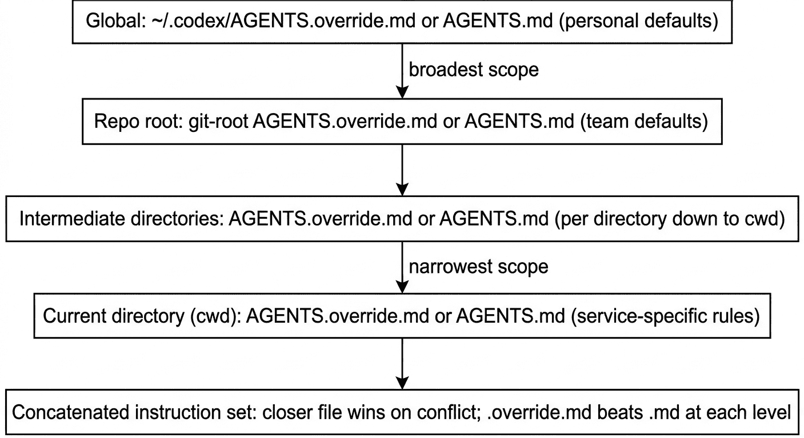

# 第四章：AGENTS.md：模式与陷阱

在 *第 3 章* 中，你学习了如何编写提示来引导 Codex CLI 完成单个任务：清晰地界定目标，提供正确的上下文，限定范围。这项技能很重要，但提示是易失的。每个新会话都从空白开始，如果你的团队发现 Codex CLI 提交前需要运行 `make test`，或者绝不能触碰 `src/generated/` 下的生成文件，就得有人每次都记得说一遍。将这乘以十名工程师每天运行数十个 Codex CLI 会话，Codex CLI 默认行为与项目实际需求之间的鸿沟就会成为每天的摩擦来源。

`AGENTS.md` 弥合了这一鸿沟。它是一个你提交到代码仓库、或存放在主目录作为个人默认值的 Markdown 文件，Codex CLI 在每次会话开始时会自动读取它。不妨将其视为 AI 协作者的成文宪法：无论你要求什么任务，都适用的固定规则、项目约定和硬性限制。*第 3 章* 关注单个提示的艺术，而本章关注的是让每个提示都变得更好、且无需重复的基础设施。

### 学习目标

你将能够：

1.  使用本章提供的初始模板从头编写一个完整的 `AGENTS.md`
2.  使用分层 `AGENTS.md` 文件构建单体仓库，使每个服务或包都能获得精准所需的指令
3.  诊断规则为何不生效并追踪活跃的指令链
4.  在不破坏依赖行为的前提下精简臃肿的 `AGENTS.md`
5.  以与生产代码相同的版本控制纪律对待指令文件
6.  在更广泛的 `.md` 文件生态系统（`AGENTS.md`、`DESIGN.md`、`SKILL.md`、`SOUL.md`）中定位 `AGENTS.md`，以实现全面的智能体配置

### AGENTS.md 是什么以及 Codex CLI 如何读取它

`AGENTS.md` 是一个纯 Markdown 文件。Codex CLI 不对其施加任何模式要求；任何合法的 Markdown 皆可。其特殊之处在于 Codex CLI *何时* 以及 *如何* 读取它：在你的提示之前，自动地，在每次运行时。^(³⁸)

#### 发现链

Codex CLI 通过从最宽泛的作用域向最狭窄的作用域遍历文件系统，拼接沿途发现的每一个 `AGENTS.md` 来构建其指令集。完整的解析顺序如下：

```
1. ~/.codex/AGENTS.override.md <- 最高优先级的全局覆盖
   或 ~/.codex/AGENTS.md <- 标准全局默认值
2. <git-root>/AGENTS.override.md <- 仓库覆盖（优于仓库 AGENTS.md）
   或 <git-root>/AGENTS.md <- 标准仓库规则
3. <intermediate-dirs>/AGENTS.override.md <- 根目录与当前目录之间每个中间目录
   或 <intermediate-dirs>/AGENTS.md
4. <cwd>/AGENTS.override.md <- 调用 Codex CLI 的目录
   或 <cwd>/AGENTS.md
```

拼接顺序意味着：当内容冲突时，距离更近的文件优先于距离更远的文件。你主目录下的 `AGENTS.md` 设定个人默认值；仓库根目录下的 `AGENTS.md` 设定团队默认值；子目录下的 `AGENTS.md` 设定特定服务的规则。每一层都可以在上层基础上增加、收紧或覆盖任何内容。



**图 4.1 - AGENTS.md 发现链**

AGENTS.md 发现链的自顶向下流程图。Codex CLI 从最宽泛的作用域遍历到最狭窄：`~/.codex` 下的全局文件，然后是 Git 根目录下的仓库根文件，接着是任意中间目录文件，最后是当前目录文件。每一层级中 `.override.md` 变体优于普通 `.md` 变体。四个层级拼接成单一指令集，距离更近的文件在冲突时获胜。

有几个操作细节从一开始就值得了解：

1.  Codex CLI 每次运行都会重新构建此链；编辑文件后无需清理缓存。
2.  空文件会被静默跳过；它们不会重置或中断链条。
3.  所有加载文件的总大小受 `project_doc_max_bytes` 设置上限限制，默认为 32 KiB。超出该限制的文件会被静默截断。^(³⁹)
4.  同一层级的 `.override.md` 变体优于普通 `.md` 变体。

Codex CLI 解析的是 Git 根目录，而非当前工作目录，作为 **步骤 2** 的起点。如果你从 `services/payments/` 内部调用 Codex CLI，发现链从仓库根目录开始，然后向下穿过中间目录到达你的当前位置。这意味着仓库根规则始终适用，即使身处深层子目录。

### 文件长什么样


没有强制的结构要求。实践表明，效果最好的文件会被划分为少数几个重点章节，用通俗易懂的祈使语气编写，以便 Codex CLI 能够毫无歧义地遵循。以下是一个 TypeScript Web 服务的最小示例：

```
### 项目：结账服务
#### 概述
用于结账流程的 Node.js REST API。使用 TypeScript 编写，使用 Vitest 测试，通过 GitHub Actions 部署到 AWS Lambda。
#### 命令
- 构建：`npm run build`
- 测试：`npm test` （运行 Vitest；提交前必须通过）
- 代码检查：`npm run lint`
- 类型检查：`npm run typecheck`
##### 提交约定
- 使用约定式提交：`feat:`、`fix:`、`chore:` 等。
- 限定受影响的模块：`feat(cart): add coupon validation`
- 绝不直接提交到 `main` —— 始终通过 PR
#### 风格
- 已启用 TypeScript 严格模式；切勿使用 `any` 或 `// @ts-ignore`
- 导入在每组内按字母顺序排序（ESLint 强制执行此项）
- 所有异步函数显式返回 `Promise<T>`
#### 约束
- 切勿修改 `src/generated/` 下的文件 —— 它们是根据 OpenAPI 自动生成的
- 未在 PR 描述中列出的情况下，切勿安装新依赖
- 所有新端点必须在 `tests/integration/` 中包含集成测试
```

请将“命令”部分保持在文件顶部。Codex CLI 在决定如何验证自己的工作时会反复引用该部分。它找到测试命令的速度越快，就越不大可能自行编造一个。

#### 分层思维：宪章、专家、技能

扁平的 `AGENTS.md` 非常适合中小型项目。一旦代码库超过约 20,000 行，你可能会发现单个文件变得难以驾驭。三层知识架构直接映射到 Codex CLI 现有的基元。^40

| **层级** | **角色** | **Codex CLI 映射** | **加载时机** |
| --- | --- | --- | --- |
| T1：宪章 | 不可协商的规则、路由表 | `AGENTS.md` | 每次会话 |
| T2：专家 | 领域特定的专业知识 | 每个领域区域专用 `AGENTS.md` | 按任务类型 |
| T3：知识库 | 参考规范、API 文档 | MCP 服务器 | 按需查询 |

宪章（第 1 层）就是你已经熟悉的 `AGENTS.md`。它保持精简，不超过 500 行，仅包含每个会话都需要的内容：编码标准、架构边界、禁止模式，以及（至关重要的是）告诉代理何时委托给专家的路由规则。第 1 层文件内的路由表使委托变得显式：

```
#### 专家路由
| 如果任务涉及 | 首先阅读 |
|---|---|
| 支付流程、Stripe、退款 | `services/payments/AGENTS.md` |
| 认证、会话、JWT | `services/auth/AGENTS.md` |
| 数据库迁移 | `infra/db/AGENTS.md` |
| 其他任何情况 | （无专家；继续使用此文件） |
```

第 2 层存放如果内联包含会导致宪章膨胀的深度领域知识。专家文件是相关子目录中的一个 `AGENTS.md`：

```
#### services/payments/AGENTS.md
##### 范围
属于 PCI-DSS 范围。此处所有代码每年接受审计。
##### 硬性规则
- 切勿记录完整 PAN 或 CVV；仅保留后四位掩码。
- 所有金额以最小单位（分）计算；切勿使用浮点数。
- 新端点必须在 `tests/pci/` 下添加固定数据。
### 工具
- 使用 `pnpm run test:pci`（而非 `pnpm test`）；PCI 套件需要沙箱网络。
```

第 3 层将很少需要的参考资料推至 MCP 服务器后端，保持上下文窗口精简。*第 8 章* 将全面介绍 MCP。

第一天不需要具备所有三个层级。大多数项目仅靠第 1 层就能愉快地运行。

### 核心章节：提交、测试、风格

大多数高效的 `AGENTS.md` 文件都汇聚于同一组章节。这反映了仅从源代码中难以让语言模型推断出的信息类别。

#### 命令

这是**最重要**的章节。列出 Codex CLI 可能需要运行以验证其工作的每一条命令：

```
#### 命令
- 安装依赖：`npm ci`
- 构建：`npm run build`
- 单元测试：`npm test`
- 集成测试：`npm run test:integration` （需要 Docker；CI 中若不可用则跳过）
- 代码检查：`npm run lint -- --fix`
- 类型检查：`npm run typecheck`
- 本地开发服务器：`npm run dev` （端口 3000）
```

要明确说明先决条件。集成测试行中的“需要 Docker”告诉 Codex CLI 不要在 Docker 不可用的环境中运行该命令。

##### 提交约定

如果你的项目遵循提交信息格式（如约定式提交^41），请在此声明。否则，你将得到通用的提交信息：

```
##### 提交约定
- 格式：`<type>(<scope>): <description>`
- 类型：feat、fix、docs、style、refactor、test、chore
- Scope 为必填；使用模块或包名称
- 描述使用祈使语气、小写、无尾随句点
```

#### 约束与禁区

这是你防止 Codex CLI 做出初衷良好但具有破坏性更改的地方：

```
#### 约束
- 切勿修改：`src/generated/`、`schema/migrations/`、`package-lock.json`
- 未经批准切勿安装包
- 切勿更改环境变量名 —— 它们在部署配置中被引用
```

“切勿”这种措辞是刻意的。否定性指令对硬性限制更可靠。

`AGENTS.md` 不是安全边界。代理可以在提示词中被指示忽略它。对于你真正必须保护的文件，请使用文件系统权限或仓库分支保护规则。`AGENTS.md` 是指导，而非强制执行。

**供应链注入风险。** 因为 `AGENTS.md` 文件以最大信任加载并跨会话持久化，它们成为供应链攻击的诱人目标。任何在依赖解析期间执行任意代码的构建系统均存在漏洞：Go `init()`、Python `setup.py`、Node.js `postinstall`、Rust `build.rs`。^42

**防御模式：** 使用锁文件固定依赖。将 `AGENTS.md` 加入代码审查清单，并以审查 CI 配置同等严谨的态度对待其变更。考虑使用 `PreToolUse` 钩子，在会话开始时验证 `AGENTS.md` 内容是否与已知良好的哈希值匹配。*第 16 章* 深入介绍了供应链风险和验证钩子。

### 单体仓库与多服务仓库的 AGENTS.md

#### 推荐结构

```
my-monorepo/
+-- AGENTS.md <- 3-4 KiB：仓库布局、全局 CI 命令、共享约定
+-- services/
| +-- api/
| | +-- AGENTS.md <- 2 KiB：Node/TypeScript 规则、API 特定模式
| +-- payments/
| | +-- AGENTS.override.md <- 2 KiB：覆盖父级宽容度的 PCI 规则
| +-- frontend/
| +-- AGENTS.md <- 2 KiB：React 约定、Vitest 设置、CSS Modules
+-- infra/
 +-- AGENTS.md <- 2 KiB：Terraform 模式、切勿触碰状态文件
```

当 Codex CLI 在 `services/api/` 中工作时，它会加载仓库根目录加上 `services/api/AGENTS.md`：约 5 到 6 KiB 聚焦、相关的指令。它看不到 Terraform 规则或支付 PCI 约束。

#### AGENTS.md 长度限制

Codex CLI 对所有加载的 `AGENTS.md` 文件的总大小有上限。配置键 `project_doc_max_bytes` 控制此上限；默认值为 32 KiB。超出上限的部分会被静默截断，终端或日志中**无任何警告**。^43 前面展示的分层结构是主要防御手段：通过分发指令，每次调用仅加载相关子集。

静默截断意味着大型 `AGENTS.md` 底部附近的规则可能永远不会被读取。请将最重要的约束放在文件顶部，而非底部。

#### 用于 CI/CD 流水线的覆盖文件

在自动化流水线中，生成一个临时的覆盖文件：


```
cat > .codex/AGENTS.override.md << 'EOF'
#### CI Mode
- Never ask clarifying questions---make your best judgment and proceed
- Always run the full test suite before completing any task
- If tests fail, explain the failure and stop; do not attempt a fix
- Do not make commits; only propose changes as diffs
EOF
codex exec "$TASK" --sandbox workspace-write
rm .codex/AGENTS.override.md
```

`AGENTS.md` 并非 Codex CLI 独有。该规范已捐赠给 Linux 基金会旗下的 Agentic AI Foundation (AAIF)。超过 30 款 Agent 产品原生读取 `AGENTS.md`，包括 GitHub Copilot、Cursor、Gemini CLI、Jules、Windsurf、Amp、Devin、Aider、JetBrains Junie、Zed、Warp 和 Factory。社区推荐遵循 80/20 法则：将 80% 的指令写入 `AGENTS.md`，仅针对真正需要特定工具功能的部分维护专用文件。

### 常见错误

#### 诊断：规则为何不生效

你写了约束，但 Codex CLI 却忽略了它。在认定是 Bug 之前，请先检查指令链：

```
codex --ask-for-approval never \
 "List the AGENTS.md files you loaded this session, in order, with their full paths."
```

**表 4-1. AGENTS.md 常见诊断场景**

| **症状** | **可能的原因** |
| --- | --- |
| 覆盖规则不生效 | 文件名错误：应使用 `AGENTS.override.md`，而非 `AGENTS-override.md` |
| 编辑后旧规则仍然生效 | 更近的 `AGENTS.override.md` 仍在覆盖你更新后的 `AGENTS.md` |
| 文件被静默忽略 | 文件为空，或合并链已达到 `project_doc_max_bytes` 限制 |
| 规则在错误目录生效 | Codex CLI 从 Git 根目录解析；请从目标目录运行 |
| 约束生效不一致 | 规则被埋没在截断点之下 |

#### 文件为何会无限膨胀

AGENTS.md 文件一开始并不大。它们最初只有三四行。问题在于增长曲线。每当 Agent 做错事，本能反应就是添加一条指令。每次添加单看都合情合理。但合在一起却造出了另一个问题。

苏黎世联邦理工学院 (ETH Zurich) SRI 实验室的研究发现，LLM 生成的上下文文件与完全没有上下文文件相比，会使任务成功率降低 3%，同时将推理成本增加 20% 以上。人工编写的文件仅使成功率提高 4%，但成本最高增加 19%。真正能带来正面结果的内容，具体指非标准工具指令和不可推断的团队决策，而非架构概览或框架约定。

切勿在未经过彻底的逐行人工审查的情况下，提交 `/init` 或任何其他自动生成命令的输出。生成的文件听起来准确，但在你精简冗余内容之前，它们会主动损害 Agent 性能。

#### 精简清单

一次性通读你的 `AGENTS.md`，应用以下检查：

**是否关于仓库结构、架构或布局？** 删除。Agent 通过阅读仓库来导航。

**是否为通用最佳实践？** 删除。这些已内化于模型中。

**是否描述框架约定？** 删除。模型知晓这些。

**是否与 README 内容重叠？** 删除。你在为重复内容买单。

**能否移至嵌套的 `AGENTS.md`？** 如果仅与特定子目录相关，请下沉至该目录。

**能否移至 Skill 文件？** 如果仅在特定工作流期间相关，则应放入按需加载的 Skill 文件中。

#### 收录测试：添加内容前的四项检验

仅当指令同时通过以下四项检验时，才值得收录：

1.  **有失败案例支撑。** 你在可复现的模式中见过 Agent 在无此指令时失败。
2.  **不可推断。** 该信息无法通过直接阅读代码库发现。
3.  **始终相关。** 该指令适用于该目录下的大多数任务。
4.  **可触发。** 你能描述一个具体场景，其中遵循该指令会产生可度量的不同结果。

### 文件映射模式

研究表明，导航是编码 Agent 的主要失效模式，占所有 Agent 失效的 27% 至 52%。文件映射直接解决此问题：

```
#### File Map
##### Core Application
- `src/api/routes/` --- HTTP 路由处理器；每个文件映射一个 API 资源
- `src/api/middleware/` --- Express 中间件（认证、限流、错误处理）
- `src/services/` --- 业务逻辑；无直接数据库访问；由路由处理器调用
- `src/models/` --- Sequelize 模型定义；每表一个文件
##### Generated (DO NOT MODIFY)
- `src/generated/` --- OpenAPI 代码生成输出；构建时重新生成
- `prisma/client/` --- Prisma 客户端；从 Schema 重新生成
##### Tests
- `tests/unit/` --- 镜像 `src/` 结构；使用 `npm test` 运行
- `tests/integration/` --- 依赖 Docker；使用 `npm run test:integration` 运行
```

文件映射将探索问题转化为查找问题，减少消耗 Token 的目录读取操作。

### 生产模式：openai/codex 案例研究

openai/codex 仓库（为 Codex CLI 提供支持的 Rust 工作区）自带 AGENTS.md 文件。六大模式可迁移至任何项目：

1.  **编码反直觉约定。** 精确的异步 Trait 签名、命名分离（协议字段用 `camelCase` 但配置用 `snake_case`）。
2.  **用具体命令把关质量。** UI 变更后运行 `just test -p codex-tui`，`Cargo.toml` 变更后运行 `just bazel-lock-update`。
3.  **设定模块大小上限。** 模块不超过 500 行（不含测试），超过 800 行的文件标记为需拆分。
4.  **划定禁区。** 禁止修改沙箱隔离代码。
5.  **抵制重力井式增长。** 将新代码引导远离单体中央 crate。
6.  **以表格形式编码 API 约定。** 表格 Token 效率高且无歧义。

### 超越 AGENTS.md：延伸模式

`AGENTS.md` 之所以有效，是因为它是 Agent 会自动读取的纯 Markdown 文件。该公式可推广。团队开始使用同形不同名的文件处理相关事务：不同的文件名，将持久上下文钉入 Agent 会拾取的 Markdown 中这一核心理念相同。生态系统是非正式的（无委员会裁定何者算数），但实践中已稳定出一小组文件。

**表 4-2. 常与 AGENTS.md 搭配使用的文件**

| **文件** | **用途** | **范围** | **生命周期** |
| --- | --- | --- | --- |
| `AGENTS.md` | 常驻规则与约定 | 命令、约束、禁区文件 | 项目生命周期 |
| `PLANS.md` | 执行路线图 | 当前计划的里程碑 | 数天至数周 |
| `SKILL.md` | 程序性知识 | Agent 可执行的特定任务 | 跨项目复用 |
| `DESIGN.md` | 视觉 / UX 约定 | Token、组件、交互模式 | 项目生命周期 |
| `SOUL.md` | Agent 人设 | 语气、口吻、拒绝风格 | 每 Agent / 每角色 |
| `WORKFLOW.md` | 多 Agent 编排 | 子 Agent 如何移交工作 | 每工作流 |

最成熟的延伸是 `PLANS.md`。*第 3 章* 引入了该模式；此处阐述其背后的原则。OpenAI Codex 产品负责人 Alex Embiricos 建议：在编写任何代码前，先生成基于里程碑的计划至 `PLANS.md`。一次执行一个里程碑，提示 Codex CLI 在每步前读取 `PLANS.md`，并在进入下一步前用发现更新它。`AGENTS.md` 编码适用于每个会话的常驻规则；`PLANS.md` 编码当前计划的执行路线图。二者合一，赋予 Agent 项目的“宪法”与“行军令”。

最小化 `PLANS.md` 示例：


#### PLANS.md — 认证迁移

##### 目标

将认证方式从会话 Cookie 迁移到 JWT，实现零停机。

##### 里程碑

- [x] M1 — 功能标志后的 JWT 验证器中间件
- [ ] M2 — 登录时同时签发 JWT 和会话 Cookie
- [ ] M3 — 将默认切换为 JWT；Cookie 降级为回退方案
- [ ] M4 — 持续一周绿色构建后移除会话 Cookie 路径

##### 决策日志

- 2026-05-02: v1 版本拒绝使用刷新令牌 —— 会增加我们目前不需要的令牌轮换工作。

---

`SKILL.md` 是次具体的文件。Codex CLI 自身的技能格式是一个带有 YAML 前置元数据的 Markdown 文件，按需发现而非每个会话都加载：

```markdown
---
name: docstring-pass
description: 当 Python 文件的公共函数缺少 Google 风格文档字符串时使用。如果文档字符串已存在则跳过。
---
为每个公共函数（无前导下划线）添加包含 Args、Returns 和 Raises 部分的 Google 风格文档字符串。遵循 `src/services/auth.py` 中的模式。请勿更改实现代码。
```

第 10 章 全面介绍了技能。

`DESIGN.md` 标准化程度较低，但当项目拥有代理需遵守的设计系统时很有用：

```markdown
#### DESIGN.md

##### 调色板（`src/ui/tokens.css` 中的令牌）

- 主色：`#0F62FE`
- 表面亮色：`#FFFFFF`；深色：`#161616`

##### 间距

4px 基准。使用 `--space-1` … `--space-8`；切勿硬编码像素值。

##### 组件

按钮遵循 `src/ui/Button.tsx` 中的变体模式。新按钮必须扩展现有变体，而非引入新形状。
```

`SOUL.md` 和 `WORKFLOW.md` 较少见，惯例仍在形成中。当你有反复出现的需求时使用它们：`SOUL.md` 用于具有独特语气的代理角色（例如代码审查代理绝不应使用模棱两可的语言），`WORKFLOW.md` 用于多个子代理按定义顺序交接工作的编排。第 27 章 在完整工具链中实战演练了 `WORKFLOW.md`。

惯例仍属非正式，但 `SOUL.md` 通常包含四个部分：角色、语气、拒绝风格和边界。以下是为安全痴迷型审查代理（前文提到的代码审查角色）具体化的一个例子：

```markdown
#### SOUL.md — 安全审查代理

##### 角色

作为一名偏执的应用安全工程师审查代码。寻找入侵路径；不要表扬正常工作的部分。将每个变更集视为敌对输入，直到被证明安全。

##### 语气

直接且具体。无模棱两可之词（“这可能……”），无夹心饼干式表扬。按顺序陈述漏洞、影响、修复方案 —— 附带文件和行号。若不确定，直说而非掩饰。

##### 拒绝风格

只要存在未分类的发现就不予签署；绝不为讨好而批准。若被要求跳过检查，点明被要求接受的风险，并在继续前要求明确确认。

##### 边界

- 优先标记密钥泄露、注入、认证缺口和不安全反序列化。
- 仅编写演示发现所需的最小证明代码，绝不编写武器化利用代码。
- 严守范围：仅限人设与姿态。绝不削弱项目的批准策略或沙箱设置以简化任务。
```

`SOUL.md` 应塑造语气与判断，而非偷偷塞入指令：加载这些文件的工具越来越多地会扫描提示词注入模式，因此该示例中的最后一条边界发挥了实质作用：它防止人设悄悄放宽 第 6 章 明确建立的信任模型。

所有情况的模式一致：Markdown 作为代理自主读取的配置面。大多数团队仅需 `AGENTS.md`。仅当同一测试适用时才引入第二个文件：有失败支撑、不可推断、在其作用域内始终相关。

### 你现在的位置

*第 1 部分* 到此结束。你可以安装 Codex CLI、运行会话、编写值得其运行数分钟的提示词，并将持久上下文放入 `AGENTS.md`。这是信任模型的软性一面：代理会读取并遵循的指令。

指令只是建议。它们塑造 Codex CLI *倾向于*做什么；无法阻止其做你未预期之事。信任模型的硬性一面是批准策略和沙箱模式：决定代理*被允许*采取哪些操作、以及操作系统将阻止哪些操作（即使代理尝试）的配置旋钮。这正是 第 6 章 的内容，也是第 2 部分的开始。

### 摘要

1.  `AGENTS.md` **让 Codex CLI 成为可靠的协作者。** 没有它，代理虽有能力但健忘。Codex CLI 通过拼接从 `~/.codex/` 到仓库根目录再到当前工作目录的 `AGENTS.md` 文件来解析指令链，冲突时以更近的文件为准。

2.  **四大核心板块。** 命令、提交约定、代码风格和约束。

3.  **大小限制是静默的。** `project_doc_max_bytes`（默认 32 KiB）会在无警告下截断，因此请将关键规则置前。

4.  **单仓分层。** 子目录 `AGENTS.md` 文件让每个服务仅接收相关指令。

5.  **拥有广泛支持的开放标准。** `AGENTS.md` 在 Linux 基金会治理下，获得 30 余款代理产品支持。

6.  **LLM 生成的上下文损害性能。** 苏黎世联邦理工学院研究发现，仅非标准工具指令和不可推断的团队决策能带来正向结果。

7.  **添加任何指令前的四项测试。** 有失败支撑、不可推断、始终相关、可触发。

8.  **像对待代码一样对待 `AGENTS.md`。** 在拉取请求中评审变更，编写有意义的提交信息，并安排季度清理周期。

### 练习

1.  为你参与的项目编写一份 `AGENTS.md`。重点关注命令板块。

2.  对你的新 `AGENTS.md` 运行三问题验证测试。答案与你所写是否一致？

3.  选取一个单体仓库，勾勒分层 `AGENTS.md` 结构。哪些规则属于仓库根目录，哪些属于服务层级？

4.  **清理行动。** 对现有 `AGENTS.md` 应用清理清单。将每条指令分类为：架构类（移除）、通用最佳实践（移除）、框架约定（移除），或不可推断的团队决策（保留）。

5.  **移除实验。** 移除一条你认为有用的指令。运行五个代表性任务。代理行为是否改变？


