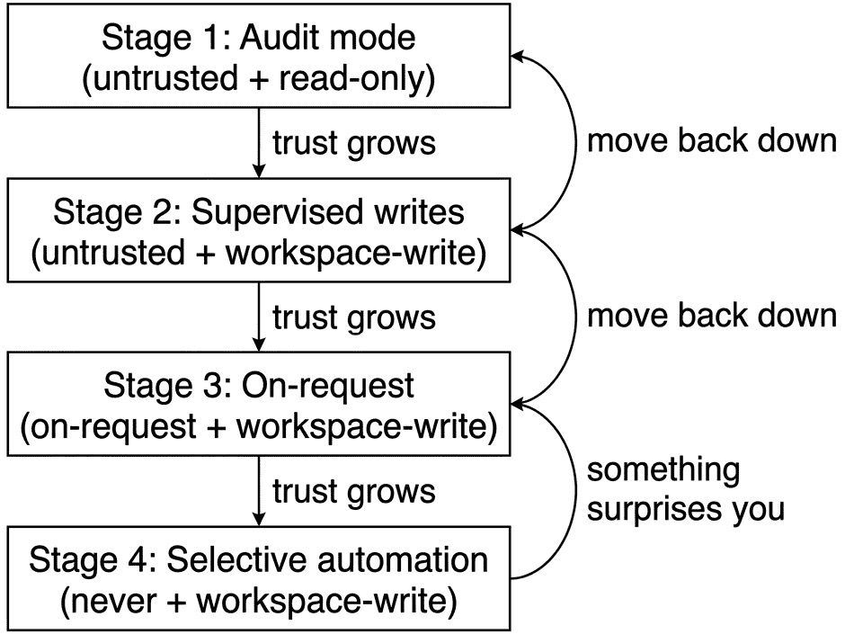

# 批准模式与信任边界

第 4 章 介绍了 `AGENTS.md`：塑造 Codex CLI 行为的软约束。指令仅是建议，建议无法阻止代理做你未预期之事。

本章讲述硬约束。两个设置决定 Codex CLI *被允许尝试*什么、以及操作系统*即便代理尝试也会允许*什么：批准策略和沙箱模式。二者共同构成一个可调信任模型，范围从只读检查到全自动执行。知晓哪种组合适配任务、哪种组合不安全，是驾驭代理的核心操作技能。

### 学习目标

你将能够：

1.  根据任务类型和信任级别选择合适的批准模式
2.  在 `config.toml` 中配置文件系统范围、网络允许列表和细粒度批准类别
3.  应用批准模式阶梯，随信心增长逐步扩大 Codex CLI 的自主权

### 信任模型：Codex CLI 能触及什么

Codex CLI 采取的每个行动都落入两类之一：观察世界的动作（读取文件、列出目录、获取文档）和改变世界的动作（写入文件、运行 Shell 命令、发起网络请求）。信任模型回答：哪些变更操作需要你显式签署，哪些操作应由操作系统无条件阻止？

Codex CLI 将其拆分为两个独立控制：


### 审批与沙箱：核心概念

1. `--ask-for-approval`（**短标志** `-a`）控制**程序边界**：Codex CLI 必须在何时暂停并请求人工确认后方可继续。
2. `--sandbox`（**短标志** `-s`）控制**技术边界**：操作系统允许什么，独立于审批是否被请求或授予。

这种分离是关键洞见。你可以拥有无审批提示的沙箱、无沙箱的审批提示、两者兼有，或两者皆无。表 5-1 列出了常见配置映射。

**表 5-1. 常见审批与沙箱组合**

| **用例** | **`--ask-for-approval`** | **`--sandbox`** |
| --- | --- | --- |
| 审计陌生代码库 | `untrusted` | `read-only` |
| 交互式本地开发 | `on-request` | `workspace-write` |
| CI/CD 流水线 | `never` | `workspace-write` |
| 临时容器，无限制 | `never` | `danger-full-access` |

### 三种审批模式

`--ask-for-approval` 标志接受三个值。可将其视为信任阶梯。

#### Untrusted：最高谨慎

`-a untrusted` 是最严格的设置。已知安全的读操作自动运行；每个状态变更步骤（文件写入、命令执行、网络请求）在 Codex CLI 继续之前都需要显式批准。当你探索陌生代码库并希望在任何事情发生前确切查看 Codex CLI 的提议时，这是正确模式。

考虑典型场景：你克隆了一个从未见过的遗留单体仓库，想让 Codex CLI 勾勒迁移计划。在你完整审查提议前，不想有任何文件被触动。`codex -a untrusted -s read-only "analyze the authentication module and draft a refactoring plan"` 提供该保证。

#### On-request：实用默认值

`-a on-request` 是交互式会话的默认值。Codex CLI 在沙箱边界内自由运行，仅在需要超出边界时暂停：写入工作树外的目录，或在网络未启用时访问网络。对大多数交互式开发，这是务实的最佳平衡点。

#### Never：全自动流水线

`-a never` 完全禁用审批提示。除非你也禁用了沙箱，否则沙箱仍处于激活状态。在沙箱边界内，没有任何东西会暂停等待人工输入。这适用于没有人工可响应的 CI/CD 流水线。

在具有网络访问权限的生产目录中使用 `never` 是真正危险的配置。如果你的工作目录包含部署脚本、基础设施清单或凭据，且你启用了网络访问，一次误导性的运行就能对真实系统做出真实更改。

#### `never` 适用与不适用的场景

**适用场景：**

1. 无网络访问的格式化和代码检查通过，范围限定在源码树
2. 具有隔离测试的模块测试生成
3. 从源码注释生成文档
4. 数据库迁移生成（非应用），无实时凭据

**不适用场景：**

1. 可能需要安装依赖的任何任务（网络 + 无审批 = 宽广攻击面）
2. 触及控制部署目标的配置文件的重构通过
3. 包含 `.env` 文件、API 密钥或机密的任何目录中的会话

在运行全自动会话前，用相同提示快速跑一遍 `-a untrusted -s read-only` 并审查 Codex CLI 说它会做什么。这种干运行只需两分钟，已让许多工程师避免了不愉快的惊喜。

#### 行业跳过审查的压力

AI 编码代理生成代码的速度比人类编写或审查快数倍，由此产生结构性问题：提示代理的开发者无法再有意义地审查产出。一些组织没有将此视为加强审查的信号，而是开始将拉取请求视为拖慢 AI 生成输出的瓶颈。

行业目前的应对是堆叠更多代理：代理生成的代码由代理审查者审查，由代理测试者测试。正如一位前 GitHub 高级工程师所言：“不完美系统堆叠在不完美系统上不会收敛于完美。” 对无机密模块的格式化通过，自动审批无妨。但当任务涉及医疗系统、金融平台或数百万人依赖的基础设施时，审批步骤不是瓶颈：它是最后一道防线。

### 沙箱：文件系统与网络限制

`--sandbox` 标志控制操作系统允许什么，独立于 Codex CLI 或你想要什么。三个值定义递增的权限级别。

- `-s read-only` 允许无文件写入，且无命令执行除非显式批准。代理可读取其有文件系统访问权的任何内容，但不能更改任何东西。
- `-s workspace-write` 允许在当前工作目录及默认的 `/tmp` 和 `$TMPDIR` 内进行读写。出站网络访问关闭。这是交互式开发的推荐基线。
- `-s danger-full-access` 移除所有文件系统和网络限制。它适用于容器本身提供隔离的环境，如作业后销毁的一次性 CI 运行器。

#### 在 config.toml 中配置沙箱

```
approval_policy = "on-request"
sandbox_mode    = "workspace-write"
```

当 `sandbox_mode` 为 `workspace-write` 时，可调整范围：

```
[sandbox_workspace_write]
writable_roots = ["/home/dan/shared-fixtures"]
```

`writable_roots` 将写入权限扩展到当前工作目录之外。单次调用的等效参数是 `--add-dir <path>`。

#### 网络访问与网页搜索

`network_access` 是二元开关：开或关。此层无逐域名允许列表。要么允许沙箱进程的所有出站请求，要么全不允许。关闭是 `workspace-write` 的默认值，大多数交互式会话可保持在此。仅为需要的运行开启：

```
[sandbox_workspace_write]
network_access = true
```

网页搜索是独立控制，有自己的设置。它允许代理在运行期间查阅开放网络信息：错误消息、库文档、特定版本语法、近期公告。如“查找最新 React 发布说明中的破坏性变更并更新迁移计划”这类提示，仅当 `web_search` 启用时才有效；否则代理仅限于其训练数据和已读取的本地文件。

```
web_search = "cached"   # "cached" | "live" | "disabled"
```

`cached` 设置（默认）使用预索引搜索索引，降低提示注入风险。`live` 设置启用实时搜索但增加攻击面。对大多数工作流，`cached` 是正确选择。

`workspace-write` 模式下网络访问默认关闭是常见困惑来源。如果你的代理任务包含安装包、获取 API 模式或克隆仓库，必须显式设置 `network_access = true` 或接受运行时的升级提示。

#### 组合快捷标志

现在两个杠杆都有了名称，常见组合更易陈述。对本地开发，显式组合 `-a on-request -s workspace-write` 是大多数会话所用。对于需要关闭两种控制的强化流水线，单个组合标志即可：

```
### 低摩擦本地开发
codex -a on-request -s workspace-write
### 硬化容器内的 CI/CD 流水线：无审批，无沙箱
codex --dangerously-bypass-approvals-and-sandbox   # 别名：--yolo
```

`--yolo` 完全绕过两种控制。仅当执行环境本身提供隔离时适用：流水线运行后销毁的一次性容器。在开发者工作站运行 `--yolo` 非预期用例。


### 内核级沙盒

`Sandbox_mode` 设置是一种可移植的抽象，但强制执行机制因平台而异。

#### macOS: Seatbelt

在 macOS 上，Codex CLI 会在运行时生成 **沙盒配置文件语言** (**SBPL**) 脚本并将其传递给 `sandbox-exec`，这是 Apple 的内核级沙盒工具。由于强制执行发生在内核系统调用级别，因此用户空间中运行的任何东西（包括 Codex CLI 本身）都无法绕过它。

#### Linux: bubblewrap 和 seccomp

Linux 沙盒是一个两阶段过程。外层阶段使用 `bwrap`（bubblewrap）对文件系统进行命名空间隔离：系统路径以只读方式绑定挂载，而写入访问权限被限制在配置的根目录内。内层阶段应用 `PR_SET_NO_NEW_PRIVS` 和 seccomp 系统调用过滤器，防止权限提升或超出精选允许列表的系统调用。

对于大多数威胁模型，Linux 沙盒比 macOS 沙盒有意义地更强。命名空间隔离、文件系统访问控制和系统调用过滤的组合提供了纵深防御。对于强化的自动化流水线，配置得当的 Linux 容器是更成熟的选择。

#### Windows: 受限令牌和 ACL

Windows 沙盒使用专用的低权限用户账户和 Win32 安全原语。存在两种子模式：`elevated`（首选，使用具有文件系统 ACL 和防火墙规则的专用沙盒账户，需要一次性管理员设置）和 `unelevated`（备选，使用来自当前用户的受限令牌）。对于托管的企业部署，强烈推荐 `elevated`。

### 命名配置文件

Codex CLI 暴露了两个相关但不同的配置文件命名空间。了解两者的区别可避免此领域最常见的配置错误。

1.  **命名配置文件** 将会话级设置（模型、审批策略、沙盒模式、MCP 服务器）打包在单个配置文件 `~/.codex/<name>.config.toml` 中，通过 `--profile <name>`（别名 `-p`）按调用激活。传递 `--profile <name>` 会先加载 `~/.codex/config.toml`，然后叠加 `~/.codex/<name>.config.toml`。

2.  `[permissions.<name>]` 定义文件系统和网络规则集，并通过 `default_permissions` 键激活。内置的 `:read-only` / `:workspace` / `:danger-full-access` 预设位于此命名空间中，将在以下小节中介绍。

配置文件将模型、审批策略和沙盒模式打包成可复用的配置集：

```
##### ~/.codex/strict.config.toml
model = "gpt-5.5"
model_reasoning_effort = "high"
approval_policy = "untrusted"
sandbox_mode = "read-only"

#### ~/.codex/auto.config.toml
approval_policy = "never"
sandbox_mode = "workspace-write"

codex --profile strict "audit this PR for security issues"
codex -p auto "fix all lint warnings"
```

每个配置文件位于各自的 `<name>.config.toml` 文件中；`--profile` 不会从 `config.toml` 读取 `[profiles.<name>]` 表。配置文件值会覆盖用户级配置，但会被显式的 CLI 标志覆盖。

### TUI 权限选择器

交互式 TUI 暴露了一个简化的选择器，用于在会话中途更改权限。它显示的标签不是新模式；它们是将权限配置文件与两个现有配置键结合的表现层预设：`approval_policy`（本章前面已介绍）和 `approvals_reviewer`（选择由谁回答审批提示）。

`approvals_reviewer` 接受两个值：

1.  `user`（默认）将每个审批提示路由给你。
2.  `auto_review` 将提示首先路由给代理；代理决定该操作是否足够冒险而转发给你。

三个选择器条目映射到底层设置如下。

**表 5-2. TUI 权限选择器映射**

| TUI 标签 | 权限配置文件 | `approval_policy` | `approvals_reviewer` |
| --- | --- | --- | --- |
| Ask for approval | `:workspace` | `on-request` | `user` |
| Approve for me | `:workspace` | `on-request` | `auto_review` |
| Full Access | full access (sandbox disabled) | `never` | n/a |

“Ask for approval” 和 “Approve for me” 共享相同的沙盒和相同的 `approval_policy`。唯一的区别是审查者：“Approve for me” 将首轮审查交给代理本身，这也是其描述为“仅针对检测到的潜在不安全操作提问”的原因。如果你想要选择器当前的默认行为写入 `config.toml`，等效配置为：

```
default_permissions = ":workspace"
approvals_reviewer = "auto_review"
```

选择器会根据上下文隐藏某些预设。例如，workspace-write 会话将不会显示“Read Only”条目，即使底层预设列表中存在此项。当你需要选择器隐藏的设置时，请使用 `config.toml` 或 `-c` 覆盖。

### 内置配置文件

Codex CLI 随附三个内置配置文件，以冒号为前缀：

- `:read-only`：无写入，无命令执行。适用于审查和探索。
- `:workspace`：在项目工作区内读写，允许命令，默认禁用网络。受保护路径（`.git/`、`.agents/`、`.codex/`）保持只读。这是推荐的默认值。
- `:danger-full-access`：移除所有限制。不推荐用于生产环境。

内置配置文件通过 `~/.codex/config.toml` 中的 `default_permissions` 键激活，**不是**通过 `--profile` 标志（后者会将用户定义的单个配置文件 `~/.codex/<name>.config.toml` 叠加到你的配置上）：

```
default_permissions = ":workspace"
```

要为单次运行覆盖默认值，请使用通用的 `-c` 配置覆盖在命令行传递该键：

```
codex -c default_permissions=':read-only' "audit this PR for security issues"
```

显式的 `-a` 和 `-s` 标志仍会覆盖配置文件，因此无需编辑配置即可进行一次性的 `-a never -s danger-full-access` 运行。

### 配置文件继承

配置文件通过配置层组合支持继承。平台团队在系统层定义限制性基线；项目团队通过仅添加其服务所需内容来扩展它：

```
#### /etc/codex/config.toml (system layer)
[permissions.secure-base]
description = "Restrictive baseline for hosted runners"
[permissions.secure-base.filesystem]
":workspace_roots"."." = "write"
":workspace_roots"."**/*.env" = "deny"
[permissions.secure-base.network]
enabled = true
[permissions.secure-base.network.domains]
"api.openai.com" = "allow"
"registry.npmjs.org" = "allow"

#### .codex/config.toml (project layer)
[permissions.payments]
extends = "secure-base"
[permissions.payments.network.domains]
"api.stripe.com" = "allow"
```

`payments` 配置文件继承 `secure-base` 的每一条规则，并在其之上仅添加 Stripe 域名。`extends` 键是组合分层权限集的文档化方式：扩展系统层基线的项目层配置文件将接收基线的所有规则，无需重述。基线中声明为 `deny` 的规则不能被扩展配置文件重新启用，因此高信任层可以为其下的所有内容锁定 `.env` 访问权限。

### 细粒度审批类别

对于想要按类别控制而非统一 `never` 的流水线：

```
[approval_policy.granular]
sandbox_approval    = true
rules               = true
mcp_elicitations    = false
request_permissions = false
skill_approval      = true
```

每个键切换该类别是否可以暂停运行以等待审批。使用此设置，技能和规则仍可提示，而 MCP 引导和权限请求将在不阻塞流水线的情况下处理。

### 权限阶梯

权限阶梯随着你对 Codex CLI 的理解和信心增长，授予其更多自主权。从将代理拴在紧绳子上开始，观察它在你的代码库中的行为，随着你积累证据表明其行为符合预期，一次放松一级绳索。


### 权限阶梯

1.  **第 1 阶段：审计模式。** `untrusted` + `read-only`。将实际任务交给 Codex CLI，但仅允许其观察和提出建议。审查每一个建议的操作。目标是理解：在代理能够做出任何更改之前，先建立其擅长什么、哪里会出错的心智模型。

2.  **第 2 阶段：监督写入。** `untrusted` + `workspace-write`。信任代理写入文件，但运行命令前仍需批准。审查建议的写入操作，批准看起来正确的，拒绝或修改其余的。留意你例行批准的操作类别；这些就是可以晋升到下一阶梯的操作。

3.  **第 3 阶段：按需批准。** `on-request` + `workspace-write`。信任代理自行处理常规操作。只有当它需要跨越边界时（例如写入工作树之外或访问网络），你才会被打断。大多数团队在交互式工作中都停留在此阶段。

4.  **第 4 阶段：选择性自动化。** `never` + `workspace-write`（或 CI/CD 流水线内的作用域配置文件 `~/.codex/<name>.config.toml`）。信任度已足够高，以至于每次运行都无需人工在环；流水线定义和周围的容器成为监督层。

当证据支持时晋升一阶，当出现意外情况时退回一阶。经验丰富的用户一旦了解代理在特定仓库中的行为，可能会跳过某些阶梯；高风险环境可能会无限期停留在早期阶梯。每个阶段的原则都是一样的：每个阶梯都是一种你可以在承诺使用前进行测试和验证的配置。



**图 5.1 - 权限阶梯**

一个四阶段阶梯，展示信任如何从最底层增长到最顶层：

*   第 1 阶段 审计模式 (`untrusted` + `read-only`)
*   第 2 阶段 监督写入 (`untrusted` + `workspace-write`)
*   第 3 阶段 按需批准 (`on-request` + `workspace-write`)
*   第 4 阶段 选择性自动化 (`never` + `workspace-write`)

向上箭头标注为“信任增长”，向下箭头表明当出现意外情况时可以退回一阶。

### 每个命令独立批准

批准范围绝不超出你所确认的单个命令。在多步骤运行中，每个命令都独立受控：批准 `npm install` 不会批准同一 Shell 代码块中随后的 `rm -rf node_modules`。如果代理需要再次提权，你会看到另一个提示。

### 目前的定论

批准策略和沙箱模式决定了代理**被允许尝试**什么。它们没有说明由**哪个模型**来尝试，也不涉及该模型在行动前思考**多么努力**。*第 6 章*将转向模型选择和推理努力：这两个设置决定了你刚刚设定的边界内每一步的质量、延迟和成本。

### 总结

1.  **两个独立的杠杆。** 批准策略（代理何时询问）和沙箱模式（操作系统允许什么）。

2.  **三种批准模式构成阶梯。** `untrusted`（所有操作均需询问），`on-request`（边界处询问），`never`（无提示）。

3.  **三种沙箱模式定义技术边界。** `read-only`、`workspace-write`、`danger-full-access`。

4.  **内核级强制执行。** macOS 上的 Seatbelt，Linux 上的 bwrap+seccomp，Windows 上的受限令牌；无法从用户空间绕过。

5.  **命名权限配置文件。** 将设置捆绑成可复用、可继承的配置，采用“拒绝优先”的冲突解决机制。

6.  **渐进式信任。** 从限制性开始，随信心增长而放宽；权限阶梯就是这条进阶路径。

7.  **纵深防御。** 两层必须同时同意才能执行任何操作，为你提供了两个独立的安全推理维度。

### 练习

**练习 5-1。** 在你的 `config.toml` 中创建三个命名权限配置文件：一个用于只读代码审查，一个用于交互式开发，一个用于 CI/CD。在所有三个配置下运行同一任务，观察代理行为如何变化。

**练习 5-2。** 使用 `-a untrusted -s read-only` 运行任务作为干运行，然后使用 `-a on-request -s workspace-write` 运行同一任务。对比 Codex CLI 提出的操作与实际执行的操作。找出一个如果没有先看到干运行结果你会拒绝的操作。

**练习 5-3。** 配置一个细粒度批准策略，自动批准沙箱操作但要求批准 MCP 引导。运行一个使用 MCP 服务器的任务，观察批准流程与全局 `never` 策略有何不同。


