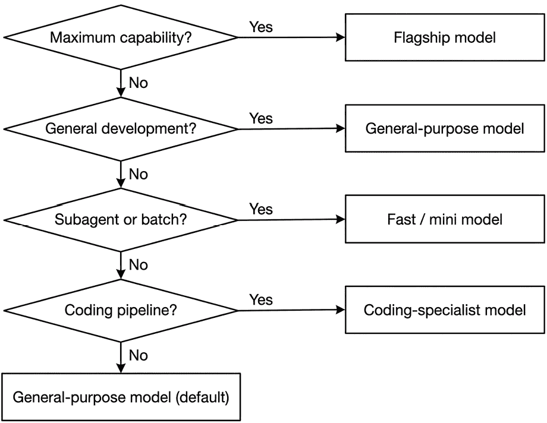
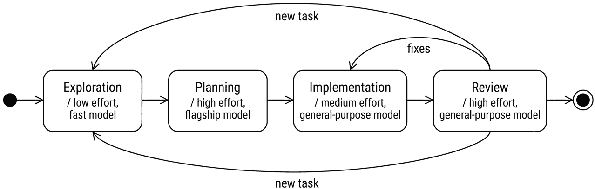
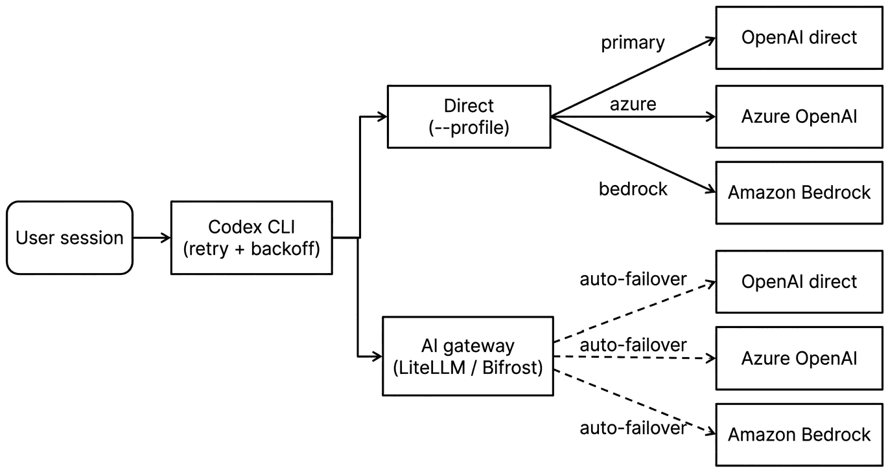

# 第六章：模型选择与推理努力

*第 5 章*涵盖了批准模式：决定 Codex CLI **被允许做什么**的杠杆。一旦你设定了边界，还有两个设置决定代理在边界内工作得有多好、每次运行成本多少：由**哪个模型**执行任务，以及该模型在回答前**思考多么努力**。

模型选择设定了能力的上限。推理努力决定了模型在任何给定请求上距离该上限有多近。两者任一设置错误都会浪费额度：在琐碎查找上使用昂贵的旗舰模型属于过度设计，而在困难的架构问题上使用轻量级模型会产出浅薄的工作，日后反而让你付出更大代价。

### 学习目标

你将能够：

1.  在 `config.toml` 中配置持久化的模型和努力默认值，并在每次调用时覆盖它
2.  构建命名配置文件，通过单个标志在日常驱动、深度调查和节省额度配置之间切换
3.  使用快速推理控制在活动会话期间改变推理深度
4.  设计多模型工作流，将推理预算分配到回报最大的地方

### 模型角色，而非模型名称

OpenAI 按自己的节奏发布新模型并弃用旧模型。具体名称（撰写时为 `gpt-5.5`、`gpt-5.4-mini`、`gpt-5.3-codex-spark`）变化速度快于任何印刷页面的追踪速度。本章不将建议锚定在你阅读时可能已不存在的名称上，而是使用**基于角色的类别**，它们映射到当前相应角色所指向的任何模型。

**表 6-1. 模型角色及其特征**

| **角色** | **特征** | **典型用途** |
| --- | --- | --- |
| **旗舰** | 最大上下文、最高能力、最高成本 | 研究、复杂推理、最高基准性能 |
| **通用** | 能力与成本的良好平衡、可通过 API 密钥访问 | 日常驱动、CI/CD、编排、通用开发 |
| **快速/迷你** | 较小上下文、最低成本、最高吞吐量 | 子代理工作、批处理、额度敏感型会话 |
| **编码专家** | 为代码生成优化、高吞吐量 | 大容量终端编码、安全审计、长时程会话 |

请查看 [`developers.openai.com/codex/models`](https://developers.openai.com/codex/models) 了解角色到模型名称的当前映射。`codex --help` 输出也会列出可用模型。

使用 `--model`（短标志 `-m`）、`config.toml` 中的 `model` 键，或交互式会话中的 `/model` 命令来设置活动模型：

```
codex -m gpt-5.5 "refactor the authentication module"
##### ~/.codex/config.toml
model = "gpt-5.5"
```

#### 能力与成本并非完全相关

快速/迷你模型并非通用模型的“弱化版”；它是针对不同工作优化的不同模型。对于有界子任务、文件级分析和探索，它能以极低成本提供适当的质量。将其视为“更便宜但更差”忽略了其设计意图。

### 推理努力

推理努力控制模型在响应前思考的深度。共有五个级别可用；*第 3 章*在提示词设计背景下介绍过它们，同一张表在此同样适用：


| 级别 | 行为 | 适用场景 |
| --- | --- | --- |
| `Minimal` | 无思维链 | 简单转换：格式化、批量重命名、CI 模板生成 |
| `Low` | 最小思维链，响应快速 | 快速编辑、重命名操作、查找 |
| `Medium` | 平衡推理深度（默认） | 通用开发、中等复杂度任务 |
| `high` | 扩展推理，速度较慢但更彻底 | 架构决策、复杂调试、安全审计 |
| `Xhigh` | 最大推理预算 | 高风险架构决策、安全评审、困难根因分析 |

在 `config.toml` 中、每次调用时或会话期间设置推理力度：

```
model_reasoning_effort = "medium"
codex -c model_reasoning_effort=high "design the database schema for the new billing module"
```

#### 快速推理控制

在交互式会话期间，无需重启即可调整推理力度：

1.  <kbd>Alt</kbd>+<kbd>,</kbd> 降低推理力度（例如，从 medium 降为 low）
2.  <kbd>Alt</kbd>+<kbd>.</kbd> 提高推理力度（例如，从 medium 升为 high）

当会话从探索阶段（低力度）转向复杂实现决策（高力度）再转回时，这很有用。更改在下一次模型调用时生效。

### 命名配置文件

配置文件将模型、推理力度和其他会话设置捆绑为可复用的配置。正如*第 5 章*所述，每个配置文件位于各自的文件中，即 `~/.codex/<name>.config.toml`，其设置作为顶层键；`--profile <name>` 先加载 `~/.codex/config.toml`，然后在其之上覆盖匹配的配置文件：

```
##### ~/.codex/config.toml
model = "gpt-5.5"
model_reasoning_effort = "medium"
#### ~/.codex/deep.config.toml
model = "gpt-5.5"
model_reasoning_effort = "high"
approval_policy = "untrusted"
sandbox_mode = "read-only"
#### ~/.codex/quick.config.toml
model = "gpt-5.4-mini"
model_reasoning_effort = "low"
#### ~/.codex/ci.config.toml
model = "gpt-5.5"
model_reasoning_effort = "medium"
approval_policy = "never"
sandbox_mode = "workspace-write"
codex --profile deep "audit this module for security vulnerabilities"
codex -p quick "fix all lint warnings"
codex -p ci "run the migration and verify tests pass"
```

配置文件值会覆盖用户级配置，但会被显式 CLI 标志覆盖。优先级为：CLI 标志 > 配置文件 > 项目配置 > 用户配置 > 默认值。

### 模型路由决策框架

既然有多种模型可用，为每项任务选择合适的模型就是一流的工程决策。从顶部开始遍历*图 6.1*中的决策树，在第一个“是”处停下；如果每个问题答案都是“否”，则通用模型为默认值。



图 6.1 - 模型路由决策树

决策树包含四个自上而下堆叠的是/否菱形判断框。第一个询问是否涉及复杂推理或需要最大能力，“是”则路由至旗舰模型。第二个询问是否涉及工具使用或通用开发，“是”则路由至通用模型。第三个询问是否为子代理或批量工作，“是”则路由至快速/迷你模型。第四个询问是否为高容量编码流水线，“是”则路由至编码专用模型。连续四个“否”答案将回落至通用模型作为默认值。

#### 错误路由的代价

在一个由十名开发者组成的团队中，每人每天运行五个会话，将所有任务路由至旗舰模型与将常规工作发送至快速模型之间的差价，每月高达数千美元。模型路由并非过早优化；它是大规模场景下的成本管理。

一个实用的启发式方法：如果资深开发者手动完成任务需时不足五分钟，快速/迷你模型足矣。如果任务需要阅读并推理多个文件或做出架构决策，请使用通用或旗舰模型。

### 多模型工作流

最高性价比的模式是针对工作的不同阶段使用不同模型：

#### 编排者-工作者模式

使用通用模型作为编排者（规划、分解、集成），使用快速模型作为工作者（有界子任务、文件级编辑）：

```
# 示例：每个子代理通过 agents.<name>.config_file 指向自己的 Codex 配置，
# 该配置携带各自的模型 + 力度设置。
# 第 11 章涵盖完整的子代理配置机制。
[agents.planner]
config_file = "~/.codex/subagents/planner.toml"   # contains model = "gpt-5.5", model_reasoning_effort = "high"
[agents.worker]
config_file = "~/.codex/subagents/worker.toml"    # contains model = "gpt-5.4-mini", model_reasoning_effort = "medium"
```

编排者推理整体方案并生成工作者执行实现。每个工作者在有界范围内操作，快速模型在此表现出色。编排者整合结果并做出下一个战略决策。

#### 会话阶段路由

在单个交互式会话中，推理力度（以及可选的模型本身）应与当前阶段匹配：

1.  **探索** (`low` 力度，快速模型)：读取文件、理解结构、提问
2.  **规划** (`high` 力度，旗舰模型)：设计方案、识别风险
3.  **实现** (`medium` 力度，通用模型)：编写代码、运行测试
4.  **评审** (`high` 力度，通用模型)：验证正确性、检查边缘情况

使用快速推理控制（<kbd>Alt</kbd>+<kbd>,</kbd> / <kbd>Alt</kbd>+<kbd>.</kbd>）和 `/model` 在阶段间切换。



图 6.2 - 会话阶段路由

状态机展示会话如何在各阶段间流转，每个阶段绑定一种推理力度和一个模型。探索阶段在快速模型上使用低力度，规划阶段在旗舰模型上使用高力度，实现阶段在通用模型上使用中等力度，评审阶段在通用模型上使用高力度。探索通向规划，规划通向实现，实现通向评审；评审可回路至实现、返回探索或结束会话。

### 云端与本地模型提供商

Codex CLI 不局限于 OpenAI 的模型系列。`config.toml` 中的 `[model_providers]` 配置支持映射到 Responses API 契约的自定义提供商。

#### 云端提供商

| 云平台 | 提供商机制 | 用例 |
| --- | --- | --- |
| Azure | Azure OpenAI 模型提供商 | 拥有 Azure 承诺的企业团队 |
| AWS | Amazon Bedrock 原生提供商 | AWS 优先组织 |
| GCP | 自定义模型提供商 (Vertex AI) | Google Cloud 环境 |

配置云端提供商：

```
model_provider = "azure-openai"
[model_providers.azure-openai]
name = "Azure OpenAI"
base_url = "https://your-org.openai.azure.com"
env_key = "AZURE_OPENAI_API_KEY"
wire_api = "responses"
```

#### 本地模型提供商

本地推理服务器（Ollama、vLLM、llama.cpp）可使用相同配置模式作为模型后端。本地模型最适合有界的、机械性任务，在这些任务中延迟和成本优势超过了能力差距：

```
[model_providers.local]
name = "Local Ollama"
base_url = "http://localhost:11434"
wire_api = "responses"
```

对于 Ollama 或 LM Studio，`--oss` 标志是内置快捷方式：它让 Codex 将运行路由至本地开源后端，无需你定义 `[model_providers.*]` 块。Codex 仍需知道使用哪个后端，因此请在 `config.toml` 中设置一次 `oss_provider`：

```
oss_provider = "ollama"   # or "lmstudio"
```

此后，`codex --oss "..."` 通过 Ollama 路由。要为单次运行选择不同的本地后端，请使用 `--local-provider lmstudio`（或 `ollama`）。


对于更受控的本地配置，请继续使用 `[model_providers.*]`。当模型 slug 不在 Codex 的内置目录中时，请添加 `model_catalog_json` 文件，以便 Codex 知道如何呈现和处理该模型：

```
##### ~/.codex/local.config.toml
model = "qwen3:32b"
model_provider = "local"
model_context_window = 131072
model_catalog_json = "~/.codex/models/local-models.json"
```

`model_context_window` 应与本地服务器中配置的上下文相匹配。如果设置过高，Codex 可能会发送比后端所能接受的更多上下文。如果设置过低，Codex 会比必要时机更早进行压缩。Ollama 默认以 40K 窗口提供 `qwen3:32b`；将其提升至模型 128K 的最大值（`131072` tokens）需要在 Ollama Modelfile 中扩展上下文，并拥有足够的 VRAM 作为支撑。

目录 JSON 文件使用与内置目录相同的模式。最小条目需要一个与部署模型名称匹配的 `slug`、一个人类可读的 `display_name`、一个简短的 `description`、以 token 为单位的 `context_window`，以及 Codex 应提供的推理力度级别：

```
{
  "models": [
    {
      "slug": "qwen3:32b",
      "display_name": "Qwen3 32B",
      "description": "Local Qwen3 32B served via Ollama",
      "context_window": 131072,
      "supported_reasoning_levels": ["medium"],
      "default_reasoning_level": "medium"
    }
  ]
}
```

有三个字段值得更仔细地关注。slug 必须与上游提供商期望的名称匹配：`qwen3:32b` 是 `ollama pull` 和 `ollama run` 接受的确切名称，因此 Codex 会原样透传。`context_window` 应为您的本地部署实际提供的窗口大小（以 token 为单位）。`supported_reasoning_levels` 是选择器中 Codex 提供的列表。Qwen3 仅有二元选项。

这与基于配置文件的切换不同。使用配置文件时，人工或脚本会在运行开始前选择备用提供商：

```
codex --profile azure "continue the refactor"
```

而网关故障转移时，选择发生在请求路径内部。Codex 配置保持稳定：

```
model_provider = "gateway"
model = "gpt-5.5"
```

这种稳定性在 CI/CD 和长时间交互会话中非常有用，因为调用者无需知道当前哪个上游是健康的。它还能集中管理策略。团队可以调整路由权重、禁用降级的提供商或添加备用账户，而无需更改每个开发者的 `config.toml`。

请勿将自动故障转移视为神奇的连续性保障。如果流式传输已开始，随后在响应中途失败，网关可能无法安全地重放该轮次。对非幂等的工具生成请求针对不同模型进行重试，也可能产生不同的计划或不同的工具调用。对于高风险工作，请倾向于在生成开始前进行故障转移，并在网关无法保证干净重试时使其闭合失败。

上游必须足够兼容，以便同一提示词能正常工作。请在故障转移池中保持以下各项对齐：

1.  模型能力和上下文窗口
2.  Responses API 兼容性和流式行为
3.  工具调用和结构化输出支持
4.  安全性和数据保留要求
5.  认证、配额和账单归属
6.  解释每个请求由哪个提供商处理所需的日志字段

有意识地测试故障转移。在暂存网关中，强制主提供商返回 429 或超时，并确认 Codex 从备用提供商收到正常响应。同时检查日志：您应该能够重构原始请求、失败的上游、备用上游和最终状态。



图 6.3 - 会话阶段路由

架构图。用户会话进入 Codex CLI，后者应用内置重试和指数退避。随后配置文件选择器路由至四条上游路径之一：OpenAI 直连（OpenAI 配额池）、Azure OpenAI（按 Azure 订阅划分配额）、Amazon Bedrock（按 AWS 账户划分配额），或 AI 网关（如 LiteLLM 或 Bifrost）。网关路径增加了跨所有三个上游提供商的虚线自动故障转移边。

### 监控模型弃用

OpenAI 会定期弃用旧模型。两种认证路径对弃用的处理方式不同：

1.  **ChatGPT 认证用户**在弃用生效后立即失去对已弃用模型的访问权限；Codex 模型页面会列出受影响的名称，并告知用户更新至当前默认模型。
2.  **API 密钥用户**通常能保留更长时间的访问权限。Codex 模型页面注明“某些对 ChatGPT 登录已弃用的模型在 API 中可能仍可用”，因此锁定在现已被 ChatGPT 弃用模型上的流水线，可能会继续工作，直到 OpenAI 也从 API 中退役该模型。

这两种结果都不是可靠的保护。ChatGPT 路径在弃用生效的那一刻即中断；API 路径仅仅是延缓了中断。请定期审核您的配置：

```
grep -rn --include='*.toml' 'model = ' ~/.codex .codex
```

在 CI/CD 流水线中显式锁定模型，并按计划刻意更新它们，而不是依赖回退行为。

### 这对您意味着什么


### 批准策略、沙箱模式、模型与推理深度

批准策略、沙箱模式、模型和推理深度决定了代理可以做什么、由谁来运行以及思考多深。这些设置都不会改变代理能记住多少内容。长会话会撞上另一堵墙：上下文窗口。第 7 章将介绍上下文如何填充、为何呈二次方而非线性增长，以及你可以利用哪些手段在不丢失线索的情况下维持长会话存活。

### 概要

1.  **使用模型类别而非名称。** 旗舰、通用、快速和专用类别能经受住模型名称的更迭；死记每隔几个月就变一次的名称则无济于事。

2.  **推理深度是独立杠杆。** 低、中、高三档控制思考深度，独立于模型选择。`Alt+,` 和 `Alt+.` 可在会话中途调整。

3.  **命名配置文件捆绑选择。** 将模型、推理深度和权限打包成可切换的配置。

4.  **编排器-工作者路由。** 将规划发送给旗舰或通用模型，将有边界的子任务发送给快速模型。

5.  **超越 OpenAI。** 云服务商（Azure、Bedrock、Vertex AI）和本地推理（Ollama、vLLM）将模型选择范围扩展到了 OpenAI 系列之外。

6.  **多提供商弹性。** 配置文件、网关和独立的速率限制池可防止会话被 429 错误终结。

7.  **定期审计。** 检查配置中是否有已弃用的模型引用。

### 练习

**练习 6-1.** 创建三个命名配置文件：`daily`（通用模型，中等推理深度）、`deep`（旗舰模型，高推理深度，只读沙箱）和 `quick`（快速模型，低推理深度）。在所有三个配置下运行同一重构任务，并对比输出质量、Token 用量和实际耗时。

**练习 6-2.** 配置一个多模型子代理工作流，编排器使用通用模型，工作者使用快速模型。运行一个需要多文件编辑的任务，观察各角色的 Token 消耗。

**练习 6-3.** 搭建一个本地模型提供商（Ollama 或类似工具）并定义 `local` 配置文件。在本地和云端配置文件上分别运行有边界的任务（列出 TODO、格式化文件）。找出本地模型输出质量变得不再足够的任务复杂度临界点。


