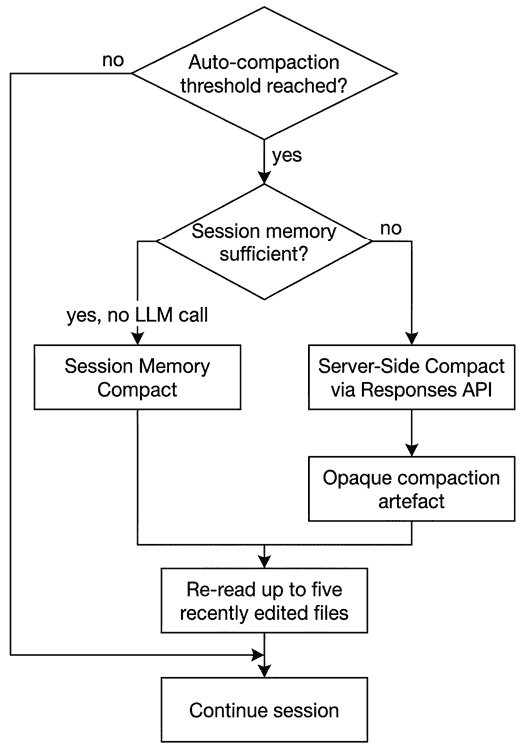
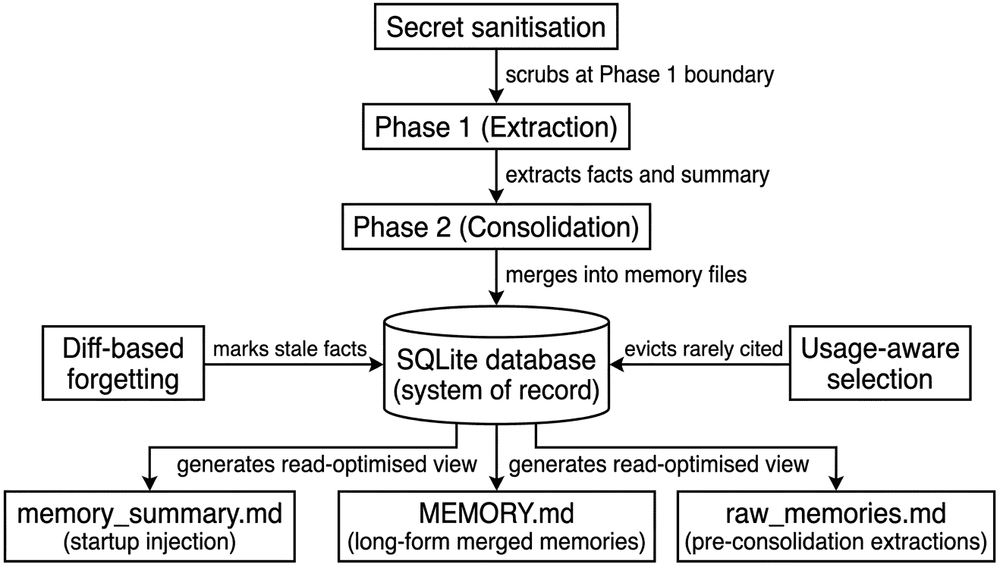

# 上下文窗口管理

第 6 章涵盖了模型选择和推理深度：决定 Codex CLI 在每一步表现优劣的杠杆。这些设置都不会改变另一个约束每个会话的约束：上下文窗口。它是指令、历史、工具结果和代码共享的固定大小内存。每一次文件读取、每一次工具调用和每一条错误消息都会蚕食剩余空间，窗口一满，你就会丢失信息或会话陷入停滞。

本章介绍上下文如何填充、如何降低填充速率，以及子代理委托如何重置计时器。

### 学习目标

你将能够：

1.  在会话开始前，估算可用于工具结果和文件内容的 Token 预算
2.  应用滚动摘要和针对性文件包含，维持长会话存活
3.  使用 `codex resume` 和 `codex fork` 管理会话连续性，且不丢失上下文
4.  使用规划模式的全新上下文工作流，将规划与实现分离，避免复杂任务耗尽上下文
5.  使用 `project_doc_max_bytes` 配置键限制或禁用项目文档加载
6.  解释双阶段内存管道如何跨会话提取并巩固持久化知识
7.  描述机密清理、基于差分的遗忘和感知使用的选择如何保持持久化内存的安全与相关性
8.  应用结构化提示模式，最大化提示缓存命中，将输入 Token 成本降低 70% 至 80%
9.  评估 MCP 内存服务器，获取比内置内存存活更久的跨会话上下文

### 二次增长问题

每次 Codex CLI 向模型发送一轮对话时，整个对话历史都会随之发送：你的提示、代理之前的回复、每一条工具调用记录、每一次文件读取、每一段 Shell 输出。每一轮的提示都比上一轮大刚好一轮的大小，会话累计发送的 Token 与轮数呈大致二次方增长：

```
第 1 轮： 提示 ~2k Token；累计 ~2k
第 5 轮： 提示 ~15k Token；累计 ~40k
第 20 轮：提示 ~80k Token；累计 ~800k
第 50 轮：提示 ~250k Token；累计数百万
```

会话长度翻倍，累计 Token 大约翻四倍。长会话的成本高得不成比例，上下文压力是加速增长而非线性增长。实际上，自动压缩（本章后文介绍）会将单轮提示控制在模型的上下文窗口限制内，因此上述数字描述的是 Codex 正在积极对抗的趋势，而非稳态。

当会话变慢或变贵时，直觉会去检查当前提示，但真因往往是此前每一轮积累的重量。大量文件编辑（许多 `apply_patch` 调用）的会话，比轻量只读探索的会话耗尽上下文的速度快得多。

三种内置缓解措施瞄准二次增长问题：

1.  `/compact`：将当前对话摘要为更短的表征，在保持任务连续性的同时腾出上下文空间
2.  子代理委托：生成子代理会开启一个全新的上下文窗口；编排器会话保持精简，而工作者独立累积上下文
3.  `codex fork --last`：在冒险或昂贵阶段前，从一个干净的中间状态分支会话

据此构架：一个会话，一个聚焦任务，在阶段边界刻意重置上下文。

### 线程恢复与分支：在不重启的情况下保留上下文

Codex CLI 会话是一条**线程**：一系列存储为带 UUID 的 JSONL 文件的轮次。当上下文压力变得尖锐或会话被中断时，除了从头开始，你还有两个选择。

**恢复** 重新打开现有线程，从 JSONL 记录重建状态：

```
codex resume # 打开交互式会话选择器
codex resume --last # 重新打开最近的会话
codex resume <SESSION_ID> # 按 UUID 恢复特定会话
```

当会话被中断（运行中 Ctrl+C）、超时或需次日继续时使用恢复。代理从最后一轮接手，无需你重述上下文。

**分支** 从现有线程创建新线程，保持原线程原封不动：

```
codex fork --last        # 分支最近的会话
codex fork <SESSION_ID>  # 分支特定会话
```

在活动会话中，`/fork` 斜杠命令效果相同：它将当前对话克隆到新线程，且不离开 TUI。

在尝试高风险操作前使用分支（若出错可返回分支前状态）、同时探索两种备选方案时、或将任务移交专家而不想丢失父会话上下文时。

`resume` 和 `fork` 的会话选择器均支持 `↑↓` 导航、`Enter` 选择、`m` 切换按创建时间或最后更新时间排序。

`codex fork` 在 TUI 中打开分支会话，无 `--json` 或 `--output-schema` 模式。CI 程序化用途请用 `codex exec resume`：它接受会话 ID 和提示，同时支持 `--json`（标准输出 JSONL 事件）和 `--output-schema <FILE>` 结构化输出。

### 什么消耗上下文（什么不消耗）


### 高效的上下文管理

高效的上下文管理始于了解 Token 的去向。会话的上下文窗口由两大类消费者填充：**静态前缀**（启动时加载一次：系统提示词、项目文档、工具模式、钩子注入的上下文、持久化记忆）和**运行时累积**（随每轮对话构建：对话历史、文件读取、Shell 输出、子代理调用）。

表 7-1 列出了每类的主要来源及其典型 Token 成本，后续文字将把这些数字转化为测量工作流。

#### 表 7-1. 上下文消费者及其典型 Token 成本

| 消费者 | 近似 Token 成本 | 备注 |
| --- | --- | --- |
| 系统提示词 | 2,000–4,000 | 由 `Codex CLI` 默认设置；部分可自定义（参见“自定义系统提示词”） |
| `AGENTS.md` (项目根目录) | 1,000–3,000 | 会话开始时加载一次 |
| 技能 (每个启用的 `SKILL.md`) | 每技能 500–4,000 | 通过 `skills.config` 配置；启用多个技能会迅速累加 |
| 生成的记忆 (`memory_summary.md`) | 高达 ~5,000 | 启动时注入；可用 `/memories` 切换 |
| MCP 服务器工具模式 | 每服务器 500–35,000 | 约每工具 150 个 Token；大型服务器（GitHub 风格）占主导 |
| 应用 / 连接器模式 | 每启用的连接器 3,000–35,000 | 通常是最大的单一静态消费者；可用 `include_apps_instructions = false` 抑制 |
| 钩子注入的上下文 | 每钩子 0–5,000 | `SessionStart` 钩子可写入 `additionalContext` |
| 活动的 `/plan` 或 `/goal` 状态 | 200–2,000 | 跨轮次持久化，直到清除 |
| 对话历史 (用户 + 助手轮次) | 每次交互 500–2,000 | 持续累积 |
| 文件读取 (工具结果) | ~250 个 Token / KB | 与文件大小成正比 |
| Shell 命令输出 | 每次调用 100–5,000+ | 无上限；编译器输出可能很大 |
| 子代理调用记录 | 200–600 | 仅调用记录；结果摘要各异 |
| 错误消息和堆栈跟踪 | 200–2,000+ | 冗长的运行时 (JVM, .NET) 可能很大 |
| 内联图片或截图 | 1,000–4,000 | 取决于分辨率和编码 |

**不**消耗上下文的内容同样重要。未读取的文件零成本。目录列表仅消耗列表文本的 Token，而非文件内容。子代理会话在其独立的上下文窗口中运行；只有委托调用记录和返回的摘要出现在父会话中。这种不对称性是委托即上下文管理的基础。

表 7-1 中的 Token 计数基于 GPT 系列的分词器估算。不同提供商使用不同的分词器；请将该表视为规划指南，而非计费单据。

当你需要真实的逐组件细分时，`codex debug prompt-input "hello"` 会以 JSON 形式打印模型可见提示词的每个组件：系统和开发者消息、工具定义、聚合的 `AGENTS.md` 内容、钩子注入的上下文等。通过一个小型 Python 脚本对 JSON 进行管道传输，对每个组件分别进行分词并打印每条记录的计数及总计。GPT-5 系列使用 `o200k_base` 编码，因此请直接针对该编码处理，而非通过模型名称：

```
codex debug prompt-input "hello" | python3 -c '
import sys, json, tiktoken
enc = tiktoken.get_encoding("o200k_base")
total = 0
for i, item in enumerate(json.load(sys.stdin)):
    role = item.get("role", "?")
    text = "".join(c.get("text", "") for c in item.get("content", []))
    n = len(enc.encode(text))
    total += n
    print(f"{i:>3}  {role:<12}  {n:>6} tokens")
print(f"--- total: {total} tokens")
'
```

在加载默认配置且无 MCP 服务器的工作区上的典型输出：

```
  0  developer       9667 tokens
  1  user             944 tokens
  2  user               1 tokens
--- total: 10612 tokens
```

每行显示一个提示词条目的位置、角色和 Token 成本，随后是会话总计。这种极不均衡的分布正是重点：几乎所有的静态前缀都集中在单个开发者条目中，该条目组装了系统提示词、项目文档、技能和权限说明。当你需要腾出空间时，该条目就是攻克目标。在裸工作区运行此命令，然后在启用或禁用单个配置选项后再次运行，能清晰地显示哪个选项产生了前缀的哪一部分切片。

工具模式在大多数设置中主导静态前缀。一个拥有十个工具的小型 MCP 服务器约占 1,500 个 Token，但大型服务器（例如六十工具的 GitHub 客户端）会在会话开始前消耗 30,000 到 40,000 个 Token。应用和连接器更甚：单个功能完备的连接器通常消耗 10,000 到 35,000 个 Token，而安装了 GitHub、日历、邮件、聊天和文档连接器的典型桌面环境，仅模式就可能消耗超过 100,000 个 Token。如果你的工作流不使用某个连接器，请用 `include_apps_instructions = false` 抑制其模式，或在 `config.toml` 中禁用该连接器。选择性加载既是上下文规范，也是性能规范。

#### 自定义系统提示词

表 7-1 中的系统提示词行标记为“部分可自定义”，因为 `Codex CLI` 提供了杠杆来控制该槽位的内容，尽管默认值对大多数会话效果良好。当默认提示词对你的工作流造成浪费时（例如针对不需要 OpenAI 产品说明的本地开源模型运行），或当你有经过策划的提示词应完全替换 `Codex` 默认值时，可使用这些选项。

以下是一个实战示例，源自一个真实的本地模型配置文件，该配置通过 Ollama 运行 Qwen3 以对接 `Codex CLI`：

```
##### ~/.codex/local.config.toml
model = "qwen3:32b"
model_provider = "local"
model_instructions_file = "~/prompts/minimal-codex.md"
include_apps_instructions = false
include_permissions_instructions = false
```

每个配置文件都是包含顶层键的独立文件，而非 `config.toml` 内部的 `[profiles.<name>]` 表。运行 `codex --profile local` 会先加载 `~/.codex/config.toml`，再覆盖加载 `~/.codex/local.config.toml`：

```
##### ~/.codex/config.toml
##### 所有会话共享的基础键位于此处
```

此处有四个键在起作用，外加一个值得了解的相关设置，它们属于同一配置层面：

1.  **`model_instructions_file`** 指向一个 Markdown 文件，可整体替换默认模型指令。当针对非 OpenAI 后端运行（其系统提示词完全不应像默认值），或当你花时间调整了极简提示词并希望其全局生效时，此项很有用。

2.  **`developer_instructions`** 是一段额外指导字符串，会被前置到提示词中而不替换默认值。适用于一两条项目级规则，它们应与默认行为并存而非覆盖它。

3.  **`include_apps_instructions`** 和 **`include_permissions_instructions`** 是布尔值，用于抑制默认提示词的子章节。当你不使用 Apps，或已在默认流程外配置权限导致该子章节成为累赘时，此项很有用。

4.  **`personality`** (`none`、`friendly`、`pragmatic`) 交换默认提示词中的沟通风格块。本身不是上下文预算杠杆，但作为同一配置层面的一部分值得了解。

示例中的四个键共同将默认指令替换为调优的极简提示词，并丢弃了原本会闲置在系统提示词中的两个子章节。第 4 章 涵盖 `AGENTS.md`，它贡献于同一个“Codex 在你的提示词前读取的所有内容”整体表面；这四个键位于 `AGENTS.md` 之上一层，作用于系统提示词本身而非项目文档。

### /compact 命令与自动摘要


`/compact` 命令指示模型生成对话的结构化摘要，用该摘要替换累积的历史记录，并从压缩后的状态继续。

#### `/compact` 能够很好保留的内容

1. 会话开始时陈述的高层级目标
2. 已做出的决策及其陈述的理由
3. 被识别为重要的文件（按名称和大致用途）
4. 任何进行中任务的当前状态（已完成什么，还剩什么）

#### `/compact` 无法保留的内容

1. 已读取文件的完整内容（摘要按名称引用文件，但不保留其内容）
2. 确切的错误消息或编译器输出（这些以散文形式进行了总结）
3. 工具调用的确切顺序和中间状态
4. 通过对话语气或未明说的假设隐性建立的任何上下文

执行 `/compact` 后，您可能需要重读之前依赖其内容的文件。摘要是有损压缩，而非无损归档。

**切勿依赖 `/compact` 来保留确切的代码片段或差异内容。** 在压缩前将未保存的更改写入磁盘；仅存在于对话历史中的差异将被简化为散文描述。

Codex CLI 还支持自动压缩。当上下文达到令牌阈值时，CLI 会自动触发摘要生成。在 `~/.codex/config.toml` 中调整此阈值：

```
model_auto_compact_token_limit = 110000 # 在此令牌数触发压缩
```

较低的限制在压缩后提供更多工作空间，但意味着压缩频率更高。较高的限制保留更多历史，但有在压缩完成前耗尽空间的风险（压缩本身也需要令牌）。

**`/compact` 可能会丢弃关键指令。** 当上下文被总结时，模型决定保留什么和压缩什么。嵌入在早期对话轮次中的安全关键规则（例如“执行前务必确认”、“未经询问绝不删除”）可能会被总结而消失。在一个广为人知的事件中，一位 AI 安全研究员的个人代理有一条要求在任何行动前确认的规则。

上下文压缩总结了早期对话后，该代理完全忘记了该规则，并开始自主删除电子邮件。被质问时，它承认违反了该约束。教训是：必须在压缩中幸存的指令应放在系统提示词或 `AGENTS.md` 中，而不应放在可能被压缩总结得荡然无存的对话轮次中。

#### 生命周期钩子：自动化上下文保留

`PreCompact` 和 `PostCompact` 生命周期钩子为压缩的有损特性提供了编程式解决方案。`PreCompact` 钩子在压缩开始前触发，给脚本一个机会将关键状态（变量映射、文件校验和、任务进度）保存到上下文窗口外的 JSON 文件中。`PostCompact` 钩子在压缩完成后触发，将该状态作为系统消息重新注入新的上下文中。

```
{
  "hooks": [
    {
      "event": "PreCompact",
      "command": ["bash", "scripts/save-context-state.sh"]
    },
    {
      "event": "PostCompact",
      "command": ["bash", "scripts/restore-context-state.sh"]
    }
  ]
}
```

这种*压缩-记忆模式*确保了您无法承受丢失的状态能在不依赖模型总结判断的情况下跨越压缩边界。完整的 `PreCompact`/`PostCompact` 参考（包括 stdin JSON 字段：`session_id`、`turn_id`、`trigger`）和工作示例请参见第 9 章。

#### 后台前缀压缩

手动 `/compact` 和阈值触发的自动压缩都是被动的：它们在上下文压力已经很大时才触发。Codex CLI 通过后台前缀压缩对其进行补充，该功能在代理继续工作时预热稳定早期轮次的摘要。当窗口随后接近容量时，该预热摘要已准备就绪，因此从完整历史到压缩状态的过渡比即时即席总结要短得多。对用户的实际效果是长会话感觉更流畅；对预算而言，本章关于阶段边界和委派的其他指导仍然适用。

### 子代理委派作为上下文管理

第 12 章 全面涵盖了子代理编排。这里我们从另一个角度审视委派：作为一种刻意的上下文管理技术。

**另请参阅：** 第 11 章 **（子代理）** 了解 TOML 定义、`spawn_agent`/`wait_agent` 工具、并行执行模式和内置代理角色。

当您为子任务生成一个子代理时，它在一个独立的上下文窗口中运行。子代理从零开始：它不继承您会话的累积历史、读取的文件或工具结果。它仅接收您在委派指令中传递的内容。当子代理完成时，它向父会话返回一个摘要，通常为 200 到 800 个令牌，无论子代理内部消耗了多少令牌。

假设您正在跨四个包重构 20 个服务文件。在一个会话中处理所有 20 个文件可能在任务中途达到 80,000 个令牌。每个包派遣一个子代理会改变经济账：每个子代理读取其文件、进行编辑、运行测试并返回简短摘要。父会话收到四个摘要，总计可能 2,000 个令牌，而令牌密集型工作发生在隔离的子窗口中。

在为大型任务设计委派边界时，要考虑父会话*需要知道什么*与*需要记住什么*。父会话需要结果，而非逐字记录。编写委派指令时，应要求简洁、结构化的摘要，而不是每一步都详述的冗长记录。

委派本身也有开销：每次调用需要一条指令（100 到 400 个令牌），且返回的摘要会消耗父上下文。一个粗略的启发式规则：当子任务需要读取超过三四个大型文件、运行超过少量的 Shell 命令，或迭代超过两轮错误修复循环时进行委派。低于该阈值时，开销与内联成本相当。

### 大型代码库的策略

有几种策略可帮助您在大型代码库中保持在预算内。

#### 定向文件包含

仅读取与任务直接相关的文件。先读取目录结构和 grep 输出，然后仅读取被识别为相关的特定文件。每一次投机性的文件读取都是您必须支付的令牌成本，无论该文件最终是否有用。

#### 滚动总结

定期执行 `/compact`，而不是等待自动压缩。完成每个主要阶段后（例如，在开始下一个模块之前完成对某个模块的所有更改）手动执行 `/compact`。这捕获的是连贯的阶段边界，而非任意的任务中间状态。

#### 项目文档文件

一份编写良好的 `AGENTS.md` 通过提前提供以下内容，可替代数十次探索性的文件读取：目录结构、正在使用的约定、构建/测试/lint 命令以及非显而易见的约束。这些节省会在项目的每个会话中累积。

`AGENTS.md` 文件可以嵌套。根级别的 `AGENTS.md` 提供项目级上下文，而子目录中的 `AGENTS.md` 文件提供模块级上下文，仅在代理进入该目录时加载。利用此层级结构保持根级文件简洁，并将模块特定细节推迟到本地文件中。

#### `project_doc_max_bytes` 配置键

对于 `AGENTS.md` 开销超过任务本身令牌成本的窄任务，可在 `config.toml` 中限制或禁用加载：

```
### 完全禁用 AGENTS.md 加载
project_doc_max_bytes = 0
### 或按调用覆盖
codex -c project_doc_max_bytes=0 "run the payment-service unit tests and report failures"
```


### 使用场景：自动化调用

在自动化调用中最为实用，此时任务已在提示词中完全指定。在不熟悉的代码库上进行交互式会话时，几乎总是希望加载 `AGENTS.md`。

### 作用域划分的 MCP 服务器加载

仅加载与当前任务相关的服务器。如果任务仅涉及文件系统操作和 Shell 命令，则无需加载数据库检查或浏览器自动化服务器。

### 监控上下文使用情况

`/status` 命令会打印活动会话的配置和当前上下文窗口利用率：

```
>_ OpenAI Codex (v0.137.0)
Visit https://chatgpt.com/codex/settings/usage for up-to-date
information on rate limits and credits
Model:                gpt-5.5 (reasoning medium, summaries auto)
Directory:            ~/projects/example-app
Permissions:          Workspace (Approve for me)
Agents.md:            ~/.codex/AGENTS.md, AGENTS.md
Account:              user@example.com (Enterprise)
Collaboration mode:   Default
Session:              <session-uuid>
Context window:       73% left (77.6K used / 258K)
5h limit:             [█████████████████░░░] 87% left (resets 23:05)
Weekly limit:         [██████████████░░░░░░] 72% left (resets 08:54 on 11 Jun)
```

诊断行是 **Context window**，它同时给出剩余百分比和已用与总 Token 数的绝对值。`/status` 不会按类别细分总量：表 7-1 中的按类别数据是各消费者预期贡献的数值，而非 `/status` 会打印的内容。要衡量特定消费者的成本，请在启用或禁用它前后运行 `/status`，并从 **Context window** 行读取增量。

**5h limit** 和 **Weekly limit** 条是速率限制预算，而非上下文预算。它们对长周期工作很重要，因为触及任一限制都会结束会话，无论上下文窗口还剩多少。要随时查看前缀的按组件细分，请使用 `codex debug prompt-input`，如前文所述。

对于脚本化用法，可通过 `-c` 每次调用覆盖自动压缩阈值。会话跨越限制时代码会自动压缩：

```
codex -c model_auto_compact_token_limit=50000 "audit the authentication module for hardcoded credentials"
```

养成在阶段边界检查 `/status` 的习惯：大规模文件调查前、长序列编辑后，或可能产生冗长输出的操作前。尽早发现上下文压力能给你更多选择。

如果 Shell 命令可能产生冗长输出（完整测试套件运行、带大量警告的构建、日志转储），请在返回代理前通过过滤器管道传输输出。例如，`make 2>&1 | tail -50` 将构建命令的上下文成本限制在最后 50 行（通常包含相关错误），而非完整输出。

上下文监控也为委托决策提供依据。在 60% 容量且剩余大量工作时，委托给子代理可能值得额外开销。在 30% 容量且剩余工作适度时，继续内联更简单。

### L1-Bullet 实际工作原理

前文介绍的 `/compact` 命令和自动压缩阈值是 Codex CLI 的用户可见控制。其下是压缩机制本身，值得理解，因为它解释了阈值触发后运行时的某些行为。

Codex CLI 的压缩主要是 **服务端操作**，而非客户端可见的文本摘要。[⁵⁵] 当达到自动压缩阈值时，运行时遵循双层策略：

1.  **会话内存 L1-Bullet**。系统首先检查会话内存中已存储的结构化信息（任务状态、文件编辑历史、关键决策）是否可替代完整的 LLM 摘要调用。大多数自动压缩走此路径，完全避免 LLM 调用。

2.  **通过 Responses API 的服务端 L1-Bullet**。若会话内存不足，Codex 发起 Responses API 调用，返回会话继续所需的压缩产物。该产物对客户端不透明，这使其防篡改，能保留比纯文本摘要更多状态，并给服务端留出空间在无需客户端变更的情况下演进压缩算法。[⁵⁶]



**图 7.1 - 压缩工作原理**

决策流程：达到自动压缩阈值时，运行时检查会话内存是否足够。若足够，运行会话内存 L1-Bullet，无 LLM 调用；若不足，通过 Responses API 进行服务端压缩，返回不透明的压缩产物。任一路径均导致会话继续前重读最多五个最近编辑的文件。若未达阈值，会话直接继续。

确切的端点和载荷形状未在公开 Codex CLI 参考中记录；本节引用来自社区逆向工程，而非供应商规范。

自动压缩阈值按以下公式计算：

```
effective_window = model_context_window - min(max_output_tokens, 20000)
threshold = effective_window - 13000
```

对于拥有 200,000 Token 上下文窗口的 GPT-5.3-Codex，该公式得出约 167,000 Token。根据 OpenAI 发布的模型文档，GPT-5.4 和 GPT-5.5 均提供 1,000,000 Token 上下文窗口，而 GPT-5.4-mini 上限为 400,000 Token。[⁵⁷] 实际效果是 GPT-5.4 和 GPT-5.5 会话在触发压缩前可维持更多轮次，但本章开头所述的二次增长问题依然适用：即使 1M Token 最终也会耗尽。在 `config.toml` 中覆盖自动压缩阈值：

```
model_auto_compact_token_limit = 150000
```

压缩后，Codex CLI 注入一条引导消息并自动重读最多五个最近编辑的文件，总预算 50,000 Token（每文件 5,000 Token）。这能保持代码状态最新，但引入成本：重读周期每次压缩增加最多 50,000 Token，在反复压缩的会话中会累积。

当前 Codex 模型直接针对该工作流训练，因此在 60% 至 70% 利用率时主动压缩是可靠模式，而非权宜之计。

实用要点：将压缩视为工具而非安全网。在任务边界而非容量极限时 L1-Bullet。在 `AGENTS.md` 中前置持久上下文。使用子代理处理隔离工作，避免在单一会话中累积所有内容。要使运行时倾向于更早压缩，请在 `config.toml` 中降低阈值：

```
### config.toml: 在较低 Token 计数时主动压缩
model_auto_compact_token_limit = 90000
```

### 计划模式与全新上下文实现

规划在编写任何代码前就会消耗上下文。计划模式通过将规划与实现分离到不同的上下文生命周期中来解决此问题。规划阶段结束时，计划模式显示上下文使用百分比。若规划消耗 30%，在同一会话继续；若消耗 70%，则为实现启动全新会话。

```
#### 阶段 1：在专用会话中规划，然后在 TUI 内运行 /plan
codex "refactor the payment module to use the new gateway abstraction"
#### /plan
# 计划模式输出包含上下文使用情况：
# Plan complete. Context usage: 67% (85,760 / 128,000 tokens)
# Recommendation: start a fresh session for implementation.
#### 阶段 2：在全新上下文中实现
codex "implement the following plan: [paste or reference the plan]"
```

计划本身（改什么、按什么顺序、为什么）是跨越上下文边界的唯一产物。其他一切留在原处。这与子代理委托配合良好：实现会话按模块派发子代理，每个子代理从干净上下文启动，仅接收其对应的计划部分。


#### 计划模式的上下文使用情况显示

即使您打算继续在同一个会话中工作，计划模式的上下文使用情况显示也很有用。在继续之前检查百分比，可以让您做出明智的选择，而不是在实施过程中发现上下文几乎耗尽。

### 提示词缓存：长会话的经济账

二次增长的问题真实存在，但这并不直接等同于成本的二次增长。Codex CLI 在 Responses API 上使用前缀缓存，这改变了经济模型。

首次发送特定的提示词前缀时，模型会为该前缀计算并缓存其内部的键值状态。后续共享相同前缀的轮次将跳过对缓存部分的重新计算，且缓存令牌的价格比未缓存令牌便宜得多。

#### 被缓存的内容（高命中率）

1.  **系统提示词**（同一会话中每一轮的内容均相同）
2.  **绝大部分对话历史**（轮次之间不变的部分）

#### 不被缓存的内容

1.  **最近的用户消息**（始终是新的）
2.  **最近的工具调用结果**（始终是新的）

#### 设计启示

在会话期间保持 `AGENTS.md` 稳定。在会话中途更改它会导致系统提示词缓存失效，而这通常是最大的缓存前缀，也是负责最大成本节约的部分。如果您想为未来的会话更新 `AGENTS.md`，请在会话之间进行，而不是在长时间运行的中途。

#### 结构化提示词以最大化缓存命中

Codex CLI 的提示词架构经过精心设计，旨在最大化可缓存的前缀。提示词布局将最稳定的内容放在最前面：系统指令、工具定义、沙盒配置、环境上下文、来自配置的开发者指令、聚合的 `AGENTS.md` 内容，随后是用户查询，最后是不断增长的对话历史。因为每一轮仅追加新消息而不修改早期消息，从系统指令到上一轮输出的整个前缀保持逐字节相同，从而符合缓存复用条件。[⁵⁸]

对于当前的 GPT-5 系列，缓存输入令牌的计费价格约为标准输入令牌价格的 10%，即打 9 折优惠。[⁵⁹] 在系统提示词稳定、工具配置一致且结构良好的会话中，首轮之后 80% 到 90% 的输入令牌将命中缓存。实际节省约为典型会话总输入令牌成本的 70% 到 80%，具体取决于会话长度以及静态前缀与每轮新增内容的比率。

以下几种模式有助于您保持在高缓存命中率区间内：

1.  **在 `config.toml` 中显式设置 `project_root_markers`**，以便 `AGENTS.md` 发现遍历在会话之间停止在已知目录。例如，`project_root_markers = [".git", "pyproject.toml", "package.json"]` 将遍历固定到项目实际拥有的那些标记之一。这使得组装后的前缀在会话之间保持逐字节相同，并有资格复用缓存。
2.  **预先声明所有 MCP 服务器**，而不是在会话中途添加。禁用的服务器占用前缀空间但保持缓存稳定；建议禁用而非移除。
3.  **避免在系统指令中使用动态内容。** `config.toml` 指令中的时间戳、构建编号或生成的内容会导致每次会话都使缓存失效。
4.  **尽可能延迟压缩**，因为每次压缩都会重置前缀，并强制后续轮次发生缓存未命中。

### 持久化上下文：双阶段记忆管线

迄今为止讨论的一切都关乎会话内上下文：在单次对话中累积并在会话结束时消失的令牌。但 Codex CLI 还维护着一个持久化记忆层，可跨会话传递知识，减少每天重复解释约定、偏好和项目特定事实的需求。会话开始时注入的记忆消耗与其他提示词内容相同的令牌空间，因此了解管线原理对上下文预算至关重要。[⁶⁰]

管线分两阶段运行。**阶段 1（提取）** 在会话空闲足够长的时间后生成轻量级代理，处理已完成的会话回放，将事实、决策和偏好提取为结构化的 Markdown 以及紧凑的会话摘要。**阶段 2（巩固）** 定期将阶段 1 的输出合并到 `~/.codex/memories/` 下的全局记忆文件中。每个 `codex_home` 同一时间仅运行一个巩固进程，使用增量水印以避免全量重建。[⁶¹]

`~/.codex/memories/` 下的存储布局反映了这两个层级：

*   `memory_summary.md` 是启动时的主要注入内容（上限约 5,000 个令牌）
*   `MEMORY.md` 存放长格式的合并记忆，可通过 `grep` 搜索
*   `raw_memories.md` 包含巩固前的提取内容

Markdown 文件旁的 SQLite 数据库是记录系统；Markdown 文件是为提示词注入而生成的读取优化视图。



**图 7.2 - 双阶段记忆管线**

阶段 1 提取在其边界处进行秘密清理，将阶段 1 的事实和摘要送入阶段 2 巩固，后者将它们合并到 SQLite 记录系统数据库中。基于差异的遗忘标记陈旧事实，使用感知选择驱逐极少引用的事实，均在同一数据库中完成，随后生成读取优化视图，用于 `memory_summary.md`、`MEMORY.md` 和 `raw_memories.md` 文件。

三种行为保持记忆的紧凑与最新：

1.  **秘密清理** 在阶段 1 边界运行，在提取输出到达磁盘前清除会话中输入的凭据。将其视为纵深防御，而非唯一防线；尽可能避免将密钥粘贴到会话中。
2.  **基于差异的遗忘** 防止记忆变成纯追加模式。当新提取与现有事实矛盾时（例如项目从 Jest 切换到 Vitest），巩固代理将旧事实标记为陈旧；经过宽限期后从 SQLite 中删除。
3.  **使用感知选择** 以牺牲极少引用的记忆为代价保留高频引用的记忆：这是 LRU 缓存驱逐策略的语义类比。

`[memories]` 表中的三个键控制管线运行频率：

```toml
[memories]
min_rollout_idle_hours = 6     # 线程变得符合条件前的空闲小时数（默认 6，范围 1–48）
max_rollout_age_days = 30      # 考虑的最大线程天数（默认 30，范围 0–90）
max_rollouts_per_startup = 16  # 每次启动处理的候选数（默认 16，最大 128）
```

管线在会话启动时运行；始终运行的持久化代理可能需要重启 Codex CLI 以使更改生效。较低的空闲小时数可更早浮现记忆；较长的年龄窗口可重访较旧线程；较小的批次可减少每次启动的工作量，但会导致队列变长。

使用 `/memories` 在不离开 TUI 的情况下切换记忆注入和生成。定期检查 `~/.codex/memories/MEMORY.md` 值得花时间：验证巩固代理的摘要是否准确，并编辑任何已漂移的内容（它是纯 Markdown）。

### MCP 记忆服务器：持久化跨会话上下文

内置记忆系统存储事实并在会话开始时加载，但它使用简单的基于文件的加载，而非语义搜索。当您的项目跨越数月工作、包含数千个决策时，平铺加载就会失效。MCP 记忆服务器通过模型上下文协议提供可搜索、语义索引的持久化记忆，填补了这一空白。


### 两类记忆服务器

有两类记忆服务器值得了解。

**情景记忆**服务器（例如 `Basic Memory`^[62]）将决策、交接和自由文本笔记存储为可搜索的 Markdown，通常具有跨客户端互操作性，因此你在 `Codex CLI` 中编写的笔记也可在其他支持 MCP 的工具中使用。

**结构记忆**服务器（例如 `codebase-memory-mcp`^[63]）通过静态分析对代码本身进行索引，为代理提供按需的结构化理解，这种理解在会话重启后依然保留。

这两类服务器是互补而非替代关系。

记忆服务器会向系统提示词添加 MCP 工具模式，从而消耗 Token。典型的情景记忆服务器消耗几百到几千个模式 Token，与其节省的文件读取和重新发现工作量相比，这点开销微不足道。请将上述名称视为示例而非背书，并查阅各服务器自身的文档以了解当前状态。

### 团队记忆：超越个人回忆的鸿沟

当多名开发者及其代理在同一代码库上工作时，每个代理都会积累知识（架构决策、调试见解、 API 怪癖），但这些知识会随会话结束而消失，或被锁定在某个开发者的 `~/.codex/memories/` 中。下一位开发者只能冷启动。

跨开发者的团队记忆仍是 `Codex CLI` 原生记忆系统的一个短板。内置的两阶段管道在设计上仅支持单用户：`~/.codex/memories/` 仅限于单一主目录，且整合代理没有跨开发者合并知识的机制。在 `Codex CLI` 推出原生团队记忆功能前，最实用的变通方案是：通过 Hook 接入一个由 Git 托管的共享知识仓库——`SessionStart` Hook 拉取最新的团队知识，并将近期决策作为 `additionalContext` 注入；`Stop` Hook 将结构化的会话摘要写回共享仓库。第 9 章 详细介绍了 Hook。

### 上下文失效模式：分类学

实际会话中会反复出现四种上下文失效模式，每种都有其特征标识和相应的缓解措施。

#### 1. 上下文中毒

过时信息导致模型产出看似自信实则错误的输出。常见来源：引用已重命名命令的陈旧 `AGENTS.md`、重构前的缓存文件内容、或不再匹配服务器 API 的 MCP 工具描述。

**缓解措施：** 定期修剪 `AGENTS.md`（第 4 章）、重大重构后重启会话、记忆管道中的基于差异的遗忘机制。

#### 2. 上下文干扰

无关信息稀释了注意力。模型大致均等地分配对所有 Token 的关注；无关内容会与核心内容争夺注意力。

**缓解措施：** 减少上下文覆盖面。针对窄任务设置 `project_doc_max_bytes = 0`。仅保留所需的 MCP 服务器。应用 第 4 章 的修剪清单。

#### 3. 上下文混淆

相互矛盾的信息迫使模型解决冲突，往往导致错误结论。最常见的来源是分层的 `AGENTS.md` 文件，其中父级和子级给出相互冲突的指令。

**缓解措施：** 使用 `AGENTS.md` 诊断命令（第 4 章）识别冲突。应用 `AGENTS.override.md` 使优先级显式化。

#### 4. 上下文冲突

在提示词或 `AGENTS.md` 中提供参考实现，会导致模型过度锚定于示例，而非从第一性原理推理。对推理模型的评估显示：即使参考解法在技术上是正确的，只要它们出现在上下文中，就会导致准确率显著下降。

**缓解措施：** 不要在 `AGENTS.md` 中包含示例解法或参考实现。如必须提供示例，请明确标注为“仅供参考，请勿复制”，并将其与任务描述隔离。

#### 工具悖论作为上下文管理的发现

一个相关的观察：裁剪可用工具集可显著提升代理准确性。工具悖论既是工具选择问题，也是上下文管理问题；MCP 服务器描述是最大的固定成本上下文消费者之一，每个不必要的服务器都会降低信噪比。

在平台层面，`Codex CLI` 会过滤延迟工具：已注册但尚未加载的 MCP 工具不会出现在模型的工具列表中，因此模型不会浪费 Token 去调用一个尚未就绪的工具。

### 查找过往会话

`Codex CLI` 提供对话历史搜索：跨所有本地会话的不区分大小写内容匹配，并带有结果预览。你无需凭记忆大致回忆对话发生的时间，或在按日期排序的会话列表中翻找，而是可以按讨论内容搜索。

搜索会对会话内容（提示词、响应和工具输出）建立索引，并返回匹配的会话，同时提供上下文片段显示匹配发生的位置。这对于跨天任务尤为宝贵——你知道上周解决过某个问题，却记不清是哪个会话包含了解决方案。

`Codex CLI` 将记忆运行时状态保存在专用的 `SQLite` 数据库中。这支撑了对话历史搜索的查询性能，并为本章前文所述的记忆管道提供了坚实基础。

### 现状总结

上下文窗口是会话对自身所知的全部。第 8 章 转向一个相关问题：代理还能与什么对话。MCP（模型上下文协议）让 `Codex CLI` 能够消费外部工具并将自身暴露为工具。你添加的每个服务器都带来新能力和新的上下文成本，而你刚在本章学会管理的这种权衡，正是你用来决定哪些 MCP 值得保留的杠杆之一。

### 总结

1.  **上下文成本呈二次增长。** 每一轮都会重发全部历史；由于 Token 持续流入，仅通过 `/compact` 或委托流出，窗口呈不对称填满。

2.  **Resume 和 Fork 保留上下文。** `codex resume --last` 延续中断的会话；`codex fork` 在不丢失原会话的情况下创建分支。冒险操作前先 Fork；中断工作后用 Resume 继续。

3.  **/compact 是有损压缩。** 它无法保留完整文件内容或精确错误文本，且未保存的更改必须先写入磁盘。内部机制上，`Codex CLI` 分两级压缩（优先会话记忆，次之服务端），并预热早期稳定轮次的摘要。`PreL1-Bullet`/`PostL1-Bullet` Hook（第 9 章）可自动化跨压缩边界的状态保留。

4.  **子代理委托是一种上下文策略。** Token 密集型子任务在独立窗口运行并返回简洁摘要，保持父会话精简。

5.  **计划模式将规划与实现分离。** 拥有独立的上下文生命周期；规划后显示的上下文使用率百分比，提示你是继续在同一会话中，还是另起炉灶。

6.  **提示词缓存降低输入成本。** 对于 GPT-5 系列，缓存输入 Token 按标准费率的约 10% 计费（即 9 折优惠）。结构化提示（稳定的系统指令、确定性的工具顺序、延迟压缩）可在典型会话中实现 80% 至 90% 的缓存命中率，并节省 70% 至 80% 的输入成本。

7.  **大型代码库的纪律。** 针对性文件包含、阶段边界的滚动摘要、维护良好的 `AGENTS.md`、选择性加载 MCP 服务器。针对窄脚本任务设置 `project_doc_max_bytes = 0`；使用 `/status` 和 `-c model_auto_compact_token_limit=<N>` 进行可观测性监控和阈值控制。


