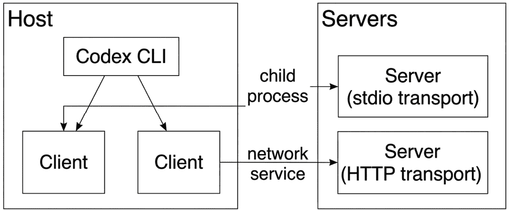

## MCP：消费与服务

### 8.1 双阶段记忆管线

双阶段记忆管线将知识跨会话传递。先提取，后巩固；密钥清洗、基于差异的遗忘和感知使用的选择，使 ~5,000 个 token 的注入预算保持最新。当扁平文件模型不足时，MCP 记忆服务器增加了语义搜索和跨客户端共享。开发者间的团队记忆仍是一个空白；在 Codex CLI 发布原生团队记忆之前，基于 git 的 `SessionStart`/`Stop` 钩子模式是最实用的变通方案。

### 练习

**练习 7-1.** 在你常用的项目上运行一个全新的 Codex CLI 会话。在发布任何任务指令前，使用 `/status` 记录基线 **上下文窗口** 使用量。在 `config.toml` 中禁用一个 MCP 服务器或连接器，重启 Codex CLI，再次运行 `/status`。差值告诉你该单个消费者的成本；由此，你可以决定哪些其他连接器和 MCP 服务器值得占据前缀位置。

**练习 7-2.** 阅读与一项非平凡任务相关的 5 到 10 个源文件，然后执行 `/compact`。尝试在不重读的情况下使用其中某个文件的信息。记录模型保留了什么，以及什么需要重新阅读。这说明了何时应提前读取文件，何时应在使用前立即读取？

**练习 7-3.** 选择一个涉及三个或更多模块的任务。一次作为单会话实现，一次每个模块使用一个子代理实现。通过 `/status` 对比峰值上下文使用量。在何种任务规模下，委派会变得明显有利？

**练习 7-4.** 选择一个同时需要规划和实现的任务。先作为单会话运行，记录规划/实现边界处的上下文使用量。然后再次运行，在一个会话中使用规划模式 (`/plan`)，在一个全新的会话中进行实现。对比两种方法在实现阶段可用的剩余空间。

### 8.2 60 秒读懂 MCP

MCP 是一个开放标准，允许任何 AI 代理通过单一的共享接口与任何外部工具对话。你无需为 GitHub 编写自定义集成代码，再为数据库写不同的代码，再为文档服务器写另一套代码，只需将每个服务配置一次为 MCP 服务器，代理即可通过同一协议消费所有服务。可将其视为代理能力的 USB-C：一个接口，多种设备。

以下是将 Codex CLI 连接到 GitHub MCP 服务器的示例：

**步骤 1.** 导出 GitHub MCP 服务器读取的环境变量：

```bash
export GITHUB_PERSONAL_ACCESS_TOKEN="ghp_your_token_here"
```

从同一个 Shell 启动 Codex CLI，或从一个能透传此环境变量的启动器启动。避免将 token 直接放入 `config.toml`；MCP 服务器进程应在启动时继承它。

**步骤 2.** 将服务器添加到你的 `~/.codex/config.toml`：

```toml
[mcp_servers.github]
enabled = true
command = "npx"
args = ["-y", "@modelcontextprotocol/server-github"]
enabled_tools = ["create_issue", "list_issues", "get_file_contents", "search_code"]
```

**步骤 3.** 重启 Codex CLI 并让它使用 GitHub：

```bash
codex "List the open issues labelled 'bug' in our main repo and summarise them"
```

代理调用 GitHub MCP 服务器的 `list_issues` 工具，接收结构化数据，并对其进行推理。相同的模式适用于数据库、浏览器自动化、文档服务以及任何拥有 MCP 服务器实现的系统。

### 8.3 MCP 是什么（以及不是什么）

MCP 是一个开放协议，定义了代理到工具通信的标准接口。MCP 服务器通过通用线路协议暴露工具、资源和提示词；任何兼容的客户端（Codex CLI、Claude Code、Cursor）均可在无需自定义集成代码的情况下消费它们。

MCP 是一个供应商中立的标准，已捐赠给 Linux 基金会的智能体 AI 基金会 (AAIF)，并通过开放规范流程进行治理。

#### MCP 提供的内容：

1.  一种跨语言和平台边界发现和调用工具的标准方式
2.  工具输入和输出的类型化接口
3.  除工具外，还包含资源（文件、数据）和提示词（模板）的协议
4.  基于工具注解和能力作用域的安全模型

#### MCP 不提供的内容：

1.  它**不是**代理间通信协议。关于代理间协调，请参阅 Google 的 Agent-to-Agent (A2A) 协议。MCP 连接代理与工具；A2A 连接代理与代理。
2.  它**不是**模型服务协议。MCP 服务器提供能力（工具、数据）；它们不提供模型推理服务。

### 8.4 架构：主机、客户端与服务器

MCP 采用三层架构：

1.  **主机：** 用户交互的应用程序（Codex CLI、IDE、Web 应用）。一个主机管理一个或多个客户端。
2.  **客户端：** 主机内部的协议级连接器，维护与**恰好一台**服务器的会话。Codex CLI 为每个配置的服务器创建一个客户端。
3.  **服务器：** 一个通过 MCP 协议暴露工具、资源和提示词的进程。服务器作为子进程运行（stdio 传输）或作为网络服务运行（HTTP 传输）。

主机决定连接哪些服务器、向模型暴露哪些工具，以及如何处理工具调用的审批。服务器无法看到其他服务器或模型的推理过程。

MCP 主机包含 Codex CLI，后者管理每个已连接服务器的一个客户端。每个客户端维护与恰好一台服务器的会话：一个作为子进程连接到 stdio 传输服务器，另一个作为网络服务连接到 HTTP 传输服务器。



*图 8.1 - MCP 主机、客户端和服务器*

### 8.5 工具注解：风险词汇表

MCP 工具注解将机器可读的风险元数据附加到每个工具上，使主机能做出明智的审批决策：

```json
{
  "name": "delete_file",
  "annotations": {
    "readOnlyHint": false,
    "destructiveHint": true,
    "idempotentHint": false,
    "openWorldHint": true
  }
}
```

| **注解** | **含义** |
| :--- | :--- |
| `readOnlyHint` | 工具仅读取数据；无副作用 |
| `destructiveHint` | 工具可能删除或覆盖数据 |
| `idempotentHint` | 重复调用产生相同结果 |
| `openWorldHint` | 工具与代理沙箱外的系统交互 |


Codex CLI 使用这些注解通过适当的审批路径路由工具调用。在 `on-request` 模式下，`readOnlyHint: true` 的工具可能会自动批准；无论何种模式，`destructiveHint: true` 的工具始终需要显式批准。

构建自己的 MCP 服务器时，请诚实地标注每个工具。保守的注解（将仅具写能力的工具标记为破坏性）比乐观的注解更安全。操作员可以放宽审批要求；但无法撤销因工具声称是只读而被自动批准的破坏性操作。

### 连接常用服务器

#### GitHub

规范的第一个 MCP 服务器。配置见开篇示例。大多数工作流有用的 `enabled_tools`：

1. `list_issues`、`create_issue`、`get_issue`：问题分类与管理

2. `get_file_contents`、`search_code`：跨仓库代码搜索

3. `create_pull_request`、`list_pull_requests`：PR 自动化

使用 `enabled_tools` 仅将工作流所需的工具列入白名单。不受限制的 GitHub MCP 服务器会暴露数十个工具，即使代理从未使用它们，每个工具也会消耗上下文窗口空间。

#### 使用 Context7 进行文档查找

`@upstash/context7-mcp` 是 Upstash 的 MCP 服务器，用于获取代理遇到的任何库的当前、特定版本的文档。没有它，代理会从训练数据中回答库相关问题，这些数据可能已过时数月。有了它，代理会在您正在使用的版本中查找实际文档。

```
[mcp_servers.context7]
enabled = true
command = "npx"
args = ["-y", "@upstash/context7-mcp"]
enabled_tools = ["resolve-library-id", "query-docs"]
```

`resolve-library-id` 将自由形式的名称（“Next.js”、“MongoDB”）转换为 Context7 的规范 ID；`query-docs` 检索与特定问题匹配的文档片段。本章作者几乎在每个会话中都运行 Context7。

#### 使用 Playwright 进行浏览器自动化

`@playwright/mcp` 是微软官方的 Playwright MCP 服务器。它驱动真实浏览器，无需视觉模型：服务器暴露结构化的无障碍快照，代理可对其进行推理，这使其非常适合 CI 中的表单填写、导航和 DOM 级断言：

```
[mcp_servers.playwright]
enabled = true
command = "npx"
args = ["-y", "@playwright/mcp@latest"]
```

默认工具集涵盖导航、点击、输入、快照和标签页管理。其他功能（网络模拟、存储操作、视频录制、PDF 生成、基于坐标的鼠标操作、测试断言）可通过命令行上的 `--caps=...` 选择加入。仅列出工作流所需的内容，因为每个功能组都会向上下文窗口添加自己的工具。

#### 数据库访问

数据库服务器允许代理查询并（可选地）写入关系存储。规范的 Postgres 示例是 `@modelcontextprotocol/server-postgres`：

```
[mcp_servers.postgres]
enabled = true
command = "npx"
args = ["-y", "@modelcontextprotocol/server-postgres", "${DATABASE_URL}"]
enabled_tools = ["query"]
```

对于生产数据库，请使用只读连接字符串并仅暴露 `query` 工具。通过 MCP 服务器对生产数据的写入访问应要求与其他生产数据库变更相同的变更管理流程。

### MCP 的上下文成本

每个连接的 MCP 服务器都会向模型的上下文窗口添加工具定义。暴露 20 个带有详细描述的工具的服务器，在代理处理单个提示前就可能消耗数千个 token；大型服务器（如拥有 60 多个工具的完全填充的 GitHub MCP）可能消耗数万个 token。*第 7 章* 的测量工作流（`codex debug prompt-input` 加上分词器）是查看每个连接的服务器在您机器上确切成本的方法。

最廉价的工具是已在上下文中的工具。Codex CLI 的 Shell 执行是内置的，因此 `PATH` 上安装的任何 CLI 都隐式地可供代理使用，而无需添加任何工具模式。对于列出问题、打开拉取请求、读取特定提交的文件或过滤搜索结果等常规 GitHub 操作，`gh` 通常比 GitHub MCP 更好。模型知道如何调用 `gh`，因为它在训练数据中见过大量 `gh` 用法，且 Shell 命令可以通过 `grep`、`jq` 或 `head` 管道预过滤输出，然后再进入上下文。

该模式推广到本章前面介绍的各服务器：

1. **GitHub** 可使用 `gh` 处理问题、PR、文件读取和代码搜索。当您想要由审批注解保护的更丰富工作流时，MCP 服务器胜出。

2. **文档查找** 可在求助于 Context7 前使用 `curl`、`gh api` 或项目自己的 CLI。当您需要模型在训练中未见过的*当前*特定版本文档时，Context7 胜出；对于模型已熟知的流行库，它则落后。

3. **浏览器自动化** 有三条路径。对于只读获取和轻量级抓取，`curl` 足矣。对于编码代理中的程序化浏览器自动化，微软现在明确推荐 `playwright-cli` 工作流而非 MCP 服务器，因为 CLI 调用更节省 token。^(⁶⁴) Playwright MCP 服务器仍是探索性自动化、自愈测试和长期运行的自主工作流的正确选择，因为持久浏览器状态值得其模式成本。

4. **数据库访问** 可使用 `psql`、`mysql` 或项目 ORM 的 CLI。当您想要由运行时而非约定强制执行结构化工具注解（`readOnlyHint`、审批门控）时，MCP 服务器胜出。

决策规则：当您需要结构化工具模式、类型化输入输出或运行时强制的安全注解时，请选择 MCP 服务器。当操作在模型训练数据中已被充分涵盖，且模式成本无法带来 Shell 无法提供的任何收益时，请选择 CLI。

当 MCP 服务器是正确选择时，四个杠杆管理其上下文成本。三个位于 `~/.codex/config.toml`；第四个位于服务器自身的源代码中。

1. **`enabled_tools` 白名单**，在每个 `[mcp_servers.<name>]` 块上设置。将服务器暴露的工具集限制为工作流所需的工具。本章前面的 GitHub 示例使用 `enabled_tools = ["create_issue", "list_issues", "get_file_contents", "search_code"]`，而非服务器默认暴露的数十个工具。未列出的工具不会被加载到上下文中。

2. **服务器级启用开关**，在同一 `[mcp_servers.<name>]` 块上设置。`enabled = false` 保留配置但跳过启动时加载服务器。适用于偶尔使用的服务器；翻转标志即可恢复，无需重写配置。

3. **作用域配置文件**：在配置文件 `~/.codex/<name>.config.toml` 内声明服务器为 `[mcp_servers.<id>]`；仅当您使用 `codex --profile <name>` 激活该配置文件时才加载，因此不需要它的会话无需支付其上下文成本。*第 6 章* 详细介绍了配置文件机制。

4. **工具描述简洁性**，在服务器自身的源代码中设置，作为每个工具定义上的 `description` 参数。构建自定义服务器时，请保持描述简洁。冗长的描述与其他文本一样被分词，并存在于每轮的静态前缀中。

### 企业级 MCP：认证、作用域与限制

企业部署需要控制可用的 MCP 服务器、谁可以使用它们以及它们携带的凭据。

**服务器作用域。** 平台团队分发的托管 `config.toml` 使用文档化的 `mcp_servers.<id>.enabled` 键声明允许的服务器。团队未审核的服务器被显式禁用或完全省略：


### 托管配置：仅这些服务器运行；其余默认禁用。

```
[mcp_servers.github]
enabled = true
# ... command, args, env, enabled_tools 按需填写
[mcp_servers.context7]
enabled = true
# ...
[mcp_servers.unvetted_server]
enabled = false
```

Codex CLI 的配置层意味着开发者本地的 `config.toml` 可以覆盖单个键，但平台团队的托管配置是基线；在敏感服务器上显式设置 `enabled = false` 可以防止在团队级别意外重新启用。*第 17 章*涵盖了完整的企业部署拓扑，包括托管配置如何分发，以及项目范围的覆盖如何与团队策略交互。

**凭证隔离。** MCP 服务器凭证（API 令牌、数据库 URL）应遵循与其他凭证相同的密钥管理实践：在运行时将它们注入服务器进程，切勿提交到配置文件。建议在启动 Codex CLI 之前设置服务器期望的确切环境变量，或使用启动器/包装器从操作系统的密钥存储中读取，然后 `exec` MCP 服务器。除非您的 Codex CLI 版本明确记录了该行为，否则不要假设 Shell 风格的占位符（如 `${GITHUB_TOKEN}`）会在 `config.toml` 内部展开。

**引诱/交互式提问。** MCP 引诱允许服务器在会话中期向用户请求额外信息：提示缺失参数、在破坏性操作前请求确认，或就模糊查询请求澄清。引诱由细粒度审批策略中的 `mcp_elicitations` 审批类别控制。

### 构建简单的 MCP 服务器

MCP 服务器构建简单。使用 `pip install "mcp[cli]"` 安装 SDK，然后使用 `FastMCP` 装饰器 API 编写最小服务器：

```
#### server.py: 使用 FastMCP 的最小 MCP 服务器
from mcp.server.fastmcp import FastMCP
mcp = FastMCP("example-server")
@mcp.tool()
def word_count(text: str) -> int:
    """Count words in the given text."""
    return len(text.split())
if __name__ == "__main__":
    mcp.run()
```

`FastMCP` 自动将函数签名转换为工具模式：`text: str` 成为必需的字符串输入，文档字符串成为工具描述，返回类型映射到工具的输出类型。幕后 SDK 仍使用低级 `Server` API 暴露的相同 JSON-RPC 协议；`FastMCP` 是新服务器的推荐入口点。

通过向 `~/.codex/config.toml` 添加 `[mcp_servers.<name>]` 块将其接入 Codex CLI（如果仅希望在特定配置文件中使用该服务器，也可以作为 `[mcp_servers.<name>]` 放入配置文件 `~/.codex/<name>.config.toml` 内）：

```
[mcp_servers.wordcount]
enabled = true
command = "python"
args = ["/absolute/path/to/server.py"]
```

在 `args` 中使用绝对路径，以便无论从哪个目录启动 Codex 都能启动服务器。替代方案是设置 `cwd` 并保持 `args` 为相对路径：

```
[mcp_servers.wordcount]
enabled = true
command = "python"
args = ["server.py"]
cwd = "/path/to/server/directory"
```

同样的模式可扩展到更大的服务器：使用 `@mcp.tool()` 添加更多装饰函数，并保持每个工具的输入和返回类型显式；MCP 协议处理发现、调用和结果编组。

### 测试 MCP 服务器

在连接到 Codex CLI 之前，在隔离环境中测试 MCP 服务器：

```
##### 如果您已使用 pip 将 SDK 安装到当前环境中
mcp dev server.py
##### 或者，如果您通过 uv 运行 Python 工具
uv run mcp dev server.py
```

这将启动 MCP Inspector，一个可视化调试工具，它启动 FastMCP 服务器，执行协议握手，并允许您交互式地列出和调用工具。使用它确认 `word_count` 带有必需的 `text` 参数出现，然后用示例文本调用它，然后再将服务器接入 Codex CLI。

### MCP 协议两端的 Codex CLI

到目前为止，本章将 Codex CLI 视为 MCP 客户端：它消费服务器。但该协议是对称的，Codex CLI 也可以作为服务器暴露自身，使其工具（文件操作、Shell 执行和代码分析）可供任何连接的代理使用：

```
codex mcp-server
```

该服务器通过 MCP 协议暴露两个工具：

1.  `codex` 启动一个新的 Codex 会话。必需参数是 `prompt`；可选参数覆盖会话的 `model`、`approval-policy`、`sandbox`、`cwd`、`base-instructions` 和 `developer-instructions`。它返回 `{ threadId, content }`。

2.  `codex-reply` 通过传递 `codex` 返回的 `threadId` 以及下一个用户提示，继续现有会话。

第二个 Codex CLI 实例可以将第一个实例作为另一个 MCP 服务器消费。将其添加到编排器的 `~/.codex/config.toml` 中：

```
[mcp_servers.codex_worker]
command = "codex"
args = ["mcp-server"]
enabled_tools = ["codex", "codex-reply"]
```

重启编排器并要求其委派：

```
codex "Use the codex_worker MCP server to read CHANGELOG.md and summarise the last release. Return only the summary."
```

编排器使用提示调用 `codex_worker.codex`；生成的子 Codex 会话读取文件、总结它，并带着线程 ID 返回结果。后续调用使用该线程 ID 调用 `codex_worker.codex-reply`，而不是每次都启动新会话，从而保留工作进程的累积上下文。

在此基础上构建三种模式：

1.  **跨代理委派。** 编排器代理将编码任务委派给 Codex CLI，同时自行处理规划和协调。

2.  **工具组合。** 管道代理将 Codex CLI 与其他 MCP 服务器（数据库、部署、监控）链接，以执行多步骤工作流。

3.  **IDE 集成。** IDE 扩展连接到 Codex CLI 作为 MCP 服务器，在编辑器中提供代理能力。

客户端不必是另一个 Codex CLI；Claude Code、自定义 Python 编排器或 IDE 扩展都通过相同的 MCP 协议与相同的 `codex mcp-server` stdio 进程对话。此后的操作关注点与消费第三方服务器相同，这也是本章剩余部分的内容。

### 在生产环境中运行 MCP

迄今为止的内容让您实现了连接。在生产环境中运行 MCP 会增加四个累积而非重叠的关注点：写回操作比读操作风险更大，需要显式控制；服务器可能失败，需要弹性配置；部署可能移至场外，需要不同的传输；出现问题时，您需要诊断信息来解释原因。本章其余部分按此顺序处理它们。

#### 写回安全

只读 MCP 集成默认安全：代理查询数据并对其进行推理。写回集成则不同。创建工单、发布消息和更新数据库都引入了代理采取用户未批准的操作或重复操作的风险。四个安全不变量应管控启用写入的 MCP 集成：

1.  **显式工具标注。** 写入工具必须标注 `readOnlyHint: false`，并在适用时标注 `destructiveHint: true`。这确保审批系统正确路由它们。

2.  **审批门控调用。** 除最高可信环境外，写入工具应在所有环境中要求显式审批。配置审批策略，将写入型 MCP 工具视同文件系统写入。

3.  **可能时的幂等性。** 设计写入工具使其可安全重试。如果代理会话被中断并恢复，重新调用的写入工具不应创建重复记录。

4.  **审计日志。** 每次写入工具调用都应在审计追踪中记录完整参数和结果。使用 `PostToolUse` 钩子（*第 9 章*）将 MCP 写入操作与文件系统操作一起记录。


### 实践中反复出现的三种模式

**工单系统** (Jira, Linear)：根据代码分析创建工单，根据 CI 结果更新工单状态，并将 PR 关联到工单；将 Agent 的写入范围限制在最小，仅允许创建和评论，不允许重新分配或关闭。

**即时通讯** (Slack, Teams)：发布摘要、警报和状态更新；使用限定频道作用域的令牌，将 Agent 限制在特定频道，而非组织范围内的访问。

**数据库**：编写迁移脚本，插入测试固件，更新配置表；始终使用具有最小必要权限的专用服务账户，切勿使用开发者的个人数据库凭据。

#### 故障恢复能力

写入安全管控 Agent *被允许做什么*；恢复能力管控其所依赖的服务器 *出现异常时会发生什么*。MCP 服务器是外部进程，可能会失败、挂起或返回意外结果，配置不应假设它们总能正常工作。

##### 优雅降级

如果 MCP 服务器不可用，Agent 应继续使用其内置能力，而不是导致整个任务失败。Codex CLI 通常能容忍 MCP 服务器启动失败，但在依赖它用于生产环境前，请针对您的版本验证该行为，并编写不假设 MCP 工具始终可用的提示词。

##### 超时配置

`tool_timeout_sec` 限制任何单次工具调用的运行时长。对于确实需要缓慢工作的服务器（大型仓库搜索、浏览器导航或大表数据库查询），请调高该值；对于其他所有情况保持较短，以防挂起的服务器无限期阻塞 Agent。配套键 `startup_timeout_sec` 管控初始握手过程，详见调试章节。

##### 用于测试的虚拟工具

开发依赖 MCP 服务器的工作流时，请创建返回预设响应的轻量级虚拟服务器。这使您能在不依赖外部服务的情况下测试提示词工程和审批流程。

#### 远程与容器化服务器

当服务器运行在非本地主机上时，故障表现形式会有所不同。MCP 支持 HTTP 传输，用于作为远程基础设施运行而非本地子进程的服务器：

```ini
[mcp_servers.remote_tools]
enabled = true
url = "https://mcp.internal.company.com/tools"
bearer_token_env_var = "MCP_REMOTE_TOKEN"
```

远程传输适用于企业部署，此时 MCP 作为由平台团队管理的共享基础设施运行：一套规范的 GitHub 服务器实例配合一组凭据，而非每个开发者笔记本一套。

为实现更严格的隔离，**Docker MCP Toolkit** 将每个 MCP 服务器运行在各自的容器内，仅赋予其所需的网络访问权限和文件系统挂载。对于企业部署，这是第三方 MCP 服务器可用的最强隔离模型，且容器级的凭据边界使密钥管理变得简单直接。

#### 故障排查指南

无论服务器运行在本地、远程还是容器中，相同的四个诊断步骤可覆盖大多数故障：

1.  **启用详细日志。** 设置 `RUST_LOG=debug`（或 `RUST_LOG=codex=debug` 仅针对 codex crate）以查看完整的 MCP 协议交换。

2.  **检查服务器健康。** 在 Codex CLI REPL 中使用 `/mcp` 命令列出已连接的服务器及其状态。

3.  **隔离测试。** 通过 stdio 直接调用服务器（或通过 MCP Inspector 进行更丰富的调试），验证其在 Codex CLI 之外是否能正确响应。

4.  **检查工具定义。** 审查服务器返回的工具模式，确保其与 Agent 预期的一致。

四种最常见的故障模式直接对应上述步骤：

1.  **服务器启动失败。** 检查配置中的 `command` 和 `args`，验证可执行文件是否在 PATH 中。如果 TUI 显示 `MCP client for '<name>' timed out after 30 seconds`，说明握手超过了默认的 `startup_timeout_sec`。这在 `npx -y` 首次运行下载包时很常见，因为在服务器能响应初始 `tools/list` 请求前，需要先获取并链接包。两种修复方法：在受影响的 `[mcp_servers.<name>]` 块中调高 `startup_timeout_sec`（60 到 120 秒覆盖大多数包下载），或全局安装服务器以便后续启动即时完成，例如为本章前文提到的 GitHub 示例运行 `npm i -g @modelcontextprotocol/server-github`。

2.  **工具未显示。** 验证 `enabled_tools` 是否与服务器暴露的确切工具名称匹配。

3.  **凭据错误。** 确认 MCP 服务器进程能看到其期望的令牌变量。如果令牌在 `gh api` 中有效但通过 MCP 失败，请重启 Codex CLI 并检查 MCP 配置是否未传递字面量占位符，如 `${GITHUB_TOKEN}`。

4.  **上下文占用过高。** 暴露的工具过多；使用 `enabled_tools` 仅将所需工具加入白名单。

### 现状总结

MCP 赋予了 Agent 触达外部系统的能力；本章展示了如何在不失控上下文成本或写入风险的前提下增加这种触达能力。第 9 章 从相反的角度切入：不是给 Agent 更多能力，而是拦截 Agent 已有的能力。Hooks 让您能在 Agent 生命周期的十个明确定义点（工具调用运行前、运行后、会话开始时、压缩触发时）触发脚本，从而在不修改 `AGENTS.md` 的任何一行代码下，实现验证、记录、转换或否决 Agent 的行为。结合本章的杠杆和下一章的生命周期 Hooks，您已拥有大部分用于生产级 Codex CLI 部署的构建模块。

### 概要

1.  **MCP 是标准协议。** 它将 Agent 连接到外部工具和服务，无需为每个集成编写专用接线。
2.  **三层架构。** Host、Client 和 Server 将 Agent 逻辑与工具实现分离。
3.  **工具注解提供风险词汇。** 审批系统利用它们做路由决策。
4.  **按需白名单。** `enabled_tools` 管理上下文成本并减少攻击面。
5.  **构建服务器很直观。** 定义工具并实现其逻辑；协议处理其余事务。
6.  **写回集成需要自律。** 显式注解、审批闸控、幂等性和审计日志。
7.  **企业级 MCP 增加控制。** 服务器准入列表、凭据隔离和引导控制。
8.  **Codex CLI 作为 MCP Server。** 支持跨 Agent 委托和工具组合。
9.  **恢复模式。** 优雅降级、超时和虚拟工具防止 MCP 故障阻塞工作流。

### 练习

**练习 8-1.** 配置带有受限 `enabled_tools` 列表的 GitHub MCP 服务器。运行一个需要 GitHub 访问权限的任务并观察 Agent 调用了哪些工具。然后移除 `enabled_tools` 并对比上下文窗口使用情况。

**练习 8-2.** 用 Python 构建一个自定义 MCP 服务器，暴露两个工具：一个只读（查询）和一个可写（创建）。用适当的风险元数据标注它们。连接到 Codex CLI 并验证写工具需要审批而读工具不需要。

**练习 8-3.** 将 Codex CLI 设置为 MCP 服务器，并将第二个 Codex CLI 实例作为 Client 连接到它。从 Client 向 Server 委派一个编码任务，观察协议如何处理工具发现、调用和结果传递。


