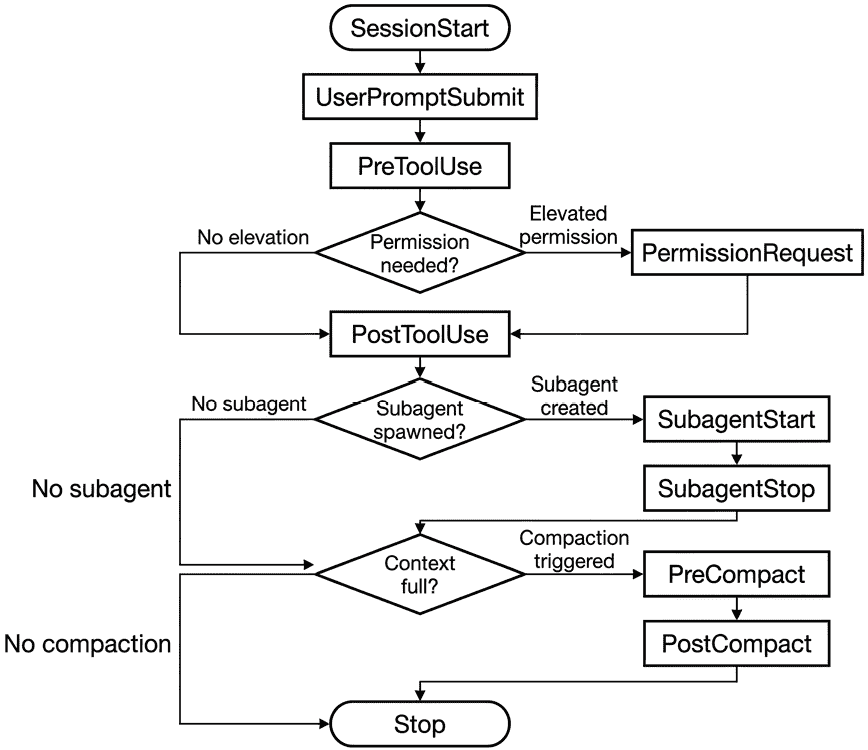

# Hooks：拦截 Agent 生命周期

MCP 向外延伸 Agent 的触达；Hooks 则让您掌控 Agent 自身的生命周期。在十个定义好的节点上，从会话开启到子 Agent 停止，您可以运行 Shell 命令来注入上下文、强制执行策略、记录行为或发送通知，且无需更改 `AGENTS.md` 的任何一行。

### 学习目标

您将能够：

1.  在 `.codex/hooks.json` 中配置所有十个 Hook 事件
2.  编写 Shell 和 Python Hook 脚本，以注入上下文、强制提示词策略、运行测试套件和扫描密钥


### 3. 推理钩子超时、错误处理以及同步执行的权衡

### 钩子系统：概述与事件

钩子是在代理生命周期的特定节点触发的 Shell 命令回调。它们以同步方式运行，并通过 `stdout`、`stderr` 和退出代码来传递结果。当在活动配置层中发现 `hooks.json` 文件，或在 `config.toml` 中存在内联钩子定义时，钩子默认启用。托管环境可通过 `requirements.toml` 集中禁用钩子。

钩子在 Windows 上受全面支持。相同的 `hooks.json` 配置无需平台特定的更改即可在 macOS、Linux 和 Windows 上工作。

Codex CLI 从两个来源读取钩子配置：项目根目录下的 `.codex/hooks.json`，以及 `config.toml` 中内联的 `[[hooks]]` 定义。两者均为热读取；编辑后无需重启即可生效。表 9-1 将十个生命周期事件映射到其主要用例。

**表 9-1. 钩子事件及其特性**

| **事件** | **触发时机** | **Stdout 效果** | **退出码 2 效果** | **可阻塞？** |
| --- | --- | --- | --- | --- |
| `SessionStart` | 会话打开 | 注入模型上下文 | 记录错误；会话继续 | 否 |
| `PreToolUse` | 每次工具调用执行前 | 记录或忽略 | 拒绝工具调用；显示错误 | 是 |
| `PermissionRequest` | 扩展或工具请求提升权限 | 由审批系统读取决策 JSON | 拒绝请求；回退到 TUI | 是 |
| `UserPromptSubmit` | 提交提示词，模型见到它之前 | 追加到提示词 | 拒绝提示词；用户看到 stderr | 是 |
| `PostToolUse` | 每次工具调用完成后 | 记录或忽略 | 记录错误；执行继续 | 否 |
| `PreL1-Bullet` | 上下文压缩开始前 | 记录或忽略 | 记录错误；压缩继续 | 否 |
| `PostL1-Bullet` | 上下文压缩完成后 | 注入压缩后上下文 | 记录错误；会话继续 | 否 |
| `SubagentStart` | 创建子代理，首次模型请求前 | 前置到子代理上下文 | 记录错误；子代理继续 | 否 |
| `SubagentStop` | 子代理轮次接近完成 | 记录或忽略 | 阻止完成（强制继续） | 是 |
| `Stop` | 会话关闭 | 无 | 记录错误；清理继续 | 否 |

`hooks.json` 对象以事件名称为键。每个事件映射到一个钩子组数组；每个组包含一个由单个钩子对象组成的 `hooks` 数组：

```
{
  "hooks": {
    "SessionStart": [
      {
        "hooks": [
          {
            "type": "command",
            "command": "bash ~/.codex/scripts/inject-context.sh",
            "statusMessage": "Loading project context…",
            "timeout": 15
          }
        ]
      }
    ]
  }
}
```

每个组内部嵌套的 `hooks` 数组并非错误。外层数组存放钩子组；每个组存放单个钩子。此结构支持有条件的组激活。

#### config.toml 中的内联配置

钩子也可在 `config.toml` 中内联定义，将双文件设置合并为单一配置界面：

```
#### .codex/config.toml
[[hooks.SessionStart]]
[[hooks.SessionStart.hooks]]
type = "command"
command = "bash ~/.codex/scripts/inject-context.sh"
statusMessage = "Loading project context..."
timeout = 15
[[hooks.PostToolUse]]
[[hooks.PostToolUse.hooks]]
type = "command"
command = "bash ~/.codex/scripts/auto-test.sh"
statusMessage = "Running tests..."
timeout = 60
```

`hooks.json` 和内联 `config.toml` 定义可同时受支持。当两者都存在时，来自所有来源的钩子按发现顺序触发。内联格式在托管的 `requirements.toml` 中也受支持，适用于集中强制执行钩子策略的企业环境。

#### MCP 与 apply_patch 观测

`PreToolUse` 和 `PostToolUse` 同样观测 MCP 工具调用（以 `mcp__<server>__<tool>` 为前缀）以及 `apply_patch` 和 `Bash`。带有类似 `"mcp__docs__search"` 匹配器的 `PreToolUse` 钩子可在 MCP 工具调用执行前将其拦截、审计或阻止。

这支持一个 MCP 审计钩子，它记录每个 MCP 工具调用及其完整的请求和响应负载，以供合规审查：

```
{
  "hooks": {
    "PostToolUse": [
      {
        "matcher": "mcp__*",
        "hooks": [
          {
            "type": "command",
            "command": "bash ~/.codex/scripts/mcp-audit.sh",
            "statusMessage": "Auditing MCP call...",
            "timeout": 5
          }
        ]
      }
    ]
  }
}
```

### 生命周期事件

这十个事件大致按代理会话遍历它们的顺序触发：会话打开、提示词到达、工具执行、上下文压缩、子代理生成与返回、会话关闭。本节将按该顺序逐一介绍每个事件，涵盖配置、契约及实战示例。



图 9.1 - 钩子生命周期事件

一张流程图，追踪钩子生命周期事件的有序触发，始于 `SessionStart` 和 `UserPromptSubmit`，继而 `PreToolUse`。它在权限检查处分支，提升权限时会在 `PostToolUse` 前插入 `PermissionRequest`。它在子代理检查处再次分支，生成的子代理运行 `SubagentStart` 和 `SubagentStop`。最后在上下文已满时分支，发生压缩时触发 `PreL1-Bullet` 和 `PostL1-Bullet`。所有路径最终汇聚于 `Stop`。

#### SessionStart：配置环境

`SessionStart` 在模型处理任何用户输入前执行一次。这是放置会在 `AGENTS.md` 中过时的动态上下文的正确位置。退出码为 `0` 时，Codex CLI 会在第一轮对话前将脚本的 `stdout` 注入模型的上下文。请保持此输出结构化且简短；每个 Token 都会占用你的上下文窗口（见第 7 章）。

```
#!/usr/bin/env bash
##### ~/.codex/scripts/inject-context.sh
BRANCH=$(git rev-parse --abbrev-ref HEAD 2>/dev/null || echo "unknown")
TICKET=$(echo "$BRANCH" | grep -oE '[A-Z]+-[0-9]+' | head -1)
DIRTY=$(git status --porcelain 2>/dev/null | wc -l | tr -d ' ')
echo "## Session Context"
echo "- Branch: $BRANCH"
echo "- Jira ticket: ${TICKET:-none detected}"
echo "- Uncommitted files: $DIRTY"
if [ -f ".codex/project-notes.md" ]; then
  echo ""
  cat .codex/project-notes.md
fi
```

将此脚本接入你的 `hooks.json`：

```
{
  "hooks": {
    "SessionStart": [
      {
        "hooks": [
          {
            "type": "command",
            "command": "bash ~/.codex/scripts/inject-context.sh",
            "statusMessage": "Loading branch context…",
            "timeout": 10
          }
        ]
      }
    ]
  }
}
```

退出码 `2` 会记录错误但会话继续（不同于 `UserPromptSubmit`，后者退出码 `2` 会阻止提示词）。如果上下文注入失败，会话将在没有注入上下文的情况下打开。

`SessionStart` 在 `stdin` 上包含一个 `source` 字段，其值为 `startup`、`resume`、`clear` 或 `compact` 之一。如果你的脚本在全新启动与恢复或 `/clear` 后重新打开时应表现不同，可根据此字段分支处理。

#### UserPromptSubmit：在代理行动前塑造输入

`UserPromptSubmit` 在你按下回车后、模型见到文本前、提示词进入会话历史前触发。用它用样板内容增强提示词，或拒绝违反策略的提示词。

##### 增强提示词

退出码为 `0` 时，Codex CLI 将钩子的 `stdout` 追加到你的提示词中：

```
#!/usr/bin/env bash
###### ~/.codex/scripts/append-test-status.sh
###### 追加当前测试套件状态，以便代理始终知道什么在失败
FAILING=$(python -m pytest --tb=no -q 2>&1 | tail -5)
if [ -n "$FAILING" ]; then
  echo ""
  echo "### Current test status"
  echo "$FAILING"
fi
```

用于复杂增强逻辑的 Python 等效实现：

```
#!/usr/bin/env python3
###### ~/.codex/scripts/append-context.py
import subprocess, sys, os
result = subprocess.run(
  ["python", "-m", "pytest", "--tb=no", "-q"],
  capture_output=True, text=True
)
if result.returncode != 0:
  lines = result.stdout.strip().splitlines()[-5:]
  print("\n### Current test status")
  print("\n".join(lines))
```

##### 阻止提示词


退出代码 `2` 将直接拒绝该提示词；它永远不会到达模型，也不会进入历史记录：

```bash
#!/usr/bin/env bash
###### ~/.codex/scripts/prompt-policy.sh
###### 阻止直接推送到 main 分支的请求
set -euo pipefail
###### UserPromptSubmit 通过 stdin 传递一个 JSON 对象；文本位于 `.prompt` 字段中。
PROMPT="$(jq -r '.prompt // empty')"
if printf '%s' "$PROMPT" | grep -qi 'push.*main\|force.push\|--force'; then
 echo "提示词已阻止：禁止直接推送到 main 分支。请改为开启 PR。" >&2
 exit 2
fi
```

`UserPromptSubmit` 钩子通过 stdin 接收以 JSON 对象形式提交的提示词，文本位于 `prompt` 字段中（以及 `session_id`、`cwd` 和 `hook_event_name` 等通用字段旁）。如本例所示，请使用 `jq -r '.prompt'` 来提取它，而不是尝试从环境变量获取：stdin JSON 是文档规定的标准通道。

请为 `UserPromptSubmit` 钩子设置严格的 `timeout`。因为该钩子会阻止提示词继续执行，缓慢的脚本会让代理显得故障。五秒通常足以完成策略检查；当你需要在模型行动前获得测试反馈时，三十秒对测试运行器来说是合理的。

#### PreToolUse：拦截 Shell 命令

`PreToolUse` 在每次工具调用执行前触发，是唯一能阻止工具调用运行的钩子。它适用于 `Bash` 工具调用、MCP 工具调用（前缀为 `mcp__<server>__<tool>`）以及 `apply_patch`。配置 `matcher` 以定位相关工具类型：

```json
{
 "hooks": {
 "PreToolUse": [
 {
 "matcher": "Bash",
 "hooks": [
 {
 "type": "command",
 "command": "bash ~/.codex/scripts/pre-tool-policy.sh",
 "statusMessage": "正在检查命令策略……",
 "timeout": 5
 }
 ]
 }
 ]
 }
}
```

退出代码 `2` 拒绝工具调用。退出代码 `0` 允许其继续执行。

若要阻止对特定路径的文件写入操作，请使用 Codex CLI 的 `sandbox_mode` 或 `AGENTS.md` 指令，而非 `PreToolUse`。

#### PermissionRequest：可编程审批

`PermissionRequest` 允许外部脚本以编程方式批准或拒绝权限请求，当钩子未返回决策时，将回退到标准的 TUI 审批流程。Shell 命令、统一执行和网络审批提示均会触发此事件。

钩子接收完整的请求上下文（命令、沙箱状态和自动审查结果），并返回三种裁决之一：

```json
{"hookSpecificOutput": {"decision": {"behavior": "allow"}}}
{"hookSpecificOutput": {"decision": {"behavior": "deny", "message": "该代理角色不允许写入 /etc"}}}
{"hookSpecificOutput": {"decision": null}}
```

当 `decision` 为 `null`（或钩子退出时未写入决策）时，标准 TUI 提示将作为后备方案出现。`PermissionRequest` 钩子扩展了审批系统，而非取代它。

四种常见模式：

1.  **CI/CD 自动审批。** 钩子检查命令是否匹配已知安全的允许列表（`npm test`、`make lint`）并自动批准；未知命令升级为人工审核。
2.  **策略即代码。** 钩子调用 OPA 或 Cedar 策略引擎，根据项目、分支和角色约束评估请求。
3.  **审计追踪记录。** 每个审批决策连同完整上下文被转发至 SIEM 或可观测性平台，独立于裁决结果。
4.  **多代理委托作用域。** 编排器钩子仅在子代理的行为落在父代理委托权限范围内时才予以批准。

审批系统由此成为可编程的安全层，而非仅是用户界面功能。*第 5 章* 在审批模式架构中全面介绍了 `PermissionRequest` 钩子。

#### PostToolUse：观察而不阻塞

`PostToolUse` 在每次工具调用完成后触发。工具已经运行完毕；你观察的是事后状态，而非把守动作。常见用途：

1.  每次文件写入后运行测试套件并将结果注回上下文
2.  文件写入后立即扫描修改过的文件以查找密钥或凭据^(⁶⁵)
3.  为每个执行的 shell 命令向审计追踪追加结构化日志条目
4.  代理运行敏感操作时发送通知

Python 编写的测试保存钩子：

```python
#!/usr/bin/env python3
##### ~/.codex/scripts/post-tool-test-runner.py
import subprocess, sys, json, os
##### 如果提供，从 stdin 读取工具调用详情
tool_info = {}
try:
 import json
 tool_info = json.load(sys.stdin)
except Exception:
 pass
tool_name = tool_info.get("tool_name", "")
##### Codex 规范的文件写入工具是 apply_patch
if tool_name not in ("apply_patch", ""):
 sys.exit(0)
result = subprocess.run(
 ["python", "-m", "pytest", "--tb=short", "-q", "--no-header"],
 capture_output=True, text=True, timeout=60
)
if result.returncode != 0:
 # 退出码 0 但向 stdout 写入输出，以便结果作为上下文可用
 print("### 写入后测试结果")
 print(result.stdout[-2000:]) # 裁剪以避免上下文泛滥
sys.exit(0)
```

`PostToolUse` 的 stdout 处理遵循与其他钩子事件相同的协议：退出码 `0` 并向 stdout 写入结构化输出。

#### PreL1-Bullet 和 PostL1-Bullet：上下文 L1-Bullet 钩子

`PreL1-Bullet` 和 `PostL1-Bullet` 在上下文压缩前后触发。当 `/compact` 运行时（手动或通过自动压缩触发器），会话历史会被总结，详细的工具调用轨迹将丢失。`PreL1-Bullet` 在压缩开始前触发；`PostL1-Bullet` 在压缩完成后触发。两个钩子均通过 stdin 接收 JSON 对象（与每个命令钩子一样）。压缩专用字段如下：

| **字段** | **描述** |
| --- | --- |
| `session_id` | 当前会话标识符 |
| `turn_id` | 触发压缩时的轮次 |
| `trigger` | 压缩的发起方式：`manual`（用户输入 `/compact`）或 `auto`（达到上下文窗口阈值） |

这些钩子仅用于审计。它们无法阻止压缩，也无法访问完整的压缩前上下文内容。`PreL1-Bullet` 作为通知触发；`PostL1-Bullet` 的 stdout 会被注入到压缩后的上下文中，这使其成为重新注入压缩本会丢弃的关键信息的机制。

规范模式是*压缩记忆*：压缩前保存关键上下文，压缩后重新注入。

```bash
#!/usr/bin/env bash
##### ~/.codex/scripts/pre-compact.sh — PreL1-Bullet 钩子
##### 在压缩丢弃详细历史前保存关键状态
INPUT="$(cat)"
SESSION_ID="$(printf '%s' "$INPUT" | jq -r '.session_id // "unknown"')"
TURN_ID="$(printf '%s' "$INPUT" | jq -r '.turn_id // 0')"
TRIGGER="$(printf '%s' "$INPUT" | jq -r '.trigger // "unknown"')"
COMPACT_DIR="$HOME/.codex/compact-state"
mkdir -p "$COMPACT_DIR"
##### 捕获代理应记住的当前状态
cat > "$COMPACT_DIR/session-${SESSION_ID}.json" << EOF
{
 "session_id": "${SESSION_ID}",
 "turn": ${TURN_ID},
 "trigger": "${TRIGGER}",
 "branch": "$(git rev-parse --abbrev-ref HEAD 2>/dev/null || echo unknown)",
 "uncommitted_files": $(git status --porcelain 2>/dev/null | wc -l | tr -d ' '),
 "test_status": "$(python -m pytest --tb=no -q 2>&1 | tail -1)"
}
EOF
```

```bash
#!/usr/bin/env bash
##### ~/.codex/scripts/post-compact.sh — PostL1-Bullet 钩子
##### 压缩后重新注入关键状态
INPUT="$(cat)"
SESSION_ID="$(printf '%s' "$INPUT" | jq -r '.session_id // "unknown"')"
TURN_ID="$(printf '%s' "$INPUT" | jq -r '.turn_id // 0')"
TRIGGER="$(printf '%s' "$INPUT" | jq -r '.trigger // "unknown"')"
COMPACT_DIR="$HOME/.codex/compact-state"
STATE_FILE="$COMPACT_DIR/session-${SESSION_ID}.json"
if [ -f "$STATE_FILE" ]; then
 echo "## 压缩后上下文恢复"
 echo "会话于第 ${TURN_ID} 轮被压缩（触发方式：${TRIGGER}）。"
 echo "压缩前保存的状态："
 cat "$STATE_FILE"
 echo ""
 echo "从此状态恢复工作。详细的工具调用历史不再可用。"
fi
```

将两者接入 `hooks.json`：


对于运行长周期智能体会话（数小时的自主工作）的团队，压缩钩子能让关键上下文在压缩边界间存活下来：正在处理哪些文件、测试状态如何、已做出哪些架构决策。*第 7 章*涵盖了互补的上下文保留策略。

#### SubagentStart 和 SubagentStop：子智能体边界钩子

`SubagentStart` 和 `SubagentStop` 在子智能体边界触发。它们填补了纯顶层生命周期钩子留下的多智能体可观测性空白。

当 Codex CLI 创建一个线程生成的子智能体时，`SubagentStart` 会在子智能体发送其首个模型请求前触发一次。这是一个上下文注入钩子：处理程序可返回 `hookSpecificOutput.additionalContext`，该内容会在子智能体的初始模型调用前被前置到其对话中。该钩子接收子智能体的 `agent_id`（线程标识符）和 `agent_type`（从 `spawn_agent` 调用解析而来）。

当子智能体轮次即将完成时，`SubagentStop` 会触发，取代常规根智能体 `Stop` 钩子对子智能体的作用。它接收相同的 `agent_id` 和 `agent_type` 字段，外加 `agent_transcript_path`（子智能体的完整对话日志）和 `last_assistant_message`（子智能体的最终输出）。`SubagentStop` 还支持完成控制：处理程序可携带理由阻塞以强制子智能体继续，或提供自定义停止理由。

两个钩子均通过 `agent_type` 匹配器使用基于类型的路由。你可以在编排工作流中为 `researcher`、`implementer` 和 `reviewer` 子智能体类型连接不同的钩子，每种类型拥有自己的上下文注入和质量把关逻辑。

```json
{
  "hooks": {
    "SubagentStart": [
      {
        "matcher": "reviewer",
        "hooks": [
          {
            "type": "command",
            "command": "bash ~/.codex/scripts/inject-review-context.sh",
            "statusMessage": "Injecting reviewer context...",
            "timeout": 5
          }
        ]
      }
    ],
    "SubagentStop": [
      {
        "matcher": "implementer",
        "hooks": [
          {
            "type": "command",
            "command": "bash ~/.codex/scripts/check-implementation-quality.sh",
            "statusMessage": "Checking implementation quality...",
            "timeout": 10
          }
        ]
      }
    ]
  }
}
```

这些钩子衍生出三种治理模式：

1.  **生成时注入上下文。** `SubagentStart` 钩子在创建时将团队特定约束、合规指令或特定角色的 `AGENTS.md` 内容注入每个子智能体，无需将所有内容烘焙进父智能体的提示词中。

2.  **子智能体输出的质量把关。** `SubagentStop` 钩子检查子智能体的最终消息和记录，实现审查/拒绝/继续模式。若输出未通过策略检查，钩子阻塞完成，子智能体继续工作。

3.  **逐子智能体审计追踪。** `SubagentStop` 上的 `agent_transcript_path` 字段指向每个子智能体的完整对话，支持多智能体运行的事后分析和逐子智能体的 Token 计数以进行成本归因。

结合线程产物持久化，这些钩子形成了完整的子智能体生命周期：启动时注入上下文、运行中产出产物、停止时检查结果。*第 11 章*涵盖了这些钩子所管辖的子智能体架构。

#### Stop：拆卸与清理

`Stop` 在会话结束时触发。它不向模型上下文注入内容；退出码 `2` 会记录错误但不阻止拆卸：

```json
{
  "hooks": {
    "Stop": [
      {
        "hooks": [
          {
            "type": "command",
            "command": "bash ~/.codex/scripts/on-stop.sh",
            "statusMessage": "Wrapping up...",
            "timeout": 10
          }
        ]
      }
    ]
  }
}
```

典型的 `on-stop.sh`：

```bash
#!/usr/bin/env bash
##### ~/.codex/scripts/on-stop.sh
TIMESTAMP=$(date -u +"%Y-%m-%dT%H:%M:%SZ")
BRANCH=$(git rev-parse --abbrev-ref HEAD 2>/dev/null || echo "unknown")
#### 审计日志
echo "$TIMESTAMP branch=$BRANCH user=$USER" >> ~/.codex/session-audit.log
##### 桌面通知（特定平台）
if command -v notify-send &>/dev/null; then
  notify-send "Codex" "Session complete on $BRANCH"
elif command -v osascript &>/dev/null; then
  osascript -e "display notification \"Session complete on $BRANCH\" with title \"Codex\""
fi
##### Slack Webhook（若已配置）
if [ -n "$CODEX_SLACK_WEBHOOK" ]; then
  curl -s -X POST "$CODEX_SLACK_WEBHOOK" \
    -H 'Content-type: application/json' \
    --data "{\"text\":\"Codex session ended on \`$BRANCH\` at $TIMESTAMP\"}" \
    > /dev/null
fi
```

### 编写健壮的钩子

**积极设置超时。** 30 秒的 `UserPromptSubmit` 钩子意味着每次提示词提交前模型都要等待 30 秒。典型值：策略检查 5 秒，上下文注入 10 到 15 秒，测试运行器 30 到 60 秒。

**防范 stdout 体量过大。** `SessionStart` 和 `UserPromptSubmit` 将 stdout 注入模型上下文。无界限的日志倾倒会无声地消耗数千 Token。裁剪至模型所需的内容。

**优雅处理缺失依赖。** 依赖失败（缺少 venv、无 Slack token）应静默退出 `0`，而非退出 `2` 并阻塞会话。保留退出码 `2` 给刻意的策略拒绝。

**理解钩子状态渲染。** 钩子状态消息在 TUI 的专用实时区域渲染。显示在 300ms 延迟后出现（避免快速钩子闪烁），完成后停留 600ms 以便阅读结果，并在多个钩子同时触发时将并行钩子折叠为紧凑的状态行。设计 `statusMessage` 字符串使其一目了然；它们可能共享屏幕空间。

**隔离测试钩子。** 在添加到 `hooks.json` 前，从终端运行你的钩子脚本。验证退出码、stdout 和 stderr 是否符合预期。

开发阶段在 bash 钩子中添加 `set -euo pipefail` 以尽早捕获错误，生产环境则替换为更有选择性的错误处理。静默失败比喧闹失败更难调试，尤其是在你迭代时。

### 模式：执行、审计与通知

下述钩子配方构建于上一节的事件之上。每个都足够小，可放入 `.codex/scripts/` 并用三四行 JSON 接入。

#### 每次提交提示词时进行风格检查

将 linter 检查接入 `UserPromptSubmit`，这样模型在编辑代码前始终知晓当前的 lint 状态：

```bash
#!/usr/bin/env bash
##### 将 ruff 输出追加到每个提示词
OUTPUT=$(ruff check . --output-format=concise 2>&1 | head -20)
if [ -n "$OUTPUT" ]; then
  echo ""
  echo "### Linter state (ruff)"
  echo "$OUTPUT"
fi
```

#### 每次文件写入时进行密钥扫描

使用 `PostToolUse` 在智能体写入后立即扫描密钥：^(⁶⁶)

```bash
#!/usr/bin/env bash
##### ~/.codex/scripts/secret-scan.sh
##### 需要：gitleaks (https://github.com/gitleaks/gitleaks)
if ! command -v gitleaks &>/dev/null; then
  exit 0
fi
OUTPUT=$(gitleaks detect --source . --no-git -q 2>&1)
if [ $? -ne 0 ]; then
  echo "### Secret scan warning"
  echo "$OUTPUT" | head -20
fi
```

#### 网络操作上的中间人攻击检测

安全意识强的部署可使用 `PostToolUse` 钩子在智能体网络操作期间检测中间人攻击。该模式针对网络相关工具（`curl`、`wget`、API 调用）并检查 SSL 证书链中的异常，这些异常暗示拦截或 DNS 操纵。若钩子检测到可疑证书（非预期颁发者、缩短的链、不匹配的 SAN），它会向 stderr 写入警告并以退出码 `2` 退出以标记会话：


#!/usr/bin/env bash
##### ~/.codex/scripts/mitm-detect.sh
##### PostToolUse 钩子：检查证书链异常
TOOL_CMD="$(jq -r '.tool_input.command // empty')"
##### 仅检查网络相关的工具调用
echo "$TOOL_CMD" | grep -qiE 'curl|wget|http|fetch|requests' || exit 0
##### 从命令中提取最近的目标主机
HOST=$(echo "$TOOL_CMD" | perl -pe 's#.*https?://##; s#[:/ ].*##' | head -1)
[ -z "$HOST" ] && exit 0
##### 验证证书链；标记意外的颁发者或过短的链
CERT_INFO=$(echo | openssl s_client -connect "$HOST:443" -servername "$HOST" 2>/dev/null)
ISSUER=$(echo "$CERT_INFO" | openssl x509 -noout -issuer 2>/dev/null)
DEPTH=$(echo "$CERT_INFO" | grep -c "^ [0-9]")
if echo "$ISSUER" | grep -qiE 'mitmproxy|burp|charles|fiddler|zscaler'; then
 echo "### MITM 警告" >&2
 echo "为 $HOST 检测到可疑的证书颁发者: $ISSUER" >&2
 exit 2
fi
if [ "$DEPTH" -lt 2 ]; then
 echo "### MITM 警告" >&2
 echo "$HOST 的证书链意外地短 (depth=$DEPTH)" >&2
 exit 2
fi

将其接入 `PostToolUse` 并使用 `Bash` 匹配器，以便它检查代理执行的每一个 shell 命令。将其与秘钥扫描钩子搭配使用，以同时覆盖凭证泄露和传输层拦截。

#### 审计日志

#!/usr/bin/env bash
ENTRY=$(python3 -c "
import json, os, time, subprocess
branch = subprocess.getoutput('git rev-parse --abbrev-ref HEAD')
print(json.dumps({
 'ts': time.strftime('%Y-%m-%dT%H:%M:%SZ', time.gmtime()),
 'user': os.environ.get('USER', 'unknown'),
 'branch': branch,
 'cwd': os.getcwd(),
}))
")
echo "$ENTRY" >> ~/.codex/audit.jsonl

#### 会话结束时的 Slack 通知

#!/usr/bin/env bash
[ -z "$CODEX_SLACK_WEBHOOK" ] && exit 0
BRANCH=$(git rev-parse --abbrev-ref HEAD 2>/dev/null || echo "unknown")
MSG="Codex 会话结束 | 分支: \`$BRANCH\` | 用户: $USER"
curl -s -X POST "$CODEX_SLACK_WEBHOOK" \
 -H 'Content-type: application/json' \
 --data "{\"text\":\"$MSG\"}" > /dev/null

#### 结合 PreToolUse 和 PostToolUse 的企业生命周期治理

对于企业部署，钩子成为治理层而非便利功能。`PreToolUse` 和 `PostToolUse` 形成了一个前后拦截对，可在每次工具执行时强制执行组织策略。^(⁶⁷)

##### PreToolUse 治理模式：

1.  **危险工具拦截。** 将工具名称与拒绝列表匹配，并返回带有解释的拒绝判决。无论审批模式如何，这都能防止代理执行破坏性命令（数据库删除、强制推送、生产部署）：

    ```
    {
     "hooks": {
     "PreToolUse": [{
     "matcher": "^Bash$",
     "hooks": [{
     "type": "command",
     "command": "/usr/local/bin/enterprise-tool-policy.sh",
     "timeout": 10
     }]
     }]
     }
    }
    ```

2.  **合规性检查。** 在任何文件编辑前，验证目标路径是否在代理的授权范围内。钩子可强制要求在功能分支上工作的代理绝不修改共享基础设施文件、`/etc/` 中的配置，或其分配模块以外的文件。

3.  **执行前审计日志。** 在工具调用执行前，将每个拟议的工具调用写入不可变的审计日志，捕获工具名称、输入参数、时间戳和会话上下文。这将创建一条独立于工具调用成败的取证追踪。

##### PostToolUse 治理模式：

1.  **合规性扫描。** 在每次文件写入后，运行自动化检查（许可证头验证、导入限制、命名规范强制执行），并通过 stdout 将纠正指导注入代理的上下文中。

2.  **变更归因。** 使用代理会话 ID 和任务标识符标记每次文件修改，实现从变更行回溯到产生该变更的特定代理运行的可追溯性。

3.  **指标收集。** 汇总工具执行结果（成功/失败率、持续时间分布、资源消耗）到团队级仪表板，用于容量规划。

所有配置层级的所有匹配钩子并发执行。企业平台团队可以通过 `requirements.toml` 强制要求治理钩子（个人开发者无法覆盖），而项目团队在仓库层级添加自己的钩子。这两组钩子是组合而非冲突关系。

#### 自进化代理重训练循环

一个更具雄心的应用是映射自 OpenAI Cookbook 重训练循环的自进化代理模式。^(⁶⁸) 该模式使用闭环反馈：`PostToolUse` 钩子在每次工具执行后运行综合评分，当分数低于阈值时，元提示词代理生成改进的指令来替换当前的 `AGENTS.md`。

综合评分管道使用四个互补的评分器以防止单一指标优化：

| **评分器** | **类型** | **目的** |
| --- | --- | --- |
| 实体保留 | 基于规则 | 确保关键术语在转换中幸存 |
| 长度约束 | 确定性 | 将目标输出大小保持在容差范围内 |
| 语义一致性 | 余弦相似度 | 防止内容偏移 |
| 整体质量 | LLM 作评判者 | 捕捉规则遗漏的细微信号 |

钩子在带有 `Bash` 匹配器的 `PostToolUse` 上触发。当平均分低于阈值（通常为 0.85）时，系统触发元提示词优化过程来修订 `AGENTS.md`。改进版本会被提交到 git，在提交信息中包含评分分数，从而创建提示词演进的可审计历史。

该模式需要在评估基础设施上进行大量前期投资，仅适用于高风险、大批量的工作流，在这些工作流中评估成本（每次基准运行约 74,000 tokens）是合理的。对于大多数团队，前文描述的简单钩子模式才是正确的起点。

### 工具

一旦钩子脚本存在，下一个问题是如何运维它们：观察其运行时性能、在不编辑文件的情况下启用/禁用它们、跨团队分发它们，以及让委托决策在 TUI 中可见。

#### /hooks 浏览器

在会话中输入 `/hooks` 会打开一个运行时浏览器，列出每个事件、针对它安装的钩子数量以及当前活跃的钩子数量：

```
钩子
来自配置和已启用插件的生命周期钩子。
事件                  已安装      活跃        描述
PreToolUse            1           1           工具执行前
PermissionRequest     0           0           请求权限时
PostToolUse           3           2           工具执行后
PreL1-Bullet            1           1           上下文压缩前
PostL1-Bullet           1           1           上下文压缩后
SessionStart          1           1           新会话开始时
UserPromptSubmit      2           1           用户提交提示词时
SubagentStart         1           1           创建子代理时
SubagentStop          1           0           子代理结束其轮次前
Stop                  1           1           Codex 结束其轮次前
```

两列最重要。**已安装** 统计在所有配置源中找到的钩子定义数量：项目 `hooks.json`、 `config.toml` 中的内联 `[[hooks]]` 块、托管的 `requirements.toml` 和插件包。**活跃** 统计其中当前启用了多少个。在上图中，开发者安装了三个 `PostToolUse` 钩子（测试运行器、秘钥扫描、MITM 检查），但在调试会话期间禁用了测试运行器，并完全关闭了一个缓慢的 `SubagentStop` 质量门控。


从浏览器中，您可以在不从配置中移除钩子的情况下单独切换各个钩子的开启或关闭状态，这在本地开发时需要运行速度较慢的 `PostToolUse` 钩子，但在无头 `codex exec` 运行中希望跳过该钩子时非常有用。切换状态是持久化的：启用/禁用决策存储在 `$CODEX_HOME` 下，并且可以在会话重启、沙箱重置和机器重启后保留。托管的 `requirements.toml` 策略仍会覆盖持久化状态，因此如果管理员强制要求某个钩子，开发者无法持久化地禁用它。

关于每次调用的统计信息（计数、时长、失败率），请使用下文所述的 OpenTelemetry 管道，而不是浏览器。

#### 钩子运行的 OpenTelemetry 指标

钩子会发出结构化的 OpenTelemetry Span。每次调用都会生成一个带有事件类型、钩子命令、退出代码和挂钟时长标签的 Span。这些 Span 会流经任何兼容 OTEL 的 Collector，因此使用 Datadog、Grafana、Honeycomb 或类似技术栈的团队无需自定义管道即可监控钩子延迟、失败率和调用分布。

一个实用的起点：在 `[otel]` 下配置 OTLP 导出器。钩子 Span 与其他所有内容通过同一个导出器流动；没有单独的钩子开关。

```
#### .codex/config.toml
[otel]
trace_exporter = { kind = "otlp-http", endpoint = "http://localhost:4317", protocol = "grpc" }
metrics_exporter = { kind = "otlp-http", endpoint = "http://localhost:4317", protocol = "grpc" }
```

当 Span 开始流动时，您可以构建仪表板来回答诸如“哪些 `PreToolUse` 钩子增加了最多延迟？”或“多少百分比的 `PostToolUse` 调用以非零代码退出？”等问题。对于在多种事件类型中运行数十个钩子的团队，这将钩子性能从一个黑盒变成了一个一流的可观测子系统。将 OpenTelemetry 指标与审计日志模式结合使用，可同时获得实时仪表板和持久的离线记录。

在团队环境中部署钩子时，请固定 Codex CLI 版本，并在升级前查看变更日志。

#### 插件捆绑钩子

钩子可以作为插件的一部分分发，而非独立脚本。当插件包含带有钩子定义的 `hooks/` 目录时，安装该插件会注册这些钩子；无需编辑 `hooks.json`。注册市场（`codex plugin marketplace add owner/repo`）并安装其插件之一，可以在一次操作中接入 `PostToolUse` 密钥扫描器和 `PreToolUse` 命令策略检查器。

钩子继承插件的生命周期：卸载插件会移除其钩子，更新插件会更新其钩子。托管的 `requirements.toml` 策略可以强制要求特定插件（及其捆绑的钩子），为企业管理员提供了一条清晰的执行路径：要求一个插件，即可获得其钩子。

#### 委托补丁审批渲染

当补丁审批被委托时（例如委托给自动审查器 `auto_review` 或自定义的 `PermissionRequest` 钩子），TUI 会渲染委托详情：审查者身份、风险级别，以及审批是自动进行还是升级处理。对于使用组合审批模式的团队（低风险变更由钩子处理，高风险变更由人工审查），这种视觉区分使得信任边界一目了然。

### 总结

1.  **十个生命周期事件，十个钩子。** `SessionStart`、`UserPromptSubmit`、`PreToolUse`、`PostToolUse`、`PreL1-Bullet`、`PostL1-Bullet`、`SubagentStart`、`SubagentStop`、`PermissionRequest` 和 `Stop`。每个都在定义点以定义契约触发。

2.  **上下文注入钩子。** `SessionStart` 在第一轮之前注入新鲜上下文；`UserPromptSubmit` 可在模型看到提示词之前对其进行增强或拒绝。

3.  **工具调用钩子。** `PreToolUse` 在每次工具调用（Bash、MCP 或 `apply_patch`）之前触发并可阻止它；`PostToolUse` 观察每次已完成的调用，准备运行测试、扫描密钥或追加观察结果。

4.  **L1-Bullet 记忆模式。** `PreL1-Bullet` 和 `PostL1-Bullet` 在上下文压缩前后触发；在压缩前保存关键状态并在压缩后重新注入，可解决长周期会话的信息丢失问题。

5.  **子代理边界钩子。** `SubagentStart` 和 `SubagentStop` 支持在子代理首次模型请求前注入上下文，以及在其输出返回父代理前进行质量把关。通过 `agent_type` 进行基于类型的路由，可为每个子代理角色连接不同的治理逻辑。

6.  **共享退出代码协议。** 退出代码 `0` 并输出 stdout 表示成功；退出代码 `2` 并输出 stderr 表示阻塞；其他代码表示静默失败。钩子同步运行，因此超时很重要；注入上下文的输出计入上下文窗口。

7.  **钩子塑造生命周期，AGENTS.md 设定规则。** AGENTS.md 是静态的，钩子是动态的；沙箱审批模式在执行前控制工具调用，而 `PostToolUse` 在执行后观察它们；MCP 向外扩展能力，而钩子塑造生命周期。

8.  **权限控制与运行时管理。** `PermissionRequest` 钩子允许外部脚本批准或拒绝权限请求，并可回退到 TUI。`/hooks` 浏览器可在运行时列出和切换钩子；切换状态持久化在 `$CODEX_HOME` 下。插件捆绑钩子让团队能通过插件市场分发可复用的质量门禁。

**另请参阅：** *第 19 章* **(测试与评估)。** `PostToolUse` 测试保存模式是代理测试循环的一半。*第 19 章* 介绍了另一半：设计一个密闭的、确定性的、足够快的测试套件，以便代理在每次文件写入后都能可靠地运行。

### 练习

1.  **分支感知上下文注入。** 编写一个 `SessionStart` 钩子，读取当前 Git 分支，从分支名称中提取 Jira 或 GitHub Issue 编号（例如 `feat/GH-1234-add-login`），并通过调用 `gh issue view` 注入单段摘要。在有无 Issue 编号的分支上分别测试。

2.  **保存即测试观察者。** 实现一个 `PostToolUse` 钩子，在每次文件写入后运行 `pytest -q --tb=line` 并将摘要行写入 stdout。通过在代理写入文件后立即询问“当前测试状态是什么？”，验证摘要是否出现在上下文中。

3.  **完整生命周期集成。** 将 `SessionStart`、`UserPromptSubmit`、`PreToolUse`、`PostToolUse` 和 `Stop` 组合到单个 `hooks.json` 中。设置保守的超时，在每个 Bash 脚本中添加 `set -euo pipefail`，并在 `.codex/scripts/` 内的 README 中记录每个钩子。运行三个会话并查看审计日志。找出至少一处钩子增加意外延迟的情况，并解释如何减少它。


