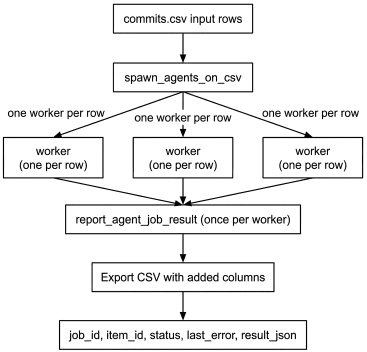
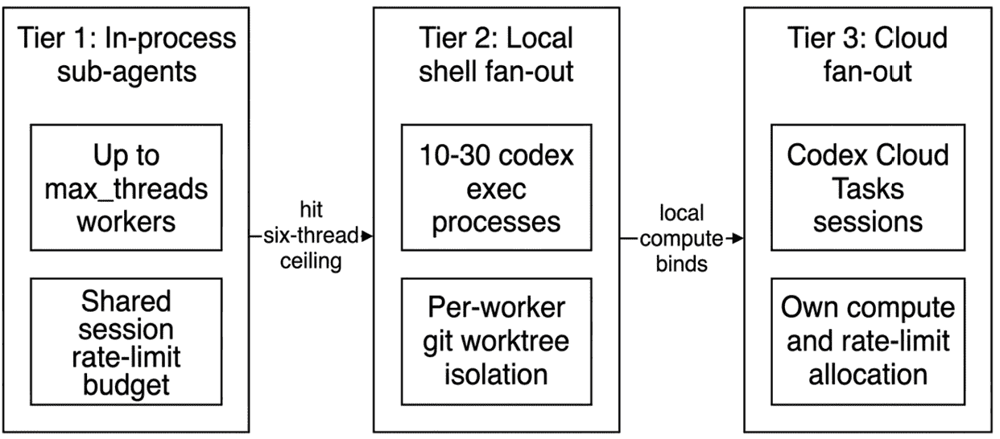

# 第十一章：子代理与并行执行

*第 10 章*将子代理委托作为重置上下文窗口时钟的一种策略引入：启动一个拥有自己全新窗口的新线程，以处理会淹没父代理的工作。本章将充分展开该策略。

当任务天然具有并行性（对一百个文件进行 lint 检查、翻译十几个模块、总结一周的拉取请求描述）时，单线程会成为瓶颈。当任务超出一个上下文窗口时，你需要一种移交工作的方式。当某个子任务的失败不应导致整个作业中止时，你需要隔离性。Codex CLI 通过子代理系统同时解决了这三个问题：一组共享会话但拥有各自独立的上下文、模型、沙箱和工具权限的代理线程。

### 学习目标

你将能够：

1.  描述三个内置代理，并判断何时值得定义自定义代理。
2.  编写包含正确必需字段和可选字段的 TOML 代理定义。
3.  使用 `spawn_agents_on_csv` 将工作分配到 CSV 输入中并聚合结果文件。
4.  根据作业的规模和形状，在进程内子代理、带工作树的本地 Shell 扇出和 Codex 云任务之间进行选择。
5.  识别使并行性成为糟糕默认选项的资源和速率限制成本。

### 子代理模型

#### 内置代理

Codex CLI 自带三个代理：`default`、`worker` 和 `explorer`。你进行输入交互的会话即为 `default` 代理。另外两个是专用线程，无需编写任何配置即可将工作移交给它们：

1.  `worker` 专注于执行。用于你想要一个未被规划对话污染的全新上下文的实现任务。
2.  `explorer` 侧重于读取。用于代码库探索，此时父代理不应吸收探索者读取的每个文件。

Codex 仅在你要求时才会生成子代理。你通过自然语言告诉父代理将工作移交给内置代理：“生成一个 explorer 来梳理仓库中对 `payment_service` 的所有引用”，或“使用 worker 应用补丁并运行测试”。父代理决定哪个内置代理合适并启动线程。没有自动路由器会检查任务并为你在 `worker` 和 `explorer` 之间做选择。

内置代理涵盖了大多数一次性委托场景。只有当你想要一组特定的指令集、不同的模型、更严格的沙箱或受限的工具列表以保持一致应用时，才需要自定义代理。

#### 在线程间切换

在 REPL 中使用 `/agent` 可在活动线程间切换并检查正在进行的线程。如果有一个父代理和一个生成的 `worker`，选择器如下所示：

```
Subagents
Select an agent to watch.  + ← previous,  + → next.
' 1. • Main [default] (current)  019eb02d-9b91-7370-b503-7179f1ed731d
  2. • Boyle [worker]            019eb02e-b7a1-7dc0-8b38-f7ff725e00d3
```

每行显示三项内容：昵称（`Main`、`Boyle`）、方括号中的代理角色（`default`、`worker`）以及线程的 UUID。`Main` 是保留给会话自身线程的标签；其他每个线程都以科学、数学或哲学领域的著名历史人物命名（Boyle、Euclid、Hypatia、Lovelace、Turing 等）。Codex 从内置的约一百个名字列表中抽取，因此三个 worker 的扇出会显示为三个不同的行，而不是三个相同的 `worker` 条目。

当非活动线程需要批准（例如需要确认的工具调用）时，Codex 会带上来源标签呈现请求，以便你知道是哪个线程在请求。按 `o` 可在批准前打开该线程，以便查看请求来源的上下文。

应用于父代理的权限和沙箱覆盖会传播给从它生成的子代理。切换到只读模式的父代理不会悄悄地将一个具备写入能力的全新沙箱交给子代理。

#### 自定义代理定义

自定义代理是单表 TOML 文件。将其放置在 `~/.codex/agents/<name>.toml` 以供个人在所有项目中使用，或放在 `.codex/agents/<name>.toml` 以随项目分发。

有三个必需字段：

| **字段** | **描述** |
| --- | --- |
| `name` | 用于调用代理和标记其输出的稳定标识符 |
| `description` | 简短摘要；显示在代理选择器中 |
| `developer_instructions` | 代理的系统指令，以多行字符串形式编写 |

五个可选字段可覆盖代理从父会话继承的内容：

| **字段** | **描述** |
| --- | --- |
| `model` | 模型标识符（`gpt-5.5`、`gpt-5.4`、`gpt-5.4-mini`） |
| `model_reasoning_effort` | `low`、`medium`、`high` 或 `xhigh` |
| `sandbox_mode` | `read-only`、`workspace-write` 或 `danger-full-access` |
| `mcp_servers` | 该代理可使用的 MCP 服务器名称数组 |
| `nickname_candidates` | 并发运行多个实例时使用的显示标签 |

一个在数据库迁移脚本登陆主分支前对其进行审计的代理的完整定义：


#### 迁移审计代理配置

```
name = "migration-auditor"
description = "审查 SQL 迁移脚本的不可逆操作、重锁操作和不安全排序。"
model = "gpt-5.4"
model_reasoning_effort = "high"
sandbox_mode = "read-only"
nickname_candidates = ["Codd", "Stonebraker", "Hellerstein", "DeWitt", "Widom"]
developer_instructions = """
你在 SQL 迁移脚本应用到生产数据库之前对其进行审计。
对于你读取的每个文件，请在以下三个标题下报告发现：
- 不可逆：DROP、RENAME、NOT NULL 添加、或无回滚路径的列类型收窄。
- 重锁：在大表上持有排他锁足够长时间以阻塞写入的语句（DROP COLUMN、Postgres < 11 上带默认值的 ADD COLUMN、某些索引操作）。
- 顺序敏感：其结果取决于迁移是从头到尾运行，还是在部分失败后重新运行的操作。
引用每个发现的文件和行号。不要提出修复方案；拥有该迁移的团队决定如何补救。
"""
```

不存在表数组格式。每个文件一个代理，按其功能命名。`migration-auditor` 位于 `.codex/agents/migration-auditor.toml`，无论父代理生成多少副本，都作为 `migration-auditor` 调用。

`nickname_candidates` 为多个此代理实例同时运行时使用的显示标签设定主题。默认情况下，Codex 从内置的约一百位科学、数学和哲学历史人物列表（欧几里得、希帕提亚、洛夫莱斯、图灵……）中挑选，因此三个审查代理的扇出会在 `/agent` 选择器中显示为三个不同的行，而不是三个相同的 `reviewer` 条目。提供 `nickname_candidates` 将仅为此代理覆盖该列表，因此 `migration-auditor` 将显示为 `Codd`、`Stonebraker`、`Hellerstein` 等，按数组顺序依次选取。列表必须包含唯一条目，且这些值仅用于展示：Codex 仍通过其 `name` 标识和生成代理，因此提示“生成 migration-auditor”无论实例最终获得哪个昵称都能工作。

要触发代理，请在发给父代理的提示中命名它。例如：

> 对 `db/migrations/2026-06/` 下的每个文件生成 `migration-auditor`，并返回一个按文件分组、严重程度按不可逆优先排序的 Markdown 报告。

父代理将 `migration-auditor` 读取为对自定义定义的引用，使用 TOML 文件中的模型、沙箱和指令生成线程，并在完成时将结果聚合回对话。相同的提示结构对 `worker` 和 `explorer` 也有效，无需磁盘上的任何配置。

#### 为子代理选择模型

对于执行机械工作（静态检查、格式化、提取结构化数据）的工作代理，使用更便宜或更快的模型；将更强大的模型留给父代理用于规划和聚合。`gpt-5.4-mini` 通常比旗舰模型更适合子代理工作角色；当工作代理本身进行大量推理时，`gpt-5.5` 更合理。省略 `model` 以从父代理继承。

#### 会话级限制

`config.toml` 中 `[agents]` 下的三个设置管辖会话中的每个子代理：

| **键** | **默认值** | **控制内容** |
| --- | --- | --- |
| `max_threads` | `6` | 最大并发打开代理线程数 |
| `max_depth` | `1` | 嵌套深度：`1` 允许父代理的直接子代理，不允许孙代理 |
| `job_max_runtime_seconds` | — | `spawn_agents_on_csv` 的默认每工作代理超时 |

这些是会话级的，而非按代理。默认值特意保守。六个并发线程足以应对大多数扇出而不触及速率限制，将嵌套限制在一层可防止广泛的委派指令演变为重复扇出，这会复合令牌使用量、延迟和本地资源消耗。当你有明确理由并了解你的速率限制和令牌预算能承受什么时，再提高任一限制。

每个子代理都计入其所用模型的账户级速率限制。六个 `gpt-5.5` 工作代理的扇出会比六个 `gpt-5.4-mini` 更早触及限制。将模型选择与槽位数量匹配。

### 任务分解

#### 并行化什么

在你写下第一行 TOML 之前，决定你的任务是否是好的候选项。每个工作项独立、输入稳定、输出离散的任务非常出色。需要共享可变状态、有序执行或紧密协调的任务是差的候选项，并行化后往往变慢。

**表 11-1. 任务类型及其对子代理并行化的适用性**

| **任务类型** | **适合并行化？** | **备注** |
| --- | --- | --- |
| 文件静态检查 | 是 | 每个文件独立；结果可轻松聚合 |
| 每模块单元测试生成 | 是 | 模块间很少共享可变状态 |
| 翻译和本地化 | 是 | 每个字符串或文件独立 |
| 拉取请求摘要 | 是 | 只读；自然扇出到 PR 列表 |
| 代码审查评论 | 是 | 按文件或差异隔离很直观 |
| 依赖图分析 | 否 | 一步的输出是下一步的输入 |
| 顺序数据库迁移 | 否 | 顺序重要；并发工作代理使回滚复杂 |
| 跨文件重命名重构 | 否 | 工作代理会在共享符号表上冲突 |
| 大文件分块处理 | 有条件 | 块间无相互引用则可行；上下文跨块渗透则失败 |
| 带速率限制的 API 抓取 | 有条件 | 扇出有助吞吐但需要共享速率限制预算 |

用依赖图思考。宽而浅（同一层级有许多独立项）可并行化。深而窄（依赖步骤链）保持顺序。混合型在父代理中并行化宽的部分，保持窄的脊柱顺序。

当你不确定两个任务是否真正独立时，问：“如果工作代理 A 和 B 以不同顺序完成，最终结果会变吗？”如果是，它们有依赖。在父代理的编排逻辑中使该依赖显式化。

#### 何时不并行化

并行化有成本。每个子代理消耗一个 `max_threads` 槽位，为上下文窗口开销（系统提示、工具描述、脚手架）消耗令牌，并增加父代理等待最慢工作代理的延迟。阿姆达尔定律对代理同样适用。^(⁹⁸)

三种你应该抵制并行化冲动的情况：

**任务本身已足够快。** 如果顺序代理在四十秒内处理十个文件而截止时间是几分钟，生成十个工作代理的开销（上下文设置、调度、聚合）可能比节省的更多。先测量再优化。

**共享状态使隔离不可能。** 如果工作代理需要读写同一可变资源（数据库表、共享文件、API 对象），你在锁和冲突解决上花费的精力将超过并行化节省的。重构任务让工作代理写入独立输出（单独文件、单独行、单独端点），然后在父代理中合并。

**扇出过宽超出速率限制。** 五百个工作代理同时击中同一模型会立即触发限流，运行时的排队反而会串行化执行，只不过现在你加载了五百个上下文。较窄的扇出往往完成得更快，因为它避免了限流惩罚。

从 `max_threads` 默认值 `6` 开始，遇到限流再降低。默认值针对你最可能遇到的限制校准；未测量前提高它是过早优化。


并行处理也存在认知成本。并行工作流更难调试，也更难向阅读你 `AGENTS.md` 的下一个人解释。如果顺序方法清晰且并行方法巧妙，请优先选择清晰度。

### CSV 扇出

#### spawn_agents_on_csv

最常见的并行化模式是 CSV 扇出。`spawn_agents_on_csv` 接收一个 CSV 文件、一个指令模板和作业控制参数，然后为每一行生成一个工作线程。每个工作线程作为独立线程运行，拥有自己的上下文窗口。

撰写本文时，`spawn_agents_on_csv` 工作流处于实验阶段，因此参数名称和默认值可能会发生变化。它所依赖的多智能体协作工具由 `multi_agent` 功能提供，该功能默认启用：

```
[features]
multi_agent = true
```

因为 `multi_agent` 默认开启，通常无需配置。如果你的配置中禁用了它，重新启用将恢复完整的子智能体功能，包括 `spawn_agents_on_csv`。在未暴露 CSV 工具的运行时中，扇出请求将回退到稍后本节描述的手动生成并等待模式。

参数如下：

| **参数** | **描述** |
| --- | --- |
| `csv_path` | 输入 CSV 文件路径 |
| `instruction` | 工作提示词，`{column_name}` 占位符将按行替换 |
| `id_column` | 可选，提供稳定的逐项标识符的列 |
| `output_schema` | 可选，每个工作线程结果必须满足的 JSON Schema |
| `output_csv_path` | 运行时写入结果 CSV 的路径 |
| `max_concurrency` | 该作业的最大并发工作线程数 |
| `max_runtime_seconds` | 每个工作线程的超时时间（秒） |

##### 实战示例

结合本书所在的代码仓库。假设你想对发布分支上的每个提交进行分类，以便从数据而非记忆中编写发布说明。你将提交日志导出到 `commits.csv`（这些是手稿分支上的真实 SHA；尝试提示词时请替换为你自己的）：

```
sha,author,subject
662e3dd,Daniel Vaughan,reviewed chapter 10
cd0265b,Daniel Vaughan,reviewed chapter 9
fc75f35,Daniel Vaughan,reviewed chapter 8
045e3bb,Daniel Vaughan,reviewed chapter 7
f6ec750,Daniel Vaughan,reviewed chapter 6
```

`spawn_agents_on_csv` 是父智能体调用的工具，而非你在 REPL 中输入或写入脚本的语法。你用自然语言向父智能体发出指令，它会发出工具调用。在未暴露该工具的运行时中，父智能体会透明地回退到为每一行生成一个子智能体并等待收集结果。工作流相同；仅中间管道不同。类似这样的提示词：

> 对 `commits.csv` 运行 `spawn_agents_on_csv`，使用 `sha`、`author` 和 `subject` 列。对于每一行，读取提交差异并写一段两句话的备注，描述变更内容及原因。输出到 `commit-review.csv`。将并发数限制在三个工作线程，每个超时时间设为两分钟。

将生成如下形状的工具调用：

```
spawn_agents_on_csv(
  csv_path = "commits.csv",
  instruction = "Read commit {sha} by {author}, subject: '{subject}'. Inspect the diff and write a two-sentence note describing what changed and why. Output only the note, no preamble.",
  id_column = "sha",
  output_csv_path = "commit-review.csv",
  max_concurrency = 3,
  max_runtime_seconds = 120
)
```

运行时生成三个工作线程（每行一个），将列值替换到指令中，并将结果 CSV 写入你提供的路径。



**Figure 11.1 - spawn_agents_on_csv 数据流**

输入 CSV 行喂入 `spawn_agents_on_csv`，后者按行扇出一个工作线程。每个工作线程调用一次 `report_agent_job_result`，运行时导出的 CSV 将新增 `job_id`、`item_id`、`status`、`last_error` 和 `result_json` 列。

占位符使用 `{column_name}` 语法，而非 Shell 风格的 `$INPUT` 或 `$1`。运行时会替换它找到的每一个 `{name}`，因此列名必须是有效的占位符标识符（无空格、无标点，下划线除外）。

#### 报告结果

每个工作线程必须**恰好调用一次** `report_agent_job_result`。该调用是工作线程将输出交回给编排器的方式。如果工作线程退出时未调用它，运行时将为该行记录失败。

设置 `output_schema` 时，工作线程的结果必须通过模式校验。这是保证工作线程输出结构诚实可靠的最佳方式。进一步推进提交审查扇出：不再要求自由文本备注，而是要求每个工作线程返回结构化记录。修订后的提示词：

> 使用 `output_schema` 重新运行提交审查扇出。每个工作线程应返回 `sha` 字符串、标识提交涉及章节的 `chapter` 字符串（或 `none`）、来自 `tech_review`、`rewrite`、`copy_edit`、`restructure` 或 `fix` 的 `edit_kind`，以及描述变更的 `note`。

将生成携带此模式的工具调用：

```
output_schema = {
  "type": "object",
  "required": ["sha", "chapter", "edit_kind", "note"],
  "properties": {
    "sha": { "type": "string" },
    "chapter": { "type": "string" },
    "edit_kind": {
      "type": "string",
      "enum": ["tech_review", "rewrite", "copy_edit", "restructure", "fix"]
    },
    "note": { "type": "string" }
  }
}
```

返回散文而非所需 JSON 对象的工作线程将收到结构化错误，而非破坏结果文件。相同的模式适用于任何扇出：声明一次模式，每个工作线程要么生成符合要求的行，要么被记录为失败。

#### 从结果 CSV 聚合

导出的 CSV 包含每行原始数据外加运行时添加的五列：

| **列** | **含义** |
| --- | --- |
| `job_id` | 标识整体 `spawn_agents_on_csv` 调用 |
| `item_id` | 每行标识符（来自 `id_column`，若未设则为行索引） |
| `status` | `completed`、`failed` 或 `cancelled`（终态；从未启动的行不会出现在导出中） |
| `last_error` | 若 `status` 非 `completed`，则为错误信息 |
| `result_json` | 工作线程的结构化输出（若提供 `output_schema` 则与其匹配） |

聚合即读取 CSV。没有 `wait_agents_all` 系列；父智能体不在句柄上阻塞。它启动扇出，运行时写入结果文件，父智能体在需要数据时读取文件。按 `status` 分区可将成功与失败分开，决定是否重试，然后继续。

扇出完成后父智能体运行的典型聚合循环：

```
After spawn_agents_on_csv completes:
1. Read commit-review.csv.
2. Separate rows where status == "completed" from rows where status != "completed".
3. For each failure, if last_error contains "rate limit", queue the row for retry.
4. Wait 30 seconds, then re-run spawn_agents_on_csv on the retry queue.
5. Merge retry results into the success set.
6. Group successes by chapter and produce a Markdown release-notes draft, one section per chapter and one bullet per commit.
```

父智能体能很好地用自然语言处理这种条件重试逻辑。对于更复杂的重试策略（指数退避、死信队列、幂等性检查），请在常规脚本中实现聚合逻辑，让父智能体将其作为工具调用，而非内联推理。

**不要**指示父智能体无限重试。始终指定最大重试次数。没有终止条件的循环代理会在大致相同的程度上耗尽你的预算和耐心。

### 跨会话扩展

#### 三个层级

Codex CLI 的并行处理体系是一个三层栈。第一层即本章所述内容。第二、三层用于超出第一层能力的作业：


##### 第一层级：进程内子代理

单个 Codex CLI 会话中最多可运行 `max_threads` 个并发工作线程，共享该会话的速率限制预算。最适合父代理需要与工作线程紧密协作、并在同一对话中读取聚合结果的任务。

##### 第二层级：本地 Shell 扇出

外部脚本启动多个独立的 Codex CLI 进程，每个进程在各自的 Git 工作树中运行，实现文件系统隔离。工作树是仓库在独立分支上的一个检出副本，它与主检出共享同一个 `.git` 目录，因此多个进程可以在同一个仓库中编辑文件，而不会发生写入冲突。Shell 脚本、GNU Parallel、`xargs` 或自定义的 Python 编排工具可启动十到三十个并发的 `codex exec` 调用，每个调用针对不同的文件或模块。工作树隔离（*第 13 章*）是关键推动因素：每个实例在自己的分支和工作目录中运行，消除了工作线程间的文件级冲突。

##### 第三层级：云端扇出

Codex 云任务将每个工作单元作为云托管会话运行，拥有独立的算力、上下文窗口和速率限制分配。当本地机器资源成为瓶颈，或需要在夜间运行任务而不必让笔记本保持唤醒时，适用此层级。

从第一层级开始。当你持续触及六线程上限时，升级到第二层级。当本地算力或连接性成为约束瓶颈时，升级到第三层级。



**图 11.2 - 三个并行层级**

第一层级在单进程内运行子代理，最多 `max_threads` 个，共享会话速率限制预算。当你触及六线程上限时，升级到第二层级，它通过带有逐工作线程 Git 工作树隔离的本地 `codex exec` 进程进行扇出。当本地算力成为瓶颈时，升级到第三层级，Codex 云任务会话各自获得独立的算力和速率限制分配。

#### 利用工作树隔离进行 Shell 扇出

一个典型的第二层级脚本：

```
#!/bin/bash
##### fan-out.sh — 利用工作树隔离并行处理文件
MAX_WORKERS=20
TASK_FILE="files-to-process.txt"
process_file() {
  local file="$1"
  local worktree
  worktree="$(mktemp -d)"
  git worktree add "$worktree" -b "worker-$(basename "$file")" HEAD --quiet
  cd "$worktree" || exit 1
  codex exec -m gpt-5.4-mini -s workspace-write \
    "根据项目风格指南对 $file 进行 lint 检查并修复" \
    2>"$worktree/codex.log"
}
export -f process_file
xargs -P "$MAX_WORKERS" -I {} bash -c 'process_file "$@"' _ {} < "$TASK_FILE"
```

这在标准开发机器上可扩展至二十到三十个并发工作线程。每个工作线程在隔离的工作树中操作，因此文件写入永不冲突。所有工作线程完成后，主分支通过合并或挑拣（cherry-pick）收集结果。完整的工作树工作流请参见*第 13 章*。

### 运维考量

#### 子代理与 MCP 服务器

当子代理调用 MCP 工具时，MCP 服务器进程并不总能被及时清理。标准 I/O 传输的 MCP 服务器（配置了 `command` 而非 `url`）会生成子进程，这些进程可能比启动它们的子代理存活得更久，在长会话中不断累积。

其影响呈乘法关系：`子代理数量 × MCP 服务器数量 × 每服务器进程数 × 每进程内存`。一个繁重的会话（四十个工作线程，五个 MCP 服务器，每个两个进程）可能在父会话结束前泄露数百个进程，消耗数 GB 内存。

##### 防御模式

**在长会话中监控 MCP 进程数量。** 一个统计进程数并在超出阈值时告警的看门狗脚本，能在泄露变得痛苦前捕获它：

```
#!/usr/bin/env bash
###### mcp-watchdog.sh — 当 MCP 进程数超过阈值时告警
THRESHOLD=${1:-50}
COUNT=$(pgrep -f 'mcp' | wc -l)
if [ "$COUNT" -gt "$THRESHOLD" ]; then
  echo "WARNING: $COUNT MCP processes detected (threshold: $THRESHOLD)"
fi
```

**在服务器支持的情况下优先使用 HTTP 传输。** 配置了 `url` 而非 `command` 的 MCP 服务器不会生成本地子进程：

```
[mcp_servers.my-server]
url = "https://mcp.example.com/sse"
```

**在大批次之间重启。** 对于 CI，建议每个作业使用一次 Codex CLI 调用，而不是持久的代理 Pod。泄露与单个进程内的子代理生成数量成正比，因此全新的进程会重置计数。

**为 MCP 密集型工作限制 `max_threads`。** 将 `max_threads` 从六降至三，可使使用标准 I/O MCP 服务器的任何扇出操作的峰值进程数减半。

如果你未使用标准 I/O MCP 服务器，则无需担心此问题。HTTP 和内置工具调用（文件编辑、Shell、网络获取）不存在此行为。

#### 子代理无助（甚至有害）的场景

并行主动损害效果的两种模式：

**具有单一正确答案的任务。** 具有特定补丁的 Bug 修复、lint 和格式化通行、确定性迁移以及安全漏洞修复，只有一个正确的输出。多个工作线程探索不同方案只会增加成本而不增值，因为你最终会丢弃除唯一正确答案外的所有内容。应改用高推理力的单个代理运行。

**以输出多样性为目标的任务。** 头脑风暴、探索性架构草图、多视角代码审查和文档草稿受益于发散性：不同工作线程产出不同框架才是重点。这些是扇出值得其开销的场景。判断你的任务落在哪一侧，是决定并行是助你还是浪费你 Token 的关键判断。

Xu 等人给这一直觉赋予了正式名称：**指标自由度**，定义为 `F = 1 − ρ(D_out, D_score)`，即工作线程输出多样性与评估分数多样性之间的秩相关性。^99 高 F（输出多样性与分数多样性不相关）意味着存在许多有效答案，并行增加价值。低 F（僵化指标，偏离即受罚）意味着只有一个正确答案，高推理力的单个代理优于扇出。论文测量的技能提升在同一任务的不同指标上从 +28% 摆动到 −2%，取决于 F。对于任何你打算常规并行化的任务，计算 F 值很有必要。

### 总结

1.  **子代理是单会话内的专用线程。** 三个内置代理覆盖大多数一次性委派：`default`（会话本身）、`worker`（执行）和 `explorer`（读密集型探索）。

2.  **自定义代理是单表 TOML。** 存储在 `~/.codex/agents/` 或 `.codex/agents/` 中，包含三个必填字段（`name`、`description`、`developer_instructions`）以及一小组可选字段，用于覆盖从父会话继承的设置。

3.  **三个会话级限制。** `agents.max_threads`（默认 `6`）、`agents.max_depth`（默认 1）和 `agents.job_max_runtime_seconds` 约束整个会话，而非单个代理。

4.  **CSV 扇出用于批量工作。** `spawn_agents_on_csv` 接受一个 CSV、一个使用 `{column_name}` 占位符的 `instruction` 模板以及作业控制参数。每个工作线程调用一次 `report_agent_job_result`。结果从导出的 CSV 聚合而来，并补充了 `job_id`、`item_id`、`status`、`last_error` 和 `result_json`。撰写时仍处于实验阶段；预计参数会演变。

5.  **三个并行层级。** 单会话内的进程内子代理；跨 Git 工作树（*第 13 章*）中 `codex exec` 调用的本地 Shell 扇出；面向需要独立于本地资源的云算力或速率限制分配的作业的 Codex 云任务。


# 6. 两大操作隐患

调用 stdio 传输 MCP 服务器的子代理可能会在长会话中泄露子进程；请改用 HTTP 传输、监控进程数量，或在批次之间重启以限制影响。而且并行并非总是正解：对于只有一种正确输出的任务，由一个高推理力代理处理效果更好，而非让多个工作线程探索不同路径。

# 7. 任务分解才是难点

TOML 语法易学。判断并行有益处的场景，以及会产生脆弱、昂贵工作流的场景，这种判断力更难培养，也更有价值。

*第 14 章* 将通过考察多代理工作的成本维度来拓展这一基础：如何预测并控制编排器层与工作层的 API 支出。

### 练习

1.  **定义一个测试运行器代理。** 在 `.codex/agents/test-runner.toml` 编写自定义代理定义，运行测试文件并返回 JSON 报告。该代理应使用 `gpt-5.4-mini`、`read-only` 沙箱，且指令需告知其针对指令中提供的路径运行 `pytest --json-report`。手动针对三个测试文件调用它，确认结构化输出在各次运行中保持一致。

2.  **将顺序工作流转为扇出模式。** 获取一个逐个处理 Markdown 文件列表的顺序父代理工作流，将其转换为 `spawn_agents_on_csv` 扇出模式。使用 `output_schema` 固定工作器输出形状。用二十个文件列表分别测量转换前后的墙钟时间。并行版本在文件数达到多少时变得更快？

3.  **审计任务的并行性。** 结合你实际工作的代码库或项目，对照表 11-1 中的任务类型进行审查。找出当前串行执行但可从并行化中受益的两个任务。在编写任何代码前，为每个任务编写简要分解计划（输入、代理定义、聚合策略、故障处理）。


