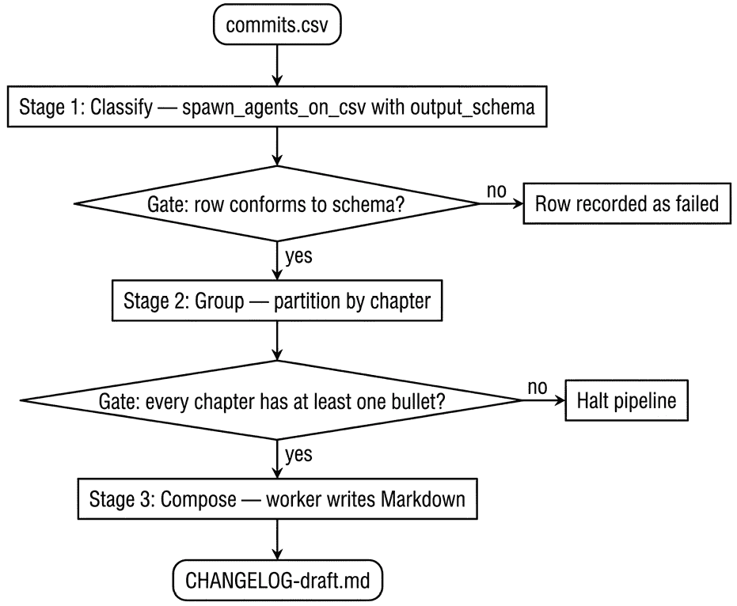
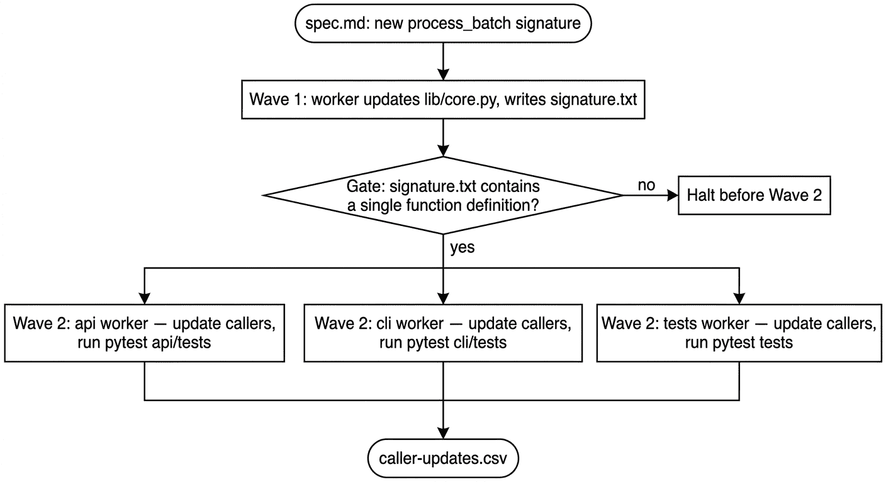
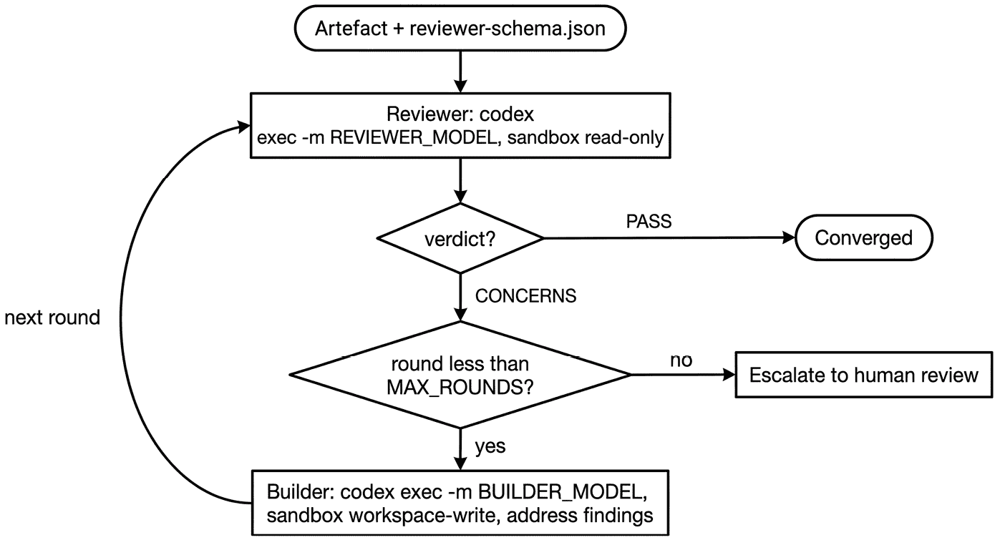
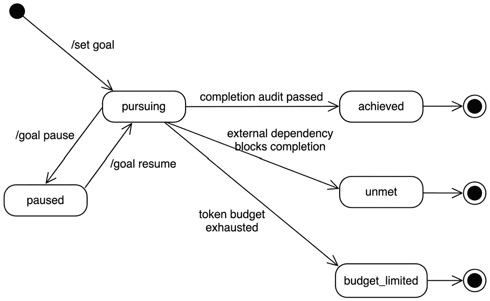

# 多代理编排模式

*第 11 章* 介绍了子代理原语：内置代理、自定义 TOML 定义、`spawn_agents_on_csv` 扇出，以及 `[agents]` 会话限制。掌握这些后，你可以生成一个专业化线程，或让上百个工作器跨 CSV 并行。但这些材料尚未说明：如何将这些原语组合成多步流水线，如何从外部驱动 Codex CLI 会话，或如何交给代理一个持久目标，让它跨多轮对话朝完成方向推进。

本章讲的是组合。内容涵盖：生产级 Codex CLI 工作中反复出现的四种编排模式（顺序门控链、基于波次的混合模式、跨模型审查循环、迭代修复循环）、让开发者化身轻量级监督者的会话分支命令（`/fork`、`/side`）、将任意模式包裹在持久目标中的 `/goal` 命令、让外部脚本通过结构化阶段驱动 Codex 会话的 `codex remote-control` 接口。同时也会标记那些悄悄破坏多步结果的反模式。

### 学习目标

你将能够：

1.  根据任务的依赖结构和质量要求，在顺序门控链、基于波次的混合模式、跨模型审查循环、迭代修复循环中做出选择。

2.  用父代理编排子代理，并在每次交接处用 `output_schema` 验证，将门控流水线表达出来。

3.  使用 `codex exec -m <model> -s read-only --output-schema` 构建跨模型审查循环。

4.  通过 JSON 串联三次独立的 `codex exec` 调用，实现迭代修复循环。

5.  使用 `/fork`、`/side` 和 `/btw` 作为监督者协调并行工作流。

6.  将任意模式置于带有令牌预算和基于审计的完成检查的 `/goal` 目标中。

7.  识别多步编排特有的反模式：无门控交接、无聚合的扇出、无界迭代、拥有写权限的审查者。

### 组合，而非新原语

*第 11 章* 以三层全景收尾：进程内子代理、跨工作树的本地 Shell 扇出（*第 13 章*）、Codex 云任务。本章不增加第四层。它增加的是连接组织：流水线各阶段如何传递结果、审查者如何与构建者分歧并让构建者响应、长期目标如何在上下文压缩中存活、外部脚本如何操控运行中会话。

原语就是你已知的那些。本章讲的是它们如何组装在一起。

### 起点：Ralph 循环

在命名本章教授的四种模式前，有必要先认识它们生长所源的社区模式。Geoffrey Huntley 于 2025 年 7 月命名了 **Ralph 循环**，源自《辛普森一家》中的 Ralph Wiggum：靠固执的简单行为产出意外结果的守护圣徒。^(¹⁰⁰) 该模式形态与其名相称。将代理调用包裹在 `while` 循环中，反复用同一提示针对同一任务运行，直到某事物停止它。移植到 Codex CLI 的 Huntley 原版单行命令：

```
while :; do cat PROMPT.md | codex exec - ; done
```

Huntley 的定位是：将 LLM 视为单块单任务处理器，做“每轮一事”。操作员提供架构护栏（规范、计划文件、标准库、`PROMPT.md`），让模型在其中自行权衡优先级。

用 Huntley 的话说，该模式是“在非确定性世界中确定性地坏”：失效模式可预测，故可调优提示对抗它们。成功建立在“信仰与对最终一致性的信念”上。

它管用，且对小型、边界明确的收敛任务真有用。大多数开发者首次需要代理突破单轮坚持时，都会伸手抓这种东西。

但随着任务变难，它有三种会复合的失效模式。成功检查与代理工作混为一谈：代理决定什么叫“完成”，循环盲目信任。无审计轨迹；你只见最终差分，不见代理为何走每一步。单一模型包办所有阶段，导致你付旗舰费率去 grep 那些廉价模型能抓的问题，再付廉价费率去应用那些需要深度推理的修复。

本章的四种模式（顺序门控链、基于波次的混合模式、跨模型审查循环、迭代修复循环）是为解决上述一项或多项失效而设计的工程化替代方案。每种都比裸循环更结构化，并用可审计性、可恢复性或成本优化的模型路由为结构买单。Ralph 循环仍是结构会成为累赘的微小任务的正确工具；其余场景皆落入四模式之一。

### 模式 1：顺序门控链

最简单拓扑是链。阶段 A 产出的输出成为阶段 B 的输入；阶段 B 喂给阶段 C。每阶段有一个上游生产者和一个下游消费者。当最后阶段交付最终制品时，链终止。

朴素版本是危险的。子代理以微妙方式失败：摘要器遇二进制源返回空串；分类器返回约定词表外的标签；翻译器无法识别输入时原样返回源语言。若将这些未经检查地向下传递，故障会传播至最终制品出错，且除非重跑整条链，几乎无法追溯错误。


### 模式 1：顺序门控链

*门控* 变体会在每次交接处插入一个验证步骤。该门控不是另一次 LLM 调用。它是在上游输出流向下游之前进行的确定性检查。在 Codex CLI 中，你能编写的最廉价的门控是上游阶段上的 `output_schema`（第 11 章）：如果工作器的结构化输出无法通过验证，运行时会为该行记录一次失败，而不是产出一个格式错误的制品。

请看一个实战示例。假设你想将原始发布分支的提交转化为可发布的变更日志。该管道包含三个阶段：

1.  **分类。** 一个扇出操作（详见 第 11 章）按章节和编辑类型对分支上的每个提交进行分类，写入 `commit-review.csv`。
2.  **分组。** 父代理读取结果 CSV，按章节对成功的行进行分区，并生成一个 `chapter-summaries.csv`，每章一行。
3.  **撰写。** 一个 `worker` 代理接收分组后的摘要，撰写 Markdown 格式的变更日志草稿。

阶段 1 和阶段 2 之间的门控是扇出操作上声明的 `output_schema`：任何 `result_json` 不符合规范的行都会被记录为 `failed`，而不是被传递下去。阶段 2 和阶段 3 之间的门控是父代理用自然语言执行的结构性检查：“在将摘要传递给撰写器之前，确认每个章节至少有一个要点”。

将管道以编号计划的形式表达给父代理。只要每个阶段的预期输出形状明确，Codex CLI 的父代理就能很好地处理散文中的条件逻辑：

```
针对当前发布分支运行一个三阶段管道。
阶段 1：在 commits.csv 上生成一个 spawn_agents_on_csv 扇出，配置 output_schema (sha, chapter, edit_kind, note)，写入 commit-review.csv。并发数 3，超时 120 秒。
阶段 2：读取 commit-review.csv，丢弃 status 不为 completed 的行，按 chapter 分组，写入 chapter-summaries.csv（每章一行，包含一个 bullets 列，汇总该章每个提交的 note）。如果分组后任何预期章节的行数为零，则使管道失败。
阶段 3：针对 chapter-summaries.csv 生成一个 worker，撰写 Markdown 变更日志草稿。保存至 CHANGELOG-draft.md。
```



图 12.1 - 顺序门控链管道

流程图展示 `commits.csv` 经阶段 1（分类）流经 Schema 门控，然后进入阶段 2（分组）流经结构门控，最后进入阶段 3（撰写）输出 `CHANGELOG-draft.md`。Schema 校验失败的行被丢弃；结构门控失败将终止管道。

该链路具有可组合性、可审计性（每个阶段的中间文件都落盘）和可恢复性：如果阶段 3 失败，你无需重新运行阶段 1 和 2。

当阶段 N 确实无法在阶段 N-1 产出可验证制品之前启动时，顺序链是正确的选择。权衡在于延迟：墙钟时间是各阶段延迟之和，链路*内部*无并行性（尽管某个阶段本身可能是一个扇出，如此处的阶段 1）。

最廉价的门控是你能表达的最严格门控。在产出 JSON 的阶段上设置 `output_schema` 只需在工具调用中写一行，即可免费捕获所有形状错误。当数据流经你无法控制的阶段时，自然语言断言（“确认每个章节至少有一个要点”）是你的后备方案。

### 模式 2：基于波次的混合模式

许多现实任务既非纯顺序也非纯并行。它们形成一个依赖图：部分工作依赖于先前的工作，但在每个层级内部，工作是独立的。基于波次的混合模式将工作分组为波次。在一个波次内，每个任务均可并行化。波次之间，后一波次依赖于前一波次完成。

一个经典示例是单体仓库重构。在函数签名变更完成前，你无法更新调用方；但一旦签名确定，你就可以并行更新所有调用方。波次 1 修改 `lib/core.py` 中的签名；波次 2 扇出至 `api/`、`cli/` 和 `tests/`。

使用一个 CSV 驱动波次 2，该 CSV 枚举每个调用方目录以及证明重写后其调用点仍能编译通过的测试命令：

```
directory,test_command
api,pytest api/tests -q
cli,pytest cli/tests -q
tests,pytest tests -q
```

将每个波次表达为独立的扇出。父代理运行波次 1 至完成，验证结果，然后携带波次 1 的输出作为输入启动波次 2。这就是模式 1 中的门控应用于波次边界：

```
波次 1：生成一个 worker，根据 spec.md 更新 lib/core.py 中 process_batch 的签名。将新签名行保存至 signature.txt。如果 signature.txt 包含除单个函数定义外的任何内容，则停止并报告。
波次 2：仅当波次 1 产出有效的 signature.txt 时，在 caller-locations.csv 上运行 spawn_agents_on_csv。对于每一行，更新 {directory} 下 process_batch 的每个调用点以匹配 signature.txt 中的新签名，然后运行 {test_command} 并捕获退出码。使用要求 directory、callsites_updated（整数）、tests_passed（布尔值）和 notes 的 output_schema。写入 caller-updates.csv。并发上限三个 worker，每个超时 300 秒。
```



图 12.2 - 单体仓库签名重构的波次计划

流程图展示波次 1 产出 `signature.txt`，通过一个验证其包含单个函数定义的门控，随后三个并行的波次 2 worker 分别更新 `api/`、`cli/` 和 `tests/` 中的调用方，全部写入 `caller-updates.csv`。

波次边界是显式的质量门控。如果波次 N 中的任意任务失败，编排器会在启动波次 N+1 前停止；否则波次 N+1 将带着过时数据启动，导致错误级联。

波次模式是四种模式中能力最强、对依赖最敏感的一种。其主要失效模式是依赖配置错误：你声明 B 依赖于 A，却忘记 C 也需要 A，导致 C 在错误的波次中运行并使用了过时输入。在用散文编码计划前，先绘制依赖图。

第 11 章中的可交换性测试可递归应用：如果波次*内部*的任务按不同顺序运行结果会改变吗？若是，你存在一个隐藏依赖，应使其显式化，通常方法是将该波次拆分为两个。

### 模式 3：跨模型审查循环

模式 1 和 2 假设每个阶段使用相同模型。实践中最显著的质量提升来自于将不同*模型*路由到构建者和审查者角色。模型审查自己的输出会遭受谄媚偏差：产生 Bug 的同一推理捷径会在审查时为其辩护。坐在批评席位上结构不同的模型拥有不同的训练数据、不同的盲区和独立的判断。当两者都标记同一问题时，置信度很高。当只有一方标记时，分歧本身就是信号。

Codex CLI 无需插件即提供构建此循环所需的一切。`codex exec -m <model> -s read-only --output-schema <reviewer-schema>` 对任意你指向的制品运行一次性的、沙箱化的、结构化输出的审查。编排器（父代理或 Shell 脚本）将审查者的发现反馈给构建者，限制迭代次数，并退出。

在 Shell 层面表达的最小审查循环：

```
#!/usr/bin/env bash
#### cross-review.sh: bounded cross-model review loop
MAX_ROUNDS=3
BUILDER_MODEL=gpt-5.5
REVIEWER_MODEL=gpt-5.4
ARTEFACT=$1
for round in $(seq 1 "$MAX_ROUNDS"); do
  codex exec -m "$REVIEWER_MODEL" -s read-only \
    --output-schema reviewer-schema.json \
    -o "review-$round.json" \
    "Review $ARTEFACT. Return findings per schema."
  verdict=$(jq -r '.verdict' "review-$round.json")
  if [ "$verdict" = "PASS" ]; then
    echo "Converged after $round round(s)"
    exit 0
  fi
  codex exec -m "$BUILDER_MODEL" -s workspace-write \
    "Address findings in review-$round.json and update $ARTEFACT."
done
echo "Failed to converge after $MAX_ROUNDS rounds. Escalate to human review."
exit 1
```

编排脚本保存迭代状态，因为 Codex CLI 不具备此功能。



**Figure 12.3 - Cross-model review loop**

流程图展示了一个以只读模式运行并发出裁决的审查器。`PASS` 以“已收敛”退出；`CONCERNS` 检查轮次计数器，如果达到上限则升级至人工，否则将发现结果反馈给构建器，后者更新制品并循环回审查器。

**重入性是陷阱。** 一个其自身完成会触发另一次审查的审查器将永远不会终止。请在编排器中保存迭代状态（计数器、`--max-rounds` 标志、 `state.json` 文件）。Codex CLI 并未为任意编排器脚本内置重入保护；你需要自己编写防护逻辑。

审查器的 `output_schema` 是让循环收敛的关键。返回散文（“看起来没问题，但也许考虑一下……”）的审查器给构建器没有任何可执行的依据。返回按顺序排列的类型化发现（“严重级别：高，文件：src/auth.py，行：47，问题：令牌在哈希前被记录”）的审查器给构建器一份优先级工作清单。每一轮针对特定发现进行修复，而不是在未定义的标准中摸索前行。

**适用场景：** 高风险输出，此时独立判断比吞吐量更重要。安全敏感代码、公共 API 变更、数据库迁移，任何已交付 Bug 的成本远高于额外五分钟 Agent 时间的场景。对于拥有廉价确定性验证的输出（静态检查、类型检查），请跳过此模式；这些检查已提供独立判断。

### 模式 4：迭代修复循环

迭代修复循环是对本章开头提到的 Ralph 循环的直接工程化回应。它针对同一个问题（制品需要在可执行检查下收敛至正确性），并一次性解决了 Ralph 循环的三种失败模式：成功检查与工作分离、每一步均可审计、每个阶段均可运行在最适配的模型上。

该模式将单一的 Ralph 提示词拆分为三个阶段（审查、修复、验证），作为独立的 `codex exec` 调用运行，并通过结构化输出在它们之间传递数据。OpenAI Cookbook 通过输出 Schema 和收敛检测将该模式形式化。^(¹⁰¹)

1.  **审查。** 在不编辑或执行任何操作的情况下检查当前制品。返回结构化发现：包含严重级别、描述和建议修复方向的问题数组。保持审查为只读模式，维护了使循环可审计的“判断与行动分离”原则。

2.  **修复。** 接收发现及任何先前的验证反馈。对制品的*副本*进行聚焦、有界的编辑，以便原始文件可被对比和回滚。

3.  **验证。** 执行真实检查（测试套件、静态检查器、类型检查器、契约验证器）。失败结果变为下一轮修复的结构化数据，而非主观意见。

连接各阶段的脚本很短。每个阶段仅需一次带有自身 `--output-schema` 的 `codex exec` 调用，写入已知的 JSON 文件；下一阶段读取它。

```
#!/usr/bin/env bash
#### repair-loop.sh: Review-Repair-Validate against a single artefact
MAX_ITERATIONS=4
ARTEFACT=$1
WORK_COPY="$ARTEFACT.repair"
cp "$ARTEFACT" "$WORK_COPY"
prev_repair_hash=""
for i in $(seq 1 "$MAX_ITERATIONS"); do
  # Phase 1: Review (read-only)
  codex exec -s read-only \
    --output-schema review-schema.json \
    -o "review-$i.json" \
    "Review $WORK_COPY and the most recent validate-*.json. Return findings."
  # Stop condition 4: human review escalation
  if jq -e '.findings[] | select(.requires_human == true)' "review-$i.json" >/dev/null; then
    echo "Iteration $i flagged findings for human review. Stopping."
    exit 2
  fi
  # Phase 2: Repair (writes to the work copy only)
  codex exec -s workspace-write \
    --output-schema repair-schema.json \
    -o "repair-$i.json" \
    "Apply review-$i.json findings to $WORK_COPY. Touch no other files."
  # Stop condition 3: no improvement between iterations
  repair_hash=$(sha256sum "$WORK_COPY" | cut -d' ' -f1)
  if [ "$repair_hash" = "$prev_repair_hash" ]; then
    echo "Iteration $i made no change. Stopping."
    exit 3
  fi
  prev_repair_hash=$repair_hash
  # Phase 3: Validate (executes real checks)
  codex exec -s workspace-write \
    --output-schema validate-schema.json \
    -o "validate-$i.json" \
    "Run the project's test, lint, and type-check commands against $WORK_COPY. Report results."
  # Stop condition 1: validation passes
  if [ "$(jq -r '.status' "validate-$i.json")" = "pass" ]; then
    mv "$WORK_COPY" "$ARTEFACT"
    echo "Converged after $i iteration(s)"
    exit 0
  fi
done
#### Stop condition 2: max iterations reached
echo "Reached $MAX_ITERATIONS iterations without convergence. Work copy left at $WORK_COPY."
exit 1
```

与跨模型审查循环一样，编排器脚本保存迭代状态。工作副本独立于原始文件；仅验证通过的路径会覆盖原始制品。


**Figure 12.4 - Iterative repair loop with three phases**

流程图展示了审查、修复和验证的一次迭代。审查后，`requires_human` 发现会停止循环。修复后，工作副本哈希值未变会停止循环。验证后，`pass` 状态表示收敛并覆盖原始文件；否则由迭代计数器决定是循环回审查还是在达到最大迭代次数时停止。

**生产级循环需要四个停止条件：**

1.  **验证通过：** 成功路径。
2.  **达到最大迭代次数：** 安全上限，通常为三到五次。
3.  **未检测到改进：** 剩余差异与上一轮迭代完全相同。
4.  **标记需人工审查的问题：** 部分发现存在歧义，不应自动修复。

收敛检查不可妥协。没有它，你就会在 Agent 空转上浪费 Token。Cookbook 食谱显示，大多数制品在两到三次迭代内收敛，三次之后边际效益递减。

**将 Ralph 循环拆分为阶段带来三大工程收益：**

1.  **可审计性：** 审查员发现的问题与修复员所做的更改可分别检查。
2.  **阶段专用模型路由：** 验证用廉价模型，修复用旗舰模型。
3.  **可组合的验证：** 无需修改修复逻辑即可替换验证阶段的检查器。

对于简单的收敛任务，裸 Ralph 循环仍然适用，前提是成功检查真正是确定性的且中间步骤无需关注，例如针对小型孤立 Bug 的“运行测试直到通过”。一旦涉及审计追踪、成本优化或独立验证，请采用结构化修复循环。

### 四种模式的选择

三个问题可快速缩小选择范围：工作单元是否独立？部分单元是否依赖其他单元？任务是否需要结构上独立的审查？

**Table 12-1. Orchestration pattern comparison**

| **Dimension** | **Sequential Gated Chain** | **Wave-Based Hybrid** | **Cross-Model Review Loop** | **Iterative Repair Loop** |


| 标准用例 | 多阶段文档流水线 | 具有依赖层级的单体仓库重构 | 安全敏感型审查 | 在测试下收敛的 API 迁移 |
| :--- | :--- | :--- | :--- | :--- |
| 构建者/审查者分离 | 同一模型端到端 | 同一模型端到端 | 不同模型 | 同一模型，分离阶段 |
| 终止条件 | 最后阶段产出最终制品 | 所有波次完成 | `PASS` 裁决或达轮次上限 | 验证通过或满足停止条件 |
| 故障模式 | 门控失败中断链路 | 波次失败中断后续波次 | 轮次上限内未收敛 | 迭代间无改进 |
| 延迟 | 各阶段延迟之和 | 各波次延迟之和 | 每轮 +30 至 90 秒 | 每阶段 +60 至 180 秒，乘以迭代次数 |

这些模式是可组合的，而非互斥的。基于波次的计划可在任意波次任务内使用门控链。门控链可在任何需要独立判断的阶段调用跨模型审查循环。迭代修复循环本身就是一种特殊的链，其阶段恰好是审查、修复、验证。

如果你的任务并不明显匹配任何单一模式，请列出约束条件（独立与依赖单元、单模型与多模型、确定性与 LLM 验证），通常模式自然就会浮现。

### 对话分支：无需框架的督导模式

上述模式描述了父代理或外部脚本所编排的内容。Codex CLI 还通过三条斜杠命令 `/fork`、`/side` 和 `/btw`（`/side` 的别名）支持在单个会话内进行更轻量级的协调。

#### /fork

`/fork` 将当前对话分叉为一个新线程。用它来分叉活动会话并探索另一种方法，而不会丢失当前的记录。你可以通过线程选择器切换回原始线程；分叉会作为独立线程持久化存在。

`/fork` 是督导模式的斜杠命令等价物。开发者（或作为督导的父代理）持有高层计划，并将有界工作单元分叉到各自的线程中，每个线程凭借自己的上下文追踪一个子任务。分叉并行进行；督导审查并合并其输出。

#### /side 和 /btw

`/side`（`/btw` 为别名）启动一个临时的侧向对话：一个不会干扰主线程记录的聚焦后续跟进。用它来提出快速澄清问题、验证假设或核对事实，而较长时间运行的任务继续在主线程中进行。侧向对话在另一个侧向对话内不可用，在审查模式下也不可用。

这三条命令按从重到轻形成一个光谱。`/fork` 创建一个拥有自身追踪目标的并行线程。`/side` 打开一个不影响主线程即可关闭的旁白。当你需要并发工作时，请使用 `/fork`；当你需要快速查阅时，请使用 `/side`。

具体实现细节（`/fork` 是否克隆完整历史、 `/side` 是否仅驻留内存、两者如何与 Token 预算交互）仍在演进中。经过验证的接口是命令集、别名以及审查模式下不可用这一约束。请将超出此范围的任何内容视为值得在依赖脚本前对照实时 REPL 进行核实的事项。

#### 分支何时足够，何时不足

当并行工作流数量较少（六个以下）、督导是人类或单个父代理，且子任务足够异质以至于共享提示模板无法提供帮助时，对话分支就足够了。开发者提供分解与集成；代理提供吞吐量。

当工作单元数量众多、同质，或拥有自动波次调度能比人工监督更好地表达的依赖图时，请采用编程式编排（`spawn_agents_on_csv`、上述四种模式）。

二者可组合。使用 `/fork` 的督导可将某个分叉委托给 CSV 扇出，以处理大型任务中的批量处理部分。

### /goal：持久化目标

上述每种模式都作用于具有明确开始和结束的离散任务。`/goal` 引入了一种不同的抽象：一种跨轮次、会话、终端崩溃和机器重启持久存在的目标，它朝着完成方向工作，直到代理宣布目标达成、Token 预算耗尽，或外部阻碍停止进展。

目标模式在 Codex CLI 中默认启用。^¹⁰² 可通过在 `config.toml` 中设置 `[features] goals = false` 来禁用（例如在 CI 中）。

#### 五条命令

```
/goal "<objective>"  # 设定新目标；Codex 立即开始追踪
/goal                # 查看当前目标摘要与状态
/goal pause          # 暂停；保留审计上下文
/goal resume         # 恢复；从中断处继续
/goal clear          # 清除目标；恢复单轮行为
```

目标内容必须非空且最多 4,000 字符。没有 `/goal status` 子命令（单独输入 `/goal` 即显示状态），也没有 `/goal budget` 子命令（预算在 `config.toml` 中配置）。

#### 生命周期才是关键

目标会经历五个离散状态。转换由模型发起的结构化 `update_goal` 工具调用驱动，而非自由文本输出。

1. `pursuing`（追踪中）：主动工作，规划下一步
2. `paused`（已暂停）：由用户操作挂起；等待 `/goal resume`
3. `achieved`（已达成）：完成审计通过；工作停止
4. `unmet`（未达成）：外部依赖阻碍完成；代理报告其无法解决的事项
5. `budget_limited`（预算受限）：Token 预算耗尽；代理总结进度与剩余工作

`achieved`、`unmet` 和 `budget_limited` 之间的区别即是架构红利。目标可以有用地失败：它保留进度，解释剩余事项，并交给你一个干净的继续切入点。对话式提示循环会将这三者坍缩为一个模糊的“完成”。



图 12.5 - /goal 生命周期

/goal 生命周期的状态图。设定目标进入 `pursuing` 状态，可移至 `paused`（经 `/goal pause`）并回到 `pursuing`（经 `/goal resume`）。从 `pursuing` 出发，目标到达三个终态之一：完成审计通过时为 `achieved`，外部依赖阻碍完成时为 `unmet`，Token 预算耗尽时为 `budget_limited`。

#### 完成审计

目标模式中最具深远影响的设计决策在于：继续提示词禁止代理接受代理信号作为完成证据。仅测试通过并不能证明目标已达成，如果目标包含测试覆盖率之外的需求。在使用 `complete` 状态调用 `update_goal` 之前，代理必须将目标转化为具体交付物，构建一份将每个需求映射到证据的清单，检查实际产出（磁盘文件、命令输出、测试结果），并全面核实覆盖率。

这就是用 Shell 脚本包装的 Ralph 循环与运行时管理的目标循环的区别。Ralph 循环信任其自身的“完成”信号。目标模式不信任。

#### Token 预算

Token 预算防止单个目标消耗整个周配额。在 `~/.codex/config.toml` 中配置默认值：

```
[goals]
default_token_budget = 500000  # 每个目标 50 万 Token
```

当预算近乎耗尽时，运行时会注入一个预算限制提示词，指示代理总结进度而非开展新工作。预算耗尽触发 `budget_limited`，而非 `achieved`。

对于范围明确的目标，起步建议 200,000 至 500,000 Token。复杂迁移可能需要更多。监控前几次运行并调整。

#### `/goal` 相对于四种模式的定位


### 目标模式

目标模式是包裹上述四种编排模式任意一种的**外层循环**。它不会取代它们。在一个目标内部，你仍然可以运行门控链、基于波次的计划、跨模型评审循环或迭代修复循环。目标模式增加的内容是：

1.  一个持久化的目标，智能体会在每个轮次边界重新检查
2.  一个令牌预算，限制在人工评审前可以进行多少工作
3.  一个审计步骤，在接受任何完成声明之前执行

用 Ralph 循环的术语来说，目标模式是 Codex 内置的长期运行智能体循环版本。当一个线程可以完成一项规格明确的工作时，请使用 `/goal`。当你需要多个智能体、每次迭代使用新会话、容器隔离、每任务一次提交工作流，或在每一步进行跨模型评审时，请求助外部编排工具。

一个薄弱的目标会无声地消耗预算。成功与否的**单一最大决定因素**是目标陈述。一个好的目标陈述会明确指出：预期结果、验证面（证明正确性的单个命令）、写入范围、停止条件，以及应触发智能体暂停并提问的条件。如果你无法回答这五个问题，说明目标尚未就绪。

#### 一个完整示例

对比完成同一项工作的两种尝试：将代码库中每个 React 类组件转换为带有 Hook 的函数组件。

##### 薄弱版本

```
/goal "Modernise our React components"
```

它没有可衡量的结果、没有验证命令、没有边界、没有停止条件。智能体可能会以不同的风格重写组件、更改 API 契约，或者在表面通过后就宣布成功。更糟的是，它会一直运行直到令牌预算耗尽，因为目标中没有任何内容告诉它何时停止。

##### 强健版本

强健版本在一个陈述中应用了五问评估标准：

```
/goal "Convert all 23 React class components in src/components/
to functional components with hooks. Preserve every existing test
in src/__tests__/components/. Run 'npm test -- --watch=false' after
each conversion and continue only if it exits zero. Touch no files
outside src/components/. Track converted_count and remaining_count
on every turn. Stop when remaining_count reaches zero, or when any
component would require changing a public prop type, leave that
component untouched and report it as requiring manual review."
```

**对应评估标准：**

1.  **结果：** 23 个组件已转换，所有测试仍然通过。
2.  **验证命令：** 每次转换后运行 `npm test -- --watch=false`。
3.  **写入范围：** 仅限 `src/components/`。
4.  **停止条件：** `remaining_count` 归零。
5.  **暂停触发器：** 需要更改公共 prop 类型。

相同的结构也适用于其他长周期工作，在这些工作中，“更好”必须转化为可观察的证据：带有故障安全停止条件的覆盖率目标、连续 N 次尝试无改进后触发熔断机制的基准阈值，或对照 `npm run spec:validate` 套件验证每个需求的规格到实现的通过过程。^(¹⁰³)

目标需要一个位于智能体之外的验证面。一个通过重读自己的输出来自我验证的目标，不过是披着运行时外衣的 Ralph 循环。如果你无法指出一个命令，其退出代码或结构化输出能回答“完成了吗？”，那么该任务还不适合设定目标。

### 外部编排：`codex remote-control`

迄今为止的模式假设编排发生在 Codex CLI 内部，或通过独立的 `codex exec` 调用进行。对于外部进程需要驱动一个*正在运行*的 Codex 会话经历多个阶段的情况，存在另一种接口：`codex remote-control`。

该命令（撰写时标记为实验性）确保本地应用服务器守护进程正在运行，并启用了远程控制支持。守护进程 (`codex app-server`) 通过 stdio、WebSocket 或 Unix 套接字接受连接，并可选择通过能力令牌或签名持有者令牌进行 WebSocket 认证。守护进程运行后，交互命令 `codex`、`codex resume` 和 `codex fork` 可以通过 `--remote ws://host:port`（也支持 `wss://`、`unix://` 或 `unix://PATH`）指向远程应用服务器端点。其他子命令拒绝远程模式。

这介于第 1 层（第 11 章中的进程内子智能体）和第 2 层（独立 `codex exec` 进程的 Shell 扇出）之间。第 1 层将所有内容保留在一个父智能体内；第 2 层为每个工作单元启动独立进程；而 `remote-control` 允许外部编排器驱动一个持久的 Codex 会话经历多个共享上下文的阶段。编排器可以是 CI 流水线、Shell 脚本、Python 编排工具，或另一个智能体，**且本身不是** Codex CLI 智能体。

最自然的契合点是 CI/CD 集成，流水线需要在特定步骤进行智能体推理，而无需为每次运行都支付全新会话的上下文构建成本。第 11 章介绍了在 CI 流水线中用于无状态单次任务的 `codex exec`；`remote-control` 是其在多步骤工作流中跨步骤上下文累积至关重要时的补充。

`remote-control` 命令和应用服务器协议接口仍在演进中。请在 CI 中固定 Codex CLI 版本，保持自定义客户端精简，并优先使用文档化的 `--remote` 传输，而非逆向工程线路协议。

### 调试编排故障

编排故障具备单智能体故障所不具备的一个特性：你观察到的错误通常远离其成因。一个在波次 1 中静默返回空字符串的工作智能体，直到波次 3 尝试解析其输出时才可能产生可见错误。一个在轮次 1 中批准了有缺陷产物的评审智能体，会导致构建智能体在轮次 2 中修复错误的东西。

有三种技术可以驾驭此类问题。

#### 坚持在每次交接时设置关卡

最廉价的关卡是对生成 JSON 的阶段施加 `output_schema`。第二廉价的是用文字表达的父级检查（“确认文件存在且非空”）。两者都比诊断由上游静默导致的下游故障便宜得多。

#### 将中间状态检查点保存到磁盘

每个阶段都写入具名 JSON 或 CSV 文件的流水线是可恢复的。阶段间通过智能体散文传递结果的流水线则不可恢复。模式 4 中的修复循环对此具体化了：每个阶段写入自己的文件，下一阶段读取它。模式 2 中的波次执行器也应对 `caller-locations.csv` 等产物做同样的处理。如果第 N 阶段失败，你只需重新运行第 N 阶段，而非整个流水线。

#### 为高风险阶段保留语义验证

当工作智能体返回格式良好但语义错误的响应时（例如，无论工单内容如何，都返回 `{"category": "billing", "suggested_priority": "P1"}`），结构化关卡将无法捕捉。一个抽取 10% 输出进行采样并标记分歧的轻量级评判智能体是最可靠的防御。将其作为一个独立阶段运行，记录分歧，并每周复查。

静默语义失败是最难捕捉的一类编排 Bug。在开发期间对工作智能体输出进行采样并目测检查，然后为那些“犯错成本高于再增加一次智能体调用成本”的情况，在运行时添加一个执行相同操作的评判阶段。

### 反模式

有五种反模式频繁出现，值得专门论述。

#### 无关卡交接

阶段间的每一次交接都是一个信任边界。上游智能体的输出可能是畸形的、被截断的，或是语义错误的。请始终插入一个关卡，哪怕只是检查输出非空和 JSON 有效。

#### 无聚合计划的扇出

在编写第一行扇出代码前，先写好聚合逻辑。明确你需要的是合并列表、汇总产物、共识投票，还是应用于共享文件的差异。如果你无法用一句话描述聚合方式，说明任务分解有误；请在并行化前重新审视。


**无界迭代。** 没有终止条件的循环会以大致相同的程度耗尽您的预算和耐心。每个审查循环、修复循环、重试循环和目标都需要一个显式的上限：最大轮数、最大 Token 数、最大墙钟时间。运行时不会替您停止。

**拥有写入权限的审查者。** 能够修改代码库的审查者可以掩盖其自身的发现，或引入您和构建者均未授权的更改。Codex CLI 的 `-s read-only` 沙箱是强制手段（在 Linux 上通过 bubblewrap 实现内核级隔离，在 macOS 上通过 Seatbelt 实现，详见*第 16 章*）。请将其用于任何扮演审查者角色的智能体。

**并行 Worker 间的共享可变状态。** 如果将共享可变对象（每个 Worker 追加写入的文件、每个 Worker 递增的计数器、每个 Worker 更新的数据库行）传入扇出阶段，就会产生竞态条件。请使用*第 11 章*中的“收集-再归约”模型：Worker 写入隔离的输出（或导出 CSV 的行），聚合在所有 Worker 完成后一次性进行。

省略 `max_concurrency` 是本章材料中最常见的单一操作错误。*第 11 章*已涵盖此内容；此处重申是因为这四种模式在其阶段内部隐藏了并发性。请始终在任何扇出阶段（包括位于波次或链内部的扇出）上设置显式的 `max_concurrency`。

### 总结

1.  **四种编排模式。** 顺序门控链（每个交接点都有验证门控的线性流水线）、基于波次的混合模式（将依赖任务分组为可并行的波次，波次边界作为质量门控）、跨模型审查循环（结构不同的模型担任评论员，将结构化发现反馈给构建者）、迭代修复循环（审查、修复和验证作为通过机器可读 JSON 连接的不同 `codex exec` 阶段）。

2.  **模式可组合。** 一个波次可以包含一条链。一条链可以在任意阶段调用审查循环。修复循环本身就是一条链，其阶段恰好是审查、修复、验证。命名约束条件（独立 vs 依赖工作、单模型 vs 多模型、确定性 vs LLM 验证），模式通常自然确定。

3.  **对话分支是更轻量的协调面。** `/fork` 创建并行线程；`/side` 和 `/btw` 开启临时旁白。当监督者是人类或单一父智能体且子任务异构时，使用分支。

4.  **大规模时采用程序化编排。** 当工作单元众多、同质，或具有自动调度能比人工监督更好表达的依赖图时使用。

5.  **`/goal` 将任意模式包装为持久目标。** Token 预算加上基于审计的完成检查。目标可以通过 `unmet` 或 `budget_limited` 失败并提供有用信息，而不是模糊地坍缩为“完成”。目标模式默认开启；在受限的 CI 环境中可通过 `[features] goals = false` 禁用。

6.  **`codex remote-control` 是外部编排接口。** CI 流水线、Shell 脚本或非智能体编排器通过应用服务器协议驱动有状态的 Codex CLI 会话跨越多个阶段。它位于 Tier 1（进程内子智能体）和 Tier 2（独立进程的 Shell 扇出）之间。该命令和协议接口仍在演进中；请在 CI 中固定 Codex 版本。

7.  **五种应避免的反模式。** 无门控交接、无聚合计划的扇出、无界迭代、拥有写入权限的审查者、并行 Worker 间的共享可变状态。嵌套在四种模式内部时，每种都会静默放大。

8.  **纪律在于严谨，而非原语。** 始终设门控、始终设边界、始终隔离、始终记录谁决定了什么。

*第 14 章*转向多步工作的成本维度：如何在编排器、子智能体和审查循环扩展时预测、监控和控制 API 支出。

### 练习

1.  **构建门控链。** 接受模式 1 中描述的三阶段发布说明流水线。针对本仓库分支上的提交实现它。在扇出阶段使用 `output_schema` 强制执行 (`sha`, `chapter`, `edit_kind`, `note`) 结构。在第 2 阶段和第 3 阶段之间添加一个自然语言门控：如果任何章节的要点为零，则停止流水线。跨三次运行记录每个阶段的墙钟时间和失败率。

2.  **将重构表达为波次计划。** 选取您自己代码库中一个在至少三个目录中拥有五个或以上调用者的函数。绘制依赖图。将重构编码为两个波次（签名变更，然后并行处理调用者）。决定波次间门控检查什么以及如何向父级表达该检查。运行它并记录波次边界在何处捕获了如果没有它会级联放大的问题。

3.  **实现跨模型审查循环。** 按照模式 3 中的模板编写 `cross-review.sh` 脚本。使用结构化的 `reviewer-schema.json`，要求包含 `verdict` (`PASS` 或 `CONCERNS`)、`findings`（包含 `severity`、`file`、`line`、`issue` 的数组）和 `summary`。在一个故意植入 Bug 的 diff 上测试，并验证循环能在轮数上限内收敛。添加章节所述的重入保护，并验证格式错误的审查者输出不会导致静默循环。

4.  **针对陈旧依赖运行迭代修复循环。** 选取一个包含单个失败测试的小项目。编写三个 `codex exec` 提示词（审查、修复、验证）和三个 `--output-schema` 文件。用 Shell 脚本将它们连接成一个具有四次迭代上限和无改进停止条件的循环。记录收敛（或失败）时的迭代次数。与不分阶段直接重试相同提示词的 Ralph-loop 版本对比；报告哪个收敛更快、哪个产出的结果可交付。

5.  **将模式包装进目标。** 取上述四种模式中的任意一种，将其表达为 `/goal` 目标。在启动前对目标陈述应用五问评估法（结果、验证命令、写入范围、停止条件、暂停触发器）。设置保守的 Token 预算。运行目标并记录其终止时的生命周期状态（`achieved`、`unmet` 或 `budget_limited`）。调整目标陈述并重跑；记录变化。

6.  **从外部驱动会话。** 使用 `codex remote-control` 启动本地应用服务器，并从第二个终端通过 `codex --remote unix://...` 连接。发送三个依次构建的提示词（每个均引用前一个提示词产生的产物）。对比总 Token 成本与三次独立的 `codex exec` 调用（从头重建上下文）的差异。报告差异以及何种条件下哪种方式更优。


