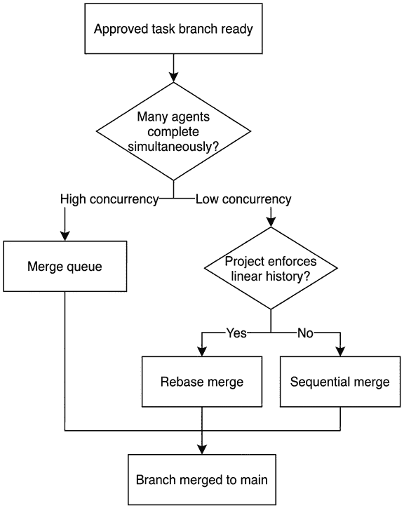

# 第十三章：Worktree 与隔离执行

*第 12 章*回答了智能体按什么顺序运行的问题。本章解决下一个问题：它们在哪里运行。当两个智能体同时写入同一源码树时，它们不仅面临合并冲突，更有破坏工作区状态的风险。Git worktree（工作树）无需单独克隆或容器即可解决此问题。本章涵盖 worktree 是什么、为何适合智能体工作流、如何将其与 Codex CLI 结合，以及如何管理其完整生命周期。

### 学习目标

您将能够：

1.  从命令行手动创建、使用和删除 worktree
2.  设计一个多智能体工作流，为每个智能体分配一个 worktree 并将结果合并回 `main`
3.  配置一个 CI 作业，自动预配和销毁 worktree

### Git Worktree 简述


自 Git 2.5 起，`git worktree` 允许你将多个工作树关联到单个对象数据库。^(¹⁰⁴) 每个工作树拥有自己已检出的分支、索引和 `HEAD` 指针；所有工作树共享对象数据库、打包的引用和仓库配置。

```
git worktree add ../feature-auth -b feature/auth # 创建
git worktree list # 检查
git worktree remove ../feature-auth # 移除
```

Git 强制规定每个工作树只能对应一个分支；两个工作树无法同时检出同一个分支。^(¹⁰⁵) 正是这一约束，使得工作树成为并行代理安全操作的基础：在显式合并之前，每个代理正在进行的写入对其他所有代理都是不可见的。

### 工作树为何对代理工作流至关重要

设想两个 Codex CLI 代理在没有隔离的情况下，并发地在同一仓库上工作：

1. 代理 A 检出 `main` 并开始编辑 `src/auth/login.ts`。
2. 代理 B 检出 `main`（相同文件）并开始编辑 `src/auth/session.ts`。
3. 代理 A 向 `src/auth/utils.ts` 写入一个辅助函数。
4. 代理 B 在同一时刻读取 `src/auth/utils.ts`，却看到了一个写了一半的文件。

即使功能在逻辑上是独立的，共享的工作树也会让正在进行的写入立即可见。结果就是产生几乎无法复现的非确定性故障。

简单的补救方法是给每个代理分配各自的克隆副本：

```
git clone https://github.com/acme/app agent-clone-1
git clone https://github.com/acme/app agent-clone-2
```

这虽可行，但浪费带宽和时间。每次克隆都要下载完整的对象数据库（可能高达数 GB），且一个克隆中的提交在推送和拉取前，对其他克隆不可见。

工作树同时解决了这两个问题。对象数据库是共享的（无冗余下载），提交通过共享的引用存储立即可见，且每个工作树检出不同的分支，因此磁盘上的文件完全隔离。这种文件隔离正是并发代理安全的关键：每个代理只能看到自己的写入，因此共享工作树带来的非确定性故障便不复存在。

在典型的中型单体仓库中，`git worktree add` 可在一秒内完成；而 `git clone` 需要数十秒至数分钟。^(¹⁰⁶) 在 CI 规模下，每批合并队列可能需配置数十个工作树，这一差距会被放大。

如果你的仓库使用 Git LFS，工作树仍共享 LFS 指针文件。实际的 LFS 对象在检出时获取，并存储在 `.git/lfs` 中，该目录也是共享的。这意味着检出包含 LFS 文件分支的第二个工作树，仅需承担检出的开销，而无需重新下载。

### 一代理，一工作树：隔离原则

核心设计原则：**一个代理在同一时刻仅在一个工作树中操作，且没有两个活跃代理共享同一个工作树。**

这提供了三重保障：

1. **文件级隔离。** 在提交并显式合并或挑拣之前，一个代理正在进行的写入永远不会被其他代理看到。
2. **索引隔离。** 每个工作树拥有独立的暂存区，因此一个代理的 `git add` 和 `git commit` 不会干扰另一个代理的暂存状态。
3. **分支锁定。** Git 拒绝在另一个工作树中已检出的分支上再次检出，从而防止代理意外覆盖彼此的分支指针。

无论你在本地、远程机器还是容器中运行代理，该原则均适用。只要每个工作树映射到不同的目录，文件系统层面的隔离就得以保证。

一个边缘情况是 Git 工作树之外的共享资源。SQLite 数据库、本地 `.env` 文件或共享缓存目录不在工作树隔离的覆盖范围内。对于这些资源，你需要代理级别的命名空间隔离（如每个代理使用独立的数据库文件）或协调机制（如文件锁）。工作树解决的是源代码隔离问题；它们不是通用的沙箱。

如果你的构建工具将生成的文件写入工作树*外部*的目录（例如，仓库根目录下的共享 `node_modules` 或全局 Gradle 缓存），这些写入就不受隔离保护。请将工具缓存固定在工作树内部的路径，或使用按代理 ID 命名的独立缓存目录，以避免交叉污染。

#### 运行时隔离的缺口

这个边缘情况值得更深入的探讨，因为它是团队在扩展并行代理工作树时最常遇到的失败模式。Git 工作树隔离的是代码状态（文件、索引、分支指针），而非执行状态。当多个代理在并行工作树中运行应用栈时，会发生几种无声的冲突：^(¹⁰⁷)

1. **端口冲突。** 两个工作树都期望使用 `localhost:3000`。第二个代理的开发服务器无法绑定端口，或者更糟，连接到了错误的实例。
2. **数据库碰撞。** 共享的数据库实例同时接收来自多个分支的迁移，导致模式状态损坏。
3. **环境变量泄漏。** 通过共享的 Shell 或 dotenv 状态，本属于某一分支的凭证或配置泄漏到了另一分支。
4. **Docker 守护进程共享。** 共享单个 Docker 守护进程的工作树之间，容器名称和端口发生冲突。
5. **浏览器状态。** 共享的会话、缓存的认证令牌和 Cookie 导致代理针对错误的应用实例进行测试。

代理会放大这些问题，因为它们运行速度远超人类（无暇停下来察觉端口冲突）、自动迭代（因错误状态导致错误复合），且无法可靠地将测试结果归因于特定分支。针对错误运行实例却通过的测试套件，会产生正确性的虚假证据。^(¹⁰⁸)

**实用缓解措施：**

| 资源 | 隔离方法 |
| :--- | :--- |
| 端口 | 为每个工作树分配唯一的端口范围（例如 `BASE_PORT=$((3000 + TASK_INDEX * 100))`） |
| 数据库 | 使用每个工作树独立的 SQLite 文件，或每个分支独立的 PostgreSQL 模式 |
| 环境变量 | 引用特定于工作树的 `.env.$TASK_ID` 文件 |
| Docker 容器 | 以任务 ID 为前缀命名容器：`docker run --name ${TASK_ID}-api` |
| 浏览器会话 | 为每个代理使用独立的浏览器配置文件或无痕模式 |

对于运行三个或更多并行代理的团队，手动管理端口和数据库命名空间容易出错。**Coasts** 就是一款解决这一缺口的工具：它提供带有规范端口镜像的动态端口分配、特定服务的重分配策略（数据库保持稳定，而前端在分支切换时热重载）、实例级数据隔离，以及一个本地可观测性 UI（Coast Guard），用于监控跨工作树的运行实例。^(¹⁰⁹)

运行时隔离属于操作层面的隔离，而非安全隔离。Coasts 及类似工具可防止工作树间的意外交叉污染；它们无法防御不可信代码、容器逃逸或提示词注入。团队仍需在运行时编排之外，部署分层安全控制（内核沙箱、网络策略）。

图形化界面从另一个角度解决了这一缺口。在撰写本文时，Codexia 内置了 Git 工作树管理功能，通过 GUI 配置隔离的工作目录，减少了大规模维护“一代理一工作树”原则所需的手动 Shell 操作。^(¹¹⁰)

### CLI 工作树工作流

在命令行中，工作树管理结合了标准的 `git worktree` 命令与 Codex CLI 的 `--cd` 标志，以将代理导向隔离的目录。

在撰写本文时，Codex CLI 尚未提供专用的 `--worktree` 标志或 `codex worktree` 子命令组。下述工作流直接使用 `git worktree`，并通过 `--cd` 将生成的路径传递给 `codex`。

#### 为任务创建工作树


#### 供给工作树并在其中启动代理

```
TASK_ID=$(uuidgen | tr '[:upper:]' '[:lower:]' | cut -c1-8)
git worktree add .codex/worktrees/$TASK_ID -b codex/$TASK_ID
codex --cd .codex/worktrees/$TASK_ID \
 "add OAuth2 support to the login flow"
```

为重复使用，将其封装在 shell 函数中：

```
codex-worktree() {
 local TASK_ID=$(uuidgen | tr '[:upper:]' '[:lower:]' | cut -c1-8)
 git worktree add ".codex/worktrees/$TASK_ID" -b "codex/$TASK_ID"
 codex --cd ".codex/worktrees/$TASK_ID" "$@"
}
```

#### 手动生命周期管理

```
##### 创建工作树但不启动代理
git worktree add .codex/worktrees/auth-oauth -b codex/auth-oauth
##### 列出活动工作树
git worktree list
##### 在现有工作树中启动代理
codex --cd .codex/worktrees/auth-oauth "implement PKCE flow"
##### 合并后移除工作树
git worktree remove .codex/worktrees/auth-oauth
git branch -d codex/auth-oauth
```

#### 并行运行代理

包装函数自然地与 shell 作业控制配合，实现本地并行执行：

```
codex-worktree "refactor the database layer to use connection pooling" &
codex-worktree "add end-to-end tests for the checkout flow" &
codex-worktree "update all dependencies to their latest minor versions" &
wait
```

每次调用都会获得自己的分支和工作目录。当所有三个作业完成后，你将得到三个独立的分支，随时可供审查和合并。对于更结构化的编排，请使用第 12 章中的模式；底层原语始终相同：每个任务一个工作树，每个工作树一个代理。

#### 检查工作树状态

```
##### 显示特定工作树的差异
git -C .codex/worktrees/auth-oauth diff
##### 在工作树中运行测试，无需切换主工作树
git -C .codex/worktrees/auth-oauth stash && \
 (cd .codex/worktrees/auth-oauth && npm test)
##### 在工作树中打开 shell（用于调试）
cd .codex/worktrees/auth-oauth && exec $SHELL
```

`git -C <path>` 在 CI 脚本中特别有用：它在工作树内运行 git 命令，而无需更改步骤的工作目录。

#### 将代理工作合并回主分支

任务复杂度各异，因此代理完成时间不同。你需要一种合并策略，能处理已完成分支的异步到达。



图 13.1 - 选择合并策略

一个已批准任务分支的决策树。第一个分支取决于同时完成的代理数量：高并发路由到合并队列，而低并发询问项目是否强制要求线性历史。"是"通向变基合并，"否"通向顺序合并。所有三条路径最终都以分支合并到 main 结束。

##### 顺序合并（简单情况）

对于低并发工作流，立即将每个已批准的任务分支合并到 `main`：

```
git checkout main
git merge --no-ff codex/task-a3f9c1
git worktree remove .codex/worktrees/task-a3f9c1
git branch -d codex/task-a3f9c1
```

`--no-ff` 标志将每个任务分支保留为一个独立的合并提交，保持历史可读。

##### 变基合并（线性历史）

如果你的项目强制要求线性历史，在合并前将任务分支变基到当前的 `main` 上：

```
git -C .codex/worktrees/task-a3f9c1 rebase main
git checkout main
git merge --ff-only codex/task-a3f9c1
```

变基可能会产生冲突。Codex 可以提供帮助：`codex --cd .codex/worktrees/task-a3f9c1 "resolve any rebase conflicts against main"` 调用代理来解释并解决它们，这对于语义冲突特别有用，即两个代理出于不同原因修改了同一个函数。

##### 合并队列（高并发情况）

当许多代理同时完成时，合并队列可防止因分支针对陈旧的 `main` 进行测试而导致集成失败。GitHub 的合并队列（通过仓库设置启用）会自动为通过 CI 的分支处理此问题。(¹¹¹) 使用标准工具推送并打开 PR：

```
git -C .codex/worktrees/auth-oauth push origin codex/auth-oauth
gh pr create --head codex/auth-oauth --title "feat: add OAuth2 PKCE support"
```

如果启用了合并队列，一旦 CI 通过，PR 会自动入队。工作树会保留，直到 PR 被合并或关闭，届时你可以使用 `git worktree remove` 和 `git branch -d` 进行清理。

将 `git worktree prune` 作为每夜 cron 任务或合并后钩子运行，以清理其分支已登陆 `main` 的工作树。如果置之不理，陈旧工作树会累积文件的工作副本并消耗磁盘空间，尽管它们不影响仓库正确性。

#### 工作树设置脚本与本地环境

原始工作树包含源文件，但没有工作环境。没有设置，代理会浪费轮次去发现缺失的依赖。通过一个在创建工作树后立即运行的脚本来解决此问题：

```
#!/usr/bin/env bash
##### .codex/worktree-setup.sh
set -euo pipefail
cd "$1" # 工作树路径作为第一个参数传递
npm ci
npm run db:migrate
```

添加超时包装器以防止挂起无限期阻塞代理：

```
timeout 120 .codex/worktree-setup.sh ".codex/worktrees/$TASK_ID"
```

对于设置成本高的项目（庞大的依赖树、缓慢的数据库种子），考虑通过符号链接 `node_modules` 或使用共享包缓存来跨工作树缓存构件。

对于清理，决定当工作树的分支被合并或放弃时会发生什么。最简单的策略是立即移除。为了调试失败的代理运行，将工作树移动到归档目录，以便在手动删除前检查最终状态。

### CI 中的工作树生命周期

在 CI 中，工作树管理必须完全自动化：在作业步骤开始时创建，使用它，无论结果如何在最后删除。

#### 基础生命周期脚本

```
#!/usr/bin/env bash
set -euo pipefail
TASK_ID="${1:?task id required}"
BRANCH="codex/${TASK_ID}"
WORKTREE_PATH=".codex/worktrees/${TASK_ID}"
##### 设置
git worktree add "$WORKTREE_PATH" -b "$BRANCH"
##### 即使代理步骤失败，teardown 也会运行
trap 'git worktree remove --force "$WORKTREE_PATH"; git branch -D "$BRANCH"' EXIT
##### 运行代理
codex --cd "$WORKTREE_PATH" "$TASK_PROMPT"
```

`trap ... EXIT` 习语确保即使代理以非零状态退出或 CI 运行器被中断，也能进行清理。`git worktree remove` 上的 `--force` 标志在工作树包含未提交更改时是必需的；在 CI 中，你通常希望丢弃这些更改，而不是让清理步骤失败。

#### GitHub Actions 示例

```
jobs:
 agent-task:
 runs-on: ubuntu-latest
 steps:
 - uses: actions/checkout@v5
 with:
 fetch-depth: 0 # 工作树需要完整历史
 - name: Provision worktree
 id: worktree
 run: |
 TASK_ID=$(echo "${{ github.run_id }}-${{ github.run_attempt }}" | sha256sum | cut -c1-8)
 echo "task_id=$TASK_ID" >> "$GITHUB_OUTPUT"
 git worktree add ".codex/worktrees/$TASK_ID" -b "codex/$TASK_ID"
 - name: Run Codex agent
 run: |
 codex \
 --cd ".codex/worktrees/${{ steps.worktree.outputs.task_id }}" \
 "${{ inputs.task_prompt }}"
 - name: Push task branch
 if: success()
 run: |
 git -C ".codex/worktrees/${{ steps.worktree.outputs.task_id }}" \
 push origin "codex/${{ steps.worktree.outputs.task_id }}"
 - name: Cleanup worktree
 if: always()
 run: |
 git worktree remove --force \
 ".codex/worktrees/${{ steps.worktree.outputs.task_id }}" || true
 git branch -D "codex/${{ steps.worktree.outputs.task_id }}" || true
```

注意 checkout 步骤上的 `fetch-depth: 0`。浅克隆缺乏足够的变基和某些工作树操作所需的历史。(¹¹²) 对于完整获取速度过慢的仓库，请使用 `--filter=blob:none`（无 blob 克隆）而不是 `--depth`。


复用工作区的 CI runner（自托管 runner 池中常见）如果上一个作业的清理步骤被跳过，可能会累积过时的 worktree 注册。在每个作业开始时、配置新 worktree 之前，运行 `git worktree prune` 以移除不再存在的目录的注册。

#### 并行矩阵作业

GitHub Actions 矩阵作业自然地映射到“一 Agent 一 worktree”的原则：

```yaml
strategy:
  matrix:
    task:
      - "migrate user service to async/await"
      - "add rate limiting to the API gateway"
      - "write property-based tests for the parser"
    max-parallel: 3
```

每个矩阵分支在独立的 runner 中运行：默认即拥有真正的文件系统隔离。共享对象数据库是远程 origin，所有 Agent 独立推送至该处。无共享本地状态，执行期间无需协调，完成后通过 PR 合并。

### 按团队规模划分的 Worktree 工作流模式

表 13-1 总结了随着团队规模和并发度增加，worktree 工作流通常如何演进。

**表 13-1. 按团队规模划分的 Worktree 工作流模式**

| **团队规模** | **并发度** | **Worktree 策略** | **合并策略** | **清理方式** |
| :--- | :--- | :--- | :--- | :--- |
| 个人 (1 dev) | 1-3 agents | 手动 `git worktree add` + `codex --cd` | 顺序 `git merge --no-ff` | 手动 `git worktree remove` |
| 小型 (2-5 devs) | 3-10 agents | CLI `git worktree add` + 封装脚本 | 每 worktree 一个 PR，人工审查 | PR 关闭时运行脚本 |
| 中型 (5-20 devs) | 10-30 agents | CLI + shell 扇出 | 每 worktree 一个 PR，合并队列 | 每个作业中的 CI 清理步骤 |
| 大型 (20+ devs) | 30+ agents | CI 矩阵作业 | 合并队列 + 自动变基 | `trap EXIT` + `git worktree prune` |

这一演进反映了一个一致的主题：随着并发度增长，你需要自动化更多的生命周期环节。底层基元（一分支、一 worktree、一 Agent）在所有团队规模下保持不变。

### 总结

1.  **Worktree 以无需克隆的代价实现隔离。** Git worktree 为每个 Codex Agent 提供独立的仓库检出视图，同时共享对象数据库，因此无冗余下载，也无需等待完整克隆。

2.  **“一 Agent 一 worktree”是核心铁律。** 隔离原则可防止并行执行期间的文件级冲突、索引损坏和意外分支覆盖。Git 的“一 worktree 一分支”约束强制执行了这一点。

3.  **Worktree 隔离的是代码状态，而非执行状态。** 端口冲突、数据库碰撞和环境变量泄漏均无法通过 worktree 隔离解决。它们需要额外的运行时隔离：每个 worktree 专用的端口范围、独立的数据库实例，或 Coasts 等专用工具。

4.  **CLI 工作流即 `git worktree add` 加 `codex --cd`。** 没有专门的 worktree 子命令。你用 git 创建 worktree，再用 `--cd` 将每个 Agent 导入其中。

5.  **三种合并策略覆盖大多数场景。** 将 Agent 成果合回 `main` 遵循顺序合并、变基合并，或由 CI 支撑的合并队列，取决于团队规模和历史偏好。

6.  **随并发度增长自动化生命周期。** 在 CI 中，任务前创建 worktree，任务后用 `trap ... EXIT` 删除，启动时 prune。这能保持 runner 工作区整洁，防止过时注册累积。

**另请参阅：** *第 27 章* **(Harness Engineering/工程化编排系统)。** Symphony harness 架构在舰队规模上使用按 Issue 隔离的 git worktree：每个 Linear Issue 一个 worktree，每个 worktree 一个专用 Codex Agent，PR 合并后清理。该章涵盖完整的 harness 模式，并展示 `WORKFLOW.md` 策略、工作量证明要求、基于检查点的状态持久化如何与本章介绍的 worktree 隔离相结合。

在并行 worktree 中运行大量 Agent 不仅成倍增加吞吐量，也成倍增加成本：每个并发 Agent 意味着更多并发 API 调用。下一章将转向这一“第二预算”，探讨 Codex CLI 配额如何运作、如何估算团队工作流成本，以及如何构建控制与监控，防止并行执行演变成账单冲击。

### 练习

1.  **基础 worktree 练习。** 使用 `git worktree add` 创建两个 worktree，分别用 `codex --cd` 运行 Codex Agent，以逻辑上独立的方式修改同一文件。确认两个 Agent 均无干扰完成，将两个分支合并到 `main`，并在 git log 中识别出那两个合并提交。

2.  **冲突解决练习。** 创建一个场景：两个 Agent worktree 均修改同一�数。第一个分支落地后，变基第二个分支，并使用 `codex --cd <worktree-path> "resolve the rebase conflict against main"` 解决冲突。对比 Agent 的解决方案与你手动解决的差异。

3.  **CI 流水线练习。** 编写一个 GitHub Actions 工作流：配置三个并行 worktree，各运行一个 Codex Agent，仅推送测试通过的分支。添加带 `if: always()` 的清理步骤，即使失败也移除 worktree。

4.  **生命周期审计练习。** 运行 `git worktree list` 并与 `git branch --list 'codex/*'` 对比。编写 shell 脚本清理过时分支并运行 `git worktree prune`，再将其设为每周 cron 任务。

5.  **团队扩容设计练习。** 以表 13-1 为起点，设计一个从 5 人扩容到 20 人的 worktree 策略。涵盖 worktree 命名约定、CI 作业结构、合并队列配置、清理自动化。


