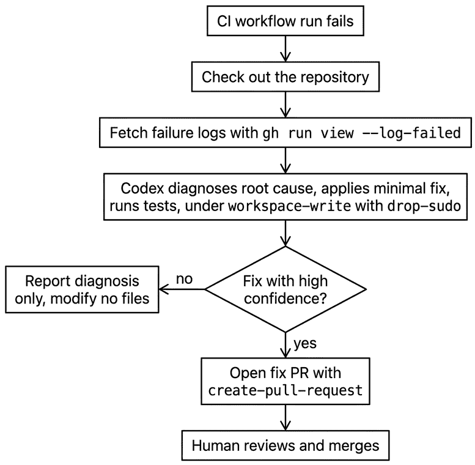

# CI/CD 集成

前几章在人工监督每一步的交互模式下运行 Codex CLI。本章将其移入流水线，由代理无人值守运行：无头 `codex exec`、`openai/codex-action` GitHub Action、带有 Duo Agent Platform 的 GitLab CI/CD，以及包括 PR 审查、测试生成、依赖更新和安全修复在内的生产自动化模式。在代理驱动的流水线中，流水线的设计比模型的选择更重要。

### 学习目标

您将能够：

1.  编写一个完整的 GitHub Actions 工作流，以自动化 PR 审查员身份运行 Codex CLI。
2.  实现一个测试生成作业，在每次合并到 main 分支时提交新测试。
3.  配置一个具有沙箱网络访问权限并能自动创建拉取请求的依赖更新代理。
4.  使用 Duo Agent Platform 和 `codex exec` 在 GitLab CI/CD 流水线中设置 Codex CLI。
5.  使用 `--ignore-user-config` 和 `--ignore-rules` 实现确定性、隔离的 CI 执行。
6.  在托管的 `requirements.toml` 中配置主机名模式策略，以限制开发、预发布和生产运行器中允许的沙箱模式。

### 无头运行 Codex CLI

`codex exec` 接受单个提示字符串，运行代理至完成，并以零或非零状态码退出。它是本章所有模式构建的基础原语，无论是被 GitHub Action 封装、嵌入 GitLab 流水线，还是直接从 Shell 脚本运行。^[¹³⁴]

CI 中重要的标志：

#### 审批策略和沙箱

第 5 章 详细介绍了审批模式（`untrusted`、`on-request`、`never`）和沙箱级别（`read-only`、`workspace-write`、`danger-full-access`）；在 CI 中，您通过命令行而非 TUI 设置它们。将 `-c approval_policy=never` 与 `-s workspace-write` 配对用于自主作业，或将 `-c approval_policy=untrusted -s read-only` 配对用于只读分析。

#### `--model`

固定特定模型以实现可复现的运行。

#### `--json`

结构化的 JSONL 事件流。一次运行以携带 `thread_id` 的 `thread.started` 事件开始，每轮对话以携带 token 用量的 `turn.completed` 事件结束：

```
{"type":"thread.started","thread_id":"019ec094-7865-7bf0-b1a4-7a12da9c0e40"}
{"type":"turn.completed","usage":{"input_tokens":4821,"cached_input_tokens":0,"output_tokens":612}}
```

每行都是一个包含每次调用的时间和 token 指标的自包含对象，因此下游步骤可以在无需缓冲的情况下处理事件。这是流水线成本监控的基础：将 token 计数发送到您的可观测性栈，并在工作流超出预算时发出警报。

#### `--output-schema`

将代理的最终响应约束为 JSON Schema。结合 `-o`（`--output-last-message`），它将结果写入磁盘供下游阶段使用，无需解析和提取：直接使用后续步骤消费的已验证 JSON：

```
codex exec "Analyse src/ for security vulnerabilities" \
 --output-schema ./schemas/vuln-report.json \
 -o ./reports/vulnerabilities.json \
 -c approval_policy=untrusted
```

#### `codex exec resume`（和 `--last`）

重新打开之前的会话，保留完整的对话上下文，包括文件读取、工具调用和推理。这支持多阶段 CI，其中每个阶段都建立在经过验证的先前工作之上：

```
##### 阶段 1：生成迁移
SESSION=$(codex exec --json "Migrate auth module to OAuth2" \
-s workspace-write -c approval_policy=never \
 | jq -r 'select(.type=="thread.started") | .thread_id')
##### 阶段 2：恢复并验证
codex exec resume "$SESSION" "Run the test suite and fix any failures" \
 -s workspace-write -c approval_policy=never
```

`--last` 无需显式 ID 跟踪即可定位最近的会话，而 `codex exec resume` 接受 `--output-schema`，因此工作站上的交互式探索可将结构化输出直接馈送到流水线。远程执行器使用标准 Codex 认证进行注册，而非单独的注册表凭据，这简化了使用远程执行的 CI/CD 设置。^[¹³⁵]

### 管道上下文

通过 stdin 直接将外部数据馈送给代理：

```
git diff origin/main...HEAD | codex exec "Review this diff for correctness and security issues" \
 -c approval_policy=untrusted --output-schema ./schemas/review.json
```

此模式是 PR 审查工作流的基础：diff 提供范围上下文，`approval_policy=untrusted` 防止文件修改，结构化输出确保审查可被机器解析。

> **警告**：切勿在由分叉 PR 触发的工作流中使用 `--dangerously-bypass-approvals-and-sandbox`（别名 `--yolo`）；它会造成远程代码执行漏洞。^[¹³⁶]

> **提示**：将大型代码库拆分为范围限定的子任务（每模块一个会话），而不是用一个会话处理所有事情。

#### `write_stdin` 非 TTY 限制

当 `codex exec` 在非 TTY 环境（CI 运行器、Docker 容器、管道输入）中运行时，`write_stdin` 工具不可用。^[¹³⁷] 代理无法写入正在运行进程的 stdin，因此期望键盘输入的交互式程序将会挂起。变通方法：

1.  使用 `echo "input" | command` 代替交互式 stdin 写入。
2.  配置工具以接受参数或环境变量，而非交互式提示。
3.  对于真正交互式的工具，使用 `expect` 风格的封装器。

设计 CI 提示词以避免交互式工具模式。

#### 确定性、密封的运行

CI 运行器会发生漂移。它们从缓存的主目录、Docker 层和共享镜像继承陈旧设置。三个标志组合使用，可使运行接近密封状态，因此无论哪个运行器执行作业，相同的提交、提示词和模型都会产生相同的行为。^[¹³⁸]

1.  **`--ignore-user-config`**：抑制 `~/.codex/config.toml`，防止开发者特定的设置影响 CI 运行。


#### `--ignore-rules`

**`--ignore-rules`**：跳过当次运行的所有用户和项目 execpolicy `.rules` 文件，移除仓库级别的 execpolicy。Execpolicy `.rules` 文件是 Starlark 规则集，决定如何将提议命令与执行策略匹配（*第 18 章* 介绍了使用 `codex execpolicy check` 编写和验证它们）。该标志会传播给子代理，因此多代理编排保持持续隔离。`AGENTS.md` 指令仍会加载，因此这是与配置和 execpolicy 的隔离，而非与项目指导的隔离；完全密闭的运行也意味着控制检出内容包含的 `AGENTS.md`。

#### `--sandbox workspace-write`

**`--sandbox workspace-write`**：将文件系统访问限制在当前工作目录。

为获得最可复现的 CI 运行，请组合使用这三个标志：`codex exec --ignore-user-config --ignore-rules --model gpt-5.4-mini "your prompt"`。这消除了本地开发与 CI 之间、不同运行器镜像之间、以及随时间推移的流水线运行之间的配置漂移。

#### 按环境限制沙盒模式

主机名模式沙盒策略根据运行器主机名改变*允许的*沙盒模式：开发运行器可使用 `workspace-write` 进行自动修复，而暂存和生产运行器则被限制为 `read-only`。它们位于托管配置（`requirements.toml`）中，作为 `[[remote_sandbox_config]]` 条目，其 `hostname_patterns` 与运行器的解析主机名匹配：

```toml
##### requirements.toml
allowed_sandbox_modes = ["read-only"]
[[remote_sandbox_config]]
hostname_patterns = ["dev-runner-*"]
allowed_sandbox_modes = ["read-only", "workspace-write"]
```

模式不区分大小写，接受 `*`（任意序列）和 `?`（单字符）。需求源中第一个匹配的 `[[remote_sandbox_config]]` 条目生效；若无匹配项，则应用顶层 `allowed_sandbox_modes`，因此未匹配的运行器默认为最严格的策略。每个条目设置该主机上*允许*的模式；运行仍通过 `-s` 选择其实际模式。主机匹配仅用于选择策略，并非经过认证的设备证明，因此切勿单独依赖它作为安全边界。

将主机名模式策略与 `--ignore-user-config` 和 `--ignore-rules` 结合，可实现确定性、环境感知的 CI：标志消除配置和 execpolicy 漂移，主机模式则限制各环境可用的沙盒模式。

### openai/codex-action GitHub Action

`openai/codex-action` Action 封装了 `codex exec` 并提供 GitHub 感知的默认值：CLI 安装、密钥注入和输出暴露。^(¹³⁹)

最简单的集成是只读 PR 总结器：Codex CLI 用通俗语言描述变更内容，后续步骤将该总结作为评论发布。这是向仓库引入该 Action 的安全方式，因为代理仅读取代码，而唯一的写入操作（评论）通过 GitHub API 进行，而非通过代理。

```yaml
- uses: openai/codex-action@v1
  id: codex
  with:
    prompt: "Summarize what changed in this PR in three bullet points"
    sandbox: read-only
  env:
    OPENAI_API_KEY: ${{ secrets.OPENAI_API_KEY }}
- name: Post summary as PR comment
  uses: actions/github-script@v7
  with:
    script: |
      await github.rest.issues.createComment({
        issue_number: context.issue.number,
        owner: context.repo.owner,
        repo: context.repo.repo,
        body: process.env.CODEX_OUTPUT
      });
    env:
      CODEX_OUTPUT: ${{ steps.codex.outputs.final-message }}
```

#### 每个 PR 的自动化代码审查

这是最高价值的首选模式：每个拉取请求在打开或更新的那一刻即进行首轮审查。作业构建差异，请求 Codex CLI 进行结构化评论（逻辑错误、缺失错误处理、安全顾虑、测试覆盖缺口），并将其作为评论发布。以 `read-only` 运行使其保持咨询性质，为人工审查者标记问题而非修改代码。在审查延迟成为瓶颈的团队中最为有用，因为当人工打开 PR 时，代理的审查已在等待。

本节仅涵盖流水线连线：作业何时触发、如何界定差异范围、如何返回结果。使审查本身值得阅读的内容是 *第 20 章* 的主题，涵盖 AI 审查可靠捕获的缺陷类别（以及其无法判断的类别）、添加到 `AGENTS.md` 以传播团队标准的 `## Review guidelines` 块、 `/review` 命令模式，以及多代理对抗性审查。将上述四行提示视为占位符，真正的审查评分卡在 *第 20 章* 中开发：流水线相同，但评论质量源自 *第 20 章*。

```yaml
name: Codex PR Review
on:
  pull_request:
    types: [opened, synchronize, reopened]
permissions:
  contents: read
  pull-requests: write
jobs:
  review:
    runs-on: ubuntu-latest
    steps:
      - uses: actions/checkout@v4
        with:
          fetch-depth: 0
      - name: Generate diff
        run: git diff origin/${{ github.base_ref }}...HEAD > /tmp/pr.diff
      - name: Run Codex review
        id: review
        uses: openai/codex-action@v1
        with:
          prompt: |
            You are a senior engineer reviewing a pull request.
            The diff is in /tmp/pr.diff.
            Identify: (1) logic errors, (2) missing error handling,
            (3) security concerns, (4) test coverage gaps.
            Format as GitHub-flavored Markdown. Be concise.
          sandbox: read-only
        env:
          OPENAI_API_KEY: ${{ secrets.OPENAI_API_KEY }}
      - name: Post review comment
        uses: actions/github-script@v7
        with:
          script: |
            await github.rest.issues.createComment({
              issue_number: context.issue.number,
              owner: context.repo.owner,
              repo: context.repo.repo,
              body: `### Codex Review\n\n${process.env.CODEX_OUTPUT}`
            });
          env:
            CODEX_OUTPUT: ${{ steps.review.outputs.final-message }}
```

添加 `paths` 过滤器以在仅文档变更时跳过审查作业。

#### 合并时生成测试

此模式自动弥补覆盖缺口。每次合并到 `main` 时，作业列出上次提交中变更的源文件，为新增或修改的函数生成单元测试，并打开一个包含结果的 PR。新测试在审查后合入而非直接推送到 `main`，因此生成质量不高仅导致 PR 被拒，而非测试套件损坏。适用于功能常无测试合入且覆盖率下滑的代码库。

```yaml
name: Codex Test Generation
on:
  push:
    branches: [main]
permissions:
  contents: write
  pull-requests: write
jobs:
  generate-tests:
    runs-on: ubuntu-latest
    steps:
      - uses: actions/checkout@v4
        with:
          fetch-depth: 2
      - name: Identify changed source files
        id: changed
        run: |
          git diff HEAD~1 HEAD --name-only \
          | grep -E '\.(ts|js|py|go)$' \
          | grep -v '\.test\.\|_test\.' \
          > /tmp/changed-source.txt
          echo "count=$(wc -l < /tmp/changed-source.txt)" >> "$GITHUB_OUTPUT"
      - name: Generate tests
        if: steps.changed.outputs.count != '0'
        uses: openai/codex-action@v1
        with:
          prompt: |
            For each source file in /tmp/changed-source.txt,
            write unit tests covering the public API of functions
            added or modified in the most recent commit.
            Use existing test framework and conventions.
          sandbox: workspace-write
        env:
          OPENAI_API_KEY: ${{ secrets.OPENAI_API_KEY }}
      - name: Open PR with generated tests
        if: steps.changed.outputs.count != '0'
        uses: peter-evans/create-pull-request@v6
        with:
          branch: codex/tests-${{ github.sha }}
          title: "test: add generated tests for ${{ github.sha }}"
          body: "Codex-generated tests. Review before merging."
          labels: codex-generated, tests
```

#### 依赖更新代理


这使得依赖保持最新，且无需像普通版本升级机器人那样需要人工照管。计划的每周作业会在安全范围内更新过时的包（仅限次要版本，绝不升级主版本），运行测试套件，回滚导致测试失败的任何依赖，并打开一个合并的 PR。其优于机械升级工具之处在于测试-回滚循环：你得到的是一个已通过测试的绿色更新 PR，而不是一堆需要分类的版本升级。`gpt-5.4-mini` 使得这类主要为机械操作的工作的单次运行成本保持在低位。

```yaml
name: Codex Dependency Update
on:
  schedule:
    - cron: '0 9 * * 1'
  workflow_dispatch:
permissions:
  contents: write
  pull-requests: write
jobs:
  update-deps:
    runs-on: ubuntu-latest
    steps:
      - uses: actions/checkout@v4
      - uses: actions/setup-node@v4
        with:
          node-version: '22'
      - name: Run dependency update agent
        id: depupdate
        uses: openai/codex-action@v1
        with:
          prompt: |
            Update all outdated npm dependencies to latest minor versions
            (never bump major). Run npm install and npm test. If tests fail,
            revert the causing dependency. Report as JSON: updated, skipped, failed.
          sandbox: workspace-write
          model: gpt-5.4-mini
        env:
          OPENAI_API_KEY: ${{ secrets.OPENAI_API_KEY }}
      - name: Open consolidated PR
        uses: peter-evans/create-pull-request@v6
        with:
          branch: codex/deps-${{ github.run_id }}
          title: "chore: weekly dependency updates"
          labels: dependencies, codex-generated
```

`npm install` 会执行更新包中的生命周期脚本。请使用网络沙箱运行器，并将出口流量限制为仅 npm 注册表。

#### 扩展评审：项目技能与堆叠 PR

两种模式将自动化与其作用的代码一起进行版本控制，这使得自动化随着代码库的变化而保持诚实（即与时俱进）。

`codex-pr-body` 是一个随 CLI 代码库一起发布的项目级技能。它根据差异、提交历史和关联的 Issue 生成 PR 描述。三个设计决策使其成为 CI 集成技能的模板：

**技能随代码库一起发布。** 技能定义位于 `.agents/skills/` 中，与其描述的代码进行版本控制。当 PR 模板变更时，技能在同一次提交中随之变更。

**Sapling CLI 限制为只读。** 该技能调用 Meta 的 Sapling (`sl`) 进行差异和堆叠分析，但将其限制为只读操作：禁止 `sl push`，禁止 `sl rebase`。此限制通过 `AGENTS.md` 说明强制执行（属于建议性，非内核强制）。对于生产用途，请结合 `-s read-only -c approval_policy=untrusted` 以实现操作系统级别的强制执行。

**感知堆叠 PR 的描述。** 该技能理解堆叠 PR（一串多个相互依赖的 PR），并生成引用父 PR 和子 PR 的描述，使依赖图对评审者显性化。

堆叠 PR（一串小的、相互依赖的 PR）将大型变更分解为可评审的增量，但会带来开销：每个 PR 都需要解释其在链中角色的描述，且随着堆叠变基，描述必须保持一致。`gh stack` 扩展自动化了机制操作（分支链、变基、PR 元数据）。将其与代理生成的描述配合，开销可降至近乎为零：

```yaml
name: Stack Description Update
on:
  pull_request:
    types: [opened, synchronize]
jobs:
  update-description:
    runs-on: ubuntu-latest
    steps:
      - uses: actions/checkout@v4
        with:
          fetch-depth: 0
      - name: Generate stack-aware description
        uses: openai/codex-action@v1
        with:
          prompt: |
            This PR is part of a stacked PR chain.
            Analyse the diff relative to the parent branch,
            identify what this specific slice accomplishes,
            and generate a description that includes:
            - What this PR does (2-3 sentences)
            - How it relates to the parent and child PRs
            - What reviewers should focus on
            Format as GitLab-flavored Markdown.
          sandbox: read-only
        env:
          OPENAI_API_KEY: ${{ secrets.OPENAI_API_KEY }}
```

这种组合将堆叠 PR 从高级用户技巧转变为默认工作流。评审吞吐量增加，因为每个 PR 都足够小，可在一次会话中完成评审，而代理生成的描述消除了理解每个切片定位的上下文切换成本。

### GitLab CI/CD 集成

上述模式使用 GitHub Actions，但 Codex CLI 同样能与 GitLab 配合良好。GitLab 的 Duo Agent Platform（自 2026 年 1 月起正式可用）支持 Codex CLI 作为 GitLab 18.8+ 上的外部代理。^[¹⁴⁰] 当开发者在 Issue 评论或合并请求讨论中提及 `@codex` 时，代理会读取仓库上下文并内联响应。认证通过 GitLab 的 AI 网关处理，因此无需单独的 `OPENAI_API_KEY`。^[¹⁴¹]

#### `.gitlab-ci.yml` 中的代码质量

要在每个合并请求上进行系统分析，请将 `codex exec` 直接嵌入管道。关键技术是基于标记的提取：指示 Codex CLI 在分隔符之间包裹其输出，然后使用 `awk` 解析。^[¹⁴²]

```yaml
codex_review:
  stage: codex
  image: node:24
  rules:
    - if: '$CI_PIPELINE_SOURCE == "merge_request_event"'
  script:
    - npm -g i @openai/codex@latest
    - FILE_LIST="$(git ls-files | sed 's/^/- /')"
    - |
      codex exec -s workspace-write -c approval_policy=never "Review this repository and output a
      GitLab Code Quality report in CodeClimate JSON format.
      OUTPUT MUST BE A SINGLE JSON ARRAY between markers:
      === BEGIN_CODE_QUALITY_JSON ===
      <JSON ARRAY>
      === END_CODE_QUALITY_JSON ===
      Each issue needs: description, check_name, fingerprint,
      severity, location with path and lines.begin.
      Only report issues in: ${FILE_LIST}" \
      | tee artifacts/codex-raw.log >/dev/null
    - |
      sed -E 's/\x1B\[[0-9;]*[A-Za-z]//g' artifacts/codex-raw.log \
      | awk '/BEGIN_CODE_QUALITY_JSON/{g=1;next}
      /END_CODE_QUALITY_JSON/{g=0}g' \
      > gl-code-quality-report.json
  artifacts:
    reports:
      codequality: gl-code-quality-report.json
    expire_in: 14 days
```

`codequality` 制品类型使发现结果直接出现在合并请求部件中，与原生 GitLab 扫描器结果并列。^[¹⁴³]

在解析前从原始日志中剥离 ANSI 转义码。`codex exec` 可能会发出终端颜色序列，从而破坏 JSON 提取。

相同的 `codex exec` 方法扩展至安全修复（将 SAST 扫描结果与 Codex 生成的补丁配对）以及受益于 LLM 分析的任何其他管道阶段。对于需要 GitLab API 访问的交互式会话，请使用 `codex mcp add --url` 配置 GitLab 原生 MCP 服务器。^[¹⁴⁴]

GitLab 集成比 `openai/codex-action` 需要更多手动配置，但提供同等能力。`codex exec` 标志、审批模式和结构化输出在两个平台上完全相同；仅管道语法和制品格式不同。

### 从自动化到自主：自愈管道

迄今为止的模式将代理视为任务执行者。更成熟的集成将其视为管道健康的持续参与者。**自愈 CI/CD 成熟度模型**将其形式化为三个级别，每个级别映射到一种审批模式：观察者、把关者和治愈者，自主性依次递增。

#### 级别 1：观察者（只读）

代理以只读模式监控管道日志，解析构建失败和测试输出，然后将分析作为 PR 评论或 Slack 消息发布。它绝不修改文件或重新触发作业。

使用 `-s read-only -c approval_policy=untrusted` 配置。代理无法执行 Shell 命令或写入文件。所有输出通过 `--json` 流出。

#### 级别 2：把关者（workspace-write，有闸控）

代理提出修复（编辑源文件、更新配置、调整测试固件），但不能执行任意 Shell 命令。它对合并就绪性进行投票：若检测到无法修复的问题则发布阻断性评审，若其补丁解决了故障则批准。


##### 使用 `-s workspace-write -c approval_policy=on-request` 进行配置

Agent 可以在工作区中写入文件，但在跨越沙箱边界前必须进行升级。这自然地映射到创建修复分支并打开 PR 的 CI 作业。

#### 第 3 级：Healer（完全自主模式）

Agent 拥有完全的自主权，可端到端地诊断、修补、测试并重新触发流水线。此级别仅适用于除了 API 端点和包注册表之外无网络访问权限的物理隔离运行器，且写入权限限定在专用的 Bot 账户上。

在网络沙箱运行器上使用 `-s workspace-write -c approval_policy=never` 进行配置，或在命名配置文件中编码相同设置。结合 *第 16 章* 中的文件系统和沙箱限制，以限制影响范围。

大多数团队应在升级到第 3 级之前，在第 2 级运行数月。CI 流水线过早引入自主性会以机器速度放大错误。利用流水线可观测性来衡量 Agent 的修复准确率，然后再移除人工审批关卡。

#### 最简单的自主模式

在完整的修复循环之前，最小的自主形式是单次 `codex exec`，它检测问题、修复问题并验证：

```
codex exec "Fix all lint errors in src/" \
 -s workspace-write -c approval_policy=never \
 --model gpt-5.4-mini
```

`-s workspace-write -c approval_policy=never` 组合授予文件写入自主权，而无需 Shell 命令审批。对于模型能力非瓶颈的机械性修复，请使用 `gpt-5.4-mini`。

#### 流水线医生模式

流水线医生将 Healer 级别实现为由 `workflow_run` 触发的作业，该作业监视失败并尝试自主修复。^(¹⁴⁵)



Figure 15.1 - 流水线医生修复循环

由 `workflow_run` 触发的修复循环流程图。失败的 CI 工作流运行触发仓库检出，随后使用 `gh run view --log-failed` 获取失败日志。Codex 随后诊断根因，应用最小修复，并在 `workspace-write` 配合 `drop-sudo` 下运行测试。决策节点询问修复是否高置信度：若否，则仅报告诊断且不修改任何文件；若是，则通过 `create-pull-request` 打开修复 PR，供人工审查并合并。

```
name: Pipeline Doctor
on:
  workflow_run:
    workflows: ["CI"]
    types: [completed]
jobs:
  diagnose-and-fix:
    if: ${{ github.event.workflow_run.conclusion == 'failure' }}
    runs-on: ubuntu-latest
    steps:
      - uses: actions/checkout@v4
        with:
          fetch-depth: 0
      - name: Fetch failure logs
        run: |
          gh run view ${{ github.event.workflow_run.id }} --log-failed \
          > /tmp/failure.log
        env:
          GH_TOKEN: ${{ secrets.GITHUB_TOKEN }}
      - name: Diagnose and fix
        uses: openai/codex-action@v1
        with:
          prompt: |
            The CI run failed. Logs are in /tmp/failure.log.
            1. Identify the root cause.
            2. Apply the minimal fix to the source code.
            3. Run the relevant test suite to confirm the fix.
            If you cannot fix it with high confidence, do NOT
            modify any files — just report the diagnosis.
          sandbox: workspace-write
          safety-strategy: drop-sudo
        env:
          OPENAI_API_KEY: ${{ secrets.OPENAI_API_KEY }}
      - name: Open fix PR
        uses: peter-evans/create-pull-request@v6
        with:
          branch: codex/pipeline-doctor-${{ github.event.workflow_run.id }}
          title: "fix: auto-remediate CI failure from run ${{ github.event.workflow_run.id }}"
          body: "Pipeline Doctor diagnosis and fix. Review before merging."
          labels: codex-generated, pipeline-doctor
```

三点使其安全。`workspace-write` 沙箱是刻意为之：医生可以编辑工作区内的源文件，但无法触及工作区外的任何内容。`safety-strategy: drop-sudo` 输入会不可逆地移除 sudo，防止权限提升。且修复通过 PR 进行，保留了人工审查。

一个更严格的变体运行在一次性运行器上，通过 `head_sha` 检出失败的提交，并在*同一作业内*重新运行测试套件以确认补丁，然后再打开 PR，这样实际上未通过测试的修复永远不会到达审查者手中。GitLab CI 的等效方案直接使用 `codex exec`，配合基于标记的输出提取和 `git apply --check` 验证。^(¹⁴⁶) 随时间验证准确性的团队可以移除 PR 关卡，并使用 `-c approval_policy=never -s workspace-write` 端到端运行循环。

两个提示约束对自动修复质量至关重要。首先，始终指示 Codex CLI 进行最小变更：“不要重构无关代码”可防止范围蔓延。其次，将 `git ls-files` 输出提供给提示词，以防止路径幻觉。

#### AutoLoop：CI 中的有界优化

AutoLoop 将 Karpathy 的 autoresearch 模式（21K+ GitHub stars）推广为集成在 CI 中的有界优化循环。^(¹⁴⁷) 传统 CI 是二元的（通过/失败），而 AutoLoop 增加了迭代改进：Agent 运行有界实验，根据基准衡量适应度，并仅提交经验证的收益。

AutoLoop 将实验结果持久化到磁盘的 `.autoloop/experiments/` 下，可在会话压缩和上下文限制后存活。每个实验记录变更了哪些文件、指标结果以及裁决（保留/丢弃/重跑）：

```
.autoloop/
├── config.toml # Eval/guardrail commands, metric parsing
├── baseline.json # Starting metric snapshot
├── learnings.md # Auto-refreshed experiment insights
└── experiments/ # Timestamped iteration history
 ├── 001-reduce-alloc.json
 └── 002-batch-queries.json
```

安装 Codex 封装并在 CI 中运行有界优化：

```
##### Install AutoLoop's Codex integration
autoloop install codex
##### Run bounded optimisation
codex exec "Use autoloop-run to reduce benchmark latency. \
 Keep behaviour unchanged. Use at most 5 experiments." \
 -a never -s workspace-write
```

三个约束使其在 CI 中安全：优化目标（延迟）、行为不变量（正确性：所有测试必须通过）和实验预算（5 次迭代）。`.autoloop/config.toml` 中的护栏会自动丢弃破坏测试的实验：

```
[eval]
command = "cargo bench --bench api_latency"
primary_metric = "p99_latency_ms"
direction = "lower_is_better"
[guardrails.tests]
command = "cargo test"
pass_threshold = "all"
```

AutoLoop 精确记录每个实验中变更的文件。`keep` 仅提交那些路径；`discard` 精确还原尝试过的内容，而非整个工作树。这使其可以安全地在 CI 分支中运行，而不影响无关变更。`.autoloop/` 配置适用于 Codex CLI、Claude Code、Gemini CLI、Cursor 和 OpenCode，因此使用混合 Agent 的团队可以共享实验历史；循环基础设施与 Agent 无关。

### CI Agent 的安全策略

自主性提高了糟糕运行的赌注，因此护栏不是可选的。

**选择正确的审批模式。** `untrusted` 用于只读分析。`on-request` 用于写文件的 Agent。`approval_policy=never`（通过 `-c approval_policy=never` 传递）仅在运行器完全物理隔离时使用。*第 5 章* 详细阐述了模式、沙箱级别和命名配置文件。

**将 PR 内容视为不受信任的输入。** 将差异写入文件；在提示词中引用该文件。切勿直接插值原始 PR 标题或正文。^(¹⁴⁸)

**管理密钥。** 将 `OPENAI_API_KEY` 作为加密的仓库密钥存储。仅在需要它的步骤上设置。

**限制权限。** 使用 `permissions` 块设置最小 GitHub 令牌作用域。^(¹⁴⁹)

### 流水线可观测性：Token 使用量、引导元数据和线程上下文

结构化输出为企业级 CI/CD 集成提供了所需的可观测性：面向 Agent 驱动流水线的成本归因、审计追踪和计费透明度。^(¹⁵⁰)


**Token 使用量追踪。** 每个 `codex exec` 轮次都以 `turn.completed` 事件结束，该事件在 `usage` 对象下携带 Token 计数（`input_tokens`、`cached_input_tokens`、`output_tokens`、`reasoning_output_tokens`）。无需外部插桩，即可使用这些数据进行按作业的成本归因。

**引导元数据。** 引导元数据捕获了会话期间影响 Agent 行为的配置：活跃模型、推理力度、审批模式以及加载了哪些 `AGENTS.md` 文件。在 CI/CD 流水线中，它为 Agent *为何*做出特定决策提供了审计追踪，而不仅仅是它*做了什么*。

**线程上下文反范式化。** 分析载荷对线程上下文进行了反范式化处理，使得无需连接多数据源即可跨会话查询。对于每天运行数百个 Codex CLI 作业的组织而言，这支持聚合分析：哪些仓库消耗最多 Token，哪些作业类型的推理 Token 与输出 Token 比率最高，以及在何处降级模型（从 `gpt-5.5` 到 `gpt-5.4-mini`）能在不损失质量的情况下节省最多成本。

将流水线可观测性与 *第 20 章* 中的结构化代码审查模式相结合，即可获得完整的可观测性图景：

```
- name: Run Codex review with analytics
 run: |
 codex exec --json -s read-only -c approval_policy=untrusted \
 "Review the PR diff for correctness and security." \
| tee /tmp/review-events.jsonl
env:
OPENAI_API_KEY: ${{ secrets.OPENAI_API_KEY }}
- name: Ship analytics to dashboard
 run: |
 jq -s '{repo: "${{ github.repository }}", job: "review",
 usage: ([.[] | select(.type == "turn.completed") | .usage] | last)}' \
 /tmp/review-events.jsonl \
 | curl -X POST -H "Content-Type: application/json" \
 -d @- ${{ secrets.ANALYTICS_ENDPOINT }}
```

### CI/CD 会话可靠性：WebSocket Keepalive 与远程连接

两项功能提升了长时间运行 CI/CD 会话的可靠性。

#### WebSocket Keepalive 心跳

出站 exec-server WebSocket 客户端发送周期性 Keepalive 心跳，防止空闲连接被代理、负载均衡器和防火墙静默丢弃。若无此机制，长时间运行的 `codex exec` 和 `codex remote-control` 会话（包括多小时重构、全量测试套件生成和夜间依赖审计）均面临静默断开风险，一旦空闲时长超过代理超时时间（企业级基础设施中通常为 60 至 120 秒）即会触发。

Keepalive 涵盖三种连接类型：直接 exec-server 客户端、汇聚 harness/executor 连接以及多路复用远程执行器流。入站 axum 接受的连接保持被动。对 CI 流水线而言，这意味着运行在企业反向代理或云负载均衡器后的会话无需自定义超时覆盖即可正常工作。

#### 远程连接作为 CI 触发模式

远程连接启用了一种新的 CI 交互模式：开发者可从 ChatGPT 移动应用触发并监控流水线驱动的 Agent 运行。^(¹⁵¹) 该模式与 `codex remote-control` 组合使用，编写时该功能标记为实验性：

1.  CI 运行器使用 `codex remote-control` 启动无头 Codex CLI 会话，并通过访问令牌进行身份验证
2.  当 Agent 需要审批时，开发者会在移动端收到通知
3.  开发者在手机上查看待定操作并批准或拒绝
4.  Agent 在运行器上继续执行

这种三级审批链——低风险操作自动批准、中风险升级至移动端、高风险保留至桌面端审查——将 CI 从“触发即遗忘”模式转变为交互式监督模式，且无需开发者守在工作站旁。结合企业访问令牌（见 *第 17 章*），所有运行均与工作区身份关联，满足治理与审计需求。

### 构建系统集成：Bazel 与 Dagger

**Bazel 单一代码库。** 对于使用 Bazel 的单一代码库团队，Codex CLI 可与远程执行、构建图分析和测试目标选择集成。^(¹⁵²) 实用模式：在 CI 步骤中使用 `codex exec` 运行 `bazel query` 以识别受影响目标，随后将实现或修复任务委托给 Codex，且仅限定于这些目标范围内。这可防止 Agent 触碰无关包，并保持上下文聚焦。

**Dagger Container-Use MCP。** Dagger 的 Container-Use MCP 服务器赋予 Codex CLI 在容器化流水线中构建、测试和部署的能力，且无需编写 Shell 脚本。^(¹⁵³) Agent 将 Dagger 函数作为 MCP 工具调用，以编程方式组合构建步骤。这对需要可复现容器构建的 CI 流水线尤为有用：Agent 可修改 Dagger 流水线定义、运行它、观察结果并迭代，所有操作均在沙箱化的 MCP 上下文中完成。

### 实证证据：33,000 个 Agentic PR 揭示的流水线设计真相

MSR 2026 发表的五项研究分析了 AIDev 数据集（跨 61,000 个仓库的 933,000 多个 Agentic PR），其发现直接指导 CI/CD 流水线设计。^(¹⁵⁴)

**28.5% 的失败率主要源于工作流问题，而非代码质量。** Ehsani 等人发现 28.52% 的 Agentic PR 无法合并，但失败分类并非大多数团队所预期：^(¹⁵⁵)

| 失败类别 | 占比 | 主要原因 |
| --- | --- | --- |
| 审查者弃置 | 38% | 缺乏有意义的人工交互 |
| PR 级别问题 | 31% | 重复 PR (23%)、非预期功能 (4%) |
| 代码级失败 | 22% | CI/测试失败 (17%)、实现错误 (3%) |
| Agent 目标偏离 | 2% | Agent 忽略审查者反馈 |

主要失败模式是社交与工作流错位：Agent 提交无人要求的 PR、重复现有工作，或未获得任何审查者关注。流水线设计比模型选择更重要；自动化重复检测、陈旧度检查和审查者分配等干预措施，其杠杆率高于提升生成质量。

**符号存活期：Agent 代码 3 天 vs 人类代码 34 天。** Pham 和 Ghaleb 发现 Agent 引入的符号在被修改或移除前的中位存活期为 3 天，而人类编写的符号为 34 天。^(¹⁵⁶) 对 CI/CD 流水线而言，这意味着应将 Agent 生成的代码视为暂时性的。流水线应标记出存活不足一周且未被修改的 Agent 创建变更，作为深度审查的候选项。

**每次 CI 失败使合并几率降低约 15%。** 被拒 PR 涉及的代码行数多 17%，触及的文件数多 10%。对流水线设计的启示是：强制执行小而原子的变更集，并在 Agent 生成的 PR 开启*前*运行完整测试套件，而非开启*后*。

三项流水线增强直接针对这些发现：

1.  **重复检测。** 在开启 PR 前，检查是否已有打开的 PR 解决同一问题。一个简单的 `gh pr list --search` 步骤即可防止 23% 的重复率。
2.  **陈旧度监控。** 一个定时工作流，标记 48 小时内无审查者活动的 Agent 生成 PR，并升级至团队负责人。这针对 38% 的审查者弃置率。
3.  **原子变更集强制。** 增加一个 CI 步骤，使超出可配置代码行变更或文件数量阈值的 PR 失败，强制 Agent 拆解大型变更。

### Microsoft 的 Agentic DevOps 实战手册


#### CI/CD 模式目录

David Sanchez 的《智能体时代的 DevOps 剧本》为本章中的流水线模式提供了企业级的可信验证。核心论点是：“智能体不会神奇地修复损坏的工程实践。它们会放大这些实践。”团队在采用智能体前必须审查六个维度：CI/CD 流水线、自动化测试、基础设施即代码、安全扫描、分支保护和可观测性。

#### 四大协作区域

| 区域 | 人类角色 | 智能体角色 | Codex CLI 对应项 |
| --- | --- | --- | --- |
| **IDE/编辑器** | 定义意图 | 生成补全 | 交互式 CLI 会话 |
| **拉取请求** | 审查变更 | 打开 PR、根据反馈迭代 | `codex-action` GitHub Action |
| **CI/CD 流水线** | 定义规则 | 触发构建、修复故障 | 工作流中的 `codex exec` |
| **生产环境** | 监控、批准 | 检测异常、执行预批准操作 | Symphony (新兴) |

#### 三层流水线验证

Sanchez 认为，流水线必须从“看门人”演变为“验证者”，并包含三个验证层：

1.  **结构层：** 验证架构模式。映射到在预提交层面强制执行代码结构的 Codex CLI 钩子。
2.  **语义层：** 检查规范对齐。映射到编码项目约定的 `AGENTS.md` 指令，智能体必须遵循这些约定。
3.  **溯源层：** 验证制品合法性。映射到插件供应链安全和 `requirements.toml` 强制执行层，后者维护允许列表批准的工具和服务器。

#### 成熟度模型

四个级别，从被动（第 1 级：仅 IDE 副驾驶）到优化（第 4 级：具有人工审查关卡的完全自主流水线智能体）。这通过将其置于更广泛的企业采用背景中，补充了本章前面描述的自愈 CI 成熟度模型——观察者、看门人、治愈者。

Sanchez 描述的角色演变——工程师从代码生产者转型为系统设计师、智能体操作员和质量管家——在使用第 12 章编排模式和第 11 章子智能体架构的团队中已清晰可见。

#### CI/CD 模式目录

表 15-1 将本章的模式整合为单一参考。将其作为决策辅助而非菜单阅读：每一行将一个 **触发器**（启动作业的流水线事件）与控制爆炸半径的两个设置配对。**审批模式** 设定智能体拥有的自主程度，从 `untrusted` 只读分析，到 `on-request` 文件编辑，再到 `never` 在隔离运行器上完全自主运行。**权限** 列是该模式所需的最小权限 GitHub 令牌作用域，别无其他：仅发表评论的审查者需要 `pull-requests: write` 和 `contents: read`，而需要打开分支和 PR 的模式则额外需要 `contents: write`。GitLab 行有所不同，因为授权通过平台流动：Duo Agent 使用 GitLab 管理的凭据，流水线作业通过制品（`codequality`、SAST）而非令牌作用域呈现结果。选择触发器与你期望工作发生的时机相匹配的行，然后采用仍能让作业完成任务的最窄审批模式和权限集。

**表 15-1. CI/CD 模式目录**

| 模式 | 触发器 | 审批模式 | 权限 |
| --- | --- | --- | --- |
| PR 审查 | `pull_request` | `untrusted` | `pull-requests: write`, `contents: read` |
| 测试生成 | `push` 到 main | `on-request` | `contents: write`, `pull-requests: write` |
| 依赖更新 | `schedule` | `on-request` | `contents: write`, `pull-requests: write` |
| 安全扫描 | `pull_request` | `untrusted` | `pull-requests: write`, `contents: read` |
| 代码质量 | `merge_request_event` | `never` | `codequality` 制品 |
| 安全修复 | `merge_request_event` | `never` | SAST 报告 + 补丁制品 |
| Duo Agent | `@codex` 提及 | GitLab 管理 | AI 网关凭据 |
| 流水线医生 | `workflow_run` (失败) | `on-request` | `contents: write`, `pull-requests: write` |
| CI 自动修复 | `workflow_run` (失败) | `never` | `contents: write`, `pull-requests: write` |
| 栈描述 | `pull_request` | `untrusted` | `pull-requests: write`, `contents: read` |

### 总结

1.  **无头入口点。** `codex exec` 运行智能体直至完成并带状态码退出。`--sandbox`、`--json`、`--output-schema` 和 `codex exec resume` 是其关键 CI 接口。通过 `-c approval_policy=...` 传递审批策略。
2.  **确定性、隔离运行。** `--ignore-user-config` 和 `--ignore-rules` 剥离开发者配置和项目 execpolicy `.rules` 文件（后者传播给子智能体）；`AGENTS.md` 仍会加载。托管 `requirements.toml` 中的主机名模式策略限制每个环境允许的沙箱模式。
3.  **通过 openai/codex-action 实现 GitHub 原生集成。** 该 Action 封装了带有密钥注入和输出暴露的 CLI。三大核心模式：PR 审查 (`untrusted`)、测试生成 (`on-request`)、依赖更新 (`on-request`)。
4.  **通过 codex exec 实现 GitLab 集成。** 集成涵盖 Duo Agent 平台 (`@codex` 提及)、带有基于标记输出提取的 `.gitlab-ci.yml` 中的 `codex exec`，以及用于 GitLab API 访问的 MCP。
5.  **自愈成熟度模型。** 观察者 (`read-only`/`untrusted`)、看门人 (`workspace-write`/`on-request`)、治愈者 (`approval_policy=never`)。流水线医生和 CI 自动修复通过 PR 实现自主修复，并在一次性运行器上进行内联测试验证。大多数团队应在授予完全自主权前在看门人级别停留数月。
6.  **将 CI 智能体视为不受信任。** 将审批模式与爆炸半径匹配，将 PR 内容写入文件而非插值插入，限制令牌作用域，并沙箱化网络访问。Codex 访问令牌将无头运行绑定到工作区身份、RBAC 和合规日志；见第 17 章。
7.  **结构化输出是集成契约。** `--json` 和 `--output-schema` 为下游阶段提供机器可读、模式验证的结果，而令牌用量、引导元数据和线程上下文支持成本归因和审计。`write_stdin` 工具在非 TTY 环境中不可用。
8.  **项目集成模式扩展审查。** 项目级技能如 `codex-pr-body`、配合 `gh stack` 的堆叠 PR 加智能体生成描述，以及 AutoLoop 的有界优化循环，都将其自动化随所作用的代码一起版本化。
9.  **长时间运行与远程监管。** WebSocket 保活心跳使会话在企业代理和负载均衡器后保持存活；远程连接让开发者能从 ChatGPT 移动应用批准或拒绝流水线驱动的智能体操作，形成一个无需桌面访问的三级审批链。
10. **来自 933,000+ 智能体 PR 的证据。** MSR 2026 对 AIDev 数据集的研究发现，失败主要源于工作流问题而非代码质量：审查者放弃 (38%) 和重复项 (23%) 超过了代码级失败。设计流水线以支持重复检测、陈旧监控和原子变更集。

### 练习

1.  **带路径过滤的审查工作流。** 添加 `paths` 过滤器，使审查作业仅在 `src/` 和 `lib/` 变更时运行。
2.  **结构化审查输出。** 修改提示词，使其返回包含 `logic_errors`、`security_concerns`、`missing_tests` 和 `summary` 键的 JSON。
3.  **作用域限定的测试生成。** 重构为使用矩阵作业，对每个变更文件使用一个 Codex CLI 会话。对比质量。
4.  **会话持久化。** 缓存以 `src/` 的 SHA 为键的 `thread_id`。度量后续运行的令牌节省量。


### 5. 确定性 CI 执行

将 `--ignore-user-config` 和 `--ignore-rules` 添加到现有的 CI 工作流中。在一个拥有已填充的 `~/.codex/` 目录和项目执行策略 `.rules` 文件的运行器上，分别带上这两个标志和不带这两个标志运行相同的提示词。对比输出结果，并注意到 `AGENTS.md` 在两次运行中均仍然生效。

### 6. 主机名模式沙箱策略

编写一个托管的 `requirements.toml`，其顶层 `allowed_sandbox_modes` 为 `["read-only"]`，并添加一个 `[[remote_sandbox_config]]` 条目，其 `hostname_patterns` 匹配 `dev-*` 运行器且同时允许 `workspace-write`。确认其他主机回退到只读模式。

