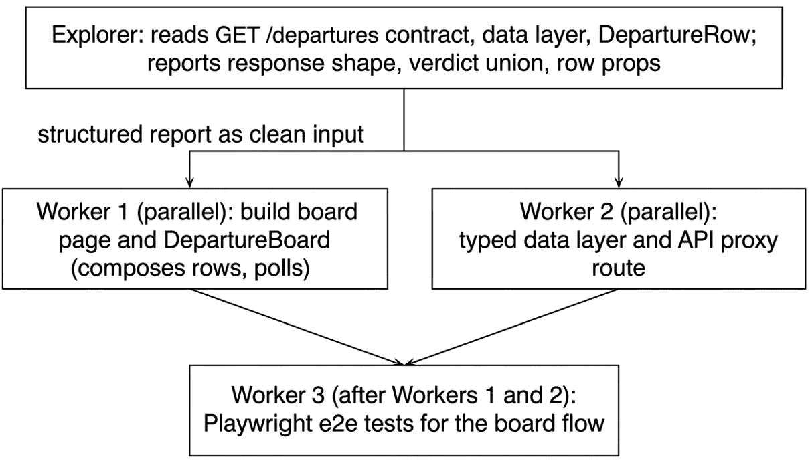

# 23 前端工程

第 22 章 构建了 Run or Relax 后端：一个 API，给定时间和时刻表，返回 Audley End 的下一班发车信息及一个裁决结果——`RUN` 或 `relax`。一个没有面孔的服务。本章构建这张“面孔”：调用 API 并渲染看板的 React 与 TypeScript 前端，与后端一样，代码由 Codex CLI 编写。

难点在于前端工作是 Agent 错误最难被捕获的领域，这改变了你引导它的方式。核心在于**静默失败**。生成错误 SQL 的后端 Agent 会立即在测试中失败；而选错包管理器、在 Hooks 代码库中拿类组件、或针对 Vitest 运行器编写 Jest 断言的前端 Agent，代码编译通过，随后却以难以追踪的方式出错。如何让它“守轨行驶”是本章剩余内容的主题，伴随的挑战包括：工具链不匹配、测试通过却无实证、无障碍技术债，以及将设计转化为代码。

我们以 React 和 TypeScript 为具体落地目标，但本章不针对某个特定库：它关乎如何为前端工作配置 Codex CLI，使那些静默失败尽早浮现。

### 学习目标

你将能够：

1.  编写一份前端 `AGENTS.md`，预防最常见的工具链不匹配。
2.  使用单个 Codex CLI 提示词，脚手架出带有同目录 Vitest 测试套件的类型化 React 组件。
3.  在 React 前端消费类型化后端契约，通过判别联合类型切换，使 API 形态在两端均得到强制约束。
4.  生成 Vitest 和 Testing Library 测试，以锻炼真实用户交互而非合成事件。
5.  应用探索者/工作者子 Agent 模式处理跨越 UI 和 API 的特性。
6.  将无障碍审计自动化为可复用的 Codex CLI 技能。
7.  利用视觉输入和 Figma 的 MCP 服务器实现设计转代码工作流。
8.  判断何时浏览器验证循环值得其延迟和 Token 成本。

### 前端专用 AGENTS.md 配置


#### 第 22 章 与前端 `AGENTS.md`

*第 22 章* 论证了 `AGENTS.md` 是阻止 Agent 盲目猜测的最高杠杆手段；前端将风险放大了。这不仅仅是因为约定更多，更因为错误的约定更隐蔽：当你的 Monorepo 使用 `pnpm` 时却执行 `npm install`，当 Barrel 文件期望命名导出时却写了默认导出，或者迁移到 Vitest 的 `vi.fn()` 后仍使用 `jest.fn()`。每个错误单独看都微不足道，但合在一起却具有腐蚀性。它们拖慢 Code Review，导致约定分歧，并侵蚀自主运行所依赖的信任。

前端 `AGENTS.md` 需要回答后端配置通常可隐式忽略的五个问题：

1.  用哪个包管理器？确切命令是什么？
2.  用哪个 React 版本？它启用或禁止哪些模式？
3.  用哪个组件库？基础组件如何安装与扩展？
4.  用哪个测试框架？单元测试与 E2E 测试的边界在哪里？
5.  Agent 绝对不能跨越哪些文件系统边界？

以下配置为使用 React 19 编译器的 Next.js 15 项目回答了上述全部五个问题：^(²⁰¹)

```
#### AGENTS.md — Frontend (React/TypeScript)
##### Stack
- React 19 with TypeScript strict mode
- Next.js 15 (App Router), built as a static export (`output: "export"`): the board ships as static assets, with no server runtime
- Tailwind CSS v4
- shadcn/ui for component primitives
- Vitest + Testing Library for unit/integration tests
- Playwright for browser automation and visual verification
- pnpm (never npm install or yarn)
##### Backend
- The Chapter 22 FastAPI service exposes `GET /departures`; the board calls it directly from the browser
- Base URL: `NEXT_PUBLIC_DEPARTURES_API_URL`, defaulting to `http://localhost:8000`
- Calls are cross-origin, so the backend must send CORS headers for the board's origin
##### Commands
- `pnpm dev` — development server (port 3000)
- `pnpm test` — Vitest unit tests
- `pnpm test:e2e` — Playwright end-to-end tests
- `pnpm build` — production build
- `pnpm lint` — ESLint + Prettier check
- `pnpm tsc --noEmit` — TypeScript type check
##### Architecture
- `/app` — Next.js App Router pages (static export, no server runtime)
- `/components/ui` — shadcn/ui primitives (regenerate with CLI, never edit directly)
- `/components` — application components
- `/lib` — utilities and data fetching (calls the backend API directly)
- `/tests` — Vitest unit tests
- `/e2e` — Playwright tests
##### Component conventions
- Functional components only (no class components)
- Do NOT add useMemo/useCallback by default; trust the React Compiler
- Use `startTransition` for non-urgent state updates
- Prefer server components; use `"use client"` only when interactivity requires it
- shadcn/ui components install via `pnpm dlx shadcn@latest add <component>`
- Named exports only (no default exports from component files)
##### TypeScript
- Strict mode is on — no `any`, no `@ts-ignore`
- Use `satisfies` for type narrowing rather than casting
- All API response shapes must have explicit types
##### Constraints
- Never modify files in `/components/ui` directly
- Never add `console.log` to production code
- Tailwind utility classes only — no inline styles, no CSS-in-JS
##### Completion criteria
- `pnpm build` passes with no errors
- `pnpm test` all pass
- `pnpm tsc --noEmit` reports zero errors
```

有两处注释值得重点关注。React 19 编译器备注“不要默认添加 `useMemo`/`useCallback`”，防止 Codex CLI 应用 React 17 时代的性能模式——该模式现由编译器自动处理。^(²⁰²) 没有它，Codex CLI 会防御性地包装每一个昂贵计算，产出虽能工作但不必要冗余的代码。shadcn/ui 约束同样具体：这些是由 shadcn CLI 管理的生成文件，而非你拥有的源代码，直接修改会破坏再生成工作流。将其编码为硬约束，可防止 Codex CLI 在“改进”基础组件时造成无声破坏。

`completion criteria`（完成标准）部分将 `AGENTS.md` 从风格指南转变为反馈循环。Codex CLI 在任务结束时运行列出的命令，并迭代直到全部通过。没有显式标准，你只能依赖 Agent 自行推断何时完成，它确实会推断，但并不总是正确。

### 创建前端项目

*第 22 章* 留下了一个 `run-or-relax/` 检出，FastAPI 服务位于 `src/` 下。前端与其并存于 `frontend/` 目录，这是一个 Node 项目而非 Python 项目，因此两套工具链永不冲突。首先确认工具链在 PATH 上，因为最新的 Node 安装可能在启用 Corepack 前不暴露 `pnpm`：

```
node --version
corepack enable pnpm
pnpm --version
```

然后从仓库根目录脚手架项目：

```
cd run-or-relax
pnpm create next-app@latest frontend --typescript --app --tailwind --eslint --use-pnpm
cd frontend
pnpm dlx shadcn@latest init --defaults --yes
pnpm add -D vitest @testing-library/react @testing-library/user-event jsdom @vitejs/plugin-react
pnpm add -D @playwright/test jest-axe @axe-core/playwright
```

这些命令追踪快速迭代的工具，预期会有漂移。`@latest` 可能安装比 `AGENTS.md` 技术栈行声明更新的 Next 主版本；保留脚手架安装的版本并更新技术栈行以匹配，而不是固定版本，因为本章的约定不依赖确切版本。使 `shadcn init` 非交互的标志也随版本变化，如果仍提示交互，请添加 `--force` 或查看当前的 `--help`。`create-next-app` 会将自己的 `AGENTS.md` 和 `CLAUDE.md` 放入项目：将其版本特定的警告合并到前述配置中，而非盲目覆盖。

如果完全无法运行 `create-next-app`（例如离线或受限会话），转而手动构建项目结构，请添加脚手架本会安装的类型包：`pnpm add -D @types/react @types/node`。没有它们 `pnpm tsc --noEmit` 会立即失败，且让 `next build` 在构建中途自动安装它们会与 pnpm 存储配置冲突。脚手架隐藏了此依赖；手动路径必须显式声明。

将合并后的 `AGENTS.md` 放置在 `frontend/AGENTS.md`，使 Codex CLI 从此处运行的每条命令都继承约定，然后在同一会话中让它生成测试配置，明确运行器边界，确保两个测试工具永不冲突：

```
Configure the test toolchain following AGENTS.md:
- vitest.config.ts: jsdom environment, a tests/setup.ts setup file, and
  exclude e2e/**, node_modules/**, .next/** and out/** so Vitest never
  loads a Playwright spec
- playwright.config.ts: run only e2e/**
- package.json: "test" runs Vitest, "test:e2e" runs Playwright
```

前端无服务器运行时发布，因此在同一会话中配置 Next.js 进行无构建时网络调用的自包含静态导出：

```
Configure the build for a static export with no build-time network calls:
- next.config.ts: set output: "export" so `pnpm build` emits a static
  out/ directory, and set turbopack.root to this frontend/ directory so
  the build does not infer a parent lockfile as the workspace root
- app/layout.tsx: replace the scaffold's next/font/google imports
  (Geist) with a system font stack, so the build never fetches fonts
  from Google at build time
```

这使 `pnpm build` 将前端写入 `out/`，即 *第 24 章* 作为静态资源服务的目录。生成的目录树即 `AGENTS.md` 架构章节所描述的结构：


run-or-relax/
├── src/departures/        # 第 22 章 FastAPI 服务
├── data/                  # 预置时刻表 + 延误数据
└── frontend/
    ├── AGENTS.md
    ├── app/
    │   └── departures/page.tsx     # 发车页面
    ├── components/
    │   ├── DepartureRow.tsx
    │   ├── DepartureBoard.tsx       # 容器组件：获取 + 轮询
    │   └── DepartureBoardView.tsx   # 展示组件
    ├── lib/departures.ts            # 类型契约 + 获取逻辑
    ├── tests/                       # Vitest
    └── e2e/                         # Playwright

这些提示词指示智能体启用 Corepack，将 `e2e/**` 从 Vitest 中排除，设置 `turbopack.root`，并替换脚手架的字体，因此遵循这些提示词的读者应该能在无需人工干预的情况下获得绿色的 `pnpm build`。前端脚手架是该技术栈中最容易受工具链漂移影响的部分，因此某个步骤仍可能落地失败：发布版本间标志发生变化，或命令在先决条件就绪前运行。表 23-1 是此类情况的恢复参考，将你实际看到的症状映射到要交给 Codex CLI 的单行修复命令。

#### 表 23-1. 当前工具链下的设置障碍及修复方法

| **症状** | **原因** | **修复** |
| --- | --- | --- |
| `pnpm: command not found` | Corepack 尚未为 pnpm 创建 shim | 在第一条命令前运行 `corepack enable pnpm` |
| `shadcn init` 仍然弹出交互提示 | 其非交互式标志在不同版本间发生漂移 | 添加 `--force`，或查看 `--help` 确认当前标志 |
| `pnpm test` 失败并提示 "Playwright Test did not expect test() to be called here" | Vitest 正在加载 `e2e/` 下的测试规格 | 在 `vitest.config.ts` 中排除 `e2e/**` |
| 构建警告推断父级 lockfile 作为工作区根目录 | 多个 lockfile 位于 `frontend/` 上层 | 在 `next.config.ts` 中将 `turbopack.root` 设置为 `frontend/` 目录 |

脚手架配置完成，约定已落笔成文，已知障碍要么被提示词预先规避，要么可查表解决，项目此时处于绿色 `pnpm build` 状态，智能体拥有无需猜测即可工作的一切条件。本章其余内容均通过后续提示词生成到此目录树中，首先从看板渲染所依赖的契约开始。

### 运行后端并定义契约

看板直接调用 *第 22 章* 的后端，因此请先启动后端并确认其返回的数据结构。从 `run-or-relax/` 检出目录出发，在一个独立的终端中（区别于前端终端）：

```
uv run uvicorn departures.app:app --reload   # 在 localhost:8000 提供服务
curl 'http://localhost:8000/departures?station=audley-end'
[
  {"service": "07:02", "platform": "2", "delayMinutes": 0,
   "minutesUntil": 10, "verdict": "RUN"}
]
```

看板运行在 `localhost:3000`，而 API 运行在 `localhost:8000`，因此浏览器的 fetch 请求是跨域的，后端必须发送 CORS 响应头，否则浏览器会拦截响应。这是在 *第 22 章* 服务中只需添加的一行代码：

> 在 `src/departures/app.py` 中，添加 FastAPI 的 CORSMiddleware，允许看板的源：开发环境下为 `http://localhost:3000`，生产环境下为部署后看板的源（从环境变量读取）。遵循 AGENTS.md。

后端可达后，前端代码库中第一个引入的内容是契约类型，`AGENTS.md` 规则“所有 API 响应结构必须具有显式类型”强制要求这一点。它完全镜像 *第 22 章* 的 camelCase JSON 结构：

```
// lib/departures.ts
const API_BASE =
  process.env.NEXT_PUBLIC_DEPARTURES_API_URL ?? "http://localhost:8000"
export interface Departure {
  service: string        // 例如 "07:02"
  platform: string
  delayMinutes: number
  minutesUntil: number
  verdict: "RUN" | "relax"
}
export async function fetchDepartures(
  station: string,
  now?: string,
): Promise<Departure[]> {
  const params = new URLSearchParams({ station })
  if (now) params.set("now", now)
  const res = await fetch(`${API_BASE}/departures?${params}`)
  if (!res.ok) throw new Error(`departures: ${res.status}`)
  return res.json()
}
```

`URLSearchParams` 对 `station` 和可选的 `now` 进行编码，因此棘手的车站 ID 不会破坏 URL；基础 URL 来源于 `NEXT_PUBLIC_DEPARTURES_API_URL`，使得同一次构建既可在开发环境指向 `localhost:8000`，也可在生产环境指向已部署的 API。`now` 覆盖参数是 *第 22 章* 暴露的同一 ISO 8601 参数：生产环境看板省略它，但测试和演示传入固定值，使看板表现具有确定性。

一个诚实的警示：`Departure` 接口是后端契约的*镜像*，而非运行时保证。TypeScript 仅检查代码期望的结构，而非线上的字节，因此类型检查器无法捕获漂移或错误的响应。共享的 `verdict: "RUN" | "relax"` 联合类型依然发挥作用：基于它进行分支的组件在构造上是穷尽的，若出现第三种 verdict 将导致 `pnpm tsc --noEmit` 失败。若想在运行时强制校验边界，可请 Codex 在返回前用 Zod schema（或手写的 `isDeparture` 守卫）验证响应。

### 组件生成与脚手架

有了 `AGENTS.md`，组件脚手架搭建成为 Codex CLI 最可靠的操作之一。构建提示词时应包含所有上下文，避免智能体被迫做假设：文件位置、props、state 及配套测试。

> 在 `/components/DepartureRow.tsx` 创建 `<DepartureRow>` 组件。
> 要求：
> - Props：单个 `departure: Departure`（类型定义于 `lib/departures.ts`）
> - 渲染发车时间、站台、延误（为零时隐藏）及距发车分钟数
> - verdict 以徽章形式展示：verdict 为 "RUN" 时变体为 "run"（醒目、高对比度），为 "relax" 时变体为 "calm"
> - verdict 为 "RUN" 时高亮整行（后端已编码门到站台规则，因此行组件不得重新计算阈值）
> - 使用 shadcn/ui 基础组件
> - 完全键盘可访问；verdict 徽章携带无障碍标签
> - TypeScript strict 模式 —— 禁止 `any`
> 在 `/tests/DepartureRow.test.tsx` 编写 Vitest 测试，覆盖：
> RUN 行、relax 行、零延误情况、无障碍标签。

具体性至关重要。“展示 verdict”与“基于 `verdict: "RUN" | "relax"` 的 'run' 或 'calm' 变体徽章”产出截然不同。后者移除了一个决策点，若猜错则需后续修正；且因该 prop 正是来自 *第 22 章* 的判别联合类型，组件在构造上即穷尽：第三种 verdict 会在此处导致类型检查失败。

对于反复脚手架同类组件形状的团队（表单字段、模态框、数据获取封装），将模式编码为技能可消除逐次提示词中对约定的重复说明。创建 `.agents/skills/new-component/SKILL.md`：

```
---
name: new-component
description: Scaffold a new React component with co-located test file
---
#### 新组件技能
按项目约定创建新组件：
1. `/components/<Name>.tsx` — 含 TypeScript props 接口、Tailwind 样式、具名导出的组件
2. `/tests/<Name>.test.tsx` — 覆盖核心渲染行为及交互状态的 Vitest + Testing Library 测试
3. 向 `/components/index.ts` 添加具名导出
4. 遵循所有 AGENTS.md 约定
除非用户显式要求，否则不要创建 Storybook 故事。
```

以极简提示词调用技能：

```
codex "$new-component — BirthdayBanner 组件，接收 name 与 age，渲染庆祝语，如 'Happy 4th Birthday Alex'"
```

技能的最后一行（“除非被询问，否则不要创建 Storybook 故事”）并非吹毛求疵。没有它，Codex CLI 会因训练数据中该模式频繁出现，而偶尔在未被要求时生成故事。技能中的显式否定指令可防止这类好心办坏事的范围蔓延。

#### 构建看板


利用 `lib/departures.ts` 中的契约，将发车板构建为两个组件：一个渲染发车信息的纯视图组件，以及一个负责获取数据并轮询的容器组件。这种拆分使视图组件极易测试，并将棘手的异步逻辑、加载态、错误处理和轮询计时器隔离在同一位置。

```
为发车板创建两个组件，遵循 AGENTS.md。
<DepartureBoardView> 位于 /components/DepartureBoardView.tsx：
- 接收 departures: Departure[]
- 每个发车信息渲染一个 <DepartureRow>
- 列表为空时渲染空状态（“今日无更多列车”）
- 纯粹且为展示型：无数据获取，无状态
<DepartureBoard> 位于 /components/DepartureBoard.tsx ("use client")：
- 接收 station: string
- 调用 fetchDepartures(station) 并每 30 秒重新轮询一次
- 先显示加载骨架屏，获取抛出错误则显示错误状态，数据到达后显示可见的最后更新时间
- 用结果渲染 <DepartureBoardView>
- 使用 shadcn/ui 基础组件；TypeScript 严格模式；完全支持键盘访问
编写 Vitest 测试：
- DepartureBoardView：一个 RUN 行、一个 relax 行和空状态
- DepartureBoard：使用模拟的 fetchDepartures 测试加载-然后加载完成的路径、获取被拒绝时的错误状态，以及轮询间隔推进时最后更新时间的前进
使用 Testing Library 的 userEvent 和假计时器，而非 fireEvent。传递固定的 now 时间，使测试不依赖真实时钟。
```

容器组件拥有所有可能出错的逻辑（加载、轮询、失败），而视图组件保持为其 `departures` prop 的纯函数，因此证明 `RUN` 徽章能正确渲染的测试，永远不需要搭建 fetch mock。容器组件刻意设计为客户端组件，因此有 `"use client"`：静态导出没有服务端运行时，所以轮询和读取 `NEXT_PUBLIC_DEPARTURES_API_URL` 都在浏览器中发生。因为裁决类型与第 22 章共享，视图组件的分支情况源于其两种状态，未来后端若新增第三种裁决，会在此处导致 `pnpm tsc --noEmit` 失败，而不是渲染空内容。这就是契约在前端发挥作用：一种形态，镜像在通信线的两端。

挂载发车板的页面是一个轻量包装器：

```
创建 /app/departures/page.tsx 渲染
<DepartureBoard station="audley-end" />，遵循 AGENTS.md。
```

同时运行两端：在后端检出目录运行 `uv run uvicorn departures.app:app --reload`，在 `frontend/` 运行 `pnpm dev`，`localhost:3000/departures` 将显示奥德利恩德（Audley End）发车板，每趟列车标记 `RUN` 或 `relax`，每三十秒刷新一次。

预置时刻表仅包含早班车，因此下午运行发车板会正确显示“今日无更多列车”，除非你了解时刻表，否则这看起来像是数据通路损坏。若要在任何时刻看到 `RUN` 和 `relax` 行，请传递数据层已支持的确定性 `now` 覆盖参数（测试使用的同一个 ISO 8601 钩子），并将发车板指向一个上午的时间点。

#### React 组件的测试生成

Vitest 和 Testing Library 为 React 项目定义了惯用的单元测试界面。Codex CLI 在拥有组件源码时能准确生成这些测试，但质量随提示词的具体程度而异。“为该组件编写测试”能产出覆盖率。指定场景则能产出有用的测试。

```
为发车板编写 Vitest 测试，遵循 AGENTS.md。
针对 <DepartureBoardView>（纯渲染）：
1. 每个发车信息渲染一行
2. RUN 发车显示 RUN 徽章，relax 发车显示 relax 徽章
3. 列表为空时渲染空状态（“今日无更多列车”）
针对 <DepartureBoard>（容器，使用模拟的 fetchDepartures）：
4. 先显示加载骨架屏，Promise resolve 后显示行
5. fetchDepartures 拒绝时显示错误状态
6. 轮询间隔到达时重新获取并推进最后更新时间
使用 Testing Library 的 userEvent 进行交互，使用假计时器处理轮询。传递固定的 now 时间，使测试不读取真实时钟。不要使用 fireEvent。
```

`userEvent` 指令至关重要，因为 `fireEvent` 触发合成 DOM 事件，而 `userEvent` 模拟真实浏览器行为，包括聚焦、失焦和键盘序列。^²⁰³ 使用 `fireEvent` 编写的测试可能在真实交互会失败时却通过了。Codex CLI 了解这两套 API，因此你必须告诉它你的代码库使用哪一种。

对于端到端测试，Playwright 技能提供了浏览器验证循环。创建 `.agents/skills/playwright-check/SKILL.md`：

```
---
name: playwright-check
description: 通过运行 Playwright 浏览器测试验证 UI 变更
---
### Playwright 检查技能
在真实浏览器中验证当前 UI 变更工作正常：
1. 启动开发服务器：`pnpm dev &`
2. 等待就绪：`npx wait-on http://localhost:3000`
3. 运行相关的 Playwright 测试：`pnpm test:e2e --grep "<组件名称>"`
4. 若该组件无测试，创建一个最小测试：
   - 导航到受影响页面
   - 断言关键元素渲染
   - 检查无控制台错误
   - 测试移动端（375px）和桌面端（1280px）视口
5. 报告结果及任何失败
在组件或页面变更后、标记任务完成前，始终运行此步骤。
```

在视觉正确性至关重要的提示词中引用该技能：

```
在页头添加搜索栏。实现后，使用 $playwright-check 验证其在移动端和桌面端断点下渲染正确。
```

Playwright 测试需要运行中的开发服务器，会在会话期间占用一个端口和一个进程。在 CI 中，确保端口 3000 可用，且 `pnpm dev` 在会话结束时能干净退出。步骤 2 中的 `wait-on` 工具必不可少：没有它，Playwright 会对尚未启动完成的服务器发起请求导致 404，产生虚假失败。

#### 探索者/工作者子代理模式

第 11 章 全面介绍了子代理。^²⁰⁴ 对于前端工作，探索者/工作者模式适用于那些在生成新代码前需要理解现有约定的功能。

问题在于上下文污染。当 Codex CLI 在陌生代码库中构建新设置页面时，它在同一上下文窗口中一边阅读现有文件以理解布局、认证模型、API 形态和组件约定，一边生成新代码。阅读阶段留下的噪音减少了可用于生成的有效上下文。

探索者/工作者模式将这些阶段分离到不同的代理中：

```
构建发车板功能：一个显示车站下一班列车的页面，每趟带有 RUN 或 relax 裁决，并轮询更新。
按如下方式使用子代理：
探索者：
  阅读 API 契约（第 22 章的 Departure 类型和 GET /departures）、/lib/departures.ts 和现有的 /components/DepartureRow.tsx。
  报告：响应形态、裁决联合类型和已有的行 props。
工作者 1（探索者之后运行）：
  利用探索者的发现，构建位于 /app/departures/page.tsx 的板页面、轮询 fetchDepartures 的 <DepartureBoard> 容器，以及组合 <DepartureRow> 的 <DepartureBoardView>。
工作者 2（与工作者 1 并行运行）：
  利用探索者的发现，在 /lib/departures.ts 中编写类型化数据层：Departure 类型、API 基础 URL，以及带查询编码和可选 now 覆盖的 fetchDepartures。
工作者 3（工作者 1 和 2 之后运行）：
  编写覆盖板流程的 Playwright e2e 测试：RUN 状态、relax 状态、API 不可达时的错误状态，以及空的“今日无更多列车”状态。
```

探索者产出结构化报告（响应形态、裁决联合类型、现有行 props），工作者 1 和 2 将其作为干净的输入接收。工作者 1 和 2 并行运行，减少了具有明显 UI 和数据层关注点分离的功能的墙钟时间。工作者 3 最后运行，因为它需要实际的实现来编写有意义的测试。




图 23.1 - Explorer/Worker 子代理模式

Explorer/Worker 子代理模式的流程图。Explorer 代理读取 `GET /departures` 契约、数据层和现有的 `DepartureRow` 组件，并将响应结构、判决联合类型和可用的行属性作为结构化报告输出。该报告供两个并行运行的 Worker 使用：Worker 1 构建看板页面、轮询的 `DepartureBoard` 容器以及组合 `DepartureRow` 的 `DepartureBoardView`；Worker 2 编写类型化数据层（`Departure` 类型和 `fetchDepartures`）。Worker 3 在两者完成后运行，为看板流程编写 Playwright 端到端测试。

此模式对于简单的组件添加属于过度设计。当任务跨越多个子系统（UI、API、数据库模式）、阅读约定消耗大量上下文，或并行执行能显著缩短生成可测试结果的时间时，请使用它。

Explorer 的输出质量取决于你提出问题的质量。“读取代码库并告诉我你发现了什么”只会产生摘要。“读取认证布局和用户类型，并报告数据结构和布局约束”则会产生规范。后者为 Worker 提供了它们生成正确代码所需的结构化输入。

### 无障碍审计自动化

前端工程会悄无声息地积累无障碍技术债。视觉检查能发现明显问题，自动化 Lint 工具能发现另一组不同但有重叠的问题。两者都无法面面俱到，也都无法产生可复现的审计追踪。将 `axe-core` 与 Codex CLI 集成可提供广泛的覆盖面、可重复性和适合 Diff 对比的报告。

`axe-core` 是由 Deque Systems 维护的无障碍测试引擎，它将违规项映射到 WCAG 2.1 和 2.2 标准。^(²⁰⁵) 可通过 `jest-axe` 进行集成，尽管名字带有 jest，但它适用于 Vitest；也可通过 `@axe-core/playwright` 进行浏览器级审计。

基于 Vitest 的审计如下所示：

```
import { render } from '@testing-library/react'
import { axe, toHaveNoViolations } from 'jest-axe'
import { expect } from 'vitest'
import { DepartureBoard } from '../components/DepartureBoard'
expect.extend(toHaveNoViolations)
it('DepartureBoard has no accessibility violations', async () => {
 const { container } = render(
 <DepartureBoard departures={mockDepartures} /> )
const results = await axe(container)
 expect(results).toHaveNoViolations()
})
```

创建 `.agents/skills/accessibility-audit/SKILL.md` 以使此模式可复用：

```
---
name: accessibility-audit
description: Run axe-core accessibility audit on specified components
---
#### Accessibility Audit Skill
Run an accessibility audit on the specified component(s):
1. For each component file named in the request, check whether an
 axe-core test already exists in /tests/.
2. If not, create one following the pattern in /tests/DepartureBoard.test.tsx.
3. Run `pnpm test --reporter=verbose` and capture any axe violations.
4. For each violation, report:
 - The WCAG criterion violated
 - The specific element causing the violation
 - The recommended fix
5. Implement fixes for violations rated "critical" or "serious".
6. Re-run the audit to confirm violations are resolved.
```

针对组件或目录调用它：

```
codex "$accessibility-audit — audit all components in /components/forms/"
```

对于浏览器级审计，它能捕捉基于 jsdom 的测试遗漏的问题（如颜色对比度和焦点陷阱行为），请使用 `@axe-core/playwright` 向技能添加 Playwright 步骤：

```
// e2e/accessibility.spec.ts
import { test, expect } from '@playwright/test'
import AxeBuilder from '@axe-core/playwright'
test('settings page has no critical accessibility violations', async ({ page }) => {
 await page.goto('/settings')
 const results = await new AxeBuilder({ page })
 .withTags(['wcag2a', 'wcag2aa'])
 .analyze()
 expect(results.violations.filter(v => v.impact === 'critical')).toHaveLength(0)
})
```

在 CI 中针对发布中包含的每个页面运行 `axe-core` Playwright 审计。Codex CLI 只需一个提示词即可为整个路由树生成初始测试套件：“使用 $accessibility-audit，为 /app/ 下的每个页面编写 Playwright axe 测试并在开发服务器上运行它们。”

### 设计到代码工作流

撰写本文时，Figma 的 MCP 服务器处于测试阶段，^(²⁰⁶) 它向兼容 MCP 的客户端暴露设计文件数据，以实现令牌级精准的组件生成。在该集成稳定之前，实用的方法是基于图像的：将设计导出为 PNG 并使用 Codex CLI 的视觉输入。

```
codex "Implement this design as a React component with Tailwind.
The image is at /tmp/designs/checkout-flow.png.
Match the layout as closely as possible. Flag any interactive states
(hover, focus, disabled) that aren't visible in the static image."
```

基于图像的提示词能准确处理结构布局；间距令牌需要人工验证。

**表 23-2. 前端任务类型与推荐的 Codex CLI 模式**

| **任务类型** | **推荐模式** | **技能或标志** | **备注** |
| --- | --- | --- | --- |
| 带测试的新组件 | 包含完整需求的单一提示词 | `$new-component` 技能 | 显式包含 Props 接口、状态和测试场景 |
| 跨越 UI + API 的功能 | Explorer/Worker 子代理 | 子代理提示块 | Explorer 先运行；Worker 并行运行 |
| 无障碍审计 | 专用审计技能 | `$accessibility-audit` 技能 | 同时针对 Vitest (jsdom) 和 Playwright (浏览器) |
| 视觉验证 | 每次 UI 变更后运行 Playwright 技能 | `$playwright-check` 技能 | 测试移动端和桌面端视口 |
| 设计到代码 | Figma MCP（若可用）或图像提示词 | MCP 或视觉 | 手动验证间距令牌；MCP 状态为测试版 |
| TypeScript 迁移 | 以 `tsc` 完成为标准的单文件作用域 | 无需额外技能 | 将 `pnpm tsc --noEmit` 添加到完成标准 |
| 组件库升级 | Explorer 读取破坏性变更；Worker 应用修复 | 子代理提示块 | 将每个 Worker 的作用域限定为单个组件文件 |
| CI 质量门禁 | 带有 Codex Action 的 GitHub Actions 工作流 | `codex-action` | 在匹配 `components/**` 的 PR 路径上运行 |

### Codex 浏览器使用：视觉验证

撰写本文时，浏览器使用（Computer Use）功能在 Codex 桌面应用中可用，但在 Codex CLI GA 发布流中不可用。在依赖它用于生产工作流前，请验证你的版本中的可用性。

**Codex 浏览器使用** 允许代理在无头浏览器中渲染前端输出、点击浏览界面并直观验证结果，从而闭合了原本需要人工开发者检查的环路。^(²⁰⁷)

#### 构建并验证循环

启用浏览器使用后，代理工作流变为一个闭环：

1.  **生成**：代理编写或修改组件
2.  **构建**：代理运行 `pnpm build` 和 `pnpm dev` 以编译和服务
3.  **渲染**：代理在无头浏览器中导航到服务的页面
4.  **验证**：代理截图，将其与预期设计对比，并识别差异
5.  **修复**：代理修改代码以解决视觉问题并返回步骤 2

这将验证从人类职责转移给了代理：它自主迭代视觉保真度，在无需开发者干预的情况下捕捉 CSS 问题、布局回归和响应式断点问题。

#### 与 Claude Computer Use 和 Devin 的对比

撰写本文时，存在三种基于浏览器的验证竞争方案：

| **功能** | **Codex 浏览器使用** | **Claude Computer Use** | **Devin 沙箱浏览器** |
| --- | --- | --- | --- |
| 环境 | 无头，代理控制 | 前台，锁定开发者桌面 | 沙箱虚拟机 |


| --- | --- | --- | --- |

| 与钩子集成 | | 完整：审批钩子和 PostToolUse 钩子均适用 | 部分：受限钩子模型 | 不适用（专有） |

| 成本模型 | | 包含在会话中 | Vision API 按截图收费 | 包含在 Devin 订阅中 |

| 适用场景 | | 迭代式前端验证循环 | 跨任意应用的 GUI 自动化 | 自包含的项目执行 |

Codex 的方案与现有的钩子和审批基础设施集成。每个浏览器操作都受制于管控 Shell 命令和文件写入的相同 `PreToolUse` 和 `PostToolUse` 钩子。企业团队可使用管控所有其他代理操作的相同治理模式，对浏览器交互进行审计、应用策略，并记录截图以供合规审查。

#### 何时使用浏览器验证

浏览器使用会增加延迟和 Token 成本。请有选择地使用：

1.  **推荐：** 完成视觉组件后的最终验证、响应式布局测试、提交前的视觉回归检查

2.  **不推荐：** 业务逻辑的快速迭代、纯 API 变更、无视觉组件的后端工作

完成标准模式可自然延伸：将 `pnpm dev && screenshot localhost:3000 && verify-visual` 添加到标准链中，只有当视觉输出符合预期时，代理才会将任务标记为完成。

### 总结

1.  **前端 AGENTS.md 解答五个问题。** 包管理器、React 版本及允许的模式、组件库安装方式、测试框架和文件系统边界。缺少这些，Codex 会默认采用看似合理但实则错误的假设。

2.  **完成标准使代理具备自我修正能力。** 列出 `pnpm build`、`pnpm test` 和 `pnpm tsc --noEmit`，Codex CLI 会迭代直到三者全部通过。

3.  **将重复模式编码为技能。** 诸如 `$new-component` 和 `$playwright-check` 之类的技能，消除了逐提示词重新指定约定的需要，并减少了范围蔓延。

4.  **探索者/工作者模式将发现与生成分离。** 对于跨越多个子系统的功能，或上下文污染会降低生成质量的场景，请使用该模式。

5.  **axe-core 使无障碍审计可复现。** 通过 `jest-axe` 在 Vitest 中集成，通过 `@axe-core/playwright` 在端到端测试中集成，它生成映射 WCAG 的审计报告，Codex CLI 可在单个会话中生成、运行并修复这些报告。

6.  **设计转代码有两条路径。** 编写本文时，Figma 的 MCP 服务器处于测试阶段；基于视觉的工作流可准确覆盖结构布局，但间距 Token 需人工核验。表 23-2 按任务类型总结了推荐模式。

7.  **Codex 浏览器使用闭合了构建-验证循环。** 它实现了自主视觉 QA，但请有选择地使用：对于纯后端工作，其延迟和 Token 成本无法得到证明是合理的。

8.  **前端是** *第 22 章* **后端的门面。** `<DepartureBoard>` 容器直接调用 `GET /departures`（基础 URL 来自 `NEXT_PUBLIC_DEPARTURES_API_URL`，后端已启用 CORS），纯 `<DepartureBoardView>` 依据共享的 `"RUN" | "relax"` 联合类型进行切换，因此契约在两端均被镜像。看板作为静态导出生成，由 *第 24 章* 与 API 一同部署。

### 练习

1.  **前端 AGENTS.md。** 选取一个你拥有的 React 项目。编写一个 `AGENTS.md`，回答本章的五个问题。添加包含至少三条命令的完成标准部分。用 Codex 运行一个脚手架任务，记录 `AGENTS.md` 阻止了哪些约定违规，哪些遗漏了。

2.  **探索者/工作者模式。** 找出一个同时涉及新 UI 界面和新 API 端点的功能。使用探索者/工作者模式编写一个子代理提示词：一个探索者报告数据结构和约束，两个工作者并行实现前端和后端，一个工作者编写 e2e 测试。在 Codex 会话中运行它，或分析每个工作者需要何种上下文以及探索者报告应如何构建。

3.  **无障碍审计流水线。** 创建本章的 `$accessibility-audit` 技能并针对三个组件运行。对于每个组件，记录 `axe-core` 在 Vitest (jsdom) 运行与 Playwright (浏览器) 运行中分别捕获了哪些违规。找出一个仅在浏览器层面被捕获的违规并解释为何 jsdom 未能捕获。

4.  **设计转代码工作流。** 对需要构建的 UI 组件截图。使用 Codex CLI 的视觉输入生成初始实现。在三个维度上将结果与原图对比：结构准确性（层级与嵌套）、视觉保真度（间距、颜色、排版）和无障碍性（ARIA 属性、键盘导航）。找出哪个维度最准确，哪个需要修正最多。

5.  **配置 TypeScript 专用护栏。** 添加一个匹配文件编辑工具的 `PostToolUse` 钩子，在 TypeScript 项目的每次文件写入后运行 `pnpm tsc --noEmit`。通过让 Codex 编写一个故意包含类型错误的函数来测试它。验证钩子触发、错误浮现，且 Codex 在完成任务前修正了它。记录钩子配置及其防止的失败模式。


