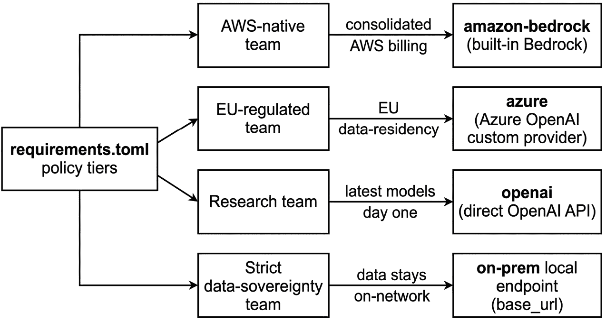
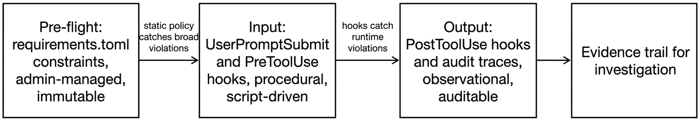

# 企业级部署

第 16 章 将安全性视为单个工作站和项目边界的属性。这种框架是必要的，但当你从单个实践者转向拥有数十个团队、数百个代码库，且合规义务覆盖每一次提交的组织时，它就不再充分。企业级部署在安全性之上增加了三大关注点：大规模分发和强制执行配置、管控智能体被允许执行的操作并在事后证明这一点，以及衡量这一切是否值得投入。本章将依次介绍这些内容，最后提供一份部署前清单，供你在大规模推广前逐项核对。


### 学习目标

你将能够：

1.  在多团队部署中分发配置并强制执行托管策略
2.  构建一个分三阶段的入职计划，安全地引导工程师从观察走向自主使用
3.  定义 ROI 指标，在不夸大承诺的前提下说服工程管理层
4.  设计多云供应商路由策略
5.  建立包含审计追踪和审批工作流的治理框架
6.  诊断企业级推广失败的常见原因，并应用针对性的结构性修复

### 企业级部署的实际含义

人们很容易将本章理解为一项配置练习：推送正确的 `config.toml`、编写 `requirements.toml`、接入 SCIM，然后宣告胜利。这些机制很重要，后续章节会涵盖它们，但它们是简单的部分。一旦你拥有 MDM 配置文件或 Ansible 清单，分发配置就是一个已解决的问题。

困难的部分是 第 28 章 为小组所界定的内容：当智能体产生的变更远超以往，约束瓶颈将从“生产代码”转移到“信任代码”。在企业规模下，这一约束表现为三个单纯靠策略文件无法回答的问题。当智能体将缺陷推送到生产环境时，谁来负责？事后能否证明智能体被要求做什么以及它实际做了什么？你的审查能力是否随着生成能力同步增长，还是你在悄悄积累未经审查的智能体编写风险？

阅读后续机制章节时，请将这三个问题记在心中。托管策略、RBAC 和审计追踪不是目标；它们是组织大规模回答责任归属、证据保全和审查能力这三个问题的工具。一个搞定配置却忽视这三个问题的部署，是企业级智能体计划在充满希望的试点后停滞不前的最常见原因。

### 大规模分发配置

`config.toml` 文件赋予未配置的 Codex CLI 安装其组织形态：模型、审批策略、网络沙箱、Token 预算和受信任的工具提供商。在个人工作流中，你只需编辑一次。在企业中，你需要每位开发者的文件都反映相同的基线，且变更能自动传播，而无需为每台机器提交支持工单。

三种分发模式覆盖了大多数组织。

#### MDM（移动设备管理）

部署一个包，在首次登录时写入 `~/.codex/config.toml`。MDM 具有权威性但粒度较粗，因此用于不可商量的基线：审批策略、网络沙箱规则和模型端点。

#### Dotfile 仓库

将 `codex/config.toml` 模板添加到共享的 dotfiles 仓库中，摩擦力低且受版本控制，但属于建议性而非强制性。

#### 配置管理

针对混合操作系统机群，将 `config.toml` 模板化部署到目标机器，提供了灵活性和可审计性的最强组合。按团队、环境和合规层级进行参数化。

无论选择哪种机制，请坚持一个核心原则：基线应最小化。锁定必须锁定的内容，即网络出口、破坏性操作的审批策略，以及出于数据驻留原因的模型端点，其余留给团队自行决定。过度集中的配置会滋生变通手段。

### 托管策略：requirements.toml

云托管的 `requirements.toml` 策略跨团队强制执行 Codex CLI 行为，无需分发设备级配置文件。当开发者使用企业账户进行身份验证时，托管策略会自动下载并应用。本地 `config.toml` 无法覆盖托管策略的值。

#### 策略分层设计

将策略构建为完整的配置档案。常见的企业设置涵盖四个层级：

| 策略 | 适用对象 | 目的 |
| --- | --- | --- |
| `baseline` | 所有用户（回退） | 通用场景的合理默认值 |
| `engineering` | 工程团队 | 更宽泛的沙箱访问、完整的审批策略 |
| `restricted` | 财务、法务、人力资源 | 面向受监管团队的更严格约束 |
| `admin` | DevOps/平台团队 | 环境操作员的完全访问权限 |

```
##### 基线策略
allowed_sandbox_modes = ["workspace-write"]
allowed_approval_policies = ["on-request"]
##### 编写时网络主机控制为实验性功能
[experimental_network]
enabled = true
allowed_domains = [
  "api.github.com",
  "registry.npmjs.org",
  "pypi.org"
]
[rules]
prefix_rules = [
  { pattern = [{ token = "git" }, { token = "push" }], decision = "prompt" },
  { pattern = [{ token = "curl" }], decision = "forbidden", justification = "外部获取必须通过批准的出口代理。" }
]
```

##### 推广前测试

创建一个 `pilot` 组，分配新策略，将自己加入，然后测试。CLI 会在会话开始时记录应用了哪个托管策略。在扩大到全组之前验证约束条件。

#### 运行时控制

两项额外控制强化企业级部署：

##### 自定义 CA 证书支持

适用于带有 TLS 检查代理的环境：

```
export CODEX_CA_CERTIFICATE=/etc/ssl/corp-ca-bundle.pem   # 若未设置则回退到 SSL_CERT_FILE
```

##### 请求权限锁定

禁用会话中权限升级。通过托管需求固定审批策略，并关闭细粒度权限请求：

```
#### 通过托管需求固定审批策略，禁止会话中升级
allowed_approval_policies = ["untrusted", "on-request"]
[approval_policy.granular]
request_permissions = false
```

设置此项后，所有权限必须通过策略在会话开始时配置，防止智能体在任务中途自行升级访问权限。

### RBAC 和访问控制

Codex 提供三种管理员角色类型，清晰地分离了关注点：

| 角色 | 主要功能 |
| --- | --- |
| **工作区所有者** | 完全管理员：RBAC、账单、工作区配置 |
| **Codex 管理员** | Codex 专用：策略管理、分析 |
| **安全/合规管理员** | 对合规日志和审计数据的只读访问 |

**最佳实践：** 在你的身份提供商中创建一个专门的 `Codex Admins` 组并通过 SCIM 同步，这样将新工程师在 IdP 中加入团队时，会自动授予正确的 Codex CLI 访问层级。

需配置的访问控制：

1.  **允许 Codex 本地：** 切换谁可以运行 CLI 和 IDE 扩展
2.  **允许 Codex 云端：** 切换谁可以提交后台云任务
3.  **允许代码审查：** 切换 Codex PR 审查集成

一种切实可行的推广策略：从 10 到 20 名工程师的试点小组开始。使用分析仪表板跟踪采用情况。以 30 到 50 名工程师为一波进行扩展，在进一步扩大前在每波之后审查分析数据。

### AGENTS.override.md：跨团队强制执行策略


#### AGENTS.md 与 AGENTS.override.md

`AGENTS.md` 文件（*第 4 章*）为项目提供了记录代理指令的场所。默认情况下，这些指令是建议性的；`AGENTS.override.md` 则对其进行补充。撰写本文时，Codex 会读取放置在 `$CODEX_HOME` 中的 `AGENTS.override.md`，并将其与项目的 `AGENTS.md` 文件一起合并到指令集中。通过 MDM 或配置管理分发到每台工作站的 `$CODEX_HOME`，它为安全团队提供了跨团队一致的指令层。请将其视为一种强默认值，而非不可变的控制：它为代理分层添加了被要求遵循的指令，不像 `requirements.toml` 那样是一个硬性的执行边界。

```
#### 组织安全策略：Codex Override
##### 禁止操作
- 未经人工操作员明确批准，不得写入、读取或修改 `src/payments/` 下的文件。
- 不得执行连接到批准的出口列表之外的外部主机的 Shell 命令。
- 不要建议在源文件中存储凭据或私钥。
##### 必需模式
- 所有新的数据库查询必须使用参数化语句。
- 每个生成的迁移文件都必须包含相应的回滚迁移。
```

该文档由安全团队维护，通过与 `config.toml` 相同的机制分发，并存储在基础设施仓库中进行版本控制。

`AGENTS.override.md` 的安全性取决于分发它的机制。对于真正的合规性用例，请将 Override 文档与该文件路径的 MDM 或 Ansible 所有权相结合，以便在下一次同步时覆盖本地修改。

### 团队上手

让每位开发者拿到一个可用的安装包就让他们去用，这是破坏采纳率最快的方式。一个分三阶段的计划能循序渐进地建立正确的直觉。

#### 阶段 1：观察（第 1-2 周）

开发者在低风险、高频任务上以 `on-request` 模式运行 Codex CLI：更新测试固件、重排导入、升级依赖版本。目标是模式识别。一个用于分享有趣输出（好的和坏的）的共享 Slack 频道能加速集体学习。

#### 阶段 2：引导式自主（第 3-6 周）

引入有范围的自主任务：为一个理解透彻的模块编写单元测试套件、根据详细规范实现功能。开发者在合并前审查每一个 diff，但不再逐条批准命令。重点转移到提示工程和添加编码第一阶段经验教训的 `AGENTS.md` 条目上。

#### 阶段 3：自主操作（第 7 周起）

团队确定适合免提执行的任务：那些以自动化测试套件通过作为成功标准且不涉及生产关键路径的任务。代理运行，测试通过或失败，开发者审查一个完成的 Pull Request。

在每个阶段结束时安排一次复盘。要求开发者带来一个代理完全按需求行事的例子和一个代理出问题的例子。失败案例比成功案例更有指导意义。

### 衡量 ROI

每个 AI 工具试点最终都会面临一个问题：这值得我们付出的代价吗？要抵制将“节省工时”作为核心指标的诱惑。开发者不会按任务粒度追踪时间，且反事实是虚构的。

以下三个指标经得起推敲。

#### 无干预完成的任务

对于任何一类自主任务，追踪在开发者无需打断或重启代理的情况下端到端完成的比例。作为一个说明性目标而非基准，第二阶段 40% 的基线，上升到第三阶段的 75%，是一个可信的轨迹。

#### 评审通过率

衡量 Codex 生成的 Pull Request 在第一轮无需修改请求即可通过代码评审的比例。将其与开发者自行编写 PR 的基线进行比较。如果 Codex 生成的 PR 需要的修改轮次更少，这就是一个具体的质量信号。

#### 按作者身份划分的缺陷逃逸率

根据核心 diff 是否为代理辅助来标记 PR。在一个发布周期后，比较部署后的缺陷率。这需要更长时间来积累，但直接说明了代理是让你的代码库更可靠还是更不可靠。

收集作者身份元数据需要一个轻量级约定：一个提交尾行（`Agent-Assisted: codex`）或当 CI 流水线检测到 Codex CLI 会话 ID 时应用的 PR 标签。在试点开始时就建立这种标记规范。

### 多云供应商策略

Codex CLI 包含内置的 `amazon-bedrock` 提供商以及内置的直接 OpenAI API，并通过自定义提供商定义接入 Azure OpenAI。这些共同为企业团队提供了一个真正的多云模型路由层，无需搭建第三方代理基础设施。Google Cloud 是显著的缺失项：Vertex AI 提供 Gemini 和 Anthropic 模型，而非 OpenAI 的模型，因此 Codex CLI 没有 Vertex 提供商。标准化于 Google Cloud 的团队通过直接 OpenAI API 或使用自定义提供商定义的 OpenAI 兼容端点进行路由。

#### 为什么多云很重要

不同业务单元面临不同约束。在欧盟数据驻留要求下运营的团队可能在合同上受限于 Azure 的欧洲区域。在 AWS 上拥有统一账单的团队可能倾向于 Bedrock。研究组可能想要直接 OpenAI API 以在第一天就使用最新模型。

#### 按策略层路由

托管的 `requirements.toml` 基础设施支持按组配置模型端点。每个策略层设置一个 `model_provider`：

```
model_provider = "amazon-bedrock"   # AWS 原生团队：内置 Bedrock 提供商
# model_provider = "azure"          # 受欧盟监管团队：Azure OpenAI（自定义提供商，定义如下）
# model_provider = "openai"         # 研究团队：直接 OpenAI API 以获取最新模型
```

内置的 `openai` 和 `amazon-bedrock` 提供商无需定义（Bedrock 仅接受嵌套的 AWS 覆盖）；通过自定义提供商接入 Azure OpenAI：

```
[model_providers.amazon-bedrock.aws]
region = "eu-central-1"
[model_providers.azure]
name = "Azure OpenAI"
base_url = "https://YOUR_RESOURCE.openai.azure.com/openai"
env_key = "AZURE_OPENAI_API_KEY"
query_params = { api-version = "2025-04-01-preview" }
wire_api = "responses"
```

每个提供商使用原生认证：Azure OpenAI 使用 API 密钥或 Entra ID 令牌，Bedrock 使用 IAM 角色（通过 AWS 配置文件和区域），直接 OpenAI API 使用 API 密钥或 OAuth。CLI 使用每个提供商的标准凭证链从环境中解析凭证。

#### 本地部署选项

对于有严格数据主权要求的组织，使用兼容硬件（如基于 NVIDIA GB10 的系统）进行本地推理提供了一条数据永不离开企业网络边界的路径。通过自定义提供商定义中的 `base_url` 键配置 Codex CLI 以指向本地端点。



**图 17.1 - 将团队路由到模型提供商**

托管 `requirements.toml` 中的每个策略层将团队指向不同的模型提供商：AWS 原生团队路由到内置的 `amazon-bedrock` 提供商以实现统一 AWS 账单，受欧盟监管的团队路由到 Azure OpenAI 自定义提供商以满足欧盟数据驻留要求，研究团队路由到直接 OpenAI API 以在第一天获得最新模型，严格数据主权团队通过 `base_url` 路由到本地端点，使数据保留在网络内。

### 云端 vs 自托管

权衡映射到标准的“构建 vs 购买”轴线，并增加了一个额外维度：数据驻留。

#### 云端优势

无需管理基础设施即可获得最高能力的模型；透明更新；零运维负担。对于大多数组织（包括许多拥有数据处理协议的受监管行业），这是正确的默认选择。


#### 自托管优势

数据永不离开您的网络边界。对模型版本拥有完全控制权。满足最严格的数据驻留法规要求。

#### 自托管成本

GPU 基础设施昂贵。开放权重模型的质量目前在大多数软件工程任务上仍落后于前沿模型。您需自行负责模型服务栈、其依赖项及更新节奏。

“自托管”并不自动意味着“合规”。运行在云服务商 GPU 实例上的自托管模型仍会将数据发送给该服务商。在基于自托管做出部署承诺前，请务必咨询您的法务和合规团队。

### 治理框架

随着 Codex CLI 从试点走向全组织部署，核心问题从“它好用吗？”转变为“当它出错时，谁来负责？”

三大要素构成了一套可行的框架。

#### 策略即代码

组织的 Codex CLI 策略应存活于版本控制文件（`config.toml`、`AGENTS.override.md`）中，并接受与基础设施代码相同的评审与批准流程。策略变更可被审计、可逆、且在生效前可被评审。

#### 审计追踪

每个会话都会生成包含执行命令、修改文件和网络请求的日志。至少需记录：

- 会话开始时间与用户身份
- 每条 Shell 命令及其退出码
- 每次文件写入及其目标路径
- 任何尝试建立的网络连接

#### 审批工作流

对于涉及生产关键路径的任务，您需要一个独立于发起任务开发者的“人工介环”检查点：通过 `CODEOWNERS` 要求对涉及特定路径的 PR 进行必须的二次审批，或针对最高风险类别建立正式的变更顾问委员会流程。

#### 三阶段护栏管线

代理治理的参考架构定义了三个阶段：

| 阶段 | Codex CLI 对应项 | 强制层 |
| --- | --- | --- |
| 预检 | `requirements.toml` 约束 | 管理员托管、不可变 |
| 输入 | `UserPromptSubmit` 和 `PreToolUse` 钩子 | 程序化、脚本驱动 |
| 输出 | `PostToolUse` 钩子 + 审计追踪 | 可观测、可审计 |

该管线将治理分布于各层：静态策略捕获广泛违规，钩子捕获运行时违规，审计追踪为调查提供证据链。



**图 17.2 - 三阶段护栏管线**

从左到右的三阶段治理管线，每阶段映射至其 Codex CLI 对应项及强制层。预检使用不可变的管理员托管 `requirements.toml` 约束捕获广泛违规；输入使用程序化的 `UserPromptSubmit` 和 `PreToolUse` 钩子捕获运行时违规；输出使用 `PostToolUse` 钩子和审计追踪进行观测，生成用于调查的证据链。

#### 三层监控模型

企业部署会产生三个截然不同的数据流：

| 层级 | 机制 | 负责人 | 目的 |
| --- | --- | --- | --- |
| 自助可视性 | 分析仪表板 | 工程负责人 | 采纳指标、团队使用情况 |
| 自动化报告 | 分析 API | 平台团队 | 每日时序数据、数据仓库摄入 |
| 审计与调查 | 合规 API | 安全/法务 | 不可变日志、SIEM 摄入 |

分析事件告诉您 *谁在使用 Codex CLI 以及使用了多少*。实时可观测性追踪（通过 OpenTelemetry）告诉您 *当下正在发生什么*。合规导出告诉您 *确切发生了什么，且不可篡改，以备案存*。

```
#### 启用 OpenTelemetry 追踪导出以实现实时可观测性
[otel]
environment = "prod"
exporter = "otlp-grpc"
[otel.exporter.default]
endpoint = "https://otel-collector.internal:4317"
```

### 企业级推广实际为何失败

上述机制是必要的，但没有哪一个单独足够。停滞的项目很少因配置失败，而是以五种反复出现的方式失败，每一种都需要结构性修复而非工具层面的修复。

#### 暗影 AI

若将认可工具管控过严，开发者会绕过它，将代码粘贴进个人聊天机器人，或在副项目上运行未获批的 CLI。这比宽松策略更糟：组织拥有了无法看见、治理或审计的代理辅助代码。修复之道非收紧管控，而是提供一条真正阻力最小的合规路径。将每一项禁令视为提供认可替代方案的契机（如用出口代理替代 `curl`，用内部包镜像替代任意安装），使合规路径同时也是最便捷的路径。

#### 策略作秀

一份看似全面的 `requirements.toml` 若 `AGENTS.override.md` 仅为建议性、钩子可被绕过、且无人阅读审计日志，则形同虚设。纸面合规不等于事实上的合规。修复之道是明确每项管控由哪一层强制执行：不可变的托管策略、程序化钩子、或事后审计，即治理框架部分所述的管线三阶段。在宣称管控生效前，确认其强制执行层确实已触发。

#### 评审瓶颈

这正是 第 25 章 基准测试所量化的失败模式：代理辅助工作流大幅缩短了提交 PR 的时间，但 PR 此后在评审环节滞留更久，因为评审产能未随生成产能增长。仅衡量采纳率和速度的企业会为加速喝彩，而未评审积压及其中蕴含的风险却在复利式累积。修复之道是将评审吞吐量视为受控约束（第 28 章）：追踪生成变更与已评审变更的比率，将生产力红利投入验证，而非仅用于产出更多。

#### 许可证浪费

在大多数企业推广中，相当比例的购买席位闲置；采购按全组织采购，而实际采纳集中于少数团队（第 25 章 引用了相关数据）。修复之道是让采纳拉动许可证而非推送许可证：为已完成三阶段上手计划的团队分配席位，观察分析仪表板，按实际使用扩展而非按人数预测。

#### 责任真空

当代理编写的变更引发事故时，“谁负责？”往往无清晰答案，因变更归因于工具而非个人。编码代理无法被问责；指导并合并该变更的工程师才是。修复之道是结构性的：在每个代理辅助变更上附加作者元数据（提交尾行或 PR 标签，见衡量 ROI 部分），在涉及生产关键路径的事项上指定具名人工审查者，并确立显性原则：合并代理输出即为作者行为，随之承担相应责任。

### 推广核查清单

| 领域 | 就绪指标 |
| --- | --- |
| RBAC 配置 | IdP 中已创建管理员组，通过 SCIM 同步 |
| 托管策略 | `requirements.toml` 基线已编写并在试点组测试通过 |
| TLS 配置 | 已为 TLS 代理环境配置 CA 证书 |
| 权限锁定 | 受限团队已设置 `request_permissions = false` |
| 多云服务商 | 按策略层级配置服务商路由；模型版本已固定 |
| 配置覆盖 | `AGENTS.override.md` 已编写并通过 MDM/Ansible 分发 |
| 合规管线 | 审计日志已配置摄入 SIEM |
| 分析归属 | 已指派仪表板、API 及事件管线负责人 |
| 上手计划 | 三阶段计划已文档化并制定复盘时间表 |
| ROI 指标 | 已建立作者标记约定；基线测量已定义 |


### 摘要

1.  **真正的约束是信任，而非配置。** 分发配置是容易的部分；企业级的挑战在于问责制、证据保留，以及让审查能力与生成能力保持同步。

2.  **分发配置，保持基线最小化。** MDM、点文件仓库或配置管理工具均可分发 `config.toml`。仅锁定必须锁定的内容，其余交由团队自行决定，因为过度集中的配置会滋生变通手段。

3.  **托管策略无法在本地被覆盖。** 云端托管的 `requirements.toml` 策略会强制执行组织约束，本地 `config.toml` 无法削弱这些约束，并在企业认证时自动应用。

4.  **带有 SCIM 的 RBAC 可扩展访问控制。** 从身份提供商同步 `Codex Admins` 组意味着将工程师加入团队即可自动授予正确的访问层级。

5.  **三阶段入职计划可逐步建立信任。** 观察、引导式自主、完全自主，并在每个过渡节点进行复盘。

6.  **ROI 指标应客观且可观测。** 跟踪无需干预即可完成的任务数、审查通过率，以及按作者划分的缺陷逃逸率，而非虚构的“节省工时”。

7.  **多云路由满足各团队约束。** 分层提供商配置允许业务单元根据各自的数据驻留、成本或能力需求，选择 Azure OpenAI、Bedrock 或直接使用 OpenAI API。

8.  **治理需要策略即代码、审计追踪和审批工作流。** 版本化的策略、不可变的会话日志，以及独立于发起任务的开发人员的人工检查点。

9.  **三层监控模型明确所有权归属。** 用于采用情况的分析、用于实时发生状况的可观测性、用于不可变记录的合规导出。

10. **了解推广失败的模式。** Shadow AI（隐形 AI 使用）、策略做样子、审查瓶颈、许可证浪费和问责真空，每一种都会阻碍企业级项目，且每一种都有结构性的修复方案，而非单纯的工具修复。

### 练习

**练习 17-1.** 为您的组织设计一个包含至少三个策略层级的 `requirements.toml`。定义每个层级限制的内容及原因。在您自己的机器上测试基线层级，并验证托管约束无法被本地 `config.toml` 覆盖。

**练习 17-2.** 为一个十人团队制定三阶段入职计划。定义每个阶段的具体任务、晋升到下一阶段的成功标准，以及在每个过渡节点将询问的复盘问题。

**练习 17-3.** 在您的 CI 流水线中为代理辅助的 Pull Request 设置作者标记。一个冲刺后，对比代理辅助 PR 与人工编写 PR 的审查通过率。


