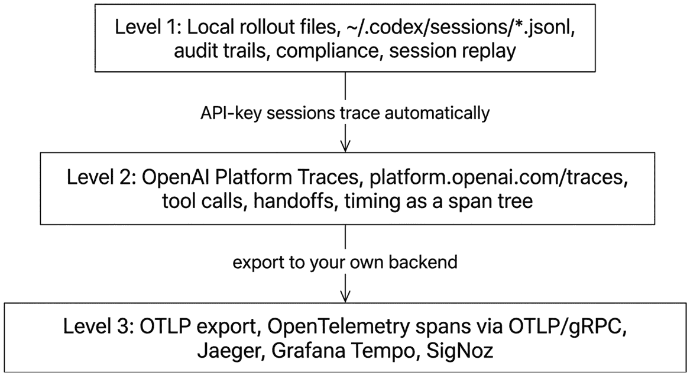

# 调试与诊断代理故障

*第 5 章* 确立了信任模型：审批模式、沙箱配置、权限阶梯。本章讲述当事情仍然出错时该怎么做。

第二部分的每个配置章节都教你如何正确设置 Codex CLI。但没有一章告诉你：当代理产生错误结果、陷入循环、默默忽略你的 `AGENTS.md`，或在未完成任务时耗尽上下文窗口时该怎么办。本章教授恢复技巧。

### 学习目标

您将能够：

1.  定位代理偏离意图的具体工具调用

2.  运行只读诊断会话以在不执行的情况下检查代理的计划

3.  使用 `RUST_LOG` 和 TUI 斜杠命令在多个粒度层面追踪代理行为

4.  通过 `RUST_LOG` 追踪输出验证加载了哪些 `AGENTS.md` 文件

5.  使用 `codex sandbox` 在离线状态下测试沙箱强制执行下的命令

6.  使用 `codex execpolicy check` 在不启动会话的情况下验证执行策略规则

7.  干净地中断失控会话并选择正确的回滚策略

8.  使用 `codex debug models` 验证在受限或代理环境中的模型可用性

### 阅读会话记录

会话记录以 JSONL 滚动文件形式写入 `~/.codex/sessions/`，每个事件一个 JSON 对象。每个文件包含类型化的 `RolloutItem` 事件，包括 `SessionMeta`、`UserMessage`、`ResponseItem`、`EventMsg` 和 `ApprovalDecision`，共同构成发生的一切的完整记录。^(¹⁵⁹) 典型的工具调用追踪如下：

```
{"type":"tool_call","id":"call_abc123","name":"read_file","args":{"path":"src/handlers/auth.ts"},"ts":1710510121}
{"type":"tool_result","call_id":"call_abc123","ok":true,"output":"import { Request, Response } from 'express'...","ts":1710510122}
{"type":"tool_call","id":"call_def456","name":"run_shell","args":{"cmd":"npm test -- --testPathPattern=auth"},"ts":1710510123}
{"type":"tool_result","call_id":"call_def456","ok":false,"output":"FAIL tests/auth.test.ts\n should validate JWT expiry...","ts":1710510126}
```

偏离点几乎总是以下三种情况之一：返回意外输出的工具调用、静默失败的命令（`ok: true` 但输出中包含错误），或做出错误推理的推理步骤。从结尾开始，倒推至您预期的最后一个结果。

`jq -s 'map(select(.type == "tool_result" and .ok == false))' transcript.jsonl` 可一条命令提取所有失败的工具结果。

除了失败结果，您还可以分析工具调用分布，并从会话中提取每一个审批决策：

```
#### 查找最新的会话记录
ls -t ~/.codex/sessions/*.jsonl | head -1
#### 按类型统计工具调用次数
cat ~/.codex/sessions/<session>.jsonl | \
 jq 'select(.type == "ResponseItem") | .item.type' | \
 sort | uniq -c | sort -rn
#### 提取所有审批决策
cat ~/.codex/sessions/<session>.jsonl | \
 jq 'select(.type == "ApprovalDecision")'
```

社区工具 `codex-replay` 可将这些 JSONL 文件渲染为可浏览的 HTML，而 `ccusage` 项目则提供基于回放令牌计数器解析的每日和每月成本报告。^(¹⁶⁰)

### 将审批模式用作诊断工具

使用 `-a untrusted -s read-only` 运行可创建纯检查模式：代理可读取文件但无法写入或执行。每个操作都会作为带有完整详情的审批提示出现。

```
codex -a untrusted -s read-only "refactor the authentication module to use JWT"
```

当之前的会话表现异常，而您希望在实际运行前了解其计划时，请使用此模式。

当您在 `untrusted` 模式下拒绝审批请求时，可直接输入修正意见：

```
[需要审批] 写入 src/auth/jwt.ts
> 拒绝：使用 jose 库，而非 new-jwt-library
```

代理将接收您的修正并就地修订计划。

### 用于实时诊断的 TUI 斜杠命令

三个斜杠命令可在不离开 TUI 的情况下提供诊断信息：^(¹⁶¹)

`/status` 显示当前会话配置和令牌用量。当感觉不对劲时，这是第一站；它确认当前活动的模型、当前推理力度级别、令牌消耗和有效的沙箱模式。

`/debug-config` 揭示完整的配置解析堆栈：层级顺序（从最低到最高优先级）、每个键的有效值及设置它的层级，以及策略详情，包括 `allowed_approval_policies`、`allowed_sandbox_modes`、`mcp_servers` 和 `rules`。^(¹⁶²) 这在企业环境中特别有用，因为托管的 `requirements.toml` 可能会无声地覆盖您的 `config.toml` 设置。如果您的 `sandbox_mode = "danger-full-access"` 被忽略，`/debug-config` 将显示托管策略正在强制执行 `workspace-write`。


`/feedback` 会收集诊断信息，包括请求 ID、会话 ID、连接状态、最后的错误消息、活动工具数量和 MCP 服务器状态，并直接提交给 OpenAI 的维护者。在关闭表现出意外行为的会话前运行 `/feedback`：请求 ID 是在 GitHub 上提交问题时最有用的单一数据。

### codex doctor：会话前诊断

在开始会话前，`codex doctor` 会运行全面的诊断检查，在配置和环境问题消耗 Token 之前将其捕获。

```
codex doctor
```

该命令检查：

1.  **API 密钥有效性和权限。** 能否通过身份验证？
2.  **模型访问权限。** 配置的模型是否可达？
3.  **网络连接。** Codex 能否通过 HTTP 到达所需的提供商端点，并打开到 `chatgpt.com` 的 WebSocket？
4.  **MCP 服务器连通性。** 所有声明的服务器是否都在响应？
5.  **config.toml 语法和键有效性。** 是否有拼写错误或已弃用的键？
6.  **沙箱兼容性。** 您的操作系统和内核是否支持请求的沙箱模式？
7.  **AGENTS.md 文件发现。** 哪些指令文件会被加载？

在撰写本文时，诊断还会报告安装的 Codex 版本，探测是否有更新版本，并涵盖环境变量、Git 配置、终端功能、应用服务器状态和线程清单。线程清单特别有用：它列出所有现有线程、其状态和磁盘使用情况，有助于诊断累积会话消耗意外存储空间的问题。

**何时运行：** 安装后、任何配置更改后、切换配置文件后，以及感觉不对劲时。五秒钟的诊断可节省二十分钟调试昂贵会话中第三轮出现的晦涩错误的时间。

`codex doctor` 如果有任何检查失败则以非零值退出，因此它可作为 CI 中的预检门禁。在得出安装损坏的结论前请先阅读失败信息：在受限网络环境中，连接检查会在 DNS、通过 HTTP 的提供商端点、`chatgpt.com` WebSocket 以及针对 `api.github.com` 的更新探测上失败，即使安装、配置、认证和 MCP 均报告正常。本地检查健康且仅网络解析失败指向沙箱或代理，而非 Codex 本身。对于机器可读输出，`--json` 发出经过编辑的支持报告，`--summary` 仅显示分组的检查行和最终计数。

### 诊断 AGENTS.md 失败

#### 使用 `RUST_LOG` 验证加载

```
RUST_LOG=info,codex_core=debug codex "your task here" 2>&1 | head -50
```

查找显示 Codex 发现并组合的指令文件的 `tracing` 输出，例如：

```
codex_core: agents_md: found /home/dan/.codex/AGENTS.md (global)
codex_core: agents_md: found /home/dan/projects/myapp/AGENTS.md (project)
codex_core: agents_md: loaded 2 file(s), combined length 847 bytes
```

如果未列出您预期的文件，请检查路径、文件名大小写（Linux 区分大小写）和编码。

#### 常见的静默失败模式

**错误的目录。** 在子目录中创建了 `AGENTS.md` 但从仓库根目录运行，反之亦然。

**编码问题。** BOM 标记或混合的行尾导致静默解析失败。使用 `file AGENTS.md` 和 `dos2unix AGENTS.md`。

**与模型先验冲突的指令。** “永远不要给代码添加注释”如果没有理由将不会生效。添加理由：“该项目使用自文档化变量名作为唯一的文档机制。”

**指令埋得太深。** 顶部的指令权重更大。将关键指令移到顶部。

当 `AGENTS.md` 加载失败时没有显式错误。模块目标 `RUST_LOG` 追踪（例如 `RUST_LOG=codex_core=debug`）是确认加载的最可靠方法。

### 认证失败

当会话因认证错误无法启动时，请在重启前隔离问题：

```
#### 检查当前认证状态，不触发登录流程
codex login status
#### 直接检查令牌过期时间
cat ~/.codex/auth.json | jq '.expires_at'
```

`codex login status` 报告您是否已认证、使用的方法（浏览器 OAuth、设备代码或 API 密钥）以及令牌是否有效。一个常见的失败模式是 `auth.json` 文件损坏或过期：修复方法是 `codex logout` 后跟 `codex login`。

### 在沙箱下测试命令

`codex sandbox` 子命令在 Codex CLI 在代理会话期间应用的确切沙箱执行下测试任意命令，而无需启动会话。这在诊断构建工具或测试运行器为何在沙箱下失败时必不可少。

```
#### macOS：在 Seatbelt 执行下测试命令
codex sandbox macos -- npm run build
#### macOS：具有 workspace-write 权限和拒绝日志记录
codex sandbox macos --permissions-profile workspace-write --log-denials -- cargo test
#### Linux：在 bubblewrap/seccomp 执行下测试
codex sandbox linux -- pytest tests/
#### Linux：workspace-write 模式
codex sandbox linux --permissions-profile workspace-write -- make install
```

macOS 上的 `--log-denials` 标志将每次 Seatbelt 拒绝打印到 stderr，显示确切被阻止的文件系统路径或网络操作。

常见场景：您的 Rust 项目在 Codex CLI 外部构建正常，但在代理的沙箱下失败。使用 `codex sandbox` 隔离问题：

```
##### 步骤 1：在沙箱下测试构建
codex sandbox linux -- cargo build 2>&1 | grep -i denied
##### 步骤 2：如果出现失败，尝试使用 workspace-write
codex sandbox linux --permissions-profile workspace-write -- cargo build
# 步骤 3：如果仍然失败，问题在于网络访问
# （例如，crates.io 下载被沙箱阻止）
```

此工作流避免了启动完整代理会话仅为调试沙箱限制的成本。

### 执行策略规则（`.rules`）

*第 15 章* 介绍了用于 CI 确定性的 `--ignore-rules`。这是其背后的机制。执行策略规则决定代理可以在沙箱外运行哪些命令，这是位于“操作系统允许什么”（沙箱模式，*第 5 章*）和“代理可以接触哪些文件”（权限配置文件）之间的层。沙箱阻止命令造成损害，而规则决定命令是否允许运行。

规则位于用 Starlark 编写的 `.rules` 文件中，Starlark 是一种小型的、类 Python 的配置语言，无副作用。Codex 在启动时从多个层加载它们：团队配置、用户层 `~/.codex/rules/` 和项目本地 `<repo>/.codex/rules/`（仅当该 `.codex/` 目录受信任时加载项目层）。撰写时为实验性功能。

核心结构是 `prefix_rule()`，它通过前导标记匹配命令并分配决策：

```
prefix_rule(
    pattern = ["gh", "pr", ["view", "list"]],
    decision = "prompt",
    justification = "Reading PRs is fine, but flag it for visibility.",
    match = ["gh pr view 7888", "gh pr list --state open"],
    not_match = ["gh pr merge 7888"],
)
```

每个 `pattern` 元素要么是字面标记，要么是该位置匹配的替代列表（并集），因此上述规则涵盖 `gh pr view` 和 `gh pr list`，但不包括 `gh pr merge`。`decision` 为 `allow`（默认）、`prompt`（仅在人工批准后运行）或 `forbidden`（从不运行）。可选的 `justification` 显示在批准提示和审计输出中；`match` 和 `not_match` 是规则应捕获和不应捕获的示例命令，供离线验证器使用。


当多条规则匹配同一条命令时，最严格的决策生效：`forbidden` 高于 `prompt` 高于 `allow`。Codex 会按安全操作符（`&&`、`||`、`;`、`|`）拆分 Shell 链并分别评估每条命令；使用了重定向、命令替换或变量的调用会被视为单条命令，而不会被拆分。

### 离线验证执行策略规则

在部署 Starlark `.rules` 文件之前，可使用 `codex execpolicy check` 进行离线验证：^(¹⁶⁶)

```
codex execpolicy check \
 --pretty \
 --rules ~/.codex/rules/default.rules \
 -- gh pr view 7888 --json title,body,comments
```

输出会显示有效决策（所有匹配规则中最严格的严重级别：`forbidden` > `prompt` > `allow`）以及每条前缀匹配的规则，并显示确切的 `matchedPrefix`。您可以组合多个规则文件：

```
codex execpolicy check \
 --pretty \
 --rules ~/.codex/rules/default.rules \
 --rules .codex/rules/project.rules \
 -- rm -rf node_modules
```

### 上下文溢出症状

当上下文窗口填满时，Agent 会遗忘会话早期的内容：

1.  **话题偏移**，忽略前文所述的约束条件
2.  **工具调用循环**，多次读取同一文件
3.  **幻觉文件名**，引用不存在的文件
4.  **莫名其妙的失败**，报告错误的命令结果

会话日志会以百分比显示上下文使用率。达到 70% 至 80% 时，应采取行动。

`/compact` 会触发一次总结压缩过程，压缩会话历史以释放上下文空间。这是有损的：压缩后详细的工具调用追踪将不复存在。

**重新开始**的时机：Agent 对文件系统状态自信地判断错误超过一次、在修复 Bug 时引入了新 Bug，或任务完成度不足 50% 但上下文使用率已达 80% 以上时。

### 恢复失控会话

**目标延续与重试循环。** 当触及使用限制或反复遇到阻碍时，目标延续可能会陷入循环：Agent 在无人工干预的情况下重复同一失败动作，消耗 Token 和时间。Codex CLI 会在使用限制或反复阻碍时暂停并将控制权交还给开发者。如果发现 Agent 进入重试循环，最可能的原因是版本过旧，升级即可解决。

按一次 `Ctrl-C` 即可干净地中断。请勿多次按下；第二次按键可能会取消清理处理程序。

`git stash` 通常比 `git checkout -- .` 更安全，因为它会保留 Agent 的更改以便选择性恢复：

```
git stash
git stash show -p # 检查暂存的内容
git stash drop # 拣选后丢弃
```

`git checkout -- .` 和 `git stash` 均不会移除新的未跟踪文件。使用 `git clean -nfd` 预览，然后用 `git clean -fd` 移除。

回滚后，花三十秒根据失败会话的教训修订提示词。

### 使用 `RUST_LOG` 进行结构化日志记录

```
RUST_LOG=debug codex "your task" 2>debug.log
```

调试日志包含：加载的配置文件、`AGENTS.md` 解析、工具调用分发、沙箱强制执行事件、API 计时和 Token 计数、错误堆栈跟踪。

```
grep 'agents_md' debug.log # AGENTS.md 加载
grep '"type":"dispatch"' debug.log | jq # 工具调用
grep 'ERROR\|WARN' debug.log # 错误
```

#### 使用 RUST_LOG 进行模块级追踪

Codex CLI 由 Rust 构建，基于标准的 `tracing` crate，因此 `RUST_LOG` 环境变量可在模块粒度上控制详细程度。^(¹⁶⁷) Codex CLI crate 的默认级别为 `info`。逐模块定位可让您精准聚焦所需的子系统，而不必淹没在噪音中：

```
#### 调试核心 Agent 循环，其余保持 info 级别
RUST_LOG=info,codex_core=debug codex
#### 调试沙箱行为
RUST_LOG=codex_sandbox=debug,codex_process_hardening=debug codex
#### 调试 MCP 服务器连接
RUST_LOG=codex_core::mcp=debug codex
```

若需机器可解析的日志（便于管道传输至日志聚合系统），请将格式设为 JSON：^(¹⁶⁸)

```
RUST_LOG=debug RUST_LOG_FORMAT=json codex exec "run tests" 2>&1 | tee codex-debug.log
```

Codex 将 TUI 日志写入 `~/.codex/logs/codex-tui.log` 并自动轮转。在 `codex exec` 模式下，带时间戳的日志文件位于 `~/.codex/logs/codex-tui-<timestamp>.log`。^(¹⁶⁹)

Debug 和 trace 级别可能会使吞吐量降低 10% 至 50%。^(¹⁷⁰) 请将其保留用于主动排查故障，而非生产工作流。

### `codex debug` 子命令

`codex debug` 命令是底层调试工具的入口点：^(¹⁷¹)

```
#### 列出可用的 debug 子命令
codex debug --help
#### 使用单条消息测试 V2 应用服务器协议
codex debug app-server send-message-v2 "Hello, world"
```

`send-message-v2` 子命令会初始化应用服务器、启动线程、发送单条用户消息，并将所有服务器通知流式传回终端，以此验证协议工作正常，而无需启动完整的 TUI。

#### 使用 `codex debug models` 进行模型目录内省

`codex debug models` 会查询提供商 API 并报告当前凭据可访问的模型。当会话拒绝启动、回退到意外模型，或因请求的模型不可用而产生降级输出时，请使用它。

```
codex debug models
```

输出会列出您的 API 密钥可访问的每个模型。常见场景：

**企业代理环境。** 重写或过滤 API 请求的代理可能会静默阻断某些模型。`codex debug models` 可确认从您的网络位置实际能到达提供商的哪些模型。

**组织级模型限制。** 企业版 OpenAI 账户通常会按 API 密钥或项目限制可用模型。当团队成员反馈 Codex CLI "无法工作" 时，第一步诊断是确认其密钥有权访问 `config.toml` 中指定的模型。

**提供商迁移。** 通过 `OPENAI_BASE_URL` 在 OpenAI、Azure OpenAI 或第三方提供商间切换时，模型名称会有所不同。`codex debug models` 会显示提供商的实际模型目录，而非您假设可用的目录。

```
#### 结合 grep 检查特定模型
codex debug models | grep gpt-5.4-mini
#### 在 CI 中很有用：若预期模型不可用则快速失败
codex debug models | grep -q "gpt-5.4-mini" || echo "ERROR: gpt-5.4-mini not available"
```

#### 使用 SLUMP 检测规格漂移

当 Agent 开始产出偏离原始规格的输出、编写了解决不同问题的正确代码时，问题不在于工具故障，而在于**规格漂移**。SLUMP 框架（普渡大学，2026）提供了一种诊断方法：对比早期轮次输出与后期轮次输出对原始规格的忠实度。^(¹⁷²)

实际诊断步骤简明扼要：

1.  **明确规格。** 定位最初的 `PLANS.md`、 `/goal` 目标或定义任务的初始提示词。
2.  **在两个节点采样输出。** 对比 Agent 在前 10 轮编写的文件与第 30+ 轮的文件。检查两者是否实现了相同的架构决策、使用了指定的模块依赖、遵循了相同的命名约定。
3.  **专门寻找结构性漂移。** SLUMP 研究表明，Codex CLI 保留了语义正确性（单个组件仍做正确的事），但丧失了结构集成性（组件不再正确连接）。检查导入图和模块依赖；漂移最先显现于此处。


如果检测到偏移，补救措施是重新锚定：将原始规范粘贴回对话中，使用 `/goal` 重述目标，或使用相同的 `PLANS.md` 开启一个新会话。计划模式 (`Shift+Tab`) 提供了一个天然的重新落地点：进入计划模式以根据原始规范审查当前状态，然后退出以恢复执行。

详见第 16 章了解完整的 SLUMP 分析和缓解模式。

### 诊断工作流清单

出现问题时，按顺序执行以下步骤，先进行低成本检查，最后才进行昂贵的重启：

1.  **检查配置**：在 TUI 中运行 `/debug-config` 以验证您的设置是否生效。

2.  **检查认证**：运行 `codex login status` 以排除凭证问题。

3.  **检查沙箱**：使用 `codex sandbox <platform> -- <command>` 在隔离环境中测试命令。

4.  **检查规则**：使用 `codex execpolicy check --pretty --rules <file> -- <command>` 以验证执行策略。

5.  **检查模型**：运行 `codex debug models` 以验证预期模型是否可通过您的网络和凭证访问。

6.  **启用追踪**：使用 `RUST_LOG=debug codex` 重启并监控 `~/.codex/logs/codex-tui.log`。

7.  **审查展开记录**：检查失败会话的 JSONL 会话文件。

8.  **提交报告**：运行 `/feedback` 以在关闭前捕获诊断上下文。

### 三层可观测性栈

本地展开文件是 Codex CLI 调试的基础，但它们只是三层可观测性栈中的一层。每一层服务于不同的调试需求。



图 18.1 - 三层可观测性栈

三层可观测性栈的自上而下视图，每一层服务于不同的调试需求。第 1 层是 `~/.codex/sessions` 中的本地展开 JSONL 文件，用于审计和重放；使用 API 密钥的会话会自动追踪至第 2 层，即 OpenAI 平台追踪，它将工具调用、切换和时序渲染为跨度树；团队可从那里导出至第 3 层，即其自有后端（如 Jaeger、Grafana Tempo 或 SigNoz）中的 OTLP/gRPC OpenTelemetry 跨度。

**第 1 层：本地展开文件** (`~/.codex/sessions/*.jsonL`)。完整的纯追加 JSONL 记录，详见本章开头。最适合审计追踪、合规性检查和会话重放。

**第 2 层：OpenAI 平台追踪** (`platform.openai.com/traces`)。Codex CLI 的展开追踪会自动记录工具调用、代码模式切换、会话关系以及多智能体父子链接。当您使用 API 密钥（而非 ChatGPT 套餐）运行 Codex CLI 时，这些追踪会出现在 OpenAI 平台的“日志”下的“追踪”中。^1 每个追踪捕获模型调用（提示词、消耗的 token、推理力度、响应）、工具调用（工具名称、参数、输出）、切换（带线程关系的子智能体生成）、护栏评估（批准决策、策略检查）以及时序数据（时钟时长、排队时间、生成延迟）。仪表板将每个会话渲染为一棵跨度树，可展开以显示确切的工具参数、标准输出/标准错误输出以及批准决议。

**第 3 层：OTLP 导出至外部后端。** 对于需要在自有可观测性栈中查看追踪的团队，Codex CLI 通过 OTLP/gRPC 导出 OpenTelemetry 跨度。^2 配置位于 `~/.codex/config.toml` 中：

```
[otel]
log_user_prompt = true
exporter = { otlp-grpc = { endpoint = "https://ingest.eu.signoz.cloud:443", headers = { "signoz-ingestion-key" = "your-key-here" } } }
```

对于自托管后端（Jaeger、Grafana Tempo、SigNoz），请使用本地端点：

```
[otel]
log_user_prompt = true
exporter = { otlp-grpc = { endpoint = "http://localhost:4317" } }
```

每个 Codex CLI 会话生成的跨度遵循以下层级：`codex.session` → `codex.turn.N` → `codex.model_call` / `codex.tool.<name>`。关键跨度属性包括 `codex.session_id`、`codex.model`、`codex.tool.name`、`codex.tool.exit_code`，以及每轮的 token 消耗（`codex.tokens.input`、`codex.tokens.cached_input`、`codex.tokens.output`）。

#### 展开-追踪调试归约器

对于原生终端调试，您可以使用标准 Shell 工具直接检查展开 JSONL。在撰写本文时，Codex 还附带一个实验性的 `codex debug trace-reduce` 辅助工具，但自行查询 JSONL 可使工作流在不同版本间保持可移植性：

```
jq '.items[] | select(.type == "tool_call") | {tool: .name, status, duration_ms}' \
 ~/.codex/sessions/2026/05/07/rollout-*.jsonl
```

输出结果提供了工具调用、退出状态和时序的紧凑视图。调整 `jq` 过滤器以隔离失败项、长时间运行的命令，或您展开模式中捕获的 token 使用字段。

#### 结合追踪的实用调试工作流

**诊断错误的文件编辑。** 打开 `platform.openai.com/traces`，按会话 ID 筛选，展开编辑错误文件的那一轮，并检查 `apply_patch` 之前是哪些 `read_file` 调用。确认相关文件是否在上下文中，或智能体是否根据命名约定进行了猜测。

**识别缓慢的会话。** JSONL 查询可识别最慢的工具调用：

```
jq '[.items[] | select(.type == "tool_call")
 | {tool: .name, duration_ms: .duration_ms}]
 | sort_by(-.duration_ms) | .[0:5]' <rollout-file>
```

**Token 花费归因。** 对于按任务跟踪成本的团队，OTLP 跨度按轮携带 token 计数。类似 `sum by (codex.model)(rate(codex_tokens_output_total[5m]))` 的 Grafana 查询可显示按模型划分的输出 token 燃烧率。

**多智能体关系映射。** 平台追踪仪表板通过 `codex.parent_session_id` 显示子智能体线程间的父子关系，让您能够验证委派指令、识别超出深度限制的子智能体，并将子智能体失败与父智能体重试决策关联起来。

ChatGPT 套餐会话不会出现在 API 平台追踪仪表板中；您需要 API 密钥才能获得平台级可见性。在典型部署中，OTLP 导出给会话时钟时长增加的开销为个位数百分比。

### 总结

1.  **会话记录是主要工具。** `~/.codex/sessions/` 中的 JSONL 展开文件记录了一切发生的事情。从末尾向前阅读以找到偏离点，并使用 `jq` 分析工具调用分布和提取批准决策。

2.  **TUI 内的实时诊断。** `/status`、`/debug-config` 和 `/feedback` 可在不离开 TUI 的情况下呈现会话配置、解析后的配置栈和可提交的诊断上下文；使用 `-a untrusted -s read-only` 运行可让您在智能体执行任何操作前检查其意图。

3.  **AGENTS.md 静默失败。** `RUST_LOG` 调试级追踪是确认文件已加载的最可靠手段。静默失败的常见原因包括目录错误、编码问题以及指令埋藏过深。

4.  **会话前的离线验证。** `codex sandbox` 在智能体使用的精确执行环境下运行命令（在 macOS 上带有 `--log-denials`），`codex execpolicy check` 验证 Starlark `.rules` 文件针对拟议命令的有效性，两者均无需启动会话。

5.  **追踪与模型内省。** 带有模块级目标（`codex_core`、`codex_exec`、`codex_sandbox`）的 `RUST_LOG` 提供从单个子系统到完整调试级追踪的粒度日志，而 `codex debug models` 会报告您的凭证能在企业代理或组织级限制后访问哪些模型。

6.  **上下文溢出与质量衰退。** 话题偏移、工具调用循环和幻觉文件名预示着上下文窗口已满，且代码质量会在长会话中下降。通过定期 `/compact`、`PostToolUse` 质量检查钩子和会话长度限制来应对这两者。

7.  **干净地中断，刻意地恢复。** 按一次 `Ctrl-C`，然后使用 `git stash` 保留智能体的更改以便有选择地恢复。


## 8. Agent Logging Gap (智能体日志缺口)

Agents under-log by default. Unlike human developers, who produce console output and commit messages as side effects of work, agents optimise for task completion and skip observability unless instructed. Enforce logging through `AGENTS.md` instructions ('log every major decision to stdout') and `PostToolUse` hooks.

智能体默认日志记录不足。与人类开发者不同，后者将控制台输出和提交消息作为工作的副作用产生，智能体则针对任务完成进行优化，除非被指示，否则会跳过可观测性。通过 `AGENTS.md` 指令（“将每个主要决策记录到 stdout”）和 `PostToolUse` 钩子来强制记录日志。

## 9. The Three-Level Observability Stack (三级可观测性栈)

Local rollout files, OpenAI Platform Traces, and OTLP export are complementary: local files for audit and replay, platform traces for visual exploration, and OTLP for team-wide dashboards and alerting.

本地回放文件、OpenAI 平台追踪和 OTLP 导出是互补的：本地文件用于审计和回放，平台追踪用于可视化探索，OTLP 用于团队级仪表板和告警。

## 10. Work the Checklist Top-Down (自上而下执行清单)

When all else fails, run the cheap checks first: config, auth, sandbox, rules, models, tracing, rollout, feedback.

当其他方法都失效时，先运行低成本检查：配置、认证、沙箱、规则、模型、追踪、回放、反馈。

# Exercises (练习)

1.  **Trace Failed Shell Calls. (追踪失败的 Shell 调用。)** Examine a `transcript.jsonl` and use `jq` to extract all `run_shell` tool calls. Identify which failed and whether the agent detected the failure.

    检查 `transcript.jsonl` 并使用 `jq` 提取所有 `run_shell` 工具调用。识别哪些失败了，以及智能体是否检测到了失败。

2.  **Verify Nested AGENTS.md Loading. (验证嵌套 AGENTS.md 加载。)** Create overlapping `AGENTS.md` files at root and subdirectory level. Run `RUST_LOG=codex_core=debug codex` from the subdirectory and verify both loaded.

    在根目录和子目录层级创建重叠的 `AGENTS.md` 文件。从子目录运行 `RUST_LOG=codex_core=debug codex` 并验证两者均已加载。

3.  **Recover from an Underspecified Prompt. (从欠指定提示词中恢复。)** Give Codex CLI a deliberately underspecified prompt in a throwaway repo. Let it run two to three turns, interrupt, examine the transcript, and write a better prompt.

    在一个临时仓库中给 Codex CLI 一个故意欠指定的提示词。让它运行两到三轮，中断，检查记录，并编写一个更好的提示词。

4.  **Find the Divergence Point. (找到偏离点。)** Use `RUST_LOG=debug` to trace a failing task. Run a task that you expect to fail, capture the debug output, and identify the exact point where the agent's reasoning went wrong. Note the tool-call sequence and the decision that led to failure.

    使用 `RUST_LOG=debug` 追踪一个失败的任务。运行一个你预期会失败的任务，捕获调试输出，并确定智能体推理出错的确切点。记录工具调用序列和导致失败的决策。

5.  **Confirm Model Availability. (确认模型可用性。)** Run `codex debug models` and compare the output to the model specified in your `config.toml`. If the model is missing, change your config to use an available model and verify the session starts successfully.

    运行 `codex debug models` 并将输出与 `config.toml` 中指定的模型进行比较。如果模型缺失，更改配置以使用可用模型，并验证会话能否成功启动。


