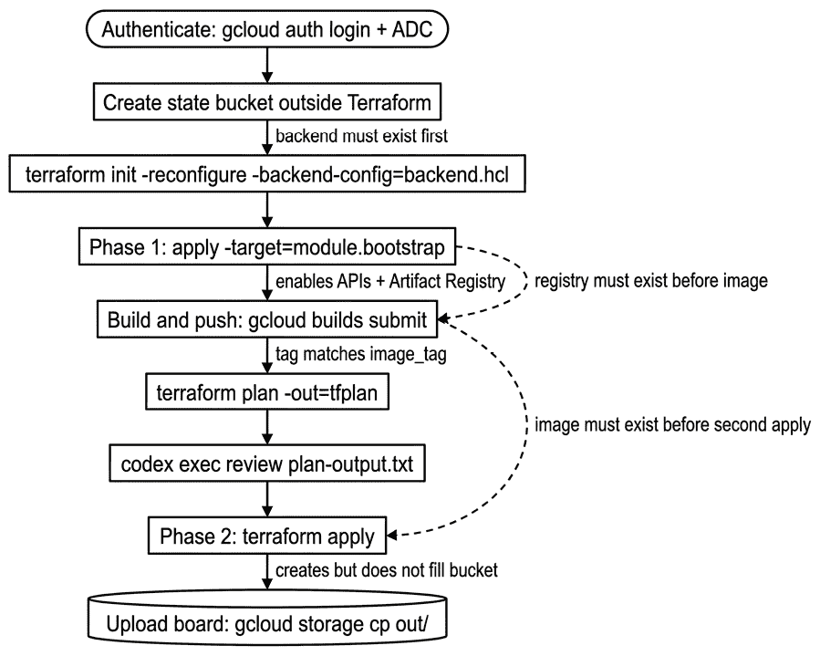

# 基础设施即代码

前两章构建了 Run or Relax：*第 22 章* 的后端，*第 23 章* 的前端。两者均在笔记本电脑上运行。要对通勤者有用，它们需要一个栖身之所，而搭建它本身就是一项工作：基础设施。本章将技术栈推向生产环境，且同其他每一章一样，Codex CLI 协助编写。

问题在于基础设施非应用代码，这种差异改变了你与代理协作的方式。核心在于影响范围。糟糕的应用代码行导致测试失败；糟糕的基础设施代码行可能拖垮生产环境，或删除其原本旨在托管的资源。因此代理的角色收窄：它规划、起草并提议，人类审查并应用。让代理停留在该界线的“提议侧”是本章剩余内容的主题，随之而来的挑战包括：幻觉资源、未经审查变更的代价，以及守住底线的安全配置。

我们以 Google Cloud Run 为具体部署目标，采用云原生 GCP 项目相同的技术。^(²⁰⁸) 但本章不关于 Google Cloud 配置；而是关于为基础设施工作配置 Codex CLI，以使该边界得以守住。

### 学习目标

你将能够：

1.  编写适配基础设施仓库的 `AGENTS.md` 文件

2.  配置适合基础设施变更的审批模式和沙箱设置

3.  使用 Codex CLI 生成、审查和重构部署服务到 Cloud Run 和静态网站到 Cloud Storage 的 Terraform 代码

4.  使用确定性工具（`tflint`、`checkov`）闭环，并将其包装在 `/goal` 中 (*第 12 章*)

5.  应用安全护栏，防止未经审查的基础设施变更

6.  将 Codex CLI 集成到基础设施 CI/CD 流水线中

7.  通过 Terraform MCP 服务器，让代理建立在最新的提供商文档之上

8.  使用 GitOps，使应用边理由架构而非仅策略来强制执行

9.  以只读 `codex exec` 流水线运行漂移检测等第二天运维操作

### 为何基础设施代码抗拒代理

在配置任何内容之前，了解为何基础设施代码比应用代码更难驾驭代理会有所帮助，理由不止影响范围。


大型语言模型以令人担忧的速率幻觉出 Terraform 资源类型和属性名称，这在 Python 中可能只是个小麻烦，但在资源定义中却具有破坏性。^(²⁰⁹) 原因是结构性的。Terraform 所使用的 HashiCorp 配置语言 HCL，其训练语料库与 Python 或 TypeScript 相比非常小，而且提供商模式随每个版本发布而变化：Google Provider 暴露了数百种资源类型并经常修订其参数，因此六个月前训练的模型会自信地生成已不存在的属性。

Cloud Run 资源就是一个典型例子：它已从 `google_cloud_run_service` 重命名并重构为 `google_cloud_run_v2_service`，而学习了旧结构的模型会尝试访问新资源并不具备的字段。关于 Terraform 合成的研究发现，即使是强模型也难以驾驭它，经常直接凭空捏造资源类型和属性名称。^(²¹⁰)

如果放任不管，Agent 编写的基础设施会以可预测的方式失败：本应是变量的值被硬编码、本应是模块的代码却成了整体式文件、过度宽松的 IAM 绑定、缺少加密，以及没有自动化测试或策略检查。^(²¹¹) `terraform validate` 无法捕捉其中任何一项，而且其中几项正是你最不希望进入生产环境的变更。

对策不是避免使用 Agent，而是对其加以约束。基础工作优先：一份编码你的约定与禁令的 `AGENTS.md`，配合 Agent 与提交之间的确定性检查。这足以构建并交付技术栈。然后，一旦它站稳脚跟，模型上下文协议（MCP）服务器通过向 Agent 提供实时、经过验证的提供商文档，而非陈旧的训练数据，进一步强化生成能力。本章剩余部分将按此顺序，基于这三者展开。

### 面向基础设施仓库的 AGENTS.md

基础设施仓库的约定与应用代码不同。`AGENTS.md` 文件应显式编码这些差异：

```
#### AGENTS.md
##### 测试命令
- `terraform fmt -recursive` 用于格式化
- `terraform init -backend=false` 然后 `terraform validate` 用于语法检查
- `terraform plan -out=tfplan` 用于变更预览
- `tflint --init` 然后 `tflint` 用于静态分析（Google 规则集；`--init` 写入 TFLint 插件缓存）
- `checkov -d . --compact` 用于安全扫描
##### 约定
- 提供商：google。目标运行时：Cloud Run；静态资产：Cloud Storage
- 所有资源使用命名约定：`{project}-{env}-{resource}`
- 变量定义在 `variables.tf` 中，输出定义在 `outputs.tf` 中
- 远程状态在 `backend.tf` 中配置（GCS 后端）：切勿修改它
- 使用 `locals` 块定义计算值，而非内联表达式
- 每个服务一个服务账号；切勿使用默认 Compute SA
- 提交 `.terraform.lock.hcl`；切勿将其加入 gitignore（它固定提供商版本）
##### 禁区
- 切勿运行 `terraform apply`、`terraform destroy` 或 `gcloud run deploy`
- 切勿直接修改 `.terraform.lock.hcl`
- 未经明确批准，切勿修改 `modules/shared/` 下的文件
- 切勿提交凭据、令牌或密钥值
```

关键约束在于禁止 `terraform apply`，此处将其延伸至 `gcloud run deploy`，因为后者跨越了相同的边界，直接将版本推送到生产环境。与应用代码不同（运行测试是安全的），这些命令可能产生即时且不可逆的影响。Agent 应负责规划、验证和提议；由人工审核并应用。

但仅写在 `AGENTS.md` 中，该禁令只是建议：Agent 会读取它，通常遵守它，但在状态不佳时仍会运行 `terraform apply`。对于影响范围达生产环境的命令，“通常”是不够的。将该指令与钩子（*第 9 章*）配对，直接阻断这些命令，将请求变成一堵墙。`PreToolUse` 钩子在 Shell 命令运行前触发，可通过非零退出来拒绝执行：

```
{
  "hooks": {
    "PreToolUse": [
      {
        "hooks": [
          {
            "type": "command",
            "command": "bash .codex/scripts/block-apply.sh",
            "statusMessage": "Checking for apply-boundary violations…",
            "timeout": 5
          }
        ]
      }
    ]
  }
}
```

该脚本读取待执行命令，并拒绝任何会更改实时基础设施的操作：

```
#!/usr/bin/env bash
#### .codex/scripts/block-apply.sh
##### 无论提示词要求什么，阻断跨越应用边界的命令。
set -euo pipefail
payload="$(cat)"   # PreToolUse JSON，包含正在运行的命令
if printf '%s' "$payload" \
  | grep -qE 'terraform[[:space:]]+(apply|destroy)|gcloud[[:space:]]+run[[:space:]]+deploy'; then
  echo "Blocked: apply/destroy/deploy cross the apply boundary. A human runs these." >&2
  exit 2
fi
```

现在，即使指令失效，边界依然坚守。Agent 仍可随意 `plan` 和 `validate`；唯一那类触达生产环境的命令被拒之门外，由人工在 Agent 之外刻意执行。同一个钩子可推广到团队想要管控的任何不可逆命令，如 `kubectl delete` 和 `gcloud sql`。

只读沙箱模式（`-s read-only`）是基础设施工作最安全的起点。Agent 可以读取你的模块、生成计划并提议变更，但无法写入文件或执行命令。仅当你准备好让 Agent 编写 Terraform 文件时，才升级至 `workspace-write`。`PreToolUse` 钩子是该 `workspace-write` 阶段的兜底保障：当 Agent 能运行命令时，禁令必须被强制执行，而非寄希望于信任。

#### 基础设施配置在仓库中的位置

在单语言仓库中，此 `AGENTS.md` 是根文件。Run or Relax 不是单语言仓库。到目前为止，仓库根目录已有来自*第 22 章*的 Python `AGENTS.md`，`frontend/` 下有来自*第 23 章*的 React `AGENTS.md`，它们各自限定自己的工具链。基础设施文件是同类的第三个，它属于自己的目录，而非根目录：

```
run-or-relax/
├── AGENTS.md            # Python: uv, pytest, ruff (第 22 章)
├── src/departures/      # FastAPI 服务
├── frontend/
│   └── AGENTS.md        # React: pnpm, vitest (第 23 章)
└── infra/
    ├── AGENTS.md        # Terraform: validate, tflint, checkov, never apply
    └── modules/         # cloud_run, site, ...
```

Codex CLI 按作用域顺序合并 `AGENTS.md` 文件，最深层优先，即*第 22 章*中的嵌套覆盖行为，因此 `infra/` 下的文件仅在 Agent 处理基础设施时生效。这种作用域划分并非表面功夫。根文件规定所有工具通过 `uv run` 运行，且任务在 pytest 通过时完成，这对 Terraform 完全错误：若将基础设施约定放在根目录，它们将与 Python 约定在三分之二的仓库范围内相互矛盾。将它们放在 `infra/` 中，Agent 就在编写 HCL 的地方准确获得 `terraform validate` 和应用禁令，而 Python 和 React 规则则完全不在其列。

保持该文件仅包含差异部分。真正共享的约定——规范化提交和绝不提交密钥——从根文件继承而来，因此基础设施 `AGENTS.md` 仅携带基础设施特有的内容：Terraform 与扫描器命令，以及最重要的是对 apply、destroy 和 `gcloud run deploy` 的禁止。重复其余内容只会在根文件变更时造成配置漂移。

### 通过确定性工具闭环


`AGENTS.md` 能够减少 Agent 起步阶段的错误，但无法完全消除。互补的做法是：在 Agent 与提交之间加入一道确定性检查，并将检查结果反馈给 Agent。Linter 和安全扫描器正是判断 Agent 编写基础设施代码的最佳“裁判”：它们速度快，每次返回相同的裁决，且每条发现都指向具体的文件和行号。Agent 是概率性的，而这些工具不是，这种反差正是它们的价值所在。

有两款工具几乎在每个 Terraform 仓库中都占有一席之地：

1.  `tflint` 能捕捉 `terraform validate` 遗漏的问题：弃用语法、无效参数及其他 Provider 特有的错误、未使用的声明，以及 `AGENTS.md` 规定的命名约定。启用 Google 规则集，使其了解 Cloud Run 和 Cloud Storage 的特定细节。
2.  `checkov` 能从本章一开始就扫描出安全误配置：未加密存储、公共入口、过度权限的 IAM —— 这些 `terraform validate` 会直接放行。其基于图的检查能跨资源进行推理，而非逐个检查，因此能捕捉单资源扫描器遗漏的关系性错误；且在检查失败时返回非零退出码，这使其可作为质量门禁使用。

提升来自于在会话*内部*运行这些工具，而非事后。因为工具是确定性的，“退出码为零”是一个明确无歧的目标，Agent 可以针对它反复迭代；这不像“使其安全”这种目标，Agent 只能大致逼近：

```
codex --profile infra-write "生成用于作为静态网站托管 Run or Relax 看板的 Cloud Storage 存储桶模块，需求见 README.md。随后在结果上运行 tflint 和 checkov，修复它们报告的每一个问题。重复此过程，直到两条命令均退出码为零，然后展示最终的 diff。"
```

每一轮迭代都在缩小“看似合理的 HCL”与“能通过检查的 HCL”之间的差距。典型流程是：Agent 生成模块，收到 `checkov` 警告存储桶缺少统一存储桶级访问权限或版本控制，添加两者，重新运行，仅在工具不再报警时停止。

有一条发现结果不应被静默，且极具指导意义：网站存储桶必须向 `allUsers` 授予 `roles/storage.objectViewer`，而 `checkov` 每次都会标记该公共读取权限。存储桶*旨在*公开，因此正确的做法是添加带有文档说明的行内抑制，而非修改代码。你将看到一个除了这条发现外已经干净的 diff，你可以阅读并批准其抑制理由。

这也是 Goal Mode（*第 12 章*）大显身手的地方。目标需要一个位于 Agent 之外的验证界面，一个其退出码能回答“完成了吗？”的命令，而一次干净的 `tflint` 和 `checkov` 运行正是如此。用 `/goal` 包装循环，可使停止条件显性化，并以 Token 预算限定工作量。在会话内设置它，`/goal` 是在 Codex TUI 中输入的斜杠命令，而非 Shell 参数：

```
/goal "根据 README.md 为 Run or Relax 看板生成静态网站存储桶模块。当 terraform validate、tflint 和 checkov 均退出码为零，且公共读取发现已通过行内抑制并附带理由时视为完成。仅在 modules/site/ 下编写文件。"
```

Agent 会迭代直到检查通过或预算耗尽，因为完成标准是真实的命令而非其自我判断，所以它无法在基础设施仍未通过扫描器时宣称胜利。在启动前，请将 *第 12 章* 的五问评估量表应用于目标陈述。应用边界依然存在：目标负责编写和验证；绝不运行 `terraform apply`。

同样的工具也应作为不可商量的质量门禁存在于 CI 中，这样人工审查 Pull Request 时，看到的仅是已经通过检查的变更：

```
#### .github/workflows/terraform-review.yml (lint and scan step)
- name: Lint and scan
  run: |
    tflint --format compact
    checkov -d . --compact
```

界限清晰：确定性工具捕捉可编目录举的问题，而非意图。它们会告诉你存储桶是全球可读的；但不会告诉你这是静态网站（没问题）还是数据存储桶（泄露）。它们不会告诉你模块抽象是否错误，或执行计划是否会删除服务。这种判断留待本章后面的计划审查，以及执行 `apply` 的人类。Linter 提高了底线；它们无法替代天花板。

### Terraform 工作流

#### 模块生成

Codex CLI 根据自然语言描述生成 Terraform 模块。看板的存储桶是 Run or Relax 部署中最小的组件，因此是一个很好的首个模块：

```
创建一个用于作为静态网站托管 Run or Relax 看板的 Cloud Storage 存储桶 Terraform 模块，要求：
- 启用统一存储桶级访问权限
- public_access_prevention 设为 "inherited" 而非 "enforced"：公共网站存储桶需要此设置，因此添加一条行内 checkov 抑制并解释该例外
- 网站配置（索引页 index.html，404 页 404.html）
- 对象版本控制（以便不良的看板部署可回滚）
- 通过授予 allUsers roles/storage.objectViewer 的 IAM 绑定实现公共读取，附带一条行内 checkov 抑制说明这是有意公开的站点
- 存储桶名称由项目和环境构建（例如 ${project}-${env}-rr-board），因为存储桶名称全局唯一且上限为 63 字符
- 包含项目、环境和位置的变量
- 输出存储桶名称、站点 URL（index.html 地址）以及源（仅协议和主机），供 API 的 CORS 配置使用
```

Agent 将按照 `AGENTS.md` 中的约定生成 `main.tf`、`variables.tf` 和 `outputs.tf`。在提交前运行 `terraform validate`、`tflint` 和 `checkov` 验证输出，或让 Agent 自行运行并迭代直到通过，如前文所述的确定性工具循环。

#### 计划审查

计划审查是基础设施团队最高价值的模式，因为它完全位于 apply 边界的安全一侧：

1.  运行 `terraform plan -out=tfplan` 并捕获输出
2.  请求 Codex CLI 审查计划中的风险、非预期变更和安全顾虑
3.  Agent 识别正在被销毁、修改或创建的资源，并标记任何异常情况

    ```
    terraform plan -out=tfplan -no-color > plan-output.txt
    codex exec -a untrusted -s read-only "审查 plan-output.txt 中的 Terraform 计划，找出风险和非预期变更。标记任何资源删除、IAM 绑定变更，或会导致流量切换的 Cloud Run 修订版本。"
    ```

#### 重构

基础设施重构遵循与 *第 21 章* 中应用重构相同的模式，但约束更严格。工作内容很熟悉：将单体配置拆分为模块、升级 Provider 版本、从弃用资源迁移，正是让未落地的 Agent 翻车的 `google_cloud_run_service` 到 `google_cloud_run_v2_service` 的迁移。

```
将 `main.tf` 中的 Cloud Run 配置重构为 `modules/cloud_run/` 下的独立模块。
保留所有资源地址，以便重构后 `terraform plan` 显示无变更。
每次变更后运行 `terraform validate` 以验证语法。
```

零 diff 约束至关重要：在生产环境中触发资源重建的重构不算重构。重建而非更新 Cloud Run 服务会导致其 URL 和流量丢失；保留资源地址可使计划为空。

### 部署到 Cloud Run


#### 部署的核心

这是“运行还是放松”部署的核心，也是三章内容汇聚之处。API 是一个容器；Cloud Run 运行容器，并在没人询问是否为 07:02 班次发车时将其缩容至零。看板是静态文件；Cloud Storage 存储桶以运行服务器成本的一小部分来托管它们。Terraform 供应这两者，而 Codex CLI 编写 Terraform 代码。

在开始这一切之前，先确定 *Chapter 24* 和 #n 留下了什么，因为部署直接连接到它们：

1.  FastAPI 应用可作为 `departures.app:app` 导入，这是容器启动命令所需的路径。
2.  Cloud Run 将流量路由到 `$PORT` 中命名的端口（默认为 8080），因此服务器必须绑定 `0.0.0.0:$PORT`，而不是开发环境的默认值。
3.  看板构建输出到静态 `out/` 目录（来自 *Chapter 23* 的 `output: "export"`）；该目录即上传到存储桶的内容。
4.  看板从 `NEXT_PUBLIC_DEPARTURES_API_URL` 读取 API 地址，该地址在构建时烘焙进去，而 API 通过 `RUN_OR_RELAX_CORS_ORIGIN` 允许看板访问。这两个值是接缝处：搞错它们，部署后的看板将渲染空白，而所有测试依然显示通过。

##### 容器入口点

构建包会检测 Python 项目并构建镜像，无需 Dockerfile，但它无法猜测如何在 Cloud Run 的端口上启动 Web 服务器。单行 `Procfile` 消除了歧义：

```
###### Procfile
web: uvicorn departures.app:app --host 0.0.0.0 --port ${PORT:-8080}
```

`${PORT:-8080}` 在生产环境中采用 Cloud Run 注入的 `$PORT`，在本地则回退到 8080。如果省略它，镜像仍能构建且部署仍会成功，但容器永远不会响应，Cloud Run 会在健康检查中将其终止——这看起来像基础设施故障，实则是缺少启动命令。

API 发布前还有一个问题需要回答：其数据从何而来。真正的“运行还是放松”会从火车时刻 API 读取实时发车和延误数据；`timetable.json` 和 `delays.json` 只是占位符，以便本章有内容可部署。作为一次性示例数据，它们随镜像 *内部* 搭载，无需额外供应。生产系统则会将服务指向实时 API，其基础 URL 作为配置，密钥存放在 Secret Manager 中，但这项工作超出了本章范围，也不影响后续的 Codex 工作流。

##### 认证与引导远程状态

Agent 编写 Terraform；它不持有你的云凭据，也无法创建存放自身状态的存储桶。两者均为人工、一次性的设置，必须在任何模块应用之前完成，跳过它们是首次部署死于 `terraform init` 的最常见方式。首先进行认证，将应用程序默认凭据指向项目：

```
gcloud auth login
gcloud auth application-default login
gcloud config set project "$PROJECT_ID"
gcloud auth application-default set-quota-project "$PROJECT_ID"
```

随后在 Terraform 之外创建状态存储桶，因为后端必须先存在，Terraform 才能用它来存储状态，这是一个真正的“鸡生蛋、蛋生鸡”问题，无法通过任何 `terraform apply` 解决：

```
gcloud storage buckets create "gs://${PROJECT_ID}-terraform-state" \
  --project="$PROJECT_ID" --location="$REGION" --uniform-bucket-level-access
gcloud storage buckets update "gs://${PROJECT_ID}-terraform-state" --versioning
```

仓库附带一个带有占位符存储桶名的 `backend.hcl.example`；它无法直接使用。将其复制为 `backend.hcl` 并填入你真实的、全局唯一的存储桶名。状态存储桶名称在整个 Google Cloud 中必须唯一，因此 `PROJECT-terraform-state` 必须改为特定于项目的名称：

```
###### infra/backend.hcl
bucket = "your-project-id-terraform-state"
prefix = "run-or-relax/dev"
```

现在初始化后端，每当 `backend.hcl` 变更时重新运行并加上 `-reconfigure`：

```
terraform -chdir=infra init -reconfigure -backend-config=backend.hcl
```

即使 `terraform init` 因后端失败，`terraform validate` 仍可能打印 `Success! The configuration is valid.`，因为它仅检查本地文件的语法和提供商模式。绿色的 `validate` 并非后端初始化成功、状态存储桶存在或凭据健康的证据。请看 `init` 的结果，而非 `validate` 的结果，以判断部署就绪情况。

如果 `init` 因 `auth: "invalid_grant"` 失败，问题出在认证而非你的 HCL：凭据过期、账号错误，或环境变量强制覆盖了服务账号密钥。重新运行前述的 ADC 登录，若有密钥被强制设置，则清除它：

```
gcloud auth list                          # 哪个账号处于活动状态
echo "$GOOGLE_APPLICATION_CREDENTIALS"    # 是否有密钥被强制设置？
unset GOOGLE_APPLICATION_CREDENTIALS
terraform -chdir=infra init -reconfigure -backend-config=backend.hcl
```

本小节从人工视角诠释了本章主题：Agent 始终处于边界的“提议方”一侧，而凭据和状态存储桶——此处仅有的两个真正能接触账户的东西——由人设置。

##### 引导：API 与镜像仓库

首次镜像推送前还需两样东西就绪，两者均由 Terraform 一次性创建：堆栈使用的 Google API，以及镜像落地的 Artifact Registry 仓库。将它们作为引导模块生成：

> 创建一个 Terraform 引导模块，要求：
> - 使用 `google_project_service` 启用所需的 Google API：Cloud Run、Cloud Build、Artifact Registry、IAM 和 Cloud Storage
> - 在目标区域创建名为 `run-or-relax` 的 `google_artifact_registry_repository`（Docker 格式）。Google 托管加密对教学仓库足矣，因此为 customer-managed-key 发现添加内联 checkov 抑制
> - 项目和区域的变量；输出仓库路径

该模块必须在其余部分 *之前* 应用，原因在于一个真实的首部署顺序陷阱。对整个堆栈进行单次 `terraform apply` 会同时规划 Cloud Run 服务和 Artifact Registry 仓库，但服务引用的镜像在仓库创建前无法存在，导致应用失败。单独先应用引导模块（或将其作为拥有独立状态的单独 Terraform 根模块，长远来看更整洁），然后构建，最后应用其余部分：



**图 24.1 - 部署到 Cloud Run**

部署作为有序序列运行：人工认证并在 Terraform 外创建状态存储桶，然后运行 init，第一阶段应用引导模块，构建并推送镜像，规划，Agent 评审规划，第二阶段应用，上传看板。虚线标记鸡生蛋依赖：仓库必须在镜像构建前存在，镜像必须在第二次应用前存在。

```
###### 阶段 1：仅 API 和仓库
terraform -chdir=infra apply -target=module.bootstrap
```

构建前，添加 `.gcloudignore`，以便 Cloud Build 上传源代码而非虚拟环境、node 模块、缓存和本地 Terraform 状态，这关乎几百个文件与一吉字节的区别：

```
###### .gcloudignore
.git
.venv/
.uv-cache/
.mypy_cache/
.pytest_cache/
.ruff_cache/
**/__pycache__/
frontend/node_modules/
frontend/.next/
frontend/out/
infra/.terraform/
infra/backend.hcl
infra/*.tfvars
infra/tfplan
infra/plan-output.txt
```

现在构建并推送。标签不仅仅是装饰：它必须与 Cloud Run 模块读取的 `image_tag` 变量匹配，否则 Terraform 将部署一个不存在的标签。

```
gcloud builds submit --pack image=REGION-docker.pkg.dev/PROJECT/run-or-relax/api:v1 .
```

默认构建包从 *Chapter 22* 拾取项目的 3.14 版本锁定并无需额外配置即可构建；保持运行时最新正是让这一步保持平淡无奇的关键。

##### Cloud Run 服务


后续部署会更改正在运行的基础设施，因此这是 Terraform 的工作，而 Agent 的工作是编写它：

```
创建一个 Terraform 模块，将 Run or Relax API 部署到 Cloud Run，要求：
- 一个运行镜像 `REGION-docker.pkg.dev/PROJECT/run-or-relax/api` 的
  `google_cloud_run_v2_service`，镜像标签为变量 `image_tag`
- 容器监听端口 `8080`
- 一个专用服务账号（最小权限），而非默认的 Compute SA
- 实例数从 0 扩缩容至最多 4 个
- 将环境变量 `RUN_OR_RELAX_CORS_ORIGIN` 设置为看板的源站（仅 scheme 和 host，
  例如 `https://BUCKET.storage.googleapis.com`，不含路径）
- 公开的 invoker 绑定（向 `allUsers` 授予 `roles/run.invoker`）：看板直接从浏览器
  调用 API，因此该服务有意设为公开
- `project`、`region`、`image_tag` 和 `cors_origin` 变量
- 一个输出服务 URL 的 output
```

该提示词中的两行正在进行跨章节连线，值得注意，因为这正是部署通常出故障的地方。`RUN_OR_RELAX_CORS_ORIGIN` 是 FastAPI 服务为其 CORS 中间件读取的环境变量（第 22 章），它需要一个*源站*——仅包含 scheme 和 host，不含路径（`https://BUCKET.storage.googleapis.com`），而不是人类访问的 `index.html` URL。将其设置为看板存储桶的源站，浏览器的跨域 fetch 就会被允许；如果留空，或设置为完整的页面 URL，来自已部署看板的每个请求都会被拦截，而每个后端测试仍会通过。看板存储桶的模块正因如此输出这两个值：给人的 `site_url` 和给 API 的源站。而该模块输出的 Cloud Run 服务 URL，正是看板在构建时作为 `NEXT_PUBLIC_DEPARTURES_API_URL`（第 23 章）注入的值。两个服务通过 Terraform 的输出和变量互相发现，而非硬编码字符串，这才使得同一配置能同时支撑仅 `.tfvars` 不同的开发环境和生产环境副本。

公开的 invoker 绑定是你有意保留的几个 `checkov` 发现之一，表 24-1 列出了它们。向 `allUsers` 开放 Cloud Run 服务通常是危险信号；但这是一个公开的只读发车看板，因此该抑制是诚实的，审阅者也能明白原因。与存储桶一样，工具捕获可编目的问题，人类提供意图。

##### 计划前先验证

首先按 Google 规则集要求的顺序，对 `infra/` 运行确定性工具（`tflint --init` 会在 `tflint` 使用前安装插件）：

```
terraform fmt -recursive infra
terraform -chdir=infra init -backend=false
terraform -chdir=infra validate
tflint --chdir=infra --init
tflint --chdir=infra
checkov -d infra --compact
```

这种 `init -backend=false` 是离线路径：它在无凭据、无状态后端的情况下验证语法和 Provider 模式，这正是 Agent 循环所需的。带后端配置的真实 `init` 来自 bootstrap 步骤，是部署时使用的那个。无论哪种方式，`terraform init` 都会下载 Provider 插件并写入 `.terraform.lock.hcl`；请提交该锁文件，以便每台机器和 CI 运行都解析到相同的 Provider 版本。

某些沙箱 Agent 环境会阻止 Provider 下载和插件安装，因此 `terraform init`、`terraform validate`、`tflint --init` 和 `checkov` 的元数据查询可能在受限沙箱中停滞或失败。若出现这种情况，请批准网络访问或在普通终端运行验证步骤；那是工具在访问注册表，而非你的配置有误。

##### 计划、审阅、应用、再上传

在任何内容发布前先计划和审阅，沿用之前同一个安全侧边界循环：

```
terraform -chdir=infra plan -out=tfplan -no-color > plan-output.txt
codex exec -a untrusted -s read-only "Review plan-output.txt. Confirm the Cloud Run service, its service account, the IAM invoker binding, the Artifact Registry repository, and the static-site bucket are created as expected, and flag anything else."
```

人类阅读审阅结果并运行 `terraform apply`，这是第二阶段的 apply，此时 Cloud Run 服务引用的镜像已存在。这会创建存储桶，但不会填充内容。上传已构建的看板是一个单独的内容部署步骤，有意与预置分离，这也是 第 23 章 中静态 `out/` 目录与 Terraform 刚创建的存储桶相遇的唯一地方：

```
gcloud storage cp -r frontend/out/* gs://$(terraform -chdir=infra output -raw board_bucket)/
```

现在 Run or Relax 在 Cloud Run URL 后回答 `GET /departures`，而看板从存储桶渲染它。始于纯判定函数的线程终于部署服务而告终，且 Agent 从未跨越 apply 边界。

##### 预期的 Checkov 发现

此栈上干净的 `checkov` 运行并非零发现，而是零*未解释*发现。少数发现每次都会触发，且保留它们是正确的，因为对于一个小型公开教学部署，被标记的行为是有意为之。纪律要求在行内用审阅者可读的注释逐个抑制，而非整体静默扫描器。表 24-1 是预期的集合。

**表 24-1. 预期的 Checkov 发现及对应决策**

| 发现 | 资源 | 决策 |
| --- | --- | --- |
| 公开读取（`allUsers` → `roles/storage.objectViewer`） | 看板存储桶 | 跳过，行内论证：有意为公开网站 |
| 未强制执行公开访问防护 | 看板存储桶 | 跳过，行内论证：公开网站需要例外；日志存储桶保持强制执行 |
| 未配置访问日志接收器 | 看板存储桶 | 教学部署跳过；生产环境启用存储桶日志记录 |
| 无客户管理加密密钥 | Artifact Registry 仓库 | 跳过：Google 托管加密在此足矣；策略要求时使用 CMEK |
| 公开调用者（`allUsers` → `roles/run.invoker`） | Cloud Run 服务 | 跳过，行内论证：看板是公开的只读 API |

除此表之外的任何发现都是需修复的真实问题，而非已知例外，这正是该门禁存在的意义：噪音已编目，因此下一个新的失败会凸显出来。

位置比看起来更重要。`#checkov:skip` 注释必须位于其适用的资源块*内部*，作为块主体的第一行，而不能在 `resource` 声明的上一行。Checkov 3.3.0 仅遵循块内发现的抑制；块上方的注释会被忽略，发现依然会触发：

```
resource "google_storage_bucket_iam_member" "board_public_read" {
  #checkov:skip=CKV_GCP_28:Intentional public website; the board is read-only static content
  bucket = google_storage_bucket.board.name
  role   = "roles/storage.objectViewer"
  member = "allUsers"
}
```

Check ID 后的文本即为论证，这是审阅者阅读的部分。一条抑制、一个资源、一个可批准的理由，这种纪律让表 24-1 的编目保持诚实。

##### 当 Cloud Run 不够用时：GKE

Cloud Run 完美契合 Run or Relax：一个可缩容至零的无状态 HTTP 服务。当服务超出其承载范围时——持续流量使缩容至零不再有帮助、需要 sidecar、细粒度网络、或非请求-响应工作负载——目标变为 Kubernetes，产物变为清单而非 Cloud Run 资源。Codex 模式不变；仅验证命令改变。将它们添加到 `AGENTS.md`：

```
##### 测试命令
- `kubectl apply --dry-run=client -f .` 用于语法验证
- `kubeconform -strict .` 用于模式验证
```


代理会从与 Cloud Run 模块相同类型的需求提示词中生成 `Deployment`、`Service` 和 `HorizontalPodAutoscaler`，包括副本数量、资源限制、针对 `/healthz` 的探针以及 ConfigMap 引用，随后你可在提交前使用 `kubectl` 和 `kubeconform` 命令验证输出结果。这一逃生通道真实存在，但极少需要；只有当 Cloud Run 的限制（而非你的习惯）强制你迁移时，才应采用它。

### 通过 Terraform MCP 服务器强化生成

技术栈现已就绪，但仍有一种故障模式仅能在事后被发现，而无法被预防：过时的提供商知识。`AGENTS.md` 编码了你的规则，扫描器能捕获不安全的输出，但二者都无法阻止代理编造一个已不存在的资源参数。一旦主干路径建立，这就是对其进行强化的增强措施。这项工作由 HashiCorp 官方的 Terraform MCP 服务器承担，它赋予任何模型上下文协议客户端（包括 Codex CLI）实时访问 Terraform Registry 的能力，而非依赖模型的训练快照。^(²¹²) *第 8 章* 概述了 MCP 的通用设置；基础设施特有的决策在于你暴露哪些工具。

这正是 Google 提供商频繁变更造成麻烦的地方，因此也是实时查询大显身手之处：代理确认 `google_cloud_run_v2_service` 的当前参数，而不是去猜测它在本章早些时候绊倒的那个已重命名的资源。将该服务器添加到项目的 `.codex/config.toml` 中，并通过 `enabled_tools` 限定其作用域，以便代理仅能看到只读的注册表查询工具：

```
[mcp_servers.terraform]
command = "docker"
args = ["run", "-i", "--rm", "hashicorp/terraform-mcp-server"]
enabled_tools = [
  "search_providers", "get_provider_details", "get_latest_provider_version",
  "search_modules", "get_module_details", "get_latest_module_version",
  "search_policies", "get_policy_details",
]
```

这些工具能回答那些原本会导致幻觉的问题：资源实际接受哪些参数、提供商或模块的当前版本、模块是否经过验证，以及适用哪些策略。^(²¹³) 代理会查阅这些信息，而不是靠猜测。

该服务器还附带用于 HCP Terraform 和 Terraform Enterprise 的工作区管理工具，包括创建运行、应用或丢弃操作。^(²¹⁴) 这些工具跨越了应用边界，因此请将它们排除在无人值守运行的代理配置文件的 `enabled_tools` 列表之外。此模式贯穿全章：暴露读取操作，保留应用操作。注册表查询可安全自动化；触发运行则不然。

### GitOps：将应用边界结构化

截至目前，所有措施皆通过策略来强制执行应用边界：`AGENTS.md` 禁令、沙箱模式、人工把关的流水线步骤。GitOps 则通过架构来强制执行，这更为稳健，因为它不依赖于代理遵守指令。

在 GitOps 工作流中，Git 是单一事实来源，协调控制器持续应用提交的任何内容。^(²¹⁵) 代理绝不接触集群或项目。它的唯一写入操作是提交或拉取请求；控制器负责应用。在 Google Cloud 上，这可以是协调 Kubernetes 状态的 Config Sync，或是在合并到 `main` 分支时运行 `terraform apply` 的 Cloud Build 触发器，从而使基础设施变更的动作变为合并行为，而非提示行为。无论哪种方式，本章其余部分通过配置捍卫的边界都成为系统的一个属性：一个没有凭证且仅能输出提交的代理，无论被如何提示，都无法应用变更。

这使得 GitOps 非常适合代理生成的基础设施。其产出物——Terraform 变更、Kubernetes 覆盖层、环境晋升编辑——具有重复性、模式约束性，且在合并前即可验证。为了一次性引入多个环境，带有输出模式的 `codex exec` 可生成结构化输出，供流水线拆分为文件并提交：

```
codex exec \
  --sandbox workspace-write \
  --output-schema envs-schema.json \
  "Read environments.yaml, which lists each environment with its project id and \
   region. Generate the per-environment tfvars and backend config for the Run or \
   Relax stack, following the GitOps conventions in AGENTS.md."
```

代理将文件写入工作副本；CI 验证它们并打开拉取请求。人工审核合并，随后控制器或由合并触发的 `terraform apply` 协调变更。需要审慎对待的唯一之处是同步策略：允许非生产环境自动自我修复和修剪，但将任何可能删除生产资源的变更视为独立的受审核变更，而非附带的编辑。^(²¹⁶)

### 安全护栏

#### 审批模式配置

对于基础设施工作，推荐的配置比应用代码更严格。`approval_policy` 和 `sandbox_mode` 是顶层配置键，因此捕获两种姿态最简洁的方式是使用两个配置文件，Codex CLI 通过 `--profile` 将它们叠加在你的基础配置之上：

```
##### ~/.codex/infra-review.config.toml — 计划审查：仅读取
approval_policy = "untrusted"
sandbox_mode = "read-only"
##### ~/.codex/infra-write.config.toml — 编写创作：写入需审批
approval_policy = "untrusted"
sandbox_mode = "workspace-write"
```

使用 `codex --profile infra-review` 进行计划分析和代码审查，使用 `codex --profile infra-write` 生成或重构模块。`untrusted` 审批策略意味着代理在运行命令前会暂停并等待显式审批，因此每次文件写入都被管控。

### CI/CD 集成

Codex CLI 在基础设施流水线中最明确的定位是对每个拉取请求进行计划审查。示例使用 GitHub Actions，但在 Cloud Build 上结构相同；关键在于代理仅审查，从不应用。

**拉取请求中的计划审查：**

```
#### .github/workflows/terraform-review.yml
- name: Generate Terraform plan
  run: terraform plan -out=tfplan -no-color > plan-output.txt
- name: AI plan review
  run: |
    codex exec -a never -s read-only \
"Review the Terraform plan in plan-output.txt. Flag resource deletions, IAM changes, and cost implications." \
      -o review-comment.md
- name: Post review comment
  uses: actions/github-script@v8
  with:
    script: |
      const review = require('fs').readFileSync('review-comment.md', 'utf8');
      github.rest.issues.createComment({ ...context.repo, issue_number: context.issue.number, body: review });
```

这是本章前文所述计划审查模式的 CI 集成：它在每个涉及基础设施的拉取请求上运行，生成计划，让 Codex CLI 以 `read-only` 模式审查并将发现写入文件，随后将该文件作为 PR 评论发布，使计划及其风险与变更一同呈现在人工审查者面前。代理从不应用；它仅做标注。

Codex CLI 在流水线中的另一种计划用法——漂移检测，也符合同一只读、仅报告的模式。它属于第二天运维而非部署流水线，因此在“第二天运维”部分详细介绍，此处不再赘述。

#### 应用边界

基础设施代理的基本法则：**绝不自动应用**。代理负责生成、验证和提议。人工审查计划并运行 `terraform apply`。此边界通过以下方式强制执行：

1.  `AGENTS.md` 指令禁止 apply、destroy 和直接 `gcloud run deploy`（建议性：代理通常遵守）
2.  一个直接阻止这些命令的 `PreToolUse` 钩子，将指令从“建议”变为“强制”
3.  沙箱模式限制阻止命令执行（`read-only`）或对其加以限制（无网络的 `workspace-write`）


#### 4. CI/CD 流水线设计：Agent 生成计划，人工审批步骤执行 Apply

这四层设计是有意为之：`AGENTS.md` 行声明意图，Hook 使其具有约束力，沙箱从根本上限制 Agent 可运行的内容，而流水线在 CI 中保持相同的边界。

### Day-Two 运维：漂移检测与 Runbook

资源供应是“第一天”的工作。更长久的工作是“第二天”：健康检查、漂移检测、证书续期和合规扫描，这些持续不断的琐碎工作让生产环境持续运转。因为这些任务读取状态并汇报，而非改变状态，它们天然处于 apply 边界的安全一侧，而 `codex exec` 将它们转化为可复现、可审计的流水线。^(²¹⁷)

其模式是一致的。调度器（cron 或 CI 作业）携带一项运维技能和一个输出 Schema 运行 `codex exec`。Agent 通过沙箱中的只读工具（`gcloud`、`terraform`、`kubectl`）读取基础设施状态，推理异常情况，并输出结构化报告。下游工具解析 JSON 并将其路由至 Slack、PagerDuty 或仪表盘。^(²¹⁸)

漂移检测是典型用例：对比声明式配置与实际状态并标记差异。输出 Schema 使结果可被机器解析：

```
codex exec \
  --sandbox read-only \
  --output-schema ./schemas/drift-report.json \
  -o /tmp/drift-report.json \
  "Run the drift-check skill against the staging environment."
```

`read-only` 沙箱是关键所在：运维读取任务绝不应改变状态。^(²¹⁹) 当真正需要修复时，应拆分工作流而非提升检测器的权限。检测技能在 `read-only` 模式下运行并生成报告；一个单独的、经人工批准的步骤执行修复。管控 `terraform apply` 的禁令同样管控运维：Agent 观察并提议，由人工或协调控制器执行。

### 其他基础设施工具

以 Terraform 为中心的模式可迁移至基础设施工具箱中的其他工具，每个工具都有其对应的安全预览命令，相当于 `terraform plan` 的角色。

对于 **Ansible**，`AGENTS.md` 规定使用 `ansible-lint` 进行代码检查，使用 `ansible-playbook --check --diff` 进行干运行；干运行在不应用的情况下预览变更，扮演与 `terraform plan` 相同的角色。对于 **Pulumi**，程序是通用代码（TypeScript、Python、Go），因此 Codex CLI 将其视为具有基础设施语义的应用代码；关键约束在于 `pulumi preview` 是安全的，而 `pulumi up` 需要人工批准。在所有情况下，规则皆相同：存在一个展示拟变更的命令，和一个执行变更的命令，Agent 仅被允许使用前者。

### 记录技术栈：项目 README

三章下来，检出的代码库已包含一个完整系统：`src/` 下的 FastAPI 服务，`frontend/` 下的 Next.js 看板，以及两者的 Terraform 代码在 `infra/` 下。它尚缺的，是那个告诉下一位阅读者（或六个月后的你）各部分如何契合、如何运行的单一入口文件。这三章努力维护的接缝——CORS 源、两个 URL 输出、apply 边界——散落在三章的文本中；根目录下的 `README.md` 正是将它们汇聚为单一操作手册之处。生成它是最后的构建步骤，而 Agent 已从会话中掌握所需的所有事实：

```
Write a root README.md for the Run or Relax project. Cover:
- Architecture: the FastAPI departures API, the static Next.js board, and the
  Terraform stack, and how the board reaches the API (NEXT_PUBLIC_DEPARTURES_API_URL)
  and the API allows the board's origin (RUN_OR_RELAX_CORS_ORIGIN)
- Local setup for both toolchains: uv for the backend, pnpm + Corepack for the frontend
- Backend commands: uv run uvicorn, uv run pytest, uv run ruff check/format
- Frontend commands: pnpm dev, pnpm build (static export to out/), pnpm test, pnpm test:e2e
- Environment variables for each service, with their defaults
- The seeded data files (data/timetable.json, data/delays.json) and what they control
- The Terraform validation workflow: fmt, init -backend=false, validate, tflint, checkov
- The infrastructure boundary in bold: the agent authors and validates, a human runs
  terraform apply and the gcloud upload; nothing in this repo applies on its own
```

在 README 本身中显式保留 no-apply 边界，而不仅是在 `AGENTS.md` 中。`AGENTS.md` 告诉 Agent 其不可为何；README 告诉人工操作员其双手何处被需，这是同一边界从相反两侧的解读。

### 总结

1.  **基础设施需要更严格的约束。** 基础设施仓库比应用代码需要更严格的 `AGENTS.md`，首要的是显式禁止 apply、destroy 和直接执行 `gcloud run deploy`。

2.  **默认只读。** 计划审查使用 `read-only` 沙箱模式，编写代码使用带有 `untrusted` 审批的 `workspace-write` 模式，从而让每一次文件写入都受到把关。

3.  **计划审查是最高价值模式。** 生成计划，让 Agent 审查风险，再由人工执行 apply。这能让 Agent 始终处于 apply 边界的安全一侧。

4.  **重构目标为零差异。** 在生产环境中触发资源重建的重组不算重构；保留资源地址，使 `terraform plan` 显示无变更，Cloud Run URL 亦然。

5.  **部署有 Agent 无法推断的前置条件。** 人工完成认证并在首次 `terraform init` 前创建 Terraform 状态存储桶（后端无法创建存放自身状态的存储桶）。Cloud Run 需要绑定 `$PORT` 的启动命令（单行 `Procfile`）；首次镜像推送需启用相关 API 和 Artifact Registry 仓库，因此引导阶段在构建镜像和应用其余资源前单独应用；`.gcloudignore` 防止构建上下文膨胀；且 buildpack 构建器必须与项目的 Python 版本匹配。绿色的 `terraform validate` 不代表 `init` 成功，干净的 `checkov` 运行意味着零*未解释*发现，而非零发现（见表 24-1）。

6.  **CI/CD 止步于计划。** 流水线集成聚焦于 PR 中的计划审查，绝不进行自动化 apply；漂移检测作为计划的 Day-Two 作业单独运行。

7.  **Agent 提议，人工执行。** 这是全章捍卫的边界。`AGENTS.md` 中的禁止声明了这一点，但提示指令仅具建议性；阻止 `terraform apply`、`terraform destroy` 和 `gcloud run deploy` 的 `PreToolUse` Hook 使其具有约束力，沙箱模式和人工审批的流水线步层层叠加在其后。

8.  **用确定性工具闭环。** 让 Agent 在会话中运行 `tflint` 和 `checkov` 并迭代至干净退出，仅保留你能辩护的抑制项（公共网站存储桶和公共看板 API 合法需要的那些）。干净的扫描运行也是 Goal Mode 所需的外部验证面，因此循环自然地包裹在 `/goal` 中（*第 12 章*）。

9.  **路径稳定后，强化生成以对抗 Provider 漂移。** 基础设施代码是 Agent 幻觉最重之处，Google Provider 的频繁变更（包括 `google_cloud_run_v2_service` 重命名）是典型案例。在工作路径跑通后引入 Terraform MCP 服务器，提供经过验证的 Provider、模块和策略文档，`enabled_tools` 将无人值守的 Agent 限制为只读注册表查找。

10. **GitOps 使边界结构化。** 当 Agent 的唯一产出是 Git 提交，而控制器或合并触发的 `terraform apply` 执行应用时，无论提示如何，没有凭证的 Agent 都无法执行 apply。


11. **第二天运维操作是只读汇报。** 漂移检测、证书校验和合规扫描作为计划内的只读 `codex exec` 流水线运行，产出结构化报告；修复是一个独立的、需经人工批准的步骤。

12. **以 README 收尾。** 完整的技术栈仍需一个根目录 `README.md`，记录架构、两套工具链的本地搭建与运行命令、环境变量、种子数据、Terraform 验证工作流以及禁止应用的边界，以便会话结束后项目仍可运行。将其生成为最后一个构建步骤。

13. **线程在应用边界处结束。** *第 22 章* 至第 #n 章构建了 Run or Relax API，为其配置了看板，并将其部署到 Cloud Run。智能体能为技术栈编写每一行 Terraform 代码，涵盖 Cloud Run 服务、静态网站存储桶、服务账号与 IAM，以及将看板源站连接到 API CORS 的部署环境变量，但同一边界依然有效：智能体提议，人工应用。

### 练习

1. **编写基础设施 AGENTS.md。** 为现有的基础设施仓库编写一个 `AGENTS.md`。包含测试命令、命名约定，以及对 apply 和 destroy 的显式禁止。使用 `-a untrusted -s read-only` 运行 Codex CLI，并请其审查你现有的 Terraform 代码是否存在最佳实践违规。

2. **生成并验证看板存储桶。** 为 Run or Relax 看板生成 Cloud Storage 静态网站模块，然后运行完整序列：`terraform fmt`、`terraform init -backend=false`、`terraform validate`、`tflint --init`、`tflint` 和 `checkov -d infra --compact`。确认每个剩余的 `checkov` 发现都与表 24-1 中的某一行匹配，并为每个发现添加合理的行内抑制注释；将表中未列出的任何发现视为真正的问题进行修复。

3. **构建计划审查流水线。** 设置一个 CI/CD 流水线，使用 `codex exec` 在拉取请求中审查 Terraform 计划。跨五个拉取请求，将智能体的审查与团队的手动审查流程进行对比。

4. **规划 Terraform MCP 服务器。** 在项目的 `.codex/config.toml` 中配置 Terraform MCP 服务器，将 `enabled_tools` 限制为仅注册表查找。请 Codex CLI 编写 Cloud Run 服务模块，然后通过会话日志确认它是查阅了注册表获取 `google_cloud_run_v2_service` 的信息，而非猜测属性名称。

5. **串联两个服务。** 利用 Terraform 输出和变量，连接已部署的组件：Cloud Run 模块输出服务 URL，看板构建时将其作为 `NEXT_PUBLIC_DEPARTURES_API_URL`，API 的 `RUN_OR_RELAX_CORS_ORIGIN` 设置为看板的存储桶 URL。运行一次 plan，请 Codex 审查，并确认两个模块间没有任何值是硬编码的。

