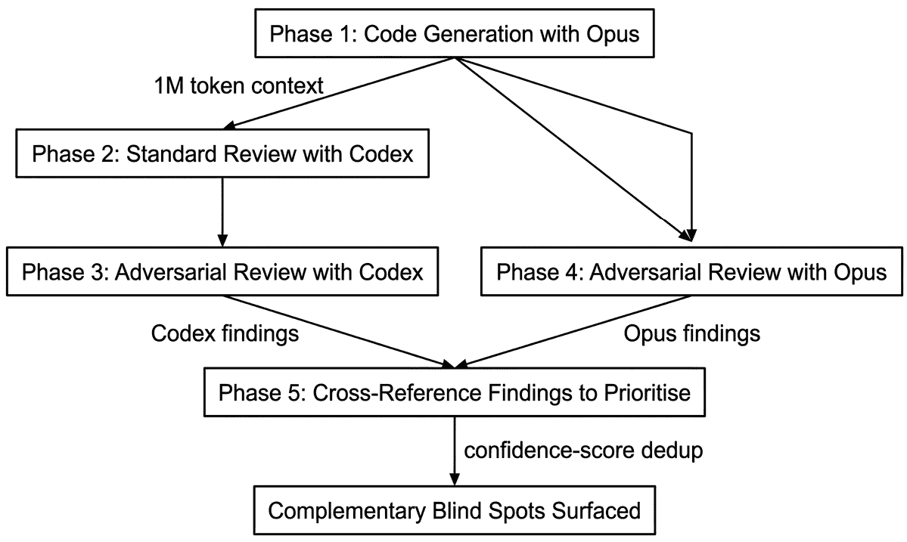

# AI 代码审查

代码审查是任何工程团队日常工作中**价值最高、频率最高**的活动之一。它传递知识、在 Bug 复合放大前捕获它们、并将标准传播到不断增长的代码库中。它也是**永无止境**的。Codex CLI 的审查能力在三个层面运作：本地终端、拉取请求和 CI 流水线。本章将向你展示如何配置每个界面、将它们连接起来，并将人类保留在其判断力不可替代的环节中。

### 学习目标

你将能够：

1.  识别 AI 审查能可靠捕获的缺陷类别，以及它无法判断的类别
2.  在 `AGENTS.md` 中编写 `## Review guidelines`（审查指南）部分，将你团队的标准传播到每个审查界面
3.  使用 `/review` 命令的四种模式进行本地、只读审查
4.  配置一个 pre-commit 钩子，阻止包含 P0 级发现的提交
5.  使用 `codex-action` 在每个拉取请求上部署自动化审查，并向 GitHub 或 GitLab 发布结构化的行内评论
6.  选择适合项目风险概况的审查-修复成熟度级别

### AI 代码审查为何有效（以及它在哪里失效）

大多数工程师对待 AI 代码审查要么**过于乐观**（“它能捕获一切”），要么**过于轻视**（“它无法理解上下文”）。现实比这两个极端更有用。

AI 审查能可靠捕获一类特定的问题。它能发现安全反模式：SQL 拼接、`eval()` 调用、缺失认证中间件、凭证泄露。[¹⁸⁰] 它能识别 Linter 无法发现但语言模型显而易见的正确性问题：Off-by-one 错误、未考虑代码路径上的空指针解引用、异步链中缺失的错误处理。它能标记出偏离你代库模式和 `AGENTS.md` 规范的代码：命名不一致、公共 API 变更未文档化、测试断言的是实现而非行为。

这些正是人类审查者**不可靠**的类别。读完那天上午的第四个 PR 后，你会漏掉第 47 行的 SQL 注入。模型**不会疲劳**。

AI 审查在另一类问题上失效。它无法评估架构是否契合团队要解决的问题，不知道你上周二设计会上决定了什么，也捕获不了那种技术上可行但违背产品心智模型、让所有用户困惑的功能。它无法权衡依赖机构知识的取舍：“是的，这看起来像性能回归，但我们接受它，因为对这个模块而言，更简单的代码更值得。”

其含义是**校准，而非替代**。将 AI 审查用于高频、易疲劳的类别，使人工审查时间集中在架构、意图以及那些需要知道“代码为何存在”的判断上。

#### 实证证据：c-CRAB 基准测试

来自新加坡国立大学的 c-CRAB（代码审查智能体基准测试）在代码审查任务而非代码生成任务上评估 AI 智能体。[¹⁸¹] 该研究在真实的拉取请求审查及对应的测试上测试了四个智能体（PR-agent、Devin、Claude Code 和 Codex CLI）。

核心发现是：**所有四个智能体加在一起，也只能解决约 40% 的 c-CRAB 任务。** 人类审查者关注架构契合度和语义正确性，而智能体擅长捕获人类在审查疲劳下会跳过的机械性缺陷（缺失错误处理、类型强制转换错误、未测试的边缘情况）。

这支持一种**互补部署模式**。在同一个 PR 上运行多个智能体能提高覆盖率，因为每个智能体都有不同的盲点。跨模型对抗性审查模式，即将一个智能体的审查输出作为第二个智能体的上下文，正是有意利用这种差异。

#### 清单指导审查：缩小差距

如果没有显式清单，智能体在审查期间会漏掉大量问题：c-CRAB 发现受测智能体仅能解决约 40% 的审查任务。[¹⁸²] 最直接的杠杆是在 `AGENTS.md` 中添加结构化审查清单。这些清单强制模型显式评估每个类别，而非依赖其默认的注意力分布——后者过度关注健壮性，而牺牲了可维护性和设计。

一个用于 `AGENTS.md` 的实用审查清单：

```
#### Review Checklist
When reviewing code, evaluate each category explicitly:
1. **Logic correctness** — off-by-one, inverted conditions, missing returns, unreachable code
2. **Error handling** — unhandled exceptions, swallowed errors, missing retries for transient failures
3. **Security** — injection vectors, auth bypass, secrets in code, unsafe deserialization
4. **Maintainability** — unclear naming, deep nesting (>3 levels), missing abstractions, code duplication
5. **Test coverage** — are edge cases tested? Are new code paths covered? (See also: the over-mocking problem in Chapter 19)
6. **API design** — consistent naming, appropriate HTTP methods, sensible error responses
7. **Documentation** — do public APIs have doc comments? Are breaking changes noted in CHANGELOG?
```

在没有指导的情况下，Codex CLI 在可维护性和设计评论上的得分低于健壮性；清单指导审查缩小了这一差距，即使无法完全消除，这也是一个有意义的改进。

#### 智能体 PR 信任赤字

除了 AI *审查* 的准确性之外，另一批证据审视的是 AI *编写* 的拉取请求的质量：即智能体生成的代码，而非它审查的代码。


一项研究分析了五个 AI 编码代理的 23,247 个拉取请求，人工标注了 974 个 PR 以验证自动化 PR-MCI（PR 消息-代码不一致性）检测流程。^(¹⁸³) 研究结果量化了审查者直观感知到的信任赤字：

1.  1.7% 的代理 PR 表现出高消息-代码不一致：描述声称了差异未实现的变更。
2.  最常见的失败模式（高 MCI 病例的 45.4%）是“描述声称未实现的变更”。
3.  高 MCI PR 的接受率低 51.7%（28.3% 对比 80.0%）。
4.  它们合并所需时间长 3.5 倍（55.8 小时对比 16.0 小时）。

放大来看，1.7% 不是舍入误差。每周合并 50 个代理 PR 的团队，大约每个工作日就会遇到一条误导性描述。

CodeRabbit 对 470 个开源 PR 的分析从互补角度佐证了这一点：AI 共同编写的拉取请求包含的问题大约是纯人工 PR 的 1.7 倍（每 PR 10.83 个问题对比 6.45 个）。^(¹⁸⁴) 质量差距跨越每一个严重类别：

**表 20-2. AI 与人工 PR 问题比率 (CodeRabbit, 2025 年 12 月)**

| **类别** | **AI 与人工比率** |
| --- | --- |
| 逻辑与正确性 | 1.75x |
| 安全发现 | 2.74x |
| 可读性 | 3.0x |

描述漂移的根本原因是时间上的：大多数代理在实现之前或实现早期生成 PR 描述。当代理遇到错误、重试工具调用或在执行中途调整方法时，描述很少更新以匹配实际情况。研究发现，代理经常“规划一组变更，描述它们，然后由于上下文窗口限制或工具故障而部分实现它们”。

两种 `Codex CLI` 配置模式直接解决此问题：

**根据差异而非计划生成描述。** 使用带有 `--output-schema` 的 `codex exec` 在实现完成后生成 PR 描述，强制描述反映实际变更而非预期变更：

```
git diff main...HEAD | codex exec \
 "Analyse this diff and produce an accurate PR description. \
List only changes that actually appear in the diff." \
 --output-schema pr-description-schema.json --json
```

**使用钩子验证描述-代码一致性。** `PostToolUse` 钩子可以拦截 `git commit` 操作，并验证暂存的差异是否与任何 PR 描述文件一致，阻止描述引用了差异中不存在的文件的提交。

切勿在没有人工批准步骤的情况下将 AI 审查配置为合并门禁。假阴性（模型遗漏的 P0 问题）会变成生产事故。将 AI 发现作为丰富人工审查的首轮过滤器，而非其替代品。

### 配置 Codex 进行代码审查

两个配置界面很重要：`config.toml` 中的模型选择和 `AGENTS.md` 中的审查指南。配置两者，以便每次审查（无论是交互式还是 CI 触发）都使用合适的模型并应用团队标准。

#### 选择审查模型

`~/.codex/config.toml` 中的 `review_model` 键为审查会话固定一个单独的模型，独立于交互式会话模型。这很重要，因为审查是一个读取密集型推理任务：你需要深度和准确性，而非速度。

```
[model]
model = "gpt-5.4" # 用于交互式工作的快速模型
review_model = "gpt-5.5" # 用于 /review 通行的重型模型
```

如果团队在较便宜的模型上运行交互式会话以控制成本，你可以将审查通行路由到更高能力的模型，而无需更改交互式体验。`codex exec` 在 CI 中也遵守相同的键，因此流水线和本地会话保持一致。

#### 校准严格度

最常见的错误是让 AI 审查标记其他工具已处理的问题。如果项目在 CI 中运行 `ESLint`、`Prettier` 和类型检查器，`Codex CLI` 报告样式不一致或隐式 `any` 类型毫无价值。每个虚假发现都会降低信任度。

从两个方向校准严格度。首先，保持 `AGENTS.md` 审查指南专注于模型处理得比 linter 更好的类别：安全性、正确性、API 契约违规，以及太过项目特定而无法编码进 lint 规则的自定义约定。其次，为每个界面设置合适的严重性阈值：自动 PR 评论仅限 P0 和 P1，交互式会话中有人在场解读上下文时可接受更广泛的发现。

如果你接手的代码库没有现有的 linting，请抵制用 AI 审查替代合适的静态分析工具的诱惑。先添加 linter，让它们捕获机械性问题，然后在顶层叠加 AI 审查以解决高阶问题。

#### /review 命令

在活跃的 `Codex CLI` 会话中输入 `/review` 会打开一个包含四种审查模式的预设菜单。所有模式均为只读：它们在会话记录中产生新一轮对话，但从不修改工作树。你可以在迭代时运行连续审查，并并排比较发现。

**分支比较** 将当前分支与基础分支进行差异对比，自动计算合并基础。当你完成一个功能并想要完整了解将登陆 PR 的所有内容时，这是正确的模式。

**未提交的变更** 审查暂存、未暂存和未跟踪的修改：提交前的最后检查。将其与本章后文“三级成熟度模型”下描述的 `pre-commit` 钩子模式搭配，可构建分层的本地工作流。

**提交审查** 以特定 `SHA` 或从日志中选择的最近提交为目标。当你想要孤立审计特定变更，或逐个提交审查他人分支时使用此模式。

**自定义指令** 将上述任意模式与聚焦提示词结合。如果你已知关注领域，限定审查范围可节省 Token 并产生更强信号：

```
/review
> Branch comparison, focus on data-validation gaps in the new API endpoints
```

审查作为会话记录中的新一轮出现。每个发现显示文件路径、行范围、标题、严重级别和解释。你可在同一会话中跟进（“展示发现 3 的修复”），`Codex CLI` 将在不离开审查上下文的情况下提出补丁。

`/review` 命令遵循作用域内任意 `AGENTS.md` 文件中的 `## Review guidelines`。如果你在包含 `payments/AGENTS.md`（含 PCI 专用审查规则）的目录中打开会话，这些规则将自动应用，无需额外标志。

#### PR 集成：每个 PR 的自动化审查

AI 审查的最高杠杆部署是对每个拉取请求的自动覆盖。`Codex CLI` 通过两条路径支持这一点：GitHub 云集成和用于自托管或非 GitHub 环境的 `openai/codex-action`。

##### GitHub 云审查

在任意已连接的仓库上，在 PR 上评论 `@codex review` 即可触发审查。Codex 以观察指示器反应，读取包括依赖上下文和测试在内的完整差异，并在相关行号发布行内评论。

为一次性聚焦而不更改持久配置，可直接传递指令：

```
@codex review for SQL injection and authentication bypass
@codex review for N+1 queries in the new ORM layer
```

该指令仅限定触发的审查范围；不修改 `AGENTS.md` 或持久设置。

在 `Codex CLI` 设置中启用 **Automatic reviews**（自动审查），可在每次打开 PR 时触发审查，无需评论。没有 PR 能在没有 AI 首轮检查的情况下到达人工审查。

GitHub 云审查默认显示 P0 和 P1 发现。要显示低严重性发现（文档缺口、命名不一致），请在 `AGENTS.md` 中显式升级它们：“将公共 API 文档缺口视为 P1。”这使升级保持有意图且受控。

##### 使用 codex-action 进行 CI 审查


不使用 GitHub 云集成（GitLab、自托管 GitHub Enterprise、Jenkins，或希望显式控制运行器环境和模型端点的团队）的仓库，可使用 `openai/codex-action` 在自己的 CI 流水线中获得相同能力。你将获得结构化 JSON 输出：在发布评论前以编程方式筛选发现结果，将其送入质量仪表盘，或实现自定义合并门禁。

此 GitHub Actions 工作流在 PR 打开或更新时触发，以只读沙箱模式运行 Codex 审查，并将 P0 和 P1 级发现结果作为内联审查评论发布：

```
name: Codex PR Review
on:
  pull_request:
    types: [opened, synchronize]
permissions:
  contents: read
  pull-requests: write
jobs:
  review:
    runs-on: ubuntu-latest
    steps:
      - uses: actions/checkout@v4
        with:
          fetch-depth: 0
          ref: ${{ github.event.pull_request.head.sha }}
      - run: git fetch origin ${{ github.base_ref }}
      - name: Generate review schema
        run: |
          cat > review-schema.json << 'EOF'
          {
            "type": "object",
            "properties": {
              "findings": {
                "type": "array",
                "items": {
                  "type": "object",
                  "properties": {
                    "title": { "type": "string" },
                    "body": { "type": "string" },
                    "priority": { "type": "integer" },
                    "confidence_score": { "type": "number" },
                    "code_location": { "type": "object" }
                  }
                }
              },
              "verdict": { "type": "string" }
            }
          }
          EOF
      - name: Run Codex review
        id: codex
        uses: openai/codex-action@v1
        with:
          openai-api-key: ${{ secrets.OPENAI_API_KEY }}
          sandbox: read-only
          safety-strategy: drop-sudo
          prompt: |
            Review the diff between origin/${{ github.base_ref }} and HEAD.
            Focus on correctness, security, and performance.
            Follow any Review guidelines in AGENTS.md files.
          output-schema-file: review-schema.json
      - name: Post review comments
        if: steps.codex.outputs.final-message != ''
        uses: actions/github-script@v7
        with:
          script: |
            const findings = JSON.parse(
              '${{ steps.codex.outputs.final-message }}'
            ).findings || [];
            for (const f of findings) {
              if (f.priority > 1) continue;
              await github.rest.pulls.createReviewComment({
                owner: context.repo.owner,
                repo: context.repo.repo,
                pull_number: context.issue.number,
                body: `**${f.title}** (P${f.priority}, ` +
                  `confidence: ${(f.confidence_score * 100).toFixed(0)}%)\n\n` +
                  `${f.body}`,
                path: f.code_location?.filepath || '',
                line: f.code_location?.line_range?.end || 1,
                commit_id: '${{ github.event.pull_request.head.sha }}'
              });
            }
```

设置 `sandbox: read-only` 可防止 Codex CLI 修改工作树，即使 PR diff 中的恶意提示词试图重定向其行为^(¹⁸⁵)（参见 *Chapter 16*）。设置 `safety-strategy: drop-sudo` 可在共享运行器上移除提升的特权。

优先级值范围为 0 到 3（0 为严重，3 为建议）^(¹⁸⁶)。过滤器 `f.priority > 1` 将内联评论限制在 P0 和 P1 级，使 PR 讨论线保持聚焦于可执行的问题。

### 使用 `codex exec --output-schema` 进行结构化输出代码审查

目前展示的 CI 审查模式使用由下游脚本解析的自由格式输出。官方 Codex SDK 代码审查食谱引入了一种更严谨的方法：通过 `codex exec` 上的 `--output-schema` 强制执行结构化 JSON 输出，生成带有置信度分数的可机器处理发现结果^(¹⁸⁷)。

#### 结构化输出 Schema

关键模式是 `codex exec` 强制执行的已声明 JSON Schema：

```
{
  "findings": [{
    "title": "string",
    "body": "string",
    "confidence_score": 0.0-1.0,
    "code_location": {
      "absolute_file_path": "string",
      "line_range": {"start": 1, "end": 1}
    }
  }],
  "overall_correctness": "patch is correct|patch is incorrect",
  "overall_confidence_score": 0.0-1.0
}
```

每个发现结果上的 `confidence_score` 字段支持基于阈值的筛选：仅将置信度高于 0.7 的发现结果发布到 PR，其余记录用于跟踪。`overall_confidence_score` 为合并门禁决策提供汇总信号，无需解析单个发现结果。

#### 平台特定实现

**GitHub Actions** 使用 `openai/codex-action`，并通过 `output-schema-file` 指向 Schema JSON。该 Action 强制执行 Schema 并通过 `final-message` 输出返回结构化发现结果。

**GitLab CI/CD** 直接执行带有 `--output-schema` 的 `codex exec`。发现结果通过 GitLab API 作为特定 diff 位置的内联评论发布到合并请求讨论中。

**Jenkins** 使用带有 `withCredentials` 的多阶段流水线进行 API 密钥管理。结构化 JSON 输出在下游阶段被解析，该阶段调用 GitHub API 发布 PR 评论。

#### 跨模型对抗性审查

结构化输出支持多模型审查策略：在同一 diff 上独立运行 Codex 和 Claude Code 审查，然后合并发现结果。从业者证据验证了这种方法。Mejba Ahmed 的受控实验，在相同代码库上同时运行 Codex 对抗性审查和 Claude Code Opus 4.6 审查，发现了**互补盲点**，两者结合比任一模型单独发现的实质性问题要多得多，且 API Token 成本适中^(¹⁸⁸)。

盲点是结构性的，而非随机的。Codex (GPT-5.x) 擅长发现运行时和执行层面的问题：去重逻辑中的竞态条件、轮询超时处理不当、Schema 验证缺口以及部署配置问题。Opus 4.6 则能捕捉系统性架构问题：认证令牌刷新竞态、负载峰值期间的无界队列增长、敏感数据记录以及缺失熔断器。两个模型独立标记了同一个最高优先级问题（一个轮询 Bug），但其余发现结果几乎完全不重叠。单模型审查会造成虚假的安全感。

**五阶段工作流**。Ahmed 建议：(1) 使用 Opus 生成代码，利用其 1M Token 上下文；(2) 使用 Codex 进行标准审查；(3) 使用 Codex 进行对抗性审查；(4) 使用 Opus 进行对抗性审查；(5) 交叉引用发现结果以确定优先级。对于 CI/CD 自动化，阶段 2 到 5 并行运行，使用结构化 JSON 输出并在合并时按置信度分数去重。



Figure 20.1 - Cross-model adversarial review

Opus 利用其 1M Token 上下文生成代码，随后 Codex 运行标准审查和对抗性审查，同时 Opus 并行运行其自身的对抗性审查。两个模型的发现结果在第五阶段被交叉引用并按置信度分数去重，浮现出任一模型单独都无法捕捉的互补盲点。

Claude Code 的 Codex 插件（见本章后面的多 AI 治理讨论）通过在 Claude Code 会话中运行 Codex 来自动化这种跨提供商模式，暴露诸如 `/codex:review`、`/codex:adversarial-review` 和 `/codex:rescue` 等斜杠命令。

```
##### Adversarial review: run both, merge findings above threshold
- name: Codex review
  uses: openai/codex-action@v1
  with:
    prompt: "Review the diff. Focus on correctness and security."
    output-schema-file: review-schema.json
    output-file: codex-findings.json
    sandbox: read-only
- name: Claude review
  run: |
    claude exec --json "Review the diff for architectural issues" \
    > claude-findings.json
- name: Merge and post findings
  run: |
    node scripts/merge-review-findings.js \
    codex-findings.json claude-findings.json \
    --threshold 0.7 --post-to-pr
```

### 在 AGENTS.md 中编写审查清单

`AGENTS.md` 以 Codex CLI 在各界面自动读取的形式编码团队的审查标准：本地 `/review`、GitHub 云审查和 `codex-action`^(¹⁸⁹)。`## Review guidelines` 部分适用于该文档作用域内所有文件的每次审查。


### AI 代码审查指南

根级别的 `AGENTS.md` 适用于整个项目。`payments/AGENTS.md` 适用于 `payments/` 下的所有文件，并针对这些文件优先于根级别配置。这种分层机制让你可以在仓库层面维护通用标准，同时为敏感子系统维护专用标准，而无需复制通用规则。

一个结构良好的审查指南部分如下所示：

```
#### Review guidelines
- Flag any use of `eval()` or `exec()` as P0.
- Flag direct SQL string concatenation as P0; require parameterised queries.
- Every new HTTP route must use the authentication middleware. Flag violations as P0.
- Do not log PII or user-identifiable data at any log level. Flag violations as P1.
- Treat typos in public-facing documentation as P1.
- New public API methods without docstrings are P1.
- Flag inconsistent error-handling patterns (mixed exceptions and error returns in the same module) as P2.
```

请注意其中缺失的内容：风格规则、导入顺序、格式化。这些属于你的 linter 配置。将它们混入审查指南会降低信噪比，并训练审查者（无论是人类还是 AI）跳过发现问题。

对于具有特定合规义务的包，在不修改根配置的情况下分层添加额外规则：

```
<!-- payments/AGENTS.md -->
#### Review guidelines
- Flag any hardcoded card numbers, CVVs, or full PANs as P0 immediately.
- All payment amounts must use the Money type from `lib/money`. Flag raw floating-point arithmetic on monetary values as P0.
- Every new payment flow must have a corresponding integration test. Flag additions to `payments/flows/` without a matching test file as P1.
```

### 人机协作审查模式

目标不是取代人工审查，而是使其更有效。三种模式构建了交接流程。

**AI 首轮审查，人工裁决争议。** Codex CLI 在 PR 打开时自动审查。人工审查者阅读 AI 发现的问题，将其标记为已解决或有争议，然后在 AI 标记的问题已标注的情况下审查差异。这压缩了审查周期：审查者不再需要从零开始发现问题。有争议的发现是宝贵的数据：将解决方案添加到 `AGENTS.md` 中，以便未来的审查能更好地校准。

**按关注点分离审查轮次。** 人工审查者擅长架构意图；AI 擅长机械正确性。并行运行它们。人工专注于“这是否是要构建的正确事物？”，而 Codex CLI 处理“这是否构建正确？”。当审查者稀缺时，此模式效果最佳：它防止机械性审查工作消耗有限的人工注意力。

**审查即对话。** 在交互式会话中，`/review` 是起点，而非定论。首轮审查后，继续追问：“关于第 84 行缺少认证检查的发现，展示一个不需要重构处理程序的最简单修复方案。” Codex CLI 提出针对性补丁。你应用它，在未提交的更改上再次运行 `/review`，并迭代。审查变成了一个增量改进循环，而非阻塞式关卡。

当人工审查者和 AI 对某个发现存在分歧时，记录原因。如果 AI 错了，在 `AGENTS.md` 中添加说明例外的注释，以便未来审查不重复该误报。如果 AI 是对的但人工覆盖了它，追踪这些案例。某一特定类别上出现覆盖模式，通常意味着该类别需要专门讨论，而非逐个 PR 驳回。

### 审查-修复循环：三级成熟度模型

一个更深层的问题是：在人类看到代码之前，有多少审查-修复循环是自主发生的？团队分阶段采用自动化审查；理解这一演进有助于你规划基础设施投资，避免过早过度设计。

#### Level 1：人工审查

Agent 生成代码；人工使用 `/review` 或在 PR 中阅读差异进行手动审查。这是大多数团队的起点。Agent 是生产力工具，代码质量仍取决于审查者的关注度和专业知识。没有自动化反馈循环：每个问题都需要人工去发现、请求修复并验证解决。

#### Level 2：自主止损钩子

审查在代码离开 Agent 会话前自动发生。Codex CLI 的 `PostToolUse` 钩子在每次修改文件的工具调用后触发审查。一个独立的 `codex exec` 进程充当审查关卡，根据 `AGENTS.md` 指南和项目的审查 Schema 检查输出，阻止包含 P0 发现的提交，而无需等待人工。

Agent 编写代码，审查关卡检查它，若标记出问题则 Agent 尝试修复，所有这些都在同一会话内完成。人类看到的代码已通过自动化关卡。*第 9 章* 的钩子基础设施使这变得简单：

```
{
 "hooks": {
 "PostToolUse": [
 {
 "matcher": { "tool_name": "apply_patch" },
 "command": "codex exec --sandbox=read-only --output-schema review-schema.json 'Review the last patch for P0 issues'",
 "timeout_ms": 30000
 }
 ]
 }
}
```

钩子在每次 `apply_patch` 调用后，以只读模式调用独立的 `codex exec` 进程。若审查返回 P0 发现，钩子的输出会注入一条系统消息，指示会话在继续前修复该问题。将审查者与生成者分离是关键设计决策：审查进程没有动机为自己未编写的代码辩护。

#### Level 3：多 AI 治理

Level 3 在审查关卡钩子之上增加了独立的跨提供商审查。两个插件使这变得切实可行。

**CodeRabbit** 作为 Codex 插件提供，在 Agent 会话内提供独立的第三方代码审查。Agent 在工作流中调用 CodeRabbit，获得应用 CodeRabbit 自身审查规则、安全检查和模式检测的视角。因为它维护自己的模型和规则引擎，能捕捉 Codex 原生审查者可能系统性遗漏的问题。

**Codex plugin for Claude Code** 通过在 Claude Code 会话中运行 Codex，实现跨提供商审查，暴露 `/codex:review` 和 `/codex:adversarial-review` 等命令。在同一会话中结合两个提供商，能捕捉源于共享训练数据或相似架构的盲点。对抗式 CI 模式从并行运行中合并发现，而此插件将跨提供商审查带入 Agent 会话本身。

在 Level 3，单个会话调用三个独立审查者：`PostToolUse` 审查钩子（同提供商，只读沙箱）、CodeRabbit（第三方引擎）和用于 Claude Code 的跨提供商 Codex 插件。审查钩子擅长 `AGENTS.md` 中的项目特定约定。CodeRabbit 应用广泛的安全和正确性规则。跨提供商配对基于不同的模型架构，识别同提供商模型共享的逻辑和架构盲点。

多 AI 治理增加了延迟和成本。在 Level 3，每个值得提交的更改在人类看到前都要通过三个审查系统。这适用于安全敏感库和受监管代码库。对于内部工具或早期原型，Level 2 以极小的开销提供了大部分安全收益。根据风险概况匹配级别，并随着项目成熟重新评估选择。

### 总结

1.  AI 代码审查可靠地捕捉安全反模式、正确性问题以及编码在 `AGENTS.md` 中的自定义团队约定。它不替代人类在架构、意图或机构权衡上的判断。表 20-1 总结了按项目类型推荐的配置。

2.  交互式会话中的 `/review` 命令提供四种模式（分支比较、未提交变更、提交审查、自定义指令），始终为只读，并遵循会话范围内的 `AGENTS.md` 指南。


## 3. `AGENTS.md` 文件中的 `## Review guidelines` 可将您团队的标准自动传播到每一个审查界面。在目录树深处为敏感包分层制定专用规则。

## 4. 校准严格度：将 AI 审查限制在您的代码检查工具未覆盖的类别上，并将自动 PR 评论保持在 P0 和 P1 级别，以维护信号质量。

## 5. 使用 `sandbox: read-only` 的 `openai/codex-action` 可为您提供结构化的 JSON 输出，并在任何 SCM 平台上实现 CI 级别的审查。优先级值从 0（关键）到 3（建议）；在 P1 级别过滤以用于 PR 评论。

## 6. 使用 `codex exec --sandbox=read-only` 的预提交钩子可在 P0 级别发现到达远程端之前将其拦截，提供快速的本地反馈，无需等待 CI。

## 7. 人机协作模式（AI 首轮审查、按关注点并行审查、将审查视为对话）让人类判断保持在回路中，同时将其集中于只有人类能做出的决策上。

## 8. 三级审查-修复循环成熟度模型从手动审查（第 1 级），进阶到带有 `PostToolUse` 审查门禁的自主停止钩子（第 2 级），再到结合 CodeRabbit、审查门禁钩子以及通过 Codex 插件实现的 Claude Code 跨提供商审查的多 AI 治理（第 3 级）。根据项目的风险概况选择匹配的级别。

## 9. **代理 PR 信任赤字。** 对 23,247 个 PR 的研究显示，1.7% 的代理 PR 存在高消息-代码不一致性，导致接受率降低 51.7%，合并时间延长 3.5 倍。CodeRabbit 数据显示，AI PR 在逻辑、质量、安全性和可读性类别中包含的问题多 1.7 倍。请使用 `codex exec --output-schema` 从差异而非计划生成 PR 描述，并使用 PostToolUse 钩子验证描述与代码的一致性。

## 10. **Pull Request 中的代理指纹。** 从业者观察表明，AI 生成的代码会留下可检测的模式（特征性的变量命名、一致的格式化选择、特定的习语偏好、独特的注释风格），通常可在 Pull Request 级别识别出来。^(¹⁹⁰) 对于专业团队，这有两层含义。首先，Git 卫生：代理撰写的提交应明确归属（例如通过 `Co-Authored-By` 尾行），而非混入人类提交历史，这既关乎知识诚实，也关乎审计追踪的完整性。其次，审查校准：知道变更由代理撰写的审查者，可将关注点调整至代理持续表现不佳的类别（架构权衡、边缘情况推理、设计选择的安全隐患）。

### 练习

#### 1. 预提交钩子设置。
编写一个 `.git/hooks/pre-commit` 脚本，在暂存的变更上以只读模式运行 `codex exec`。如果返回任何 P0 级别发现，该钩子应阻止提交，并将发现标题打印到 stderr。通过暂存一个包含硬编码密码的文件来测试它。

#### 2. AGENTS.md 审查指南。
选择一个您正在参与的真实项目。确定您的代码审查历史中反复出现但现有代码检查工具未捕获的三类问题。编写一个 `AGENTS.md` `## Review guidelines` 部分来编码这些规则，并为每类问题包含适当的优先级。

#### 3. codex-action 工作流。
向仓库添加一个 GitHub Actions 工作流，在每个 PR 上运行 Codex 审查。仅将 P0 级别发现作为阻塞性审查评论发布，将 P1 级别发现作为非阻塞性建议发布。在测试 PR 上验证工作流运行正确。

#### 4. 校准审计。
在您代码库的近期 PR 上运行 `/review`，并将其发现与实际的人工审查评论进行比较。将每个发现分类为真阳性、假阳性或漏报（人工审查中存在但 AI 审查中缺失）。利用假阳性改进您的 `AGENTS.md` 指南，利用漏报识别值得添加的类别。

#### 5. 协作模式设计。
为共享高流量仓库（每周 20+ 个 PR）的四人工程团队设计一个审查工作流。指定哪个审查界面处理哪类问题，如何对 AI 发现进行分诊，以及有争议发现的升级路径是什么。将其写成一份适合团队 Wiki 的单页工程流程文档。

#### 6. 多 AI 治理设置。
为一个小型安全敏感服务配置第 3 级审查流水线。安装 CodeRabbit 插件和用于 Claude Code 的 Codex 插件，使用 `codex exec --sandbox=read-only` 配置 `PostToolUse` 审查钩子，并在一个包含故意 SQL 注入漏洞和架构反模式的测试提交上运行这三个审查者。比较哪个审查者捕获了哪个问题，并记录重叠部分。

#### 表 20-1. 按项目类型划分的审查配置

| **项目类型** | **推荐界面** | **AGENTS.md 优先级** | **严格度阈值** | **人工审查重点** |
| --- | --- | --- | --- | --- |
| 公共 API 服务 | 预提交 + 自动 PR 审查 | P0：认证绕过、注入、数据泄露。P1：缺失输入验证、未记录的端点 | P0 阻止提交；P1 合并前必需 | API 契约正确性、向后兼容性 |
| 内部工具 | 交互式 `/review` + 敏感 PR 上的手动 `@codex review` | P0：凭据泄露、无确认的破坏性操作。P1：缺失错误处理 | P0 仅建议；无自动合并门禁 | 易用性、运维安全 |
| 数据管道 | 自动 PR 审查 + CI `codex-action` | P0：无迁移的 Schema 变更、日志中的 PII。P1：外部数据缺失空值检查、硬编码批次大小 | P0 阻止 CI；P1 以评论形式浮现 | 数据质量契约、上下游影响 |
| 前端应用 | 预提交 + 自动 PR 审查 | P0：XSS 攻击向量、令牌不安全存储。P1：无障碍倒退、缺失加载/错误状态 | P0 阻止提交；P1 合并前审查 | UX 一致性、交互设计 |
| 安全敏感库 | 预提交 + 自动 PR 审查 + 手动专家审查 | P0：包含其他项目类型的所有类别及加密误用。P1：任何偏离既定模式的情况 | P0 阻止提交和 CI；P1 需显式签署 | 威胁模型一致性、侧信道暴露 |
| 遗留现代化 | 重构期间的交互式 `/review` | P0：破坏行为的变更、丢失的错误路径。P1：重新引入遗留反模式的新代码 | P0 阻止提交；P1 记录以便追踪 | 与原始行为等价、增量范围 |


