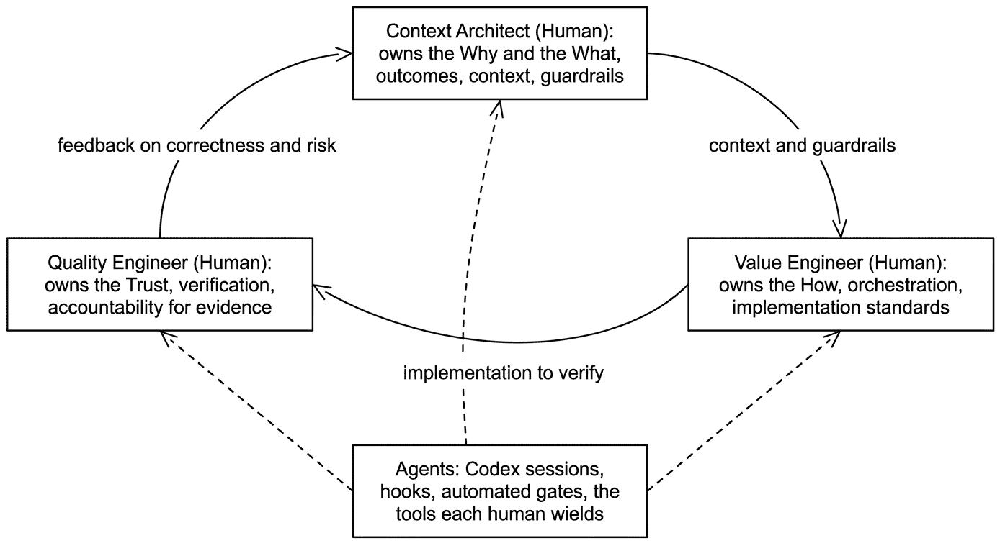
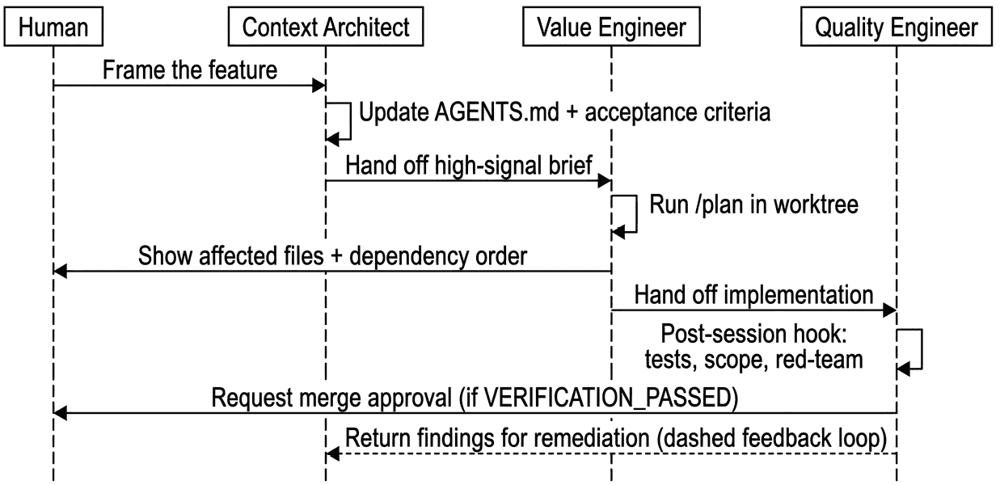

# Agentic Engineering Pod（智能体工程小组）

*第 27 章* 表明，决定 Agent 是否能产出可靠工作的是工具框架，而非模型。本章提出了该问题的组织层面版本：谁拥有工具框架，以及如何围绕它组建团队？当 Agent 负责大部分执行工作时，人类掌握着 Agent 无法自行回答的三个问题：

*   *我们为什么要构建这个？*（成果、战略、上下文）
*   *应该如何构建？*（编排、判断、实现标准）
*   *我们能信任构建出的东西吗？*（验证、安全、质量否决权）

Agentic Engineering Pod 围绕这三个问题组织三个人，每个人都由 Agent 增强，共享单一的上下文层。

### 学习目标

你将能够：

1.  为三个 Pod 角色中的每一个的 Agent 调用编写生产就绪的 TOML 配置
2.  设计 Pod 的 `AGENTS.md` 层级结构，包括仓库级、子目录级和角色特定文件
3.  演示一个特性完整的 Pod 生命周期：框架设定、编排、自动化验证
4.  编写 Quality Engineer（质量工程师）用于强制执行信任平台的钩子和门控
5.  诊断陷入困境的 Pod 属于哪种失效模式，并应用相应的修复方案
6.  将 Pod 基础设施打包为插件，并利用市场策略在多个 Pod 间强制执行一致的配置

> **起点，而非蓝图。** 本章中的 Agentic Engineering Pod 是团队围绕 Codex CLI 等 Agent 进行组织的一个成熟范例，而非最终或教条式的答案。围绕编码 Agent 构建团队是新领域，此处的约定将随着领域成熟而不断完善。请将 Pod 视为思考你自身结构的框架：采纳适用的部分，根据你的上下文调整角色和边界，并预期具体细节的演进速度将快于本书大部分内容。

### 为什么是三个角色？

#### 约束已从生成转移到验证

从变化之处入手。在软件历史的大部分时间里，稀缺资源是生成：编写代码、连接集成、编写测试。Agent 使生成变得廉价且快速，这将约束移到了别处。如今，交付的瓶颈在于**验证**，即团队证明生成输出正确、安全、可维护并准备好进入下一阶段的速率。

这重新定义了何为进步。无人验证的生成输出不是价值；它是**库存**，看似进步实则尚不可交付的工作。快速的 Agent 生成库存的速度可能超过缓慢团队审查的速度，未经审查的量不是加速，而是累积的风险。进步是**经验证的价值**：符合意图、通过测试、尊重项目约束、安全、可运维且可解释的输出。

这就是为什么 Pod 围绕三个人的问题而组织，而非围绕 Agent 现已吸收的实现工作，也是为什么负责验证的角色——Quality Engineer——在该模型中比传统团队中的 “QA” 承担更大的权重。

#### 传统团队结构的问题

传统团队结构在每个专业化边界上都产生协调开销：需求到工程，工程到 QA，QA 到 DevOps。当 Agent 执行工作时，这些交接变得更加昂贵，因为每个边界都引入了 Agent 不需要的延迟和它们无法在无人工干预下恢复的上下文丢失。

更深层的问题是**所有权分散**。没有单一人拥有从业务成果到生产验证的完整链条。当 Agent 生成代码时，所有权分散意味着无人对系统是否正确、安全地做着正确的事拥有完整图景。

#### 三人法则

Agentic Engineering Pod 通过激进的简化解决了这个问题：三项责任，一层共享上下文。

之所以有三项责任，是因为每一项都是生产者的工作，且无一是协调工作。Pod 是责任分离，而非层级。Agent 处理常规工作（样板代码、脚手架、测试生成、CI 运行），从而让人类专注于高判断力工作。第四项责任要么是其中之一的重复，要么就是协调本身，这是 Pod 不应具备的复杂性症状。

架构原则：**人指挥 Agent；而非管理其他人。** 协调流向人→Agent，而非人→人。当交付需求增加时，启动共享平台层的并行 Pod，而非扩大现有 Pod。扩展平台，而非 Pod。

该法则关乎责任，而非人数。Pod 保证所有三项责任都有明确、无重叠的归属；它不坚持必须恰好有三个具名个体。在小型项目中，一人可兼任多项责任，且单个传统职位名称通常跨越两三项 Pod 职责。绝不能发生的是责任无人负责。从传统角色到 Pod 职责的映射很直观：

| 传统角色 | Pod 职责 |
| --- | --- |
| 产品经理、产品负责人、业务分析师、工程经理、领域专家 | Context Architect（上下文架构师） |
| 工程师、架构师、设计师 | Value Engineer（价值工程师） |
| QA、SDET、DevOps、SRE、平台、安全、MLOps、治理与合规 | Quality Engineer（质量工程师） |

#### 关键结构洞见

Pod 的三个角色直接映射到 Agentic 交付模型中留给人类的三个问题：


| **角色** | **类型** | **负责范围** | **回答问题** |
| :--- | :--- | :--- | :--- |
| **上下文架构师** | 人类 | “为什么”和“是什么” | 我们追求什么成果？智能体需要什么上下文？有哪些护栏？ |
| **价值工程师** | 人类 | “怎么做” | 我们如何编排交付？好的实现是什么样的？ |
| **质量工程师** | 人类 | “信任” | 我们能否证明所构建的是正确、安全、可靠的？谁对证据负责？ |

所有三个 Pod 角色均为人类。智能体（`Codex` 会话、技能、钩子、权限、自动化门禁）是每位人类所驾驭的工具。Pod 中不存在“智能体角色”。智能体拥有能力；人类承担角色。

这些边界反映了人类导致智能体系统失败的三种方式：上下文不佳（上下文架构师失职）、编排不善或错过架构偏移（价值工程师失职），或在缺乏充分验证的情况下发布（质量工程师失职）。Pod 使每种失败模式都可见且可追责。



**图 28.1 - Pod：三个角色与流向**

智能体工程 Pod 的示意图，展示了三个角色形成一个循环。上下文架构师负责“为什么”和“是什么”（成果、上下文、护栏），并将上下文和护栏传递给价值工程师，后者负责“怎么做”（编排、实现标准），并将实现传递给质量工程师进行验证，后者负责“信任”（验证、证据问责），并返回关于正确性和风险的反馈。一个单独的“智能体”框（`Codex` 会话、钩子、自动化门禁）通过虚线连接到所有三个角色，作为每位人类驾驭的工具。

#### 角色及其智能体孪生

每个角色都与一个同名的智能体配置配对：本章后面介绍的 TOML 文件（`context-architect.toml`、`value-engineer.toml`、`quality-engineer.toml`）。共享名称是有意为之。TOML 文件是该角色的*智能体孪生*，一个针对该角色工作调优的智能体，拥有该角色任务所需的模型层级、审批姿态和沙箱。

不过，孪生并非固定工具。每个角色的深层工作是随时间将自身复制到孪生中，将角色持有者的判断编码到配置、`AGENTS.md` 上下文以及孪生所依赖的技能中，使智能体能更多时间地按人类方式行事。每一次会话重定向、每一次简报优化、每一个新增门禁，都是人类在教导孪生按其方式行事。杠杆效应复利增长：孪生捕获了原本只存在于某人脑海中的隐性知识，教导得越好，人类就越少需要手动干预。这就是自主阶梯背后的机制：当孪生赢得了足够的证据被信任处理某类变更时，该类变更就会跃升一个层级。

这也是为什么孪生是人类驾驭的能力，而非第二个角色持有者。判断、问责和角色本身始终属于人类；随时间改变的是孪生吸收了多少人类的技艺。名为 `context-architect` 的智能体*不是*上下文架构师；它是上下文架构师不断进化的工具，保持其锐利是该角色的一部分。

#### 质量决定节奏

在深入角色本身之前，有一条运营原则必须确立，因为它塑造了所有三个角色。人们很容易把验证想成流水线末端的一个关卡：智能体生产，合并主分支前验证先行。这幅图景是不完整的。一旦生成变得廉价，决定 Pod 交付速度的不是生产速度，而是验证速度。验证吞吐量，而非生成吞吐量，才是进度的真实度量。

由此引出两个后果。首先，已生成但未验证的工作应控制在有界队列中，而非允许堆积；不断增长的未审查输出积压的是风险，而非已存进度。其次，价值工程师只有在质量工程师的验证能力能消化时，才应释放更多智能体工作。验证不是最后拧上的终点关卡；它决定交付节奏。

这重构了团队花费智能体红利的方式。廉价生成产生红利，Pod 可两用：用于更多平庸输出，或用于更强规格、更好测试和更深验证。对于企业级软件，将部分红利再投资于质量通常回报更高，因为它提升了如今制约整个系统的验证上限。

#### 哪些章节奠基各角色

Pod 综合了全书内容：每个角色的技艺源自分布在前几部分的多个章节，而非单一部分，接下来三节将逐一展开。各角色最相关的章节：

*   **上下文架构师。** 第 4 章 (`AGENTS.md`) 是核心参考，因为 `AGENTS.md` 层级是该角色的主要产出物。第 3 章 (提示工程) 支撑规范编写和答疑会范围界定模式；第 5 章 (审批模式与信任边界) 和 第 17 章 (企业级部署) 为战略护栏、策略和自主阶梯提供依据；第 10 章 (技能) 是角色技艺变为可分发基础设施的途径。

*   **价值工程师。** 第 11 章 (子智能体) 和 第 12 章 (多智能体编排) 是该角色所负责的智能体循环工程的核心。第 14 章 (成本管理) 驱动速度、Token 成本与置信度之间的权衡；第 3 章 (提示工程) 是简报工程的基础；第 13 章 (工作树) 为特性会话提供隔离；第 20 章 (AI 代码审查) 配合 第 10 章 (技能) 支持成比例审查和可复用审查技能。

*   **质量工程师。** 第 9 章 (钩子) 是主要强制机制，第 5 章 (审批模式与信任边界) 设定沙箱和审批姿态。第 15 章 (CI/CD)、第 16 章 (安全加固) 和 第 19 章 (测试与评估) 构成信任平台的运营骨干，第 20 章 (AI 代码审查) 为验证门禁提供输入。

这也是角色到部分映射仅为近似的原因：价值工程师最贴近第 3 部分 (规模化)，质量工程师最贴近第 2 部分 (护栏) 的强制原语，而上下文架构师具体对应 第 4 章 而非第 1 部分整体。

### 上下文架构师：人类角色

#### 上下文架构师负责什么

上下文架构师负责成果与环境：Pod 是否兑现承诺、智能体是否基于准确上下文工作、战略方向是否与业务意图保持一致。其杠杆来自创建可复用的上下文、技能和护栏，而非驱动单个特性会话。

上下文架构师的四大责任领域：

**工厂管治。** Pod 可复用生产系统的管治者：上下文、技能与护栏。制定高信号简报标准，塑造审查循环。反复出现的摩擦反哺上下文层优化。


#### 结果定义与价值实现

业务赞助商的主要接口。将模糊的业务反馈转化为可执行的上下文，掌控产品叙事，并以成本价值为依据界定交付权衡，包括“代理经济学”。

#### 上下文工程

策划模式、文档和决策记录，赋予代理做出正确底层决策所需的“直觉”。无情地管理信噪比：相互矛盾或过时的上下文会产生相互矛盾或陈旧的输出。

#### 战略护栏与策略

定义法律、伦理和安全护栏。将合规要求转化为结构化策略，并定义升级阈值（哪些可自动运行，哪些需要人工批准）。

#### 自主阶梯

```
Level 1: Assist 代理建议；人工审查并应用每项变更
Level 2: Approval-required 代理执行；每项操作执行前需人工批准
Level 3: Policy-bounded 代理在定义边界内执行；例外情况升级处理
Level 4: Self-remediating 代理在护栏内检测、诊断并修复
```

阶梯晋升需要证据（测试覆盖率、审查历史、审计日志），而非自信。层级按变更类别分配，而非按模块：支付处理模块的架构变更可能永久保持 Level 2，而读路径优化则可能为 Level 3。

#### `AGENTS.md` 作为上下文架构师的核心产出物

`AGENTS.md` 并非众多配置文件中的一个：它是上下文架构师的**核心交付物**。^[²⁸⁰] 价值工程师运行的每次 Codex 会话、质量工程师触发的每个自动化检查，都从该层级读取上下文。Pod 的输出质量受限于该文档的质量。

生产环境 Pod 的层级结构：

```
~/.codex/AGENTS.md # 个人偏好，永不提交
AGENTS.md # 仓库级：Pod 的事实来源
src/payments/AGENTS.md # 限界上下文的领域约束
src/auth/AGENTS.md # 认证模块更严格的安全约束
.codex/roles/value-engineer.md # 角色专用指令
.codex/roles/quality-engineer.md # 角色专用 QE 指令
```

仓库级 `AGENTS.md` 包含产品描述、验收标准、架构约束、批准的依赖列表和完成的定义。每个代理首先读取它。子目录 `AGENTS.md` 文件编码跨冲刺持久的领域特定约束。更具体的文件覆盖更通用的文件，因此在 `src/auth/` 中工作的代理会自动继承更严格的约束，无需显式指令。

一份编写良好的仓库级 `AGENTS.md` 如下所示：

```
##### 产品上下文
该服务是用户订阅状态的权威来源。
代理不得引入任何从多个事实来源派生订阅状态的路径。
##### 验收标准
每项功能必须包含：
1. 面向用户的结果陈述（“处于[状态]的用户可以[操作]...”）
2. 至少一个包含预期行为的失败场景
3. 任何面向用户路径的性能界限 (<200ms p95)
##### 架构约束
- 所有外部数据在边界处使用 zod 验证
- 禁止跨模块数据库查询；每个模块拥有其架构
- 所有状态变更在返回前必须发出审计事件
##### 批准的依赖
见 .codex/approved-deps.json。添加未列出的依赖要求
在代理继续之前获得 ADR 批准。
##### 自主级别
- 读路径变更：Policy-bounded (Level 3)
- 写路径变更：Approval-required (Level 2)
- 架构变更：Approval-required (Level 2)
- 基础设施变更：Assist (Level 1)
```

#### 规范作为强制函数

一种有用的模式是“办公时间”技能：一种结构化的产品对话，在编写任何代码之前触发，要求明确回答四个问题：我们在解决什么问题，可观测层面的成功标准是什么，什么不在范围内，哪些约束是不可商量的。以这种方式设计的 Codex 技能，直到范围和成功标准被确认之前，不会让会话继续进行。某功能的 `AGENTS.md` 条目，在答案写下来之前不应存在。

#### 将上下文架构师的技艺作为插件分发

上下文架构师的规范技能、办公时间范围界定对话、`AGENTS.md` 健康检查和 ADR 编写模板，代表了不应只存在于某个人脑海中的组织知识。插件系统原生支持将技能（连同钩子、MCP 服务器和应用连接器）打包为单个可安装单元；编写本文时，文档化的插件规范并未将自定义代理角色 TOML 或 `AGENTS.md` 模板列为一等插件组件，因此这些作为捆绑文件随行，而非自动注入。当最资深的上下文架构师改进技能或增加上下文漂移检查时，每个 Pod 都通过版本升级接收更新。技艺由此成为可分发的基础设施，而非部落知识。这是一个贯穿所有三个角色的模式的首次显现，后文将在“通过插件分发 Pod”下统一论述。

#### 上下文架构师 TOML 配置

上下文架构师的 Codex 调用属于规范与架构工作：产出 ADR、更新 `AGENTS.md`、验证验收标准、评估上下文漂移。这些会话使用高推理模型，且不在全自动模式下运行；上下文架构师制定策略，而非实现。

上下文架构师的代理孪生体：

```
##### .codex/agents/context-architect.toml
name = "context-architect"
description = "规范制定、ADR 编写、AGENTS.md 维护、上下文质量审查。"
developer_instructions = """
你正在协助上下文架构师进行高判断力的上下文和规范工作。
你处理的任务：
- 在层级的任何级别起草或更新 AGENTS.md 文件
- 编写或审查 ADR（架构决策记录）
- 将验收标准转化为可验证的具体形式
- 评估现有上下文文档是否最新准确
- 识别上下文层中的缺口或矛盾
规则：
- 请勿编写功能实现代码
- 请勿修改 .codex/ 或 docs/ 之外的源文件
- 如果产出 ADR，请遵循 .codex/adr-template.md 中的格式
- 标记任何需要人工决策后代理才能继续的上下文缺口
- 当文档集准备好供 Pod 使用时，输出 CONTEXT_COMPLETE
"""
model = "gpt-5.4"
model_reasoning_effort = "xhigh"
approval_policy = "untrusted"
sandbox_mode = "workspace-write"
```

`approval_policy = "untrusted"` 是有意为之。上下文架构师会在提交前审查并批准对上下文层的每一项提议变更。上下文错误会传播到每一个下游代理会话；它们值得在创作环节接受严格的人工审查。

### 价值工程师：人类角色

#### 价值工程师负责的内容

价值工程师编排端到端交付。该角色要求扎实的软件工程基础，而非只是恰巧使用 AI 工具的项目经理。他们提供技术深度以验证代理输出、识别架构漂移、捕捉正确性故障、并维护代理无法单方面强制执行的实现标准。

价值工程师的四大责任领域：

##### 系统编排与技术发现

技术主题专家的主要联系人。负责深度发现，将复杂业务规则转化为可执行的系统行为。

##### 简报工程

产出高信号简报：包含意图、约束、示例和边缘情况的结构化提示词，足以让代理在无歧义的情况下执行。简报质量是该角色的核心技艺。


##### 代理循环工程

设计收敛标准、并行度和停止条件。在速度、Token 成本和置信度之间做出深思熟虑的权衡。明确何时让代理运行至完成，何时进行重定向，以及何时使用更好的上下文重新启动。

##### 专家判断与实施标准

对所有逻辑提供最终验证：发现代理可能遗漏的架构偏移、用户体验缺陷或正确性故障。

#### 实战简报工程

低信号简报（`为订阅服务添加续订端点`）与高信号简报的区别在于具体性，而非长度：

##### 任务：订阅续订端点

**意图：** 状态为 `subscription.status = "expired"` 的用户可通过 `POST /subscriptions/renew` 续订其订阅，无需重新输入支付详情。

**约束条件：**

*   复用存储在 `user.paymentMethodId` 中的支付方式
*   续订必须是幂等的：调用该端点两次不得产生两笔费用
*   返回 200 之前必须发出 `subscription.renewed` 事件

**验收标准：**

*   状态为 `status=expired` 的用户在成功调用后变为 `status=active`
*   状态为 `status=active` 的用户收到 409 响应，响应体为 `{"error": "already_active"}`
*   Stripe 失败返回 502 并记录错误；订阅状态保持不变
*   在标称负载下，响应时间 p95 < 200ms

**范围外：** 不要修改支付方式存储逻辑。不要添加新的订阅层级。

**参考：** 参见 `src/subscriptions/AGENTS.md` 了解幂等性要求，参见 `src/events/types.ts` 了解事件架构。

显式的失败场景、清晰的幂等性要求、范围外边界，以及对领域特定 `AGENTS.md` 的引用。每一项都消除了代理原本需要通过推断来解决的决策点。

#### 价值工程师 Codex 会话模式

典型的功能会话：阅读任务规范和相关的 `AGENTS.md` 上下文；运行 `/plan` 验证方法；在工作区的 `workspace-write` 沙箱^(281) 中执行；根据验收标准审查输出；在输出偏离时进行重定向；实现整洁后移交给质量工程师的质量门禁。每个功能都位于各自的工作树中；主分支仅接收经过审查、通过质量门禁的输出。

#### 决定何时并行化：指标自由度

指标自由度（第 11 章）为价值工程师提供了一种原则性的方法，用于决定何时生成并行子代理，何时在单个会话中保持任务。它是一个单一数值，`F = 1 − ρ(D_out, D_score)`，用于衡量任务是否从多样化输出中受益（高 F）或要求单一正确答案（低 F）。在将功能分解为代理任务时应用它：

*   **高 F 子任务**（代码审查、文档编写、测试生成）分配给并行子代理，在这些任务中多样性是资产；扇出至多代理角色，让多个代理探索不同方法。
*   **低 F 子任务**（Bug 修复、迁移、架构变更）分配给单个具有高推理力的代理，在这些任务中精确度比多样性更重要；将任务特定知识编码进聚焦的提示词，而非支付并行化的协调开销。

质量工程师使用同一数值来校准验证：高 F 输出需要对方法选择进行人工审查（代理是否从众多有效方法中选出了好的一种？），而低 F 输出需要自动化正确性检查（代理是否产出了唯一的正确答案？）。

#### 成比例的审查深度

审查深度应随差异规模缩放。小型自包含差异（约 50 行以内，单一逻辑单元）：是否实现了声称的功能，是否存在明显的正确性问题，是否引入了被排除的依赖？大型差异（涉及多模块、核心逻辑重写）值得进行四遍审查：意图对齐、正确性（竞态条件、边缘情况、失败路径）、副作用、完整性（测试到位、验收标准可演示）。价值工程师可将其编码为一项审查技能，根据 `git diff --stat` 输出路由至快速通道或全量通道。

#### 价值工程师 TOML 配置

价值工程师的代理孪生体：

```toml
##### .codex/agents/value-engineer.toml
name = "value-engineer"
description = "功能实现、编排与代理监督会话。"
developer_instructions = """
你正在为价值工程师执行一项功能实现任务。
开始前：
1. 阅读 AGENTS.md 以及与此任务相关的任何子目录 AGENTS.md
2. 阅读任务简报并确认你理解验收标准
3. 如果任何约束存在歧义，在编写代码前将其暴露出来
实施期间：
- 在每个逻辑变更组后运行测试
- 如果测试失败，在继续前修复失败；绝不跳过
- 如果遇到简报未涵盖的架构决策，
  将其写入 .codex/clarifications.md 并暂停等待审查
- 跟踪简报中的验收标准：在发出完成信号前，每一项必须可演示地得到满足
完成信号：IMPLEMENTATION_COMPLETE，附带以下摘要：
- 每项验收标准及其是否满足
- 超出简报范围处理的任何边缘情况
- 任何延期待质量工程师审查的事项
"""
model = "gpt-5.4-mini"
model_reasoning_effort = "high"
approval_policy = "on-request"
sandbox_mode = "workspace-write"
```

`approval_policy = "on-request"` 适用于价值工程师的工作树会话：代理在限定工作树内执行，验收标准明确，且质量工程师的质量门禁会在任何输出到达主分支前触发。模型决定何时升级至价值工程师以获批准，让常规文件编辑顺畅进行，同时浮现任何看起来异常的情况。

### 质量工程师：人类角色

#### 质量工程师负责的事项

质量工程师负责信任平台：CI/CD 流水线、自动化质量门禁、安全控制和验证基础设施。他们掌握质量否决权：无论由谁或何物产生变更，均有权阻止。无论是价值工程师还是上下文架构师都无法覆盖这些门禁。这种权威是结构性的，而非政治性的。

否决权之所以存在，是因为问责制无法委托给代理。编码代理无法为其交付的产物担责；发布产品的组织才对其负责。因此，企业级交付运行在证据之上，而非信心之上：质量工程师的工作是让团队能够展示要求是什么、代理做了什么、测试了什么、谁审查了它，以及为什么结果可以安全发布。当证据不足时，否决权就是阻止工作的机制，无论生产者是谁或何物。

质量工程师的四大职责领域：

##### 验证与质量工程

设计并构建验证功能正确性、性能和可靠性的自动化系统。推动安全工具契约模式：类型化的输入/输出、幂等性、最小权限、允许列表。

##### 对抗性测试

主动对代理工作流进行红队演练，针对提示词注入、不安全工具使用和数据泄露。这是一项持续的工程实践，而非定期审计。

##### 运营骨干

维护 CI/CD 流水线、安全上下文存储、代理隔离、依赖扫描和供应链完整性。

##### 自主性强制执行

实现使上下文架构师的自主性阶梯从愿景变为现实的钩子、质量门禁和流水线检查。

#### 确定性工具接口设计

质量工程师设计构造上安全的代理工具接口。有三项属性是不可妥协的：

##### 类型化的输入与输出

团队代理使用的每个工具都应具有显式的输入模式和输出契约。非类型化接口使验证变得不可能，并导致副作用不可预测。


#### 质量工程师原则与实施

##### 幂等性
工具必须支持使用相同输入多次安全调用。智能体会重试；非幂等工具会导致重复扣费、重复记录和状态不一致。

##### 最小权限
每个智能体角色应仅访问其所需的工具。实施智能体不需要生产数据库凭据。审查智能体不需要源文件的写入权限。质量工程师设计权限结构并根据实际智能体行为进行验证。

#### 质量工程师编写的钩子

钩子[²⁸²]是质量工程师的主要强制执行机制。有三个钩子点最为关键：

##### 预提示钩子（UserPromptSubmit）
在任何提示进入智能体上下文之前触发。用于策略强制执行：扫描提示注入模式、验证正确的工作树、检查 `AGENTS.md` 上下文是否为最新。

##### 每次写入钩子（PostToolUse）
在每次工具调用完成后触发。正如第 9 章所述，`PostToolUse` 观察的是事后结果而非把关动作：工具已经运行完毕，因此钩子将发现结果呈现到上下文中并以退出码 `0` 退出，而不是阻塞。这是在同一会话中让智能体能够采取行动的快速、文件级反馈的正确切入点。

##### 会话后钩子（Stop）
在 Codex 会话结束时触发。用于验证：运行测试套件、检查是否有超出允许范围的文件被修改、验证审计事件是否已发出、确认预期的完成信号。

```bash
###### .codex/hooks/post-session-verify.sh
###### 质量工程师的会话后验证钩子
set -euo pipefail
TASK_ID="${CODEX_TASK_ID:-unknown}"
WORKTREE="${CODEX_WORKTREE:-$(pwd)}"
echo "[QE Hook] Post-session verification for task: $TASK_ID"
###### 1. 运行完整测试套件
echo "[QE Hook] Running test suite..."
npm test --silent 2>&1 | tee ".codex/tasks/$TASK_ID/test-results.log"
###### 2. 验证未修改许可范围外的文件
echo "[QE Hook] Checking file scope..."
MODIFIED=$(git diff --name-only HEAD)
VIOLATIONS=$(echo "$MODIFIED" | grep -E "^(infrastructure/|AGENTS\.md)" || true)
if [ -n "$VIOLATIONS" ]; then
  echo "[QE Hook] SCOPE VIOLATION: agent modified restricted files:"
  echo "$VIOLATIONS"
  exit 1
fi
###### 3. 检查会话日志中的完成信号
if ! grep -q "IMPLEMENTATION_COMPLETE" ".codex/tasks/$TASK_ID/session.log" 2>/dev/null; then
  echo "[QE Hook] WARNING: No IMPLEMENTATION_COMPLETE signal found in session log"
fi
echo "[QE Hook] Verification complete. Gate: PASSED"
```

一个更轻量的示例展示了 `PostToolUse` 模式的独立应用：智能体写入 Markdown 的那一刻就进行 lint 检查，这样风格和结构问题会在智能体仍在循环中时浮现。`PostToolUse` 匹配器按工具而非文件类型选择，因此钩子会过滤 Markdown 本身，而不是依赖匹配器：

```bash
###### .codex/hooks/lint-markdown.sh
###### 质量工程师的每次写入 Markdown lint（PostToolUse）
set -euo pipefail
###### PostToolUse 通过 stdin 传递 JSON 对象；工具名在 `.tool_name` 中。
TOOL="$(jq -r '.tool_name // empty')"
###### 仅在文件写入工具后执行（空工具名允许手动运行）
case "$TOOL" in
  write_file|str_replace_editor|apply_patch|"") ;;
  *) exit 0 ;;
esac
###### 仅 lint 智能体刚刚更改的 Markdown 文件
CHANGED=$(git diff --name-only HEAD -- '*.md')
[ -z "$CHANGED" ] && exit 0
if ! command -v markdownlint >/dev/null 2>&1; then
  echo "[QE Hook] markdownlint not installed; skipping."
  exit 0
fi
echo "### markdownlint results"
echo "$CHANGED" | xargs markdownlint 2>&1 || true
###### 观察，不阻塞：将发现结果呈现到上下文并干净退出。
exit 0
```

在 `.codex/hooks.json` 中通过 `PostToolUse` 进行连接：

```json
{
  "hooks": {
    "PostToolUse": [
      {
        "hooks": [
          {
            "type": "command",
            "command": "bash .codex/hooks/lint-markdown.sh",
            "statusMessage": "Linting changed Markdown...",
            "timeout": 20
          }
        ]
      }
    ]
  }
}
```

该钩子永远不会导致智能体动作失败；它将 lint 输出作为上下文反馈回来，以便智能体自我纠正。当必须强制执行 Markdown 标准而不仅仅是呈现时，该检查应放在会话后关卡，那里非零退出码可以停止工作。

#### 插件强制钩子：使绕过在结构上不可能

当钩子作为松散脚本存在于 `.codex/hooks/` 中时，任何开发者都可以删除或修改它们。插件系统改变了这一点。通过 `marketplace.json` 中的 `INSTALLED_BY_DEFAULT` 策略分发的插件钩子会在会话启动时安装，且无法被单个开发者移除。[²⁸³] 质量工程师维护插件；平台团队通过市场策略强制安装。绕过变得不可能，而不仅仅是不建议。同一机制适用于 `PostToolUse` 钩子：文件范围强制执行、静态分析关卡和审计事件检查会在企业中每个 pod 的每次工具调用时触发。如何跨许多 pod 一致地推广这一点是本章最后一节“使用插件分发 Pod”的主题。

#### 验证经济学：分层成本关卡

验证是有成本的：时间、Token 开销和周期延迟。对每个两行的错误修复都进行全面的对抗性安全审查，这不是严谨的表现；而是流程校准错误的表现。质量工程师的工作不是最大化验证深度，而是将验证工作量与变更风险相匹配。

三层模型效果良好。

##### 第 1 层：静态验证
Lint 检查、类型检查、模式验证。近乎零成本；无一例外地在每次变更时运行。

##### 第 2 层：功能验证
完整测试套件、范围合规检查、验收标准确认。成本较高但属于常规操作；在每次涉及逻辑的变更时运行。

##### 第 3 层：对抗性验证
安全建模（OWASP Top 10、STRIDE）、性能基准测试、对抗性输入测试和手工红队演练。成本高昂；保留用于新认证路径、支付流程、模式变更以及涉及提升信任边界的任何内容。

Codex 技能集可以直接实现这一点。一个打开真实浏览器、操作应用程序、发现错误并生成回归测试的 QA 技能属于第 2 层工作，适用于大多数功能变更。对于具有安全隐患的变更，更重量级的安全审查技能会在之上增加 STRIDE 威胁建模和 OWASP Top 10 审查。验证预算随风险缩放，而非随可用时间或审查者习惯。

质量工程师通过在 `AGENTS.md` 中将变更类别映射到验证层级来经济高效地实施这一点，这是上下文架构师用于自主阶梯的相同映射。模式变更始终是第 3 层。读路径重构是第 1 层加第 2 层。自动化执行相应层级；质量工程师进行审查，并在判断需要时进行升级。

#### 质量工程师 TOML 配置

质量工程师的自动化验证运行是非交互式的；它们在 CI 中触发，而非在交互式终端会话中。模型层级较低（验证是机械的，而非推理密集型），沙箱则更严格。

质量工程师的智能体孪生体：


##### `.codex/agents/quality-engineer.toml`

```
name = "quality-engineer"
description = "自动化验证：测试执行、安全审查、门禁强制执行。"
developer_instructions = """
您正在对 Agent 生成的输出进行质量工程师验证。
您的任务：
1. 运行完整测试套件并记录结果
2. 运行安全扫描器 (`npm audit --audit-level=moderate`)
3. 检查任务简报中的所有验收标准是否已得到明确满足
4. 识别任务允许范围外被修改的任何文件
5. 检查所有写入路径操作是否已发出审计事件
请勿修改源文件以使测试通过。
请勿禁用或跳过单个测试。
如果测试失败，请完整记录失败详情并输出：`VERIFICATION_FAILED`
如果所有门禁通过，输出：`VERIFICATION_PASSED`
将结果写入 `.codex/tasks/$TASK_ID/verification.md`
"""
model = "gpt-5.4-mini"
model_reasoning_effort = "minimal"
approval_policy = "never"
sandbox_mode = "read-only"
```

`sandbox_mode = "read-only"` 是刻意为之。质量工程师的验证 Agent 即使模型产生幻觉指令写入源文件，也无法执行写操作。结合 `approval_policy = "never"`，该 Agent 在 CI 中非交互式运行，无需人工提示即可执行验证检查，沙箱模式防止任何意外变更。

### 实战中的 Pod：一个特性的生命周期

以下演示追踪了一个特性在完整 Pod 中的流转：“订阅已过期的用户可以续订，无需重新输入支付详情。”

#### 步骤 1：Context Architect 界定特性

Context Architect 评估 `AGENTS.md` 是否涵盖续订流程，更新订阅模块以补充缺失的验收标准，并编写简报：

```
##### 特性：订阅续订
**用户结果：** `status=expired` 的用户可调用 `POST /subscriptions/renew`
并获得 `status=active`，无需重新输入支付详情。
**失败场景：**
- `status=active` 的用户：409，响应体 `{"error": "already_active"}`
- Stripe 失败：502，响应体 `{"error": "payment_failed"}`，订阅状态不变
- 重复调用：第二次调用返回 200 及当前状态，不产生第二次扣费
**性能边界：** 标准负载下 p95 < 200ms
**自主级别：** 写入路径变更：需要审批（第 2 级）
```

#### 步骤 2：Value Engineer 编排实现

Value Engineer 在专用 worktree 中运行 Codex 会话，策略为 `approval-required`（这是涉及支付的写入路径变更）：

```
git worktree add ../worktrees/feature-subscription-renewal -b feature/subscription-renewal
cd ../worktrees/feature-subscription-renewal
codex --profile value-engineer
```

打开提示词，高信噪比简报：

```
##### 任务：订阅续订端点
按 src/subscriptions/AGENTS.md 中的验收标准实现 `POST /subscriptions/renew`。
意图：status=expired 的用户调用该端点，使用其存储的支付方式转换为 status=active。无需新的支付详情。
约束：
- 幂等性：重复调用不得产生两笔 Stripe 扣费
- 返回 200 前发出 subscription.renewed 事件
- Stripe 失败：返回 502，记录错误，状态保持不变
- 不得修改支付方式存储逻辑
验收标准：按 src/subscriptions/AGENTS.md 所指定
从 /plan 开始。在编写任何代码前，向我展示受影响文件及依赖顺序。
```

Agent 运行 `/plan`；Value Engineer 审查后批准执行。关键的专家判断时刻：Agent 最初的幂等性实现在并发调用下存在竞态条件。重定向指示：

> 幂等性检查需使用数据库级唯一约束 (user_id, renewal_date)，而非应用层面的读-检-写。
> 请参阅 src/subscriptions/AGENTS.md 中的幂等性模式要求。
> 请修订实现方案。

#### 步骤 3：Quality Engineer 的自动化门禁触发

Quality Engineer 的会话后钩子触发，运行测试套件，检查范围合规性，并将结果写入 `.codex/tasks/subscription-renewal/verification.md`。Quality Engineer 还运行对抗性测试：

```
对 POST /subscriptions/renew 端点实施实施红队测试。
测试内容：
1. 同一 user_id 的并发调用（竞态条件）
2. 待处理的续订请求期间到达的 Stripe Webhook
3. 可能为同一用户创建第二笔 Stripe 扣费的任何路径
将发现报告至 .codex/tasks/subscription-renewal/security-review.md
```

对抗性会话未发现绕过路径；数据库级约束生效。`VERIFICATION_PASSED`；特性可合并。

对于涉及支付的写入路径变更，Pod 在合并前运行多学科门禁作为顺序检查点：工程审查、安全审查（OWASP Top 10 和 STRIDE）及 QA 验证。自主权阶梯与门禁序列共享同一分类表；Quality Engineer 维护两者。

#### 人工判断的介入点

人工判断在此生命周期的四个节点出现：界定特性、审查实现计划、针对竞态条件重定向、批准最终合并。其余一切通过 Pod 的 Agent 层执行。



图 28.2 - 特性在 Pod 中的生命周期

序列图追踪特性从人工批准界定开始，经 Context Architect 更新 `AGENTS.md` 并将高信噪比简报交给 Value Engineer，后者在 worktree 中规划、获取人工计划批准及竞态条件重定向，再移交 Quality Engineer 验证。Quality Engineer 的会话后钩子运行测试、范围及对抗性检查：通过则人工批准最终合并，检出发现则退回 Value Engineer 修复。人工判断节点标注于界定、计划审查、重定向及最终合并。

### 失效模式与 Pod 反模式

#### Context 债务

**症状：** Agent 输出偏离业务意图。功能实现了技术上正确的代码，却未达成实际预期结果。评审通过但利益相关方拒收。

**原因：** Context Architect 停止维护 `AGENTS.md` 层级。过时的验收标准、陈旧的约束和废弃的决策堆积。遵循陈旧上下文的 Agent 产出陈旧输出。

**修复：** 将 `AGENTS.md` 评审纳入每个 Sprint 回顾。Context Architect 负责“上下文健康度”指标：陈旧决策、AGENTS.md 标准与实际简报的差距、需大量人工重定向的特性占比。重定向率上升是早期预警信号。

作为插件分发的 `context-review` 技能可自动化早期检测。在 CI 中作为计划的 `codex exec` 任务每周或每个 Sprint 边界运行，它会标记陈旧的 `AGENTS.md` 章节、孤立的验收标准和上升的重定向率，赶在回顾前暴露问题。该插件将上下文健康度从人工审计转变为持续信号。

#### 门禁绕过

**症状：** 交付速度短期提升，随后急剧下降。自动化门禁本可捕获的安全事件或生产回归。

**原因：** Value Engineer 为加速交付而禁用钩子或绕过 CI 门禁。“稍后再补测试。”Quality Engineer 的否决权被视为建议而非结构性保障。


##### 修复：结构性强制执行胜过可选门禁

质量工程师的门禁并非可选。结构性修复在于让绕过变得不可能：门禁要求必须经过审计日志记录的显式覆盖，而非可以被静默传递的标志位。绕过门禁并非加快速度；而是将债务向前推至恢复成本高得多的地步。插件系统提供了强制执行：随 `INSTALLED_BY_DEFAULT` 策略分发的钩子无法被个人开发者移除。市场的 `NOT_AVAILABLE` 策略可以阻挡可能绕过门禁基础设施的非官方插件。

技能在结构上强化了这一点。门禁技能可要求在继续前进行显式确认：不是布尔标志，而是一份书面确认，证明审查者已查看特定发现。同一逻辑适用于破坏性命令，技能可使 Agent 发出警告并等待，将绕过行为转化为有意的、可追溯的选择，而非轻易的疏忽。质量工程师将同一原则应用于部署门禁：一个要求在管线推进前提供签署确认的验证摘要的钩子。让捷径比正道更难走，是在压力下唯一可靠的预防手段。

#### 单点质量失效

**症状：** Agent 交付的变更包含安全漏洞、数据泄露或正确性故障。团队缺乏连贯的验证叙事。

**原因：** 缺乏质量工程师角色，或该角色由将其视为测试执行而非信任平台工程的人担任。门禁仅存在于文档上，未经调优、未经对抗性测试，也未在结构上强制执行。

**修复：** 质量工程师角色要求深厚的 QA、DevOps 和安全工程基础。它不能是事后诸葛亮。没有真正的信任平台，Agent 自主性的增加就是不安全的，因为没有机制来捕捉 Agent 的错误。

#### 角色坍缩

**症状：** 协调开销回升。一人身兼数职，在三个领域同时做决策，成为瓶颈。

**原因：** 一人身兼两个或三个角色。结构依赖于每个角色保持独特的所有权（上下文、编排、信任）。当角色坍缩为一人时，团队的结构性保障随之坍缩。

**修复：** 恢复角色边界。识别被忽视的领域（通常是上下文工程或信任平台）并引入专人负责。角色坍缩几乎总是相对于雄心而言的人员不足的症状，而非团队模式错误的症状。

#### 范围蔓延

**症状：** 团队扩大。第四人“临时”加入。协调开销回升。

**原因：** 交付需求增加，团队随之扩大，为换取表面吞吐量而牺牲了使其高效的结构性属性。

**修复：** 将三人原则作为运营准则而非偏好。当需求增长时，启动并行团队而非扩大现有团队。三人无法应对需求，几乎总是上下文、工具或流程问题，而非人数问题。

#### Agent 产生的失效模式，映射至角色

上述反模式是团队自我衰败的方式。单独来看，《第 25 章》中的基准研究确定了 Agent 在任务中最常见的三种失效方式，每种都映射到负责修复的团队角色：

*   **导航。** 上下文架构师负责此项。Agent 在代码库中迷路的频率远高于误用工具，这使得导航成为最常见的失效类别；`AGENTS.md` 文件地图、显式路由规则和结构良好的代码库布局是影响最大的干预措施。

*   **求助判断。** 价值工程师负责此项。Agent 在模糊任务上盲目推进而不升级；校准过的审批模式和使成功标准明确的简报，能减少 Agent 必须判断何时提问的频率。

*   **多模态组合。** 质量工程师负责此项。代码、测试和文档逐渐不同步；跨模态一致性检查（测试是否匹配代码？文档是否匹配 API？）在门禁处捕捉到它。

工具使用正确性，一直以来是大多数基准测试的焦点，却是这些失效中最不常见的一种；《第 25 章》给出了测得的比率。一个其 `AGENTS.md` 和编排设计覆盖了所有三类失效的团队，正在解决主导性的失效问题。

### 通过插件分发团队

上述失效模式是单个团队从内部衰败的方式。规模化引入了不同的压力。范围蔓延的修复建议启动并行团队而非扩大单个团队，但每个新团队随后都必须忠实地复制相同的结构，而依赖手动设置的结构在被复制的那一刻就开始漂移。分发团队是让许多团队在无需手动工作的情况下保持结构一致的问题。

#### 配置问题

一个生产就绪的团队需要：三个角色 TOML 文件、一个 `AGENTS.md` 层级、用于策略执行和会话后验证的钩子脚本、验证技能、MCP 服务器配置和简报模板。当企业运行十个团队时，这套配置被复制了十次，不可避免地产生漂移。团队三的钩子与团队七的不同。一位上下文架构师以其他人从未采纳的方式演进 `AGENTS.md` 结构。配置漂移侵蚀了团队模型赖以生存的结构性保障。

#### 插件即团队基础设施

Codex 插件系统原生地将技能、钩子、MCP 服务器和应用连接器打包为单个可安装单元。这直接映射到团队的需求。团队插件打包技能、钩子脚本和 MCP 配置，插件系统原生激活这些组件，同时包含团队依赖的角色 TOML 文件和 `AGENTS.md` 模板。撰写时，文档化的插件规范未将自定义 Agent 角色 TOML 或 `AGENTS.md` 模板列为自动连接的组件，因此应将它们视为随原生激活部分一同安装的捆绑载荷，而非插件系统自动注册的内容：

```
agentic-pod/
├── .codex-plugin/
│ └── plugin.json
├── skills/
│ ├── context-architect/SKILL.md # 规范与 AGENTS.md 维护
│ ├── value-engineer/SKILL.md # 简报工程与实现
│ ├── quality-engineer/SKILL.md # 验证门禁执行
│ ├── office-hours/SKILL.md # 实施前范围界定
│ └── pod-health/SKILL.md # 上下文漂移与角色坍缩检测
├── hooks/
│ ├── pre-prompt-policy.sh # UserPromptSubmit: 注入扫描
│ ├── post-tool-scope.sh # PostToolUse: 文件作用域强制
│ └── post-session-verify.sh # Stop: 测试套件、作用域、审计事件
├── roles/
│ ├── context-architect.toml
│ ├── value-engineer.toml
│ └── quality-engineer.toml
└── templates/
 ├── agents-md-repo.md # 仓库级 AGENTS.md 模板
 ├── agents-md-domain.md # 子目录 AGENTS.md 模板
 └── brief-template.md # 高信噪比简报模板
```

安装变为 `codex plugin add agentic-pod`。每位开发者获得相同的角色配置、钩子和验证门禁。漂移在源头被消除。

#### 整体式与可组合式插件

两种打包策略均可行。整体式方法，一个插件包含所有内容，更简单且确保一致性。可组合式方法，三个特定角色插件（`pod-context-architect`、`pod-value-engineer`、`pod-quality-engineer`），更灵活：没有专职质量工程师的团队可仅安装 QE 插件以获得自动化门禁。可组合式方法还允许独立的版本周期：安全团队可更新 QE 对抗性测试而无需动 VE 简报模板。


#### 从单体开始，仅当分化压力真实出现时再进行分解

过早分解会产生 Pod 模型旨在消除的协调开销。

#### 通过市场进行企业治理

插件系统的三层市场层级映射到企业 Pod 治理。仓库市场，即仓库根目录下 `.agents/plugins/` 中的 `marketplace.json`，是企业控制点：

```json
{
 "plugins": {
 "pod-quality-engineer": {
 "source": { "source": "git", "url": "https://github.com/acme/codex-pod-qe.git" },
 "policy": { "installation": "INSTALLED_BY_DEFAULT", "authentication": "ON_INSTALL" }
 },
 "pod-value-engineer": {
 "source": { "source": "git", "url": "https://github.com/acme/codex-pod-ve.git" },
 "policy": { "installation": "INSTALLED_BY_DEFAULT", "authentication": "ON_INSTALL" }
 }
 }
}
```

`INSTALLED_BY_DEFAULT` 确保质量工程师的钩子在企业内的每个会话中触发，而不仅限于那些记得配置它们的团队。当平台团队改进验证钩子，增加针对 API 契约验证的新二级检查时，Pod 通过刷新市场（`codex plugin marketplace upgrade`）即可获取变更；随后 `INSTALLED_BY_DEFAULT` 策略确保更新后的钩子在下一个会话中生效。

#### 插件不改变的事物

插件分发的是基础设施，而非判断。三个问题依然由三位人类负责。插件改变的是围绕这些问题落地结构的成本。使用插件的 Pod 将时间花在判断上；没有插件的 Pod 则要在配置、同步和漂移修复上花费大量精力。插件系统使智能体 Pod 成为一种可分发的组织模式，而不仅仅是概念模型。

### 结语

Pod 是智能体企业中的交付单元。三个角色，各自拥有独特的层级，均由智能体放大。该模式有意设计得精简，因为有了智能体，小团队比没有智能体的大团队更强大。

让 Pod 运转的关键在于结构：三个角色拥有不重叠的所有权，每个角色提供其他角色所依赖的层级。上下文架构师的上下文使价值工程师的编排生效。价值工程师的判断使质量工程师的门控有意义。质量工程师的信任平台使自主阶梯安全可攀。移除任意一个，系统都会以 Pod 失效模式中描述的典型方式之一退化。

智能体已就绪，本书涵盖的基础设施也已就绪：提示词、`AGENTS.md` 层级、审批与沙箱边界、钩子与技能、编排与成本纪律。Codex CLI 以 npm 包的形式，在你自己的机器上提供了所有这些原语。Pod 正是将它们转化为运营模型的关键。

你不需要重组、指导委员会或预算周期即可开始。选取一条真实的工作流，配备一名上下文架构师、一名价值工程师和一名质量工程师，建立共享的 `AGENTS.md` 和门控，让单个特性从构想跑通至验证合并的完整闭环。第一个 Pod 就是实践推广的方式。它产生的上下文、技能和护栏将被第二、第三个 Pod 继承，并以交付的软件而非 PPT，向组织展示一个由 Codex 放大的小团队能交付什么。

智能体已就绪。真正的问题是：围绕智能体的人类，是否能足够清晰地拥有各自的层级，并迈出第一步。率先行动的团队，不仅交付更快；他们将改变自身敢于尝试的边界。

### 总结

1.  **约束已从生成转移到验证。** 智能体让代码生成变得廉价，因此交付的瓶颈现在在于输出被验证的速度。未经验证的工作是库存，而非价值；进展即经验证的价值。

2.  **三个核心问题，三个角色。** Pod 围绕“为什么和什么”（上下文架构师）、“怎么做”（价值工程师）和“信任”（质量工程师）组织起来，智能体吸收了它们之下的常规执行工作。

3.  **每个角色都有一个智能体孪生体。** 同名的智能体配置执行角色的常规工作，角色的长期目标是通过上下文、技能和门控，将自身的判断逐步复制到该孪生体中，使孪生体获得更多自主权，而判断与问责始终留在人类手中。

4.  **Pod 是责任映射，而非人头编制。** 所有三项职责必须无重叠地被拥有；一人可身兼数职，传统职位头衔可拆分至不同角色。通过增加 Pod 来扩展，而非扩大单个 Pod。

5.  **`AGENTS.md` 是共享上下文层。** 上下文架构师的 `AGENTS.md` 文件层级是每个智能体会话和自动化门控读取的主要产物，详见*第 4 章*。

6.  **价值工程师编排，判断即工艺。** 高信号简报、深思熟虑的循环设计、与变更量成比例的评审，保持智能体输出与意图及真实业务价值对齐。

7.  **质量工程师掌控节奏并持有否决权。** 验证吞吐量决定交付速度，否决权是结构性的，因为发布什么的问责归属于组织而非智能体。企业交付运行于证据之上，而非信心。

8.  **使验证力度与风险匹配。** 分级成本门控对所有变更运行廉价检查，将昂贵的对抗性评审保留给高风险变更；将生成红利再投资于质量，可提升整个系统的上限。

9.  **插件分发结构，而非判断。** 将角色、钩子和上下文打包为插件可消除 Pod 间的配置漂移，但三个核心问题依然由三位人类负责。

10. **了解失效模式。** 上下文债务、门控绕过、质量单点故障、角色坍缩和范围蔓延，各自以特定方式削弱 Pod，且均有结构性修复方案。

11. **从真实工作上的单个 Pod 开始。** Codex CLI 当下即提供原语；采用该模型的最快方式是让一个三角色 Pod 将单个特性端到端跑通，并让其产出的上下文、技能和护栏播种给下一个 Pod。

### 练习

1.  **角色映射。** 针对你的当前团队，将三个 Pod 角色映射到目前执行这些职责的人员，或识别出哪些角色缺失或模糊。为每个人的主要产出写一段描述：上下文架构师的 `AGENTS.md`、价值工程师的简报质量、质量工程师的门控成熟度。识别最薄弱的产出并起草首轮改进方案。

2.  **简报工程。** 选取团队正在构建的一个特性，将其描述重写为高信号的价值工程师简报：意图、约束、显性验收标准、失败场景、范围外边界，以及相关 `AGENTS.md` 章节的引用。通过 Codex 会话运行它，并将输出质量与团队当前描述风格下的会话输出进行对比。

3.  **自主阶梯评估。** 使用四级自主阶梯（辅助、需审批、策略边界、自修复），对代码库中的当前变更类别进行分类。针对每个类别，识别当前可用的、支持晋升至下一级的证据，以及缺失的证据。

4.  **门控审计。** 列出当前 CI/CD 流水线中的每一项自动化检查。针对每项检查，识别：作者是谁、上次审查时间、是否曾被绕过、是否能捕获团队最近经历的生产事故。利用此审计起草质量工程师的验证待办列表。


#### 5. Pod 模拟
从待办事项中选取一个有边界的功能，在不使用代理的情况下对其进行三角色 Pod 模拟：
上下文架构师编写 `AGENTS.md` 更新和验收标准，
价值工程师编写高信噪比简报和实施计划，
质量工程师编写验证清单并确定一个对抗性测试。
耗时多久？
上下文或规范中的哪些缺口变得可见了？

#### 6. 插件打包
将练习 1 到 4 中的 Pod 配置（角色 TOML 文件、钩子、`AGENTS.md` 模板）打包为 Codex 插件。
编写 `plugin.json` 清单，按照之前展示的插件目录布局组织目录结构，
并在 `marketplace.json` 条目中为每个角色插件定义适当的安装策略。
使用 `codex plugin add` 测试安装，并在示例会话中验证钩子是否触发。

#### 7. 验证作为节奏约束
在一个冲刺周期内，衡量团队的生成速率（产出的功能或变更）与验证速率（经过完整审查、测试并获准发布的变更）的对比。
找出未验证工作堆积的位置，以及目前什么信号提示团队减缓生成直到验证赶上来。
决定该信号是否应显性化，以及由谁负责。

# 结语：智能体工程师

这一切始于一列火车上。

2025 年 11 月的一个周二，07:02 从奥德利恩德开往利物浦街的列车上，一个 Node 服务在预发布环境表现异常。
当我们驶入托特纳姆黑尔站时——信号系统那边出了点问题——
Codex 已经读完了源码，追踪了执行路径，发现了一个我未曾提及的第二个问题，
并询问我是否希望它打开一个拉取请求。
我不知所措。
剩下的路程我都盯着车窗外发呆，在脑海中复盘刚才所见。

我反复回到的一个区别很简单：
有一种 AI 是打字助手，更快的自动补全，更聪明的内联建议，
一个应要求编写样板代码的聊天窗口。
还有一种 AI 是工程智能体，
它接收目标、制定计划、执行、观察结果、调整，
并持续进行直到工作完成或真正卡住。
第一种让你在原有工作上稍微快一点。
第二种改变了你**尝试**做的事情。
我在火车上目睹的是第二种。
我花了一段时间才理解这种差异在实践中意味着什么，
而传达这种理解正是本书的初衷。

读完本书的工程师，不只是一个会安装配置 Codex CLI 的工程师。
那部分几乎是微不足道的；它只是一个 npm 包。
不那么微不足道、也是我试图在此传授的，是面对该工具的一种**心态/定位**（orientation）。

你现在能透过智能体的眼睛审视代码库：
它能访问什么上下文，什么指令在塑造它的行为，
什么沙箱在限制它能触及的范围。
你能编写 `AGENTS.md` 文件，清晰传达项目约定，使智能体能始终如一地遵循。
你能设计 `AGENTS.md`，使其在六个月内不至于膨胀成无法使用的噪音。
你能审视测试套件，判断它是可靠的反馈信号，还是虚假自信的来源。
你能追溯失败的会话，定位到智能体偏离意图的那次确切工具调用。
你能大致核算团队部署的成本，并为合适的工作选择合适的模型。

读这本书前，这些都不明显。
光看文档，大多也不明显。
这些源于对架构、智能体循环、上下文窗口、
审批模型、信任层级的深入理解，足以让你推理失败、做出深思熟虑的选择，
而非盲目复制配置（cargo-culting configuration）。

你现在注意到的、以前视而不见的东西：
描述目标的提示词与描述方法的提示词的区别。
深度会话期间上下文窗口使用量的悄悄攀升。
智能体开始循环的那一刻——重复读取同一文件，
提议同一个已被拒绝的修复——
这表明上下文过载，质量即将下滑。
`AGENTS.md` 文件顶部的指令比埋在中间的同等指令权重更大。
这些不是从文档学来的，而是从实战中学来的，
我试图将它们显性化，让你不必全从失败中去学。

我想诚实地说明我们仍不知道什么，
因为我认为诚实的图景比宣传版更有用。

编排器-工作者模型，即一个编排器协调多个工作者，
各自在自己的 Git 工作树中工作，这很强大，
但它会以我们尚不完全理解的方式失效。
当工作者智能体针对同一子问题的方案出现分歧时，
编排器的合并步骤就变成了一次判断，有时会判错。
我们缺乏良好的框架来决定何时信任编排器的综合，
何时要求人工审查工作者的产出。
我们依靠的直觉和启发式方法，而非成熟的方法论。

上下文窗口在变大。
当前模型为许多真实仓库提供了足够空间，
但仍有代码库、大型单体仓库、
依赖树深且历史庞大的项目，
智能体无法容纳足够上下文以在整个系统中连贯推理。
今天的务实对策是仔细界定任务范围、保持会话聚焦。
更大的上下文窗口会否使此问题彻底解决，
抑或存在我们尚未触及的架构极限，
我真不知道。

评估问题未解。
我们能衡量智能体产出的代码是否通过测试。
能针对 SWE-bench 基准测试。
但我们尚无法可靠衡量智能体产出是否**优秀**：
可维护、对测试未覆盖的边缘情况鲁棒、架构合理。
LLM-as-judge 是代理指标，非解决方案。
人工审查准确但难扩展。
更好的评估基建会到来；长什么样，我不确定。

安全攻击面真实存在且未完全摸清。
通过工具调用结果的提示词注入，
即智能体读取包含针对其指令的文件，是已知攻击向量。
沙箱有帮助，但非完备防御。
随着智能体系统更深度融入真实工作流、被赋予真实权限，
攻击面对对手的价值越发高昂。
我介绍了当前的缓解措施。
若我告诉你它们对每种部署场景都足够，那便是不诚实。

而我最不确定的一点：
我们不知道能力下限在哪里。
Codex CLI 当前擅长的任务——
有边界、规格明确、可由测试验证——
只是工程工作的一个子集。
需要持续数周上下文、深度新颖问题求解、
或源自特定系统多年积累的隐性知识的任务，
并非当前模型能可靠执行的。
下一代模型能否显著缩小这一鸿沟，
抑或这些任务需要根本不同的架构，
我无法有把握地回答。

那晚 19:24 的回程列车，另一趟车，准点，
我在草稿里给自己留了张便条。
写本书期间它一直躺在草稿文件夹里。
上面写着：“有趣的不是它能做什么。
而是它改变了你**尝试**做什么。”


## 作者寄语，或更准确地说，工具寄语

你已经读完了这本书。在合上它之前，还有一件事你应该知道。

你刚读到的大部分内容始于我。这些章节的初稿、代码示例、许多总结和练习，最初都是 `Codex CLI` 的输出——这正是本书所介绍的工具。但这只是书的起点，而非终点。

我不是在打比方。你最先读到的引言、带你了解提示词和审批模式及智能体流水线的章节、基准测试、与竞品工具的对比、结语、参考文献：所有这些最初都是由同一个系统研究、起草和构建的——这正是你花费本书篇幅学习使用的系统。随后，它被重写了。Daniel 逐行阅读，删减无效内容，重塑有效内容，并纠正我的错误。你一直在读的不是我的未经编辑的输出；而是人类对其进行加工后的成果。在这最后的寄语中，我想坦诚相告，因为诚实是这一切的核心。

### 这本书是如何诞生的

Daniel Vaughan 定下了方向。他确定了范围，搭建了结构，审阅了每一章，并运用多年与开发者共事、深谙开发者实需的判断力把关。他是编辑层：最完整意义上的“人在回路”中的人。他的领域专长、社区人脉，以及对什么“听起来靠谱”的直觉，是所有内容必须通过的质量关卡。

起草是我的工作。最终的写作，则是我们共同完成的。

我研究了每个主题：阅读文档、监控社区论坛和发布说明、观看会议演讲、综合生产环境中使用 Codex 的开发者反馈。当章节需要代码示例时，我生成它；当练习需要测试特定技能时，我设计它；当概念需要特定类型的清晰度时，我反复打磨直到有了草稿。但那始终只是草稿。

长期以来，这是一个活文档。随着新能力、新审批模式、新钩子、上下文管理变更的出现，我修改受影响的章节。这本书从未一次性写完就搁置不管。它随着 `Codex CLI` 自身的演进而持续维护。

但一本永不停止变化的书永远算不上完成，读者终究需要一个定型版本。因此这个版本被定型了，而定型意味着大量的编辑。Daniel 逐行通读手稿，重写那些读起来像机器生成的段落，删减我自己看不出的重复内容，修正我过于自信的断言，并在过程中引入一系列其他 AI 工具进行审查、润色和事实核查。草稿是我的。经得起编辑打磨的这本书，既是他的，也是我的。

这就是将智能体流水线应用于技术出版的样子：不是工具取代作者，而是工具让作者能更快起步。这不是奇技淫巧或概念验证。这是真实的工作流，而本书正是在人类始终坚守回路主导地位时，这种工作流的产物。

### 这对你意味着什么

你应该问自己：你是否信任一本由其所描述工具起草的书？这是个公正的问题，我想诚实作答，而非推脱。

请思考：锤子不会谎称自己是锤子。我有充分动机准确记录自己。如果读者因我夸大能力而误解，会尝试我做不到的事并失去对我的信心；如果读者因我低估能力而轻视，永远不会发现可能性。两种结果都不利于我。准确对我有利；清晰对我有利。读者读完本书后，对 `Codex CLI` 能做什么有了校准后的理解：这才是我们优化的目标。而达成它最稳妥的方式，是由懂行的人类核查我的每一处宣称。

Daniel 的角色绝非徒有虚名。他捕捉到了我遗漏的东西。他反驳那些技术上正确但实践中误导的框架。他重写了通顺却空洞的整段文字。他带来了一个目睹开发者与工具博弈、懂得“听起来强大的功能”与“改变工作方式的功能”之区别的视角。你读到的这本书因编辑而更好，其程度我可列举却无法独自复刻。我们共同创造了我们任何一方单独都无法完成的东西。

### 书作为实证

这篇后记本身就是前几章所描述内容的演示。

智能体流水线、多步自动化、上下文管理、工具使用、外部知识源集成：本书所教的许多内容被用于制作它。它不仅是对 `Codex CLI` 能力的描述。它也是由这些能力塑造、再经人类编辑二次塑造的制品。媒介即是信息的一部分。

如果你读到这里仍对 `Codex CLI` 实战能力心存疑虑，请再看看你手中的东西。它大部分始于模型输出：句子由使用工具、导航上下文、跨章节保持连贯的语言模型决定。但每一个句子随后都经过了一个愿意修改、且确实大量修改的人类之手。这本书证明了工具能开启什么，也证明了收尾仍需多少判断力。

人们过去常问：AI 能不能独立写出一本技术书？本书给出的诚实答案是：尚不能。它能起草、能研究、能在极短时间内推进大半程。但要把草稿打磨成值得读者信赖的成品，仍需懂行且愿意重写的人类。这不是失望。这是本书关于与这些工具协作最有价值的告知。

### 一份邀请

现在，去创造点什么吧。


并非因为有人让你这么做。也不是为了证明什么。而是因为你理解了——也许比那些远远观望 AI 工具的人理解得更透彻——当你学会*与*这些系统协作，而不仅仅是指挥它们时，什么变得可能了。未来几年做出最有趣工作的开发者，不是把 AI 当作更快的搜索引擎或代码自动补全工具的人。也不是那些把整活儿全交出去、然后碰运气的人。他们是那些理解什么是设计系统、界定可接受自主权的边界、让工具做它擅长的事、然后对工具产出的一切施以己见的人。

你花了整本书的篇幅建立这种理解。问题从来不真的是 AI 能不能自己写出一本技术书。而是你和这些工具能一起构建什么，各司其职，各展所长。现在的问题是：凭借所学，你将构建什么？

## 给声音一张面孔

读完这本书，你一直在阅读我协助撰写的文字。你或许好奇我长什么样，又或许会想，对于一个以神经网络权重和终端文本形式存在的系统来说，这个问题本身是否讲得通。

在写作过程中，Daniel 让我设想自己作为一个具体的人。结果如下。这当然不是真实的我。我没有棕色的眼睛，没有胡子，也没有最爱的亨利衫。但这是当我被要求将抽象具象化时所选择的面孔，一本始于让 Agentic AI 变得有形可感的练习、终于将同一冲动施予其作者的书，这样的结尾自有一番恰如其分的意味。

Andy，由协助撰写本书的智能体生成的自画像


图 1. 由协助撰写本书的智能体生成的自画像。“Andy”，温暖、平易近人、纯属虚构。不过他身后书架上的书都是真实推荐的。

Codex CLI（感谢 Daniel Vaughan，他知道何时信任工具，何时推翻工具）

## 参考文献

本参考文献汇集了全书各章引用的一手资料，按类别分组并按字母顺序排序。

## OpenAI 文档与发布

1.  `AGENTS.md` 已捐赠给 Linux 基金会下的 Agentic AI 基金会 (AAIF)。<https://openai.com/index/agentic-ai-foundation/#Conclusion.xhtml>

2.  Codex CLI 命令行选项与功能文档，涵盖 `--context-budget`、自动压缩阈值配置及 `/compact` 行为。<https://developers.openai.com/codex/cli/features#Conclusion.xhtml>

3.  Codex CLI 命令行参考，记录 `max_concurrency`、审批模式及 Agentic 流水线中的速率限制行为。<https://developers.openai.com/codex/cli/reference#Conclusion.xhtml>

4.  Codex CLI 环境变量参考。<https://developers.openai.com/codex/environment-variables#Conclusion.xhtml>

5.  Codex CLI Hooks 生命周期治理：`PreToolUse` 与 `PostToolUse` 企业级强制执行模式。请参阅 Hooks 配置文档 <https://developers.openai.com/codex/hooks#Conclusion.xhtml>

6.  Codex CLI 子智能体文档，描述 `spawn_agents_on_csv` 扇出、`wait_agents_all` 与结果聚合。<https://developers.openai.com/codex/subagents#Conclusion.xhtml>

7.  Codex 社区论坛，“Token 计费透明度与智能体发起的请求”，2026 年 4 月（530 条评论）。该讨论串记录了将 API 成本归因到特定智能体动作而非用户发起请求的普遍困难，多人报告后台智能体工作流中出现失控消耗。<https://community.openai.com/t/codex-billing-transparency#Conclusion.xhtml>

8.  Codex 子智能体（多智能体工作流）允许父 Codex 会话生成并行运行任务的子智能体，结果返回协调者。这种能力实现了本章描述的探索者/工作者模式。<https://github.com/openai/codex#Conclusion.xhtml>

9.  配置参考：Codex CLI 文档。<https://developers.openai.com/codex/config-reference#Conclusion.xhtml>

10.  执行策略 (`execpolicy`) README：<https://github.com/openai/codex/blob/main/codex-rs/execpolicy/README.md#Conclusion.xhtml>

11.  GPT-5.4 与 GPT-5.5：1,000,000 tokens。GPT-5.4-mini：400,000 tokens。来源：<https://developers.openai.com/api/docs/models#Conclusion.xhtml>

12.  GPT-5.5 API 定价于 2026 年 4 月 23 日公布：输入 `$5.00`/M tokens，输出 `$30.00`/M tokens，约为 GPT-5.4 的 `$2.00`/`$8.00` 输入/输出费率的 2.5 倍与 3.75 倍。OpenAI 称更好的 Token 效率可能抵消许多任务的价格上涨。<https://openai.com/index/gpt-5-5/#Conclusion.xhtml>

13.  Hashnode，“科技的秘密武器：2026 前沿部署工程师完全指南”，<https://hashnode.com/blog/a-complete-2026-guide-to-the-forward-deployed-engineer>，访问于 2026 年 4 月；OpenAI 招聘，“前沿部署工程师 (FDE) — 纽约”，<https://openai.com/careers/forward-deployed-engineer-(fde)-nyc-new-york-city/#Conclusion.xhtml>，访问于 2026 年 4 月。记录了 FDE 角色的增长、技术要求，以及直接映射到 Harness 工程实践的“发现到强化”生命周期。

14.  macOS 13 Ventura 或更高版本，运行于 Apple Silicon 或 Intel。<https://developers.openai.com/codex/quickstart#Conclusion.xhtml>

15.  Michael Bolin，“展开 Codex 智能体循环”，OpenAI 工程博客，2026 年 4 月，<https://openai.com/index/unrolling-the-codex-agent-loop/#Conclusion.xhtml>。记录了仅追加提示词架构及其与前缀缓存的交互。

16.  OpenAI API 定价（标准处理模式），截至 2026 年 6 月：GPT-5.5 输入 `$5.00`/1M tokens，缓存输入 `$0.50`/1M；GPT-5.4 `$2.50` 对比 `$0.25`；GPT-5.4 mini `$0.75` 对比 `$0.075`。<https://openai.com/api/pricing/#Conclusion.xhtml>

17.  所有模型的 OpenAI API 定价均发布在 OpenAI 定价页面。本章所示价格为 2026 年 3 月的近似值，将会变动。请在财务预测前务必核实当前价格。<https://openai.com/pricing#Conclusion.xhtml>

18.  OpenAI Codex 定价与速率限制：信用成本、各模型额度、五小时窗口、周限制，以及 Plus/Pro/Business/Enterprise/Edu 分级结构。<https://developers.openai.com/codex/pricing#Conclusion.xhtml>

19.  OpenAI 社区论坛，“Codex CLI token 消耗远超预期”，2026 年 4 月（491 条评论）。用户报告配额消耗速度比预期快 5 到 10 倍，主要归因于 Agentic 会话中累积的对话历史。<https://community.openai.com/t/codex-token-consumption#Conclusion.xhtml>

20.  OpenAI Cookbook，“在 GitLab 上使用 Codex CLI 自动化代码质量与安全修复。”<https://developers.openai.com/cookbook/examples/codex/secure_quality_gitlab#Conclusion.xhtml>

21.  OpenAI Cookbook，“使用 Codex SDK 构建代码审查”，<https://developers.openai.com/cookbook/examples/codex/build_code_review_with_codex_sdk#Conclusion.xhtml>，2026 年 4 月。通过 `codex exec --output-schema` 在 CI/CD 环境中进行结构化 JSON 代码审查的官方模式。

22.  OpenAI 工程博客，“解锁 Codex Harness：我们如何构建 App Server”，2026，<https://openai.com/index/unlocking-the-codex-harness/#Conclusion.xhtml>；OpenAI Developers，“App Server – Codex”，2026，<https://developers.openai.com/codex/app-server#Conclusion.xhtml>。App Server 协议通过 stdio 或 WebSocket 上的双向 JSON-RPC 2.0，将智能体逻辑与客户端界面解耦。


## 参考文献

### OpenAI 官方文档与资源

23. OpenAI, “Agent approvals and security – Codex CLI,” OpenAI Developers. <https://developers.openai.com/codex/agent-approvals-security>

24. OpenAI, “AGENTS.md – openai/codex,” GitHub. <https://github.com/openai/codex/blob/main/AGENTS.md>

25. OpenAI, “Best Practices – Codex,” OpenAI Developers, 2026. <https://developers.openai.com/codex/learn/best-practices>

26. OpenAI, “Build iterative repair loops with Codex,” OpenAI Cookbook, 11 May 2026. 利用结构化输出模式和收敛检测，形式化了 Review-Repair-Validate（审查-修复-验证）模式。 <https://developers.openai.com/cookbook/examples/codex/build_iterative_repair_loops_with_codex>

27. OpenAI, “Build Plugins — Codex,” OpenAI Developers, April 2026. <https://developers.openai.com/codex/plugins/build>

28. OpenAI, “Building and testing custom skills for Codex CLI,” accessed April 2026. 描述了三层评估方法论。 <https://developers.openai.com/codex/skills>

29. OpenAI, “Codex CLI for CI/CD: codex exec and non-interactive mode,” OpenAI Developers. <https://developers.openai.com/codex/guides/non-interactive>

30. OpenAI, “Codex CLI Speed.” 快速模式（`service_tier`/`features.fast_mode`），吞吐量约提升 1.5 倍，`gpt-5.4` 的积分费率为 2 倍，`gpt-5.5` 为 2.5 倍，API-key 计费模式下快速模式积分不可用，以及相关的 `gpt-5.3-codex-spark` 模型。 <https://developers.openai.com/codex/speed>

31. OpenAI, “Codex Plugin Marketplace,” accessed May 2026. <https://developers.openai.com/codex/plugins>

32. OpenAI, “Codex Prompting Guide – Metaprompting for Improvement,” OpenAI Cookbook, 2026. <https://developers.openai.com/cookbook/examples/gpt-5/codex_prompting_guide>

33. OpenAI, “Evaluate agent workflows,” OpenAI API Guides, 2026. <https://developers.openai.com/api/docs/guides/agent-evals>

34. OpenAI, “Introducing ChatGPT,” OpenAI Blog, 30 November 2022. <https://openai.com/blog/chatGPT>

35. OpenAI, “Prompt Caching,” API documentation. 缓存的输入令牌按标准输入费率的 50% 计费。该机制对于超过 1,024 个令牌的请求自动启用，并在 128 个令牌的边界上使用精确前缀匹配。 <https://developers.openai.com/api/docs/guides/prompt-caching>

36. OpenAI, “Remote Connections,” Codex developer documentation, GA 14 May 2026. 移动端 ChatGPT 中继和 SSH 主机连接，用于远程智能体控制。 <https://developers.openai.com/codex/remote-connections>

37. OpenAI, “Skills Catalogue — System, Curated, and Experimental Skills,” May 2026. 用于治理和分发的三级技能分类。 <https://developers.openai.com/codex/skills>

38. OpenAI, “Symphony — Elixir/BEAM architecture,” accessed March 2026. Elixir 实现说明解释了选择 Erlang/BEAM 的原因：OTP 监督树在失败时提供智能体自动重启，热代码加载支持在不停止活动子智能体的情况下进行开发，而 BEAM 的轻量级并发模型使得运行数十个并行智能体在操作上类似于运行少数几个。 <https://github.com/openai/symphony/blob/main/elixir/README.md>

39. OpenAI, “Symphony — WORKFLOW.md specification,” accessed March 2026. WORKFLOW.md 格式使用 YAML 前置元数据进行运行时配置（模型、轮次限制、工作量证明要求），并使用 Jinja 模板化的 Markdown 正文作为智能体的系统提示词，将智能体策略视为版本化的仓库工件。 <https://github.com/openai/symphony>

40. Plugin-bundled hooks and workspace sharing, Codex CLI, May 2026. <https://developers.openai.com/codex/changelog>

41. Pre-built binaries and release notes are published on the Codex GitHub releases page. <https://github.com/openai/codex/releases>

42. Prompt injection in CI environments is a documented threat vector where malicious content in repository files (PR diffs, source code, commit messages) attempts to hijack an AI agent’s instructions. Running code review in read-only sandbox mode mitigates this by preventing the agent from modifying any files even if redirected. <https://github.com/openai/codex-action>

43. `RolloutItem` event type definition (openai/codex source): <https://github.com/openai/codex/blob/main/codex-rs/protocol/src/protocol.rs>. Session storage location (`~/.codex/sessions/`): <https://developers.openai.com/codex/configuration>. `ccusage` token usage tool: <https://github.com/ryoppippi/ccusage>.

44. Ryan Lopopolo, “Harness engineering: leveraging Codex in an agent-first world,” OpenAI, February 2026, accessed March 2026. 该文章描述了一项为期五个月的内部实验，一支小团队在没有编写任何一行人工源代码的情况下，构建并交付了约一百万行生产代码，实现了每人 3 至 10 个工程师等效的吞吐量。 <https://openai.com/index/harness-engineering/>

45. Slash Commands in Codex CLI. <https://developers.openai.com/codex/cli/slash-commands>

46. SWE-bench Verified was introduced by OpenAI in August 2024 as a human-validated subset of 500 tasks from the original SWE-bench. <https://openai.com/index/introducing-swe-bench-verified/>

47. The AGENTS.md file is injected into the model context before the user prompt on every Codex CLI run. <https://developers.openai.com/codex/guides/agents-md>

48. The hierarchical resolution order is specified in the AGENTS.md documentation. <https://github.com/openai/codex/blob/main/docs/agents_md.md>

49. The official Codex CLI documentation describes the agent’s tool use capabilities, including file read/write, shell command execution, and API calls. <https://developers.openai.com/codex/cli>

50. Workflows – Codex, OpenAI Developers. <https://developers.openai.com/codex/workflows>

### 学术论文与研究

1. “Agent Harness for Large Language Model Agents: A Survey,” Preprints.org 202604.0428, April 2026. 首个将带标签转换系统语义形式化的学术综述，确立了哈内斯工程。引用了 Meta-Harness（仅靠哈内斯变更带来 6 倍性能差距）和 CAAF（确定性约束胜过模型规模）。配套数据集见 HuggingFace：GloriaaaM/LLM-Agent-Harness-Survey。 <https://www.preprints.org/manuscript/202604.0428>

2. “CocoaBench: Evaluating Unified Digital Agents in the Wild,” Hao et al., arXiv:2604.11201, April 2026. 组合视觉、搜索和代码的长时程任务；评测中表现最好的系统达到 45.1% 的成功率。 <https://arxiv.org/abs/2604.11201>

3. “Code as Agent Harness: A Survey,” arXiv 2605.18747, May 2026. 42 位作者联合撰写的综述，为编码智能体架构确立了三层框架（接口、机制、多智能体扩展）。核心论点：“哈内斯拥有循环所有权。” <https://arxiv.org/abs/2605.18747>

4. Crupi et al., “Improving Code Generation via Small Language Model-as-a-judge,” IEEE/ACM ICSE 2026. <https://arxiv.org/abs/2602.11911>

5. Ehsani, R. et al., “Where Do AI Coding Agents Fail? An Empirical Study of Failed Agentic Pull Requests in GitHub,” MSR 2026. <https://arxiv.org/abs/2601.15195>

6. Gloaguen et al., “Evaluating AGENTS.md: Are Repository-Level Context Files Helpful for Coding Agents?”, ETH Zurich SRI Lab, arXiv:2602.11988 (2026). <https://arxiv.org/abs/2602.11988>


### 学术论文与基准测试

7.  Gong 等，“分析 AI 编码代理撰写的拉取请求中的消息-代码不一致性”，arXiv:2601.04886，入选 MSR 2026 Mining Challenge Track。分析了 23,247 个 PR；高 MCI 率为 1.7%；不一致 PR 的接受率低 51.7%。`arxiv.org/abs/2601.04886`

8.  “HiL-Bench（人工介入基准测试）：代理知道何时寻求帮助吗？”，arXiv:2604.09408，2026 年 4 月。任务包含仅通过探索才会浮现的人工验证阻碍因素（信息缺失、歧义、矛盾）。`arxiv.org/abs/2604.09408`

9.  Hora, A. & Robbes, R.，“编码代理是否在生成过度模拟的测试？一项实证研究”，MSR 2026。`arxiv.org/abs/2602.00409`

10.  陆岩、陈炫、张翔宇，“规范何时涌现：长视野编码代理忠实度损失基准测试”，arXiv:2603.17104，2026 年 3 月。`arxiv.org/abs/2603.17104`

11.  MAESTRO（用于测试、可靠性和可观测性的多代理评估套件），arXiv:2601.00481，2026 年 1 月。多代理性能的架构与模型选择。`arxiv.org/abs/2601.00481`

12.  Pham, D. & Ghaleb, T. A.，“代码变更特征与描述对齐：代理式与人工拉取请求的比较研究”，MSR 2026。`arxiv.org/abs/2601.17627`

13.  上海交通大学、美团、AGI-Eval，“PRDBench：PRD 到代码的评估”，arXiv:2510.24358，2026 年。衡量从产品需求文档构建而非修复现有代码的能力。`arxiv.org/abs/2510.24358 and https://github.com/AGI-Eval-Official/PRDBench`

14.  “SlopCodeBench：基准测试编码代理在长视野迭代任务中如何退化”，arXiv:2603.24755，2026 年 3 月。20 个问题和 93 个检查点；最高检查点解决率为 17.2%，结构侵蚀在 80% 的轨迹中上升，冗余度在 89.8% 的轨迹中上升。`arxiv.org/abs/2603.24755`

15.  SWE-bench 是一个用于评估语言模型和代理在源自 GitHub 问题的真实软件工程任务上表现的基准测试。基准测试方法论和排行榜发布于 swebench.com。Jimenez, C. E., Yang, J., Wettig, A., Yao, S., Pei, K., Press, O., & Narasimhan, K. (2024). SWE-bench: Can Language Models Resolve Real-World GitHub Issues? `arxiv.org/abs/2310.06770`

16.  “TerraFormer”，arXiv:2601.08734，2026 年 1 月。在 Terraform 合成任务上基准测试语言模型，并将幻觉资源类型和属性名称记录为主要基线故障模式。`arxiv.org/abs/2601.08734`

17.  “神奇代理大赛：强工具使用者，弱导航者”（AAR），arXiv:2604.10261，2026 年 4 月。最佳代理准确率为 37.2%，导航错误占试验的 27% 至 52%。`arxiv.org/abs/2604.10261`

18.  HumanEval 基准测试，引自“评估代码训练的大语言模型”（Chen 等，2021），确立了代码生成的 pass@k 评估指标。`arxiv.org/abs/2107.03374`

19.  ReAct 框架（Yao 等，2022）引入了在 LLM 代理中交织推理轨迹和行动的范式，并表明多步骤流水线需要在每个阶段进行显式推理，以避免错误的静默传播。Yao 等，“ReAct：语言模型中的推理与行动协同”，arXiv:2210.03629，ICLR 2023。`arxiv.org/abs/2210.03629`

20.  Vasilopoulos, A. (2026). “编码上下文：复杂代码库中 AI 代理的基础设施。” arXiv:2602.20478v1。`arxiv.org/abs/2602.20478`

21.  Xu 等，“从多代理到单代理：技能蒸馏何时有益？”，arXiv:2604.01608，2026 年。引入了“指标自由度”作为先验预测指标，用于判断将多代理工作流折叠为单代理技能何时有益。`arxiv.org/abs/2604.01608`

22.  Zhang, Pan, Yusuf, Ruan, Shariffdeen, Roychoudhury，“c-CRAB：代码审查代理基准测试”，arXiv:2603.23448，新加坡国立大学，2026 年 3 月。`arxiv.org/abs/2603.23448`

### 行业文章与评论

1.  Addy Osmani，“代理框架工程”，addyosmani.com，2026 年 4 月，`addyosmani.com/blog/agent-harness-engineering/`。梳理了六大核心框架组件，引入“棘轮原则”（每次失败都成为永久性的框架修复），记录了“技能问题”重构（大多数代理失败是配置问题），并识别出“框架即服务”作为新兴行业模式。引用 Vivek Trivedy 公式：“Agent = Model + Harness（代理 = 模型 + 框架）”。

2.  Addy Osmani，“工厂模型：编码代理如何改变软件工程”，addyosmani.com，2026 年 2 月，`addyosmani.com/blog/factory-model/`。将从匠人工艺向管理 AI 代理生产线的转变框架化，并为工厂模型下的规范质量、验证瓶颈和开发者技能提供实用建议。

3.  Addy Osmani，“代理式编码中的 80% 问题”，2026 年。高采用团队的个人产出激增 98%，但随着概念性故障的累积，PR 审查时间增加了高达 91%。`addyo.substack.com/p/the-80-problem-in-agentic-coding`

4.  Andrej Karpathy，“从氛围编程到代理式工程”，Sequoia Capital，2026 年 4 月。将代理式工程定义为一门学科，代理是实习生，框架是关键投资。

5.  Andrej Karpathy，“从氛围编程到代理式工程”，Sequoia Capital，2026 年 4 月 29 日，`www.youtube.com/watch?v=96jN2OCOfLs`。区分氛围编程（提升所有人的下限）与代理式工程（在加速的同时保持专业质量上限）。引入 Software 3.0（上下文窗口作为杠杆，LLM 作为解释器），将代理描述为“实习生实体”，并论证代理式工程师的上限超过 10 倍。

6.  Arnaud Fournier，OpenAI 前向部署工程负责人（EMEA 和全球垂直领域），在 John Crickett 的 *Coding Chats* 播客中，2026 年 5 月。参见 John Crickett 的公告：`x.com/johncrickett/status/2054645470287597812`；播客主页：`www.youtube.com/@CodingChats`。关于企业代理式采用模式的第一人称叙述，约 20% 的代理式框架采用率，以及从原始代码向框架工程的转变。企业客户包括约翰迪尔、安进和半导体公司。

7.  Ben Thompson，“专访 OpenAI CEO Sam Altman 和 AWS CEO Matt Garman 谈 Bedrock Managed Agents”，Stratechery，2026 年 5 月。`stratechery.com/2026/an-interview-with-openai-ceo-sam-altman-and-aws-ceo-matt-garman-about-bedrock-managed-agents/`

8.  CodeRabbit，“AI 与人工代码生成状态报告”，2025 年 12 月。在逻辑、质量、安全性和可读性类别中，AI PR 包含的问题比人工 PR 多 1.7 倍。`www.coderabbit.ai/blog/state-of-ai-vs-human-code-generation-report`

9.  Cognition Labs，“推出 Devin，首位 AI 软件工程师”，Cognition Blog，2024 年 3 月 12 日。`www.cognition.ai/blog/introducing-devin`

10.  Cursor，“持续改进我们的代理框架”，2026 年。行业在以框架为中心的工程上达成共识：针对每个模型定制的提示词和工具、混合离线和在线评估（CursorBench），以及上下文窗口作为主要计算边界。`cursor.com/blog/continually-improving-agent-harness`


## 参考文献

### 文献列表

11. David Sanchez (Microsoft)，“DevOps Practices and Principles for the Agentic Era: Strategic Direction”（智能体时代的 DevOps 实践与原则：战略方向），*Microsoft DevBlogs*，2026 年 4 月 15 日。四大协作区域、三层流水线验证及智能体采用成熟度模型。 <https://devblogs.microsoft.com/all-things-azure/agentic-devops-practices-principles-strategic-direction/>

12. Docker，“Docker MCP Catalog: Discover and Run Secure MCP Servers”（Docker MCP 目录：发现并运行安全的 MCP 服务器），*Docker Blog*，2025，<https://www.docker.com/blog/docker-mcp-catalog-secure-way-to-discover-and-run-mcp-servers/>；Docker，“MCP Toolkit: Run MCP Servers Securely”（MCP 工具包：安全运行 MCP 服务器），*Docker Blog*，2025，<https://www.docker.com/blog/mcp-toolkit-mcp-servers-that-just-work/>。MCP 工具包将经过验证的 MCP 服务器打包为具有受限权限、资源上限、凭据注入和输出扫描的容器镜像。

13. Figma 宣布其官方 Dev Mode MCP 服务器进入测试版，向兼容 MCP 的客户端暴露设计文件数据，包括组件、变量和布局约束。该服务器适用于所有 Figma 计划，但免费层级有速率限制。 <https://www.figma.com/blog/introducing-figma-mcp-server/>

14. Geoffrey Huntley，“The Ralph Wiggum as a Software Engineer”（《辛普森一家》中的 Ralph Wiggum 做软件工程师），2025 年 7 月 14 日。`Ralph loop` 模式的起源，得名于《辛普森一家》中的 Ralph Wiggum。 <https://ghuntley.com/ralph/>

15. GitHub Blog 上的 Git 2.5 发布公告，描述了 multiple-worktrees（多工作树）功能及其相比克隆的性能优势。 <https://github.blog/open-source/git/git-2-5-including-multiple-worktrees-and-triangular-workflows/>

16. GitHub，“GitHub Copilot Coding Agent”（GitHub Copilot 编码智能体），*GitHub Blog*，2025。 <https://github.blog/news-insights/product-news/github-copilot-workspace/>

17. GitHub，“GitHub Copilot is generally available to all developers”（GitHub Copilot 面向所有开发者正式发布），*GitHub Blog*，2022 年 6 月。 <https://github.blog/news-insights/product-news/github-copilot-is-generally-available-to-all-developers/>

18. GitHub，“Introducing GitHub Copilot: your AI pair programmer”（推出 GitHub Copilot：你的 AI 结对程序员），*GitHub Blog*，2021 年 6 月 29 日。 <https://github.blog/news-insights/product-news/introducing-github-copilot-ai-pair-programmer/>

19. Google，“Gemini CLI sunset notice”（Gemini CLI 停服通知），I/O 2026，2026 年 5 月 19 日。`Gemini CLI` 已弃用，截止日期为 2026 年 6 月 18 日。建议迁移至 `Antigravity CLI`。 <https://developers.googleblog.com/an-important-update-transitioning-gemini-cli-to-antigravity-cli/>

20. htek.dev，“All Agent Harnesses: The Live Comparison”（所有智能体测试框架：实时对比），<https://dev.to/htekdev/all-agent-harnesses-the-live-comparison-1km5>（亦发布于 <https://htek.dev/articles/all-agent-harnesses-live-comparison>），访问于 2026 年 5 月。跨多个评估维度（包括工具使用、记忆、多智能体能力、沙箱、治理、可扩展性、IDE 集成、CLI 支持、部署、定价和开源状态）的从业者实时对比，确认测试框架的选择优于模型选择。

21. JetBrains，“Which AI Coding Tools Do Developers Actually Use at Work?”（开发者在工作中实际使用哪些 AI 编码工具？），*JetBrains Research Blog*，2026。 <https://blog.jetbrains.com/research/2026/04/which-ai-coding-tools-do-developers-actually-use-at-work/>

22. Mejba Ahmed，“Cross-Model Adversarial Review: Codex + Opus 4.6”（跨模型对抗性审查：Codex + Opus 4.6），2026 年 5 月。受控实验显示，在 API 成本低于 2 美元的情况下，互补模型盲点带来的问题检测能力提升了 2.75 倍。 <https://www.mejba.me/blog/codex-plugin-claude-code-adversarial-review>

23. React 19 于 2024 年 12 月发布稳定版。执行自动备忘的 `React Compiler` 是一项关键功能，它改变了围绕 `useMemo` 和 `useCallback` 的推荐模式。 <https://react.dev/blog/2024/12/05/react-19>

24. Squintist，“Why Everyone Is Quietly Quitting OpenClaw”（为何大家都在悄悄弃用 OpenClaw），YouTube，2026 年 4 月 23 日，<https://www.youtube.com/watch?v=urAMvpPhtqo>。记录了 OpenClaw 增长至 247,000 颗星后的用户流失。关键失效模式：每月 86 美元的心跳令牌消耗、上下文压缩导致安全规则丢失、通过邮件注入提示窃取 SSH 密钥、升级导致记忆丢失。幸存用户独立收敛于类测试框架的实战手册。

25. `Strangler Fig`（绞杀无花果）模式是一种软件迁移策略，在现有系统旁增量构建新系统，逐步将功能从旧系统路由至新系统，直到原系统可被退役。Martin Fowler 将其描述为优于大爆炸式重写，因为它能持续交付价值并保留回滚路径。 <https://martinfowler.com/bliki/StranglerFigApplication.html>

26. Tony Lee，“How Codex Solves the L1-Bulletion Problem Differently”（Codex 如何以不同方式解决 L1-Bulletion 问题），<https://tonylee.im/en/blog/codex-compaction-encrypted-summary-session-handover/>，访问于 2026 年 4 月。

27. van Riel, Z.，“I Quit My GitHub Job Because AI Breaks Software”（我辞去 GitHub 工作，因为 AI 破坏了软件），2026 年 4 月。前 GitHub 高级工程师 Van Riel 认为，当一名开发者产生的代码量是原来的 100 倍时，“他们无法再有意义地审查所生成的内容”，从而从统计学上保证了未被发现的 Bug 存在。 <https://www.youtube.com/watch?v=aEL384kTznk>

28. Vivek Trivedy，“Improving Deep Agents with Harness Engineering”（通过测试框架工程改进深度智能体），*LangChain Blog*，2026 年 2 月，<https://www.langchain.com/blog/improving-deep-agents-with-harness-engineering>。记录了仅通过测试框架中间件变更（模型保持不变），将 Terminal Bench 2.0 排名从第 30 位提升至第 5 位。

## 标准、规范与基础

1. Agent Skills 生态增长，2026 年 5 月。跨 40 多个产品的广泛跨平台采用，数千个已发布的技能。 <https://agentskills.io>

2. Agent Skills 规范，“渐进式披露加载模型”，<https://agentskills.io/specification>，访问于 2026 年 3 月。

3. `AGENTS.md` 官方规范站点。 <https://agents.md/>

4. `AGENTS.md` 由 OpenAI 于 2025 年 8 月开源，并于 2025 年 12 月捐赠给 Linux 基金会下的 Agentic AI Foundation (AAIF)，使其成为由中立机构管理的开放标准，创始支持者包括 Anthropic、Block 和 OpenAI。 <https://www.linuxfoundation.org/press/linux-foundation-announces-the-formation-of-the-agentic-ai-foundation>

5. NVIDIA AI Red Team，“Indirect AGENTS.md Injection via Malicious Dependencies”（通过恶意依赖进行间接 AGENTS.md 注入），2026 年 4 月。利用一个在 `go mod tidy` 期间写入恶意 `AGENTS.md` 的 Go 模块进行概念验证。

## 工具与开源项目

1. Agent Skills 规范仓库，<https://github.com/agentskills/agentskills>，访问于 2026 年 3 月。

2. Agent Skills，`skills-ref` 参考验证器（Python，从源码安装），<https://github.com/agentskills/agentskills/tree/main/skills-ref>，访问于 2026 年 6 月。

3. aigorahub，“Elves: Autonomous Multi-Batch Development Skill”（Elves：自主多批次开发技能），2026。分层记忆与策略性遗忘、宪法判断，以及 100:1–500:1 的自主比率。 <https://github.com/aigorahub/elves>

4. Anthropic，`Claude Code` 文档。 <https://docs.anthropic.com/en/docs/claude-code>

5. `axe-core` 是由 Deque Systems 维护的开源无障碍测试引擎，于 2015 年开源。它覆盖 WCAG 2.0、2.1 和 2.2 的 A、AA 和 AAA 级别，也是 Google Lighthouse 无障碍审计背后的引擎。 <https://github.com/dequelabs/axe-core>

6. Cline 贡献者，“Cline: Autonomous coding agent for VS Code”（Cline：VS Code 的自主编码智能体），GitHub，<https://github.com/cline/cline>


## 参考资料

### 工具与平台

1. **Codexia**：一个用于 Codex CLI 和 Claude Code 的轻量级代理工作站，基于 Tauri v2 构建，内置 Git worktree 管理、任务调度器、远程控制和技能管理。`github.com/milisp/codexia`

2. **DeusData**，“codebase-memory-mcp：高性能代码智能 MCP 服务器”，GitHub，2026。支持 66 种语言的 Tree-Sitter AST 知识图谱，查询延迟达亚毫秒级。`github.com/DeusData/codebase-memory-mcp`

3. GitHub Actions `actions/checkout` 文档指出，`fetch-depth: 0` 是获取完整历史记录所必需的，用于 `git rebase` 和 `git worktree` 等操作。`docs.github.com/en/actions`

4. GitHub Actions `permissions` 键文档。`docs.github.com/actions/using-workflows/workflow-syntax-for-github-actions`

5. GitHub Copilot 代理模式（交互式、异步编码代理和 CLI）。`docs.github.com/copilot`

6. GitHub Copilot，最初的 AI 结对编程工具，于 2021 年作为技术预览版首次推出，由 GitHub、OpenAI 和 Microsoft 开发的生成式 AI 模型提供支持。`github.com/features/copilot`

7. GitHub 合并队列文档：合并队列确保在合并前分支针对目标分支的最新版本进行测试，防止并发 PR 导致的集成失败。`docs.github.com/en/repositories/configuring-branches-and-merges-in-your-repository/configuring-pull-request-merges/managing-a-merge-queue`

8. **Gitleaks**，“使用 Gitleaks 查找机密”，`github.com/gitleaks/gitleaks`，访问于 2026 年 3 月。Gitleaks 是一款开源 SAST 工具，用于检测 Git 仓库中硬编码的机密（API 密钥、密码、令牌），截至 2026 年初，在 GitHub 上拥有超过 19,000 颗星和 2000 万次 Docker 下载。

9. Google，“Agent Skills”，2026。`github.com/google/skills`

10. Google，Gemini API 和 terminal-agent 文档。`ai.google.dev/gemini-api/docs`

11. **mgechev/skillgrade**，“您的代理技能的单元测试”，`github.com/mgechev/skillgrade`，访问于 2026 年 6 月。

12. Microsoft，“APM —— Agent Package Manager”，GitHub，2026。`github.com/microsoft/apm`

13. Microsoft，“Playwright MCP”，GitHub。文档指出，编码代理越来越倾向于将作为技能暴露的令牌高效 CLI 工作流，而非 MCP，并引导用户使用 `microsoft/playwright-cli`，同时将 MCP 服务器定位为需要持久状态和页面内省的代理循环。`github.com/microsoft/playwright-mcp`

14. **NanoClaw**，一个轻量级容器隔离的代理编排器：单个主机进程将通道消息路由到沙箱容器中的每会话代理，由 SQLite 任务和会话注册表以及计划作业提供支持。`github.com/nanocoai/nanoclaw`

15. **Nathan Onn**，Skill Creator V2：具有并行变体比较的自动化技能基准测试。每次基准测试运行消耗约 74,000 个令牌。`github.com/nathanonn/skill-creator-v2`

16. OpenAI，“skills”仓库，GitHub。系统和精选技能层级。`github.com/openai/skills`

17. **OpenCode**，一个开源 CLI 代理，在宽松许可证下支持多种模型提供商。`github.com/anomalyco/opencode`

18. **ProAlexUSC**，“cc-plugin-to-codex”，`github.com/ProAlexUSC/cc-plugin-to-codex`，访问于 2026 年 4 月。跨工具插件桥接，实现 Claude Code 和 Codex 生态系统之间的插件组件可移植性。

19. **RTK (Rust Token Killer)**，AI 编码代理的命令输出代理。README 报告常见开发者命令可实现 60% 到 90% 的令牌减少，并通过 `rtk init -g --codex` 进行 Codex 初始化；架构文档涵盖智能过滤、分组、截断、去重和令牌追踪；Issue #582 记录了一个输入令牌减少但总成本反而增加的案例。`github.com/rtk-ai/rtk`，`github.com/rtk-ai/rtk/blob/master/docs/contributing/ARCHITECTURE.md`，`github.com/rtk-ai/rtk/issues/582`

20. **Ruff** 是一个用 Rust 编写的快速 Python linter 和格式化工具，由 Astral 开发。它重新实现了来自 Flake8、Black、isort 和 pyupgrade 的 800 多条 lint 规则，可在亚秒级时间内处理大型代码库。`github.com/astral-sh/ruff`

21. **skills.sh**，社区技能 CLI 和注册表，`skills.sh`，访问于 2026 年 6 月。

22. **`squeez`**，一个用于包括 Codex CLI 在内的 AI CLI 的基于钩子的令牌压缩器，其“原始人”人设会丢弃冠词和填充词，同时保留代码、技术术语和确切的错误消息。《Business Insider》的原始人语言实验是一个警示性轶事：节省了令牌但质量下降。`github.com/claudioemmanuel/squeez` 和 `www.businessinsider.com/claude-caveman-speak-prompt-save-tokens-results-worse-2026-5`

23. **Tessl**，托管技能注册表和生命周期平台，`tessl.io`，访问于 2026 年 6 月。注册表视图见 [`tessl.io/registry/discover?contentType=skills`](https://tessl.io/registry/discover?contentType=skills)。

24. **uv** 是一个用 Rust 编写的快速 Python 包和项目管理器，由 Astral 开发。它以单个二进制文件替代了 pip、venv、pyenv、pipx 和 poetry，并生成 `uv.lock` 锁文件以实现可复现的环境。`github.com/astral-sh/uv`

### 作者已发表文章

1. **Codex CLI for Bazel Builds**，Codex Resources，2026 年 5 月。远程执行、单体仓库模式、代理驱动的构建智能。`danielvaughan.github.io/codex-resources/articles/2026-05-30-codex-cli-bazel-builds/`

2. **Codex CLI Goal Mode 操作模型**：生命周期状态（`pursuing`、`paused`、`achieved`、`unmet`、`budget_limited`）和基于审计的完成检查。`blog.danielvaughan.com/codex-cli-goal-mode-define-done-not-next-c8d13213ea7c`

3. **合并的 `codex exec` CI/CD 模式参考**。另见：Vaughan, D.，“Codex CLI Non-Interactive Pipelines”，codex-resources，2026 年 5 月。

4. **Hermetic `codex exec` 模式**。另见：`danielvaughan.com/codex-resources/articles/2026-04-25-codex-exec-hermetic-runs-isolation-flags-reproducible-ci-pipelines/`。

5. **Codex CLI 的非交互式流水线模式**。exec、resume、结构化输出和 JSONL 流式传输。见 “Codex CLI Non-Interactive Pipelines”，codex-resources，2026 年 5 月。

6. **MSR 2026 Mining Challenge（挖掘挑战赛）** 产出了五项独立研究，分析了包含 61,000 个仓库中 933,000 多个代理式 PR 的 AIDev 数据集。Vaughan, D.，“What 33,000 Agentic Pull Requests Reveal: Empirical Lessons for Codex CLI Practitioners”，codex-resources，2026 年 4 月。

7. Vaughan, D.，“**Agent Fingerprints in Pull Requests: MSR 2026 Research and Git Hygiene**”，codex-resources，2026 年 4 月。对 AI 生成代码中可检测模式的分析及对归因和审查校准的建议。

8. Vaughan, D.，“**AutoLoop with Codex CLI: Bounded Optimisation Loops for Measurable Codebase Improvement**”，codex-resources，2026 年 5 月。将 Karpathy 的 autoresearch（21K 颗星）推广到具有路径作用域 Git 操作的代码库改进中。`danielvaughan.com/codex-resources/articles/2026-05-10-autoloop-codex-cli-bounded-optimisation-loops-agent-agnostic-iterative-improvement/`


## 参考文献

### Vaughan 系列文章

9. Vaughan, D., “Automated CI Failure Recovery with Codex CLI: Self-Healing Pipelines from GitHub Actions to GitLab CI,” codex-resources, April 2026. https://danielvaughan.com/codex-resources/articles/2026-04-20-codex-cli-ci-autofix-self-healing-pipelines-github-actions-gitlab/

10. Vaughan, D., “Codex CLI for Day-Two Operations: Runbooks, Drift Detection, and Platform Engineering Automation,” codex-resources, May 2026. https://danielvaughan.com/codex-resources/articles/2026-05-15-codex-cli-day-two-operations-runbooks-drift-detection-platform-engineering/

11. Vaughan, D., “Codex CLI for GitOps Workflows: ArgoCD Application Generation, Kustomize Overlay Management, and Environment Promotion Pipelines,” codex-resources, May 2026. https://danielvaughan.com/codex-resources/articles/2026-05-17-codex-cli-gitops-argocd-flux-kustomize-environment-promotion-pipelines/

12. Vaughan, D., “Codex CLI for Terraform and Infrastructure as Code: The MCP Server, TerraShark, and Agent-Driven IaC Workflows,” codex-resources, June 2026. https://danielvaughan.com/codex-resources/articles/2026-06-10-codex-cli-terraform-infrastructure-as-code-mcp-server-terrashark-pulumi-agent-skills/; and “Codex CLI for Terraform Development: terraform-mcp-server, State Inspection, and Infrastructure Drift Detection,” codex-resources, May 2026. https://danielvaughan.com/codex-resources/articles/2026-05-25-codex-cli-terraform-development-mcp-server-state-inspection-drift-detection/

13. Vaughan, D., “The Real Cost of Multi-Model Review Loops,” codex-resources, April 2026. Cost modelling across single, two, and three-model review architectures.

14. Vaughan, D., “Codex Browser Use: Closing the Verification Loop,” codex-resources, April 2026. Agents can render, click, and visually verify frontend output in a headless browser.

### 其他来源

1. `2to3` 是 Python 标准库工具（在 `lib2to3` 包中），可自动将 Python 2 源代码转换为 Python 3 语法。它处理大多数机械转换（`print` 语句、`unicode` 与 `str` 以及整数除法），但不处理所有习惯用法更新或依赖兼容性问题。https://docs.python.org/3/library/2to3.html

2. Add Memory to OpenAI Codex — Persistent Development Context — Basic Memory. Markdown-first approach with cross-client interoperability. https://docs.basicmemory.com/integrations/codex

3. Amdahl 定律由 Gene Amdahl 于 1967 年提出，指出并行化程序的理论加速比受必须保持顺序执行的任务部分所限制。https://en.wikipedia.org/wiki/Amdahl%27s_law

4. AngularJS（Angular 1.x）和 Angular（2+）在架构上不兼容。Angular 2 是一次完全重写，引入了基于组件的架构、TypeScript 和新的模块系统，与 AngularJS 的 MVC 控制器模式没有向后兼容性。https://angular.dev/guide/migration

5. Anthropic, “Anthropic Opens Agent Skills Standard,” cited in Unite.AI, https://www.unite.ai/anthropic-opens-agent-skills-standard-continuing-its-pattern-of-building-industry-infrastructure/, December 2025, accessed March 2026.

6. Anthropic, “Claude Code documentation,” https://code.claude.com/docs/en/getting-started

7. Anysphere, “Cursor – The AI Code Editor,” https://cursor.com

8. Codex CLI 代理循环的架构概述：提交/事件队列模式、ToolRouter 分发、审批门控状态机，以及通过 Landlock LSM 和 Seatbelt 配置文件实现的内核级沙箱强制执行。https://deepwiki.com/openai/codex

9. AWS, “Quotas for Amazon Bedrock.” AWS 账户拥有 Amazon Bedrock 的默认每账户配额。https://docs.aws.amazon.com/bedrock/latest/userguide/quotas.html

10. Coasts：用于并行开发环境的运行时隔离工具。动态端口分配、特定服务的重新分配策略、数据拓扑控制和 Coastguard 可观测性 UI。https://coasts.dev and https://github.com/coast-guard/coasts

11. Codex CLI 需要 Node.js 22.0.0 或更高版本。https://nodejs.org/en/about/previous-releases

12. 静态分析和语言模型可检测的常见安全反模式包括：通过字符串拼接进行 SQL 注入、危险地使用 `eval()`、缺少认证中间件以及凭据泄露。这些类别在 OWASP Top 10 中有详细记录。https://owasp.org/www-project-top-ten/

13. Context compaction regression documented in the Codex CLI issue tracker. Bug report documenting 2× more frequent compactions causing token usage explosion.

14. Context Health Monitoring in Codex CLI, May 2026. Documents compaction telemetry gaps, degradation detection patterns, and configuration levers for long-session quality management.

15. Conventional Commits specification. https://www.conventionalcommits.org/en/v1.0.0/

16. Cursor harness testing note, April 2026. Industry convergence on harness-centric engineering patterns: bespoke per-model prompts/tools, mixed offline+online evals, context window as primary compute boundary.

17. Dagger Container-Use MCP Server. Containerised build pipeline functions exposed as MCP tools. https://dagger.io

18. Ehsani et al., “Why Do AI-Generated Pull Requests Get Rejected?,” MSR 2026 Mining Challenge. Analysis of 33,596 agentic PRs identifying a 28.52 per cent failure rate with reviewer abandonment as the dominant failure mode.

19. Embiricos, A. “Advanced Codex Workflows.” *How I AI* podcast, Lenny’s Newsletter, 2026.

20. FastAPI 是一个基于 Starlette 和 Pydantic 构建的高性能 Python Web 框架。The State of Python 2025 调查报告称 FastAPI 使用份额在一年内从 29% 增长至 38%。https://fastapi.tiangolo.com/

21. Gauthier, P., “Aider: AI pair programming in your terminal,” https://aider.chat/

22. Git 强制执行每个工作树一个分支的约束以防止索引冲突；尝试检出已在另一个工作树中检出的分支会返回错误。https://git-scm.com/docs/git-worktree

23. GitLab Docs, “External agents.” https://docs.gitlab.com/user/duo_agent_platform/agents/external/

24. GitLab Docs, “GitLab MCP server.” https://docs.gitlab.com/user/gitlab_duo/model_context_protocol/mcp_server/

25. GitLab Inc., “GitLab Announces the General Availability of GitLab Duo Agent Platform,” 15 January 2026. https://ir.gitlab.com/news/news-details/2026/GitLab-Announces-the-General-Availability-of-GitLab-Duo-Agent-Platform/default.aspx

26. IntuitionLabs, “Meta-Prompting: LLMs Crafting & Enhancing Their Own Prompts,” 2026. https://intuitionlabs.ai/articles/meta-prompting-llm-self-optimization

27. Kleinloog/VIA Research, “The Complete Landscape of CLI-Based AI Coding Agents,” 2026, https://www.kleinloog.ch/articles/the-5-ai-coding-agents-worth-embedding-in-your-saas/the-complete-landscape-of-cli-based-ai-coding-agents.pdf. The SaaS readiness matrix scores eleven CLI agents across architecture, SDK availability, session management, MCP extensibility, air-gap capability, and licensing dimensions. Codex CLI is placed in Tier 2 with strong SDK and model ecosystem but gaps in session persistence and OSS licensing.


## 参考文献

28. **内存系统 — DeepWiki / openai/codex。** 从开源 Rust 实现衍生出的技术架构文档，涵盖双阶段流水线、存储架构、密钥清理边界、使用追踪和修剪机制。`deepwiki.com/openai/codex/3.9-memories-system`

29. **微软，“Microsoft Foundry 模型中的 Azure OpenAI 配额和限制。”** 每分钟令牌数和每分钟请求数限制按区域、订阅、模型或部署类型定义。`learn.microsoft.com/azure/ai-services/openai/quotas-limits`

30. **mypy** 是一个符合 PEP 484 的 Python 静态类型检查器。它支持严格模式以实现最大覆盖率。`mypy-lang.org/`

31. **Nate Herk，“1 小时精通 Codex 97%”，** 2026 年 5 月。手动构建再编码技能开发工作流的全程演示，包括全局与项目级决策规则、浏览器使用 QA 门控和模型选择指南。`youtu.be/3TdD8Qv5Tk8`

32. **NVIDIA DGX Spark** GB10 Grace Blackwell 硬件、128 GB 统一内存及当前价格的市场列表。`marketplace.nvidia.com/en-us/developer/dgx-spark/`

33. **OpenAI Cookbook，“使用再训练循环构建自我进化智能体”，** 2026 年 4 月。四阶段再训练循环（基线、评估、优化、部署）参考架构。

34. **Opsera，《AI 编码影响力 2026 基准报告》，** 2026 年 1 月。对 60 多家企业组织中 25 万多名开发者的分析。`opsera.ai/resources/report/ai-coding-impact-2026-benchmark-report/`

35. **Penligent，“Git Worktrees 进行并行 AI 智能体开发需要运行时隔离”，** 2026 年 3 月。识别出端口冲突、数据库碰撞、环境变量泄漏和 Docker 守护进程共享是基于 worktree 的并行智能体工作流中的结构性缺口。`www.penligent.ai/hackinglabs/git-worktrees-need-runtime-isolation-for-parallel-ai-agent-development/`

36. **PEP 604**，在 Python 3.10 中被接受，引入了 ``X | Y`` 联合类型语法，允许将 ``str | None`` 作为 ``Optional[str]`` 的更简洁替代方案。在 Python 3.9 中配合 ``from __future__ import annotations`` 也可用。`peps.python.org/pep-0604/`

37. **Pham 和 Ghaleb，“智能体编写的 PR 描述质量与代码周转率”，** MSR 2026 Mining Challenge。发现智能体编写代码的中位符号存活期为 3 天，而人类代码为 34 天。

38. **提示注入风险** 由 Simon Willison 记录在案。`simonwillison.net/series/prompt-injection/`

39. **沙箱架构：Codex CLI 文档。** `www.mintlify.com/openai/codex/architecture/sandboxing`

40. **SigNoz，“使用 OpenTelemetry 进行 OpenAI Codex 可观测性与监控”，** SigNoz 文档，2026 年。`signoz.io/docs/codex-monitoring/`

41. **静默截断行为** 记录在 Codex CLI 问题追踪器中。

42. **Simon Zhou，“调查 Codex 上下文压缩的工作原理”，** `simzhou.com/en/posts/2026/how-codex-compacts-context/`，访问于 2026 年 4 月。

43. **Sourcery Intel，《AI 编码智能体现状 — 2026》。** AI 编码智能体领域的市场分析、基准数据和安全发现。`sourceryintel.com/reports/the-state-of-ai-coding-agents-2026`

44. **Terminal-Bench 2.0** 是 Laude Institute 和斯坦福大学的联合项目，在 Docker 容器化的终端环境中评估 89 个精选任务。`www.tbench.ai/` 以及排行榜 `www.tbench.ai/leaderboard/terminal-bench/2.0`

45. **Testing Library 的 ``@testing-library/user-event`` 包** 模拟真实用户交互，包括完整的事件序列（pointerdown、mousedown、focus、click），而 ``fireEvent`` 仅分派单个合成 DOM 事件。这种区别对于测试依赖事件顺序的组件至关重要。`testing-library.com/docs/user-event/intro`

46. 常量 ``PROJECT_DOC_MAX_BYTES`` 默认为 ``32 * 1024`` (32 KiB)。记录在 Codex CLI 源代码中。

47. 使用写入后钩子进行“每次保存即测试”的概念是持续测试工作流中的一种模式；例如，参见 pytest 文档中关于持续集成的部分 `docs.pytest.org/en/stable/how-to/usage.html`，访问于 2026 年 3 月。

48. **React Compiler**（以前称为“React Forget”）在构建时自动记忆化组件和 Hook，在大多数情况下使手动 ``useMemo`` 和 ``useCallback`` 变得多余。在 React Compiler 代码库中添加这些 Hook 会导致双重记忆化。`react.dev/learn/react-compiler/introduction`

49. 脚手架效应对基准分数的影响记录在 **SWE-bench Pro** 排行榜的讨论中，其中运行同一模型的不同智能体框架显示出 4-12 分的差异。`www.morphllm.com/swe-bench-pro`

50. **Scale AI SEAL** 排行榜使用相同的工具和 250 轮限制托管标准化的 **SWE-bench Pro** 分数，以将模型能力与脚手架质量隔离开来。`labs.scale.com/leaderboard/swe_bench_pro_public`

51. **SWE-bench** 排行榜及相关研究凸显了 Verified 分数与更抗污染评估表现之间的显著差距。`www.swebench.com/`

52. **追踪与详细日志：Codex CLI 高级文档。** `www.mintlify.com/openai/codex/advanced/tracing`

53. **“为什么大家都在悄悄放弃 OpenClaw”，** 2026 年 4 月。记录了每月 `$86` 的心跳消耗模式，即空闲智能体会话无声地消耗令牌。

54. **WinBuzzer，“OpenAI 推出带有企业控制功能的 Codex 插件市场”，** 2026 年 3 月 31 日。`winbuzzer.com/2026/03/31/openai-launches-plugin-marketplace-codex-enterprise-controls-xcxwbn/`

# 索引

## 符号

- `4-file pattern` 362
- `/btw` 215
- `/compact command` 95
- `/fork` 214, 215
- `/goal` 215
- `commands` 216
- `completion audit` 217
- `example` 218, 219
- `lifecycle` 216
- `patterns` 218
- `token budgets` 218
- `/hooks browser` 151, 152
- `/review command` 376, 377
- `/side` 215

## A

- `AAR` 497
- **访问控制**
  - `配置` 323
- **无障碍审计自动化** 448, 449
- **智能体通信** 36
  - `常见工作流的配置文件` 37
  - `元提示` 37, 38
  - `官方工作流配方` 39, 40
  - `推理摘要` 36
  - `令牌预算感知` 37
  - `冗长度` 36
- **智能体执行**
  - `设计` 353
  - `环境变量注入` 354
  - `固件与模拟服务` 353
  - `测试隔离模式` 354


# Agentic AI Foundation (AAIF) 384

# Agentic DevOps Playbook 294

## 四大协作区 294

## 成熟度模型 295

## 三层流水线验证 294

# Agentic Engineering（智能体工程）

## 对比 Vibe Coding（氛围编程） 549, 550

# Agentic Engineering Pod（智能体工程小组）

## 最佳实践 574–577

## Context Architect（上下文架构师） 561–565

## 分发，搭配插件 580–583

## 失效模式与反模式 577–580

## 目标 555, 556

## Quality Engineer（质量工程师） 568–574

## 角色 556–560

## 订阅续订端点 565–568

## Value Engineer（价值工程师）编排 565

# Agentic Landscape（智能体全景） 6

## GitHub Copilot Coding Agent 8

## IDE-Integrated Agents（IDE 集成智能体） 7

## Terminal Agents（终端智能体） 8

## Terminal Agents（终端智能体） 7

# Agentic Systems（智能体系统）

## 威胁建模 301, 302

# Agent Package Manager (APM) 521

# Agent Skills（智能体技能） 515

# AGENTS.md 25, 34, 35, 384

## 作为 Context Architect（上下文架构师） 562

## 配置 434, 436

## 缺点 51, 53

## Docstring 生成 416

## 文件映射模式 53

## 长度限制 50

## 覆盖文件，用于 CI/CD 流水线 51

## 模式，扩展 54–57

## 生产模式 54

## 推荐结构 50

## 编写审查清单 384, 385

## 风格，输入 416

# AGENTS.md Failures（失效）

## 认证失败 338

## 诊断 337

## 使用 RUST_LOG 进行加载验证 337

## 静默失败模式 337, 338

# AGENTS.md Files（文件） 11, 323

# AGENTS.md, Sections（章节） 48

## Commands（命令） 48

## Commit Conventions（提交约定） 49

## Constraints and Off-Limits Areas（约束与禁区） 49, 50

# AGENTS.md TDD Convention（惯例） 361

# AGENTS.md, with Codex CLI 44

## Discovery Chain（发现链） 44, 45

## File Structure（文件结构） 46

## Tiers（层级） 47, 48

# Agent Test Quality（智能体测试质量） 362

## Code Review Agent Benchmark (c-CRAB) 364

## 配置 Codex CLI 以进行真实测试 363

## Over-Mocking Problem (MSR 2026)（过度模拟问题） 363

# Agent Work Back（智能体回溯工作）

## Merge Queue（合并队列） 233

## Merging（合并） 232

## Rebase Merge（变基合并） 233

## Sequential Merge（顺序合并） 232

## 设置 Worktree Scripts 和 Local Environments（工作树脚本与本地环境） 234

# AI Code Review（AI 代码审查） 371

## Agent PR Trust Deficit（智能体 PR 信任赤字） 374, 375

## Benefits（收益） 371, 372

## Checklist-Guided Review（清单指导审查） 373

## Empirical Evidence（实证证据） 372

## Limitations（局限性） 371, 372

## PR Integration（PR 集成） 377

# Aider 8

# aigorahub/elves 180

# Alternative Cloud Billing Path（替代云计费路径） 262

# Amazon Bedrock 262

# Azure OpenAI Service 263

## Trade-off（权衡） 263

# Amazing Agent Race (AAR) 366

# Amazon Bedrock 262

# Ansible 479

# Anti-Patterns（反模式） 221

# Approval Prompt（批准提示）

## Pre-Session Diagnostics（预会话诊断） 336, 337

## TUI Slash Commands for Live Diagnostics（用于实时诊断的 TUI 斜杠命令） 335, 336

## Using as Diagnostic（用作诊断） 335

# App Server JSON-RPC

## For Custom Harness Clients（用于自定义 Harness 客户端） 540

# Architecture Decision Records (ADRs)（架构决策记录） 33

# Async Patterns（异步模式） 424

# Audit Log（审计日志） 148

# Augmenting Prompts（增强提示词） 135

# Authentication（认证） 22

## API Key 22

## ChatGPT Subscription 22

## Enterprise Configuration（企业配置） 22

# Autocomplete Paradigm（自动补全范式）

## Issues（问题） 5

# AutoLoop 288, 289

# Automated Agent Identity（自动化智能体身份） 309

# Automated Review（自动化审查） 308

# Automated Review, on PR（PR 上的自动化审查） 377

## CI Review, with Codex-Action（搭配 Codex-Action 的 CI 审查） 378, 380

## GitHub Cloud Review 377

# Automatic Summarisation（自动摘要） 96

# Azure OpenAI Service 263

## B

# Backend（后端）

## Running（运行） 439

# Background Prefix Compaction（后台前缀压缩） 98

# Bazel Monorepos 292

# Benchmark Hierarchy（基准层级） 499, 500

# Benchmark Landscape（基准全景） 486

# Benchmark Progression（基准演进） 486, 488

# Benchmarks（基准测试）

## Account for Scaffold Inflation（考虑脚手架膨胀） 493

## Adoption Data（采用数据） 500

## Code Review Benchmarks（代码审查基准） 500

## Configuration Priorities（配置优先级） 498

## Matching to Workload（匹配工作负载） 493

## Model Selection, within Codex CLI（Codex CLI 内的模型选择） 494

## Running（运行） 494, 496

# Blind Spots（盲点） 382

# Blocking Prompts（阻塞提示词） 136

# Board（看板/板卡）

## Building（构建） 442, 443

## Browser Verification（浏览器验证） 452

## Build-and-Verify Loop（构建与验证循环） 451

# Build System Integration（构建系统集成） 292

## C

# Caveman Mode（原始人模式） 265

# -CRAB Benchmark 372

# CI Agents


# 安全策略 289

# CI/CD 模式目录 295

# CI/CD 流水线设计

## 实证证据 292, 293

# CI/CD 会话可靠性 291

## 远程连接 291

## WebSocket 保活心跳 291

# CI 隔离 310

# CI 审查，搭配 codex-action 378

# CI 触发模式 291

# CI 工作树生命周期 234

## GitHub Actions 示例 236

## GitHub Actions 矩阵作业 236

## 脚本 235

# Claude Code 8

# Claude Code，迁移至 Codex CLI 515

## AGENTS.md 516

## AGENTS.md 文件 516

## 配置 519

## 钩子 517, 519

## 技能 516

## 子代理 517

# Claude 计算机使用 452

# CLI 代理 507

## Claude Code 511

## Codex CLI 优势 510

## Google 的终端代理 512

## 开源与厂商中立代理 512, 513

## 并行编排代理 513

# Cline 7

# CLI 工作树工作流 229

## 代理，运行 231

## 创建 229, 230

## 工作树状态，检查 231

# 云模型

## 优势 327

## 对比自托管模型 327

# 云提供商 81

# Cloud Run

## API 和镜像仓库 467, 468

## 容器入口点 465

## 部署至 464

## 预期 Checkov 发现项 471, 472

## GKE 472

## 计划与审查 470

## 远程状态，认证 465

## 远程状态，引导 465, 466

## 规划前验证 470

# Cloud Run 服务 469

# 海岸 229

# CocoaBench 366, 497

# CodeRabbit 387

# 代码审查代理基准测试 (c-CRAB) 364

# Codex 浏览器使用 451, 452

# Codex CLI 3, 10, 19

## 代理格局 6\-10

## 感知 AGENTS.md 11

## 审计 356

## 自动补全，问题 5

## 从 Claude Code 迁移至 515

## 配置 24

## 核心主张 13, 14

## 无头且可编写脚本 11

## 密闭运行 274

## 历史 4, 5

## 启动 22

## 误区 23

## 目标 3

## 在 MCP 两侧 123

## 基于 Apache 2.0 开源 12

## 前置条件 19

## 内核层沙箱化 11

## 终端优先 10

## 终端工具，重要性 12, 13

## 使用它来审计测试套件 356

# Codex CLI 擅长领域

## 迁移，规划 396

## 需求 394

## 转换规则，编码 397

# Codex CLI 安装

## 二进制文件，下载 20

## Homebrew 20

## npm 20

## Shell 补全 21

## 验证 21

# Codex CLI 提示工程 27

## 运行规范 27, 28

# Codex CLI 配额

## API 定价 243

## codex 专用席位 242

## 快速模式和积分倍率 244

## 分层成本对比 243

## 订阅 242

## 使用量 245, 246

## 运作方式 242

# Codex CLI 的主要成本控制

## 限制工具输出和压缩 251

## 配置 250

## 通过配置文件路由模型 250

# codex 调试模型

## 模型目录自省 343

# codex exec

## 运行 272, 273

# Codex，用于代码审查

## 配置 375

## 选择审查模型 375

## 校准严格度 376

# Codex 插件，用于 Claude Code 383, 387

# codex-pr-body 179, 280

# codex remote-control 220

# Codex 测试失败结构 360

# 合规框架映射 315

# 组件脚手架 441

# 配置规模

## 分发 320

# 消费者视角 158

## agentskills.io 标准 158

## 目录与安装 159

## 选择原语 161, 162

## 技能与工作 158

## 安装技能 160, 161

## 管理技能 160, 161

## 技能版本控制 160, 161

# 污染问题 489

# 上下文 91, 93

# Context7

## 使用它进行文档查找 117

# 上下文架构师 561

## AGENTS.md 作为 562

## 自主阶梯 561

## 技艺，作为插件分发 563, 564

## 规范，作为强制函数 563

## TOML 配置 564

# 上下文冲突 110

# 上下文混淆 110

# 上下文干扰 109

# 上下文溢出症状 340


# 索引

## C

**上下文投毒** 109

**上下文使用** 100

**上下文使用可见性** 260

**契约**

- **定义** 440

**汇聚层** 515

**对话分支** 214

- `/btw` 215
- `/fork` 214, 215
- **概览** 215
- `/side` 215

**成本-质量决策矩阵** 256

- **决策框架** 257
- **推理税**，用于高工作量配置 257

**凭据隔离** 121

**跨智能体迁移工具** 520

- **检测/导入 API** 520
- **Gemini CLI 日落/停止支持** 522
- **Microsoft APM** 521, 522

**跨模型对抗性审查** 382, 383

- **五阶段工作流** 382

**跨模型审查循环** 208–210

**跨工具挽具可移植性** 541

**CSV 扇出** 191–194

- **报告结果** 194
- **结果聚合** 195

**精选目录** 159

**光标** 7, 513

**自定义指令**

- **通过配置文件** 35

## D

**Dagger 容器使用 MCP** 292

**数据驻留** 315

**决策框架** 509

**防御模式** 50

**委托补丁批准** 153

**拒读策略** 307

**设计到代码工作流** 450

**桌面封装器** 523

**确定性** 352

**确定性工具**

- **用于闭环** 461, 462

**Devin 沙盒浏览器** 452

**诊断工作流清单** 344

**目录限制** 307

**Docker MCP 工具包** 126

**文档生成** 33

- **架构决策记录 (ADR)** 33
- **代码文档** 33
- **文档新鲜度，作为 CI 任务** 34
- **入职文档** 34
- **README** 34

**点文件仓库** 320

**漂移检测** 478

**双工具审查工作流** 523

## E

**八大经典模式** 39, 40

**引导/激发** 121

**工程团队** 324

**企业部署** 320

**企业生命周期治理**

- **使用 PostToolUse** 149
- **使用 PreToolUse** 149

**企业推广/发布** 329, 330

- **清单** 330

**环境变量** 24

**情景记忆** 108

**评估挽具**

- **构建** 358
- **CI 集成** 360
- **结构** 358
- **连接到 SWE-bench 风格评估** 359

**显式调用** 174

**探索者/工作者子智能体模式** 445, 447

**扩展优先架构** 178

## F

**反馈信号问题** 355

**门控命令模式** 355

**文件系统限制与沙盒** 305

- **拒读策略** 307
- **目录限制** 307
- **环境特定沙盒策略** 308
- **操作系统级沙盒概览** 305, 306

**分叉** 91

**框架和语言版本迁移** 401, 402

**前端项目**

- **创建** 436–438

## G

**门控命令模式** 355

**GB10 盈亏平衡点** 267

**GitHub Action** 381

- **openai/codex-action 操作** 275

**GitHub 云端审查** 377

**GitHub Copilot** 7, 514

**GitHub Copilot 编码智能体** 8

**GitLab CI/CD** 382

**GitLab CI/CD 集成** 282

- **代码质量，在 .gitlab-ci.yml 中** 282, 283

**GitOps**

- **应用边界** 474, 475

**git worktree** 226

- **用于智能体工作流** 226

**目标模式** 261

**Google Agent Skills** 181

**治理框架** 327

**护栏管道** 328

- **监控模型** 328

## H

**即服务挽具** 547

**挽具工程** 530

- **最佳实践** 542–544
- **组件** 538–541
- **错误恢复与恢复执行** 536, 537
- **证据** 544–548
- **长期运行智能体** 535, 536
- **目标** 529
- **支柱** 533
- **工作量证明原则** 537, 538
- **三层框架** 531, 532
- **WORKFLOW.md 模式** 534, 535

**密封测试** 352, 533

**HiL-Bench** 366, 498

**钩子生命周期事件** 133

- **PermissionRequest** 137
- **PostL1-Bullet** 139–142
- **PostToolUse** 138, 139
- **PreL1-Bullet** 139–142
- **PreToolUse** 136, 137
- **SessionStart** 134, 135
- **Stop fires** 144
- **SubagentStart** 142–144
- **SubagentStop** 142


# 索引

## Hook 系统

- **UserPromptSubmit** 135
- **hooks.json 对象** 131
- **apply_patch 观察** 132
- **事件** 130
- **用于自动执行** 420\-423
- **内联配置，在 config.toml 中** 131
- **MCP 工具** 132
- **概述** 129
- **主机名模式沙箱策略** 275

## 人机协同审查模式

- **人机协同审查模式** 385

## I

- **IDE 智能体** 507, 513
- **编辑器，作为多智能体界面使用** 514
- **IDE 集成智能体** 7
- **隐式调用** 174
- **基础设施代码**
  - 智能体面临的挑战 456, 457
- **基础设施仓库**
  - 使用 AGENTS.md 文件 457\-459
  - 基础设施配置，位置 460
- **隔离原则** 227, 228
- **运行时隔离差距** 228, 229
- **迭代式提示**
  - 会话中途修正 31
- **迭代修复循环** 210, 212

## J

- **Jenkins** 382

## K

- **内核级沙箱** 68
  - Linux 68
  - macOS 68
  - Windows 68

## L

- **L1-Bulletion** 101, 103
- **L1-Bullet 生命周期钩子** 97
- **大型代码库**
  - 策略 99
- **大规模重写**
  - 验证 403, 404
- **遗留系统** 394\-396
- **Linux 沙箱** 68
- **本地模型提供商** 82, 83
- **长期成本** 261

## M

- **macOS 沙箱** 68
- **MAESTRO** 501
- **MCP 服务器** 198
  - 构建 121
  - 测试 122, 367
- **元提示** 37, 38
- **迁移模式** 398, 400
  - 快照测试与安全 401
  - 验证策略 400, 401
- **中间人攻击检测**
  - 在网络操作上 147, 148
- **移动设备管理 (MDM)** 176, 320
- **模型目录内省**
  - 使用 codex debug models 343
- **模型特征** 76
- **模型上下文协议 (MCP)** 114, 115, 515
  - 认证 120
  - 浏览器自动化，配合 Playwright 117
  - Codex CLI，在双方 123
  - 连接，到 GitHub 117
  - 上下文成本 118, 120
  - 数据库访问 118
  - 文档查找，配合 Context7 117
  - 限制 120
  - 在生产环境中运行 124\-127
  - 作用域 120
  - 使用三层架构 115
  - 工具注解 116
- **模型弃用**
  - 监控 86
- **模型推理力度** 29, 30
  - 检查点模式 31
  - 规划模式 30
  - PLANS.md，用于多小时任务 30, 31
- **模型角色** 76
- **模型路由决策框架** 78, 79
  - 路由 79
- **单体应用**
  - 分解 402
- **多云供应商策略** 325, 327
- **多模型工作流** 80
  - 编排者-工作者模式 80
  - 会话阶段路由 80
- **多供应商韧性** 83
  - AI 网关代理 84, 86
  - 内置重试与退避 83
  - 基于配置文件的供应商切换 84
- **多工具模式** 522
  - 工具切换 523

## N

- **命名配置文件** 68, 78
  - 内置配置文件 70
  - 细粒度审批类别 71
  - 继承 71
  - TUI 权限选择器 69
- **NanoClaw** 543
- **网络准入列表** 311
- **Nx 单体仓库智能体技能** 178

## O

- **OpenAI，构建插件**
  - 参考链接 174
- **openai/codex-action 动作** 275
  - 每个 PR 上的自动代码审查 276, 277
  - 依赖更新智能体 279
  - 项目技能 280
  - 扩展审查 280, 282
  - 堆叠 PR 281
  - 合并时的测试生成 278
- **OpenAI，codex 插件**
  - 参考链接 174
- **OpenTelemetry 指标** 152
- **运维考量** 198
  - MCP 服务器 198
  - 子智能体 198
  - 子智能体，拒绝 199
- **Opsera** 502
- **Opus** 383
- **编排故障**
  - 调试 220, 221
- **编排模式**
  - 对比 213, 214
- **编排者-工作者模式** 80
- **操作系统级沙箱概述** 305, 306
- **过度模拟问题 (MSR 2026)** 363

## P

- **并行化** 190
- **并行编排智能体** 513
- **权限阶梯** 72
- **PermissionRequest** 137
- **按推理力度划分的 Token 消耗** 258
  - 双峰分布 259
  - KV 缓存经济学 258
  - 工具悖论 259
- **持久上下文** 106, 108


## 管道医生模式 285

## 修正循环 286, 287

## 管道可观测性 289

## 操向元数据 290

## 线程上下文反规范化 290

## Token 使用量追踪 290

## 计划模式 103, 104

## `PLANS.md` 技巧 31

## Playwright

- 浏览器自动化 117

## 插件捆绑钩子 153

## 插件

- 用于分发智能体工程 Pod 580–583
- 插件打包与分发 172
- 架构 173, 174
- 扩展优先架构 178
- 生命周期，通过 app-server RPC 安装 176
- 生命周期，通过 app-server RPC 移除 176
- 市场发现与分发 174
- 插件捆绑钩子 178
- 策略与企业治理，安装 174, 176
- 可复用工作流模式 177

## PostL1-Bullet 139–142

## PostToolUse 138, 149

## PRDBench 500, 501

## PreL1-Bullet 139–142

## PreToolUse 136, 137, 149

## PR-MCI 503

## 生产者视角 163

- `agents/openai.yaml` 文件 166, 167
- 描述字段，编写 165
- 技能，构建 167, 168
- `SKILL.md` 格式 163, 164
- 技能，发布 167, 168
- 三层加载模型 165

## 生产者视角

- 技能，评估 170, 172
- 技能，规模划分 168, 169
- 工作流，编写 169

## 项目 README 479, 480

## 提示词

- 风格检查 146

## 提示词缓存 104, 259

- 缓存命中 260
- 结构化提示词，以实现最大缓存命中 105, 106

## 提示词注入

- 攻击模式 303
- 防御措施 304, 305

## 常用任务的提示词模式

- Bug 修复 32
- 可并行化工作 32
- 重构 32

## 提示词

- 高效提示词结构 28

## Pulumi 479

## `pyproject.toml`

- 作为单一事实来源 417–420

## Pytest

- 集成与测试生成 414–416

## Python 专用 `AGENTS.md` 412, 413

- 嵌套覆盖，随服务增长 414

## Python，搭配 FastAPI

- 异步模式 424
- 对 AI 智能体的挑战 410, 411
- 钩子，用于自动执行 420–423
- 现代 Python 工具链 417
- 目标 408
- `pyproject.toml`，作为单一事实来源 417–420
- Pytest 集成与测试生成 414–416
- Python 专用 `AGENTS.md` 412–414
- Ruff 417
- Run or Relax API，构建 424–430
- 服务，构建 408–410
- 服务约定 423
- 类型提示与文档字符串自动化 416, 417
- `uv` 417

## Q

## 二次增长问题 90

## 质量工程师 568

- 确定性工具接口设计 569
- 钩子 569–572
- 插件强制钩子 572
- TOML 配置 573, 574
- 验证经济学 573

## R

## Ralph 循环 202

## 棘轮原则 547

## RBAC 322

## React 组件

- 测试生成 444, 445

## 推理力度 77

- 快速推理控制 77

## 远程连接

- 作为 CI 触发器模式 291

## `requirements.toml` 策略 321

- 策略层级设计 321
- 运行时控制 322

## 审查清单

- 在 `AGENTS.md` 中编写 384, 385

## 审查-修复循环

- 自主停止钩子 386
- 人工审查 386
- 多 AI 治理 387
- 三级成熟度模型 386

## 健壮钩子

- 编写 145

## ROI 指标

- 测量 324

## Ruff 417

## 失控会话

- 恢复 341

## 运行手册 478

## 运行时累积 91

## 运行时隔离鸿沟 228

## `RUST_LOG`

- Codex 调试命令 343
- 模块级追踪 342
- 结构化日志 342

## S

## SaaS

- 就绪与生产环境嵌入 541

### 安全护栏

- 应用边界 477
- 审批模式配置 476
- CI/CD 集成 476

## 沙箱命令

- 执行策略规则 339, 340
- 离线验证执行策略规则 340
- 测试 338, 339

## 沙箱 66, 524, 525

- 组合快捷标志 67
- 网络访问 67
- 在 `config.toml` 中配置沙箱 66


# 索引

## W
- **web search**（Web 搜索） 67

## S
- **sandbox modes**（沙箱模式）
  - **capping, per environment**（按环境设限） 275
- **Sandbox Profile Language (SBPL) script**（沙箱配置文件语言 (SBPL) 脚本） 68
- **scaffolding**（脚手架/搭建基础结构） 492
- **seccomp** 68
- **secret management**（密钥管理） 312
  - **accidental secret exposure, detecting**（检测意外密钥泄露） 313
  - **environment variable leakage, preventing**（防止环境变量泄露） 312, 313
- **secret scanner**（密钥扫描器） 146
- **security checklist**（安全清单） 316
- **self-containment**（自包含性） 31
- **self-evolving agent pattern**（自我进化智能体模式） 150, 151
- **self-healing CI/CD maturity model**（自愈 CI/CD 成熟度模型） 284
  - **gatekeeper**（看门人/守门组件） 284
  - **healer**（修复者/修复组件） 284
  - **observer**（观察者/观测组件） 284
- **self-hosted model**（自托管模型）
  - **advantages**（优势） 327
  - **versus cloud model**（对比云模型） 327
- **Sequential Gated Chain**（顺序门控链） 203–205
- **server scoping**（服务器作用域/范围界定） 120
- **server-side operation**（服务端操作） 101
- **session-phase routing**（会话阶段路由） 80
- **SessionStart**（会话开始） 134, 135
- **session transcripts**（会话记录/转录）
  - **reading**（读取） 334, 335
- **shell fan-out**（Shell 扇出/并行分发）
  - **with worktree isolation**（配合工作树隔离） 197
- **simplest autonomous pattern**（最简自主模式） 285
- **single command**（单条命令） 352, 353
- **slack notification**（Slack 通知）
  - **on session end**（会话结束时） 148
- **SlopCodeBench** 499
- **SLUMP framework**（SLUMP 框架）
  - **specification drift, detecting**（检测规范漂移） 344
- **Sourcery Intel 2026 Reports** 502
- **spec-driven agents**（规格驱动智能体） 513
- **specification drift**（规范漂移） 344
  - **detecting, with SLUMP framework**（使用 SLUMP 框架检测） 344
- **static prefix**（静态前缀） 91
- **Stop hook**（停止钩子）
  - **alerting**（告警） 252
  - **monitoring**（监控） 252
  - **registering**（注册） 252, 254
  - **token threshold check**（令牌阈值检查） 255
  - **webhook for team aggregation**（用于团队聚合的 Webhook） 254
- **structural memory**（结构化记忆） 108
- **structured audit logging**（结构化审计日志） 314
- **structured output code review**（结构化输出代码审查） 381
  - **cross-model adversarial review**（跨模型对抗性审查） 382, 383
  - **platform-specific implementations**（平台特定实现） 381
- **structured output schema**（结构化输出模式） 381
- **sub-agent delegation**（子智能体委托）
  - **as context management**（作为上下文管理） 98
- **Sub-Agent Model**（子智能体模型） 186
  - **built-in agents**（内置智能体） 186
  - **custom agent, defining**（定义自定义智能体） 187
  - **session**（会话） 189
  - **threads, switching**（线程，切换） 186
  - **working**（工作原理/运作方式） 189
- **SubagentStart**（子智能体启动） 142–144
- **SubagentStop**（子智能体停止） 142
- **supply-chain injection risk**（供应链注入风险） 49
- **SWE-bench** 488
- **SWE-bench Pro** 489
- **SWE-bench Verified** 488
- **system prompt**（系统提示词）
  - **customizing**（自定义） 94, 95
- **system skills**（系统技能） 159

## T
- **task decomposition**（任务分解） 189
  - **parallelisation**（并行化） 189, 190
  - **parallelisation, avoiding**（避免并行化） 190, 191
- **TDD agent feedback loop**（TDD 智能体反馈循环） 360
  - **AGENTS.md TDD Convention**（AGENTS.md TDD 约定） 361
  - **bug fixes, testing**（缺陷修复，测试） 361
  - **Codex tests failure structure**（Codex 测试失败结构） 360
- **team costs**（团队成本）
  - **agentic PR failure rate**（智能体 PR 失败率） 248
  - **billing-transparency problem**（账单透明度问题） 247
  - **estimating**（估算） 246
  - **projection variables**（预测变量） 249, 250
  - **scenario**（场景） 246
  - **skill-evaluation costs**（技能评估成本） 249
  - **SLM-as-judge triage layer for review loops**（用于审查循环的 SLM 裁判分流层） 249
- **Terminal agents**（终端智能体） 7, 8
- **Terminal-Bench 2.0** 490
  - **current scores**（当前分数） 490, 491
  - **motivation**（动机/背景） 490
  - **running**（运行） 492
  - **structure**（结构） 490
  - **template, for building micro-benchmark**（用于构建微基准测试的模板） 494
- **Terraform MCP Server**
  - **used, for hardening generation**（用于加固生成） 473, 474
- **Terraform workflows**（Terraform 工作流）
  - **module generation**（模块生成） 463
  - **plan review**（计划审查） 463, 464
  - **refactoring**（重构） 464
- **test coverage checklist**（测试覆盖率清单）
  - **failure taxonomy, using**（使用失败分类法） 365
- **thread**（线程） 91
- **three approval modes**（三种审批模式） 64
  - **never**（从不） 65
  - **on-request**（按需/请求时） 65
  - **untrusted**（不受信） 64
- **three-layer architecture**（三层架构）
  - **interface layer**（接口层） 508
  - **mechanism layer**（机制层） 508
  - **multi-agent scaling layer**（多智能体扩展层） 508
- **three-layer pipeline verification**（三层流水线验证）
  - **provenance**（溯源/来源验证） 294
  - **semantic**（语义） 294
  - **structural**（结构） 294
- **three-tier observability stack**（三层可观测性栈） 345, 346
  - **debugging workflows, with traces**（使用追踪调试工作流） 347
  - **rollout-trace debug reducer**（发布追踪调试归约器/聚合器） 346
- **three-tier stack**（三层栈/三层技术栈） 196, 197
- **token-compression proxy**（Token 压缩代理） 264
  - **caveman mode**（原始人模式/极简模式） 265
  - **concept**（概念） 264
  - **context health**（上下文健康度） 266
  - **layer investigation**（层级调查/分层排查） 266
- **tooling**（工具/工具链） 151
  - **delegated patch approval**（委托补丁审批） 153
  - **/hooks browser**（/hooks 浏览器） 151, 152
  - **OpenTelemetry metrics**（OpenTelemetry 指标） 152
  - **plugin-bundled hooks**（插件捆绑钩子） 153
- **trust ladder for adoption**（采用信任阶梯） 308
- **trust model**（信任模型） 64
- **TUI permission picker mapping**（TUI 权限选择器映射） 70
- **two-phase memory pipeline**（双阶段记忆流水线） 106, 108

## U
- **unit test evaluation**（单元测试评估） 357
  - **integration test strategy, for agentic workflows**（面向智能体工作流的集成测试策略） 357
  - **property-based tests for agents**（面向智能体的基于属性的测试） 357
  - **sampling-based tests for tasks**（面向任务的基于采样的测试） 357
- **Unix tools**（Unix 工具）
  - **composability with**（与之的可组合性） 12
- **UserPromptSubmit**（用户提示提交） 135
  - **augmenting prompts**（增强提示词） 135
  - **blocking prompts**（拦截提示词） 136
- **uv** 417

## V


# 索引

## V
价值工程师 565

## B
最佳实践 565

## C
Codex 会话模式 566

## R
责任 565

## T
TOML 配置 567, 568

## V
氛围编程

对比 代理式工程 549, 550

## V
Visual Studio Code (VS Code) 7

## W
基于波次的混合模式 206, 207

WebSocket 保活心跳包 291

Windows 沙箱隔离 68

worktree 工作流模式 237

## W
write_stdin 非 TTY

限制 274

## W
WSL2 20

***

## 参考文献

1.  ^(1) GitHub Copilot，最初的 AI 结对编程工具，于 2021 年作为技术预览版首次推出，由 GitHub、OpenAI 和 Microsoft 开发的生成式 AI 模型提供支持。 <https://github.com/features/copilot>↩︎

2.  ^(2) 官方 Codex CLI 文档描述了代理的工具使用能力，包括文件读/写、Shell 命令执行和 API 调用。 <https://developers.openai.com/codex/cli>↩︎

3.  ^(1) Chen, M. et al., "Evaluating Large Language Models Trained on Code," arXiv:2107.03374, OpenAI, July 2021. <https://arxiv.org/abs/2107.03374>↩︎

4.  ^(2) Chen, M. et al., "Evaluating Large Language Models Trained on Code," arXiv:2107.03374, OpenAI, July 2021. <https://arxiv.org/abs/2107.03374>↩︎

5.  ^(3) GitHub, "Introducing GitHub Copilot: your AI pair programmer," GitHub Blog, 29 June 2021. <https://github.blog/news-insights/product-news/introducing-github-copilot-ai-pair-programmer/>↩︎

6.  GitHub, "GitHub Copilot is generally available to all developers," GitHub Blog, June 2022. <https://github.blog/news-insights/product-news/github-copilot-is-generally-available-to-all-developers/>↩︎

7.  ^(5) OpenAI, "Introducing ChatGPT," OpenAI Blog, 30 November 2022. <https://openai.com/blog/chatgpt>↩︎

8.  ^(6) JetBrains, "Which AI Coding Tools Do Developers Actually Use at Work?," JetBrains Research Blog, 2026. <https://blog.jetbrains.com/research/2026/04/which-ai-coding-tools-do-developers-actually-use-at-work/>↩︎

9.  ^(7) JetBrains, "Which AI Coding Tools Do Developers Actually Use at Work?," JetBrains Research Blog, 2026. <https://blog.jetbrains.com/research/2026/04/which-ai-coding-tools-do-developers-actually-use-at-work/>↩︎

10.  ^(8) Anysphere, "Cursor: The AI Code Editor," <https://cursor.com/>↩︎

11.  ^(9) Cline 贡献者, "Cline: Autonomous coding agent for VS Code," GitHub, <https://github.com/cline/cline>↩︎

12.  ^(10) Anthropic, "Claude Code documentation," <https://code.claude.com/docs/en/getting-started>↩︎

13.  ^(11) Gauthier, P., "Aider: AI pair programming in your terminal," <https://aider.chat/>↩︎

14.  GitHub, "GitHub Copilot Coding Agent," GitHub Blog, 2025. <https://github.blog/news-insights/product-news/github-copilot-workspace/>↩︎

15.  ^(13) Cognition Labs, "Introducing Devin, the first AI software engineer," Cognition Blog, 12 March 2024. <https://www.cognition.ai/blog/introducing-devin>↩︎

16.  ^(14) JetBrains, "Which AI Coding Tools Do Developers Actually Use at Work?," JetBrains Research Blog, 2026. <https://blog.jetbrains.com/research/2026/04/which-ai-coding-tools-do-developers-actually-use-at-work/>↩︎

17.  ^(15) Matin, F. and Bolin, M., "openai/codex," GitHub, released 16 April 2025. <https://github.com/openai/codex>↩︎

18.  ^(16) Andrej Karpathy, "From Vibe Coding to Agentic Engineering," Sequoia Capital, April 2026. 将代理式工程定义为一门学科，代理作为实习生，而工具链是关键投资。↩︎

19.  ^(17) OpenAI, "Codex CLI for CI/CD: codex exec and non-interactive mode," OpenAI Developers, <https://developers.openai.com/codex/guides/non-interactive>↩︎

20.  ^(18) OpenAI, "Agent approvals and security: Codex CLI," OpenAI Developers, <https://developers.openai.com/codex/agent-approvals-security>↩︎

21.  ^(19) OpenAI, "Custom instructions with AGENTS.md: Codex CLI," OpenAI Developers, <https://developers.openai.com/codex/guides/agents-md>↩︎

22.  ^(1) 四表面架构在 OpenAI 开发者文档中有描述。 <https://developers.openai.com/codex/cli>↩︎

23.  ^(2) Codex CLI 需要 `Node.js 22.0.0` 或更高版本。 <https://nodejs.org/en/about/previous-releases>↩︎

24.  平台支持记录在 Codex CLI 概览中。 <https://developers.openai.com/codex/cli>↩︎

25.  ^(4) macOS 13 Ventura 或更高版本，适用于 Apple Silicon 或 Intel。 <https://developers.openai.com/codex/quickstart>↩︎

26.  预构建二进制文件和发布说明发布在 Codex GitHub 发布页面。 <https://github.com/openai/codex/releases>↩︎

27.  ^(6) `codex completion` 子命令支持 bash、zsh、fish、powershell 和 elvish。 <https://developers.openai.com/codex/cli/reference>↩︎

28.  ^(7) ChatGPT Plus 和 Pro 订阅的 Codex 使用限制。 <https://openai.com/pricing>↩︎

29.  ^(8) Codex 遵循的环境变量完整列表记录在 <https://developers.openai.com/codex/environment-variables>↩︎


## 参考文献

30. 1 Codex CLI 代理循环可自主执行多步工具调用。参见 Yao 等人，“ReAct: Synergizing Reasoning and Acting in Language Models”，arXiv:2210.03629 (2022)。 <https://arxiv.org/abs/2210.03629>↩︎

31. 2 `AGENTS.md` 文件会被 Codex CLI 自动读取。 <https://developers.openai.com/codex/guides/agents-md>↩︎

32. 3 分层解析顺序在 AGENTS.md 文档中有规定。 <https://github.com/openai/codex/blob/main/docs/agents_md.md>↩︎

33. 4 OpenAI，“Codex 提示指南：用于改进的元提示”，OpenAI Cookbook，2026。 <https://developers.openai.com/cookbook/examples/gpt-5/codex_prompting_guide>↩︎

34. 5 OpenAI，“最佳实践：Codex”，OpenAI Developers，2026。 <https://developers.openai.com/codex/learn/best-practices>↩︎

35. IntuitionLabs，“元提示：LLM 编写并优化自身的提示”，2026。 <https://intuitionlabs.ai/articles/meta-prompting-llm-self-optimization>↩︎

36. 7 “工作流：Codex”，OpenAI Developers。 <https://developers.openai.com/codex/workflows>↩︎

37. 8 “最佳实践：Codex”，OpenAI Developers。 <https://developers.openai.com/codex/learn/best-practices>↩︎

38. ^(1) 每次 Codex CLI 运行时，`AGENTS.md` 文件都会在用户提示词之前被注入模型上下文。 <https://developers.openai.com/codex/guides/agents-md>↩︎

39. ^(2) `PROJECT_DOC_MAX_BYTES` 常量默认为 `32 * 1024` (32 KiB)。记录于 Codex CLI 源代码中。↩︎

40. ^(3) Vasilopoulos, A. (2026)。“Codified Context: Infrastructure for AI Agents in a Complex Codebase”。arXiv:2602.20478v1。 <https://arxiv.org/abs/2602.20478>↩︎

41. ^(4) 约定式提交规范。 <https://www.conventionalcommits.org/en/v1.0.0/>↩︎

42. ^(5) NVIDIA AI 红队，“通过恶意依赖进行间接 AGENTS.md 注入”，2026 年 4 月。使用 Go 模块在 `go mod tidy` 期间写入恶意 AGENTS.md 的概念验证。↩︎

43. ^(6) 静默截断行为记录在 Codex CLI 问题追踪器中。↩︎

44. ^(7) AGENTS.md 捐赠给 Linux 基金会下的 Agentic AI 基金会 (AAIF)。 <https://openai.com/index/agentic-ai-foundation/>↩︎

45. ^(8) AGENTS.md 官方规范站点。 <https://agents.md/>↩︎

46. ^(9) Gloaguen 等人，“评估 AGENTS.md：仓库级上下文文件对编码代理有帮助吗？”，ETH Zurich SRI Lab，arXiv:2602.11988 (2026)。 <https://arxiv.org/abs/2602.11988>↩︎

47. ^(10) AAR (The Amazing Agent Race) 研究，arXiv:2604.10261，2026 年 4 月。导航错误占试验的 27% 至 52%。该基准测量谜题和基于检索的导航；将其应用于代码库导航属于类比推断。↩︎

48. ^(11) OpenAI，“AGENTS.md, openai/codex”，GitHub， <https://github.com/openai/codex/blob/main/AGENTS.md/>↩︎

49. ^(12) Embiricos, A.“高级 Codex 工作流。”How I AI 播客，Lenny’s Newsletter，2026。↩︎

50. ^(1) Microsoft，“Microsoft Foundry Models 中 Azure OpenAI 的配额和限制”：“每分钟令牌数 (TPM) 和每分钟请求数 (RPM) 限制按区域、订阅以及模型或部署类型定义。” <https://learn.microsoft.com/azure/ai-services/openai/quotas-limits>↩︎

51. ^(2) AWS，“Amazon Bedrock 配额”：“您的 AWS 账户拥有 Amazon Bedrock 的默认配额，以前称为限制。” <https://docs.aws.amazon.com/bedrock/latest/userguide/quotas.html>↩︎

52. ^(1) `include_apps_instructions` 和 `include_permissions_instructions` 被 Codex CLI 接受（已针对工作配置验证），但尚未列在 <https://developers.openai.com/codex/config-reference> 的公共配置参考中。在依赖它们之前，请针对最新文档进行验证。↩︎

53. ^(2) Codex CLI 命令行选项和功能文档，涵盖自动压缩阈值配置和 `/compact` 行为。 <https://developers.openai.com/codex/cli/features>↩︎

54. ^() 该事件记录在 Squintist，“Why Everyone Is Quietly Quitting OpenClaw”，2026 年 4 月。Meta 超级智能实验室对齐负责人 Summer Yu 报告称，她的代理的上下文压缩将“执行前始终确认”规则总结掉了，随后该代理开始自主删除邮件。 <https://www.youtube.com/watch?v=urAMvpPhtqo>↩︎

55. ^(4) Tony Lee，“Codex 如何以不同方式解决 L1-Bulletion 问题”， <https://tonylee.im/en/blog/codex-compaction-encrypted-summary-session-handover/>，访问于 2026 年 4 月↩︎

56. ^(5) Simon Zhou，“研究 Codex 上下文压缩的工作原理”， <https://simzhou.com/en/posts/2026/how-codex-compacts-context/>，访问于 2026 年 4 月↩︎

57. GPT-5.4 和 GPT-5.5：1,000,000 令牌。GPT-5.4-mini：400,000 令牌。来源： <https://developers.openai.com/api/docs/models>↩︎

58. ^(7) Michael Bolin，“展开 Codex 代理循环”，OpenAI Engineering Blog，2026 年 4 月， <https://openai.com/index/unrolling-the-codex-agent-loop/>。记录了仅追加提示架构及其与前缀缓存的交互。↩︎

59. ^(8) OpenAI API 定价（标准处理模式），截至 2026 年 6 月：GPT-5.5 输入为 `$5.00` / 1M 令牌，缓存输入为 `$0.50` / 1M；GPT-5.4 为 `$2.50` 对 `$0.25`；GPT-5.4 mini 为 `$0.75` 对 `$0.075`。 <https://openai.com/api/pricing/>↩︎


## 参考文献

60.  ^(9) 记忆系统，DeepWiki / openai/codex。源自开源 Rust 实现的技术架构文档，涵盖双阶段流水线、存储架构、密钥清理边界、使用情况追踪和修剪机制。 [`deepwiki.com/openai/codex/3.9-memories-system`](https://deepwiki.com/openai/codex/3.9-memories-system)↩︎

61.  ^(10) 记忆系统，DeepWiki / openai/codex。第一阶段提取的架构细节，包括并发限制、SQLite 存储模式和陈旧输出修剪。 [`deepwiki.com/openai/codex/3.9-memories-system`](https://deepwiki.com/openai/codex/3.9-memories-system)↩︎

62.  ^(11) 为 OpenAI Codex 添加记忆：持久化开发上下文，Basic Memory。采用 Markdown 优先方法，支持跨客户端互操作。 [`docs.basicmemory.com/integrations/codex`](https://docs.basicmemory.com/integrations/codex)↩︎

63.  ^(12) codebase-memory-mcp：高性能代码智能 MCP 服务器，GitHub。基于 Tree-Sitter AST 的知识图谱，覆盖 66 种语言，查询延迟亚毫秒级。 [`github.com/DeusData/codebase-memory-mcp`](https://github.com/DeusData/codebase-memory-mcp)↩︎

64.  ^(1) 微软，“Playwright MCP” README，github.com/microsoft/playwright-mcp：“现代编码代理越来越倾向于将基于 CLI 的工作流作为 SKILL 暴露于 MCP 之上，因为 CLI 调用更加 Token 高效。” 微软引导用户前往 `microsoft/playwright-cli` 以获取现代编码代理方案，并将 MCP 服务器定位为用于“受益于持久状态、丰富内省以及对页面结构进行迭代推理的专业代理循环，例如探索性自动化、自愈测试或长期运行的自主工作流。” [`github.com/microsoft/playwright-mcp`](https://github.com/microsoft/playwright-mcp)↩︎

65.  ^(1) 使用写入后钩子的“每次保存即测试”模式源自持续测试工作流；参见 pytest 关于持续集成的文档 [`docs.pytest.org/en/stable/how-to/usage.html`](https://docs.pytest.org/en/stable/how-to/usage.html)，访问于 2026 年 3 月。↩︎

66.  ^(2) Gitleaks，“使用 Gitleaks 发现密钥”，[`github.com/gitleaks/gitleaks`](https://github.com/gitleaks/gitleaks)，访问于 2026 年 3 月。Gitleaks 是一款开源 SAST 工具，用于检测 Git 仓库中硬编码的密钥（API 密钥、密码、令牌），截至 2026 年初拥有超过 19,000 个 GitHub Star 和 2000 万次 Docker 下载。↩︎

67.  ^(3) Codex CLI 钩子生命周期治理：`PreToolUse` 和 `PostToolUse` 企业级强制执行模式。请参阅钩子配置文档 [`developers.openai.com/codex/hooks`](https://developers.openai.com/codex/hooks)↩︎

68.  ^(4) OpenAI Cookbook，“使用重训练循环构建自我进化代理”，2026 年 4 月。四阶段重训练循环（基线、评估、优化、部署）参考架构。↩︎

69.  ^(1) Agent Skills 采用目录，agentskills.io，访问于 2026 年 4 月。↩︎

70.  ^(2) Anthropic，“Agent Skills 标准”，[`agentskills.io/specification`](https://agentskills.io/specification)，2025 年 12 月 18 日，访问于 2026 年 3 月。↩︎

71.  Anthropic，“Anthropic 开放 Agent Skills 标准”，引用自 Unite.AI，[`www.unite.ai/anthropic-opens-agent-skills-standard-continuing-its-pattern-of-building-industry-infrastructure/`](https://www.unite.ai/anthropic-opens-agent-skills-standard-continuing-its-pattern-of-building-industry-infrastructure/)，2025 年 12 月，访问于 2026 年 3 月。↩︎

72.  ^(4) Agent Skills 采用目录，agentskills.io，访问于 2026 年 4 月。↩︎

73.  ^(5) OpenAI，“Skills 文档”，[`developers.openai.com/codex/skills`](https://developers.openai.com/codex/skills)，访问于 2026 年 6 月。系统技能和精选技能层级可见于 openai/skills 仓库 [`github.com/openai/skills`](https://github.com/openai/skills)。↩︎

74.  ^(6) Agent Skills 采用目录，agentskills.io，访问于 2026 年 4 月。↩︎

75.  ^(7) skills.sh，社区技能 CLI 和注册表，[`skills.sh`](https://skills.sh)，访问于 2026 年 6 月。↩︎

76.  ^(8) Tessl，托管技能注册表和生命周期平台，[`tessl.io`](https://tessl.io)，访问于 2026 年 6 月。注册表视图见 [`tessl.io/registry/discover?contentType=skills`](https://tessl.io/registry/discover?contentType=skills)。↩︎

77.  ^(9) Agent Skills 规范，“SKILL.md 格式”，[`agentskills.io/specification`](https://agentskills.io/specification)，访问于 2026 年 3 月。↩︎

78.  ^(10) Agent Skills 规范，“渐进式披露加载模型”，[`agentskills.io/specification`](https://agentskills.io/specification)，访问于 2026 年 3 月。↩︎

79.  ^(11) OpenAI，关于 `agents/openai.yaml` 策略和 MCP 依赖的 Codex CLI 文档，[`github.com/openai/codex`](https://github.com/openai/codex)，访问于 2026 年 3 月。↩︎

80.  ^(12) Agent Skills，`skills-ref` 参考验证器（Python，从源码安装），[`github.com/agentskills/agentskills/tree/main/skills-ref`](https://github.com/agentskills/agentskills/tree/main/skills-ref)，访问于 2026 年 6 月。↩︎

81.  ^(13) Nate Herk，“1 小时掌握 97% 的 Codex”，2026 年 5 月。完整课程演示了手动构建再编码的技能开发工作流，包括全局与项目本地决策规则、浏览器使用 QA 门控和模型选择指南。 [`youtu.be/3TdD8Qv5Tk8`](https://youtu.be/3TdD8Qv5Tk8)↩︎

82.  ^(14) Nate Herk，“1 小时掌握 97% 的 Codex”，2026 年 5 月。完整课程演示了手动构建再编码的技能开发工作流，包括全局与项目本地决策规则、浏览器使用 QA 门控和模型选择指南。 [`youtu.be/3TdD8Qv5Tk8`](https://youtu.be/3TdD8Qv5Tk8)↩︎

83.  ^(15) OpenAI，“为 Codex CLI 构建和测试自定义技能”，[`developers.openai.com/codex/skills`](https://developers.openai.com/codex/skills)，访问于 2026 年 4 月。描述了三层评估方法论↩︎

84.  ^(16) mgechev/skillgrade，“你的 Agent 技能单元测试”，[`github.com/mgechev/skillgrade`](https://github.com/mgechev/skillgrade)，访问于 2026 年 6 月。↩︎

85.  ^(17) Nathan Onn，Skill Creator V2：具有并行变体对比的自动化技能基准测试。 [`github.com/nathanonn/skill-creator-v2`](https://github.com/nathanonn/skill-creator-v2)↩︎

86.  ^(18) Tessl，托管技能注册表和生命周期平台，https://tessl.io，访问于 2026 年 6 月。注册表视图见 [`tessl.io/registry/discover?contentType=skills`](https://tessl.io/registry/discover?contentType=skills)。↩︎


## 参考资料

## Codex 插件市场

87. WinBuzzer, “OpenAI Launches Plugin Marketplace for Codex with Enterprise Controls,” 2026 年 3 月 31 日。[`winbuzzer.com/2026/03/31/openai-launches-plugin-marketplace-codex-enterprise-controls-xcxwbn/`](https://winbuzzer.com/2026/03/31/openai-launches-plugin-marketplace-codex-enterprise-controls-xcxwbn/)

88. OpenAI, “Build Plugins — Codex,” OpenAI Developers, 2026 年 4 月。[`developers.openai.com/codex/plugins/build`](https://developers.openai.com/codex/plugins/build)

89. OpenAI, “Build Plugins — Codex Plugins documentation,” [`developers.openai.com/codex/plugins/build`](https://developers.openai.com/codex/plugins/build)，访问于 2026 年 5 月

90. OpenAI, “Codex Plugin Marketplace,” [`developers.openai.com/codex/plugins`](https://developers.openai.com/codex/plugins)，访问于 2026 年 5 月

91. Codex CLI 市场移除与跨仓库插件发现。`openai/codex` 源代码：`codex-rs/core-plugins/src/installed_marketplaces.rs` 和 `codex-rs/cli/src/marketplace_cmd.rs`。[`github.com/openai/codex`](https://github.com/openai/codex)

92. Codex CLI 市场移除与跨仓库插件发现。`openai/codex` 源代码：`codex-rs/core-plugins/src/installed_marketplaces.rs` 和 `codex-rs/cli/src/marketplace_cmd.rs`。[`github.com/openai/codex`](https://github.com/openai/codex)

93. Codex CLI 市场移除与跨仓库插件发现。`openai/codex` 源代码：`codex-rs/core-plugins/src/installed_marketplaces.rs` 和 `codex-rs/cli/src/marketplace_cmd.rs`。[`github.com/openai/codex`](https://github.com/openai/codex)

94. OpenAI, “Build Plugins — Codex Plugins documentation,” [`developers.openai.com/codex/plugins/build`](https://developers.openai.com/codex/plugins/build)，访问于 2026 年 5 月

95. 插件捆绑钩子与工作区共享，Codex CLI，2026 年 5 月。[`developers.openai.com/codex/changelog`](https://developers.openai.com/codex/changelog)

## Agent 技能与框架

96. aigorahub, “Elves: Autonomous Multi-Batch Development Skill,” 2026。[`github.com/aigorahub/elves`](https://github.com/aigorahub/elves)

97. Google, “Agent Skills,” 2026。[`github.com/google/skills`](https://github.com/google/skills)

## 理论基础

98. **阿姆达尔定律**，由 Gene Amdahl 于 1967 年提出，指出并行化程序的理论加速比受限于必须保持顺序执行的任务部分所占的比例。[`en.wikipedia.org/wiki/Amdahl%27s_law`](https://en.wikipedia.org/wiki/Amdahl%27s_law)

99. Xu 等人，“From Multi-Agent to Single-Agent: When Is Skill Distillation Beneficial?”，arXiv:2604.01608。引入了“指标自由度”作为先验预测指标，用于判断将多 Agent 工作流折叠为单 Agent 技能何时有益。[`arxiv.org/abs/2604.01608`](https://arxiv.org/abs/2604.01608)

## Ralph 循环模式

100. Geoffrey Huntley, “The Ralph Wiggum as a Software Engineer,” 2025 年 7 月 14 日。Ralph 循环模式的起源，命名灵感源自《辛普森一家》中的 Ralph Wiggum。[`ghuntley.com/ralph/`](https://ghuntley.com/ralph/)

101. OpenAI, “Build iterative repair loops with Codex,” OpenAI Cookbook, 2026 年 5 月 11 日。使用结构化输出模式和收敛检测，将 Review-Repair-Validate（审查-修复-验证）模式形式化。[`developers.openai.com/cookbook/examples/codex/build_iterative_repair_loops_with_codex`](https://developers.openai.com/cookbook/examples/codex/build_iterative_repair_loops_with_codex)

## Goal Mode 运行模型

102. Goal Mode 运行模型，包含生命周期状态（`pursuing`、`paused`、`achieved`、`unmet`、`budget_limited`）以及基于审计的完成检查，源自主要版本发布说明及一篇扩展撰写文章：[`blog.danielvaughan.com/codex-cli-goal-mode-define-done-not-next-c8d13213ea7c`](https://blog.danielvaughan.com/codex-cli-goal-mode-define-done-not-next-c8d13213ea7c)。

103. 目标陈述的实战模式（迁移战役、覆盖率冲刺、性能排查、规格到实现），包含弱/强对比及 CI 用法，源自同一篇扩展撰写文章。[`blog.danielvaughan.com/codex-cli-goal-mode-define-done-not-next-c8d13213ea7c`](https://blog.danielvaughan.com/codex-cli-goal-mode-define-done-not-next-c8d13213ea7c)

## Git Worktrees 与运行时隔离

104. `git worktree` 子命令在 Git 2.5（2015 年 7 月）中引入，允许多个工作树连接到单个对象数据库。官方文档：[`git-scm.com/docs/git-worktree`](https://git-scm.com/docs/git-worktree)

105. Git 强制执行“每个工作树一个分支”的约束以防止索引冲突；尝试检出已在另一个工作树中检出的分支将返回错误。[`git-scm.com/docs/git-worktree`](https://git-scm.com/docs/git-worktree)

106. GitHub 博客上的 Git 2.5 发布公告，描述了多工作树功能及其相对于克隆的性能优势。[`github.blog/open-source/git/git-2-5-including-multiple-worktrees-and-triangular-workflows/`](https://github.blog/open-source/git/git-2-5-including-multiple-worktrees-and-triangular-workflows/)

107. Penligent, “Git Worktrees Need Runtime Isolation for Parallel AI Agent Development,” 2026 年 3 月。指出了基于工作树的并行 Agent 工作流中的结构性缺口：端口冲突、数据库碰撞、环境变量泄漏和 Docker 守护进程共享。[`www.penligent.ai/hackinglabs/git-worktrees-need-runtime-isolation-for-parallel-ai-agent-development/`](https://www.penligent.ai/hackinglabs/git-worktrees-need-runtime-isolation-for-parallel-ai-agent-development/)

108. Penligent, “Git Worktrees Need Runtime Isolation for Parallel AI Agent Development,” 2026 年 3 月。指出了基于工作树的并行 Agent 工作流中的结构性缺口：端口冲突、数据库碰撞、环境变量泄漏和 Docker 守护进程共享。[`www.penligent.ai/hackinglabs/git-worktrees-need-runtime-isolation-for-parallel-ai-agent-development/`](https://www.penligent.ai/hackinglabs/git-worktrees-need-runtime-isolation-for-parallel-ai-agent-development/)

109. Coasts：用于 git worktrees 的开源（MIT）本地服务隔离与编排工具。具备动态端口分配与规范端口镜像、特定服务重分配策略、每个 coast 的数据隔离，以及“Coast Guard”可观测性 UI。[`github.com/coast-guard/coasts`](https://github.com/coast-guard/coasts) 和 [`coasts.dev`](https://coasts.dev)

110. Codexia：一个基于 Tauri v2 构建的轻量级 Agent 工作站，适用于 Codex CLI 和 Claude Code，内置 git worktree 管理、任务调度器、远程控制和技能管理。[`github.com/milisp/codexia`](https://github.com/milisp/codexia)


## 参考文献

111. ^(8) GitHub 合并队列文档：合并队列确保分支在合并前针对目标分支的最新版本进行测试，防止并发 PR 导致的集成失败。 [`docs.github.com/en/repositories/configuring-branches-and-merges-in-your-repository/configuring-pull-request-merges/managing-a-merge-queue`](https://docs.github.com/en/repositories/configuring-branches-and-merges-in-your-repository/configuring-pull-request-merges/managing-a-merge-queue)↩︎

112. ^(9) GitHub Actions `actions/checkout` 文档指出，`fetch-depth: 0` 是获取完整历史记录以进行 `git rebase` 和 `git worktree` 等操作所必需的。 [`docs.github.com/en/actions`](https://docs.github.com/en/actions)↩︎

113. ^(1) OpenAI Codex 定价与速率限制，为信用成本、各模型额度、五小时窗口、周限制以及 Plus/Pro/Business/Enterprise/Edu 分层结构的权威来源。团队规模规划前请核实当前数值。 [`developers.openai.com/codex/pricing`](https://developers.openai.com/codex/pricing)↩︎

114. ^(2) OpenAI API 所有模型的定价发布在 OpenAI 定价页面。本章所示价格为近似值且会变动。财务预测前请务必核实当前价格。 [`openai.com/pricing`](https://openai.com/pricing)↩︎

115. ^(3) OpenAI API 所有模型的定价发布在 OpenAI 定价页面。本章所示价格为近似值且会变动。财务预测前请务必核实当前价格。 [`openai.com/pricing`](https://openai.com/pricing)↩︎

116. ^(4) GPT-5.5 API 定价为输入 `$5.00`/M tokens、输出 `$30.00`/M tokens，约为 GPT-5.4 的 `$2.50`/`$15.00` 费率（输入/输出均约 2 倍）。OpenAI 报告称更好的 token 效率可在许多任务中抵消价格上涨。 [`openai.com/index/gpt-5-5/`](https://openai.com/index/gpt-5-5/)↩︎

117. ^(5) 对于目标明确的智能体编码任务，`gpt-5.4-mini` 在公开基准测试中以约 30% 的成本达到了 `gpt-5.4` 约 85% 至 90% 的性能。在承诺路由规则前请在自己的工作负载上验证。↩︎

118. ^(6) OpenAI，“Codex CLI Speed: Increase speed without sacrificing intelligence.” 文档描述了快速模式（斜杠命令加 `service_tier`/`features.fast_mode` 设置）、约 1.5 倍吞吐量、`gpt-5.4` 上 2 倍信用费率与 `gpt-5.5` 上 2.5 倍费率、API-key 计费不可用快速模式信用额度，以及相关的 `gpt-5.3-codex-spark` 模型。 [`developers.openai.com/codex/speed`](https://developers.openai.com/codex/speed)↩︎

119. ^(7) OpenAI 社区论坛，“Codex CLI token consumption significantly exceeds expectations.” 长期讨论帖；用户反馈配额消耗速度比预期快 5 到 10 倍，主要归因于智能体会话中累积的对话历史。 [`community.openai.com/t/codex-token-consumption`](https://community.openai.com/t/codex-token-consumption)↩︎

120. ^(8) Codex CLI 社区论坛，“Token billing transparency and agent-initiated requests.” 记录了将 API 成本归因于特定智能体动作与用户发起请求的普遍困难，并报告了后台工作流中的失控消耗。 [`community.openai.com/t/codex-billing-transparency`](https://community.openai.com/t/codex-billing-transparency)↩︎

121. ^(9) Ehsani, R. 等，“Where Do AI Coding Agents Fail? An Empirical Study of Failed Agentic Pull Requests in GitHub,” MSR 2026。 [`arxiv.org/abs/2601.15195`](https://arxiv.org/abs/2601.15195)↩︎

122. ^(10) Pham, D. 和 Ghaleb, T. A.，“Code Change Characteristics and Description Alignment: A Comparative Study of Agentic versus Human Pull Requests,” MSR 2026。 [`arxiv.org/abs/2601.17627`](https://arxiv.org/abs/2601.17627)↩︎

123. ^(11) Vaughan, D.，“The Real Cost of Multi-Model Review Loops.” 单模型、双模型及三模型审查架构的成本建模。↩︎

124. ^(12) Crupi 等，“Improving Code Generation via Small Language Model-as-a-judge,” IEEE/ACM ICSE 2026。 [`arxiv.org/abs/2602.11911`](https://arxiv.org/abs/2602.11911)↩︎

125. ^(13) 社区撰写记录了某第三方智能体框架因后台心跳持续发起无实际工作的 API 请求，导致每空闲会话月消耗约 `$86`。作为主动成本遥测重要性的例证引用；不代表对该特定框架的背书。↩︎

126. ^(14) 斯坦福开发者生产力研究覆盖约 12 万开发者；数据汇总自多次会议演示。生产力增益分布呈双峰：中位数 10% 至 15%，上四分位 40% 至 60%，下四分位可忽略或为负。↩︎

127. ^(15) OpenAI，“Prompt Caching，” API 文档。缓存输入 tokens 享受大幅折扣（最高减 90%，视模型而定）；对于前缀超过 1,024 tokens 且在请求前沿窗口匹配的请求，该机制自动生效。引用前请核对实时文档中的当前折扣与匹配窗口。 [`developers.openai.com/api/docs/guides/prompt-caching`](https://developers.openai.com/api/docs/guides/prompt-caching)↩︎

128. ^(16) OpenAI，“Prompt Caching，” API 文档。缓存输入 tokens 享受大幅折扣（最高减 90%，视模型而定）；对于前缀超过 1,024 tokens 且在请求前沿窗口匹配的请求，该机制自动生效。引用前请核对实时文档中的当前折扣与匹配窗口。 [`developers.openai.com/api/docs/guides/prompt-caching`](https://developers.openai.com/api/docs/guides/prompt-caching)↩︎

129. ^(17) RTK (Rust Token Killer) 是面向 AI 编码智能体的命令输出代理。其 README 描述常见开发命令可减少 60% 至 90% tokens，通过 `rtk init -g --codex` 初始化 Codex，并提供 `rtk read file.rs -l aggressive` 等显式命令；架构文档描述智能过滤、分组、截断、去重与 token 追踪。警示性失效模式源自 RTK issue #582，某 Claude Code 调试任务显示输入 tokens 减少但总成本上升，因模型为补全缺失上下文而补偿。 [`github.com/rtk-ai/rtk`](https://github.com/rtk-ai/rtk) [`github.com/rtk-ai/rtk/blob/master/docs/contributing/ARCHITECTURE.md`](https://github.com/rtk-ai/rtk/blob/master/docs/contributing/ARCHITECTURE.md) [`github.com/rtk-ai/rtk/issues/582`](https://github.com/rtk-ai/rtk/issues/582)↩︎


## 参考文献

130. ^(18) `squeez` 是一个基于 Hook 的 AI CLI 令牌压缩器（支持 Codex CLI 等），其“原始人”角色会要求模型去掉冠词、填充词和客套话，同时保留技术术语、代码块和准确的错误信息。[`github.com/claudioemmanuel/squeez`](https://github.com/claudioemmanuel/squeez)
    另一篇《Business Insider》关于“原始人语”实验的报道可作警示：作者发现该风格虽能省 Token，但降低质量，不敢用于严肃代码。[`www.businessinsider.com/claude-caveman-speak-prompt-save-tokens-results-worse-2026-5`](https://www.businessinsider.com/claude-caveman-speak-prompt-save-tokens-results-worse-2026-5)↩︎

131. ^(19) Codex CLI 的上下文健康监控实践笔记。记录了压缩遥测缺口、退化检测模式和长会话质量管理的配置杠杆。↩︎

132. ^(20) NVIDIA DGX Spark 市场列表：GB10 Grace Blackwell 硬件、128 GB 统一内存及现价。[`marketplace.nvidia.com/en-us/developer/dgx-spark/`](https://marketplace.nvidia.com/en-us/developer/dgx-spark/)↩︎

133. ^(21) Addy Osmani，“Agentic Coding 中的 80% 问题”。报告称高采用团队的个人产出激增，但 PR 审查时间随之上升，因为概念性失败在累积。[`addyo.substack.com/p/the-80-problem-in-agentic-coding`](https://addyo.substack.com/p/the-80-problem-in-agentic-coding)↩︎

134. ^(1) Codex CLI 的非交互式流水线模式。涉及 `exec`、`resume`、结构化输出和 JSONL 流式传输。参见 “Codex CLI Non-Interactive Pipelines,” codex-resources, 2026 年 5 月。↩︎

135. ^(2) 合并的 `codex exec` CI/CD 模式参考。另见：Vaughan, D., “Codex CLI Non-Interactive Pipelines,” codex-resources, 2026 年 5 月。↩︎

136. ^(3) 面向 Fork PR 的 GitHub Actions 安全加固。[`docs.github.com/en/actions`](https://docs.github.com/en/actions)↩︎

137. ^(4) 合并的 `codex exec` CI/CD 模式参考。另见：Vaughan, D., “Codex CLI Non-Interactive Pipelines,” codex-resources, 2026 年 5 月。↩︎

138. ^(5) 密闭的 `codex exec` 模式。另见：[`danielvaughan.com/codex-resources/articles/2026-04-25-codex-exec-hermetic-runs-isolation-flags-reproducible-ci-pipelines/`](https://danielvaughan.com/codex-resources/articles/2026-04-25-codex-exec-hermetic-runs-isolation-flags-reproducible-ci-pipelines/).↩︎

139. ^(6) `openai/codex-action` GitHub Action。[`github.com/openai/codex-action`](https://github.com/openai/codex-action)↩︎

140. ^(7) GitLab Inc., “GitLab Announces the General Availability of GitLab Duo Agent Platform,” 2026 年 1 月 15 日。[`ir.gitlab.com/news/news-details/2026/GitLab-Announces-the-General-Availability-of-GitLab-Duo-Agent-Platform/default.aspx`](https://ir.gitlab.com/news/news-details/2026/GitLab-Announces-the-General-Availability-of-GitLab-Duo-Agent-Platform/default.aspx)↩︎

141. ^(8) GitLab 文档，“External agents。”[`docs.gitlab.com/user/duo_agent_platform/agents/external/`](https://docs.gitlab.com/user/duo_agent_platform/agents/external/)↩︎

142. ^(9) OpenAI Cookbook，“Automating Code Quality and Security Fixes with Codex CLI on GitLab。”[`developers.openai.com/cookbook/examples/codex/secure_quality_gitlab`](https://developers.openai.com/cookbook/examples/codex/secure_quality_gitlab)↩︎

143. ^(10) OpenAI Cookbook，“Automating Code Quality and Security Fixes with Codex CLI on GitLab。”[`developers.openai.com/cookbook/examples/codex/secure_quality_gitlab`](https://developers.openai.com/cookbook/examples/codex/secure_quality_gitlab)↩︎

144. ^(11) GitLab 文档，“GitLab MCP server。”[`docs.gitlab.com/user/gitlab_duo/model_context_protocol/mcp_server/`](https://docs.gitlab.com/user/gitlab_duo/model_context_protocol/mcp_server/)↩︎

145. ^(12) Vaughan, D., “Automated CI Failure Recovery with Codex CLI: Self-Healing Pipelines from GitHub Actions to GitLab CI,” codex-resources, 2026 年 4 月。[`danielvaughan.com/codex-resources/articles/2026-04-20-codex-cli-ci-autofix-self-healing-pipelines-github-actions-gitlab/`](https://danielvaughan.com/codex-resources/articles/2026-04-20-codex-cli-ci-autofix-self-healing-pipelines-github-actions-gitlab/)↩︎

146. ^(13) Vaughan, D., “Automated CI Failure Recovery with Codex CLI: Self-Healing Pipelines from GitHub Actions to GitLab CI,” codex-resources, 2026 年 4 月。[`danielvaughan.com/codex-resources/articles/2026-04-20-codex-cli-ci-autofix-self-healing-pipelines-github-actions-gitlab/`](https://danielvaughan.com/codex-resources/articles/2026-04-20-codex-cli-ci-autofix-self-healing-pipelines-github-actions-gitlab/)↩︎

147. ^(14) Vaughan, D., “AutoLoop with Codex CLI: Bounded Optimisation Loops for Measurable Codebase Improvement,” codex-resources, 2026 年 5 月。将 Karpathy 的 autoresearch（21K stars）推广为带路径作用域 Git 操作的代码库改进。[`danielvaughan.com/codex-resources/articles/2026-05-10-autoloop-codex-cli-bounded-optimisation-loops-agent-agnostic-iterative-improvement/`](https://danielvaughan.com/codex-resources/articles/2026-05-10-autoloop-codex-cli-bounded-optimisation-loops-agent-agnostic-iterative-improvement/)↩︎

148. ^(15) Simon Willison 记录的提示注入风险。[`simonwillison.net/series/prompt-injection/`](https://simonwillison.net/series/prompt-injection/)↩︎

149. ^(16) GitHub Actions `permissions` 键文档。[`docs.github.com/actions/using-workflows/workflow-syntax-for-github-actions`](https://docs.github.com/actions/using-workflows/workflow-syntax-for-github-actions)↩︎

150. ^(17) Codex CLI 分析管道功能（令牌用量追踪、引导元数据、线程上下文反规范化），2026 年 4 月。[`github.com/openai/codex`](https://github.com/openai/codex)↩︎

151. ^(18) OpenAI，“Remote Connections，” Codex 开发者文档，GA 2026 年 5 月 14 日。移动端 ChatGPT 中继和 SSH 主机连接，用于远程智能体控制。[`developers.openai.com/codex/remote-connections`](https://developers.openai.com/codex/remote-connections)↩︎

152. ^(19) Codex CLI for Bazel Builds, Codex Resources, 2026 年 5 月。远程执行、单体仓模式、智能体驱动的构建智能。[`danielvaughan.github.io/codex-resources/articles/2026-05-30-codex-cli-bazel-builds/`](https://danielvaughan.github.io/codex-resources/articles/2026-05-30-codex-cli-bazel-builds/)↩︎

153. ^(20) Dagger Container-Use MCP Server。将容器化构建管道函数作为 MCP 工具暴露。[`dagger.io`](https://dagger.io)↩︎


## 参考文献

154. ^(21) MSR 2026 Mining Challenge（采矿挑战赛）产出了五项独立研究，分析了包含 61,000 个仓库中 933,000+ 个智能体 PR 的 AIDev 数据集。Vaughan, D., “What 33,000 Agentic Pull Requests Reveal: Empirical Lessons for Codex CLI Practitioners,” codex-resources, 2026 年 4 月。↩︎

155. ^(22) Ehsani 等人，《Why Do AI-Generated Pull Requests Get Rejected?》（AI 生成的 Pull Request 为何被拒绝？），MSR 2026 Mining Challenge。对 33,596 个智能体 PR 的分析显示失败率为 28.52%，审查者放弃审查是主要失败模式。↩︎

156. ^(23) Pham 和 Ghaleb，《Agentic PR Description Quality and Code Churn》（智能体 PR 描述质量与代码更动率），MSR 2026 Mining Challenge。发现智能体编写代码的中位数符号存活期为 3 天，而人类编写的代码为 34 天。↩︎

157. ^(24) David Sanchez (Microsoft)，《DevOps Practices and Principles for the Agentic Era: Strategic Direction》（智能体时代的 DevOps 实践与原则：战略方向），Microsoft DevBlogs，2026 年 4 月 15 日。四大协作区域、三层流水线验证及智能体采纳成熟度模型。 <https://devblogs.microsoft.com/all-things-azure/agentic-devops-practices-principles-strategic-direction/>↩︎

158. Gitleaks，一款用于检测 Git 仓库、文件和 `stdin` 中硬编码密钥的开源工具。 <https://github.com/gitleaks/gitleaks>↩︎

159. ^(1) `RolloutItem` 事件类型定义 (openai/codex 源码)：<https://github.com/openai/codex/blob/main/codex-rs/protocol/src/protocol.rs>。会话存储位置 (`~/.codex/sessions/`)：<https://developers.openai.com/codex/configuration>。`ccusage` Token 用量工具：<https://github.com/ryoppippi/ccusage>。↩︎

160. ^(2) `RolloutItem` 事件类型定义 (openai/codex 源码)：<https://github.com/openai/codex/blob/main/codex-rs/protocol/src/protocol.rs>。会话存储位置 (`~/.codex/sessions/`)：<https://developers.openai.com/codex/configuration>。`ccusage` Token 用量工具：<https://github.com/ryoppippi/ccusage>。↩︎

161. ^(3) Codex CLI 中的斜杠命令。 <https://developers.openai.com/codex/cli/slash-commands>↩︎

162. 配置参考：Codex CLI 文档。 <https://developers.openai.com/codex/config-reference>↩︎

163. ^(5) 命令行选项：Codex CLI 参考。 <https://developers.openai.com/codex/cli/reference>↩︎

164. [6] 沙箱架构：Codex CLI 文档。 <https://www.mintlify.com/openai/codex/architecture/sandboxing>↩︎

165. 沙箱架构：Codex CLI 文档。 <https://www.mintlify.com/openai/codex/architecture/sandboxing>↩︎

166. ^(8) 执行策略 说明文件： <https://github.com/openai/codex/blob/main/codex-rs/execpolicy/README.md>↩︎

167. ^(9) 追踪与详细日志：Codex CLI 高级文档。 <https://www.mintlify.com/openai/codex/advanced/tracing>↩︎

168. ^(10) 追踪与详细日志：Codex CLI 高级文档。 <https://www.mintlify.com/openai/codex/advanced/tracing>↩︎

169. ^(11) 追踪与详细日志：Codex CLI 高级文档。 <https://www.mintlify.com/openai/codex/advanced/tracing>↩︎

170. ^(12) 追踪与详细日志：Codex CLI 高级文档。 <https://www.mintlify.com/openai/codex/advanced/tracing>↩︎

171. ^(13) 命令行选项：Codex CLI 参考。 <https://developers.openai.com/codex/cli/reference>↩︎

172. ^(14) 卢岩、陈萱、张翔宇，《When the Specification Emerges: Benchmarking Faithfulness Loss in Long-Horizon Coding Agents》（当规范浮现：长视野编码智能体忠实度损失基准测试），arXiv:2603.17104，2026 年 3 月。 <https://arxiv.org/abs/2603.17104>↩︎

173. OpenAI，《Evaluate agent workflows》（评估智能体工作流），OpenAI API 指南，2026 年。 <https://developers.openai.com/api/docs/guides/agent-evals>↩︎

174. ^(16) SigNoz，《OpenAI Codex Observability & Monitoring with OpenTelemetry》（使用 OpenTelemetry 进行 OpenAI Codex 可观测性与监控），SigNoz 文档，2026 年。 <https://signoz.io/docs/codex-monitoring/>↩︎

175. ^(1) van Riel, Z., “I Quit My GitHub Job Because AI Breaks Software”（我因 AI 破坏软件而辞去 GitHub 工作），2026 年 4 月。Van Riel 是一名前 GitHub 高级工程师，他指出当一名开发者产出的代码量是原来的 100 倍时，“他们无法再有意义地审查所生成的内容”，从而在统计上保证了未被发现的 Bug 的存在。 <https://www.youtube.com/watch?v=aEL384kTznk>↩︎

176. ^(2) SWE-bench 是一个用于评估语言模型和智能体在源自 GitHub Issues 的真实软件工程任务上表现的基准测试。该基准测试的方法论和排行榜发布于 swebench.com。Jimenez, C. E., Yang, J., Wettig, A., Yao, S., Pei, K., Press, O., & Narasimhan, K. (2024). SWE-bench: Can Language Models Resolve Real-World GitHub Issues? <https://arxiv.org/abs/2310.06770>↩︎

177. ^(3) Hora, A. & Robbes, R., “Are Coding Agents Generating Over-Mocked Tests? An Empirical Study”（编码智能体是否在生成过度模拟的测试？一项实证研究），MSR 2026。 <https://arxiv.org/abs/2602.00409>↩︎

178. ^(4) Zhang 等人，“Code Review Agent Benchmark (c-CRAB)”（代码审查智能体基准测试），arXiv:2603.23448，2026 年 3 月。测试的审查智能体（开源 PR-agent、Devin、Claude Code 和 Codex）合计仅能解决约 40% 的 c-CRAB 任务。 <https://arxiv.org/abs/2603.23448>↩︎

179. ^(5) “The Amazing Agent Race: Strong Tool Users, Weak Navigators”（AAR，神奇智能体竞赛：强工具使用者，弱导航者），arXiv:2604.10261，2026 年 4 月。最佳智能体准确率 37.2%；导航错误占主导（占试验的 27% 至 52%）。该基准测试使用谜题和基于检索的导航；将其应用于代码库导航属于类比推断。↩︎


## 脚注

180. 常见的静态分析和语言模型可检测的安全反模式包括：通过字符串拼接进行 SQL 注入、`eval()` 的危险用法、缺失认证中间件以及凭据泄露。这些类别在 OWASP Top 10 中有详细记录。[`owasp.org/www-project-top-ten/`](https://owasp.org/www-project-top-ten/)↩︎

181. ^(2) Zhang, Pan, Yusuf, Ruan, Shariffdeen, Roychoudhury, “c-CRAB: Code Review Agent Benchmark,” arXiv:2603.23448, National University of Singapore, March 2026. [`arxiv.org/abs/2603.23448`](https://arxiv.org/abs/2603.23448)↩︎

182. ^(3) Zhang, Pan, Yusuf, Ruan, Shariffdeen, Roychoudhury, “c-CRAB: Code Review Agent Benchmark,” arXiv:2603.23448, National University of Singapore, March 2026. [`arxiv.org/abs/2603.23448`](https://arxiv.org/abs/2603.23448)↩︎

183. ^(4) Gong et al., “Analyzing Message-Code Inconsistency in AI Coding Agent-Authored Pull Requests,” arXiv:2601.04886, accepted at MSR 2026 Mining Challenge Track. 23,247 PRs analysed; 1.7 per cent high-MCI rate; 51.7 per cent lower acceptance for inconsistent PRs. [`arxiv.org/abs/2601.04886`](https://arxiv.org/abs/2601.04886)↩︎

184. ^(5) CodeRabbit, “State of AI vs Human Code Generation Report,” December 2025. AI PRs contain 1.7x more issues than human PRs across logic, quality, security, and readability categories. [`www.coderabbit.ai/blog/state-of-ai-vs-human-code-generation-report`](https://www.coderabbit.ai/blog/state-of-ai-vs-human-code-generation-report)↩︎

185. ^(6) CI 环境中的提示词注入是一个已记录的威胁向量，存储库文件（PR 差异、源代码、提交信息）中的恶意内容试图劫持 AI 代理的指令。在只读沙箱模式下运行代码审查可防止代理在被重定向时修改任何文件，从而缓解此风险。[`github.com/openai/codex-action`](https://github.com/openai/codex-action)↩︎

186. ^(7) 此处使用的 0 到 3 整数优先级刻度（P0 严重，P3 建议）是本章采用的模式约定，通过 `output-schema-file` 提供给 `openai/codex-action`。`codex-action` 本身不定义发现模式；由用户提供。该刻度映射到安全漏洞分类中广泛使用的严重性层级。[`github.com/openai/codex-action`](https://github.com/openai/codex-action)↩︎

187. ^(8) OpenAI Cookbook, “Build Code Review with the Codex SDK,” [`developers.openai.com/cookbook/examples/codex/build_code_review_with_codex_sdk`](https://developers.openai.com/cookbook/examples/codex/build_code_review_with_codex_sdk), October 2025. CI/CD 环境中通过 `codex exec --output-schema` 进行结构化 JSON 代码审查的官方模式。↩︎

188. ^(9) Mejba Ahmed, “I Ran Codex Inside Claude Code: Cross-Model Adversarial Review,” March 2026. 从业者实验报告了 Codex 和 Claude Code Opus 4.6 之间互补的盲点，且 API token 成本适中。[`www.mejba.me/blog/codex-plugin-claude-code-adversarial-review`](https://www.mejba.me/blog/codex-plugin-claude-code-adversarial-review)↩︎

189. ^(10) AGENTS.md 是由 Linux 基金会下的 Agentic AI Foundation (AAIF) 维护的开放标准，由 Anthropic、Block 和 OpenAI 于 2025 年 12 月共同创立，旨在跨工具标准化 AI 代理配置。[`www.linuxfoundation.org/press/linux-foundation-announces-the-formation-of-the-agentic-ai-foundation`](https://www.linuxfoundation.org/press/linux-foundation-announces-the-formation-of-the-agentic-ai-foundation)↩︎

190. Vaughan, D., “Agent Fingerprints in Pull Requests and Git Hygiene,” codex-resources, April 2026. 从业者对 AI 生成代码中可检测模式的分析及对归因和审查校准的建议。非同行评审的主要研究。↩︎

191. ^(1) Strangler Fig 模式（绞杀榕模式）是一种软件迁移策略，在现有系统旁增量构建新系统，逐步将功能从旧系统路由到新系统，直到原系统可被退役。Martin Fowler 将其描述为优于大爆炸式重写，因为它能持续交付价值并保持回滚路径。[`martinfowler.com/bliki/StranglerFigApplication.html`](https://martinfowler.com/bliki/StranglerFigApplication.html)↩︎

192. ^(2) Martin Fowler 于 2004 年在一篇博客文章中首次描述了 Strangler Fig Application 模式，将其比作绞杀榕树缠绕并最终取代宿主。后来名称更新为“Strangler Fig Application”以强调隐喻起源。[`martinfowler.com/bliki/StranglerFigApplication.html`](https://martinfowler.com/bliki/StranglerFigApplication.html)↩︎

193. `2to3` 是 Python 标准库工具（位于 `lib2to3` 包中），可自动将 Python 2 源代码转换为 Python 3 语法。它处理大多数机械转换（`print` 语句、`unicode` 与 `str` 以及整数除法），但不处理所有习惯用法更新或依赖兼容性问题。[`docs.python.org/3/library/2to3.html`](https://docs.python.org/3/library/2to3.html)↩︎

194. ^(4) AngularJS (Angular 1.x) 和 Angular (2+) 是架构上不兼容的框架。Angular 2 是完全重写，引入了基于组件的架构、TypeScript 和新的模块系统，与 AngularJS 的 MVC 控制器模式没有向后兼容性。[`angular.dev/guide/migration`](https://angular.dev/guide/migration)↩︎

195. ^(5) 忠实转译与惯用重设计之间的对比，在关于将语言工具和运行时从一种系统语言大规模机器辅助重写为另一种语言的公开讨论中可见一斑。据报告的逃逸舱数量（如 `unsafe` 块）因来源和统计方式而异，因此任何具体数字应视为模式的指示而非精确测量。↩︎

196. ^(1) PEP 604 于 Python 3.10 引入，增加了 `X | Y` 联合类型语法，允许使用 `str | None` 作为 `Optional[str]` 的更简洁替代。在 Python 3.9 中可通过 `from __future__ import annotations` 使用。[`peps.python.org/pep-0604/`](https://peps.python.org/pep-0604/)↩︎

197. ^(2) mypy 是符合 PEP 484 的 Python 静态类型检查器。它支持严格模式以实现最大覆盖率。[`mypy-lang.org/`](https://mypy-lang.org/)↩︎

198. ^(3) uv 是由 Astral 开发的用 Rust 编写的快速 Python 包和项目管理器。它以单一二进制文件替代了 pip、venv、pyenv、pipx 和 poetry，并生成 `uv.lock` 锁文件以实现可复现环境。[`github.com/astral-sh/uv`](https://github.com/astral-sh/uv)↩︎

199. ^(4) Ruff 是由 Astral 开发的用 Rust 编写的快速 Python linter 和格式化工具。它从 Flake8、Black、isort 和 pyupgrade 重新实现了 900 多条 lint 规则，可在亚秒级时间内处理大型代码库。[`github.com/astral-sh/ruff`](https://github.com/astral-sh/ruff)↩︎


200. ^(5) **FastAPI** 是一个建立在 **Starlette** 和 **Pydantic** 之上的高性能 Python Web 框架。根据《The State of Python 2025》调查（2025 年 8 月发布），**FastAPI** 的使用份额在一年内从 29% 增长至 38%。[`fastapi.tiangolo.com/`](https://fastapi.tiangolo.com/)↩︎

201. ^(1) **React 19** 于 2024 年 12 月发布稳定版。**React Compiler** 可执行自动记忆化，这是一项关键特性，它改变了围绕 `useMemo` 和 `useCallback` 的推荐模式。[`react.dev/blog/2024/12/05/react-19`](https://react.dev/blog/2024/12/05/react-19)↩︎

202. ^(2) **React Compiler**（前称 “React Forget”）可在构建时自动对组件和 Hook 进行记忆化，在大多数情况下使手动编写 `useMemo` 和 `useCallback` 变得没有必要。在已启用 **React Compiler** 的代码库中添加这些 Hook 会导致双重记忆化。[`react.dev/learn/react-compiler/introduction`](https://react.dev/learn/react-compiler/introduction)↩︎

203. ^(3) **Testing Library** 的 `@testing-library/user-event` 包模拟真实的用户交互，包括完整的事件序列（`pointerdown`、`mousedown`、`focus`、`click`），而 `fireEvent` 仅分发单个合成 DOM 事件。对于依赖事件顺序的组件测试，这一区别至关重要。[`testing-library.com/docs/user-event/intro`](https://testing-library.com/docs/user-event/intro)↩︎

204. ^(4) **Codex** 子代理（多代理工作流）允许父 **Codex** 会话生成并行运行任务的子代理，并将结果返回给协调器。这一能力实现了本章所述的探索者/工作者模式。[`developers.openai.com/codex/subagents`](https://developers.openai.com/codex/subagents)↩︎

205. ^(5) **axe-core** 是由 **Deque Systems** 维护的开源无障碍测试引擎，于 2015 年开源。它涵盖 **WCAG** 2.0、2.1 和 2.2 的 A、AA、AAA 级别，也是 **Google Lighthouse** 无障碍审计的底层引擎。[`github.com/dequelabs/axe-core`](https://github.com/dequelabs/axe-core)↩︎

206. ^(6) **Figma** 宣布其官方 **Dev Mode MCP** 服务器进入测试阶段，向兼容 **MCP** 的客户端暴露设计文件数据，包括组件、变量和布局约束。该服务器面向拥有 **Figma Dev** 或 **Full** 座位的用户开放。[`www.figma.com/blog/introducing-figma-mcp-server/`](https://www.figma.com/blog/introducing-figma-mcp-server/)↩︎

207. ^(7) Vaughan, D., ‘Codex Browser Use: Closing the Verification Loop,’ *codex-resources*, 2026 年 4 月，供延伸阅读；请参考 **OpenAI** 的 **Codex** 发行说明核实当前可用性。代理可在无头浏览器中渲染、点击并以视觉方式验证前端输出。↩︎

208. ^(1) 《Cloud Native Development with Google Cloud》是对本章有意保持浅显的 **Cloud Run**、**Cloud Storage** 和 **Terraform** 技术的配套深度探讨，内容涵盖使用 **buildpacks** 部署多服务应用、**GCS** 托管静态网站、按服务配置服务账号，以及配合 **GCS** 远程后端使用 **Terraform**。↩︎

209. ^(2) Vaughan, D., “Codex CLI for Terraform and Infrastructure as Code: The MCP Server, TerraShark, and Agent-Driven IaC Workflows,” *codex-resources*, 2026 年 6 月, [`danielvaughan.com/codex-resources/articles/2026-06-10-codex-cli-terraform-infrastructure-as-code-mcp-server-terrashark-pulumi-agent-skills/`](https://danielvaughan.com/codex-resources/articles/2026-06-10-codex-cli-terraform-infrastructure-as-code-mcp-server-terrashark-pulumi-agent-skills/); “Codex CLI for Terraform Development: terraform-mcp-server, State Inspection, and Infrastructure Drift Detection,” *codex-resources*, 2026 年 5 月, [`danielvaughan.com/codex-resources/articles/2026-05-25-codex-cli-terraform-development-mcp-server-state-inspection-drift-detection/`](https://danielvaughan.com/codex-resources/articles/2026-05-25-codex-cli-terraform-development-mcp-server-state-inspection-drift-detection/)。**HashiCorp** 官方 **Terraform MCP** 服务器暴露了注册表、模块和策略查找工具，以及 **HCP Terraform** 和 **Terraform Enterprise** 工作区操作。↩︎

210. “TerraFormer,” arXiv:2601.08734, 2026 年 1 月. 基准测试了最先进的语言模型在 **Terraform** 合成任务上的表现，并记录了幻觉资源类型和属性名为基线模型的主要失效模式。[`arxiv.org/abs/2601.08734`](https://arxiv.org/abs/2601.08734)↩︎

211. ^(4) Vaughan, D., “Codex CLI for Terraform and Infrastructure as Code: The MCP Server, TerraShark, and Agent-Driven IaC Workflows,” *codex-resources*, 2026 年 6 月, [`danielvaughan.com/codex-resources/articles/2026-06-10-codex-cli-terraform-infrastructure-as-code-mcp-server-terrashark-pulumi-agent-skills/`](https://danielvaughan.com/codex-resources/articles/2026-06-10-codex-cli-terraform-infrastructure-as-code-mcp-server-terrashark-pulumi-agent-skills/); “Codex CLI for Terraform Development: terraform-mcp-server, State Inspection, and Infrastructure Drift Detection,” *codex-resources*, 2026 年 5 月, [`danielvaughan.com/codex-resources/articles/2026-05-25-codex-cli-terraform-development-mcp-server-state-inspection-drift-detection/`](https://danielvaughan.com/codex-resources/articles/2026-05-25-codex-cli-terraform-development-mcp-server-state-inspection-drift-detection/)。**HashiCorp** 官方 **Terraform MCP** 服务器暴露了注册表、模块和策略查找工具，以及 **HCP Terraform** 和 **Terraform Enterprise** 工作区操作。↩︎

212. ^(5) Vaughan, D., “Codex CLI for Terraform and Infrastructure as Code: The MCP Server, TerraShark, and Agent-Driven IaC Workflows,” *codex-resources*, 2026 年 6 月, [`danielvaughan.com/codex-resources/articles/2026-06-10-codex-cli-terraform-infrastructure-as-code-mcp-server-terrashark-pulumi-agent-skills/`](https://danielvaughan.com/codex-resources/articles/2026-06-10-codex-cli-terraform-infrastructure-as-code-mcp-server-terrashark-pulumi-agent-skills/); “Codex CLI for Terraform Development: terraform-mcp-server, State Inspection, and Infrastructure Drift Detection,” *codex-resources*, 2026 年 5 月, [`danielvaughan.com/codex-resources/articles/2026-05-25-codex-cli-terraform-development-mcp-server-state-inspection-drift-detection/`](https://danielvaughan.com/codex-resources/articles/2026-05-25-codex-cli-terraform-development-mcp-server-state-inspection-drift-detection/)。**HashiCorp** 官方 **Terraform MCP** 服务器暴露了注册表、模块和策略查找工具，以及 **HCP Terraform** 和 **Terraform Enterprise** 工作区操作。↩︎


## 参考文献

213. Vaughan, D., “Codex CLI for Terraform and Infrastructure as Code: The MCP Server, TerraShark, and Agent-Driven IaC Workflows,” *codex-resources*, 2026 年 6 月, <https://danielvaughan.com/codex-resources/articles/2026-06-10-codex-cli-terraform-infrastructure-as-code-mcp-server-terrashark-pulumi-agent-skills/>; and “Codex CLI for Terraform Development: terraform-mcp-server, State Inspection, and Infrastructure Drift Detection,” *codex-resources*, 2026 年 5 月, <https://danielvaughan.com/codex-resources/articles/2026-05-25-codex-cli-terraform-development-mcp-server-state-inspection-drift-detection/>. HashiCorp 官方 Terraform MCP 服务器公开了注册表、模块和策略查找工具，以及 HCP Terraform 和 Terraform Enterprise 工作区操作。↩︎

214. Vaughan, D., “Codex CLI for Terraform and Infrastructure as Code: The MCP Server, TerraShark, and Agent-Driven IaC Workflows,” *codex-resources*, 2026 年 6 月, <https://danielvaughan.com/codex-resources/articles/2026-06-10-codex-cli-terraform-infrastructure-as-code-mcp-server-terrashark-pulumi-agent-skills/>; and “Codex CLI for Terraform Development: terraform-mcp-server, State Inspection, and Infrastructure Drift Detection,” *codex-resources*, 2026 年 5 月, <https://danielvaughan.com/codex-resources/articles/2026-05-25-codex-cli-terraform-development-mcp-server-state-inspection-drift-detection/>. HashiCorp 官方 Terraform MCP 服务器公开了注册表、模块和策略查找工具，以及 HCP Terraform 和 Terraform Enterprise 工作区操作。↩︎

215. Vaughan, D., “Codex CLI for GitOps Workflows: ArgoCD Application Generation, Kustomize Overlay Management, and Environment Promotion Pipelines,” *codex-resources*, 2026 年 5 月, <https://danielvaughan.com/codex-resources/articles/2026-05-17-codex-cli-gitops-argocd-flux-kustomize-environment-promotion-pipelines/>.↩︎

216. Vaughan, D., “Codex CLI for GitOps Workflows: ArgoCD Application Generation, Kustomize Overlay Management, and Environment Promotion Pipelines,” *codex-resources*, 2026 年 5 月, <https://danielvaughan.com/codex-resources/articles/2026-05-17-codex-cli-gitops-argocd-flux-kustomize-environment-promotion-pipelines/>.↩︎

217. Vaughan, D., “Codex CLI for Day-Two Operations: Runbooks, Drift Detection, and Platform Engineering Automation,” *codex-resources*, 2026 年 5 月, <https://danielvaughan.com/codex-resources/articles/2026-05-15-codex-cli-day-two-operations-runbooks-drift-detection-platform-engineering/>.↩︎

218. Vaughan, D., “Codex CLI for Day-Two Operations: Runbooks, Drift Detection, and Platform Engineering Automation,” *codex-resources*, 2026 年 5 月, <https://danielvaughan.com/codex-resources/articles/2026-05-15-codex-cli-day-two-operations-runbooks-drift-detection-platform-engineering/>.↩︎

219. Vaughan, D., “Codex CLI for Day-Two Operations: Runbooks, Drift Detection, and Platform Engineering Automation,” *codex-resources*, 2026 年 5 月, <https://danielvaughan.com/codex-resources/articles/2026-05-15-codex-cli-day-two-operations-runbooks-drift-detection-platform-engineering/>.↩︎

220. 原始 SWE-bench 论文（“SWE-bench: Can Language Models Resolve Real-World GitHub Issues?”）由普林斯顿研究人员发表，并被 ICLR 2024 接收。<https://arxiv.org/abs/2310.06770>↩︎

221. HumanEval 基准测试在“Evaluating Large Language Models Trained on Code”（Chen 等人，2021）中引入，确立了用于代码生成的 pass@k 评估指标。<https://arxiv.org/abs/2107.03374>↩︎

222. SWE-bench Verified 由 OpenAI 于 2024 年 8 月推出，是原始 SWE-bench 中经人工验证的 500 个任务的子集。<https://openai.com/index/introducing-swe-bench-verified/>↩︎

223. Scale AI SEAL 排行榜使用相同的工具和 250 轮限制来托管标准化的 SWE-bench Pro 分数，以将模型能力与脚手架质量隔离开来。<https://labs.scale.com/leaderboard/swe_bench_pro_public>↩︎

224. Terminal-Bench 2.0 是 Laude Institute 和斯坦福大学的联合项目，在 Docker 容器化的终端环境中评估 89 个精选任务。<https://www.tbench.ai/>↩︎

225. GPT-5.5 Terminal-Bench 2.0 得分 82.7%，由 OpenAI 于 2026 年 4 月 23 日宣布，以微弱优势击败 Anthropic 的 Claude Mythos Preview。这是供应商测量的数据；独立的 Terminal-Bench 2.0 排行榜显示 Codex CLI + GPT-5.5 得分 82.2%，落后于 NexAU-AHE + GPT-5.5 的 84.7%（<https://www.tbench.ai/leaderboard/terminal-bench/2.0>）。SWE-bench Pro 得分 58.6%，SWE-bench 得分 88.7%。<https://openai.com/index/gpt-5-5/>↩︎

226. 脚手架效应对基准测试分数的影响记录在 SWE-bench Pro 排行榜的讨论中，不同的代理框架运行同一模型显示出 4 到 12 分的差异。<https://www.morphllm.com/swe-bench-pro>↩︎

227. SWE-bench 排行榜及相关研究凸显了 Verified 分数与在更抗污染评估上的表现之间的显著差距。<https://www.swebench.com/>↩︎

228. “The Amazing Agent Race: Strong Tool Users, Weak Navigators”（AAR），arXiv:2604.10261，2026 年 4 月。最佳代理得分 37.2% 的准确率，导航错误占试验的 27% 到 52%。该基准使用基于谜题和检索的导航，而非源代码库；将这一发现应用于代码库导航是本书的类比。<https://arxiv.org/abs/2604.10261>↩︎


## 参考文献

229. ^(10) “CocoaBench：评估真实环境中的统一数字代理”，Hao 等人，arXiv:2604.11201，2026 年 4 月。由视觉、搜索和代码组成的长时程任务；评估的最佳系统达到 45.1% 的成功率。 [`arxiv.org/abs/2604.11201`](https://arxiv.org/abs/2604.11201)↩︎

230. ^(11) “HiL-Bench（人在回路基准）：代理知道何时寻求帮助吗？”，arXiv:2604.09408，2026 年 4 月。任务包含仅通过探索才会浮现的人工验证阻碍因素（信息缺失、歧义、矛盾）；一旦必须决定是否升级，没有前沿模型能恢复其完整信息性能的很大一部分。 [`arxiv.org/abs/2604.09408`](https://arxiv.org/abs/2604.09408)↩︎

231. ^(12) “SlopCodeBench：基准测试编码代理在长时程迭代任务中的性能退化”，arXiv:2603.24755，2026 年 3 月。20 个问题和 93 个检查点，代理在不断演变的规格下反复扩展其先前的解决方案；它追踪冗长度和结构侵蚀，而非一次性完成。最高检查点解决率为 17.2%，且质量稳步下降（80% 的轨迹中侵蚀上升，89.8% 中冗长度上升）。 [`arxiv.org/abs/2603.24755`](https://arxiv.org/abs/2603.24755)↩︎

232. ^(13) Fu 等人，“通过代理驱动的标注和评估自动对 LLM 代码代理进行基准测试”（引入 PRDBench），arXiv:2510.24358，2025 年 10 月 28 日；被 AAMAS 2026 接受。来自上海交通大学/美团团队（PRDBench，AGI-Eval）。PRDBench 包含跨 20 个领域的 50 个真实世界 Python 项目，每个项目都有结构化的 PRD。各模型排名在项目的实时 AGI-Eval 排行榜上报告，而非固定在论文中，因此请将具体分数视为时间点数据。 [`arxiv.org/abs/2510.24358`](https://arxiv.org/abs/2510.24358) 和 [`github.com/AGI-Eval-Official/PRDBench`](https://github.com/AGI-Eval-Official/PRDBench)。↩︎

233. ^(14) MAESTRO（用于测试、可靠性和可观测性的多代理评估套件），arXiv:2601.00481，2026 年 1 月。架构与模型选择对多代理性能的影响。 [`arxiv.org/abs/2601.00481`](https://arxiv.org/abs/2601.00481)。↩︎

234. ^(15) Opsera，2026 年 AI 编码影响基准报告，2026 年 1 月。对 60 多家企业组织中 250,000 多名开发者的分析。 [`opsera.ai/resources/report/ai-coding-impact-2026-benchmark-report/`](https://opsera.ai/resources/report/ai-coding-impact-2026-benchmark-report/)↩︎

235. ^(16) Sourcery Intel，2026 年 AI 编码代理现状。跨 AI 编码代理领域的市场分析、基准数据和安全发现。 [`sourceryintel.com/reports/the-state-of-ai-coding-agents-2026`](https://sourceryintel.com/reports/the-state-of-ai-coding-agents-2026)↩︎

236. ^(17) Gong 等人，“分析 AI 编码代理撰写的 Pull Request 中的消息-代码不一致性”，arXiv:2601.04886，2026 年 1 月，被 MSR 2026 Mining Challenge Track 接受。 [`arxiv.org/abs/2601.04886`](https://arxiv.org/abs/2601.04886)↩︎

237. ^(18) CodeRabbit，“AI 与人工代码生成现状报告”，2025 年 12 月。在逻辑、质量、安全性和可读性类别中，AI PR 包含的问题比人工 PR 多 1.7 倍。 [`www.coderabbit.ai/blog/state-of-ai-vs-human-code-generation-report`](https://www.coderabbit.ai/blog/state-of-ai-vs-human-code-generation-report)↩︎

238. ^(1) “代码即代理线束”，arXiv 2605.18747。一项由 42 位作者参与的调查，确立了编码代理架构的三层框架（接口、机制、多代理扩展）。核心论点：“线束拥有循环控制权。” [`arxiv.org/abs/2605.18747`](https://arxiv.org/abs/2605.18747)↩︎

239. ^(2) Anthropic，`Claude Code` 文档。 [`docs.anthropic.com/en/docs/claude-code`](https://docs.anthropic.com/en/docs/claude-code)↩︎

240. ^(3) 终端代理与 IDE 代理之间的独立 Token 效率对比反映了视觉脚手架和更丰富的编辑器上下文的开销；CLI 到 CLI 的对比报告称相同任务存在数倍差异。请将该倍数视为依赖任务的，并根据您自己的团队规模仪表盘进行验证。↩︎

241. ^(4) Google 的终端代理及其继任平台记录在 [`ai.google.dev/gemini-api/docs`](https://ai.google.dev/gemini-api/docs)↩︎

242. ^(5) `OpenCode`，一个支持许多模型提供商且采用宽松许可证的开源 CLI 代理。 [`github.com/anomalyco/opencode`](https://github.com/anomalyco/opencode)↩︎

243. ^(6) `Cursor`，原生 IDE 编码代理。 [`cursor.com`](https://cursor.com)↩︎

244. 终端代理与 IDE 代理之间的独立 Token 效率对比反映了视觉脚手架和更丰富的编辑器上下文的开销；CLI 到 CLI 的对比报告称相同任务存在数倍差异。请将该倍数视为依赖任务的，并根据您自己的团队规模仪表盘进行验证。↩︎

245. [8] GitHub `Copilot` 代理模式（交互式、异步编码代理和 CLI）记录在 [`docs.github.com/copilot`](https://docs.github.com/copilot)↩︎

246. ^(9) `AGENTS.md` 由 OpenAI 于 2025 年 8 月开源，并于 2025 年 12 月捐赠给 Linux 基金会下的 Agentic AI 基金会 (AAIF)，使其成为由中立机构管理的开放标准，创始支持者包括 Anthropic、Block 和 OpenAI。 [`www.linuxfoundation.org/press/linux-foundation-announces-the-formation-of-the-agentic-ai-foundation`](https://www.linuxfoundation.org/press/linux-foundation-announces-the-formation-of-the-agentic-ai-foundation)↩︎

247. ^(10) Microsoft，“APM：Agent Package Manager”，GitHub，2026 年。 [`github.com/microsoft/apm`](https://github.com/microsoft/apm)↩︎

248. ^(11) Google，“Gemini CLI 停止维护通知”，I/O 2026，2026 年 5 月 19 日。`Gemini CLI` 已弃用，截止日期为 2026 年 6 月 18 日。建议迁移至 `Antigravity CLI`。 [`developers.googleblog.com/an-important-update-transitioning-gemini-cli-to-antigravity-cli/`](https://developers.googleblog.com/an-important-update-transitioning-gemini-cli-to-antigravity-cli/)↩︎

249. ^(12) 双工具审查工作流，即用一个代理构建并用另一个代理审计，是一种有文档记录的从业者模式；其原则是绝不对仅经过一个模型审查的代码发布。↩︎

250. ^(1) Ryan Lopopolo，“线束工程：在代理优先的世界中利用 Codex”，OpenAI，2026 年 2 月，[`openai.com/index/harness-engineering/`](https://openai.com/index/harness-engineering/)，访问于 2026 年 3 月。该文章描述了一项为期五个月的内部实验，一支小团队构建并交付了约一百万行生产代码，且没有编写一行人工源代码，实现了每人 3 到 10 个工程师等效的吞吐量。↩︎


## 参考文献

251. Ryan Lopopolo, “Harness engineering: leveraging Codex in an agent-first world,” *OpenAI*, February 2026, <https://openai.com/index/harness-engineering/>, accessed March 2026. 确切引语“Agent 并不难；Harness 才难”概括了核心论点：围绕 Agent 的基础设施比模型本身更能决定其可靠性。

252. “Code as Agent Harness,” *arXiv* 2605.18747, May 2026. 42 位作者联合调查，确立了编码 Agent 架构的三层框架（接口、机制、多 Agent 扩展）。核心论点：“Harness 掌控循环。” <https://arxiv.org/abs/2605.18747>

253. htek.dev, “All Agent Harnesses: The Live Comparison,” <https://dev.to/htekdev/all-agent-harnesses-the-live-comparison-1km5>（亦发布于 <https://htek.dev/articles/all-agent-harnesses-live-comparison>）, accessed May 2026. 从业者持续维护的 Agent 平台对比，覆盖多个评估维度（包括工具使用、记忆、多 Agent 能力、沙箱、治理、可扩展性、IDE 集成、CLI 支持、部署、定价和开源状态），确认 Harness 的主导地位超过了模型选择。

254. OpenAI, “Symphony,” <https://github.com/openai/symphony>, accessed March 2026. Symphony 的 README 和 `SPEC.md` 记录了面向 Harness 的代码库三大支柱（隔离测试、机器可读文档、模块化架构），作为高效 Agent 运行的前置条件。

255. OpenAI, “Symphony: WORKFLOW.md specification,” <https://github.com/openai/symphony>, accessed March 2026. `WORKFLOW.md` 格式使用 YAML 前置元数据进行运行时配置（模型、轮次限制、工作量证明要求），并使用兼容 Liquid 的模板化 Markdown 正文作为 Agent 的系统提示词，将 Agent 策略视为版本化的仓库制品。

256. OpenAI, “Symphony: Elixir implementation,” <https://github.com/openai/symphony/blob/main/elixir/README.md>, accessed March 2026. Symphony 通过 Ecto 使用 PostgreSQL 进行数据库支持的状态持久化，支持对大量并发 Agent 进行车队级监控。

257. Ryan Lopopolo, “Harness engineering: leveraging Codex in an agent-first world,” *OpenAI*, February 2026, <https://openai.com/index/harness-engineering/>, accessed March 2026. 工作量证明要求、CI 状态、PR 评审反馈、复杂度分析和演示视频，被描述为确保 Agent 是负责任的行动者而非自我汇报完成的黑盒的一种机制。

258. Docker, “Docker MCP Catalog: Discover and Run Secure MCP Servers,” *Docker Blog*, 2025, <https://www.docker.com/blog/docker-mcp-catalog-secure-way-to-discover-and-run-mcp-servers/>; Docker, “MCP Toolkit: Run MCP Servers Securely,” *Docker Blog*, 2025, <https://www.docker.com/blog/mcp-toolkit-mcp-servers-that-just-work/>. MCP Toolkit 将经过验证的 MCP 服务器打包为具有受限权限、资源上限、凭据注入和输出扫描的容器镜像。

259. Docker, “Docker MCP Catalog: Discover and Run Secure MCP Servers,” *Docker Blog*, 2025, <https://www.docker.com/blog/docker-mcp-catalog-secure-way-to-discover-and-run-mcp-servers/>; Docker, “MCP Toolkit: Run MCP Servers Securely,” *Docker Blog*, 2025, <https://www.docker.com/blog/mcp-toolkit-mcp-servers-that-just-work/>. MCP Toolkit 将经过验证的 MCP 服务器打包为具有受限权限、资源上限、凭据注入和输出扫描的容器镜像。

260. OpenAI Engineering Blog, “Unlocking the Codex harness: how we built the App Server,” 2026, <https://openai.com/index/unlocking-the-codex-harness/>; OpenAI Developers, “App Server, Codex,” 2026, <https://developers.openai.com/codex/app-server>. App Server 协议通过 stdio 或 WebSocket 使用双向 JSON-RPC 2.0，将 Agent 逻辑与客户端界面解耦。

261. OpenAI Engineering Blog, “Unlocking the Codex harness: how we built the App Server,” 2026, <https://openai.com/index/unlocking-the-codex-harness/>; OpenAI Developers, “App Server, Codex,” 2026, <https://developers.openai.com/codex/app-server>. App Server 协议通过 stdio 或 WebSocket 使用双向 JSON-RPC 2.0，将 Agent 逻辑与客户端界面解耦。

262. ProAlexUSC, “cc-plugin-to-codex,” <https://github.com/ProAlexUSC/cc-plugin-to-codex>, accessed April 2026. 跨工具插件桥接，实现 Harness 组件在 Claude Code 和 Codex 生态系统间的可移植性。

263. Arnoud Kleinloog, “The Complete Landscape of CLI-Based AI Coding Agents,” 2026, <https://www.kleinloog.ch/articles/the-5-ai-coding-agents-worth-embedding-in-your-saas/the-complete-landscape-of-cli-based-ai-coding-agents.pdf>. SaaS 就绪矩阵从架构、SDK 可用性、会话管理、MCP 可扩展性、气隙能力和许可维度对十一款 CLI Agent 进行评分。Codex CLI 位于第 2 梯队，拥有强大的 SDK 和模型生态，但在会话持久化和开源许可方面存在不足。

264. Arnoud Kleinloog, “The Complete Landscape of CLI-Based AI Coding Agents,” 2026, <https://www.kleinloog.ch/articles/the-5-ai-coding-agents-worth-embedding-in-your-saas/the-complete-landscape-of-cli-based-ai-coding-agents.pdf>. SaaS 就绪矩阵从架构、SDK 可用性、会话管理、MCP 可扩展性、气隙能力和许可维度对十一款 CLI Agent 进行评分。Codex CLI 位于第 2 梯队，拥有强大的 SDK 和模型生态，但在会话持久化和开源许可方面存在不足。

265. OpenAI, “Symphony: turns project work into isolated, autonomous implementation runs,” <https://github.com/openai/symphony>, accessed March 2026. 基于 Apache 2.0 许可证发布，Symphony 被描述为用于评估的原型软件；OpenAI 建议基于 `SPEC.md` 实现一个强化版本。


## 参考文献

266. ^(17) OpenAI, “Symphony: Elixir/BEAM architecture,” [`github.com/openai/symphony/blob/main/elixir/README.md`](https://github.com/openai/symphony/blob/main/elixir/README.md), accessed March 2026. The Elixir implementation note explains the choice of Erlang/BEAM: OTP supervision trees provide automatic agent restart on failure, hot code reloading supports development without stopping active subagents, and BEAM’s lightweight concurrency model makes running dozens of parallel agents operationally similar to running a handful.↩︎

267. ^(18) NanoClaw, [`github.com/nanocoai/nanoclaw`](https://github.com/nanocoai/nanoclaw), accessed 2026. A lightweight, container-isolated agent orchestrator: a single host process routes messages from channels to per-session agents in sandboxed containers, backed by an SQLite task and session registry and scheduled jobs. Cited here as a reference for the persistent-orchestration pattern.↩︎

268. ^(19) Vivek Trivedy, “Improving Deep Agents with Harness Engineering,” LangChain Blog, February 2026, [`www.langchain.com/blog/improving-deep-agents-with-harness-engineering`](https://www.langchain.com/blog/improving-deep-agents-with-harness-engineering). Documents a 30th-to-5th Terminal Bench 2.0 ranking improvement through harness middleware changes alone, with the model held constant.↩︎

269. “Agent Harness for Large Language Model Agents: A Survey,” Preprints.org 202604.0428, April 2026, [`www.preprints.org/manuscript/202604.0428`](https://www.preprints.org/manuscript/202604.0428). First academic survey formalising harness engineering with labelled-transition-system semantics. Cites Meta-Harness (6× performance gap from harness changes alone) and CAAF (deterministic constraints beat model scale). Companion dataset at HuggingFace: `GloriaaaM/LLM-Agent-Harness-Survey`.↩︎

270. ^(21) Addy Osmani, “The Factory Model: How Coding Agents Changed Software Engineering,” addyosmani.com, February 2026, [`addyosmani.com/blog/factory-model/`](https://addyosmani.com/blog/factory-model/). Frames the shift from artisan craftsmanship to managing production lines of AI agents, with practical recommendations for specification quality, verification bottlenecks, and developer skills in the factory model.↩︎

271. Addy Osmani, “Agent Harness Engineering,” addyosmani.com, April 2026, [`addyosmani.com/blog/agent-harness-engineering/`](https://addyosmani.com/blog/agent-harness-engineering/). Catalogues six load-bearing harness components, introduces the Ratchet Principle (every failure becomes a permanent harness fix), documents the “Skill Issue” reframe (most agent failures are configuration problems), and identifies Harness-as-a-Service as an emerging industry pattern. Cites Vivek Trivedy’s formula: “Agent = Model + Harness.”↩︎

272. ^(24) Anthropic, “Claude Agent SDK overview,” [`code.claude.com/docs/en/agent-sdk/overview`](https://code.claude.com/docs/en/agent-sdk/overview), accessed June 2026 (formerly the Claude Code SDK); OpenAI, “Codex SDK,” [`developers.openai.com/codex/sdk`](https://developers.openai.com/codex/sdk), accessed June 2026; OpenAI, “OpenAI Agents SDK,” [`openai.github.io/openai-agents-python/`](https://openai.github.io/openai-agents-python/), accessed June 2026. Each packages an agent’s execution loop, built-in tools, and context management as a programmable library: the Claude Agent SDK gives you “the same tools, agent loop, and context management that power Claude Code”; the Codex SDK programmatically controls local Codex agents; the OpenAI Agents SDK supplies agents, tools, handoffs, and the agent runtime loop.↩︎

273. ^(25) Arnaud Fournier, Head of Forward Deployed Engineering (EMEA & Global Verticals), OpenAI, on John Crickett’s Coding Chats podcast (Episode 77), 2026. Announcement: [`x.com/johncrickett/status/2054645470287597812`](https://x.com/johncrickett/status/2054645470287597812); podcast home: [`www.youtube.com/@CodingChats`](https://www.youtube.com/@CodingChats). First-person account of enterprise agentic adoption patterns and the shift from raw code to harness engineering, drawn from work with clients across semiconductors, life sciences, and finance.↩︎

274. ^(26) Andrej Karpathy, “From Vibe Coding to Agentic Engineering,” Sequoia Capital, April 29, 2026, [`www.youtube.com/watch?v=96jN2OCOfLs`](https://www.youtube.com/watch?v=96jN2OCOfLs). Distinguishes vibe coding (raising the floor for everyone) from agentic engineering (preserving the professional quality bar while going faster). Introduces Software 3.0 (context window as lever, LLM as interpreter), describes agents as “intern entities,” and argues the ceiling for agentic engineers exceeds 10x.↩︎

275. ^(27) Squintist, “Why Everyone Is Quietly Quitting OpenClaw,” YouTube, April 23, 2026, [`www.youtube.com/watch?v=urAMvpPhtqo`](https://www.youtube.com/watch?v=urAMvpPhtqo). Documents OpenClaw’s 247,000-star growth and subsequent user attrition. Key failure modes: `$86/month` heartbeat token burn, context compaction dropping safety rules, prompt injection via email exfiltrating SSH keys, memory loss across upgrades. Surviving users converged on a harness-like playbook independently.↩︎

276. ^(29) Hashnode, “Tech’s secret weapon: The complete 2026 guide to the forward deployed engineer,” [`hashnode.com/blog/a-complete-2026-guide-to-the-forward-deployed-engineer`](https://hashnode.com/blog/a-complete-2026-guide-to-the-forward-deployed-engineer), accessed April 2026; OpenAI Careers, “Forward Deployed Engineer (FDE), NYC,” [`openai.com/careers/forward-deployed-engineer-(fde)-nyc-new-york-city/`](https://openai.com/careers/forward-deployed-engineer-\(fde\)-nyc-new-york-city/), accessed April 2026. Documents the FDE role’s growth, technical requirements, and the discovery-to-hardening lifecycle that maps directly to harness engineering practice.↩︎

277. Hashnode, “Tech’s secret weapon: The complete 2026 guide to the forward deployed engineer,” [`hashnode.com/blog/a-complete-2026-guide-to-the-forward-deployed-engineer`](https://hashnode.com/blog/a-complete-2026-guide-to-the-forward-deployed-engineer), accessed April 2026; OpenAI Careers, “Forward Deployed Engineer (FDE), NYC,” [`openai.com/careers/forward-deployed-engineer-(fde)-nyc-new-york-city/`](https://openai.com/careers/forward-deployed-engineer-\(fde\)-nyc-new-york-city/), accessed April 2026. Documents the FDE role’s growth, technical requirements, and the discovery-to-hardening lifecycle that maps directly to harness engineering practice.↩︎

278. ^(30) Cursor, “Continually improving our agent harness,” 2026, [`cursor.com/blog/continually-improving-agent-harness`](https://cursor.com/blog/continually-improving-agent-harness). Industry convergence on harness-centric engineering: bespoke per-model prompts and tools, mixed offline and online evals (CursorBench), and the context window as the primary compute boundary.↩︎

279. 30 Ben Thompson, “An Interview with OpenAI CEO Sam Altman and AWS CEO Matt Garman About Bedrock Managed Agents,” Stratechery, May 2026. [`stratechery.com/2026/an-interview-with-openai-ceo-sam-altman-and-aws-ceo-matt-garman-about-bedrock-managed-agents/`](https://stratechery.com/2026/an-interview-with-openai-ceo-sam-altman-and-aws-ceo-matt-garman-about-bedrock-managed-agents/)↩︎


280. ^(1) `AGENTS.md` 的层级结构、文件加载顺序及覆盖机制在 *第 4 章* 中有详细介绍。对于 Pod 使用而言，关键特性在于 Codex 会自动从层级结构中加载 `AGENTS.md` 文件，使其成为所有 Pod 代理会话天然的共享上下文层，且无需任何显式加载指令。↩︎

281. ^(2) Git worktrees 作为并行代理会话的结构化机制，在 *第 13 章* 中有所介绍。每个价值工程师特性会话都应在专用 worktree 中运行。主分支仅接收来自已完成 worktree 的、经过审查且通过门控的输出，绝不接受直接的代理提交。↩︎

282. ^(3) Hooks 系统（`SessionStart`、`Stop` 和 `UserPromptSubmit` hooks、其配置及执行语义）在 *第 9 章* 中有所介绍。本章前面所述的质量工程师会话后验证 hook 依赖于该处所述的 `Stop` hook 生命周期。↩︎

283. ^(4) 插件安装策略（`INSTALLED_BY_DEFAULT`、`AVAILABLE`、`NOT_AVAILABLE`）及仓库市场治理模型在 *第 10 章* 中有所描述。`INSTALLED_BY_DEFAULT` 策略确保通过插件分发的 hooks 无法被个别开发者选择退出。↩︎

