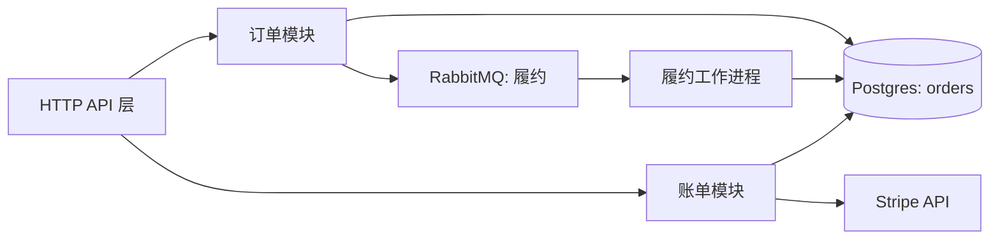
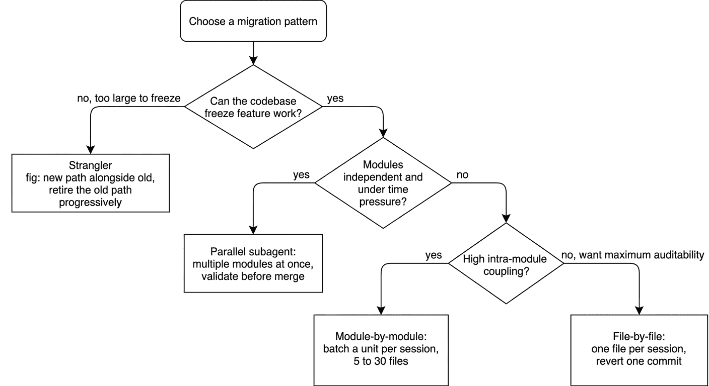

# 代码库迁移与现代化

手动进行迁移工作既繁琐又容易出错。您重命名一个文件，却忘记了三个目录外的一个引用，结果花费一个下午来理清后果。大规模迁移需要 Codex CLI 为特性开发和代码审查带来的那种持续、多步、自主工作的能力。智能工具不会疲劳，不会忘记测试文件中的导入，并能在您审查计划时并行跨数十个模块运行。本章涵盖为什么迁移是 Codex CLI 的高杠杆应用，如何在动手前理解遗留系统，如何构建迁移以使代理保持正轨，以及如何验证结果——从单个批次到单体分解，再到整个语言的重写。

### 学习目标

您将能够：

1.  运行一次只读发现阶段，在更改遗留系统之前生成现代化报告和风险登记册

2.  运行一次 Codex CLI 规划会话，为真实代码库生成一个经过优先级排序、验证过的迁移计划

3.  实现一个批次验证循环，阻止前向推进，直到当前批次通过其测试套件

4.  使用耦合分析、契约优先提取和功能标志路由来分解单体


### 分层验证大规模重写（对等性、合理性、惯用法、安全性、性能），而不仅仅依赖测试

### 为什么 Codex CLI 擅长迁移工作

迁移工作具有四个特性，使其非常适合代理工具。

#### 机械且定义明确

迁移由明确的转换规则定义：将 `React.Component` 替换为函数组件，将 `CLAUDE.md` 重命名为 `AGENTS.md`，将每个 `print` 语句更新为 `print()`。代理在大面积代码库中一致地应用已知规则。模式匹配是优势；创造性即兴发挥则是隐患。精心编写的迁移提示词能约束创造力：“应用此转换；不要重构其他任何内容。”

#### 范围明确

迁移有天然的工作单元：一个文件、一个模块、一个包。该单元完美映射到 Codex CLI 会话。批量处理二十个文件，运行代理，运行测试，提交，继续下一批。有限的范围使上下文窗口保持可控，并为审查和回滚提供了天然的检查点。

#### 可测试

几乎所有有意义的迁移都可以通过运行现有测试套件来验证。如果每批迁移前后测试均通过，则说明转换保留了行为。此原则支撑着下文的验证策略。

#### 可并行化

当模块间不共享可变状态时，可同时迁移它们。Codex CLI 子代理（见第 11 章) 使此具体化：每包生成一个代理，收集结果，验证，合并。两周细致的串行工作压缩为数小时的并行执行，后接聚焦的人工审查。

迁移极少需要新颖性。你决定*如何*迁移；代理大规模执行且不遗漏边缘情况。

### 先理解遗留系统

破坏遗留系统最快的方式，是在弄清它实际做什么之前就开始修改。文档会撒谎，注释会腐烂，而真正重要的行为往往是某下游系统现依赖的未文档化怪癖。在任何转换前，先花一个会话进行纯发现，让代理处于只读模式，以便它在学习时无法修改任何东西。

将 Codex CLI 指向代码库并使用 `-s read-only`，要求其生成现代化报告：用通俗语言描述系统功能，按模块记录实际行为而非设计意图，列出包含真实字段类型的数据模型，并编制技术风险登记册。风险登记册是最有价值的部分。明确要求列出重写易搞错的关键怪癖：日期与时区处理、数值舍入与精度、字符编码、隐式排序、全局可变状态。测试套件极少捕获这些行为，天真重写会悄无声息地改变它们。

```
codex -s read-only "读取此服务并生成现代化报告：
1. 它的业务功能是什么，面向从未见过它的人
2. 按模块行为：每个模块实际做什么，而非其名称暗示什么
3. 数据模型：每个持久化字段、其真实类型及其不变量
4. 风险登记册：日期与时区处理、舍入、编码、排序、全局状态，
   以及每项所在的文件和行号"
```

在此阶段运行现有测试，即使你不信任它们。通过的套件告诉你哪些行为被钉死；单薄的套件告诉你在哪里盲目飞行，需在动手前添加特性化测试。

将所学记录在代理会再次读取的位置：仓库根目录下的 `AGENTS.md`（见第 4 章）。记录约定、可安全修改的模块、不可修改的模块，以及风险登记册中的怪癖。这将部落知识转化为代理每次会话重读的持久指令，使理解在上下文压缩中存活，而非在第十二批次中被重新学习或遗忘。此处也应放置一条直白的安全规则，例如：未经明确批准，不得修改 `src/legacy/billing/` 下的文件。

对于你真正不理解的系统，要求一张图。Codex CLI 可输出模块、数据存储和外部依赖的 Mermaid 架构图，直接在拉取请求中渲染，在第一行代码变更前给团队一张共享地图。

```
codex --profile read-only "将此服务绘制为 Mermaid 流程图。
展示顶层模块、它们读写的数据存储，及任何外部依赖（HTTP API、队列、第三方 SDK）。
标注每条边上的流向。仅输出单个围栏式 mermaid 代码块。"
```

代理读取的是代码而非 README，所以图表反映系统实际行为。典型结果如下：



将该代码块粘贴到拉取请求描述或议题中，GitHub 会将其作为图表内联渲染，无需任何工具。视其为待修正的草稿而非绝对真理：代理从导入和调用点推断图谱，可能遗漏通过动态配置或配置连接的依赖。与了解系统的人一起阅读它，往往是迁移计划中第一个真实缺口浮现的地方。

### 使用 Codex CLI 规划迁移

最差的开始方式是将代理指向代码库并说“迁移所有东西。”代理缺乏关于哪些模块高风险、哪些测试存在、哪些文件是生成而非手写的上下文。

从只读模式的规划会话开始（`sandbox_mode = "read-only"`），要求代理在任何更改前分析代码库。

```
codex --profile read-only "分析此代码库以进行 React 类组件到 Hooks 的迁移。
生成包含以下章节的迁移计划：
1. 文件清单：包含类组件的每个文件，附带行数和测试覆盖率标记
2. 依赖图：哪些组件继承自其他组件，哪些组件在多少处被使用
3. 复杂度分级：高/中/低，附带你的判据
4. 建议批次顺序：按什么顺序迁移哪些文件，从叶子节点开始
5. 风险登记册：转换模棱两可或需要人工决策的任何文件"
```

该单一提示词生成一份可在任何代码变更前审查的文档。它在棘手情况变成 Bug 前将其暴露：使用 `getSnapshotBeforeUpdate` 的类组件，或调用 API 不兼容的第三方库的组件。

将迁移计划保存为仓库根目录下的 `MIGRATION_PLAN.md` 并在任何转换工作开始前提交。它作为范围的权威记录，并可在批次完成时更新作为进度追踪器。

规划会话还验证代理的理解。如果清单遗漏一半组件或包含生成文件，你会在代码变更前发现。

#### 编码转换规则

对计划满意后，将转换规则编码为技能。技能使规则在每个批次中保持一致，防止代理在第十二批次以不同于第一批次的方式解读提示词。


---
name: react-class-to-hooks
description: 将 React 类组件文件迁移为带有 Hooks 的函数组件
allowed-tools:
 - Read
 - Edit
 - Bash
---

将 `$ARGUMENTS` 处的文件从 React 类组件迁移为函数组件。

规则：
- 将 state 转换为 `useState` Hooks
- 转换生命周期方法：`componentDidMount` → `useEffect(fn, [])`，`componentDidUpdate` → 带有依赖项的 `useEffect`，`componentWillUnmount` → `useEffect` 清理函数
- **不要**转换使用 `getSnapshotBeforeUpdate` 的组件——在注释中标记它们并保持原样
- **不要**重构与组件生命周期无关的逻辑
- 完全保留所有 prop types 和默认 props
- 编辑后，运行：`npx tsc --noEmit src/$ARGUMENTS` 以验证类型正确性

将此保存到 `.agents/skills/react-class-to-hooks/SKILL.md`。每个批次会话调用 `/react-class-to-hooks src/components/Button.tsx`，而不是重新解释规则。

### 增量迁移模式

表 21-1 总结了涵盖大多数现实场景的三种模式。你的选择取决于模块耦合度以及你对新旧代码共存期的容忍度。

**逐文件** 是最简单的。将每个文件作为一个单独的会话处理，运行测试，通过后提交。速度较慢但可审计性最高：每次提交对应一个转换后的文件，二分查找总能定位到具体的变更。

**逐模块** 将一个连贯单元（一个包、一个目录、一个功能切片）批量放入单个会话。代理一次性看到模块中的所有文件，有助于在无需猜测的情况下解决跨文件引用。权衡是：失败的批次更难二分查找。当文件紧密耦合且代理需要读取多个文件才能安全转换任意一个时使用此模式。

**绞杀者模式** 适用于无法一次性迁移所有内容的场景，因为代码库太大、迁移破坏性太强，或业务无法接受功能冻结。^(¹⁹¹) 在旧实现旁引入新实现，将新代码路由到新实现，并逐步淘汰旧路径。Codex CLI 在每个阶段都能提供帮助：生成新实现、更新调用点、审计剩余用法。

**并行子代理** 在时间紧迫且模块真正独立时，同时运行多个独立模块。

**表 21-1. 迁移模式决策指南**

| **模式** | **适用场景** | **批次大小** | **回滚成本** |
| --- | --- | --- | --- |
| 逐文件 | 低耦合，高可审计性要求 | 1 个文件 | 最小；还原一次提交 |
| 逐模块 | 高模块内耦合，清晰的模块边界 | 5 到 30 个文件 | 中等；还原一个批次 |
| 绞杀者模式 | 大型代码库，无法冻结功能开发，或可接受部分迁移 | 持续进行 | 低；旧路径始终可用 |
| 并行子代理 | 独立模块，时间压力 | 多个模块同时进行 | 中等；合并前验证 |

绞杀者模式的名字源自绞杀榕，它环绕寄主树生长，最终完全取代寄主，而寄主在过渡期提供结构支撑。Martin Fowler 在 2004 年的一篇文章^(¹⁹²)中推广了该术语；它仍然是软件工程中最有用的迁移隐喻之一。



**图 21.1 - 选择迁移模式**

用于选择增量迁移模式的决策树。第一个决策询问代码库是否可以冻结功能开发；如果不能，选择绞杀者模式。如果可以，下一个决策询问模块是否独立且面临时间压力；如果是，使用并行子代理。否则，最终根据高模块内耦合决定：耦合高则走向逐模块，追求最大可审计性则走向逐文件。

### 迁移过程中的验证策略

核心原则：在前一批次通过测试之前，下一批次不得进行。跳过这条规则，让代理在运行测试套件前迁移十个模块，你就失去了将失败归因于特定变更的能力。迁移就会变成那种已毁掉不止几个工程团队的“大爆炸式”重写。

验证循环如下所示：

```bash
#!/usr/bin/env bash
#### migrate-batch.sh — 运行迁移批次并以测试为门控
set -euo pipefail
BATCH_FILE="$1" # 列出本批次要迁移路径的文件
while IFS= read -r filepath; do
 echo "迁移中: $filepath"
 codex --profile migration "/react-class-to-hooks $filepath"
done < "$BATCH_FILE"
echo "运行测试套件..."
npm test -- --passWithNoTests
if [ $? -eq 0 ]; then
 git add -p
 git commit -m "chore: migrate batch $(basename "$BATCH_FILE" .txt) to hooks"
 echo "批次已提交。"
else
 echo "测试失败。回滚批次。"
 git checkout -- .
 exit 1
fi
```

有三个细节值得注意。脚本使用 `git checkout -- .` 进行回滚；如果你想在丢弃前检查失败状态，请改用 `git stash`。它以 `npm test` 为门控，所以你需要在开始前拥有一个全绿的测试套件：预先存在的失败会使新的回归变得不可见。它在批次边界而非文件边界提交；调整粒度以匹配你的可审计性需求。

**不要**在测试套件失败的代码库上运行迁移批次。你需要一个绿色基线来检测回归。如果套件不全绿，先修复预先存在的失败并单独提交该修复，以便清晰地归因。

对于类型检查的代码库，在测试套件前添加类型检查。TypeScript 迁移常产生通过运行时测试但无法通过编译器的代码：

```bash
npx tsc --noEmit && npm test
```

对于有 lint 的代码库，添加 linter。匹配你的 CI 流水线强制执行的相同门控；如果 CI 能捕获，你的本地循环应先捕获。

#### 快照测试与迁移安全

快照测试值得特别关注。捕获渲染 HTML 的快照在类转 Hooks 迁移后会失败，即使行为完全相同，因为内部表示发生了变化。在开始前决定是自动更新快照 (`jest --updateSnapshot`) 还是将失败视为阻断项。答案取决于你的快照是行为契约还是附带的实现工件。在迁移计划中明确这一区别。

### 框架与语言版本迁移

同样的模式适用于框架和语言版本迁移，以下三例说明这一点。

**React 类组件到 Hooks。** 本章的激励示例。转换规则定义明确，测试套件提供强有力的验证，叶子优先的批次顺序使工作易于管理。主要的人工决策是处理没有直接 Hooks 等价物的生命周期方法（`getSnapshotBeforeUpdate`、`getDerivedStateFromError`）。代理会标记这些而不是猜测；上述技能定义编码了该约束。

**Python 2 到 Python 3。** `2to3` 工具^(¹⁹³) 处理机械转换。Codex CLI 在周边工作中增值：分析哪些包缺乏 Python 3 支持、生成更新后的 `requirements.txt` 条目、更新 CI 配置，并重写 `2to3` 处理不当或过于保守的惯用语。先运行 `2to3`，然后用 Codex CLI 处理残留情况。使用 `python -m pytest` 验证，对于有类型的代码库，使用 `mypy`。


#### 从 AngularJS 迁移到 Angular

**从 AngularJS 迁移到 Angular。** 由于两个框架在架构上不兼容^(¹⁹⁴)，因此必须采用“绞杀无花果”迁移模式；大规模重写一个庞大的 AngularJS 应用程序极少可行。智能体为每个 AngularJS 组件生成 Angular 的等效实现，更新路由器以将新 URL 导向 Angular，而旧版 URL 保留在 AngularJS 上，并审核旧版代码库以查找剩余依赖项。验证较少依赖单元测试（旧版 AngularJS 应用程序往往缺乏测试），而更多依赖针对正在运行的应用程序进行的端到端测试。请在开始前投资构建这些测试。

对于语言版本迁移，请将目标版本的静态分析工具（如 `pylint`、`tsc --strict` 或 `eslint`）作为验证循环的一部分运行。这些工具能捕获一类完整的错误，而仅测试“快乐路径”的测试套件会漏掉这些错误。

共同点在于：智能体处理规模与一致性；你处理歧义与判断。定义规则，审查标记出的案例，做出规则无法处理的决策。

### 解构单体架构

将单体架构拆分为服务是“绞杀无花果”模式在最大规模上的应用，同样的原则适用：先理解，再增量提取，并保持旧路径存活，直到新路径被证明可行。Codex CLI 在人类觉得繁琐的两端帮助最大：寻找接缝和证明一致性；在中间环节帮助最小，那里需要你的架构判断。

#### 通过依赖分析寻找接缝

**通过依赖分析寻找接缝。** 让智能体以只读模式映射模块级依赖，并按耦合度对候选服务进行排序：入站和出站依赖计数、共享数据表以及任何循环依赖。

最佳试点是低耦合且具有清晰数据边界的模块，而不是导致痛苦最多的模块。一个读写另外三个模块也会触及的表的模块，不是服务边界；它是个陷阱。数据库所有权是最严格的测试：如果两个候选服务都需要写入同一张表，那么边界划分就是错的。

#### 先定义契约，后实现代码

**先定义契约，后实现代码。** 让智能体在编写任何服务代码之前，先生成被提取服务的 API 契约——一份 OpenAPI 文档。可审查的契约能在错误代价最低时捕获边界错误，并成为实现代码及其测试所依据的规范。这是本章前面提到的规划原则在服务层面的应用：契约即计划。

#### 通过可切换的接缝进行路由

**通过可切换的接缝进行路由。** 在路由层（API 网关或反向代理）后提取服务，该层将试点的端点发送给新服务，将其他所有内容发送给单体架构。将开关置于功能标志后面，以便你可以切换一小部分流量过去，观察其表现，并能在无需重新部署的情况下即时回滚。在新服务赢得流量之前，单体架构仍是事实来源。

验证原则不变；只是强度升级。每个被提取的端点在接管真实流量前，必须针对新服务运行并通过单体架构现有的集成测试。解构增加了活动部件；测试关卡正是阻止活动部件增加事故的关键。

### 超越测试通过：验证大规模重写

对于迁移到新语言或平台的场景，测试套件全部通过是必要但不充分的条件。智能体可以忠实地复现行为，却仍可能让目标代码库充斥着“逃生舱口”：破坏类型系统的类型转换、破坏借用检查器的 `unsafe` 代码块、破坏失败模型的被吞没的错误。测试通过是因为行为正确；代码不健全是因为翻译过于字面化。大规模机器辅助重写的公开案例清晰地展示了这一模式：一个几乎逐行复现源代码的重写发布了数千个 `unsafe` 代码块，而一个为目标语言重新设计的同类工具则将其控制在极少数。^(¹⁹⁵) 测试同样通过，代码却截然不同。

这种差距源于两种策略的区别，你应在开始前慎重选择。*音译* 保留原始架构并逐语句翻译；速度快、易于与原代码对比，但会整体引入源语言的惯用语，并以不健全为代价。*重新设计* 以目标语言的惯用方式重建每个模块；速度较慢、难以与原代码对比，但产出的代码能受目标语言工具链的保护。将该选择编码为智能体遵循的规则，并为“逃生舱口”设定显式预算，例如每千行代码 `unsafe` 或 `any` 的上限，使策略成为可度量的指标而非愿景。

分层验证，每一层捕获其下一层无法捕获的问题：

1.  **行为一致性。** 现有测试套件针对重写代码通过。这是底线，而非上限。

2.  **类型与内存健全性。** 运行目标语言提供的最严格类型检查和 lint 设置，并根据预算统计“逃生舱口”数量。一个运行类型检查器的 `PostToolUse` 钩子（*第 9 章*）可在写入后立即捕获回归，而非在最后才发现。

3.  **惯用性。** 让一个单独的只读审查智能体根据目标语言惯用语检查翻译后的文件：错误处理、标准库使用，以及标记代码为原生而非音译的模式。

4.  **安全与供应链。** 审计新的依赖集、信任边界，以及每个“逃生舱口”的辩护性注释。重写也是全新的依赖树，该树需要 *第 16 章* 级别的审视。

5.  **性能。** 将基准测试套件与原版对比。功能正确性可能掩盖严重退化，“用更快的语言重写”不等于“它更快”。

这一原则推广到语言翻译之外：每当智能体产生大量看似合理、测试通过的变更时，一致性是最廉价但也最不充分的验证属性。从健全性到性能的其余层级，才是将“可信赖的重写”与“仅仅能跑通的重写”区分开来的关键。

### 总结

1.  **迁移适合智能体执行。** 它们具有机械性、边界明确、可测试、可并行化等特性，这些特性完美契合 Codex CLI 管理上下文和执行任务的方式。

2.  **先理解，后变更。** 运行只读发现阶段，产出现代化报告和风险登记表，记录承载重任的怪癖（日期、舍入、编码、排序、全局状态），并将发现记录在 `AGENTS.md` 中，以便跨会话保留。

3.  **从只读规划会话开始。** 智能体对代码库的分析（文件清单、依赖图、复杂度分级和批次顺序）是你在任何代码变更前审查和批准的文档。

4.  **三种模式覆盖大多数迁移。** 逐文件迁移以实现最大可审计性，逐模块迁移以处理紧耦合模块，绞杀无花果模式适用于无法完全冻结功能开发的大型代码库。

5.  **以测试为门控前向进度。** 在前一批次通过测试前，下一批次不得进行。将此门控编码在 Shell 脚本中，而非寄希望于美好意愿。

6.  **框架迁移遵循相同模式。** React 类组件到 Hooks、Python 2 到 3、AngularJS 到 Angular 皆可遵循。定义转换规则，将其编码为技能，通过完整的 CI 关卡验证，并将人类注意力保留给智能体正确标记出的模糊案例，而非猜测。


# 7. 分解单体应用即大规模扼杀无花果

通过耦合分析寻找切分缝隙，在实现之前先定义每个服务的契约，通过可切换的功能开关网关进行路由，并将每个抽取出的端点保持在单体应用现有的集成测试之下。

# 8. 通过的测试套件并非合理重写的证明

有意识地选择音译或重新设计，为 `unsafe` 和 `any` 等“逃生舱”预算，并分层验证：功能对等、类型与内存安全、语言习惯用法、安全与供应链、以及性能。

**另请参阅：** *第 8 章* **(MCP)。** 本章将 Codex CLI 应用于其擅长处理的高杠杆工程问题之一。*第 8 章* 探讨模型上下文协议连接，Codex CLI 在此既消费又暴露 MCP 端点，从而实现与您迁移后的代码库所依赖的工具和服务的更丰富集成。

### 练习

1.  **在真实代码库上运行规划会话。** 在您组织中寻找一个包含类组件、使用旧版 API 或存在其他明确迁移机会的 JavaScript 或 TypeScript 项目。以只读模式运行 Codex CLI，提示词要求提供文件清单、依赖图、复杂度分级和建议的批次顺序。审查输出：代理的分析在哪些地方与您的直觉相符？哪些地方让您感到意外？提交生成的 `MIGRATION_PLAN.md`。

2.  **实现批次验证循环。** 将“迁移过程中的验证策略”部分中的 `migrate-batch.sh` 脚本适配到您项目的测试运行器和提交规范中。针对迁移计划中复杂度最低的批次运行它。验证故意引入的错误（重命名函数以破坏测试）会导致脚本回滚而非提交。

3.  **为您的代码库设计复杂度分级分析。** 在运行任何迁移之前，您需要了解要迁移什么。编写一个以只读模式运行的 Codex CLI 提示词，为与您的代码库相关的特定迁移类型（例如 API 版本升级、依赖替换、编码模式现代化）生成复杂度分级评估。评估应将文件分为至少三个等级（简单、中等、复杂），并为每个等级提供明确的标准。通过人工审查每个等级中的五个文件来评估分级分配的质量。

4.  **验证迁移批次回滚。** 为单个迁移批次实现本章中的“测试失败时回滚”模式。设置带有故意测试失败（在批次中破坏一个测试）的验证循环，并验证脚本会回滚整个批次而非提交部分更改。然后修复测试并重新运行，确认批次成功提交。记录该回滚模式所防范的具体故障模式。

5.  **运行遗留代码考古排查。** 选取一个不熟悉的或遗留的模块。在 `-s read-only` 模式下，让 Codex CLI 生成一份现代化报告，涵盖通俗易懂的行为描述、逐模块行为、数据模型，以及日期、舍入、编码、顺序和全局状态怪癖的风险登记册。将排名前三的风险作为约束添加到 `AGENTS.md` 中，然后勾勒出如果您重写该模块将运行的分层验证（对等性、安全性、习惯用法、安全、性能）。


