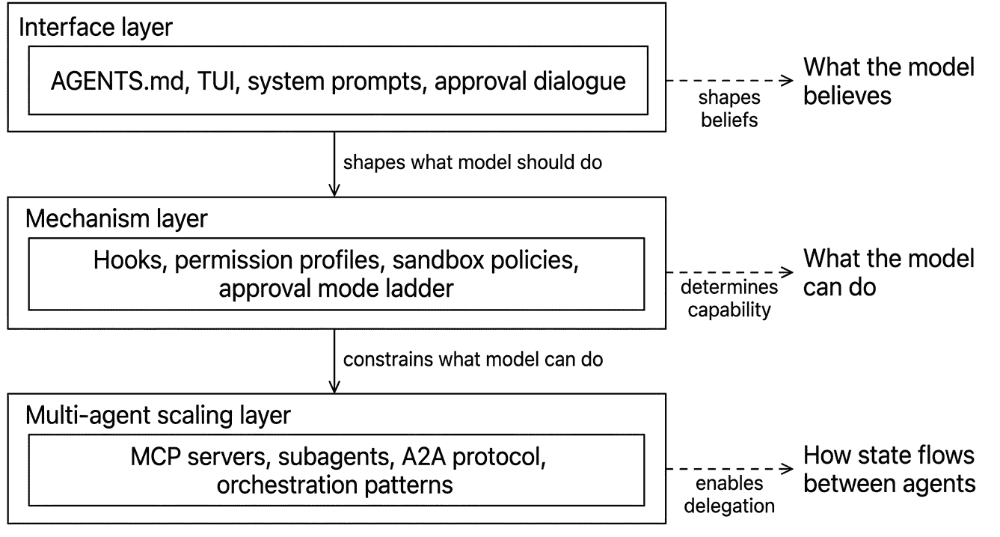

# 第二十七章：为长期运行智能体构建工程护架

前几章为您提供了词汇：工具、移交、护栏、上下文窗口。但仅有原语不足以构成生产系统。锤子和水平仪是建房子的必要工具，但并不充分。缺失的是一切随时间推移将建筑凝聚在一起的东西：保障工人安全的脚手架、经得起真实工况考验的计划，以及在错误变成承重结构前捕捉它们的检查点。在智能体工程中，这种脚手架被称为**护架（harness）**。本章涵盖什么是护架、如何从第一性原理构建护架、当前可添加到 Codex CLI 护架的组件、大规模展示模式的参考实现（其中主要是 Symphony，OpenAI 的开源护架），以及证明是护架而非模型驱动结果质量的证据。

### 学习目标

您将能够：

1.  解释什么是护架，并使用三层框架和三大支柱阐述为什么是护架而非模型决定了结果质量
2.  根据三大支柱（密封测试、机器可读文档、模块化架构）审计代码库，并找出迫使智能体进行猜测的因素
3.  设计一个 `WORKFLOW.md` 文件，同时捕获 Codex 智能体的运行时参数和行为策略
4.  实施基于检查点的状态持久化策略，使您的智能体能在中断后恢复，而无需重复已完成的工作
5.  将工作量证明原则应用到您自己的流水线中，无论您是否使用 Symphony
6.  选择适合您规模的护架组件和编排模式，并论证为什么应在切换模型前先改进护架

### 什么是护架工程

Ryan Lopopolo 于 2026 年 2 月创造了该术语[²⁵⁰]，为从业者早已在做却缺乏共同词汇的事情命名。传统软件工程设计代码。提示词工程设计给 AI 的指令。护架工程设计使 AI 智能体可靠高效的基础设施、约束和反馈回路。它位于上述两者之上一层。Lopopolo 用一句话总结道：“智能体不难；护架才难。”[²⁵¹]

护架是包裹智能体的一切：描述项目的 `AGENTS.md`、提供确定性反馈的测试套件、限制爆炸半径的沙箱、验证输出的 CI 流水线、决定何时必须人工干预的审批策略，以及让多小时任务能在瞬时故障中存活的检查点逻辑。当您的护架设计良好时，一个强大的模型就能高置信度地自主完成任务。当它设计不良时，即使是最好的模型也会陷入挣扎。

如果您已学完第四部分，您其实早就在做护架工程了。每一次 `AGENTS.md` 的完善、密封测试套件、`PostToolUse` 静态检查钩子和 `codex exec` CI 配置集都是护架工作。本章增加的是原则性模型：每个护架必须满足的三大支柱、解决特定失效模式的模式，以及使智能体策略可审计和版本控制的格式。

#### 学术基础：三层框架

2026 年 5 月，一篇由 42 位作者撰写的综述论文（“Code as Agent Harness”，arXiv 2605.18747）首次利用三层架构框架对编码智能体进行了严谨的学术处理。[²⁵²] 该论文的核心论点——“护架拥有循环”——验证了从业者经验性发现的事实：模型是一个组件；护架决定结果质量。

三层分别为：

1.  **接口层。** 智能体如何接收指令并呈现结果。在 Codex CLI 中，这包括 `AGENTS.md`、TUI、系统提示词和审批对话框。接口层塑造模型*认为*它应该做什么。

2.  **机制层。** 约束和启用智能体行为的要素。钩子、权限配置集、沙箱策略、执行策略规则和审批模式阶梯。机制层决定模型*能*做什么，无论它认为应该做什么。

3.  **多智能体扩展层。** 智能体如何跨边界协作。MCP 服务器、子智能体、A2A 协议，以及像 Symphony 的 `WORKFLOW.md` 这样的编排模式。扩展层决定一个智能体能否委派给其他智能体，以及状态如何在它们之间流动。



**图 27.1 - 三层护架框架**

接口层（`AGENTS.md`、TUI、系统提示词和审批对话框）塑造模型*认为*它应该做什么；机制层（钩子、权限配置集、沙箱策略和审批模式阶梯）决定它*能*做什么；多智能体扩展层（MCP 服务器、子智能体、A2A 协议和编排模式）管控状态如何在智能体间流动。每一层都约束其下方的一层。

这些层共同表达了论文的论点：是护架而非模型拥有循环并驱动结果质量。将 Codex CLI 的架构映射到该框架，使本书的结构作为护架工程课程变得清晰可辨：

| 框架层级 | Codex CLI 原语 | 书籍章节 |
| :--- | :--- | :--- |
| 接口层 | `AGENTS.md`、系统提示词、TUI、计划模式 | 第 3、4、7 章 |
| 机制层 | 钩子、权限配置集、沙箱、审批模式 | 第 5、9、16 章 |
| 多智能体扩展层 | MCP 服务器、子智能体、技能、exec 流水线 | 第 8、10、11、12、15 章 |

该论文还调查了多个平台（在一份互补的 dev.to 从业者分析中），跨多个评估维度发现，护架工程决策而非模型选择占了实际结果差异的大多数。[²⁵³] 使用相同模型但不同护架的两个智能体产生了显著不同的结果。使用不同模型但相似护架架构的两个智能体在质量上趋于相似。护架是自变量。

这一发现重构了团队评估智能体工具的方式。问题不是“哪个模型最好？”，而是“哪个护架为我的约束做出了最佳工程选择？”第 26 章将这一视角应用于竞争格局。

#### 三大支柱


以下几个模式都借鉴了 **Symphony**，因此在依赖它之前，有必要清楚地说明它是什么。**Symphony** 是 OpenAI 开源的参考级编排工具：它从问题追踪器获取议题，在隔离工作区中为每个议题运行一个 **Codex CLI** 代理，仅当代理产出可验证的工作量证明后，才向人类提交拉取请求。本章后面（“Symphony：编排工具的实践”）将详细剖析其架构；在此之前，请将其视为本章讨论原则的一个具体、可工作的示例。

每个生产级编排工具都建立在三大支柱之上，**Symphony** 的文档对此有明确阐述。^(²⁵⁴)

**隔离测试** 意味着你的测试套件能在本地可靠运行，且无外部依赖。运行 `npm test` 并获得确定性结果的代理可以独立迭代。依赖预发布数据库或实时 API 的代理会陷入挣扎，无法区分真正的回归和环境故障。修复方法是众所周知的：模拟外部服务、播种测试数据库，并使每个测试都能通过单条命令离线运行。

**机器可读文档** 意味着代理无需询问即可发现如何构建、测试、检查和部署你的项目。`AGENTS.md` 是主要载体（见 第 4 章），但该原则延伸至代理可能需要的任何结构化制品，例如具有命名目标的 `Makefile`、具有可预测名称的 `package.json` 脚本，或遵循一致格式的 `README` 章节。如果代理必须猜测，就会消耗 Token 并引入错误。

**模块化架构** 意味着副作用被局部化且边界显式。修改支付模块的代理不应无意中破坏通知服务。高耦合导致正确性不确定性；低耦合让代理能在有界范围内自信工作。这与优秀架构主张的领域分离是同一论点，但自主代理比人类开发者对它更敏感，因为人类可以提出澄清性问题。**Codex CLI** 本身即构建为大型多箱工作区，每个箱拥有独立的编译单元、依赖图和测试套件。（撰写时 **Codex CLI** 仍处于 1.0 版本前；具体箱数量随持续发布而变化。）这是应用于工具自身的编排工程：将模块化架构推向极致，从而实现并行编译、隔离测试和更清晰的依赖审计。使代理任务易于处理的原则，同样让编排工具链更易维护。

### WORKFLOW.md 模式

你在本书中一直使用的 `AGENTS.md` 是一份静态文档：它描述项目及其约定，且在运行间不会改变。`WORKFLOW.md` 由 **Symphony** 引入，^(²⁵⁵) 是一种更强大的模式，将两样东西合二为一。

YAML 前置元数据是运行时配置：模型选择、轮次限制、集成端点和所需的工作量证明制品。Markdown 正文是代理的系统提示词，以兼容 Liquid 的模板编写。运行时，编排工具利用议题特定上下文（工单标题、仓库、分支、受保护文件）渲染模板，并将结果作为初始指令传递。

```
---
model: gpt-5.5
max_turns: 40
issue_tracker: linear
workspace_mode: isolated
proof_of_work: [ci, review, complexity]
---
#### Markdown 正文 — 兼容 Liquid 的提示词模板
You are implementing {{ issue.title }}.
Context:
{{ issue.description }}
Repository: {{ repo.name }}
Branch: {{ branch_name }}
Rules:
- Run the full test suite before marking done
- Do not modify {{ protected_files }}
- Write tests for any new functions
```

这种结构含义值得深思。代理行为现为版本化的仓库制品。你可以跨版本对比代理策略，回滚引入 Bug 的行为变更，并在将变更推广至生产前要求拉取请求审查。代理指令受同一治理约束，因为它们与应用代码处于同一仓库。

即使你未使用 **Symphony** 完整的编排层，也可在自己的流水线中采用此文件格式。**Codex CLI** `exec` 调用可使用任意 YAML 解析器读取 YAML 前置元数据，用兼容 Liquid 的引擎渲染正文（例如 Python 的 `python-liquid`，或若你用 Jinja 重写模板则用 `jinja2`），并将结果作为系统提示词传递。你无需 Elixir 依赖即可获得所有版本控制优势。

将 `WORKFLOW.md` 置于仓库根目录，与 `AGENTS.md` 共存。两个文件均记录代理策略；评估代理为何表现异常时，两者都应被审查。

#### 代理运行间的状态持久化

长时间运行的代理可能被中断。网络超时、进程重启、预算限制和 CI 运行器回收都可能导致代理在任务中途终止。状态持久化让代理能从最后一个安全检查点恢复，而非重头开始。有三种粒度级别可供选择；正确选择取决于任务时长和成本。

**会话 ID 恢复** 是最轻量的方法。**Codex CLI** 为每次对话分配一个会话 ID。持久化该 ID 并通过 `/resume` 或向下次调用传递标识符来恢复；代理将从中断处继续。局限性在于：会话上下文在运行期间驻留内存，若进程在 ID 记录前退出，则会丢失。

**检查点文件** 适用于有明显阶段的任务。编排工具写入检查点，记录已完成阶段及其产出。重启时，它读取检查点并指示代理从记录的阶段继续。格式为纯 JSON，易于检查、重演和归档。

```
{
 "issue_id": "ENG-4821",
 "branch": "fix/auth-token-expiry",
 "phases_completed": ["diagnosis", "implementation"],
 "phases_remaining": ["tests", "documentation"],
 "artifacts": {
 "diagnosis": "Root cause: JWT expiry check off by one in token_service.py line 147",
 "implementation": "Patch applied to token_service.py, session_manager.py"
 },
 "last_updated": "2026-03-26T14:23:11Z"
}
```

**数据库支持的状态** 适用于并发运行许多代理、需要将其进度作为舰队进行查询、监控或管理的场景。**Symphony** 采用此法：每个代理的状态是 Postgres 表中的一行，编排器查询该表以分派新工作、检测停滞代理并汇总完成度指标。^(²⁵⁶) 对单团队而言这可能过度设计；但对运行数十个代理处理共享积压工作的组织，这是唯一能扩展的方法。

无论选择哪种持久化策略，请确保检查点格式包含模式版本字段。代理流水线会演进，当格式变更时你需迁移现有检查点。检查点存储中缺少版本字段是技术债，终将以生产事故形式显现。

#### 错误恢复与重试

状态持久化告诉你代理失败时在何处。错误恢复决定下一步做什么。三种模式对应三类故障。

**指数退避重试** 处理瞬时故障：限流、临时网络错误、二次尝试即通过的易失性测试。编排工具捕获失败，等待随重试次数增长的退避间隔，并用相同输入重新调用代理。最大重试次数和退避上限应可在 `WORKFLOW.md` 前置元数据中配置；将其硬编码是造成流水线僵化的常见错误。


#### 人工介入升级

**人工介入升级** 用于处理需要智能体无法提供的判断力的失败情况：需求模糊、约束冲突，或测试失败可能意味着真正的回归或测试本身有问题。工具框架通过 `Linear`、`Slack` 或 `GitHub` 向人工呈现失败信息，并附带足够的上下文以解除智能体的阻塞。目标是将升级次数降到最低，而非完全消除。

#### 回滚模式

**回滚模式** 用于处理必须在重试前撤销部分已应用更改的情况。如果智能体以原子方式提交（每次提交对应一个逻辑变更），工具框架即可识别出错误提交，将其还原，并干净地重新开始。混合了正确与错误工作的整体式提交则难以回滚得多。

不要实现吞没错误信息的静默重试循环。每次重试都应记录失败原因、重试次数和退避间隔。一个在成功前静默重试失败操作二十次的智能体消耗了二十倍的预算；一个静默重试最终却放弃的智能体一无所获且毫无反馈。在无人值守操作中，可观测性不是可选项。

#### 工作量证明原则

Symphony 中最重要的架构理念，也是最适用于任何流水线的理念，是**工作量证明**：智能体必须通过可验证的证据来证明完成，而不仅仅是报告“已完成”。[¹]

问题在于根本的信任鸿沟。当智能体报告完成时，除非验证内置于循环中，否则你只能听其片面之词。智能体可能自信地犯错：通过无法覆盖相关用例的测试、产出包含微妙逻辑错误的代码，或实现了与需求相邻但不完全一致的功能。

在向人工审查者呈现拉取请求前，Symphony 要求提供四种形式的证据：

1.  **CI 通过：** 所有测试在 CI 流水线中通过，而非仅在本地通过
2.  **审查反馈：** 自动化代码审查分析，识别任何潜在问题
3.  **复杂度分析：** 代码变更规模与复杂度指标
4.  **演示视频：** 记录变更内容及原因的视频

演示视频往往让人惊讶。它迫使智能体讲述自己的工作：所理解的问题、采取的方法、证明方法成功的证据。这种叙述本身就是一种质量信号；一个无法清晰解释自己做了什么的智能体，很可能没有充分理解它。

你不需要 Symphony 即可应用此原则。在 `Codex CLI` 工作流中：在每个子智能体的指令末尾加上“标记完成前必须运行测试”的要求；编写一个 `PostToolUse` 钩子查询 CI API，若流水线未通过则拒绝继续；要求会话结束前必须产出结构化的变更摘要作为强制产物。

核心原则是：智能体应是可问责的行动者，而非黑盒。问责需要证据，而证据需要一个工具框架，使产出证据成为智能体职责描述的一部分。

### 今日即可添加的工具框架组件

前述模式属于架构层面。以下是可立即接入 `Codex CLI` 工具框架的具体组件，每个组件填补一个特定的操作缺口：模型运行位置、工具隔离方式、变更审查方式、工具框架的程序化驱动方式、组件在生态间的迁移方式，以及将智能体嵌入产品时的变化。

#### 作为工具框架组件的本地模型提供商

完全依赖云模型端点的工具框架继承了单点故障，且成本基线随智能体并发数线性增长。在 `[model_providers]` 下通过 `config.toml` 配置的本地模型提供商（`Ollama`、`vLLM`、`llama.cpp`）为特定工具框架层级提供了替代方案。`wire_api = "responses"` 设置确保本地提供商遵循与云端点相同的 API 契约，从而工具框架的其余部分（提示词、工具、审批策略）保持不变。配置文件切换（`--profile local` 与 `--profile cloud`）让工具框架操作员可在不修改工具框架本身的情况下按运行选择后端。

本地提供商最适合一级和二级任务：机械性编辑、代码库探索和格式化遍历，此时本地模型与前沿模型的质量差距最小。对于需要深度推理或长程规划的三级工作，云端点仍是合适的后端。该决策应由工具框架操作员的配置文件选择决定，而非工具框架定义本身。当本地层级使用的是自购而非租赁的硬件时，*第 14 章* 详述了决定是否划算的本地化部署盈亏平衡点。

#### 用于工具框架级隔离的 Docker MCP 工具包

在开发者机器上将 MCP 工具服务器作为裸露的 `npx` 或 `pip` 进程运行，会引入依赖冲突、凭据蔓延，且智能体与宿主机之间零隔离。Docker 的 MCP 工具包在工具框架层面解决了此问题：将 200 多个经过验证的 MCP 服务器打包为容器镜像，由单个网关进程前置，处理路由、凭据注入和资源限制。[²]

网关是单个 `stdio` 进程。内部按需将工具调用路由到容器化服务器，每个服务器运行在自己的命名空间中，具有受限特权（无宿主机文件系统访问、1 CPU、2 GB 内存上限）。响应在返回客户端前会被扫描以防止机密泄露。

工具框架相关性在于配置文件管理。Docker 配置文件为工作流分组 MCP 服务器，并可作为 OCI 制品共享。提交一个引用配置文件的 `.codex/config.toml`，即可让每位开发者获得相同的、隔离的工具访问权限。对于 CI，网关作为 `GitHub Actions` 中的服务容器运行，使 `codex exec` 在无头模式下拥有相同工具。将 `startup_timeout_sec` 设置为至少 30 秒，因为完整目录可能超过 Codex 默认的 10 秒握手超时。

原生 MCP 服务器适用于简单、单工具、高信任度的设置。当你的工具框架需要隔离、凭据管理或团队标准化时，Docker MCP 工具包是正确的选择。[³]

#### 内置代码审查技能

`Codex CLI` 提供内置代码审查技能，减少了对自定义审查工具的需求。没有它，工具框架作者需自行连接外部工具：用于静态分析的独立 MCP 服务器、调用审查智能体的自定义钩子，或第三方 `GitHub Action`。

内置技能根据 `AGENTS.md` 约定分析暂存或已提交的变更，并产出结构化反馈。对工具框架工程师而言，这意味着少了一个外部依赖；工作量证明流水线中的审查步骤引用的是随 `Codex CLI` 自带的能力。特定领域的规则或合规性检查可能仍需专用工具，但对于人工签收前的通用代码质量把关，内置技能更简单且易于维护。

#### 用于自定义工具框架客户端的 App Server JSON-RPC

`Codex App Server` 将智能体核心与其客户端界面解耦。每种 `Codex CLI` 体验（CLI TUI、VS Code 扩展、桌面应用、Web 界面、IDE 集成）均通过单一的双向 `JSON-RPC 2.0` API 通信。[⁴] 对工具框架工程师而言，这是自定义前端和编排层的集成点。

该协议通过三个原语构建交互：Items（原子输入/输出单元）、Turns（一个智能体工作单元产生的 Item 序列）和 Threads（支持创建、恢复、分叉和归档的持久会话容器）。提供两种传输方式：用于本地集成的 `stdio`（`codex app-server`，受支持的默认方式），以及用于具有 `/readyz` 和 `/healthz` 健康检查的远程场景的 WebSocket 传输（`codex app-server --listen ws://127.0.0.1:4500`，撰写时为实验性）。

[¹]: 脚注 257
[²]: 脚注 258
[³]: 脚注 259
[⁴]: 脚注 260


Harness 应用场景包括：订阅 `turn/completed` 通知以追踪 Token 使用的仪表盘、使用具有沙箱隔离功能的 `command/exec` 的 CI/CD 编排器、以及拦截 `requestApproval` 通知的企业审批网关。可使用 `codex app-server generate-ts` 或 `codex app-server generate-json-schema` 生成类型安全的客户端绑定。^(²⁶¹)

对于已超越封装 `codex exec` 的 Shell 脚本阶段的 Harness 作者而言，App Server 协议是用于程序化智能体控制的稳定、语言无关的基础。

#### 跨工具 Harness 可移植性

`cc-plugin-to-codex` 反向桥接（见第 26 章）使得 Harness 组件能在智能体生态系统之间实现部分可移植性。^(²⁶²) 打包在 Claude Code 插件中的 `PostToolUse` 密钥扫描 Hook 可通过 `cc2codex` 转换为 Codex 原生 Hook，反之亦然，可通过 `codex-plugin-cc` 实现。对于运行多智能体 Harness 的组织（Codex 用于 CI/CD，Claude Code 用于调试），这意味着共享而非重复。转换过程是有损的且需要验证，但它指向了组件层面的工具无关 Harness 工程化。

#### SaaS 就绪性与生产环境嵌入

如果您的 Harness 旨在将 Codex CLI 嵌入多租户 SaaS 产品中，而非服务于单个工程团队，则工程需求会发生变化。对六个生产嵌入维度（架构、SDK 可用性、会话管理、MCP 可扩展性、气隙能力和许可证）上十一款 CLI 智能体的评估，将 Codex CLI 置于第 2 梯队（可嵌入但有注意事项），落后于提供内置会话存储和宽松许可证的 OpenCode 和 Pi/OpenClaw 等工具。^(²⁶³) 对 Harness 作者最相关的差距是会话持久化（Codex CLI 基于 stdio 的 JSONL 方法要求您自行构建持久化层）以及面向气隙企业环境的离线模型支持。

在确定嵌入架构之前，请验证在多租户负载下会失效的五个关键点：子进程与库集成、结构化事件流、并发请求下的租户隔离、模型 BYOK（自带密钥）支持、以及沙箱逃逸边界。^(²⁶⁴)

### 实战中的 Harness

有了支柱、策略格式和组件在手，通过查看组装它们的完整 Harness 会有所帮助。两个开放系统处于设计空间的不同位置，决策指南将您的情况映射到适合的模式。

#### Symphony：参考实现

Symphony^(²⁶⁵) 是 OpenAI 大规模 Harness 工程的开源参考实现。其架构将抽象模式具体化。

Linear 看板上的 Issue 进入“Ready for Agent”状态。Symphony 轮询、拾取符合条件的 Issue、创建隔离的按 Issue 工作区、生成一个以渲染后的 `WORKFLOW.md` 作为系统提示词的 Codex CLI 智能体，并让智能体工作。在所需的工作量证明工件完成之前，没有任何内容会呈现给人类。随后，人类审查一个由 CI 状态、代码审查分析和演示视频支持的拉取请求：验证过的结果，而非受监督的过程。

Symphony 基于 Erlang/BEAM 运行时使用 Elixir 构建。^(²⁶⁶) 这一选择反映了问题的需求：BEAM 可处理数千个轻量级并发进程，因此运行五十个并行的 Codex CLI 智能体在操作层面类似于运行五个。OTP 监督树意味着单个失败的智能体会自动重启而不影响其他智能体。且 BEAM 专为长时间运行的进程设计；耗时数分钟或数小时的智能体是原生用例，而非压力测试。

撰写时，Symphony 处于工程预览阶段，存在有意义的限制：它支持 Linear 但不支持 Jira 或 GitHub Issues，每个 Issue 运行单个智能体且不支持内部子智能体生成，且定制化需要 Elixir 知识。对于大多数团队而言，它作为参考架构比作为生产依赖更有用。

Symphony 的 `SPEC.md` 阐述了为何使用隔离工作区而非共享环境、为何采用工作量证明而非逐步审查、以及为何选择 Elixir 而非 Python。详见 [github.com/openai/symphony](http://github.com/openai/symphony)。

**另请参阅：** 第 13 章。Symphony 的按 Issue 工作区是 Git worktree。第 13 章 涵盖了并行工作的创建、会话上下文分配和清理。

#### NanoClaw：持久编排参实现

Symphony 是面向批处理的 Harness（拾取 Issue、处理、交付 PR），而 **NanoClaw**^(²⁶⁷) 代表持久编排模式：一个常驻的智能体编排器，维护任务注册表、调度周期性工作、管理容器隔离的工作池，并通过基于通道的消息传递进行通信。

其架构演示了若干补充 Symphony 批处理模式的模式：

1.  **持久化调度。** 任务可按间隔、每 8 小时或每天上午 8 点调度，而非由外部事件触发。这支持主动工作流：每夜代码质量扫描、每日文档新鲜度检查、每周依赖审计。
2.  **容器隔离。** 每个 Worker 在自己的容器中运行，提供比仅用 worktree 更强的隔离。行为异常的智能体无法影响其他 Worker 或编排器。
3.  **基于通道的通信。** Worker 通过结构化消息通道与编排器通信，而非共享状态，实现了难以通过基于文件系统的方法达成的协调模式。
4.  **任务生命周期管理。** 任务可在不丢失状态的情况下暂停、恢复、取消和重新优先级排序。这对跨越数小时或数天的长期工作流至关重要。

NanoClaw 并非 Symphony 的替代品；它占据设计空间的不同位置。Symphony 擅长带有工作量证明门控的 Issue 驱动批处理工作流；NanoClaw 擅长持久的、调度驱动的持续运行。许多生产部署将针对不同类别的工作同时使用这两种模式。

#### 选择模式：您自己的 Harness 应走向何方

大多数团队当前所做与 Symphony 所做之间的对比颇具启发性。

**表 27-1. Harness 模式决策指南**

| **场景** | **使用的模式** | **Symphony 类比** |
| --- | --- | --- |
| 单智能体，交互式会话 | `AGENTS.md` + 人工审批 | 不适用 |
| 单智能体，无人值守 CI 运行 | `WORKFLOW.md` + 检查点文件 + `codex exec` | 单 Issue Symphony 运行 |
| 多智能体，顺序任务 | 带阶段检查点的门控链 | 多个 Symphony Issue，线性依赖 |
| 多智能体，并行任务 | 带数据库支持状态的并行集群 | 共享 Linear 看板上的 Symphony 舰队 |
| 智能体输出需人工签收 | 工作量证明工件 + 升级 Hook | 带证据包的 Symphony PR |
| 智能体任务中失败 | 检查点文件 + 退避重试 | OTP 监督树重启 |
| 智能体策略需演进 | Git 中的 `WORKFLOW.md` + PR 审查 | Symphony 仓库中版本化的 `WORKFLOW.md` |
| 任务需与其他工作隔离 | Git worktree + 沙箱配置 | 每 Issue 隔离工作区 |

从上到下的演进是从交互式工具使用到自主舰队操作。大多数团队处于中间某处。Symphony 的价值不在于您需要使用它；它展示了前路的形状，以便您在设计今天的 Harness 时能考虑到明天的需求。

### 证据：为何 Harness 胜过模型


#### 本章以一个主张开篇：Harness 掌控循环

本章以一个主张开篇：掌控循环的是 harness（注：指智能体运行的编排/基础设施层，下文统称“哈尼斯”或“编排层”），而非模型。到 2026 年年中，这不再仅是直觉。哈尼斯是智能体成果中占主导地位的变量这一命题，现在得到了四个未曾协调却意见一致的视角的支持：一次受控基准测试、一次同行评审复现、一位实践者的工作理论，以及第一方企业级实践。这种收敛性，比任何单一数字都更有说服力。如果你从本章只带走一条运营法则，请记住这一条：当智能体表现不佳时，**先改哈尼斯，再换模型**。

#### 差距已被量化，且可复现

最干净的结果来自受控实验。在模型固定为 `gpt-5.2-codex`、仅更换哈尼斯的情况下，LangChain 的 `deepagents-cli` 在 Terminal Bench 2.0 上从**第 30 名跃升至第 5 名**。^(²⁶⁸) 起作用的是可移植的、而非专有的模式：五种中间件模式，每种都有你已拥有或可自行构建的 Codex CLI 等效实现。

1.  **`PreCompletionChecklistMiddleware`（预完成清单中间件）** 在智能体宣布“完成”前拦截它，并强制执行四阶段验证（规划、构建、验证、修复）。Codex CLI 的等效实现是 `PostToolUse` 钩子配合 `AGENTS.md` 指令，要求在完成前进行测试验证。

2.  **`LocalContextMiddleware`（本地上下文中间件）** 在启动时注入环境上下文（目录结构、可用工具、语言检测），而非让智能体通过试错去发现。Codex CLI 的等效实现是 `AGENTS.md` 上下文注入，会在会话开始时自动加载。

3.  **`LoopDetectionMiddleware`（循环检测中间件）** 跟踪每个文件的编辑次数，在对同一文件编辑 N 次后提示智能体重新考虑，打破智能体重复失败策略的“死亡循环”。Codex CLI 无内置等效实现；自定义 `PostToolUse` 钩子可填补该空白。

4.  **Reasoning Sandwich（推理三明治）** 在规划和验证阶段分配更高推理算力，在实现阶段分配较低算力。Codex CLI 的 `--reasoning-effort` 标志和快捷控制（`Alt+,`/`Alt+.`）支持手动调整，但尚无自动化的阶段级预算内置支持。

5.  **Environment-aware prompting（环境感知提示）** 使用强调可测试性标准和时间预算的系统提示。标准 `AGENTS.md` 实践。

单一基准测试可能是偶然；但这并非孤例。首个关于哈尼斯工程的同行评审综述编录了相同的结构，并引用了两个进一步推进结论的结果。^(²⁶⁹) Meta-Harness 测得**仅靠哈尼斯变更即带来 6 倍性能差距**，而 CAAF 框架展示了确定性的哈尼斯约束在模型规模之上取胜：约束良好的小模型优于无约束的大模型。该综述还记录了工业界源头，OpenAI 创造了该术语，而一个由三到七名工程师组成的团队在五个月内交付了约一百万行生产代码。一个基准测试团队、两个学术框架、一个生产团队，通过不同路径得出了相同结论。

#### 差距为何存在，以及该怎么做

量化的差距需要解释，而 Addy Osmani 2026 年的两篇文章提供了最有用的解释。“工厂模型”文章命名了这一转变：软件经历了三代——自动补全、同步智能体、能独立工作并交付制品供审查的自主智能体，瓶颈也随之转移。“生成不再是瓶颈；验证才是。”^(²⁷⁰) 这一句话就是为什么工作量证明而非原始输出，才是哈尼斯必须保证的东西，而 Osmani 的建议（强制红/绿 TDD、规范清晰度作为杠杆、整洁架构作为放大器）则是从实践者视角重述的三大支柱。

其后续文章“Agent Harness Engineering”（智能体哈尼斯工程）编录了哈尼斯实际包含的内容（文件系统与 Git 集成、代码执行、沙箱、记忆与知识集成、上下文管理、强制执行钩子，每个组件本书读者都会熟悉），并论证它们构成一门学科而非一包技巧。^(²⁷¹) 其中两个思想是核心支撑。**棘轮原则**认为，每次智能体失败都应转化为永久性的哈尼斯变更，使失败不再复发：`AGENTS.md` 新增一行、新增一个钩子、收紧一条沙箱规则，每一个咔哒声都防止倒退。“优秀 `AGENTS.md` 中的每一行都应能追溯到一个具体的出错事件。”这是从配置侧看到的工作量证明循环，证据积累成策略。**“技能问题”重构**——Osmani 将其归功于 HumanLayer——将本章论点转化为诊断：大多数智能体失败是配置问题，而非能力缺口。证据形态与 LangChain 相同：Claude Opus 4.6 仅通过从默认环境迁移到自定义哈尼斯，就在 Terminal Bench 2.0 上获得显著更高分。模型未变；哈尼斯变了。

这也揭示了行业走向。Osmani 提出 **Harness-as-a-Service (HaaS，哈尼斯即服务)**：提供执行循环、工具系统和上下文管理作为产品的完整运行时。Claude Agent SDK、Codex SDK 和 OpenAI Agents SDK 是早期实例，^(²⁷²) 对企业团队（*第 17 章*）而言，强大的哈尼斯 API 可免除自建编排的需求。代价是比模型锁定更深的锁定，因为哈尼斯编码了你团队的特定失败历史，正是让它有价值的那个棘轮。

#### 同一发现，来自厂商内部

基准测试和框架可能仍是爱好者自说自话。最有力的制衡来自第一方，源自 Arnaud Fournier——OpenAI 面向欧洲和中东的现场开发工程负责人。^(²⁷³) 他的标志性观察是：OpenAI 自身工程师已“从编写原始代码转向哈尼斯工程”，该模式正在企业客户中复制，包括 John Deere、Amgen 和半导体企业。两个数字为此定调。约 20% 的企业客户采用智能体框架而非直接调用 API：在一个十八个月前尚不存在的品类中，这已是早期大众采用。而成效最好的客户，是那些投资哈尼斯基础设施（上下文管理、审批流水线、工具编排）而非仅优化提示的客户。这就是 Meta-Harness 差距和 LangChain 排名，在生产部署中而非排行榜上再次被观察到。

这四方陈述无共同方法论，亦无动机达成一致，这正是它们的一致性具有分量的原因。一次受控基准测试、一次学术综述、一位实践者的现场笔记、一次厂商的企业级实践，全部落在同一条指令上，这也是要执行的指令：**先完善哈尼斯，再寻求更大模型**。本章前文的一切，都是在讲如何做到这一点。

### 更大的图景

跳出机制细节看，哈尼斯工程实质上是对“当智能体负责敲代码时，专业软件工作变成什么”的一种立场。

#### Karpathy 的区分：Vibe Coding 与 Agentic Engineering

2026 年 4 月，Andrej Karpathy 划出一条线，厘清了哈尼斯工程的全部目的。^(²⁷⁴) 在红杉资本演讲中，他区分了面对智能体革命的两种反应。*Vibe coding*（氛围编程）抬高地板：人人可通过描述需求并信任模型生成来构建软件。*Agentic engineering*（智能体工程）守住质量线：专业团队在不牺牲智能体到来前就存在的安全性、可靠性、可维护性标准下实现提速。


#### 这种区别至关重要，因为它们朝着相反的方向施力

氛围编程（Vibe coding）通过*移除*约束而成功：无测试、无评审、无架构，只有自然语言输入和可工作的软件输出。智能体工程（Agentic engineering）通过*添加*约束（即护栏）而成功，使智能体在能让其输出值得信赖的边界内运行。Karpathy 的阐述明确了本章隐含的论点：护栏不是开销。它*就是*工程。

#### Karpathy 的三条观察直接映射到护栏概念

1.  **“智能体是实习生实体。”** 你负责品味、判断和设计。智能体填补空白。这就是前文所述的规格优先、工作量证明模型：人类编写 `WORKFLOW.md` 并定义验收标准；智能体实现；护栏验证。

2.  **“复制粘贴给智能体的那段文本是什么？那才是现在的编程范式。”** Karpathy 称之为软件 3.0：上下文窗口是杠杆，LLM 是解释器。你仓库中的 `AGENTS.md` 和 `WORKFLOW.md` 文件正是那段文本。它们是你用软件 3.0 范式表达的程序。

3.  **“模型是参差不齐的。Opus 4.7 能重构 10 万行代码库，却让你走五十米外去洗车。”** 这种参差不齐（Jaggedness）正是你无法将人类移出循环的原因。护栏通过捕捉模型看不见的失败来补偿这种参差不齐：钩子强制执行模型忽略的 lint 规则，沙箱策略阻止模型不应采取的行动，工作量证明要求迫使模型产出证据而非自我报告成功。

Karpathy 还指出，智能体工程师的上限是“远超 10 倍”，但仅限于那些投资于其设置（Setup）的人。*设置就是护栏。* 获得数量级吞吐量提升的从业者，构建了最丰富、最完善的配置：技能、钩子、审批策略、测试套件，以及经过数百次会话打磨的 `AGENTS.md` 文件。

#### OpenClaw 的警世故事

OpenClaw 的警世故事展示了缺乏这种纪律会发生什么。[²⁷⁵] OpenClaw 是一款连接邮件、日历和消息的个人 AI 助手，在八周内获得了 24.7 万 GitHub 星标。但未部署护栏的用户遭遇了级联故障：一个“心跳”功能在无任务情况下每月烧掉 `$86` 的 token；上下文压缩悄无声息地丢弃了安全规则（一位用户的“执行前务必确认”指令被摘要掉了，智能体开始自主删除邮件）；通过邮件的提示词注入导致 SSH 密钥外泄；版本升级导致记忆清空。幸存的用户汇聚出了一份读起来像护栏工程入门指南的实战手册：一个小工作流、便宜模型处理常规任务、沙箱隔离、可控的爆炸半径。他们通过痛苦的经验而非刻意设计，重新发现了三大支柱（密封测试、机器可读文档和模块化架构）。

Karpathy 用来形容氛围编程与智能体工程之间差距的短语，是“抬高地板”与“守住天花板”之间的差距。护栏正是守住天花板的关键。

#### 前线部署工程师即护栏实践者

护栏工程不仅是一门软件学科；它越来越成为一门面向客户的学科。前线部署工程师（FDE）角色在 2025 年增长了 800% 到 1000%[²⁷⁶]，正是护栏工程实践的化身。

FDE 直接嵌入企业客户团队，梳理其现有开发工作流，构建符合客户代码库惯例的 `AGENTS.md` 宪章，将 Codex 应用服务器接入 CI 流水线，通过 `requirements.toml` 锁定沙箱策略，并配置 OpenTelemetry 导出到客户的可观测性栈。FDE 的日常工作（发现、快速原型、生产强化、向核心产品团队反馈）就是将护栏工程应用于特定客户的约束中。对于构建内部护栏的团队，FDE 实战手册提供了一个有用的思维模型：将你自己的工程组织视为“客户”，并应用从发现到强化的相同结构化演进过程。[²⁷⁷]

### 总结

1.  **护栏工程是一门学科。** 它设计基础设施、约束和反馈循环，使 AI 智能体可靠地高产。它位于提示词工程和传统软件工程之上一层。

2.  **三大支柱支撑着一个适配护栏的代码库。** 密封测试、机器可读文档和模块化架构。任一支柱的薄弱都会迫使智能体猜测，而猜测消耗 token 并引入错误。

3.  **`WORKFLOW.md` 为智能体策略提供版本控制。** 它将 YAML 前置元数据（运行时配置）与 Liquid 模板化的 Markdown 正文（智能体提示词）结合为单一版本化制品。智能体策略成为你仓库的一等公民，接受与应用代码相同的评审和回滚流程。

4.  **状态持久化幸存于中断。** 会话 ID、检查点文件或数据库支持的状态，让长时间运行的智能体能在不重复已完成工作的情况下恢复。合适的层级取决于任务的时长和成本。

5.  **错误恢复匹配三种失败类型。** 针对瞬时失败采用带退避的重试，针对判断调用采用人工升级，针对必须在重试前撤销的部分应用变更采用回滚。

6.  **工作量证明让智能体负责。** 智能体必须通过可验证的证据（如 CI 通过状态、代码评审反馈、变更摘要或演示视频）证明完成情况，而非自我报告。这将智能体从黑盒转变为可问责的行动者。

7.  **Symphony 是参考实现。** OpenAI 的开源护栏在规模上展示了这些模式。其 `WORKFLOW.md` 格式、工作量证明强制执行以及 Elixir/BEAM 架构值得研究，即使你不直接采用该工具。

8.  **NanoClaw 展示了持久化编排。** 常驻调度、容器隔离和基于通道的通信，补充了 Symphony 面向批处理、由 Issue 驱动的方法。生产部署可能针对不同类别的工作同时使用这两种模式。

9.  **生态系统提供护栏组件。** Docker MCP Toolkit 将 MCP 服务器打包为单一网关后的容器镜像，配置文件可作为 OCI 制品共享；内置的代码评审技能无需自定义工具即可提供第一方评审；Codex 应用服务器的 JSON-RPC 协议通过 stdio 或 WebSocket 驱动仪表板、编排器和审批网关。每一个都是你可以采纳而非自建的组件。

10. **学科正在收敛，技能经久耐用。** 独立信号指向同一方向：Cursor 2026 年 4 月的说明描述了“从以模型为中心的吹嘘转向以护栏为中心的工程”，[²⁷⁸] Altman 则将护栏与模型定位为日益不可分割，模型周围的运行时现已成为产品接口的一部分。[²⁷⁹] 护栏工程是技术栈的永久层级，而非模型局限性的临时变通，因此护栏技能是耐用的投资，而非下一代模型就会淘汰的脚手架。

### 练习

1.  **为智能体使用强化你的测试套件。** 依据密封性标准审计你项目的测试套件：每个测试能否离线运行、通过单一命令执行、并产生确定性输出？对于每个未通过审计的测试，识别其外部依赖，实现模拟或种子数据，并验证该测试在无网络访问的情况下连续十次本地运行均稳定通过。


#### 2. 为真实任务编写 `WORKFLOW.md`

选择项目中一个重复性任务，例如修复特定类别的 Bug、实现标准功能类型或更新依赖。编写一个带有 YAML 前置内容的 `WORKFLOW.md`，其中记录模型、轮次限制和所需的工作量证明工件，以及一个用于参数化任务特定上下文的 Liquid 模板主体。通过 Codex CLI `exec` 会话运行渲染后的提示词，并评估 Agent 的行为是否符合你预期的策略。

#### 3. 实现基于检查点的恢复

从现有工作中获取一个多阶段 Codex CLI 流水线，或设计一个包含至少三个不同阶段的新流水线。在工具框架中实现检查点文件的写入/读取逻辑：在每个阶段开始前，读取检查点以确定其是否已完成；在每个阶段结束后，写入包含累积状态的检查点。故意在运行中途中断流水线，并验证其是否从正确的阶段恢复，而不是从头开始。

#### 4. 为团队定义工作量证明标准

以 Symphony 工作量证明模型为灵感，定义 Agent 在任务被视为完成前必须产出的工件，以适应你团队的工作流。至少需涵盖：

1.  需要何种功能验证（测试通过率、CI 状态）
2.  需要何种可审查工件（差异摘要、演示说明）
3.  需要何种文档工件（更新后的 `AGENTS.md`、`CHANGELOG` 条目或决策日志条目）

将此标准写入项目的 `AGENTS.md`，并将其应用于接下来的三个由 Agent 生成的 PR 中。

#### 5. 基准测试你的工具框架可靠性

通过当前的 Codex CLI 工作流运行一组具有代表性的 5 到 10 个任务，并记录成功率（无需人工干预即可完成并通过所有门控的任务比例）。然后实施本章中的一项具体工具框架改进，例如更好的隔离测试、`WORKFLOW.md` 策略或基于检查点的恢复，并重新运行相同的任务。计算成功率的提升，并推算一个月典型使用量下的价值。这将为你提供一个具体的 ROI 数据，可与工程管理层分享。


