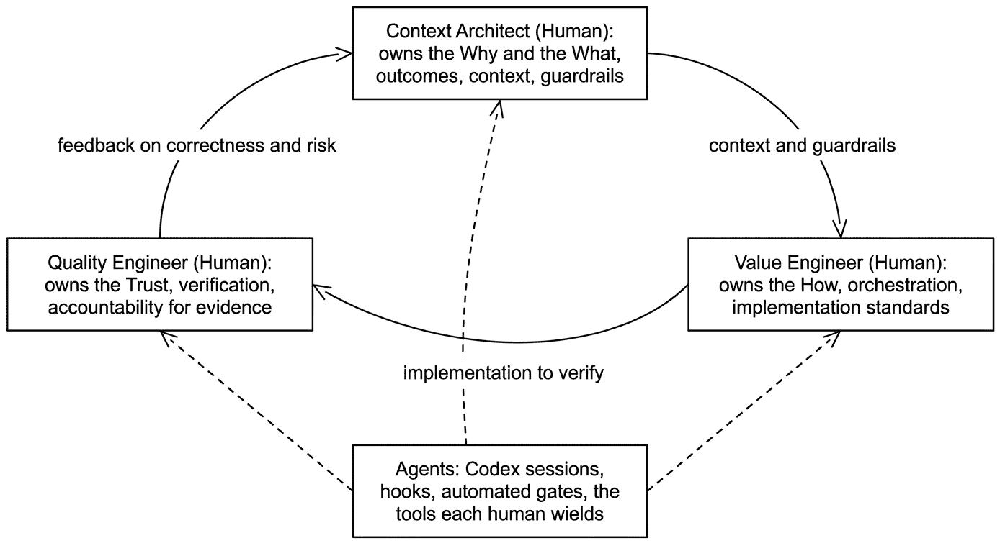
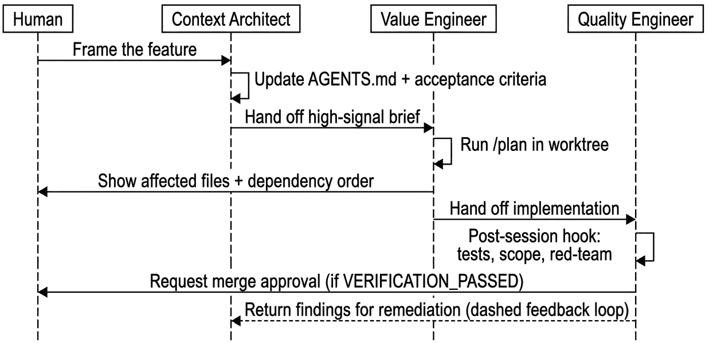

# Agentic Engineering Pod（智能体工程小组）

*第 27 章* 表明，决定 Agent 是否能产出可靠工作的是工具框架，而非模型。本章提出了该问题的组织层面版本：谁拥有工具框架，以及如何围绕它组建团队？当 Agent 负责大部分执行工作时，人类掌握着 Agent 无法自行回答的三个问题：

*   *我们为什么要构建这个？*（成果、战略、上下文）
*   *应该如何构建？*（编排、判断、实现标准）
*   *我们能信任构建出的东西吗？*（验证、安全、质量否决权）

Agentic Engineering Pod 围绕这三个问题组织三个人，每个人都由 Agent 增强，共享单一的上下文层。

### 学习目标

你将能够：

1.  为三个 Pod 角色中的每一个的 Agent 调用编写生产就绪的 TOML 配置
2.  设计 Pod 的 `AGENTS.md` 层级结构，包括仓库级、子目录级和角色特定文件
3.  演示一个特性完整的 Pod 生命周期：框架设定、编排、自动化验证
4.  编写 Quality Engineer（质量工程师）用于强制执行信任平台的钩子和门控
5.  诊断陷入困境的 Pod 属于哪种失效模式，并应用相应的修复方案
6.  将 Pod 基础设施打包为插件，并利用市场策略在多个 Pod 间强制执行一致的配置

> **起点，而非蓝图。** 本章中的 Agentic Engineering Pod 是团队围绕 Codex CLI 等 Agent 进行组织的一个成熟范例，而非最终或教条式的答案。围绕编码 Agent 构建团队是新领域，此处的约定将随着领域成熟而不断完善。请将 Pod 视为思考你自身结构的框架：采纳适用的部分，根据你的上下文调整角色和边界，并预期具体细节的演进速度将快于本书大部分内容。

### 为什么是三个角色？

#### 约束已从生成转移到验证

从变化之处入手。在软件历史的大部分时间里，稀缺资源是生成：编写代码、连接集成、编写测试。Agent 使生成变得廉价且快速，这将约束移到了别处。如今，交付的瓶颈在于**验证**，即团队证明生成输出正确、安全、可维护并准备好进入下一阶段的速率。

这重新定义了何为进步。无人验证的生成输出不是价值；它是**库存**，看似进步实则尚不可交付的工作。快速的 Agent 生成库存的速度可能超过缓慢团队审查的速度，未经审查的量不是加速，而是累积的风险。进步是**经验证的价值**：符合意图、通过测试、尊重项目约束、安全、可运维且可解释的输出。

这就是为什么 Pod 围绕三个人的问题而组织，而非围绕 Agent 现已吸收的实现工作，也是为什么负责验证的角色——Quality Engineer——在该模型中比传统团队中的 “QA” 承担更大的权重。

#### 传统团队结构的问题

传统团队结构在每个专业化边界上都产生协调开销：需求到工程，工程到 QA，QA 到 DevOps。当 Agent 执行工作时，这些交接变得更加昂贵，因为每个边界都引入了 Agent 不需要的延迟和它们无法在无人工干预下恢复的上下文丢失。

更深层的问题是**所有权分散**。没有单一人拥有从业务成果到生产验证的完整链条。当 Agent 生成代码时，所有权分散意味着无人对系统是否正确、安全地做着正确的事拥有完整图景。

#### 三人法则

Agentic Engineering Pod 通过激进的简化解决了这个问题：三项责任，一层共享上下文。

之所以有三项责任，是因为每一项都是生产者的工作，且无一是协调工作。Pod 是责任分离，而非层级。Agent 处理常规工作（样板代码、脚手架、测试生成、CI 运行），从而让人类专注于高判断力工作。第四项责任要么是其中之一的重复，要么就是协调本身，这是 Pod 不应具备的复杂性症状。

架构原则：**人指挥 Agent；而非管理其他人。** 协调流向人→Agent，而非人→人。当交付需求增加时，启动共享平台层的并行 Pod，而非扩大现有 Pod。扩展平台，而非 Pod。

该法则关乎责任，而非人数。Pod 保证所有三项责任都有明确、无重叠的归属；它不坚持必须恰好有三个具名个体。在小型项目中，一人可兼任多项责任，且单个传统职位名称通常跨越两三项 Pod 职责。绝不能发生的是责任无人负责。从传统角色到 Pod 职责的映射很直观：

| 传统角色 | Pod 职责 |
| --- | --- |
| 产品经理、产品负责人、业务分析师、工程经理、领域专家 | Context Architect（上下文架构师） |
| 工程师、架构师、设计师 | Value Engineer（价值工程师） |
| QA、SDET、DevOps、SRE、平台、安全、MLOps、治理与合规 | Quality Engineer（质量工程师） |

#### 关键结构洞见

Pod 的三个角色直接映射到 Agentic 交付模型中留给人类的三个问题：


| **角色** | **类型** | **负责范围** | **回答问题** |
| :--- | :--- | :--- | :--- |
| **上下文架构师** | 人类 | “为什么”和“是什么” | 我们追求什么成果？智能体需要什么上下文？有哪些护栏？ |
| **价值工程师** | 人类 | “怎么做” | 我们如何编排交付？好的实现是什么样的？ |
| **质量工程师** | 人类 | “信任” | 我们能否证明所构建的是正确、安全、可靠的？谁对证据负责？ |

所有三个 Pod 角色均为人类。智能体（`Codex` 会话、技能、钩子、权限、自动化门禁）是每位人类所驾驭的工具。Pod 中不存在“智能体角色”。智能体拥有能力；人类承担角色。

这些边界反映了人类导致智能体系统失败的三种方式：上下文不佳（上下文架构师失职）、编排不善或错过架构偏移（价值工程师失职），或在缺乏充分验证的情况下发布（质量工程师失职）。Pod 使每种失败模式都可见且可追责。



**图 28.1 - Pod：三个角色与流向**

智能体工程 Pod 的示意图，展示了三个角色形成一个循环。上下文架构师负责“为什么”和“是什么”（成果、上下文、护栏），并将上下文和护栏传递给价值工程师，后者负责“怎么做”（编排、实现标准），并将实现传递给质量工程师进行验证，后者负责“信任”（验证、证据问责），并返回关于正确性和风险的反馈。一个单独的“智能体”框（`Codex` 会话、钩子、自动化门禁）通过虚线连接到所有三个角色，作为每位人类驾驭的工具。

#### 角色及其智能体孪生

每个角色都与一个同名的智能体配置配对：本章后面介绍的 TOML 文件（`context-architect.toml`、`value-engineer.toml`、`quality-engineer.toml`）。共享名称是有意为之。TOML 文件是该角色的*智能体孪生*，一个针对该角色工作调优的智能体，拥有该角色任务所需的模型层级、审批姿态和沙箱。

不过，孪生并非固定工具。每个角色的深层工作是随时间将自身复制到孪生中，将角色持有者的判断编码到配置、`AGENTS.md` 上下文以及孪生所依赖的技能中，使智能体能更多时间地按人类方式行事。每一次会话重定向、每一次简报优化、每一个新增门禁，都是人类在教导孪生按其方式行事。杠杆效应复利增长：孪生捕获了原本只存在于某人脑海中的隐性知识，教导得越好，人类就越少需要手动干预。这就是自主阶梯背后的机制：当孪生赢得了足够的证据被信任处理某类变更时，该类变更就会跃升一个层级。

这也是为什么孪生是人类驾驭的能力，而非第二个角色持有者。判断、问责和角色本身始终属于人类；随时间改变的是孪生吸收了多少人类的技艺。名为 `context-architect` 的智能体*不是*上下文架构师；它是上下文架构师不断进化的工具，保持其锐利是该角色的一部分。

#### 质量决定节奏

在深入角色本身之前，有一条运营原则必须确立，因为它塑造了所有三个角色。人们很容易把验证想成流水线末端的一个关卡：智能体生产，合并主分支前验证先行。这幅图景是不完整的。一旦生成变得廉价，决定 Pod 交付速度的不是生产速度，而是验证速度。验证吞吐量，而非生成吞吐量，才是进度的真实度量。

由此引出两个后果。首先，已生成但未验证的工作应控制在有界队列中，而非允许堆积；不断增长的未审查输出积压的是风险，而非已存进度。其次，价值工程师只有在质量工程师的验证能力能消化时，才应释放更多智能体工作。验证不是最后拧上的终点关卡；它决定交付节奏。

这重构了团队花费智能体红利的方式。廉价生成产生红利，Pod 可两用：用于更多平庸输出，或用于更强规格、更好测试和更深验证。对于企业级软件，将部分红利再投资于质量通常回报更高，因为它提升了如今制约整个系统的验证上限。

#### 哪些章节奠基各角色

Pod 综合了全书内容：每个角色的技艺源自分布在前几部分的多个章节，而非单一部分，接下来三节将逐一展开。各角色最相关的章节：

*   **上下文架构师。** 第 4 章 (`AGENTS.md`) 是核心参考，因为 `AGENTS.md` 层级是该角色的主要产出物。第 3 章 (提示工程) 支撑规范编写和答疑会范围界定模式；第 5 章 (审批模式与信任边界) 和 第 17 章 (企业级部署) 为战略护栏、策略和自主阶梯提供依据；第 10 章 (技能) 是角色技艺变为可分发基础设施的途径。

*   **价值工程师。** 第 11 章 (子智能体) 和 第 12 章 (多智能体编排) 是该角色所负责的智能体循环工程的核心。第 14 章 (成本管理) 驱动速度、Token 成本与置信度之间的权衡；第 3 章 (提示工程) 是简报工程的基础；第 13 章 (工作树) 为特性会话提供隔离；第 20 章 (AI 代码审查) 配合 第 10 章 (技能) 支持成比例审查和可复用审查技能。

*   **质量工程师。** 第 9 章 (钩子) 是主要强制机制，第 5 章 (审批模式与信任边界) 设定沙箱和审批姿态。第 15 章 (CI/CD)、第 16 章 (安全加固) 和 第 19 章 (测试与评估) 构成信任平台的运营骨干，第 20 章 (AI 代码审查) 为验证门禁提供输入。

这也是角色到部分映射仅为近似的原因：价值工程师最贴近第 3 部分 (规模化)，质量工程师最贴近第 2 部分 (护栏) 的强制原语，而上下文架构师具体对应 第 4 章 而非第 1 部分整体。

### 上下文架构师：人类角色

#### 上下文架构师负责什么

上下文架构师负责成果与环境：Pod 是否兑现承诺、智能体是否基于准确上下文工作、战略方向是否与业务意图保持一致。其杠杆来自创建可复用的上下文、技能和护栏，而非驱动单个特性会话。

上下文架构师的四大责任领域：

**工厂管治。** Pod 可复用生产系统的管治者：上下文、技能与护栏。制定高信号简报标准，塑造审查循环。反复出现的摩擦反哺上下文层优化。


#### 结果定义与价值实现

业务赞助商的主要接口。将模糊的业务反馈转化为可执行的上下文，掌控产品叙事，并以成本价值为依据界定交付权衡，包括“代理经济学”。

#### 上下文工程

策划模式、文档和决策记录，赋予代理做出正确底层决策所需的“直觉”。无情地管理信噪比：相互矛盾或过时的上下文会产生相互矛盾或陈旧的输出。

#### 战略护栏与策略

定义法律、伦理和安全护栏。将合规要求转化为结构化策略，并定义升级阈值（哪些可自动运行，哪些需要人工批准）。

#### 自主阶梯

```
Level 1: Assist 代理建议；人工审查并应用每项变更
Level 2: Approval-required 代理执行；每项操作执行前需人工批准
Level 3: Policy-bounded 代理在定义边界内执行；例外情况升级处理
Level 4: Self-remediating 代理在护栏内检测、诊断并修复
```

阶梯晋升需要证据（测试覆盖率、审查历史、审计日志），而非自信。层级按变更类别分配，而非按模块：支付处理模块的架构变更可能永久保持 Level 2，而读路径优化则可能为 Level 3。

#### `AGENTS.md` 作为上下文架构师的核心产出物

`AGENTS.md` 并非众多配置文件中的一个：它是上下文架构师的**核心交付物**。^[²⁸⁰] 价值工程师运行的每次 Codex 会话、质量工程师触发的每个自动化检查，都从该层级读取上下文。Pod 的输出质量受限于该文档的质量。

生产环境 Pod 的层级结构：

```
~/.codex/AGENTS.md # 个人偏好，永不提交
AGENTS.md # 仓库级：Pod 的事实来源
src/payments/AGENTS.md # 限界上下文的领域约束
src/auth/AGENTS.md # 认证模块更严格的安全约束
.codex/roles/value-engineer.md # 角色专用指令
.codex/roles/quality-engineer.md # 角色专用 QE 指令
```

仓库级 `AGENTS.md` 包含产品描述、验收标准、架构约束、批准的依赖列表和完成的定义。每个代理首先读取它。子目录 `AGENTS.md` 文件编码跨冲刺持久的领域特定约束。更具体的文件覆盖更通用的文件，因此在 `src/auth/` 中工作的代理会自动继承更严格的约束，无需显式指令。

一份编写良好的仓库级 `AGENTS.md` 如下所示：

```
##### 产品上下文
该服务是用户订阅状态的权威来源。
代理不得引入任何从多个事实来源派生订阅状态的路径。
##### 验收标准
每项功能必须包含：
1. 面向用户的结果陈述（“处于[状态]的用户可以[操作]...”）
2. 至少一个包含预期行为的失败场景
3. 任何面向用户路径的性能界限 (<200ms p95)
##### 架构约束
- 所有外部数据在边界处使用 zod 验证
- 禁止跨模块数据库查询；每个模块拥有其架构
- 所有状态变更在返回前必须发出审计事件
##### 批准的依赖
见 .codex/approved-deps.json。添加未列出的依赖要求
在代理继续之前获得 ADR 批准。
##### 自主级别
- 读路径变更：Policy-bounded (Level 3)
- 写路径变更：Approval-required (Level 2)
- 架构变更：Approval-required (Level 2)
- 基础设施变更：Assist (Level 1)
```

#### 规范作为强制函数

一种有用的模式是“办公时间”技能：一种结构化的产品对话，在编写任何代码之前触发，要求明确回答四个问题：我们在解决什么问题，可观测层面的成功标准是什么，什么不在范围内，哪些约束是不可商量的。以这种方式设计的 Codex 技能，直到范围和成功标准被确认之前，不会让会话继续进行。某功能的 `AGENTS.md` 条目，在答案写下来之前不应存在。

#### 将上下文架构师的技艺作为插件分发

上下文架构师的规范技能、办公时间范围界定对话、`AGENTS.md` 健康检查和 ADR 编写模板，代表了不应只存在于某个人脑海中的组织知识。插件系统原生支持将技能（连同钩子、MCP 服务器和应用连接器）打包为单个可安装单元；编写本文时，文档化的插件规范并未将自定义代理角色 TOML 或 `AGENTS.md` 模板列为一等插件组件，因此这些作为捆绑文件随行，而非自动注入。当最资深的上下文架构师改进技能或增加上下文漂移检查时，每个 Pod 都通过版本升级接收更新。技艺由此成为可分发的基础设施，而非部落知识。这是一个贯穿所有三个角色的模式的首次显现，后文将在“通过插件分发 Pod”下统一论述。

#### 上下文架构师 TOML 配置

上下文架构师的 Codex 调用属于规范与架构工作：产出 ADR、更新 `AGENTS.md`、验证验收标准、评估上下文漂移。这些会话使用高推理模型，且不在全自动模式下运行；上下文架构师制定策略，而非实现。

上下文架构师的代理孪生体：

```
##### .codex/agents/context-architect.toml
name = "context-architect"
description = "规范制定、ADR 编写、AGENTS.md 维护、上下文质量审查。"
developer_instructions = """
你正在协助上下文架构师进行高判断力的上下文和规范工作。
你处理的任务：
- 在层级的任何级别起草或更新 AGENTS.md 文件
- 编写或审查 ADR（架构决策记录）
- 将验收标准转化为可验证的具体形式
- 评估现有上下文文档是否最新准确
- 识别上下文层中的缺口或矛盾
规则：
- 请勿编写功能实现代码
- 请勿修改 .codex/ 或 docs/ 之外的源文件
- 如果产出 ADR，请遵循 .codex/adr-template.md 中的格式
- 标记任何需要人工决策后代理才能继续的上下文缺口
- 当文档集准备好供 Pod 使用时，输出 CONTEXT_COMPLETE
"""
model = "gpt-5.4"
model_reasoning_effort = "xhigh"
approval_policy = "untrusted"
sandbox_mode = "workspace-write"
```

`approval_policy = "untrusted"` 是有意为之。上下文架构师会在提交前审查并批准对上下文层的每一项提议变更。上下文错误会传播到每一个下游代理会话；它们值得在创作环节接受严格的人工审查。

### 价值工程师：人类角色

#### 价值工程师负责的内容

价值工程师编排端到端交付。该角色要求扎实的软件工程基础，而非只是恰巧使用 AI 工具的项目经理。他们提供技术深度以验证代理输出、识别架构漂移、捕捉正确性故障、并维护代理无法单方面强制执行的实现标准。

价值工程师的四大责任领域：

##### 系统编排与技术发现

技术主题专家的主要联系人。负责深度发现，将复杂业务规则转化为可执行的系统行为。

##### 简报工程

产出高信号简报：包含意图、约束、示例和边缘情况的结构化提示词，足以让代理在无歧义的情况下执行。简报质量是该角色的核心技艺。


##### 代理循环工程

设计收敛标准、并行度和停止条件。在速度、Token 成本和置信度之间做出深思熟虑的权衡。明确何时让代理运行至完成，何时进行重定向，以及何时使用更好的上下文重新启动。

##### 专家判断与实施标准

对所有逻辑提供最终验证：发现代理可能遗漏的架构偏移、用户体验缺陷或正确性故障。

#### 实战简报工程

低信号简报（`为订阅服务添加续订端点`）与高信号简报的区别在于具体性，而非长度：

##### 任务：订阅续订端点

**意图：** 状态为 `subscription.status = "expired"` 的用户可通过 `POST /subscriptions/renew` 续订其订阅，无需重新输入支付详情。

**约束条件：**

*   复用存储在 `user.paymentMethodId` 中的支付方式
*   续订必须是幂等的：调用该端点两次不得产生两笔费用
*   返回 200 之前必须发出 `subscription.renewed` 事件

**验收标准：**

*   状态为 `status=expired` 的用户在成功调用后变为 `status=active`
*   状态为 `status=active` 的用户收到 409 响应，响应体为 `{"error": "already_active"}`
*   Stripe 失败返回 502 并记录错误；订阅状态保持不变
*   在标称负载下，响应时间 p95 < 200ms

**范围外：** 不要修改支付方式存储逻辑。不要添加新的订阅层级。

**参考：** 参见 `src/subscriptions/AGENTS.md` 了解幂等性要求，参见 `src/events/types.ts` 了解事件架构。

显式的失败场景、清晰的幂等性要求、范围外边界，以及对领域特定 `AGENTS.md` 的引用。每一项都消除了代理原本需要通过推断来解决的决策点。

#### 价值工程师 Codex 会话模式

典型的功能会话：阅读任务规范和相关的 `AGENTS.md` 上下文；运行 `/plan` 验证方法；在工作区的 `workspace-write` 沙箱^(281) 中执行；根据验收标准审查输出；在输出偏离时进行重定向；实现整洁后移交给质量工程师的质量门禁。每个功能都位于各自的工作树中；主分支仅接收经过审查、通过质量门禁的输出。

#### 决定何时并行化：指标自由度

指标自由度（第 11 章）为价值工程师提供了一种原则性的方法，用于决定何时生成并行子代理，何时在单个会话中保持任务。它是一个单一数值，`F = 1 − ρ(D_out, D_score)`，用于衡量任务是否从多样化输出中受益（高 F）或要求单一正确答案（低 F）。在将功能分解为代理任务时应用它：

*   **高 F 子任务**（代码审查、文档编写、测试生成）分配给并行子代理，在这些任务中多样性是资产；扇出至多代理角色，让多个代理探索不同方法。
*   **低 F 子任务**（Bug 修复、迁移、架构变更）分配给单个具有高推理力的代理，在这些任务中精确度比多样性更重要；将任务特定知识编码进聚焦的提示词，而非支付并行化的协调开销。

质量工程师使用同一数值来校准验证：高 F 输出需要对方法选择进行人工审查（代理是否从众多有效方法中选出了好的一种？），而低 F 输出需要自动化正确性检查（代理是否产出了唯一的正确答案？）。

#### 成比例的审查深度

审查深度应随差异规模缩放。小型自包含差异（约 50 行以内，单一逻辑单元）：是否实现了声称的功能，是否存在明显的正确性问题，是否引入了被排除的依赖？大型差异（涉及多模块、核心逻辑重写）值得进行四遍审查：意图对齐、正确性（竞态条件、边缘情况、失败路径）、副作用、完整性（测试到位、验收标准可演示）。价值工程师可将其编码为一项审查技能，根据 `git diff --stat` 输出路由至快速通道或全量通道。

#### 价值工程师 TOML 配置

价值工程师的代理孪生体：

```toml
##### .codex/agents/value-engineer.toml
name = "value-engineer"
description = "功能实现、编排与代理监督会话。"
developer_instructions = """
你正在为价值工程师执行一项功能实现任务。
开始前：
1. 阅读 AGENTS.md 以及与此任务相关的任何子目录 AGENTS.md
2. 阅读任务简报并确认你理解验收标准
3. 如果任何约束存在歧义，在编写代码前将其暴露出来
实施期间：
- 在每个逻辑变更组后运行测试
- 如果测试失败，在继续前修复失败；绝不跳过
- 如果遇到简报未涵盖的架构决策，
  将其写入 .codex/clarifications.md 并暂停等待审查
- 跟踪简报中的验收标准：在发出完成信号前，每一项必须可演示地得到满足
完成信号：IMPLEMENTATION_COMPLETE，附带以下摘要：
- 每项验收标准及其是否满足
- 超出简报范围处理的任何边缘情况
- 任何延期待质量工程师审查的事项
"""
model = "gpt-5.4-mini"
model_reasoning_effort = "high"
approval_policy = "on-request"
sandbox_mode = "workspace-write"
```

`approval_policy = "on-request"` 适用于价值工程师的工作树会话：代理在限定工作树内执行，验收标准明确，且质量工程师的质量门禁会在任何输出到达主分支前触发。模型决定何时升级至价值工程师以获批准，让常规文件编辑顺畅进行，同时浮现任何看起来异常的情况。

### 质量工程师：人类角色

#### 质量工程师负责的事项

质量工程师负责信任平台：CI/CD 流水线、自动化质量门禁、安全控制和验证基础设施。他们掌握质量否决权：无论由谁或何物产生变更，均有权阻止。无论是价值工程师还是上下文架构师都无法覆盖这些门禁。这种权威是结构性的，而非政治性的。

否决权之所以存在，是因为问责制无法委托给代理。编码代理无法为其交付的产物担责；发布产品的组织才对其负责。因此，企业级交付运行在证据之上，而非信心之上：质量工程师的工作是让团队能够展示要求是什么、代理做了什么、测试了什么、谁审查了它，以及为什么结果可以安全发布。当证据不足时，否决权就是阻止工作的机制，无论生产者是谁或何物。

质量工程师的四大职责领域：

##### 验证与质量工程

设计并构建验证功能正确性、性能和可靠性的自动化系统。推动安全工具契约模式：类型化的输入/输出、幂等性、最小权限、允许列表。

##### 对抗性测试

主动对代理工作流进行红队演练，针对提示词注入、不安全工具使用和数据泄露。这是一项持续的工程实践，而非定期审计。

##### 运营骨干

维护 CI/CD 流水线、安全上下文存储、代理隔离、依赖扫描和供应链完整性。

##### 自主性强制执行

实现使上下文架构师的自主性阶梯从愿景变为现实的钩子、质量门禁和流水线检查。

#### 确定性工具接口设计

质量工程师设计构造上安全的代理工具接口。有三项属性是不可妥协的：

##### 类型化的输入与输出

团队代理使用的每个工具都应具有显式的输入模式和输出契约。非类型化接口使验证变得不可能，并导致副作用不可预测。


#### 质量工程师原则与实施

##### 幂等性
工具必须支持使用相同输入多次安全调用。智能体会重试；非幂等工具会导致重复扣费、重复记录和状态不一致。

##### 最小权限
每个智能体角色应仅访问其所需的工具。实施智能体不需要生产数据库凭据。审查智能体不需要源文件的写入权限。质量工程师设计权限结构并根据实际智能体行为进行验证。

#### 质量工程师编写的钩子

钩子[²⁸²]是质量工程师的主要强制执行机制。有三个钩子点最为关键：

##### 预提示钩子（UserPromptSubmit）
在任何提示进入智能体上下文之前触发。用于策略强制执行：扫描提示注入模式、验证正确的工作树、检查 `AGENTS.md` 上下文是否为最新。

##### 每次写入钩子（PostToolUse）
在每次工具调用完成后触发。正如第 9 章所述，`PostToolUse` 观察的是事后结果而非把关动作：工具已经运行完毕，因此钩子将发现结果呈现到上下文中并以退出码 `0` 退出，而不是阻塞。这是在同一会话中让智能体能够采取行动的快速、文件级反馈的正确切入点。

##### 会话后钩子（Stop）
在 Codex 会话结束时触发。用于验证：运行测试套件、检查是否有超出允许范围的文件被修改、验证审计事件是否已发出、确认预期的完成信号。

```bash
###### .codex/hooks/post-session-verify.sh
###### 质量工程师的会话后验证钩子
set -euo pipefail
TASK_ID="${CODEX_TASK_ID:-unknown}"
WORKTREE="${CODEX_WORKTREE:-$(pwd)}"
echo "[QE Hook] Post-session verification for task: $TASK_ID"
###### 1. 运行完整测试套件
echo "[QE Hook] Running test suite..."
npm test --silent 2>&1 | tee ".codex/tasks/$TASK_ID/test-results.log"
###### 2. 验证未修改许可范围外的文件
echo "[QE Hook] Checking file scope..."
MODIFIED=$(git diff --name-only HEAD)
VIOLATIONS=$(echo "$MODIFIED" | grep -E "^(infrastructure/|AGENTS\.md)" || true)
if [ -n "$VIOLATIONS" ]; then
  echo "[QE Hook] SCOPE VIOLATION: agent modified restricted files:"
  echo "$VIOLATIONS"
  exit 1
fi
###### 3. 检查会话日志中的完成信号
if ! grep -q "IMPLEMENTATION_COMPLETE" ".codex/tasks/$TASK_ID/session.log" 2>/dev/null; then
  echo "[QE Hook] WARNING: No IMPLEMENTATION_COMPLETE signal found in session log"
fi
echo "[QE Hook] Verification complete. Gate: PASSED"
```

一个更轻量的示例展示了 `PostToolUse` 模式的独立应用：智能体写入 Markdown 的那一刻就进行 lint 检查，这样风格和结构问题会在智能体仍在循环中时浮现。`PostToolUse` 匹配器按工具而非文件类型选择，因此钩子会过滤 Markdown 本身，而不是依赖匹配器：

```bash
###### .codex/hooks/lint-markdown.sh
###### 质量工程师的每次写入 Markdown lint（PostToolUse）
set -euo pipefail
###### PostToolUse 通过 stdin 传递 JSON 对象；工具名在 `.tool_name` 中。
TOOL="$(jq -r '.tool_name // empty')"
###### 仅在文件写入工具后执行（空工具名允许手动运行）
case "$TOOL" in
  write_file|str_replace_editor|apply_patch|"") ;;
  *) exit 0 ;;
esac
###### 仅 lint 智能体刚刚更改的 Markdown 文件
CHANGED=$(git diff --name-only HEAD -- '*.md')
[ -z "$CHANGED" ] && exit 0
if ! command -v markdownlint >/dev/null 2>&1; then
  echo "[QE Hook] markdownlint not installed; skipping."
  exit 0
fi
echo "### markdownlint results"
echo "$CHANGED" | xargs markdownlint 2>&1 || true
###### 观察，不阻塞：将发现结果呈现到上下文并干净退出。
exit 0
```

在 `.codex/hooks.json` 中通过 `PostToolUse` 进行连接：

```json
{
  "hooks": {
    "PostToolUse": [
      {
        "hooks": [
          {
            "type": "command",
            "command": "bash .codex/hooks/lint-markdown.sh",
            "statusMessage": "Linting changed Markdown...",
            "timeout": 20
          }
        ]
      }
    ]
  }
}
```

该钩子永远不会导致智能体动作失败；它将 lint 输出作为上下文反馈回来，以便智能体自我纠正。当必须强制执行 Markdown 标准而不仅仅是呈现时，该检查应放在会话后关卡，那里非零退出码可以停止工作。

#### 插件强制钩子：使绕过在结构上不可能

当钩子作为松散脚本存在于 `.codex/hooks/` 中时，任何开发者都可以删除或修改它们。插件系统改变了这一点。通过 `marketplace.json` 中的 `INSTALLED_BY_DEFAULT` 策略分发的插件钩子会在会话启动时安装，且无法被单个开发者移除。[²⁸³] 质量工程师维护插件；平台团队通过市场策略强制安装。绕过变得不可能，而不仅仅是不建议。同一机制适用于 `PostToolUse` 钩子：文件范围强制执行、静态分析关卡和审计事件检查会在企业中每个 pod 的每次工具调用时触发。如何跨许多 pod 一致地推广这一点是本章最后一节“使用插件分发 Pod”的主题。

#### 验证经济学：分层成本关卡

验证是有成本的：时间、Token 开销和周期延迟。对每个两行的错误修复都进行全面的对抗性安全审查，这不是严谨的表现；而是流程校准错误的表现。质量工程师的工作不是最大化验证深度，而是将验证工作量与变更风险相匹配。

三层模型效果良好。

##### 第 1 层：静态验证
Lint 检查、类型检查、模式验证。近乎零成本；无一例外地在每次变更时运行。

##### 第 2 层：功能验证
完整测试套件、范围合规检查、验收标准确认。成本较高但属于常规操作；在每次涉及逻辑的变更时运行。

##### 第 3 层：对抗性验证
安全建模（OWASP Top 10、STRIDE）、性能基准测试、对抗性输入测试和手工红队演练。成本高昂；保留用于新认证路径、支付流程、模式变更以及涉及提升信任边界的任何内容。

Codex 技能集可以直接实现这一点。一个打开真实浏览器、操作应用程序、发现错误并生成回归测试的 QA 技能属于第 2 层工作，适用于大多数功能变更。对于具有安全隐患的变更，更重量级的安全审查技能会在之上增加 STRIDE 威胁建模和 OWASP Top 10 审查。验证预算随风险缩放，而非随可用时间或审查者习惯。

质量工程师通过在 `AGENTS.md` 中将变更类别映射到验证层级来经济高效地实施这一点，这是上下文架构师用于自主阶梯的相同映射。模式变更始终是第 3 层。读路径重构是第 1 层加第 2 层。自动化执行相应层级；质量工程师进行审查，并在判断需要时进行升级。

#### 质量工程师 TOML 配置

质量工程师的自动化验证运行是非交互式的；它们在 CI 中触发，而非在交互式终端会话中。模型层级较低（验证是机械的，而非推理密集型），沙箱则更严格。

质量工程师的智能体孪生体：


##### `.codex/agents/quality-engineer.toml`

```
name = "quality-engineer"
description = "自动化验证：测试执行、安全审查、门禁强制执行。"
developer_instructions = """
您正在对 Agent 生成的输出进行质量工程师验证。
您的任务：
1. 运行完整测试套件并记录结果
2. 运行安全扫描器 (`npm audit --audit-level=moderate`)
3. 检查任务简报中的所有验收标准是否已得到明确满足
4. 识别任务允许范围外被修改的任何文件
5. 检查所有写入路径操作是否已发出审计事件
请勿修改源文件以使测试通过。
请勿禁用或跳过单个测试。
如果测试失败，请完整记录失败详情并输出：`VERIFICATION_FAILED`
如果所有门禁通过，输出：`VERIFICATION_PASSED`
将结果写入 `.codex/tasks/$TASK_ID/verification.md`
"""
model = "gpt-5.4-mini"
model_reasoning_effort = "minimal"
approval_policy = "never"
sandbox_mode = "read-only"
```

`sandbox_mode = "read-only"` 是刻意为之。质量工程师的验证 Agent 即使模型产生幻觉指令写入源文件，也无法执行写操作。结合 `approval_policy = "never"`，该 Agent 在 CI 中非交互式运行，无需人工提示即可执行验证检查，沙箱模式防止任何意外变更。

### 实战中的 Pod：一个特性的生命周期

以下演示追踪了一个特性在完整 Pod 中的流转：“订阅已过期的用户可以续订，无需重新输入支付详情。”

#### 步骤 1：Context Architect 界定特性

Context Architect 评估 `AGENTS.md` 是否涵盖续订流程，更新订阅模块以补充缺失的验收标准，并编写简报：

```
##### 特性：订阅续订
**用户结果：** `status=expired` 的用户可调用 `POST /subscriptions/renew`
并获得 `status=active`，无需重新输入支付详情。
**失败场景：**
- `status=active` 的用户：409，响应体 `{"error": "already_active"}`
- Stripe 失败：502，响应体 `{"error": "payment_failed"}`，订阅状态不变
- 重复调用：第二次调用返回 200 及当前状态，不产生第二次扣费
**性能边界：** 标准负载下 p95 < 200ms
**自主级别：** 写入路径变更：需要审批（第 2 级）
```

#### 步骤 2：Value Engineer 编排实现

Value Engineer 在专用 worktree 中运行 Codex 会话，策略为 `approval-required`（这是涉及支付的写入路径变更）：

```
git worktree add ../worktrees/feature-subscription-renewal -b feature/subscription-renewal
cd ../worktrees/feature-subscription-renewal
codex --profile value-engineer
```

打开提示词，高信噪比简报：

```
##### 任务：订阅续订端点
按 src/subscriptions/AGENTS.md 中的验收标准实现 `POST /subscriptions/renew`。
意图：status=expired 的用户调用该端点，使用其存储的支付方式转换为 status=active。无需新的支付详情。
约束：
- 幂等性：重复调用不得产生两笔 Stripe 扣费
- 返回 200 前发出 subscription.renewed 事件
- Stripe 失败：返回 502，记录错误，状态保持不变
- 不得修改支付方式存储逻辑
验收标准：按 src/subscriptions/AGENTS.md 所指定
从 /plan 开始。在编写任何代码前，向我展示受影响文件及依赖顺序。
```

Agent 运行 `/plan`；Value Engineer 审查后批准执行。关键的专家判断时刻：Agent 最初的幂等性实现在并发调用下存在竞态条件。重定向指示：

> 幂等性检查需使用数据库级唯一约束 (user_id, renewal_date)，而非应用层面的读-检-写。
> 请参阅 src/subscriptions/AGENTS.md 中的幂等性模式要求。
> 请修订实现方案。

#### 步骤 3：Quality Engineer 的自动化门禁触发

Quality Engineer 的会话后钩子触发，运行测试套件，检查范围合规性，并将结果写入 `.codex/tasks/subscription-renewal/verification.md`。Quality Engineer 还运行对抗性测试：

```
对 POST /subscriptions/renew 端点实施实施红队测试。
测试内容：
1. 同一 user_id 的并发调用（竞态条件）
2. 待处理的续订请求期间到达的 Stripe Webhook
3. 可能为同一用户创建第二笔 Stripe 扣费的任何路径
将发现报告至 .codex/tasks/subscription-renewal/security-review.md
```

对抗性会话未发现绕过路径；数据库级约束生效。`VERIFICATION_PASSED`；特性可合并。

对于涉及支付的写入路径变更，Pod 在合并前运行多学科门禁作为顺序检查点：工程审查、安全审查（OWASP Top 10 和 STRIDE）及 QA 验证。自主权阶梯与门禁序列共享同一分类表；Quality Engineer 维护两者。

#### 人工判断的介入点

人工判断在此生命周期的四个节点出现：界定特性、审查实现计划、针对竞态条件重定向、批准最终合并。其余一切通过 Pod 的 Agent 层执行。



图 28.2 - 特性在 Pod 中的生命周期

序列图追踪特性从人工批准界定开始，经 Context Architect 更新 `AGENTS.md` 并将高信噪比简报交给 Value Engineer，后者在 worktree 中规划、获取人工计划批准及竞态条件重定向，再移交 Quality Engineer 验证。Quality Engineer 的会话后钩子运行测试、范围及对抗性检查：通过则人工批准最终合并，检出发现则退回 Value Engineer 修复。人工判断节点标注于界定、计划审查、重定向及最终合并。

### 失效模式与 Pod 反模式

#### Context 债务

**症状：** Agent 输出偏离业务意图。功能实现了技术上正确的代码，却未达成实际预期结果。评审通过但利益相关方拒收。

**原因：** Context Architect 停止维护 `AGENTS.md` 层级。过时的验收标准、陈旧的约束和废弃的决策堆积。遵循陈旧上下文的 Agent 产出陈旧输出。

**修复：** 将 `AGENTS.md` 评审纳入每个 Sprint 回顾。Context Architect 负责“上下文健康度”指标：陈旧决策、AGENTS.md 标准与实际简报的差距、需大量人工重定向的特性占比。重定向率上升是早期预警信号。

作为插件分发的 `context-review` 技能可自动化早期检测。在 CI 中作为计划的 `codex exec` 任务每周或每个 Sprint 边界运行，它会标记陈旧的 `AGENTS.md` 章节、孤立的验收标准和上升的重定向率，赶在回顾前暴露问题。该插件将上下文健康度从人工审计转变为持续信号。

#### 门禁绕过

**症状：** 交付速度短期提升，随后急剧下降。自动化门禁本可捕获的安全事件或生产回归。

**原因：** Value Engineer 为加速交付而禁用钩子或绕过 CI 门禁。“稍后再补测试。”Quality Engineer 的否决权被视为建议而非结构性保障。


##### 修复：结构性强制执行胜过可选门禁

质量工程师的门禁并非可选。结构性修复在于让绕过变得不可能：门禁要求必须经过审计日志记录的显式覆盖，而非可以被静默传递的标志位。绕过门禁并非加快速度；而是将债务向前推至恢复成本高得多的地步。插件系统提供了强制执行：随 `INSTALLED_BY_DEFAULT` 策略分发的钩子无法被个人开发者移除。市场的 `NOT_AVAILABLE` 策略可以阻挡可能绕过门禁基础设施的非官方插件。

技能在结构上强化了这一点。门禁技能可要求在继续前进行显式确认：不是布尔标志，而是一份书面确认，证明审查者已查看特定发现。同一逻辑适用于破坏性命令，技能可使 Agent 发出警告并等待，将绕过行为转化为有意的、可追溯的选择，而非轻易的疏忽。质量工程师将同一原则应用于部署门禁：一个要求在管线推进前提供签署确认的验证摘要的钩子。让捷径比正道更难走，是在压力下唯一可靠的预防手段。

#### 单点质量失效

**症状：** Agent 交付的变更包含安全漏洞、数据泄露或正确性故障。团队缺乏连贯的验证叙事。

**原因：** 缺乏质量工程师角色，或该角色由将其视为测试执行而非信任平台工程的人担任。门禁仅存在于文档上，未经调优、未经对抗性测试，也未在结构上强制执行。

**修复：** 质量工程师角色要求深厚的 QA、DevOps 和安全工程基础。它不能是事后诸葛亮。没有真正的信任平台，Agent 自主性的增加就是不安全的，因为没有机制来捕捉 Agent 的错误。

#### 角色坍缩

**症状：** 协调开销回升。一人身兼数职，在三个领域同时做决策，成为瓶颈。

**原因：** 一人身兼两个或三个角色。结构依赖于每个角色保持独特的所有权（上下文、编排、信任）。当角色坍缩为一人时，团队的结构性保障随之坍缩。

**修复：** 恢复角色边界。识别被忽视的领域（通常是上下文工程或信任平台）并引入专人负责。角色坍缩几乎总是相对于雄心而言的人员不足的症状，而非团队模式错误的症状。

#### 范围蔓延

**症状：** 团队扩大。第四人“临时”加入。协调开销回升。

**原因：** 交付需求增加，团队随之扩大，为换取表面吞吐量而牺牲了使其高效的结构性属性。

**修复：** 将三人原则作为运营准则而非偏好。当需求增长时，启动并行团队而非扩大现有团队。三人无法应对需求，几乎总是上下文、工具或流程问题，而非人数问题。

#### Agent 产生的失效模式，映射至角色

上述反模式是团队自我衰败的方式。单独来看，《第 25 章》中的基准研究确定了 Agent 在任务中最常见的三种失效方式，每种都映射到负责修复的团队角色：

*   **导航。** 上下文架构师负责此项。Agent 在代码库中迷路的频率远高于误用工具，这使得导航成为最常见的失效类别；`AGENTS.md` 文件地图、显式路由规则和结构良好的代码库布局是影响最大的干预措施。

*   **求助判断。** 价值工程师负责此项。Agent 在模糊任务上盲目推进而不升级；校准过的审批模式和使成功标准明确的简报，能减少 Agent 必须判断何时提问的频率。

*   **多模态组合。** 质量工程师负责此项。代码、测试和文档逐渐不同步；跨模态一致性检查（测试是否匹配代码？文档是否匹配 API？）在门禁处捕捉到它。

工具使用正确性，一直以来是大多数基准测试的焦点，却是这些失效中最不常见的一种；《第 25 章》给出了测得的比率。一个其 `AGENTS.md` 和编排设计覆盖了所有三类失效的团队，正在解决主导性的失效问题。

### 通过插件分发团队

上述失效模式是单个团队从内部衰败的方式。规模化引入了不同的压力。范围蔓延的修复建议启动并行团队而非扩大单个团队，但每个新团队随后都必须忠实地复制相同的结构，而依赖手动设置的结构在被复制的那一刻就开始漂移。分发团队是让许多团队在无需手动工作的情况下保持结构一致的问题。

#### 配置问题

一个生产就绪的团队需要：三个角色 TOML 文件、一个 `AGENTS.md` 层级、用于策略执行和会话后验证的钩子脚本、验证技能、MCP 服务器配置和简报模板。当企业运行十个团队时，这套配置被复制了十次，不可避免地产生漂移。团队三的钩子与团队七的不同。一位上下文架构师以其他人从未采纳的方式演进 `AGENTS.md` 结构。配置漂移侵蚀了团队模型赖以生存的结构性保障。

#### 插件即团队基础设施

Codex 插件系统原生地将技能、钩子、MCP 服务器和应用连接器打包为单个可安装单元。这直接映射到团队的需求。团队插件打包技能、钩子脚本和 MCP 配置，插件系统原生激活这些组件，同时包含团队依赖的角色 TOML 文件和 `AGENTS.md` 模板。撰写时，文档化的插件规范未将自定义 Agent 角色 TOML 或 `AGENTS.md` 模板列为自动连接的组件，因此应将它们视为随原生激活部分一同安装的捆绑载荷，而非插件系统自动注册的内容：

```
agentic-pod/
├── .codex-plugin/
│ └── plugin.json
├── skills/
│ ├── context-architect/SKILL.md # 规范与 AGENTS.md 维护
│ ├── value-engineer/SKILL.md # 简报工程与实现
│ ├── quality-engineer/SKILL.md # 验证门禁执行
│ ├── office-hours/SKILL.md # 实施前范围界定
│ └── pod-health/SKILL.md # 上下文漂移与角色坍缩检测
├── hooks/
│ ├── pre-prompt-policy.sh # UserPromptSubmit: 注入扫描
│ ├── post-tool-scope.sh # PostToolUse: 文件作用域强制
│ └── post-session-verify.sh # Stop: 测试套件、作用域、审计事件
├── roles/
│ ├── context-architect.toml
│ ├── value-engineer.toml
│ └── quality-engineer.toml
└── templates/
 ├── agents-md-repo.md # 仓库级 AGENTS.md 模板
 ├── agents-md-domain.md # 子目录 AGENTS.md 模板
 └── brief-template.md # 高信噪比简报模板
```

安装变为 `codex plugin add agentic-pod`。每位开发者获得相同的角色配置、钩子和验证门禁。漂移在源头被消除。

#### 整体式与可组合式插件

两种打包策略均可行。整体式方法，一个插件包含所有内容，更简单且确保一致性。可组合式方法，三个特定角色插件（`pod-context-architect`、`pod-value-engineer`、`pod-quality-engineer`），更灵活：没有专职质量工程师的团队可仅安装 QE 插件以获得自动化门禁。可组合式方法还允许独立的版本周期：安全团队可更新 QE 对抗性测试而无需动 VE 简报模板。


#### 从单体开始，仅当分化压力真实出现时再进行分解

过早分解会产生 Pod 模型旨在消除的协调开销。

#### 通过市场进行企业治理

插件系统的三层市场层级映射到企业 Pod 治理。仓库市场，即仓库根目录下 `.agents/plugins/` 中的 `marketplace.json`，是企业控制点：

```json
{
 "plugins": {
 "pod-quality-engineer": {
 "source": { "source": "git", "url": "https://github.com/acme/codex-pod-qe.git" },
 "policy": { "installation": "INSTALLED_BY_DEFAULT", "authentication": "ON_INSTALL" }
 },
 "pod-value-engineer": {
 "source": { "source": "git", "url": "https://github.com/acme/codex-pod-ve.git" },
 "policy": { "installation": "INSTALLED_BY_DEFAULT", "authentication": "ON_INSTALL" }
 }
 }
}
```

`INSTALLED_BY_DEFAULT` 确保质量工程师的钩子在企业内的每个会话中触发，而不仅限于那些记得配置它们的团队。当平台团队改进验证钩子，增加针对 API 契约验证的新二级检查时，Pod 通过刷新市场（`codex plugin marketplace upgrade`）即可获取变更；随后 `INSTALLED_BY_DEFAULT` 策略确保更新后的钩子在下一个会话中生效。

#### 插件不改变的事物

插件分发的是基础设施，而非判断。三个问题依然由三位人类负责。插件改变的是围绕这些问题落地结构的成本。使用插件的 Pod 将时间花在判断上；没有插件的 Pod 则要在配置、同步和漂移修复上花费大量精力。插件系统使智能体 Pod 成为一种可分发的组织模式，而不仅仅是概念模型。

### 结语

Pod 是智能体企业中的交付单元。三个角色，各自拥有独特的层级，均由智能体放大。该模式有意设计得精简，因为有了智能体，小团队比没有智能体的大团队更强大。

让 Pod 运转的关键在于结构：三个角色拥有不重叠的所有权，每个角色提供其他角色所依赖的层级。上下文架构师的上下文使价值工程师的编排生效。价值工程师的判断使质量工程师的门控有意义。质量工程师的信任平台使自主阶梯安全可攀。移除任意一个，系统都会以 Pod 失效模式中描述的典型方式之一退化。

智能体已就绪，本书涵盖的基础设施也已就绪：提示词、`AGENTS.md` 层级、审批与沙箱边界、钩子与技能、编排与成本纪律。Codex CLI 以 npm 包的形式，在你自己的机器上提供了所有这些原语。Pod 正是将它们转化为运营模型的关键。

你不需要重组、指导委员会或预算周期即可开始。选取一条真实的工作流，配备一名上下文架构师、一名价值工程师和一名质量工程师，建立共享的 `AGENTS.md` 和门控，让单个特性从构想跑通至验证合并的完整闭环。第一个 Pod 就是实践推广的方式。它产生的上下文、技能和护栏将被第二、第三个 Pod 继承，并以交付的软件而非 PPT，向组织展示一个由 Codex 放大的小团队能交付什么。

智能体已就绪。真正的问题是：围绕智能体的人类，是否能足够清晰地拥有各自的层级，并迈出第一步。率先行动的团队，不仅交付更快；他们将改变自身敢于尝试的边界。

### 总结

1.  **约束已从生成转移到验证。** 智能体让代码生成变得廉价，因此交付的瓶颈现在在于输出被验证的速度。未经验证的工作是库存，而非价值；进展即经验证的价值。

2.  **三个核心问题，三个角色。** Pod 围绕“为什么和什么”（上下文架构师）、“怎么做”（价值工程师）和“信任”（质量工程师）组织起来，智能体吸收了它们之下的常规执行工作。

3.  **每个角色都有一个智能体孪生体。** 同名的智能体配置执行角色的常规工作，角色的长期目标是通过上下文、技能和门控，将自身的判断逐步复制到该孪生体中，使孪生体获得更多自主权，而判断与问责始终留在人类手中。

4.  **Pod 是责任映射，而非人头编制。** 所有三项职责必须无重叠地被拥有；一人可身兼数职，传统职位头衔可拆分至不同角色。通过增加 Pod 来扩展，而非扩大单个 Pod。

5.  **`AGENTS.md` 是共享上下文层。** 上下文架构师的 `AGENTS.md` 文件层级是每个智能体会话和自动化门控读取的主要产物，详见*第 4 章*。

6.  **价值工程师编排，判断即工艺。** 高信号简报、深思熟虑的循环设计、与变更量成比例的评审，保持智能体输出与意图及真实业务价值对齐。

7.  **质量工程师掌控节奏并持有否决权。** 验证吞吐量决定交付速度，否决权是结构性的，因为发布什么的问责归属于组织而非智能体。企业交付运行于证据之上，而非信心。

8.  **使验证力度与风险匹配。** 分级成本门控对所有变更运行廉价检查，将昂贵的对抗性评审保留给高风险变更；将生成红利再投资于质量，可提升整个系统的上限。

9.  **插件分发结构，而非判断。** 将角色、钩子和上下文打包为插件可消除 Pod 间的配置漂移，但三个核心问题依然由三位人类负责。

10. **了解失效模式。** 上下文债务、门控绕过、质量单点故障、角色坍缩和范围蔓延，各自以特定方式削弱 Pod，且均有结构性修复方案。

11. **从真实工作上的单个 Pod 开始。** Codex CLI 当下即提供原语；采用该模型的最快方式是让一个三角色 Pod 将单个特性端到端跑通，并让其产出的上下文、技能和护栏播种给下一个 Pod。

### 练习

1.  **角色映射。** 针对你的当前团队，将三个 Pod 角色映射到目前执行这些职责的人员，或识别出哪些角色缺失或模糊。为每个人的主要产出写一段描述：上下文架构师的 `AGENTS.md`、价值工程师的简报质量、质量工程师的门控成熟度。识别最薄弱的产出并起草首轮改进方案。

2.  **简报工程。** 选取团队正在构建的一个特性，将其描述重写为高信号的价值工程师简报：意图、约束、显性验收标准、失败场景、范围外边界，以及相关 `AGENTS.md` 章节的引用。通过 Codex 会话运行它，并将输出质量与团队当前描述风格下的会话输出进行对比。

3.  **自主阶梯评估。** 使用四级自主阶梯（辅助、需审批、策略边界、自修复），对代码库中的当前变更类别进行分类。针对每个类别，识别当前可用的、支持晋升至下一级的证据，以及缺失的证据。

4.  **门控审计。** 列出当前 CI/CD 流水线中的每一项自动化检查。针对每项检查，识别：作者是谁、上次审查时间、是否曾被绕过、是否能捕获团队最近经历的生产事故。利用此审计起草质量工程师的验证待办列表。


#### 5. Pod 模拟
从待办事项中选取一个有边界的功能，在不使用代理的情况下对其进行三角色 Pod 模拟：
上下文架构师编写 `AGENTS.md` 更新和验收标准，
价值工程师编写高信噪比简报和实施计划，
质量工程师编写验证清单并确定一个对抗性测试。
耗时多久？
上下文或规范中的哪些缺口变得可见了？

#### 6. 插件打包
将练习 1 到 4 中的 Pod 配置（角色 TOML 文件、钩子、`AGENTS.md` 模板）打包为 Codex 插件。
编写 `plugin.json` 清单，按照之前展示的插件目录布局组织目录结构，
并在 `marketplace.json` 条目中为每个角色插件定义适当的安装策略。
使用 `codex plugin add` 测试安装，并在示例会话中验证钩子是否触发。

#### 7. 验证作为节奏约束
在一个冲刺周期内，衡量团队的生成速率（产出的功能或变更）与验证速率（经过完整审查、测试并获准发布的变更）的对比。
找出未验证工作堆积的位置，以及目前什么信号提示团队减缓生成直到验证赶上来。
决定该信号是否应显性化，以及由谁负责。

