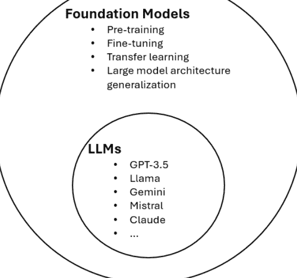
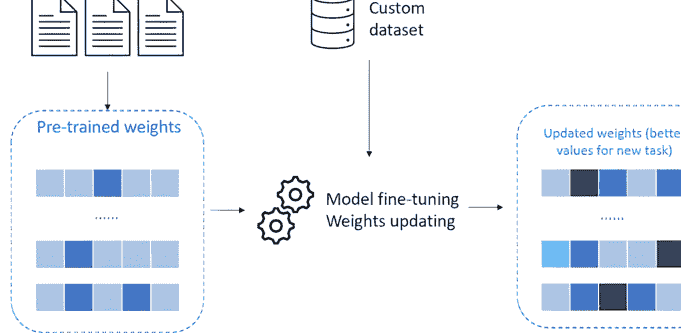
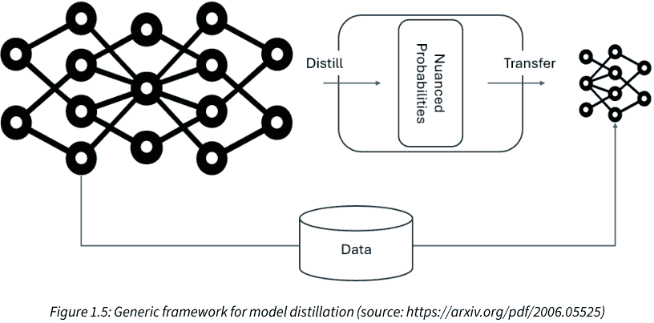

# 1 生成式 AI 工作流的演变

在过去的两年里，**大语言模型（LLMs）**重塑了 AI 的格局。从简单的基于提示的交互到跨越多个行业的复杂应用，LLMs 在架构、训练技术和微调策略突破的推动下演进得非常快。随着其能力的演进，截至 2025 年 4 月，从 ChatGPT 到如今智能体系统的转变标志着一种自然的演进，其中推理、规划和执行能力的加入代表了重大的技术飞跃。

本章将探讨 LLM 的基础、它们如何被构建和使用，以及预训练模型与微调模型之间的区别。重要的是，它为下一次飞跃——AI 智能体的出现铺平了道路。

在本章中，我们将涵盖以下主题：

- 理解基础模型和 LLMs 的崛起
- 最新的重大突破
- 通往 AI 智能体的之路
- 额外智能层的必要性：引入 AI 智能体

通过本章的学习，您将清晰地理解 LLM 是如何演变的、如何被训练和部署，以及为什么通往真正智能系统的道路不可避免地指向 AI 智能体的。

## 技术要求

您可以在书籍配套的 GitHub 仓库中访问本章的完整代码，地址为 `https://github.com/PacktPublishing/AI-Agents-in-Practice`。

## 理解基础模型和 LLMs 的崛起

由于基础模型的出现，AI 经历了根本性的转变——基础模型是多功能、通用的模型，可以适应广泛的任务。其中，LLMs 占据了中心位置，通过自然语言重新定义了我们与机器的交互作用方式。

### 从狭义 AI 到基础模型

在基础模型兴起之前，AI 领域由狭义 AI 主导——即为了执行某一个特定任务而不做其他任何事情的系统。每个用例都需要自定义的流水线：专门的模型架构和专门的训练程序。如果你想将电子邮件分类为垃圾邮件或非垃圾邮件，你需要构建一个过滤器。如果你需要从文档中提取名称和地点，你需要创建一个实体识别器。总结新闻文章？那意味着另一个定制化模型。

这种碎片化的方法有几个缺点。模型是脆弱的——仅在它们训练的狭窄领域内表现良好——且维护成本高昂。任务或数据分布的任何变化都意味着从头开始训练。

基础模型的引入标志着我们构建和思考 AI 系统方式的根本性转变。这些模型在跨越多个领域和任务的海量且多样化的数据集上进行训练。其核心思想在大规模预训练阶段教导一个模型对世界产生通用的理解——其语言、结构和模式。一旦嵌入了这些通用知识，模型就可以以极少的额外数据和计算来适应特定任务。

例如，现在不再为将法语翻译成英语单独构建一个模型，我们现在可以取一个预训练的基础模型，并在较小的翻译数据集上对其进行微调。预训练模型已经理解了语言语法、词法和含义。微调仅仅是将这种理解对齐到特定目标。

基础模型背后的关键创新是迁移学习。这些模型不是从零开始学习，而是将通用训练中获得的知识转移到特定问题上。这大大提高了效率，减少了对标注数据的需求，并导致了更稳健灵活的 AI 系统。

此外，基础模型不仅限于语言。它们跨越模态：某些模型不仅可以处理和生成文本，还可以处理图像、音频或代码。

本质上，基础模型充当了 AI 的“基础大脑”——训练一次，多次复用。这种可扩展性和适应性开启了我们构建智能系统的全新可能性，为更自主和交互的应用程序（如 AI 智能体）奠定了基础。

现在，我们提到基础模型能够处理各种数据格式。在基础模型的集群中，我们可以找到只关注一种数据类型的特定数据模型，LLM 就是如此。



图 1.1：LLM 的特征

LLM 本质上是基础模型的语言专门化版本。它们构建在深度神经网络架构（特别是 Transformer）之上，并经过训练以预测序列中的下一个词。但这个看似简单的目标解锁了令人惊叹的涌现行为。LLM 可以进行对话、回答复杂问题、编写代码，甚至模拟推理。

### 定义

涌现行为（Emergent behaviors）是指系统在达到特定规模时意外展现的复杂能力，尽管这些能力并非通过显式编程或预设。在大型语言模型（LLMs）的语境下，当模型在数据、参数和训练时间上进行扩展时，这些行为就会出现——从而解锁了较小版本中不具备的新能力。

随着模型规模的扩大，它们开始表现出涌现属性，包括以下：

- **上下文学习 (In-context learning)**：LLM 仅通过在提示中提供几个示例即可学习执行任务，而无需任何微调。这在较小的模型中是不可见的。
- **思维链推理 (Chain-of-thought reasoning)**：通过生成中间推理步骤，LLM 可以解决数学应用题或逻辑谜题等多步问题——这些是它们以前所苦恼的。
- **类比推理 (Analogical reasoning)**：它们能够以人类认知处理的方式解决类比问题（例如，“猫之于小猫，狗之于……”）。
- **算术与逻辑**：在大规模下，LLM 发展出了处理多位数算术或逻辑谜题等任务的能力，即使这些任务并非它们训练目标的一部分。
- **理解比喻和幽默**：先进的 LLM 可以解释比喻甚至尝试开笑话——展现出对语言细微差别的抽象理解。
- **多任务泛化 (Multi-task generalization)**：它们不是针对某个特定任务进行训练的，而是同时处理翻译、摘要、问答等——而无需特定任务的训练。

这些能力代表的不仅仅是性能的提升——它们是质上的新行为，只有在大规模下才会“涌现”，赋予了 LLM 令人惊讶的广泛技能，并对各个领域产生现实世界的影响。

### 每个 LLM 的底层机制

每个 LLM 的核心都是强大的神经网络架构——最常见的是 **transformer**。这些网络通过学习数十亿个示例的统计关系，来处理和理解数据中的模式，特别是人类语言。尽管在结构上受到人类大脑的启发，但 LLM 纯通过数学运行，通过相互连接的层传递信息，这些层会随着模型进行调整。

为了让语言变得可计算，第一步将其转换为数字，因为神经网络无法处理原始文本。这通过两个关键步骤实现——分词（tokenization）和嵌入（embedding）：

- **分词 (Tokenization)** 将句子分解为称为 **tokens**（标记）的较小单元。根据模型，可以是完整的单词或单词的一部分。例如，“The cat sat on the mat”可能会根据所使用的分词器被拆分为单个单词或更小的子词。
- **嵌入 (Embedding)** 获取这些标记并将每个标记映射到高维向量——一组编码了其含义与其他单词之间关系的数字字符串。这些嵌入是在训练过程中学习的，使得相似的词最终位于模型“语义空间”中的相似区域。这有助于模型理解上下文和词汇用法，例如“巴黎”和“伦敦”作为城市之间的关系。

一旦输入被分词和嵌入，它就会在 **transformer 网络** 本身中移动。与只有几个隐藏层的传统神经网络不同，LLM 使用了数十层甚至数百层堆叠的层，每层都包含称为 **注意力头（attention heads）** 的机制。这些注意力层帮助模型决定输入中的哪些部分对预测最相关。例如，在完成句子时，模型学习更多关注影响后续内容的特定前词。

训练 LLM 是教导它随时间推移做出更好的预测。这是通过名为 **反向传播（backpropagation）** 的方法实现的，模型将其预测的词与正确的词进行比较，计算偏差程度，然后更新其内部参数以减少未来的错误。

> 反向传播是用于训练神经网络的核心学习算法。它通过比较模型的预测与正确答案，计算误差（称为损失/loss），然后调整网络的内部参数（权重）来减少该误差。这种调整通过将误差向后“传播”到网络的每一层来实现——这也就是其名称的由来。随着时间的推移，这个过程帮助模型做出越来越准确的预测。

假设你输入了“The cat is on the...”。模型通过对可能的延续（如 mat, roof 或 sofa）分配概率来预测下一个词。它并不是随机猜测——而是依赖于在训练期间见过的模式。

这个过程在海量数据（数百万或数十亿个句子）中重复，使模型能够逐渐捕捉语言的结构和节奏。结果是一个系统不仅能够完成句子，还能进行对话、解决问题，并以感知上下文的、通常非常流畅的语言做出响应。

### 我们如何使用 LLM？

一旦 LLM 的训练完成，我们需要理解如何使用这个模型预测下一个标记，这个过程被称为推理（inference）。

在机器学习和人工智能的语境下，推理指的是在新的输入数据上运行训练过的模型以生成预测或响应。在 LLM 中，推理涉及处理提示（prompt）并产生文本输出，通常需要大量的计算资源，特别是对于大模型。

可以通过 API 访问 LLM，允许开发者无需管理复杂基础设施即可使用它们。这种方法简化了集成，使 AI 驱动的应用更具扩展性和成本效益。

OpenAI、Azure AI 和 Hugging Face 等 LLM 提供了处理请求并实时返回响应的 API。该过程通常涉及：

- **身份验证 (Authentication)**：开发者使用 API密钥或 OAuth令牌进行安全访问。

| 定义 |
| :--- |
| 身份验证是开发者证明其应用程序权限访问外部服务的方法。通常通过API密钥或OAuth令牌来实现。API密钥是由服务提供的唯一字符串（类似于密码），用于标识应用程序。另一方面，OAuth 是一种更灵活的系统，允许用户授予应用程序特定的权限，并返回临时令牌。这两种方法确保了只有授权的用户或系统可以发出请求，从而保护敏感数据和资源。 |

- **发送请求**：结构化的 JSON 请求包含模型名称、提示和参数（如用于随机性的温度/temperature）。
- **接收响应**：API 返回生成的文本输出以及作为 token 使用用量的元数据。

```bash
curl -X POST "https://api.openai.com/v1/chat/completions" \
-H "Authorization: Bearer YOUR_API_KEY" \
-H "Content-Type: application/json" \
-d '{
  "model": "gpt-4",
  "messages": [{"role": "user", "content": "What is the capital of France?"}],
  "temperature": 0.7,
  "max_tokens": 50
}'
```

```json
{
  "message": {
    "role": "assistant",
    "content": "The capital of France is Paris."
  }
}
```

注意：某些 LLM API 支持流式响应（streaming responses），模型增量地输出标记，而不是等待生成完整响应后再发送。这种方法有助于缓解通常与大模型相关的高延迟。通过快速交付第一块文本，流式传输减少了感知延迟（用户在看到任何输出之前的等待时间），从而带来了更流畅、更敏捷的体验。

现在，一个合理的问题可能是：如果我想在本地计算机上运行我的模型怎么办？为了回答这个问题，我们首先需要区分以下：

- **私有 LLM (Private LLMs)**：这些是由 OpenAI、Anthropic 或 Google 等公司开发的专有模型。它们是闭源的意味着意味着无法查看或修改其底层代码。这些模型通常仅通过 API 访问，并按使用 token 计费。
- **开源 LLM**：开源模型（如 Meta 的 Llama、Mistral 和 Falcon）可以免费下载、修改和部署。这意味着开发者可以访问底层的已训练参数，在私有基础设施上运行它们，并利用底层架构从零开始提取模型。

然而，即使对于开源 LLM，许多开发者也选择通过 Azure AI Foundry 和 Hugging Face Hub 等平台提供的 API 来访问这些模型。

这种方法具有多个优势：

- **降低基础设施成本**：独立运行 LLM 需要大量的计算资源，这可能昂到难以负担。利用 API 将此负担转移给服务提供商，允许开发者在无需投资昂贵硬件的情况下利用强大的模型。
- **可扩展性**：API 服务可以动态扩展以处理不同的工作负载，确保在无需人工干预的情况下保持一致的性能。
- **安全与合规**：Azure AI Foundry 等平台提供企业级安全功能，帮助组织满足合规性要求并保护敏感数据。

在 AI Agent（以及更广泛的 AI 驱动应用）背景下，最被采用的方法是通过 API 消费 LLM。例外可能与离线场景（例如在离岸站点或远程位置运行 LLM）或数据驻留方面的法规限制有关（LLM 必须位于没有公共云服务的特定国家内）。

## 最新重大突破

生成式 AI（GenAI）领域在过去几年中经历了快速发展，其突破了效率、适应性和推理能力的边界。在接下来的章节中，我们将探索一些最新的技术，这些技术在显著增强 GenAI 模型性能的同时减少了计算需求。

### 小语言模型与微调

随着组织寻求高效、高效益的大型 AI 系统替代方案，小语言模型（SLM）变得越来越重要。

SLM 是 GenAI 模型中的一个精简类别，旨在利用比较大的模型更少的计算资源来高效地处理和生成自然语言。与拥有数千亿参数的 LLM 不同，SLM 通常只包含几百万到几十亿个参数。

SLM 较小的尺寸使得它们能够部署在硬件能力受限的环境中，例如移动设备、边缘计算系统和离线应用程序。通过专注于特定领域，SLM 可以在其专业领域提供与 LLM 相当的性能，同时更具成本效益和能源效率。

SLM 可以在预训练阶段被设计为领域特定模型，也可以在首次训练（通常是通用的，类似于 LLM）之后进行调整和定制。在特定领域进一步使模型专业化的过程被称为微调。

微调过程涉及使用较小的、特定任务的数据集来为特定应用定制基座模型。

这种方法与第一种方法不同，因为通过微调，预训练模型的参数会被修改并针对特定任务进行优化。这是通过在针对新任务的较小标记数据集上训练模型来实现的。微调背核心思想是利用从预训练模型中学到的知识并将其微调到新任务，而不是从零开始训练模型。

未标记语料库训练数据集



图 1.4：微调过程说明

在前面的图中，你可以看到一个在 OpenAI 预构建模型上进行微调的架构。其核心思想是你有一个具有通用权重或参数的预训练模型。然后，你向模型输入自定义数据，通常以“键值”提示词（prompt）和完成项（completion）的形式存在。在实践中，你为模型提供一组示例，说明它应该如何回答特定问题（提示词）（完成项）。

在这里，你可以看到这些键值对可能的外观：

```
{"prompt": "prompt text>", "completion": "ideal generated text>"}
{"prompt": "prompt text>", "completion": "ideal generated text>"}
{"prompt": "prompt text>", "completion": "ideal generated text>"}
...
```

训练完成后，你将拥有一个特别适用于给定任务的定制模型，例如你公司文档的分类。

微调的主要优势在于，你可以根据自己的用例来定制预构建模型，而无需从零开始重新训练它们，利用较小的训练数据集，从而缩短训练时间和计算量。同时，模型保留了通过原始训练（即在大数据集上进行的训练）学到的生成能力和精度。

微调对于 SLM 特别有价值，因为它使其能够在保持效率的同时实现高性能。

已经开发出几种先进的微调技术来优化这一过程，特别是对于 SLM：

- **低秩自适应（LoRA）**：该方法在模型层中插入低秩矩阵，允许以极小的计算开销自适应新任务。LoRA 在内存使用方面非常高效，被广泛用于在有限的硬件上微调大模型。
- **适配器调优（Adapter tuning）**：不是修改整个模型，而是向每层添加名为“适配器”的小型神经网络模块。在微调期间，仅更新这些适配器，在保留模型预训练知识的同时显著减少了可训练参数的数量。
- **前缀调优（Prefix tuning）和提示词调优（Prompt tuning）**：这些技术通过在输入中附加可学习的任务特定向量或标记来引导模型的输出。前缀调优在输入序列开头引入可训练向量，而提示词调优则优化一组提示词标记以引导模型的行为。这两种方法允许在不改变模型内部参数的情况下进行高效自适应。

通过将 SLM 与高效的微调方法相结合，AI 应用可以在无大规模模型计算和财务负担的情况下实现高性能。这使得 AI 在广泛的行业和用例中更加容易、可持续且可扩展。

### 模型蒸馏

模型蒸馏（也称为知识馏 KD）是一个让重型 LLM（我们所谓的重型是指其参数数量）将其知识传递给轻量级 LLM 或 SLM 的过程，且不会显著损失性能。考虑到最强大的 LLM 通常由数十亿甚至数万亿参数组成，导致训练和推理的计算成本高昂，这是一项关键技术。事实上，在蒸馏的主要优势中，我们可以提到：

- 保持精度的同时缩小模型尺寸
- 提高速度并降低延迟
- 降低计算和能源成本
- 允许部署在边缘设备和平台上

蒸馏通常遵循结构化的训练流水线：

1. 教师模型训练：在大型数据集上预训练大型强大的 LLM，并针对特定任务进行微调。
2. 软标签提取：当 LLM 返回输出（称为硬标签）时，我们知道每个标记都是概率计算的结果——关联概率最高的。然而，对于每个预测，我们都有一个相关的概率向量，这实际上提供了对教师预测和思考过程的细致观察。提取这些概率作为软标签，因为它们对训练学生模型非常有用。
3. 学生模型训练：使用软标签结合真实值（ground truth）训练较小的模型。


4. 优化与微调：对学生模型进行进一步完善，以进一步提高其准确性和效率。

# 教师模型

# 学生模型



随着语言模型（LLMs）规模和计算需求的不断增长，蒸馏技术在保持高质量输出的同时，实现了更具实用性的部署。

## 推理模型

2024 年，一种被称为推理语言模型（RLMs）的新型 AI 模型问世，旨在增强超越传统 LLM 的复杂问题解决能力。这些模型代表了生成式 AI（GenAI）发展的重大转变，侧重于内部审议和逐步推理来处理复杂的任务。

RLM 的示例包括：

- OpenAI 的 `o1`：于 2024 年 9 月发布，`o1`模型引入了“私有思维链”机制，允许模型在回答之前在内部对问题进行处理和推理。这种方法在数学和科学领域取得了显著进展，`o1`解决了美国数学数学邀请赛（https://en.wikipedia.org/wiki/OpenAI-o1?utm_source=chat.com）中 83% 的问题，标志着性能与之前的模型相比有了大幅提升。

- OpenAI 的 `o3`模型：在 `o1`进展的基础上，`o3`模型于 2024 年 12 月发布，通过分配更多时间进行内部审议进一步增强了推理能力。这使其在包括编码和高级科学查询在复杂任务中获得了更高的准确率。注意的是，`o3`在 ARC-AGI 基准测试（https://arxiv.org/blog/oai-o3-pub-breakthrough）中获得了 75.7% 的得分，反映了其卓越的问题解决能力。

## 定义


通用人工智能抽象与推理语料库（ARC-AGI）是一个用于评估 AI 系统对新任务的泛化和适应能力的基准，它紧密模拟了人类的智能。由 François Chollet 于 2019 年引入，ARC 强调在不依赖大量先验数据或特定领域训练的情况下抽象推理问题解决能力。

- DeepSeek 的 `R1`模型：2025 年 1 月，中国初创公司 DeepSeek 引入了 `R1`，这是一种开源推理模型，其性能与 `o1`等领先模型相当，而开发成本仅为后者的部分。`R1`的开源特性促进了广泛的研究和应用，贡献了它的快速被采用和影响。

推理模型巨大的区别在于，它们在回答之前会“花时间思考”；与单次通过生成响应的传统 LLM 不同，RLM 会参与内部审议，在得出结论之前处理多个推理步骤。这种方法增强了它们处理复杂多步问题的能力，而这也是我们开始讨论 AI 智能体（AI agents）的关键，正如我们在整本书中看到的那样。

此外，RLM 经过专门训练，擅长需要高级推理的任务，例如复杂的数学、科学研究和错综复杂的编码挑战。这种专业化使其能够在这些领域优于传统的 LLM。

上述特征的自然结果是，与传统 LLM 相比，RLM 的内部处理和扩展的推理路径使得每次查询需要更多的计算力和时间。这种权衡导致了在需要深度推理的任务上以增加资源消耗为代价换得了更优越性能。

## DeepSeek

2025 年，所有人的注意力都转向了一个名为 DeepSeek R1 的突破性模型。

DeepSeek 是一家成立于 2023 年的中国 AI 公司，开发了一系列先进的 LLM——以其 `R1`系列为巅峰——这些模型通过证明高性能模型可以高效且具有成本效益地进行开发，颠覆了 AI 行业。作为锦上添花，DeepSeek 还开源了这种训练方法以及模型本身，以便每个人都可以下载并在本地使用它们。

以下是 DeepSeek LLM 在生成式 AI 领域具备的主要特征：

- **训练方法：** 让 DeepSeek 脱颖而出的是其独特的训练方法。它并不深度依赖人工标注的数据集，DeepSeek 的 `R1-Zero`模型是仅使用强化学习（RL）训练的。在强化学习中，模型通过尝试错误来学习——通过产生理想的结果获得奖励。在这种情况下，LLM 因其连贯且准确的回答而获得奖励，鼓励它独立发展出推理能力。

这种纯 RL 方法允许 DeepSeek 突破边界，但最初也伴随着权衡——模型有时产生可读性较差或不一致的语言。为了解决这个问题，团队对后续的 `R1`模型采用了多阶段训练过程，结合不同的技术来逐步提高模型性能。

该过程从在小规模、高质量的数据集上进行监督微调（通常被称为“冷启动”）开始，以建立语言基础。然后重新引入强化学习以提高推理和决策能力。模型还生成了合成数据，并通过拒绝采样（rejection sampling）进行过滤以剔除糟糕的输出。这些过滤后的数据被用于进一步的监督训练。最后的 RL 阶段有助于提高模型在多样化任务中的一致性和适应性。

结果是什么？一个质量上可以与 OpenAI 的 `o1`等顶级替代方案竞争的模型——尽管训练时使用的资源更少，且没有大规模的人工标注数据集。

- **硬件利用：** 在尖端硬件往往是限制因素的行业中，DeepSeek 证明了创新可以抵消硬件限制。得益于前述的训练策略，该公司在 55 天内使用约 2,000 张 NVIDIA H800 GPU 成功训练了其旗舰模型 DeepSeek-R1，成本约为 560 万美元。考虑到美国对先进 AI 芯片的出口限制，这一成就尤为值得关注。

- **开源：** DeepSeek 对开源原则的承诺营造了一个加速创新的协作环境。通过公开其模型和训练方法，DeepSeek 邀请全球研究人员和开发者对其工作做出贡献并在此基础上进行开发。

DeepSeek 的进展在全球 AI 界产生了波动，挑战了既有者，并引发了对现有实践的重新评估。

## 通 AI 智能体之路

生成式 AI 的快速演进使我们从简单的自动化变成了能够推理、学习和决策的日益智能的系统。近年来，LLM 改变了我们与周围生态交互的方式，实现了更自然的对话和复杂的问题解决。

让我们探索推动 AI 智能体出现的重大里程碑。

## 文本生成

自 2022 年 11 月 ChatGPT 发布以来，用户接受的首个用例是对话式生成，例如：

- “对核裂变生成一个初级的描述”

- “草拟一封给客户高层的邮件，邀请他们参加我们的活动”

- “为关于 AI 的文章列出 10 个创意”

- “为我生成一篇明天要交的法国大革命论文”

上述场景你看起来眼熟吗？

LLM 的文本生成能力是颠覆性的，因为它从根本上改变了人类与技术交互的方式，使 AI 能够以以前未有的流畅度和上下文理解力生成人类文本。

> 注意

在此语境下，文本也包括代码，因为从一开始开始，LLM 在生成和协助编程任务方面就展现了强大的能力。

## 生成式 AI 工作流的演变

大语言模型（LLMs）标志着传统人工智能和自然语言处理领域前未有的转变，因为它们能够根据生成连贯、创意且与上下文相关的文本。突然之间，这种不可思议的技术对每个连接互联网的用户都可用，实现了高质量写作的民主化，加速了营销和客户服务等行业的自动化进程，甚至通过故事讲述、诗歌和剧本创作重塑了创意领域。

然而，在最初对这种似乎了解我们所处世界的免费对话助手进行热热后，我们很快开始意识到存在一个巨大的局限性。ChatGPT 以及更广泛地说，LLMs 所携带的知识限于它们接受训练的数据（这称为参数化知识）。现在，即使这些数据代表了整个网络，用户仍然需要处理动态的、私有的或未包含在模型训练数据中的数据集。

事实上，“与你的数据聊天”是我们生成式 AI 路线图中的下一个里程碑。

## 与你的数据聊天

“我想和我的数据聊天。”这一陈述引出了名为检索增强生成（RAG）的特定技术。这种方法允许 LLM 不仅能生成文本，还能在生成响应之前从外部源检索相关信息，从而确保准确性、上下文相关性并降低幻觉风险。


在语言模型的语境下，幻觉是指生成听起来合理但事实错误或缺乏事实数据支持的信息。这会损害信任，特别是在要求准确性的场景中。

将 LLM “限定”到预定义的知识库的过程被称为“落地”（grounding）。RAG 的关键部分是向量数据库（vector DB），它使用称为嵌入（embeddings）的向量表示来高效地存储和检索信息。这允许 LLM 搜索语义相关的信息，而不仅仅是精确的关键词匹配。

让我们分解这项技术的每一步：

- 1. 检索或寻找相关信息：RAG 不仅仅依赖预训练知识，而是首先从已正确向量化的外部知识库中检索相关数据。这些可以是 PDF、Word 文件、报告、研究论文、结构化记录、表格、内部档案等。

- 2. 增强——提升 AI 的理解：一旦系统检索到相关文档，它们将与原始查询一起被输入模型。这一部分通过提供丰富的上下文输入来增强了 AI 的理解。

AI 现在不再是猜测或依赖通用知识，而是有了基于落地的、特定上下文的信息来构建其响应。这种增强过程确保了模型的输出具有：

- 更精确，因为它直接引用了相关数据

- 更具可解释性的响应，因为它们有可追溯的来源支持

- 更不容易产生幻觉，因为 AI 在经过策划且落地的上下文中生成内容

- 3. 生成——创建感知上下文的响应：有了增强的上下文，AI 随后会生成一个更具信息量、更准确且与检索到的数据一致的响应。最终输出是：

- 事实有据，因为它整合了检索到的知识

- 上下文感知，针对你的特定数据集进行定制

- 可引用的，意味着它在需要时可以提供引用或来源链接

这一步确保了响应不仅仅是 AI 生成的答案，而且是根据你数据的检索和增强知识专门定制的答案。

在接下来的章节中，我们将涵盖更多关于 RAG 及其在代理系统（agentic systems）中作用的内容。

到为止，我们一直在谈论文本数据，但如果我们想用图像、视频或音频与模型交互该怎么办？

## 多模态

生成式 AI 中的多模态是指模型处理和生成跨多种类型数据（如文本、图像、音频和视频）的能力。多模态大模型（MLLMs）通过整合多种模态扩展了传统 LLMs 的功能，允许更全面的理解和更丰富的交互。

最近的进展，例如 OpenAI 的 GPT-4V 和 Google 的 Gemini，展示了 MLLMs 如何在单一工作流中分析图像、说明、处理语音输入，甚至跨不同格式进行推理。

LLMs 的关键特征是它们与仅限文本的 LLMs 共享泛化和适应能力。然而，LLMs 能够处理异构数据，其理念是模仿人类与周围生态互动的方式——即通过我们所有的感官。

多模态模型的一个很好的例子是 OpenAI 的 GPT-4o，它能够通过文本、图像和音频与用户交互。让我们来看几个图像示例：


这是**罗马斗兽场**，也称为**弗拉未露剧场**，位于**意大利**的**罗马**。它是古罗马最具标志性的地标之一，曾用于角斗士比赛和动物狩猎、模拟战斗等公共表演。

图 1.6：ChatGPT 对图像进行推理的示例

如你所见，模型能够分析图像并进行推理。现在让我们让模型生成一张插图：


图 1.7：ChatGPT 修改图像风格的示例

关于 LMM（大模态模型）最有趣的事实是，它们保留了推理能力，使其适用于异构上下文中的复杂推理。让我们考虑最后最后一个例子（仅显示响应的前几行）：

## 十字游戏


横向：

1. 一种属于猫头鹰且眼睛非常圆的鸟。

5. 一种以长胡须闻名的猫。

9. 一种有八条腿且在水中的动物。

13. 风的英文怎么说。

纵向：

10. 以飞行闻名的鸟叫什么名字？

11. 一种以鳞片闻名的鱼。

12. 一种以皮毛闻名的哺乳动物。

14. 有翅膀的鸟叫什么名字？

15. 使用哪个身体部位？

你能帮我解决吗？

当然，让我们来解这个字游戏。以下是根据给定线索的答案：

- 2. Cephalothorax（螯肢节肢动物中头部和胸部的的融合）

- 3. Arachnids（蝎子所属的纲：蛛目）

- 4. Metamorphosis（变态：从幼态到成态的转变）

图 1.8：ChatGPT 对谜题进行推理并解决的示例

## 需要额外的智能层：引入 AI 代理（Agents）

LLMs 在生成连贯文本、回答问题甚至进行有限的问题解决方面展示了惊人的能力。然而，它们的基本设计在现实世界应用中存在几个局限性：

- 缺乏长期记忆：大多数 LLM 在固定的上下文窗口内运行，这意味着一旦超过上下文限制，它们就会忘记之前的交互。这使得它们无法从过去的经验中学习，也在时间推移中保持连续性。

- 缺乏持久的目标或自主性：大语言模型（LLMs）对单个提示词做出响应，但并非以持久的目标为导向进行运行。它们无法主动做出决策、自我纠正或随时间推移改进其方法。

- 推理和多步执行能力有限：虽然 LLM 可以遵循单个提示词中的指令，但在执行多步工作流、处理复杂决策以及在长期交互中保持逻辑连贯性方面表现挣扎。

- 无法与外部系统交互：如果没有额外的集成，LLM 无法检索实时信息、调用 API、操作数据库或执行文本输出之外的操作。

为了应对这些挑战，AI 代理（AI agents）引入了额外的智能层，使模型能够自主行动、对任务进行推理、与外部环境交互，并从过去的交互中学习。

我们将在下一章中定义 AI 代理的构造。不过，你可以开始将其视为一个结合了 LLM 和额外能力（如记忆、规划和多步推理）的系统，以便以最小的干预执行任务，实现极大程度的自主性。与生成静态响应的标准 LLM 不同，AI 代理可以执行以下操作：

- 通过维持记忆并随时间调整行为，实现跨交互的持久化

- 将复杂任务分解为较小的步骤并按顺序执行

- 与工具和 API 交互以检索实时数据、自动化工作流并采取有意义的行动

- 根据学习到的知识、目标和约束自主做出决策

AI 代理的核心是能够处理超越简单问答的复杂任务的智能助手。我们将在接下来的章节中详细探讨它们。

## 总结

在过去的两年里，AI 经历了深刻的变革，从简单的 LLM API 调用转向了更复杂、交互式且自主的系统。LLM 的快速演进以 RAG、微调进展和以推理为核心的架构等创新为标志，所有这些都旨在提高效率、适应性和成本效益。

尽管有了这些进展，但仅靠 LLM 还不足以满足市场对能够自主运行、做出决策并与环境进行有意义交互的 AI 系统的日益增长的需求。

这种转变标志着 AI 开发的一个关键时刻。关注点不再仅仅是让模型变得**更大**，而是让它们变得**更智能**。我们不再将 AI 视为一个响应孤立提示词的被动工具，而是现在设计能够行动、学习并适应复杂现实世界任务的**代理系统（agentic systems）**。

在下一章中，我们将研究 AI 代理的出现、其主要组件以及它们可能形成的各种形式。

## 参考文献

- Knowledge Distillation: A Survey: https://arxiv.org/pdf/2006.05525

- OpenAI o1: https://en.wikipedia.org/wiki/OpenAI_o1?utm_source=chatgpt

- Reasoning Language Models: A Blueprint: https://arxiv.org/abs/2501.11223

- LoRA: https://arxiv.org/abs/2106.09685

- Adapter Tuning: https://arxiv.org/abs/2304.01933

- Prefix Tuning and Prompt Tuning: https://ericwiener.github.io/ai-notes/AI-Notes/Large-Language-Models/Prompt-Tuning-and-Prefix-Tuning

立即解锁此书的专属福利

扫描此二维码或访问 packpub.com/unlock，然后按名称搜索此书


