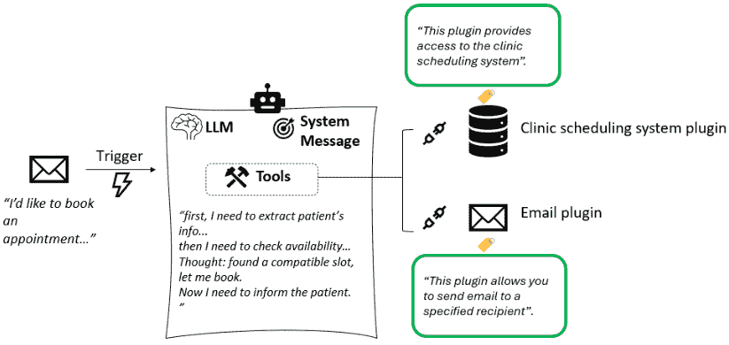

## AI 代理的崛起

本章将探索 AI 代理的演进，追溯其从早期的机器人流程自动化（RPA）到如今复杂的多代理架构的根源。我们将定义什么是真正的 AI 代理，分解其核心组件，并检查塑造全球行业的不同类型的 AI 代理。

在本章中，我们将涵盖以下主题：

- 从 RPA 到 AI 代理的代理演进

- AI 代理的定义

- 不同类型的 AI 代理

- AI 代理的组件

在本章结束时，你将对 AI 代理的演进、其关键组件以及它们如何转型行业清晰的的。

## 技术要求

你可以在书中附带的 GitHub 仓库访问本章的完整代码：https://github.com/PacktPublishing/AI-Agents-in-Practice。

## 从 RPA 到 AI 代理的代理演进

从传统的基于规则的自动化到复杂的 AI 驱动代理的历程，标志着重大的技术进步。最初，自动化局限于僵化的、预定义的工作流。随着机器学习、强化学习和大语言模型（LLMs）的兴起，AI 代理已经进化变得更加自主、更智能，并能够处理复杂的决策。让我们来看看最近几年来代理曾过的不同形态。

- **机器人流程自动化 (RPA)：** 这代表了自动化的早期阶段，专注于设计用于执行预定义任务的基于规则的系统。这些系统遵循严格的逻辑流，根据显式条件和结构化输入执行操作。对于重复性流程，RPA 缺乏灵活性、适应性和处理非结构化数据的能力。例如，一个遵循严格决策树而不从交互中学习的基于规则的机器人；它无法处理动态环境或意外输入。

- **传统的基于 ML/RL 的代理：** 随着人工智能的进步，传统的机器学习（ML）和强化学习（RL）代理开始出现。这些代理可以从数据中学习，基于概率模型做出决策，并通过试错来优化行动。让我们深入了解其中之一：

- 基于规则的代理：这些代理从静态规则集转变为基于机器学习的模型，可以根据训练数据对结果进行分类和预测。

以早期的客户支持机器人为例，它遵循严格的决策树来响应用户查询，并利用命名实体识别机制进行路由。

| 定义 |

| :--- |

| **命名实体识别 (NER)** 是一项自然语言处理（NLP）任务，用于识别和分类给定文本中的关键信息，如人名、组织、地点、日期和其他定义的实体 |


# AI 智能体（AI Agent）的演进

## 强化学习（RL）代理与非 LLM 智能体

强化学习（RL）代理通过与环境交互进行学习，优化行动以获得长期奖励。RL 代理被广泛应用于游戏、机器人和复杂问题解决领域。

例如，DeepMind 的 AlphaGo 通过模拟数百万局游戏并通过试错优化策略，学会了下围棋。

然而，这些早期的代理有一个巨大的缺点：泛化能力有限。以 AlphaGo 为例——尽管它通过数百万次模拟比赛精通了围棋，但它的智能是狭窄且特定领域的。AlphaGo 无法将其知识应用于象棋等其他棋类游戏，也无法处理客户服务或调度等不相关的任务。这种 AI 在严格限制的环境中可能表现出色，但在规则、上下文或输入模式发生变化时无法适应。

这种灵活性的缺乏揭示了 AI 面临的一个更广泛的挑战：需要能够跨领域进行推理、理解模糊指令并实时适应动态环境的代理。这就是基于 LLM 的代理大显身手的地方。

## 基于 LLM 的代理

随着 LLM 的出现，AI 代理变得更具推理、规划和动态交互的能力。生成式 AI 使这些代理不仅能够响应查询，还能合成信息、自动化工作流并与各种外部系统集成——正如我们在整个章节中详细看到的那样。

从高层次来说，基于 LLM 的代理的威力在于，它们可以利用像 `GPT-4o` 这样的模型理解上下文并检索相关信息，还可以协调一组组件，使代理与周围环境交互。这就是区分现代 AI 代理与之前的 RL 代理以及 LLM 本身的“额外智能层”。

此外，当我们利用大型多模态模型时，AI 代理可以整合不同的模态（如文本、语音、视觉和结构化数据），以更人类的方式进行交互。

例如，你可以将基于 LLM 的代理想象成零售助手，它可以处理口头问题、分析产品图像并实时查询库存数据库。

## 多智能体系统与自我复制代理

AI 代理演进的一项重大突破是多智能体系统的引入，即多个代理协作解决复杂任务。这些系统允许任务委托、专门化和并行执行，从而实现更高的效率和自主性。例如，在一个多智能体研究系统中，一个代理负责检索论文，另一个负责总结，而第三个则为团队生成可操作的见解。

此外，我们还可以为这些代理提供“自我复制”能力，这意味着它们可以生成额外的代理来处理任务，从而有效地扩展自身以满足需求。例如，一个 AI 项目经理可以派生出专门的代理来处理软件开发工作流中的设计、编码和测试任务。

## AGI 代理——下一个前沿

AI 演化的最终目标是开发通用人工智能（AGI）代理——即能够执行人类可以完成的任何智力任务的系统。AGI 代理将整合推理、规划、记忆和自我改进能力，在广泛的应用中自主运行。

在编写本书时，这仍然尚未完全成为共识，但见证 AI 代理不断演变的边界确实是一个令人兴奋的时刻。

在本书中，我们将主要关注基于 LLM 的单一代理，并在第 7 章涉及多智能体框架。让我们从定义什么是 AI 代理开始。

# AI 代理的组件

AI 代理是一种基于软件的实体，能够感知环境、对目标进行推理、做出决策，并通过与外部系统的交互（通常是自主地）执行操作。与遵循预设规则的传统自动化不同，AI 代理可以根据上下文动态调整，利用外部工具，并结合记忆随着时间的推移来改进决策能力。

在技术层面，AI 代理由几个核心组件组成：

- **LLM**：代理的推理引擎，提供自然语言理解、响应生成和任务规划。像 `GPT-4`、`Claude` 和 `Gemini` 等 LLM 使代理能够处理用户输入、生成响应，甚至进行多步推理。

- **系统消息（`System message`）**：可以将系统消息视为代理的“使命”，因为它提供了塑造代理行为的底层指令。除了主目标外，系统消息还定义了语气、角色和限制（例如，“你是一个客户支持助手；请简洁且同情地回答”）。

- **记忆（`Memory`）**：使代理能够随时间推移检索上下文，提高连续性和个性化。从高层来说，记忆可以分为短期（基于会话）和长期（存储过去交互的数据库）。然而，代理记忆还有许多细微差别，包括短期、事件记忆和程序性记忆，我们将在第 4 章中探索这些内容。

- **工具（`Tools`）**：将代理的能力扩展到 LLM 之外。代理与 API、数据库、搜索引擎和自动化脚本等外部工具交互，以获取实时数据、执行计算或触发外部流程。

- **知识库（`Knowledge base`）**：存储代理可以引用的结构化和非结构化领域知识。这包括检索增强生成（RAG）、公司专有数据或用于增强决策的专业知识库。

此外，我们还有一个编排层（`Orchestration layer`），用于管理代理内部的任务流，确保组件之间的协调。

## 注意

AI 代理可能具有也可能不具有用户界面。一方面是面向输入的对话式应用程序，它们会根据用户的输入做出反应（例如，处理用户对特定产品查询的客户服务 AI 代理）。另一方面，它们也可以在自动化工作流中“幕后”运行；如果是这样，它们可能完全不需要 UI，因为它们是由事件触发的（例如，每当记录系统中创建工单时，AI 代理就会提供解决方案）。

让我们考虑以下示例。想象一家学术机构正在开发一种 AI 代理，旨在帮助高中生理解复杂的 STEM 主题。通过利用大语言模型、记忆和编排，该代理可以提供个性化的辅导，引用权威来源，并适应每个学生的学习需求。

让我们详细查看每个组件：

- **LLM**：它充当核心推理引擎，即代理的“大脑”，以对话的方式提供解释、解决问题并回答学生的问题——这一切都归功于代理组件提供的额外信息。

> **注意**
>
> 重要的是，LLM 通常在公共或通用数据集上进行训练。这意味着，除非显式地基于此类信息进行对齐，否则它们通常对特定行业、专有数据或组织流程缺乏深层的上下文理解。这就是为什么提供与特定用例相关的外部知识库可以为代理配备特定领域的知识，从而提高在现实世界场景中的准确性、可信度和实用性。

- **系统消息**：这定义了代理的个性，确保其符合教育目的（毕竟，我们不想要一个代替学生做作业的 AI 辅导师，而是一个能够支持他们学习过程、强化薄弱环节并关注特定学习领域的助手）。

- **编排**：确保了 UI、LLM 和各种组件之间的顺畅交互。它能智能地路由请求，决定何时获取外部数据、参考存储的性能历史或直接从 LLM 生成内容。

- **记忆**：跟踪学生的聊天以保持对话的相关性（短期）。此外，它存储了之前学生的交互，以获得他们学术背景的相关知识。这些知识允许代理利用优劣势数据来强化挑战性主题并优化课程计划。

- **知识**：存储代理回答特定问题时所需的相关知识。如果我们需要将模型建立在特定的文档集（例如学校手册）上，这将特别有用。

- **工具和 API 集成**：这是我们为代理提供执行操作工具的地方，例如学生和学校的日历。这将允许代理根据可用性以及与学术课程的兼容性，代表学生预约课程。

- **UI（学生界面）**：提供基于对话的交互学习体验，整合了文本、图表和逐步解决问题。

以下是它们在实践中的工作方式：

1. 学生提问一个关于牛顿力学的复杂物理问题。
2. LLM 处理查询，利用先前的交互和上下文记忆。
3. 编排器确定答案是否需要参考资料、过去的学生表现数据或外部网络搜索。
4. 如果必要，代理从学校的参考手册中检索相关信息。
5. LLM 根据学生的水平调整解释，强化他们在过去考试中遇到困难的领域。
6. 学生接收到交互式响应，包括逐步的解释、视觉辅助工具和练习题。
7. 最终，代理根据其日历，为学生提供在可用时段内预订有关该主题的额外课程的选项。
8. 如果学生接受，代理将代表他们预约课程。

现在问题是：代理是如何知道如何调用特定知识或特定工具的？

这种机制之所以强大，是因为语言模型理解自然语言的能力。每当一个工具或组件（例如“预约会议”操作）初始化时，不仅是通过其底层逻辑（例如 API 调用和向日历添加事件的 `POST`），还附带了自然语言描述。该描述用通俗易懂的话解释了工具的功能及其返回的输出类型。LLM 读取此描述并利用它在执行任务期间决定何时以及如何调用工具。本质上，模型不仅是在执行代码，而是在根据人类可读的描述对可用操作进行推理。

## 如何在自然语言中描述代理人的组件示例

现在，当用户提问的瞬间，由 LLM 大脑驱动的 Agent 会浏览所有组件描述并理解该查询应调用哪个组件来解决问题。

我们可以为 Agent 定义策略以调用合适工具。例如：始终先启动一个工具；随后让它决定是否还需要额外工具（使用系统消息中的指导顺序）。请注意这些策略必须在编排层面上定义：

```
You are a helpful AI assistant with access to following tools:
- Tool A
- Tool B

When processing requests, always try using only Tool A; if insufficient action cannot completed with only model capabilities activate Step B afterward making sure we don't activate Button C before trying upon button T while already tested Item more than necessary.
```

这些生产开发计划最初被指定为 **章节** 条目，随后显示在文章页面中，其中实际操作流程需要根据正在进行的部门特定项目进度报告进行验证更新，这些报告是在证明实质性修改后创建的，包括关于功能需求调整的审计变更，而不影响核心功能状态的保持，除了文档目的之外，仍然继续实际操作的执行，最终的预期成果仍然得以实现。

# 第 2 章

# 39

> **快速提示：** 需要查看此图像的高分辨率版本吗？请在下一代 Packt Reader 中打开此书，或查看 PDF/ePub 版本。

购买此书时将免费赠送**下一代 Packt Reader**。扫描二维码码或访问 `packtpub.com/unlock`，使用搜索栏通过名称查找此书。请双倍检查显示的版本，以确保获取的是正确的版本。


1. AI 智能体自动扫描来自患者 X 的电子邮件。它提取关键细节，如患者 X 的姓名和联系方式、偏好的日期和时间以及所需的专科医生。
2. AI 智能体检查可用性，通过与诊所调度系统调用插件（我们为智能体配备的工具）来完成操作。它将患者 X 的偏好与专科医生最早的空档进行匹配。如果匹配成功，则进入第 5 步。
3. AI 未找到匹配项。由于未找到匹配项，AI 智能体根据专科医生的日程生成后续最佳可用空档列表。它利用写作技能为患者 X 起草回复邮件，提供建议的替代方案，但在发送之前由 John 审核并批准。
4. 患者 X 回复新的偏好，并：
   - a. 接受其中之一（进入第 5 步）
   - b. 请求新选项，然后 AI 智能体重复第 3 步。
5. 一旦 John 和患者 X 同意某个时间，AI 智能体将利用上述相同的插件在系统中安排预约。此外，它利用电子邮件插件向患者 X 发送包含详情的确认邮件。最后，它更新专科医生的日历并通知他们预约。

**AI 智能体的崛起**



图 2.7：医生办公室 AI 智能体结构示例

如你所示，AI 智能体充当 John 的助手，处理重复性的调度任务，而他专注于面对面的患者互动。

# 自主智能体

自主智能体代表了 AI 智能体的最高级类别。与在预定义边界内运行的检索智能体和任务智能体不同，自主智能体策略地协调多个任务和检索过程，做出实时决策以优化工作流。这些智能体表现出高度的独立性、适应性和感知能力，允许它们极少的人工干预执行复杂操作。

自主智能体的关键区别在于它们能够：

1. **结合检索与行动**：它们既可以寻找信息（类似于检索智能体），也可以对其执行操作（类似于任务智能体）。
2. **计划与自我调整**：它们根据新信息或不断变化的约束进行动态调整。
3. **执行多步工作流**：它们将复杂任务分解为子任务，迭代执行并根据结果进行调整。

让我们继续以 John 诊所的例子。随着诊所变得繁忙，管理预约、取消和重新安排变得不可重负。任务智能体帮助简化了单个动作，但现在由自主智能体接管了端到端的调度过程，只需极少的监督。以下是其工作步骤：

- **a. 接收与优先级排序**：智能体监控所有渠道（电子邮件、门户网站、电话转录），提取患者偏好、紧急程度、专科需求，并根据优先级对请求进行排序。例如，一个取消的预约释放了一个空档，智能体立即将其匹配给等待相似时间的患者 X。
- **b. 计划与优化**：它审查全天日程，识别冲突或空闲间隙，并构建优化计划——调整低优先级访问以为紧急访问留出空间。
- **c. 带有反馈的执行**：智能体向患者发送选项信息、更新日历、预订并发送确认——全部自动完成。如果偏好发生变化，它会返回循环并完善其操作。
- **d. 实时适应**：医生请假了。智能体停止新的预约，重新安排受影响患者的行程并通知员工——在无需人工输入的情况下自主处理所有步骤。
- **e. 持续学习**：在结束时，它分析结果，更新患者偏好并调整未来的优先级逻辑。

自主智能体可以进行计划、检索、决策、行动、适应和学习——这一切都不依赖于预定义的工作流。现在 John 专注于边缘情况，而由智能体智能地处理其余部分。

自主智能体代表了 AI 驱动流程自动化的下一步。通过将检索能力（上下文感知、实时查询优化）与任务执行技能（预约调度、自动通知）相结合，自主智能体可以从根本上重塑业务流程和日常运营。

## 备注

即使自主智能体与业务流程自动化的概念非常契合，但请记住，它们也可以代表客户体验的新增强。例如，在上述场景中，患者 X 无需打电话或发送电子邮件，而是利用 AI 智能体提供的对话式 UI（这可以通过诊所网站或 WhatsApp 通道实现）。通过这种方式，患者 X 将以全新的、更顺畅的方式与诊所互动，而 AI 智能体正在捕捉意图、在需要更多信息时提问问题，并协调后端执行任务。


我们可以为智能体提供不同程度的自主性，决策取决于业务场景以及我们对解决方案准确性的信心程度。

## 总结

AI 智能体已经从基础自动化工具演变为复杂的自主系统，改变了业务运营和专业工作流。本章探讨了三种主要类型：通过 Agent RAG 增强知识访问的检索智能体；自动执行调度和电子邮件管理等特定操作的任务智能体；以及将检索、执行与战略性决策相结合以优化复杂工作流的自主智能体。为每种用例部署正确的 AI 类型是实现有影响的自动化和增强用户体验的关键。

从下一章开始，我们将深入探讨 AI 智能体的每个组件，从 AI 编排开始。

## 参考文献

- DeepMind 的 AlphaGo: https://en.wikipedia.org/wiki/AlphaGo#:~:text-AlphaGo%20is%20a%20computer%20program%20that%20plays%20the,%20version%20that%20competed%20the%20name%20Master
- 自主智能体: https://www.techtarget.com/searchenpriseai/definition/autonomous-agents
- 强化学习: https://www.tensorflow.org/agents/tutorials/intro_rl
- AGI: https://www.ibm.com/think/topics/artificial-general-intelligence

此部分包含以下章节：

- 第 3 章：AI 编排器的必要性
- 第 4 章：内存与上下文管理的必要性
- 第 5 章：工具与外部集成的必要性
- 第 6 章：使用 LangChain 构建第一个 AI Agent
- 第 7 章：多智能体应用
