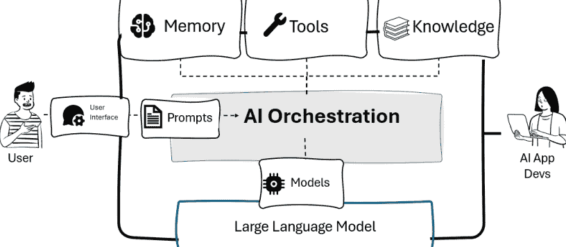
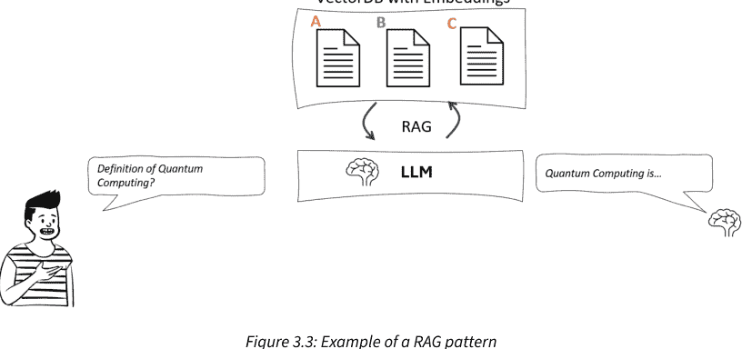
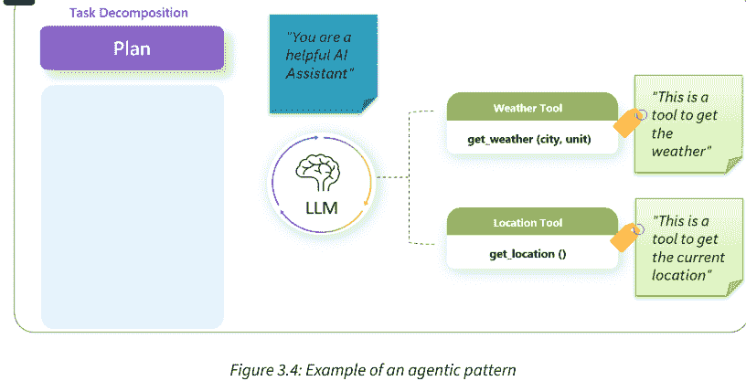
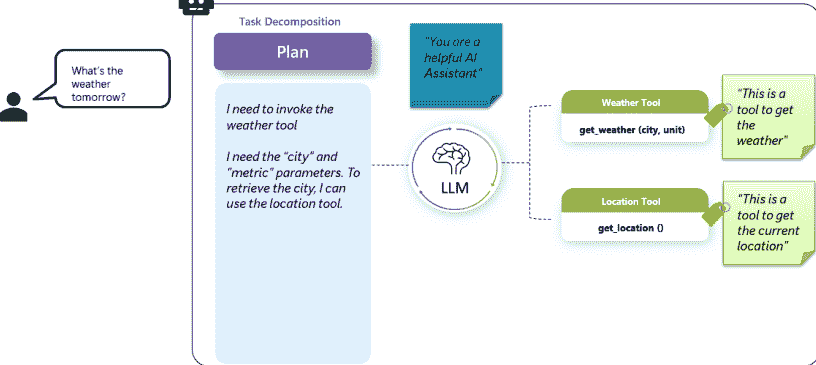
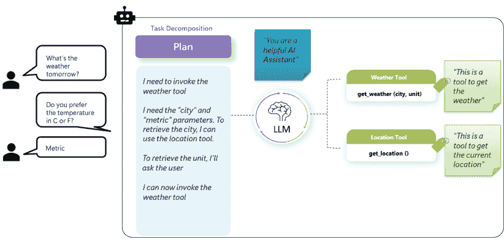
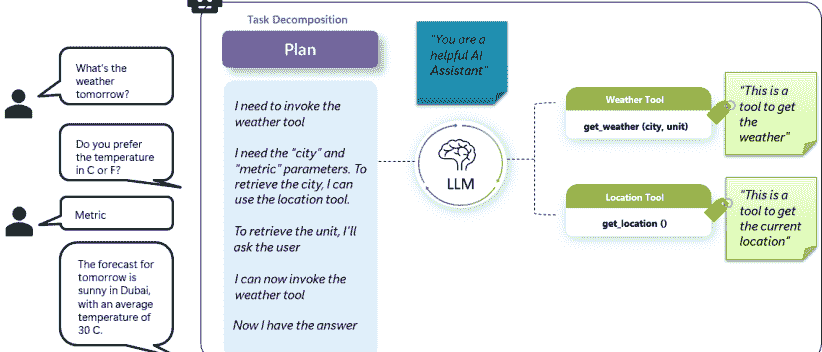
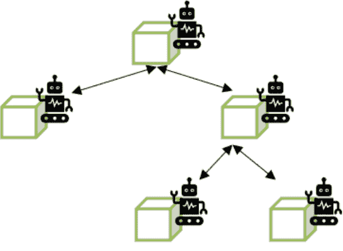

# 3 AI 编排器的必要性

随着大语言模型的出现和 AI 应用的爆发，开发者面临着一个日益增长的挑战：如何有效地管理和协调日益复杂的 AI 系统。随着 AI Agent 变得越来越强大和自主，它们的行为必须是结构化的、受监控且优化的——这通常跨越多个工具、服务和数据源。这种不断增长的复杂性对编排产生了迫切需求：一种确保这些智能组件能够无缝协作以实现共同目标的方法。

AI 编排器的出现是为了应对这一需求。它们不仅仅是提供预构建的组件，而是提供了一个用于结构化交互、管理依赖关系以及维护多智能体或模块化工作流控制的框架——同时加速开发并降低操作风险。

在本章中，我们将涵盖以下主题：

- AI 编排器简介
- AI 编排器的核心组件
- 市场上最流行的 AI 编排器概览
- 如何为你的 AI Agent 选择合适的编排器

在本章结束时，你将熟悉最流行的 AI 编排器，以及如何利用它们来实现你独特的智能体用例。

## AI 编排器简介

现在已经已经很清楚了，利用大语言模型（LLMs）不仅仅是简单的 API 调用——它涉及到工具编排、内存管理以及协调复杂的交互，以构建真正的智能系统。早期的 AI 集成依赖于与模型的直接交互，而 AI Agent 要求更具结构化的方法来管理工作流、集成外部工具并高效处理内存。这正是 AI 编排器发挥作用的地方。

AI 编排器作为中心枢纽，协调模型、工具、内存存储、API 和其他外部系统之间的交互。它确保 AI Agent 以有效且受控的方式运行。

图 3.1：典型开发框架中 AI 编排层的示例

AI 编排器可以在以下方面提供帮助：

- **管理复杂性**：AI 工作流通常涉及多个协调步骤，如检索、推理和执行。编排器自动化并结构化这些过程，使系统更容易扩展和维护。
- **增强可扩展性**：编排器通过分配任务、缓存响应和并行化操作来处理高负载——这对于处理多个用户或 Token 密集型任务至关重要。
- **确保上下文感知**：由于 LLM 内存有限，编排器集成了向量数据库和内存系统，帮助 Agent 保留信息并提供更连贯、个性化的体验。
- **促进工具集成**：编排器通过管理任务执行并确保 LLM 与外部工具之间的流畅交互，简化了 API、搜索引擎和数据库的使用。
- **提高可靠性和监控**：从日志记录到人机回反馈，编排器提供了工具来捕获错误、防止幻觉并确保系统安全可靠地运行。

为了更好地理解在 AI Agent 特有背景下对 AI 编排器的需求，我们需要介绍后者的三个重要特性：自主性、抽象化和模块化。

## 自主性

自主性是指 AI Agent 独立运行的能力，在没有人类干预的情况下做出决策并执行操作。这种自导行为使 AI Agent 能够执行任务、适应新情况并根据其学习的经验追求目标。

AI Agent 的自主性意味着 Agent 将采取的步骤并不总是预先知道的。

例如，让我们考虑一个简单的非智能体工作流：

图 3.2：直接调用 LLM 的 API 示例

每当我们提示 LLM 时，我们都在进行 API 调用，这是构成该工作流的唯一步骤。即使在检索增强生成（RAG）工作流场景中，步骤也是预先知道的：

## 带有嵌入的向量数据库

现在让我们考虑一种自主的智能体方法。假设我们有一个有两个工具的 Agent：

- 天气工具：一个接收两个参数的函数：城市和测量单位。
- 位置工具：一个接收用户当前位置（利用 GPS 位置）的函数。该函数没有参数。

根据 AI Agent 的解剖结构，这两个函数都带有自然语言描述。我们的工作流设计将让 Agent 决定调用哪个工具。

假设一个新用户问：“明天天气如何？”将发生以下情况：

1. Agent 将读取其工具的描述并理解它需要调用天气工具。然而，它缺少两个参数，但得益于它的自主性，它可以查看周围来检索这些参数。因此它理解可以利用位置工具来获取第一个参数：该函数的输出将作为天气工具的参数。

图 3.5：AI Agent 调用工具检索参数的示例

2. 对于第二个参数，Agent 无法独自完成：它需要询问用户。于是它这样做了，询问用户需要哪种测量单位。一旦用户回答，Agent 就能使用两个参数正确地调用工具。

## AI 编排器的必要性

图 3.6：AI Agent 向用户询问缺失工具的示例

3. Agent 观察天气工具的输出，并确定它现在知道了给用户的最终答案。

图 3.7：AI Agent 向用户询问缺失工具的示例

我们可以想象需要多少个 `if...else` 语句才能复制这种自主性吗？即使我们能管理类似的场景，如果用户问了某些未在流程中硬编码的内容怎么办？自适应性、自我批判、自我调整是智能体自主性的关键特征。

我们可以为 Agent 提供许多不同程度的自主性：这取决于我们设置的工作流以及指示 Agent 遵循的规划策略。正如我们在本章中看到的，我们可以定义一个计划，让 Agent 按特定顺序执行工具；我们可以计划让 Agent 在达到特定输出之前不断循环，然后再进入下一步；或者我们可以让 Agent 自由地在需要时尽可能多次使用所有工具。

设计合适的智能体工作流是一场架构设计对话，这是构建你的智能体状态时的关键。

## 抽象化与模块化

抽象化是指拆解并简化复杂性。它是让这些系统变得可理解且可扩展的原因。但除了简化之外，它还实现了模块化设计，这是构建智能系统的基本原则。

模块化将复杂问题分解为更小的、可重用的组件，每个组件处理挑战的特定部分。这种方法具有多个优势：

- **可互换性**：组件可以交换、升级或替换，而不影响整个系统。
- **可重用性**：设计良好的模块可以在不同的项目中重复使用，提高效率。
- **可扩展性**：独立但无缝集成的组件使得解决方案更容易扩展。

在多智能体系统中，抽象化和模块化允许创建协作智能体，每个智能体负责特定任务并进行动态交互。这反映了人类解决问题的方式，我们通过分工、委托和协作来有效应对复杂性。

理解智能体模式中抽象化和模块化的极佳方法是观察繁忙大都市的多智能体交通管理系统，其中不同层级的智能体处理不同级别的抽象，确保运行顺畅而不会让任何单一实体过载。

## 注意

我们将在第 7 章中详细介绍多智能体系统。然而，重要的是，一个独立的智能体始终可以被另一个智能体作为“工具”来调用，其方法是提供关于其能力的自然语言描述。例如，当“项目经理智能体”需要查询 SQL 数据库时，“SQL 智能体”就可以成为它的工具。

从现在起，在多智能体系统以及接下来的示例中，请将智能体视为其他智能体的潜在工具。

在最细粒度的层面上，我们有路口控制器，它们运行于单个交通灯或交叉路口。这些智能体依赖摄像头和传感器的实时数据，根据交通拥堵情况、行人移动和紧急车辆优先级来调整交通信号。

它们并不担心下一个街区或更广泛区域发生了什么；它们唯一的工作就是优化其特定位置的交通流。如果路口突然出现大量车辆，它们可能会延长绿灯时长以缓解拥堵。

放远视角，我们有区域级交通协调员。这些智能体并不微观管理单个交通灯，而是分析社区或区域内多个交叉路口的交通流。

我们使用来自路口控制器、GPS 追踪和公共交通系统的数据来识别拥堵模式、重新规划车辆路线并平衡区域内的车流量。如果它们检测到某个区域延迟过度，它们会调整多个路口交通信号灯的时长，而不仅仅是单个路口。

更重要的是，它们指导路口级智能体，确保它们的调整与更广泛的区域交通目标保持一致。

在最高层，我们有市级交通管理系统，负责优化整个大区的车辆流量。该智能体不关注特定的交通灯或单个拥堵点；而是分配资源、预测长期模式并做出战略性调整。

利用来自天气预报、重大活动日程、事故和公共交通网络的数据，该智能体可能会重新规划整条道路，协调施工进度以减少干扰，或在发生重大事件时实施全市应急响应计划。

# 3 

如果主高速路上发生事故，市级系统会重定向区域级智能体来调整交通模式，进而指示路口控制器高效地重新规划路线。

这种分层结构展示了多智能体系统中抽象和模块化的力量：

- 路口智能体处理本地实时决策，调整交通灯并优先考虑即时流量
- 区域级智能体分析并协调一组交叉路口，优化更广泛区域的交通
- 市级智能体关注大局，为长期效率、应急响应和系统性优化进行规划

这反映了软件架构、AI 系统甚至公司结构在现实世界中的运作方式。无论是执行任务的一线员工、协调工作的中层经理，还是看到整体愿景的高管，抽象都能让系统保持可扩展性、效率和韧性。

通过这种分层方法设计多智能体 AI 架构，我们确保每个智能体都专注于它需要处理的内容，防止系统过载，并实现大规模的自适应、实时决策，就像管理繁华城市的智能交通系统一样。

如果你觉得这听起来不像现实中的存在，让我们来看看 OpenAI 的一个名为 Operator 的工具，它作为一个自主智能体运行，能够在网页浏览器中执行任务，例如预订或填写在线订单。

OpenAI 的 Operator 遵循类似于交通管理系统的分层多智能体方法。每个智能体在不同的抽象级别运行，确保了效率和适应性，而不会让任何单一组件负担过重。

- Web 控制器（低级智能体）：这些智能体处理执行工作：移动鼠标、点击按钮和输入文本。它们不进行分析或规划——它们只是遵循命令。
- 视觉与推理（中级智能体）：这些智能体解释网页界面。视觉智能体（Vision Agent）处理检测相关元素，而推理智能体（Reasoning Agent）决定下一步（点击、输入或滚动）。这一层抽象了执行细节，专注于理解和决策。
- 规划器/编排器（高级智能体）：顶级智能体监督整个系统，确保网页交互与更广泛的目标一致——无论是搜索信息还是填写表单。它将任务委托给中级智能体，确保导航流畅且具有战略性。

这种结构化方法强调了抽象在多智能体设计中的关键性：

- 低级智能体执行而无需担心决策
- 中级智能体专注于解释和规划
- 高级智能体处理整体策略，而不涉及技术细节

通过利用这种模块化设计，OpenAI 的 Adapt 能够动态适应，处理不同的网站而无需手动编程。这种可扩展且通用的架构是多智能体系统驱动现实世界 AI 应用的范例。

从架构角度来看，所有这些组件——智能体、技能、插件——都可以被视为组织中可重复的资产。在这种背景下，AI 编排器确保这些组件协同工作而不产生紧耦合，防止复杂性使系统过载。

遵循上述的分层示例，通过 AI 编排器，你可以轻松定义以下内容：

- 执行智能体（低级）：这些处理原始任务，如 API 调用、数据库查询或网页爬取，执行命令而不进行决策
- 推理智能体（中级）：它们分析数据、确定操作并选择正确的工具，抽象执行细节
- 编排与规划（高级）：编排器监督工作流，分解任务，将其分配给各个智能体并进行动态调整

图 3.8：AI 智能体层次

## 编排器的核心组件

现在我们已经探索了 AI 编排器在管理复杂性、扩展性和可靠性方面的关键作用，是时候检查它们的内部原理了。每个编排器的核心都是一组基础组件，包括工作流执行、内存处理、工具集成、错误检测和安全执行。

## 工作流管理

编排器的主要功能之一是定义和管理工作流。工作流决定了任务如何执行，是顺序执行、并行执行还是通过条件逻辑执行。我们列出一些常见的工作流：

- 顺序工作流：按照预定义的顺序逐步执行任务。例如：文档处理 AI 智能体首先从图像中提取文本，总结内容，最后将其翻译成另一种语言。
- 并行工作流：同时执行多个任务以优化效率。例如：财务分析 AI 智能体可以同时处理多个趋势。
- 条件工作流：执行路径根据特定条件改变。例如：如果情感检测到沮丧，客户支持 AI 智能体可能会将复杂的查询升级给人工代理。
- 分层工作流：任务以结构化、多层的方式组织，由高级 AI 智能体将任务委托给专业智能体。例如：项目管理 AI 智能体监督工程工作流，将任务委托给编码、测试和部署智能体，同时确保整体进度。
- 群聊工作流：AI 智能体在对话环境中协作，交换见解并根据实时反馈调整行为。例如：AI 智能体团队（如研究助手、事实检查机器人和总结模型）动态地讨论一个话题，在向用户提供最终响应之前完善输出。

> 注意

工作流管理与前节介绍的自主性概念紧密结合。例如，在群聊类型的工作流中，你为你的多智能体系统提供了高度的自主性；另一方面，顺序工作流更具预测性，因为你明确说明了要调用的智能体顺序。

AI 编排器为开发者提供了动态设计、修改和优化这些工作流的工具，使其成为创建可扩展自适应 AI 应用的关键。

## 内存与上下文处理

有效的 AI 智能体需要访问历史交互和外部知识库以提供相关的响应并保持连续性。编排器通过各种内存技术处理这些：

- 短记忆：存储基于会话的上下文，允许 AI 智能体回忆正在进行的对话中的细节。例如：虚拟助手在会话期间记得用户之前的问题。
- 长记忆：长期保留知识，通常存储在向量数据库中。例如：医疗 AI 系统记得患者的病史以提供个性化建议，例如过去的就诊转录记录、医学报告、过敏史或服用的药物等。
- 语义记忆缓存：当 AI 编排器管理内存时，它们使用缓存策略来优化检索速度和效率。语义记忆缓存涉及以特定方式存储常见问题，允许 AI 智能体召回事实、概念和关系，而无需依赖基于会话的历史。*示例：* 服务类 AI 智能体可能会回忆用户过去的投诉，并更快速地检索解决方案。

## 定义

在计算上下文中，缓存是一种用于临时存储数据以加速未来访问的技术。传统上，具有低延迟和大吞吐量要求的应用程序利用内存缓存，这涉及到将数据直接存储在系统的 RAM 中，由于 RAM 的高高速特性，能够实现快速检索。然而，内存缓存通常依赖于精确的键值对进行数据检索，这意味着请求必须与存储内容精确匹配才能检索相应的数据。

随着 LLM 驱动应用的出现，一种全新的缓存系统应运而生：语义缓存。它关注数据的含义和上下文（利用嵌入技术），而不是精确匹配。这种方法存储查询结果及其语义上下文，使系统即使在新查询与之前的查询不完全匹配时也能识别并检索相关数据。

通过高效管理内存，AI 编排器确保智能体提供连贯、信息丰富且感知上下文的响应。

## 工具与 API 集成

AI 智能体通常需要访问外部资源，如数据库、API 和计算工具。编排器通过允许智能体执行以下操作来促进无缝集成：

- 从 API 获取实时数据（例如，为旅游助手 AI 获取天气状况更新）
- 访问并查询数据库（例如，为电商 AI 助手检索订单详情）
- 利用外部计算工具（例如，在银行应用中使用机器学习 API 进行欺诈检测）

编排器允许高效地管理这些集成，确保 AI 智能体根据最新且准确的信息进行运行。

## 错误处理与监控

为了确保 AI 应用保持可靠性，编排器实施了稳健的错误处理和监控机制：

- 日志与分析：捕捉 AI 交互的详细日志，用于调试和优化。
- 自动错误检测：识别失败的进程并重试，同时自动进行升级处理。
- 性能跟踪：监控响应时间、准确性和整体系统健康状况。
- 人机交互（Human-in-the-loop）：允许对关键决策进行人工审核。示例：医疗 AI 助手在做出诊断之前需要人类确认。

通过主动处理错误并提供全面的监控，AI 编排器有助于维持高系统可靠性和信任度。

## 安全与合规

安全是 AI 系统中的重中之重，特别是在处理敏感数据时。AI 编排器结合了多项安全措施，包括：

- 身份验证与访问控制：确保只有授权的用户和系统才能与 AI 智能体交互
- 频率限制：通过控制 AI 智能体在特定时间内处理的请求数量来防止滥用
- 数据隐私合规：通过安全管理用户数据，遵守 GDPR 或 HIPAA 等法规
- 偏见与安全过滤器：实施保护措施以防止偏见或有害的 AI 输出

安全与合规机制帮助 AI 智能体在安全、符合伦理的法律框架内运行。

AI 编排器的核心组件——工作流管理、内存处理、工具集成、错误检测和安全——构成了构建稳健高效 AI 应用的基础。通过利用这些能力，开发者可以创建不仅强大而且可靠、可扩展且安全的 AI 智能体。理解这些组件有助于在选择或设计 AI 编排框架时做出更好的决策。

## 市面上最流行的 AI 编排器概览

多种 AI 编排器已成为各自领域的领导者，每种都为特定用例定制了独特能力。有些侧重于模块化和灵活性，允许开发者自定义工作流，而另一些则优先考虑用户友好界面以进行快速原型。在这里，我们将探索截至 2025 年 5 月最常用的 AI 编排器，突出它们的优势和理想应用场景。

- LangChain：LangChain 是一个为构建 LLM 驱动的应用设计的模块化框架。它为集成外部工具、跨交互管理内存以及定义基于智能体的工作流提供了基本元素。作为一个开源项目，LangChain 拥有丰富的文档和强大的社区，是开发者构建稳健 AI 驱动应用的首选。
- LlamaIndex（原 GPT Index）：LlamaIndex 专门优化 LLM 的数据检索，确保高效访问结构化和非结构化数据源。它在与 LangChain 结合构建需要复杂搜索和索引能力的知识驱动型 AI 智能体时特别有效。它弥合大规模数据与生成式 AI 之间差距的能力，使其成为处理海量信息库的组织的宝贵工具。
- AutoGen：AutoGen 为开发多智能体 AI 工作流量身定制，允许 LLM 驱动的智能体在复杂任务上进行通信和协作。通过自动化 AI 实体之间的交互，AutoGen 促进了研究、推理和内容生成，允许 AI 系统通过结构化对话做出更明智的决策。它非常适用于多个专业智能体朝着共同目标工作。
- Langflow：Langflow 通过直观的可视界面简化了设计 AI 工作流的过程。通过与 LangChain 和其他编排工具无缝集成，它实现了智能体交互的快速原型和实时可视化。这对于希望实验 AI 驱动自动化但不想深入研究代码密集型实现的开发者和研究人员特别有用。
- Semantic Kernel (SK)：由微软开发，将机器学习能力与传统软件开发实践相结合，弥合了 AI 与企业应用之间的差距。它支持基于插件的方法，允许开发者将 AI 驱动的工作流集成到现有的业务系统中。Semantic Kernel 的设计是将 AI 驱动的自动化直接嵌入到企业软件环境中以提高生产力。
- LangGraph：LangGraph 通过基于图的工作流为多智能体协作引入了结构化方法。它提供了一个设计复杂的智能体间交互的框架，确保 AI 系统以组织且可扩展的方式进行通信。这对于编排不同智能体必须动态协作解决复杂问题的 AI 应用特别有价值。

现在问题是：我如何为我的 AI 智能体选择合适的编排器？

## 如何为你的 AI 智能体选择正确的编排器

选择 AI 编排器取决于多个因素，包括应用的复杂度、所需的自定义程度、可用的生态系统以及部署的简易性。选择编排器时的关键标准：

- 易用性和模块化：如果你寻找一种快速且模块化的方法将 LLM 集成到应用中，LangChain 是一个很好的选择，因为它文档齐全且架构灵活。示例：开发客户支持 AI 聊天机器人的初创公司可以使用 LangChain 快速构建原型并与现有的数据库和 API 集成。
- 数据密集型应用：如果你的智能体高度依赖结构化或非结构化数据检索，LlamaIndex 为高效集成外部知识源进行了优化。示例：一个跨多个存储库检索和分析法例的法律助手将从 LlamaIndex 的检索能力中受益。

# AI 编排器与智能体内存管理

## 多智能体工作流

如果你的应用需要多个智能体动态交互，`AutoGen` 或 `LangGraph` 是编排复杂 AI 交互的理想选择。示例：研究助手需要多个智能体协作——一个总结文档，另一个检查事实，第三个生成报告——这会从这些编排器中受益。

## 企业级 AI

如果你需要强大的企业级集成和安全性，`Semantic Kernel` 非常适合基于 Microsoft 的环境和结构化的 AI 工作流。例如：一个与 Microsoft Teams 和 SharePoint 集成的企业级 AI 驱动工具将与 `Semantic Kernel` 非常匹配。

## 视觉化工作流设计

如果你倾向于使用无代码或低代码界面进行 AI 工作流设计，`Langflow` 提供了一个直观的 UI，用于 AI 智能体交互的快速原型和调试。例如：一个没有深厚编程知识的营销团队创建一个 AI 驱动的内容生成器，利用 `Langflow` 的可视化界面进行快速工作流设计。

## 选择合适的 AI 编排器

选择 AI 编排器应符合你 AI 系统的目标和技术需求。有些编排器专注于模块化开发，而另一些则侧重于扩展性、多智能体协作或企业集成。理解这些区别将帮助你为特定的用例选择最佳工具。

## 总结

AI 编排器在智能系统的开发和部署中起着关键作用，它们提供了管理工作流、集成工具和维持效率的必要框架。随着 AI 应用的不断演进，编排器确保了 AI 智能体能够自主运行、处理复杂任务并适应动态需求。

在本章中，我们探索了 AI 编排器的基本组件，包括工作流管理、内存处理和安全性。我们还研究了目前最流行的一些编排器，每种都针对特定用例提供了定制的优势。

选择正确的 AI 编排器取决于多种因素，例如集成需求、扩展性和工作流复杂性。通过理解它们的核心功能，开发者和企业在选择符合其目标的编排工具时可以做出明智的决策。

从下一章开始，我们将深入探讨 AI 智能体引人注目的组件，从内存和上下文管理开始。

## 参考文献

- OpenAI Operator: https://openai.com/index/introducing-operator
- LangChain: https://www.langchain.com/
- LlamaIndex (原 GPT Index): https://www.llamaindex.ai/
- AutoGen: https://www.microsoft.com/en-us/research/project/autogen/
- Langflow: https://www.langflow.org/
- Semantic Kernel (SK): https://github.com/microsoft/semantic-kernel
- LangGraph: https://www.langchain.com/langgraph

## 解锁专属福利

立即解锁此书的专属福利。扫描此二维码或访问 `packtpub.com/unlock`，然后通过书名搜索此书。

注意：在开始之前准备好你的购买发票。

---
