# 4 内存和上下文管理的必要

大型语言模型（LLMs）从根本上是无状态的，尽管它们看起来是连贯且富有对话性的。它们只知道你在当前提示（`prompt`）中告诉它们的内容。除非你显式地构建，否则没有持久的上下文或历史。如果处理得当，内存允许智能体在时间的推移中保持一致性、感知上下文，甚至实现个性化。

在本章中，我们将涵盖以下主题：

- 不同类型的内存
- 管理上下文窗口
- 内存的存储、检索和刷新
- 管理内存的流行工具

在本章结束时，你将对内存如何在 AI 智能体中发挥作用，以及让你的智能体更智能、更可靠且感知上下文所需的工具和模式有深入理解。

## 不同类型的内存

就像人类依赖记忆来理解世界一样，AI 智能体也需要内存来随时间长时间智能地运行。内存允许智能体在跨交互中保留信息、记住过去的事件、存储有用知识并建立一致的行为。没有内存，即使是最强大的语言模型也是无状态的——只对当前输入做出反应，而不知道之前发生了什么。

随着 AI 智能体变得越来越复杂，对其内存系统的要求也随之增加。智能体仅仅生成响应已经不够了——它必须随着时间的推移进行记忆、适应和改进。有趣的是，研究人员设计智能体内存架构的方法很大程度上借鉴了心理学家对人类记忆的理解。这种并行关系导致 AI 内存类型的分类日益增多，每种内存都有独特的用途，从处理近期交互到构建长期知识和技能。

在本节中，我们将遵循 Theodore R. Sumers 等人在他们的论文 [Cognitive Architectures for Language Agents](https://arxiv.org/pdf/2309.02427) 中提出的框架，拆解驱动现代 AI 智能体的不同类型的内存系统。

## 短记忆

短期内存（STM）是智能体的即时工作空间——用于临时存放最近输入以供快速参考的草稿纸。这就是为什么 STM 通常被称为**工作记忆**（根据上述论文中使用的术语）。

在对话系统中，这对于维持跨多轮交互的连贯性至关重要。如果用户说“帮我订一个晚上 7 点 4 个人的桌子”，然后接着说“再加一个座位”，STM 帮助智能体连接这些点。

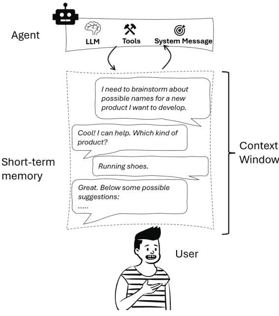

从技术上讲，STM 通常使用滚动上下文窗口或缓冲区实现，持有最近的对话或数据块。

| 定义 |
| :--- |
| 上下文窗口是指模型一次可以处理的最大信息量（令牌）——通常包括提示、对话历史以及任何检索到的或注入的知识。它是内存管理中的一个关键限制，因为超过窗口将迫使智能体忘记或总结过去的数据以保持在限制之内。 |

随着新输入的到来，旧数据会被推出去。这保持了交互的响应性和轻量化，但也意味着 STM 本质上是瞬时的。一旦缓冲区充满或会话结束，信息就消失了。

## 内存和上下文管理的必要

因此，虽然 STM 是快速问答式交互的理想选择，但在记住偏好或从过去的会话中学习方面不足。这提出了一个关键问题：AI 智能体如何在跨交互中保留长期上下文和连续性？

## 长期记忆

虽然 STM 处理现在，但长期记忆（LTM）关乎时间的连续性。它允许智能体在不同的会话之间回忆信息，实现个性化、持久知识和更好的决策。

LTM 通常由持久性存储系统支持——向量数据库、知识图谱或结构化仓库。这里最有效的技术之一是检索增强生成（RAG），智能体从存储的库中提取相关知识来告知其响应。这使得 LTM 对于客户助手、推荐引擎或个性化导师等智能体来说至关重要。

注意 STM 和 LTM 是关联的，STM 最终可以刷新到 LTM（我们将在接下来的章节中探索类似的技术）。

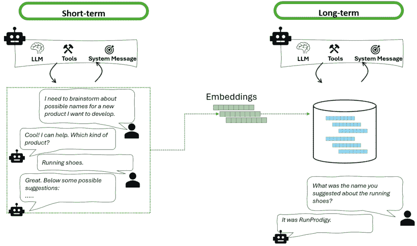

在长期记忆中，我们可以进一步细分为三个镜像人类认知的不同子类型。

## 语义内存

语义内存存储通用知识——事实、概念、规则和定义。它是系统中“知道某事”的部分，允许智能体进行推理、解释并提供知情的答案。

注意，根据设计，LLM 带有参数化知识，这些知识提供了关于世界的广泛知识：它们了解物理、数学、通用常识以及以任何形式编码在互联网上公开的任何文档中的一切。然而，这些知识对于我们特定的用例可能不够或不相关：例如，如果我们想让 AI 智能体对我们在医疗保健中心进行过的所有过去的诊断有记忆呢？当然，这是无法成为训练集的一部分，因此它不是 LLM 参数化知识的一部分。这就是为什么语义内存对于运行在法律、医学或金融等领域的智能体特别有用，在这些领域，事实准确性和领域理解至关重要。

在实践中，语义内存可以通过存储在向量存储中的向量编码器嵌入来实现，其检索原理与第 1 章解释的 RAG 概念相似。

> 注意：语义内存也可以是 STM 部分内容的最终终点。事实上，STM 上下文窗口中的某些组件或对话可能值得保留，如果是这样，它们可以向量化并存储在语义内存中。

## 情景记忆

在人类大脑的语境下，情节记忆是指回忆个人参与过的特定事件的能力。对于 AI 来说，情节记忆允许 AI 存储和检索与其环境交互的特定经验或片段的记忆，而不仅仅是通用事实知识。

例如，一个 AI 导师可能会记住学生上周是如何回答一个数学题的，并将其用于今天的课程。这种内存通常存储为结构化日志或事件历史，智能体可以引用它们做出案例决策或调整其行为。

在实践中，情节记忆可以被视为少样本提示（`few-shot prompting`）技术的扩展。

### 定义

少样本提示（Few-shot prompting）是一种用于大语言模型的技术，通过在提示词本身中为模型提供少量（通常为 2-5 个）说明性示例。这些示例有助于引导模型的响应，使其更好地对齐目标任务，而不需要大量的微调或训练数据。

以下是一个示例：

任务：情感分析

示例 1：
文本：“我太喜欢这部电影了！”
情感：正向

示例 2：
文本：“这部电影太糟糕了。”
情感：负面

现在对以下文本进行分类：
文本：“尽管存在一些缺陷，但电影整体来说是趣味。”
情感：

通过这种方式，少样本提示利用了模型仅从少数示例中快速学习模式的能力，在无需显式重新训练的情况下提高其在特定任务上的性能。

事实上，通过存储一组（“用户问题”，“给定答案”）或（“用户问题”，“执行的任务”）配对，AI 智能体可以被引导以正确的方式执行特定操作。

根据 Chad Dechant 的论文《AI 智能体中的情景记忆带来了需要研究和缓解的风险》，在 AI 智能体中实施情景记忆将带来显著增强，如下：

- **规划与决策：** 记忆提供了形成新策略的基石，或者通过回顾类似的以往经验和结果。
- **改进学习：** AI 智能体可以通过反思过去的事件及其结果，识别模式并从错误中学习，从而更好地适应新场景。
- **问题解决：** 情景记忆提供了过去场景的示例，通过类比或对过去解决方案的重新组合来帮助解决当前问题。
- **预测与想象：** 就像人类根据过去的事件在脑海中模拟未来场景一样，AI 智能体可以使用情景记忆来预测可能的结果。

然而，作者还强调了与情景记忆相关的潜在风险：

- **欺骗：** 智能体可以利用情景记忆，通过回顾过去的交互并策略性地操纵未来的交互来执行复杂的欺骗。
- **非愿知识保留：** 智能体可能会保留并回忆用户希望私密的信息，构成重大的隐私风险。
- **不可预测的行为：** 随着智能体重用过去的经验来形成未来的行动，很难预测某些记忆将如何影响未来的行为，可能导致意外之外的后果。
- **增强的情境感知：** 改进记忆能力可以使 AI 更好地理解并适应其运行环境，可能在不被察觉的情况下逃避控制或审计以确保安全。

尽管将情景记忆集成到 AI 智能体中存在潜在风险，但整体能力仍然非常有前景。论文强调，这些风险可以通过精心设计的封锁策略和安全原则得到显著缓解，例如确保人类的可解释性、提供用户添加或删除记忆的控制、隔离内存存储，以及限制 AI 智能体编辑自己的记忆。

### 注意事项

在人类认知和 AI 系统中，情景记忆和语义记忆起着不同的作用：

情景记忆像一本个人日记。它存储“发生了什么”——与特定时间和地点相关的特定事件、交互和经验。对于 AI 来说，这可能意味着记住特定用户的投诉或在失败过程中所采取的步骤。

语义记忆更像一本百科全书。它存储“已知内容”——独立于语境的通用事实、概念和规则。对于 AI 智能体来说，这可能意味着产品规格、策略规则或领域知识。

保留这两种类型的记忆允许智能体更有效地进行推理：它们可以在需要时利用过去的事件，同时依靠既有知识来保持一致性和准确性。

通常，AI 智能体通过记录交互来捕获情景记忆，这些交互通常包含：

- **用户输入：** 用户提供的查询或命令
- **智能体响应：** AI 生成的动作或回复
- **上下文元数据：** 附加信息，如时间戳、用户标识符和环境上下文

这些交互存储在数据库的结构化格式中。常见的存储解决方案包括：

- **关系型数据库：** `SQLite` 和 `PostgreSQL` 等系统用于存储结构化的交互日志
- **向量数据库：** 如 `Pinecone`、`Weaviate` 和 `Chroma` 等工具存储交互的嵌入（数值表示），便于基于相似性的高效检索

当 AI 智能体需要回忆过去的经验以为当前决策提供信息时，它执行以下步骤：

- **查询嵌入：** 将当前用户输入转换为嵌入
- **相似性搜索：** 将此嵌入与向量数据库中存储的嵌入进行比较，以找到最相关的过去交互
- **上下文注入：** 将检索到的记忆整合到智能体的当前上下文中（通常通过提示工程），以影响响应的生成

这一过程使智能体能够根据先前的经验调整其行为，增强交互的个性化和连续性。

## 程序记忆

我们需要提到的最后一种记忆是程序记忆。对于我们来说，这种类型的长期记忆负责存储“如何做某事”，例如记住如何骑自行车或系鞋带——这些技能一旦学会，就可以在没有有意识思考的情况下执行。在 AI 语境下，程序记忆具有类似的功能：它编码了治理智能体行为的基础性“门道”。例如，在自动驾驶汽车中，程序记忆能够执行导航路线和避障操作，而无需从头重新评估每个决策。

根据《语言智能体认知架构》（Cognitive Architectures for Language Agents）论文中提出的 `CoALA` 框架，智能体的程序记忆由两个主要部分组成：

- LLM 权重，它隐式地编码了大量的程序知识——如语言使用、推理模式和世界模型
- 智能体代码，它显式定义了程序，如提示构建、检索机制、落地例程（`grounding routines`）和决策逻辑

本质上，程序记忆被编码在模型的架构中。因此，大多数当前的 AI 智能体将其视为静态的（与人类的程序记忆不同，后者可以通过经验随时间进行适应）。LLM 的权重在部署期间保持不变，而智能体代码很大程度上由智能体自己重写。

> 注意：理论上可以创建能够自动更新自身源代码的智能体——特别是其技能集（通过编写新技能，例如）或决策逻辑。另一方面，由于高成本、复杂性和安全考虑，野外 LLM 微调（即修改权重）并不常见。

一种更具实用且观察到的行为是智能体修改系统消息——本质上是更新它们用于引导的指令。这种方法提供了一种轻量级的程序化适应，尽管其范围有限且未被充分利用。

我们涵盖的每种记忆在塑造智能体智能方面都发挥着独特的作用，从实现行动到辅助决策以及从过去学习（参见下表 4.1）：

| 类型 | 目的 | 内容 | 存储机制 | 使用示例 | 更新机制 |
| :--- | :--- | :--- | :--- | :--- | :--- |
| 语义 | 存储通用世界知识和事实 | 抽象概念、定义和关系（例如，“巴黎是法国首都”） | 知识库、数据库或嵌入模型参数中 | 检索事实或领域知识 | 通过结构化数据进行训练或手动输入更新 |
| 情景 | 记录特定事件和经验 | 过去交互的上下文细节（例如，用户之前的查询） | 日志、数据库或结构化记忆存储 | 根据用户历史个性化响应 | 在交互过程中捕获；可能涉及用户反馈 |
| 程序 | 编码知识和技能 | 动作序列或例程（例如，处理用户请求的步骤） | 嵌入代码、模型权重或定义的工作流中 | 执行任务，如身份验证或数据处理 | 通过训练、强化学习或手动更新进行 |

表 4.1：记忆类型及其使用示例

它们共同构成了智能体持久能力和累积知识的骨干。

我们涵盖了长期和短期记忆；但还有第三类值得提的：语义内存缓存。

## 在短期记忆与长期记忆之间——语义缓存的作用

在短期记忆（STM）的即时性和长期记忆（LTM）的持久性之间，语义缓存提供了一个灵活、高速的层，用于根据含义检索近期信息。这些缓存通过将最近的交互存储为向量嵌入（`vector embeddings`），能够在当前会话中进行语义相似搜索——而无需在长期存储中查询或持久化数据。

> 注意
> 在传统的应用程序开发中，内存缓存是一个临时存储层，它在内存（通常是 RAM）中保留被频繁访问的数据，以降低延迟并提高性能。应用程序不再重复从数据库或外部 API 查询相同的数据，而是从缓存中检索——从而实现更快的访问。`Redis`、`Memcached` 以及应用框架中的内存级层通常用于此类目的。

缓存通常基于键值对工作——你使用唯一键存储结果，并在稍后检索它。这对于存储用户会话、API 响应或不经常更改的计算值等场景非常高效。在 AI 智能体以及更广泛的 LLM 驱动应用背景下，这一概念是类似的，但键值对是基于嵌入的，因此检索可以通过向量搜索而非关键词匹配来实现。

在图 4.3 中，你可以看到关键词内存缓存与语义内存缓存的区别：

### 关键词内存缓存

| 内存缓存 |
| :--- |
| 'question': 'what is the capital of Italy?' | 'answer': 'what is the capital of Italy?' |
| 'The capital of Italy is Rome.' | 'answer': 'The capital of Italy is Rome.' |

### 语义内存缓存

| 语义内存缓存 | | |
|---|---|---|
| 'what is the capital of Italy?' | Embedding | Question: what is the capital of Italy? |
| 'Italy main city?' | [0.5, 0.9, ... ] | Answer: The capital of Italy is Rome |
| 'Can you tell me what is the boot-shaped country's capital?' | | The capital of Italy is Rome. |

图 4.3：关键词内存缓存与语义内存缓存之间的区别

**快速提示：** 需要查看此图像的高分辨率版本？请在下一代 `Packt Reader` 中打开此书，或在 PDF/EPub 版本中查看。

**下一代 `Packt Reader`** 随书免费赠送。扫描二维码或访问 `packtpub.com/unlock`，然后使用搜索栏通过名称找到此书。双检显示的版本以确保获取的是正确的版本。


与依赖模型 token 上下文窗口的 STM 以及设计用于跨会话持久记忆的 LTM 不同，语义缓存是会话范围内的、瞬时的且快速的。它的设计不是为了随时间保留知识或事件，而是为了帮助智能体在持续交互期间动态检索相关上下文——即使其表述方式与原始表达不同。

# 4 

这种实时回溯通过专为语义检索设计的向量支持数据库实现的。诸如集成了向量索引的 `Cosmos DB`、`Pinecone`、`Weaviate` 和 `Qdrant` 等工具允许开发者以低延迟存储和查询嵌入。这些系统支持内存搜索、元数据过滤以及基于相关性和新颖性的评分等功能——使其成为实现语义缓存的理想选择。

例如，在患者预约流程中，如果用户之前说“下午最合适”，随后询问“你们下午 3 点以后有空档吗？”，语义缓存可以检索并匹配之前的陈述——即使它已不在上下文窗口中。这使得智能体能够在不产生额外成本的情况下保持连贯性和上下文感知。

在实践中，语义缓存充当智能的短期回溯层，赋予智能体保持响应能力、语义流利高效性的能力——而无需长期的投入。它们并没有取代 STM 或 LSTM；它们通过在对话过程中实现低延迟、相关性驱动的内存来弥补它们。

在下一节中，我们将关注 STM——智能体在决策过程中如何持有和操作活动信息。这是感知、推理和上下文实时汇聚的地方。

## 管理上下文窗口

当涉及 STM（或工作记忆）时，上下文窗口（context window）的概念至关重要。它定义了模型可以同时处理的、以 token 为单位的最大文本跨度。该窗口允许模型在生成响应时“记住”并利用特定段的信息，从而使用户无需重复上下文信息。

尽管最新的 LLM 能够处理的最大 token 数量有所增加（例如 GPT-4o 等模型可多达 128K token），但管理上下文窗口仍面临挑战。当输入超过模型的上下文窗口时，模型可能难以维持连贯性和相关性，因为它无法访问文本的前部部分。这种局限性可能导致输出缺乏上下文或连续性，特别是在需要处理扩展文档或长时间对话的任务中。

因此，我们需要妥善设计上下文窗口的处理方式。该领域有许多技术，在本节中，我们将检查一些最流行的技术：

- **滑动窗口（Sliding window）：** 滑动窗口技术通过维护一个固定大小近期消息窗口并动态更新它来管理短期记忆。确定窗口大小至关重要，可以通过固定消息数量或设置 token 限制来实现。例如，如果我们设置滑动窗口以保留 4 条消息（通常是这样设置的），我们将得到如下结果：

- **编辑消息列表（Editing message lists）：** 编辑消息列表是滑动窗口的扩展，在保留哪些消息方面可能更加细粒度。它涉及在 LLM 处理消息之前选择性地裁剪或过滤消息。例如，想象一个 AI 客户支持助手正在帮助用户排除软件故障。在 20 次往返对话中，只有少数消息与用户的最新请求直接相关。系统不会将 20 条消息全部输入 LLM（这可能会超过 token 限制），而是选择性地保留：

    - 用户最近的问题
    - 助手最后的 1–2 次回复
    - 一条包含关键上下文的早期消息（例如用户的操作系统版本）

在实践中，你需要建立明确的规则或指南来确定哪些消息应该被保留或丢弃。常见标准包括：

- **新颖性（Recency）**（滑动窗口的一种）：优先考虑近期消息以保持相关内容
- **相关性（Relevance）：** 保留与当前查询或任务直接相关的消息（可以通过另一个 LLM 结合特定提示词进行相关性评估）
- **发送者（Sender）：** 仅保留来自特定发送者（用户或其中一个智能体）的消息

过滤器的详细程度取决于聊天窗口中每条消息关联的元数据。例如，我们可以决定只保留用户在过去 5 分钟内发送的消息。所有其他闲聊或冗余问题都被裁剪掉。这确保了模型只关注上下文中最相关的细节。

例如，在在上一个示例中，一组可能的元数据可能如下：

```json
{ "sender": "user",
"timestamp": dd-mm-hh-mm,
"content": "I like option 2",
}
```

- **摘要：** 摘要是将大量的历史记录或冗长的文档浓缩为简洁、集中的观点的过程。这种技术捕捉了要点和关键信息，在保留关键上下文的同时显著减少了所需的 token 数量。

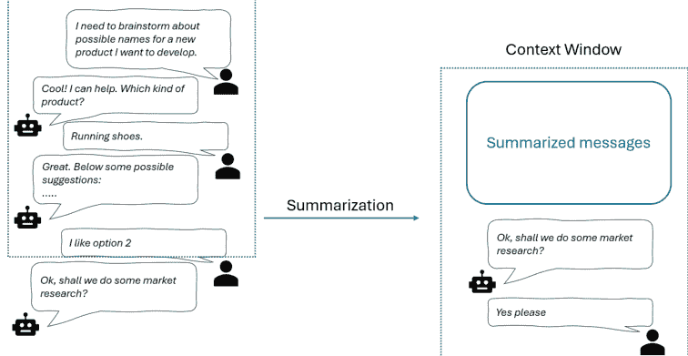

图 4.6：短期记忆消息摘要示例

在实践中，摘要由 LLM 直接生成，并作为参数传递给系统消息的特定，该部分告知代理（agent）如何处理短期记忆。

## 注意事项

除了我们将要使用的特定技术外，了解何时想要应用该技术也关重要——例如，当短期记忆（STM）的 token 数量达到给定的数量时（我们可以将其设置为接近我们所使用的 LLM 能处理的最大 token 数量）。通过执行 token 检查，我们确保当 token 计数接近限制时，选定的策略（如摘要或消息编辑）会被强制执行。

上述技术是处理 STM 上下窗口的关键；然而，它们可能还不够。事实上，取决于你正在开发的 AI 代理的类型，你可能需要在比用户会话更长的时间内保留和存储工作记忆。

在接一节中，我们将查看如何处理类似的场景。

## 存储、检索和刷新记忆

在 AI 代理中将信息从 STM 移动到 LTM（长期记忆）对于跨会话保留上下文并实现随时间的学习至关重要。这一过程通常涉及从最近的交互中识别相关的事实、用户偏好或见解，并将存储在结构化的、可检索的格式中。

长期记忆可以通过多种方式实现，取决于用例。一种常见方法是使用向量数据库进行语义存储——将信息块嵌入向量并用于基于相似性的检索，通常与 RAG 结合使用。这允许系统检索与上下文相关的数据，即使它不是即时提示词（prompt）的一部分。

存储的信息也可以组织为结构化元数据（如用户配置文件或偏好），或作为事实条目附加到更广泛的知识库中。

注意，这种方法可以与向量存储方法相结合。这种混合方法允许系统首先使用显式的结构化字段（如用户 ID、主题标签或时间戳）过滤相关信息，然后在过滤后的子集应用语义向量搜索。例如，在多用户应用程序中，代理可以首先检索与特定用户相关的文档，确保上下文范围被正确限定。

## 长期语义记忆

# 记忆与上下文管理的性

```json
{
  "user": "Pippo",
  "topic": "bank account",
  "embeddings": [
    [0.2, 0.4, ...],
    ... 
  ]
}
```

```json
{
  "user": "Pluto",
  "topic": "bank account",
  "embeddings": [
    [0.3, 0.1, ...],
    ... 
  ]
}
```

```json
{
  "user": "Pippo",
  "topic": "card inquiry",
  "embeddings": [
    [0.9, 0.1, ...],
    ... 
  ]
}
```

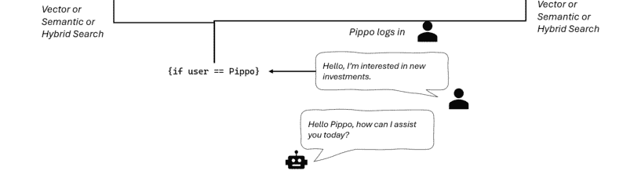

图 4.7：混合记忆检索示例，结合过滤器与向量搜索

一旦隔离了相关的记忆片段，向量相似性搜索就可以根据当前查询呈现出最符合上下文的信息片段。这种分层方法提高了精确性和相关性，能够提供更准确、更个性化的响应。它还通过在调用计算密集密集型向量相似性操作之前缩小搜索空间，来提高性能。

最终，我们需要考虑长期如何管理我们的记忆。在 AI 代理中刷新和更新记忆涉及定期审查和修改存储的知识，以确保其保持相关性、准确性和实用性。这一过程可以是响应性的（由特定的交互或更改触发），也可以是主动的（作为后台任务进行调度）。

记忆更新可以在工作记忆层实时实现，也可以在后台异步地对长期记忆进行处理。例如，如果用户更改了偏好或纠正了代理，该数据可以立即覆盖或修改记忆中相应的条目。

# 4 

# 83

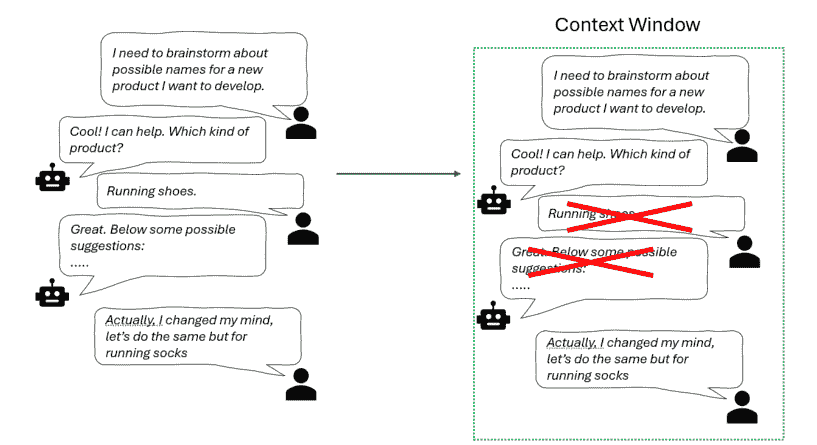

图 4.8：用户会话背景下编辑记忆的示例

另一方面，代理也可以定期审查积累的交互，以精炼摘要、重构配置文件或删除过时的事实。

刷新语义记忆的常用技术是重新生成更新文档的嵌入并替换数据库中的旧向量。对于结构化元数据，更新涉及覆盖用户配置文件中的字段或调整反映随时间行为的计数器。通过结合实时和后台刷新策略，允许 AI 代理维护一个随用户需求和应用动态同步演变的记忆系统——确保它们所依赖的信息既保持最新又符合上下文准确性。

## AI 代理中的时间和空间推理

为了让 AI 代理在动态环境中有效运行，它们必须具备理解和推理时间序列和空间上下文的能力。这不仅涉及过去的事件，还涉及根据模式预测未来的发生。让我们来看一些示例：

- **使用时间序列事件：** 时间推理允许代理按时间顺序处理事件，从而理解因果关系并预测后续行动。例如，在客服机器人中，识别用户之前询问过产品的可用性，可以引导代理在未来的交互中主动提供更新或相关信息。

在强化学习场景中，代理从回溯导致成功结果的动作序列中受益，随时间优化其策略。

- **引用过去的交互：** 通过维护交互历史，代理可以个性化响应并保持对话的连续性。这种情景记忆允许更自然、更感知上下文的交互，因为代理可以回忆之前的细节，增强用户体验和信任。

- **管理时间衰减：** 人类倾向于忘记未加强的信息，AI 代理也必须管理存储信息的相关性。实施时间衰减机制可以确保过时或不相关的数据不会占用记忆，从而更高效地处理和检索信息。

以下是管理时间衰减的策略：

- **时间感知检索：** 在决策过程中优先考虑最近和频繁访问的信息。例如，代理可以为每个记忆附加时间戳，并在检索时使用性评分。向量存储可能会随时间衰减嵌入或应用过滤器检索最近的条目。

- **强化机制：** 加强反复访问或被认为重要的信息的保留，同时让不关键的数据消失。例如，你可以实施一种机制跟踪访问频率并应用强化信号（例如提高相似性评分或将其标记为“固定”）。这些可以通过自定义检索逻辑或混合 RAG 流水线进行管理。

- **记忆修剪：** 定期评估并移除过期信息以优化内存使用并维护系统性能。例如，你可以让 LLM 或记忆代理定期根据年龄、访问频率和相关性等标准进行评估。低价值项目将被归档或删除，以优化内存使用和延迟。

通过有效管理时间衰减，AI 代理可以在保留有用信息和丢弃无关数据之间取得平衡，提供更准确且符合上下文的响应。

## 管理记忆的流行工具

# 4 

流行的 AI 编排器如 `LangChain`、`LangGraph`、`Semantic Kernel` 等提供了预构建库，以便更容易于管理短期内存（STM）和长期内存（LTM）。然而，某些应用程序可能需要复杂的内存管理，仅依赖上述框架可能会变得非常繁琐。

因此，近期发布了许多针对内存的轻量级框架，为开发者为复杂应用提供了稳健的工具包。

让我们来探索三个最流行的框架：`LangMem`、`Mem0` 和 `MemGPT`——它们为增强智能体（Agent）内存提供了不同的方法。

## LangMem

`LangMem` 是在 `LangChain` 生态系统中开发的一个专用内存管理工具，旨在让开发者对 AI 智能体记忆和检索信息的方式进行细粒度、有目的控制。`LangMem` 允许将内存视为智能体工作流中活跃的、可编程的部分——特别是在与 `LangGraph` 使用时。这种集成允许开发者精确指定智能体何时应该向内存写入或从内存读取，例如在决策点、外部 API 调用或用户输入之后。

`LangMem` 引入了一种内存架构，区分了两种互补的处理模式：热路径（hot path）和后台内存（background memory）。这些模式定义了 AI 智能体何时以及如何存储和处理信息，让开发者能够精确控制内存行为。

图 4.9：Langmem 中的热路径和后台内存。来源：`https://langchain.io/langmem/hot_path_quickstart/`

热路径指的是在智能体活跃推理过程中写入的内存。换句话说，当智能体与用户交互（回答问题、解决任务、引导工作流）时，它可以意识地决定记住哪些信息。这是通过一个名为 `manage_memory` 的工具实现的，智能体可以使用自然语言输入来存储有意义的事实、决策或偏好。例如，如果用户说“我更喜欢预约预约”，智能体可以选择立即将该偏好保存到内存中。这些内存被组织在命名空间中——类似于文件夹系统——这样它们就可以被限制到特定的用户、主题或线程。这让开发者对存储什么、存储在哪里以及如何存储有了精确控制。

另一方面，后台内存是被动且异步运行的。这种模式不是由智能体在对话期间触发，而是在后台运行——通常在交互结束后运行。它可以处理整个对话历史以提取摘要、反复出现的主题或有用的元数据，而不会干扰用户的体验。这对于构建长期用户画像或将长交互浓缩为几个易于理解的见解特别有用。可以将其想象为对话后的反思，系统从对话中学习，而不需要被显式告知记住什么。

`LangMem` 与 `LangGraph` 框架深度集成，允许开发者构建具有结构化工作流和状态管理的智能体。由于 `LangMem` 中的内存感知线程的，它会随着对话流进行跟踪，因此智能体不仅能回孤立的事实，还能理解这些事实是在何时以及为何存储的。

`LangMem` 还支持不同的存储后端。开发者可以从内存设置开始（适用于测试和快速开发），在构建生产环境应用时切换到更持久的存储（如数据库）。这种灵活性确保了内存策略可以随着智能体的复杂性和生命周期而扩展。

通过结合热路径和后台内存，`LangMem` 使智能体能够既有反应性又有反思：能够实时做出智能决策，同时随着时间的推移进行学习和适应。它桥接了短期感知与长期学习，使其成为智能、内存感知智能体的强大基础。

## Mem0

`Mem0` 是一种特殊的内存层，旨在为 AI 智能体提供跨用户和会话保留、适应和个性化行为的能力。

根据 `Mem0` 官方文档，该框架具有以下特性：

- 内存处理：`Mem0` 利用 LLM 自动从对话中提取并提炼有意义的见解。它在捕捉实体、事件和关系的同时保留完整的上下文，使智能体能够在无需手动标记或输入格式化的情况下记住相关事实。
- 双存储架构：`Mem0` 结合了两个互补的存储系统：
    - 向量数据库：用于存储内存的语义表示，并针对基于相似性的检索进行了优化。
    - 图数据库：用于捕捉和查询实体之间的关系，为内存网络提供结构化和可追溯性。

> 定义：
>
> 图数据库是一种以图结构存储数据的数据库类型——由节点（实体）和边（实体之间的关系）组成。与使用表格的传统关系型数据库不同，图数据库针对导航和查询关系进行了优化，使其成为表示复杂、互连数据（如社交网络、推荐引擎或知识图谱）的理想选择。

- 智能检索系统：`Mem0` 的混合检索引擎同时使用搜索和基于图的查询来检索最相关的内存。它根据重要性、近期和上下文对信息进行排序，确保智能体根据其内存提供精确且有意义的引用进行回答。
- 简单的 API 集成：开发者可以通过轻量级 API 轻松集成 `Mem0`。它提供了用于添加新内存（`add`）和检索上下文相关内存（`search`）的直观端点，使得无需深层的基础设施工作即可轻松构建支持内存的智能体。
- 内存管理：当新信息可用时，`Mem0` 会更新存储的内存，同时解决冲突和矛盾。这确保了即使用户偏好或事实随时间演变，智能体的内存也能保持一致和可靠。

注意，后一个功能——内存管理——是自适应学习的一个示例。随着智能体与用户的交互，`Mem0` 赋予了它们动态完善和扩展内存的能力——有效地允许它们在不需要正式重新训练的情况下“学习”。这种能力在智能体需要提供个性化体验的长期部署中特别有利。

总之，`Mem0` 了 AI 智能体的认知骨干，桥接了短期交互与长期记忆。它对个性化、适应性和灵活部署的强调，使其成为开发者构建不仅仅是做出反应的智能体的理想选择——它们会记忆、进化并深度参与。

## LeTTA (原 MemGPT)

`Letta`——以前名为 `MemGPT`——是一个用于构建有状态、内存感知智能体的开源框架。它的创新在于如何通过赋予智能体长期记忆、多步推理和自适应上下文管理，将传统的 LLM 交互转换为动态、持续的关系。这意味着基于 `Letta` 的智能体跨会话记住关键因素、用户偏好和之前的决策——从而随着时间实现真正连贯且个性化的对话。

`Letta` 设计为与模型无关，允许开发者根据其用例选择最佳模型，而不受限于特定的提供商。`Letta` 最独特的组件之一是智能体开发环境（ADE），这是一个让开发者能够深度观察智能体状态的图形界面。

通过 ADE，你可以观察智能体是如何推理的、它正在访问什么、以及它是如何响应的——提供了一种在其他框架中很少看到的透明且交互式的调试体验。

从工程角度来看，`Letta` 是为了稳健性和集成而构建的。它包含了完整的 API 和 SDK 支持（REST、Python 和 TypeScript），使其能够轻松插入新应用程序和现有应用程序中。它的持久层确保了每次交互、内存更新和内部状态转换都安全地存储在 `PostgreSQL` 数据库中。这不仅保证了会话之间的连续性，还支持审计和分析。

`Letta` 还支持模型上下文协议（MCP），允许智能体动态访问和编排外部工具——例如网络搜索、日历或自定义 API。

# 4 

# 89 定义

MCP（模型上下文协议）是一种标准化接口，允许 AI 代理在推理过程中动态地访问、调用和协调外部工具、API 或数据源。它充当了语言模型与可用能力库之间的通信层，使代理能够将其核心功能扩展到文本生成之外。

MCP 在多智能体或工具丰富的环境中环境中表现尤为强大，在这些环境中，灵活性、模块化和协调对于构建智能、自主系统至关重要。


通过结合深度内存集成、灵活的工具化、持久的状态跟踪和透明的可观测性，`Letta` 成为一个开发真正的自主、感知上下文 AI 代理的综合平台——这些代理会随着每一次交互而变得更聪明、功能更强大。

## 总结

内存是智能 AI 代理的基础组件，使它们能够维持上下文、个性化交互并随着时间的推移进行适应。本章探索了记忆类型的范围——短期记忆和长期记忆及其子类别，包括语义记忆、情节记忆和程序记忆。

我们研究了管理 LLM 有限上下文窗口的策略，以及使用结构化和语义化方法存储、检索和刷新内存的技术。一种结合了元数据过滤与向量搜索的混合模型成为实现可扩展且相关的内存访问的强大方法。


最后，我们介绍了关键工具——`LangMem`、`MemO`和`MemGPT`，它们以不同的方式实现内存的操作化，从感知工作流的存储到受操作系统启发的上下文管理。

在下一章中，我们将看到如何通过正确定义与周围生态系统相关的工具和集成层，将内存与AI代理“执行任务”的实际能力相结合。

## 参考文献

- 语言智能体的认知架构：https://arxiv.org/pdf/2309.02427
- 什么是AI代理内存？https://www.ibm.com/think/topics/ai-agent-memory#~:text=AI%20agent%20memory%20refers%20to%20an%20artificial%20intelligence,experiences%20to%20improve%20decision-making%2C%20perception%20and%20overall%20performance
- 记忆的类型：https://www.psychologytoday.com/us/basics/memory/types-of-memory?ref=blog.langchain
- AI代理中的情节记忆带来了应该被研究和缓解的风险：https://arxiv.org/pdf/2501.11739
- 使用LangGraph精通长期代理内存：https://saptak.in/writing/2025/03/23/mastering-long-term-agentic-memory-with-langgraph#~:This%20is%20precisely%20the%20challenge%20that%20long-term%20memory,primary%20types%20of%20memory%3Asemantic%22episodic%22and%20procedural
- 从功能机制到转换机会的内存记忆：https://pm.ncbi.nlm.nih.gov/articles/PMC1086701/
- AI会忘记人类吗？探索LLM中的内存动态：https://ai.gobubby.com/can-ai-forget-like-humans-exploring-memory-dynamics-in-llms-c7a49678c469
- 回到未来：迈向大语言模型的可解释时间推理：https://arxiv.org/abs/2310.01074
- LangMem：https://github.com/langchain-ai/langmem
- MemO：https://github.com/memoai/memo
- Letta：https://github.com/letta-ai/letta

## 订阅免费电子书

新框架、演进中的架构、研究发布、生产拆解——`AI_Distilled`将噪音过滤掉，为实际操作LLM和生成式AI系统的工程师和研究人员提供每周简报。现在订阅即可获得免费电子书，以及帮助你保持专注并掌握资讯的每周见解。

在https://packt.link/T05B订阅或扫描下方的二维码。


# 5 工具与外部集成的需求

正如我们在前面的章节中提到的，AI代理的关键特征和区别之一是它们可以与世界进行交互。虽然`LLM`可以理解、推理和生成文本，但它们最终受限于其训练数据和当前上下文窗口中的内容。为了超越被动对话并执行真实的实用的操作——例如预约预约、查询数据库、检索实时信息或执行多步工作流——AI代理必须配备工具。

工具是代理智能的功能性扩展。它们允许代理调用`API`、访问外部系统、检索新鲜数据并操作结构化知识库。

在本章中，我们将涵盖以下主题：

- AI代理工具的解剖结构
- 硬编码函数和语义函数
- API和网络服务
- 数据库和知识库
- 同步与异步调用

在本章结束时，你将理解工具如何将`LLM`转换为能力强大的代理——以及如何为智能系统设计工具。

## 技术要求

你可以在随附存储库 https://github.com/PacktPublishing/AI-Agents-in-Practice 中访问本章的完整代码。

## AI代理工具的解剖结构

正如第2章提到的，在谈论AI代理时，你经常会听到工具（`tools`）、技能（`skills`）、函数（`functions`）和动作（`actions`）这些术语，指的是同一个概念：即代表用户执行操作的AI系统。为了一致，我们在书中统一使用“工具（`tool`）”一词。

工具可以通过许多“做事情”的方式有效地赋予代理，正如我们在接下来的章节中看到的。

那么，回到工具的解剖结构：主要成分有哪些？

从高层次来说，工具由以下组件定义：

- **名称 (Name)**：工具的唯一标识符。例如，一个可以在我们的日历中安排预约的工具可以是`"CalendarTool"`。
- **描述 (Description)**：定义工具的能力。正如本书反复提到的，这个元素是关键。事实上，它将是AI代理大脑——`LLM`——读取以判断是否调用它（取决于用户的查询），以及如果调用，使用哪些参数。例如，`CalendarTool`可以具有如下描述：此工具与用户的日历集成，能够读取现有会议、安排新会议，并回顾会议以及任何与日历管理相关的其他活动。
- **核心逻辑**，即工具的正确引擎。例如，`CalendarTool`将具有不同的方法（获取现有会议、创建新会议等），这些方法可以定义为`Python`函数。在下面的代码示例中，我们利用`Outlook`作为日历，这意味着我们需要连接到`Microsoft Graph`：

```python
def get_outlook_calendar_events(
    access_token: str, date: str = None
):
    """
    使用 Microsoft Graph API 获取指定日的 Outlook 日历事件。
    """
    if not date:
        date = datetime.today().date().isoformat()

    start_datetime = f"{date}T00:00:00"
    end_datetime = f"{date}T23:59:59"

    url = (
        "https://graph.microsoft.com/v1.0/me/calendareview?"
        f"startTime={start_datetime}&endTime={end_datetime}"
    )

    headers = {
        "Authorization": f"Bearer {access_token}",
        "Content-Type": "application/json"
    }

    response = requests.get(
        url,
        headers=headers
    )
```

**快速贴士：** 使用**AI代码解释器**和**快速复制**功能来增强您的编码体验。在下一代`Packt Reader`中打开此书。点击**复制**按钮 (1) 可以快速地将代码复制到您的编码环境中，或点击**解释**按钮 (2) 让AI助手向您解释一段代码。

```
function calculate(a, b) {
  return {sum: a + b};
}
```

购买本书将免费赠送**下一代`Packt Reader`**。扫描二维码并访问`packpub.com/unlock`，然后使用搜索栏通过名称查找此书。请双击显示的版本，以确保您获取的是正确的版本。

现在，在上述的示例中，工具的核心逻辑是基于`API`集成——事实上，我们正在使用`Microsoft Graph APIs`执行操作。然而，当我们谈论AI工具时，它们背后的核心逻辑可能会根据用例和集成需求而异。

在接下来的章节中，我们将检查其中一些工具。

## 硬编码函数与语义函数

这一类指的是由开发者显式定义的逻辑，可以通过传统的编程结构（硬编码逻辑）或使用自然语言描述（语义函数）来实现。

## 硬编码函数

**硬编码函数**是实现在代码中的传统逻辑单元。它们是确定性的且特定于任务，这意味着它们完全按照开发者的指示执行操作。这些函数对于简单的工具、计算、格式化或不需要外部`API`或学习的业务规则非常理想。

例如，我们可以有一个将温度从摄氏度转换为华氏度的工具：

```python
def convert_celsius_to_fahrenheit(celsius: float) -> float:
    return (celsius * 9/5) + 32
```

我们可以通过添加额外的元素（名称和描述）将此函数封装为AI智能体的工具。在可选的各种方法中，我们可以利用`LangChain`的工具装饰器，它将自动推断出名称和描述（我们将在第6章中详细考虑`LangChain`的组件和分类）：

```python
@tool
def convert_celsius_to_fahrenheit(celsius: float) -> float:
    """tool to convert temperature from celsius to Fahrenheit"""
    return (celsius * 9/5) + 32
```

该工具将使用函数名作为其名称（`convert_celsius_to_fahrenheit`），并使用文档字符串（`docstring`）作为其描述。AI智能体在被询问时可以调用它，例如，“20摄氏度是多少华氏度？”

这类硬编码函数速度快、轻量级且不需要外部依赖，是工具逻辑的理想选择。

## 语义函数

另一方面，语义函数是用自然语言描述，但在底层被映射为代码。它们在`Semantic Kernel`等框架中特别强大：在该框架中，其分类法是将插件视为一组函数。当涉及到语义插件时，其典型结构如下。

让我们考虑`Semantic Kernel`框架中提供的内置插件示例`WriterPlugin`：

```text
WriterPlugin/
| Acronym/
| config.json
| skprompt.txt
AcronymGenerator/
| config.json
| skprompt.txt
Brainstorm/
| config.json
| skprompt.txt
...
```

该插件包含16个函数。每个函数都由一个`JSON`文件（其中设置了函数的描述和其他配置参数）以及一个文本文件（其中用自然语言描述了适当的语义技能）定义。

让我们查看一下`AcronymGenerator`函数的构造：

- 这里是配置文件：

```json
{
  "schema": 1,
  "description": "Given a request to generate an acronym from a string, generate an acronym and provide the acronym explanation.",
  "execution_settings": {
    "default": {
      "max_tokens": 256,
      "temperature": 0.7,
      "top_p": 1.0,
      "presence_penalty": 0.0,
      "frequency_penalty": 0.0,
      "stop_sequences": [
        "#"
      ]
    }
  }
}
```

- 这里是文本文件（截取版）：

```text
# Name of a super artificial intelligence
J.A.R.V.I.S. = Just A Really Very Intelligent System.
# Name for a new young beautiful assistant
Youth.
# F.R.I.D.A.Y. = Female Replacement Intelligent Digital Assistant
# Mirror to check what's behind
B.A.R.F. = Binary Augmented Retro-Framing.
# Pair of powerful glasses created by a genius that is now dead
E.D.I.T.H. = Even Dead I'm The Hero.
# A company building and selling computers
I.B.M. = Intelligent Business Machine.
...
```

如你所见，在文本文件中没有任何代码；它仅仅是一组缩写词，提供了此特定语义函数的智能体能够以正确的方式生成缩写并对其提供解释（如函数描述中所述）。这里有一个例子：

- 用户输入：“为一个魔法传送头盔生成一个缩写”
- 智能体输出（由缩写技能驱动）：“`M.A.G.I.C.` = Mobile Apparatus for Instantaneous Conveyance”

通常，当你需要精确、性能或低级逻辑时，你可能希望利用硬编码函数。另一方面，当你想要让AI更加灵活地根据自然语言描述判断某个函数是否相关时，可以使用语义函数。

现在，当涉及到将智能体与外部服务集成时，我们需要引入`API`和`Web`服务。

## API和Web服务

在扩展AI智能体或工具的能力时，`API`和`Web`服务在连接语言模型与外部世界方面起着至关重要的作用。

> **定义**
>
> 应用程序编程接口（`API`）是软件应用程序之间通信的一种。它定义了一组规则，规定一个程序如何向另一个程序请求数据或服务——通常通过互联网进行。`API`随处可见：当你的应用获取天气、加载电子邮件或预订`Uber`时，它正在使用`API`。

`API`通常遵循`HTTP`协议并使用如下等的方法：

- `GET`：检索数据（例如，获取你所在城市的当前天气）
- `POST`：发送新数据（例如，提交用户注册表单）
- `PUT`：更新现有数据（例如，编辑你的个人信息）
- `DELETE`：删除数据（例如，从你的账户中删除保存的地址）

这些操作是`RESTful API`的一部分——这是一种在`Web`上构建`API`的流行架构风格。

这些工具充当与实时系统的连接器，允许AI执行操作或从云平台、第三方服务或企业后端检索实时数据。它们本质上弥合了大语言模型（`LLM`）推理与其运行所需的实时、动态数字环境之间的鸿沟。

请注意，当我们听到“`API`”时，脑海往往会跳到`Google Maps`或`OpenWeather`等`Web`服务，但并非所有的`API`都是外部的——某些完全运行在你的应用程序或企业环境中。当你为智能体构建工具或使用语言模型编排工作流时，这种区别非常重要。

## Web API

`Web API`通过互联网上公开（或半公开）的，并且通常属于第三方提供者。它们附带文档、速率限制和访问令牌。

> **注意**
>
> `Web API`是一种通过`HTTP`或`HTTPS`远程可访问的服务，通常通过`REST`或`GraphQL`暴露，允许应用程序检索或操作托管在其他处的数据。大多数`SaaS`平台都提供面向的`Web API`。

示例包括`OpenWeather API`（通过城市获取天气）、`Stripe API`（处理支付）、`Microsoft Graph API`（与`Outlook`、`Teams`和`OneDrive`交互）。

## 内部或企业级API

许多组织在防火墙之后或虚拟网络内部运行内部`API`。这些`API`驱动着核心业务系统，例如库存管理、客户数据库、预订引擎或`HR`平台。

> **注意**
>
> 内部`API`通常需要安全的网络访问（如`VPN`或`VNet`集成）。

以下是你可以使用内部`API`运行的一些操作示例：

- `GET /orders/{id}`：从你的企业资源计划（`ERP`）系统中获取客户订单
- `POST /leave-request`：创建员工请假申请
- `GET /pricing-rules`：返回内部定价逻辑

如果你正在为企业构建AI智能体（`Agent`），你的大多数工具可能都会与内部`API`接口，而不是外部`API`。

## 后端函数API（服务网格或微服务）

在基于微服务的架构中，不同的服务通过暴露内部`HTTP API`进行相互通信。这些服务通常是容器化的，并可能部署在`Kubernetes`上，位于`Istio`或`Linkerd`等服务网格之后。

> **定义**
>
> 微服务是一种软件架构风格，它将应用程序拆分为较小的、可独立部署的服务。每个服务执行特定的业务功能，并通过`HTTP API`等轻量级协议与其他服务进行通信。
>
> 服务网格是一种基础设施层，以安全、可靠且可观测的方式管理微服务之间的通信。它处理流量路由、负载均衡、服务发现、身份验证和遥测等任务——而不会为微服务本身增加复杂性。

从AI的角度来看，这些行为就像任何其他`API`一样——但延迟更低，并且可能没有互联网访问权限。当你构建处理跨内部服务的多步逻辑的智能体时，它们对于内部编排非常有用。

## 无服务器函数/轻量级API

有时，你需要的`API`还没有存在。通过`Azure Functions`、`AWS Lambda`或`Google Cloud Functions`等工具，你可以快速创建自己的轻量级`HTTP`端点，作为动态工具使用。

类似的服务利用了无服务器模型，这种模型颠覆了传统的托管观念：你不需要管理服务器、扩展资源或担心基础设施，你只需要编写函数并将其部署到云提供程序处，它就可以通过`API`调用了。

这种方法非常适合AI工具开发，因为它允许你启动小型的、集中的函数——每个函数执行一个单一任务，例如总结文档、格式化报告或从系统中获取过滤后的数据。

一旦你理解了这种模式，可能性就是无限的。以下是`API`在智能体系统内部可以执行的几个示例：

| 场景 | 工具描述 | 示例API |
|------|----------|----------|
| 查询天气 | 获取特定位置的实时天气数据 | `OpenWeather API` |
| 处理支付 | 接受并处理客户付款 | `Stripe API` |
| 日历管理 | 读取和更新用户日历 | `Microsoft Graph API` |
| 内部订单查询 | 从`ERP`系统检索订单信息 | 内部`REST API` |


# 工具与外部集成的需求

| 任务 | 描述 | 实现方式 |
| --- | --- | --- |
| “向我们的团队发送一条关于发布的消息。” | 向 Slack 或 Teams 等共享通信平台发布即时消息。 | Slack Web API: 使用 `chat.postMessage` 向特定频道发布更新。 |
| “在我们的内部财务系统中创建新发票。” | 将结构化数据（如客户和金额）推送到安全的内部记账应用程序中。 | 内部财务 API: 使用 `POST /invoices` 在公司 ERP 系统内部创建发票。 |
| “更新内部服务的订单状态。” | 微服务接收订单状态变化并据此更新其他服务。 | 订单服务 API: 使用 `PATCH /orders/{id}` 更新跨后端服务的订单状态。 |
| “从文档中提取关键词用于标记。” | 轻量级函数接收原始文本并返回提取的关键词用于搜索或元数据。 | Azure Function: 使用自定义的 `POST /extract-keywords` 端点从文本输入中返回关键术语。 |

表 5.1：针对不同任务的不同 API 示例  
理解 Web、内部、后端和无服务器 API 之间的区别有助于你设计更智能、更模块化且更安全的 AI 架构。

第 5 章  
101

在构建工具时，请问自己以下问题：

- AI 是否需要与外部世界通信？Web API。
- 数据是否被锁在公司防火墙之后？内部 API。
- 这部分是你应用程序自身的后端逻辑吗？微服务。
- 需要快速简单的功能吗？无服务器函数。

通过为任务选择正确的 API 类型，你为你的 AI 智能体的成功奠定了基础。

在下一节中，我们将探索另一类工具，它们旨在为你的智能体添加外部知识。

## 数据库和知识库

正如本书第 1 章所探讨的，在 ChatGPT 发布后，为大语言模型（LLM）添加外部知识是生成式 AI 领域取得的首批里程碑之一。我们看到管理 LLM 外部知识的典型模式是检索增强生成 (RAG)。然而，有两个主要的考虑因素：

- 数据格式多种多样，而 RAG 通常适用于非结构化数据（文本、图像、音频……）
- 当涉及到 AI 时，得益于额外的推理层（这是 AI 智能体自身的特性），有方法可以让传统的 RAG 流水变得更加“智能”。

因此，让我们从区分这两类主要数据开始。

## 结构化数据

这是存储在行、列和模式中的数据——你经典的 SQL 表、CRM 字段和库存记录。它是可预测、可查询且易于过滤或排序的。对于这类数据，工具通常封装以下内容：

- SQL 查询（`SELECT * FROM orders WHERE status = 'pending'`）
- 连接到现有系统的 API 调用（例如 Salesforce、SAP）

第二个示例——连接到现有系统的 API 调用——归结为上一节涵盖的工具类别（API 和 Web 服务）。因此，此后我们将关注通过结构化查询与结构化数据库交互的场景。

在 AI 智能体以及更广泛的 AI 应用背景下，通过自然语言查询实现智能数据库检索的典型模式是“文本转查询”（text-to-query）。

102  
工具与外部集成的需求

这些是高级步骤：

1. 用户提问
2. 智能体将问题翻译为 SQL 语句：

```sql
SELECT artist_name, units_sold
FROM sales
WHERE country = 'US'
ORDER BY units_sold DESC
LIMIT 1;
```

3. LLM 返回答案

## 非结构化数据

这是信息丰富的数据：电子邮件、PDF、转录、聊天日志。在 LLM 的背景下，非结构化数据通常存储在向量数据库中。然而，随着 AI 系统变得智能化，检索的角色必须演进。这种从静态检索到智能检索的转变将 RAG 变为更有目的的行为。

让我们考虑以下示例。我们想要查询：“长新冠的症状有哪些？”在传统的 RAG 场景下，会发生：

1. 输入：用户提交问题。
2. 嵌入和检索：系统将问题转换为向量并在向量数据库中进行相似性搜索。
3. 上下注入：将 3–5 个匹配文档直接传递给模型。
4. 生成：模型根据检索到的文档生成答案。

输出可能是症状的合理总结——但感知文档类型、来源可靠性或地区、日期和患者类型等上下文。

而在智能 RAG 系统中，可能会看到类似的情况：

1. 理解意图：智能体识别出“长新冠”是一个医学术语，且用户正在寻找可靠的临床总结。
2. 工具选择：它评估可用工具，并确定对同行评审医学期刊或官方健康指南进行向量搜索最为合适。
3. 查询优化：智能体将查询重构为“SARS-CoV-2 感染后后遗症（PASC），即长新冠的当前临床症状和影响。”
4. 检索与推理：使用优化后的查询调用向量数据库。如果结果缺少近期研究，智能体可能会带有日期过滤器（例如 2022 年之后）重试，或切换到另一个知识源。
5. 多源合成：智能体汇总相关信息，过滤重复内容，并编写区分常见、罕见和新兴症状的回复。

在这种情况下，结果将是根据用户需求定制的、感知上下文的答案，可能包括“成人与儿童”的区别，或注明最新发现的日期。

104

# 工具与外部集成的需求

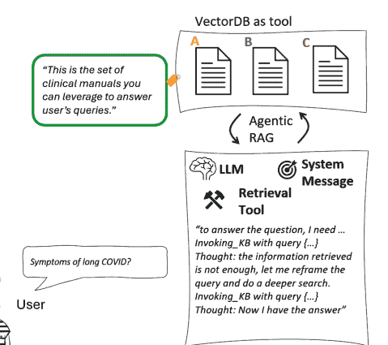

> “这是我们可以利用来回答用户查询的临床手册集。”

图 5.1：代理式 RAG 示例

这种方法使得更复杂的交互成为可能，因为向量数据库将成为我们智能体许多可用工具之一。这意味着 AI 智能体可以将检索到的数据与其他工具的输出相结合，或者在向量数据库缺乏必要的领域知识时完全切换工具。通过这样做，检索不再仅仅是一个后端操作，而是智能体更广泛决策循环的一部分。

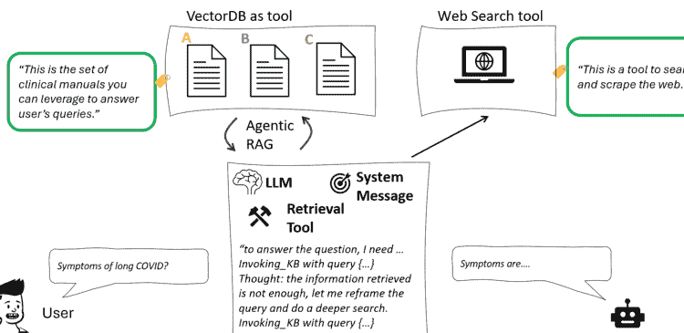

> “这是我们可以利用来回答用户查询的临床手册集。”

图 5.2：包含多个工具（包括作为工具的 VectorDB）的 AI 智能体示例

# 5 

将向量数据库作为可调用工具，使检索与基于智能体的架构原则保持一致：自主性、适应性和上下文感知。智能体现在不再取决于询问了什么，而是决定什么值得检索——以及为什么要检索。这种增加的智能层不仅提高了响应的准确性和相关性，还为企业级 AI 系统开启了完全新的工作流。

## 同步调用与异步调用

随着我们构建日益智能的 AI 智能体——即能够推理、计划并与外部工具交互的系统——理解这些工具是如何被调用的变得至关重要。在智能体工具设计中，经常被忽视但至关重要的区别是工具是以同步运行还是异步运行的。

这不仅仅是一个技术实现细节。工具的执行方式会影响你的代理应用的性能、可扩展性和响应速度。

首先，让我们从定义编程中同步和异步调用的概念开始。

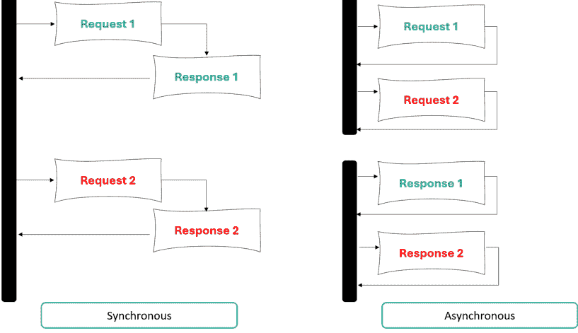

图 5.3：同步和异步过程示例

在这种情况下，编程中的同步调用是函数或方法调用，它会在完成之前阻塞后续的执行。程序会等待函数返回结果，然后移动到下一条指令。这种模式简单直观且易于理解，但在处理文件 I/O、网络请求或数据库访问等慢操作时，可能会导致性能瓶颈。

例如，以下 Python 函数以同步方式读取文件：

```python
## Python 中的同步文件读取
with open("report.txt", "r") as file:
    content = file.read()
print("File content loaded.")
```

在这种情况下，在读取完整个文件之前，程序不会打印“File content loaded”。

另一方面，异步调用是非阻塞的函数调用，它允许程序在操作于后台完成的同时继续执行。当结果就绪时，将根据语言的不同通过回调、事件或承诺/未来器（promises/futures）进行处理。异步编程对于构建响应迅速且可扩展的系统至关重要，特别是必须同时管理多个 I/O 密集任务的环境。

例如，以下 Python 函数以异步方式读取文件：

```python
import aiofiles
import asyncio

async def read_file():
    async with aiofiles.open("report.txt", "r") as file:
        content = await file.read()
    print("File content loaded.")

asyncio.run(read_file())
```

在这里，程序可以在读取文件时继续执行其他任务，使其成为 I/O 密集型应用程序的理想选择。

回到 AI 智能体的语境，同步和异步调用的概念与工具的调用机制紧密相连。

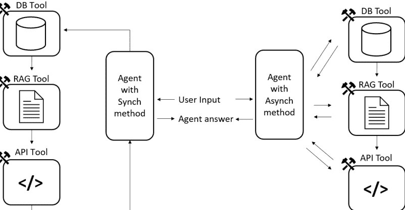

图 5.4：AI 智能体背景下的同步和异步过程示例

在同步过程中，智能体发出请求并在执行任何其他操作之前等待响应。在响应到达之前，它无法继续进行。

在 AI 工作流中，这对于短运行的、可预测的任务通常是必要的，例如以下任务：

- 转换单位（例如，摄氏度转华氏度）
- 格式化日期或数字
- 简单的数据库查询
- 调用快速的 API（例如，本地微服务）

使用异步调用，智能体发起调用但不会阻塞它；智能体会继续进行，并在结果到达时随时处理结果。

这在执行以下操作时特别有用：

- 调用缓慢或高延迟的 API（例如，第三方服务、外部数据库）
- 执行 I/O 密集型操作（例如，文件上传、网络爬虫）
- 并行运行多个调用（例如，批量数据查询）

异步工具让你的智能体响应更快，并允许它同时处理多件事，提高性能和用户体验。

同步与异步之间的选择不仅仅是一个实现细节——它直接影响你智能体的行为：

- **响应性：** 异步工具允许智能体在等待长时间运行的操作时保持响应。
- **并行性：** 同步调用可以批量处理或并发运行，在从多个源检索数据时特别有用。
- **错误处理：** 异步工具可以包含重试逻辑、回退机制或超时，而不会冻结智能体。

让我们来看一个场景。假设你的智能体需要总结来自五个区域系统的每周销售报告。同步版本将逐一个获取——耗时是 5 倍。异步版本将一次性获取它们。

```python
@tool
async def fetch_sales_report(region: str) -> str:
    """获取给定区域的销售报告"""
    await asyncio.sleep(2) # 模拟网络延迟
    return f"{region} sales report: $100k"

async def fetch_all_reports():
    regions = ["North", "South", "East", "West", "Central"]
    tasks = [fetch_sales_report(region) for region in regions]
    results = await asyncio.gather(*tasks)
    return "\n".join(results)
```

异步模式允许智能体在获取一份报告的时间获取全部五份。

所以，问题在于使用哪种方法？如果操作很快且不会影响用户体验，或者任务必须按顺序执行且每一步都取决于上一步的结果，你可能希望使用同步调用。然而，如果你处理的是高延迟操作，或者智能体需要同时处理任务，异步调用是首选。

许多 AI 系统会混合使用同步异步工具。这完全没问题。重要的是有意识地设计工具——知道哪些任务是阻塞的，哪些应该是非阻塞的。

LangChain 和 Semantic Kernel 等框架支持两种模式，通常需要你正确注册工具以便智能体运行时处理它们。

# 6 使用 LangChain 构建你的第一个 AI 代理

在之前的章节中，我们探索了 AI 代理（Agents）背后的理论——它们的架构、工具的作用、内存与规划，以及 LangChain 等框架如何实现这些组件的编排。现在，是时候从理论转向实践了。

在本章中，我们将介绍如何使用 LangChain 构建你的第一个 AI 代理。我们将通过一个实际的用例来实现这一点：为一家数字化的披萨店（digital Pineria）创建一个电子商务助手。从理解场景和组装核心构建块，到开发和评估代理的性能，你将获得 LangChain 能力的实践经验。你还将探索如何使用 LangSmith 等工具对代理行为进行追踪和观察，最后学习如何将此助手扩展为移动端体验。

我们将涵盖以下主题：

- LangChain 生态系统介绍
- 开箱即用组件概述
- 用例——电子商务 AI 代理

在本章结束时，你不仅将拥有一个可以运行的 AI 代理原型，还将理解在现实应用中构建和维护智能、可信助手所需的模式和组件。

## 技术要求

为了复现用于 Piadineria 餐厅的 AI 驱动助手，请按照以下步骤操作：

### 克隆项目仓库

首先克隆包含笔记本、源代码和必要资源的 GitHub 仓库：

```bash
git clone https://github.com/PacktPublishing/AI-Agents-in-Practice
cd "your_folder"
```

### 安装 Python 包

创建虚拟环境并安装 `requirements.txt` 中列出的依赖项，或手动安装以下包：

- langchain, openai, python-dotenv
- faiss-cpu, sqlite3, pandas, requests
- 用于评估和分析的 langsmith

```bash
pip install -r requirements.txt
```

### 配置环境变量

在项目根目录下创建一个 `.env` 文件，并填入你的配置密钥：

```
AZURE_OPENAI_API_VERSION=
AZURE_OPENAI_ENDPOINT=
AZURE_OPENAI_API_KEY=
AZURE_OPENAI_CHAT_DEPLOYMENT_NAME=
LANGSMITH_API_KEY=
LANGSMITH_ENDPOINT=
LANGSMITH_PROJECT=
```

> **注意：** 在此情况下，我们将利用 Azure OpenAI GPT-4 作为大语言模型（LLM），其费用为每 100 万 token 输入 2.50 美元，每 100 万 token 输出 10 美元（你可以在此处查看完整页面：https://azure.microsoft.com/en-us/pricing/details/cognitive-services/openai-service/?msockid=12c6546e7da69082d28419716658f0）。

如果你想使用免费的 LLM，可以利用 Hugging Face (HF) Hub 及其与 LangChain 的原生集成。安装所需的包：

```bash
pip install langchain-huggingface
```

你将有两种选择：

**直接从 `from_model_id` 方法加载你的模型：**

```python
from langchain_huggingface import HuggingFacePipeline
llm = HuggingFacePipeline.from_model_id(
    model_id="microsoft/Phi-3-mini-4k-instruct",
    task="text-generation",
    pipeline_kwargs={
        "max_tokens": 100, "top_k": 50,
        "temperature": 0.1,
    },
)
llm.invoke("Your query here")
```

> **快速提示：** 使用 AI 代码解释器和**快速复制（Quick Copy）**功能增强你的编码体验。在下一代 Packt Reader 中打开本书。点击**复制（Copy）**按钮 (1) 将代码快速复制到你的编码环境中，或点击**解释（Explain）**按钮 (2) 让 AI 助手向你解释一段代码。

```javascript
function calculate(a, b) {
    return {sum: a + b};
};
```

购买本书免费赠**下一代 Packt Reader**。扫描二维码访问 packpub.com/unlock，然后使用搜索栏通过名称查找此书。双检显示的版本以确保获取正确版本。

**使用 Hugging Face 端点**（你可以创建一个免费账户来访问它——在此处了解更多关于 HF 账户的信息：https://huggingface.co/pricing）：

```python
from langchain_huggingface import HuggingFaceEndpoint
llm = HuggingFaceEndpoint(
    repo_id="meta-llama/Meta-Llama-3-8B-Instruct",
    task="text-generation", max_new_tokens=100,
    do_sample=False
)
llm.invoke("Hugging Face is")
```

例如，如果你想在 LangChain 中利用 HF 的聊天模型，请使用以下代码：

```python
from langchain_huggingface import (
    HuggingFaceEndpoint,
    ChatHuggingFace
)
llm = HuggingFaceEndpoint(
    repo_id="microsoft/Phi-3-mini-4k-instruct",
    task="text-generation", max_new_tokens=512,
    do_sample=False, repetition_penalty=1.03,
)
chat = ChatHuggingFace(llm=llm, verbose=True)
```

你可以在此处找到完整教程：https://python.langchain.com/v0.2/api_reference/huggingface/chat_models/langchain_huggingface.chat_models.ChatHuggingFace.html

### 准备本地资源


确保项目目录中存在以下文件和文件夹：

- `piadiniera.db`：包含产品和供应商的 SQLite 数据库
- `docs/`：包含 PDF 文件的文件夹（例如：食品安全证书、所有者历史）

## 运行购物车 API

在 `localhost:3000` 上启动一个 JSON 服务器以启用购物车管理工具：

```
json-server --watch cart-data.json --port 3000
```

## 熟悉笔记本

打开仓库中提供的 Jupyter 笔记本并开始与 AI 代理交互以完成以下操作：

- 查询产品详情
- 将商品添加到购物车
- 搜索餐厅文档
- 使用 LangSmith 集成评估代理响应

## 启动移动应用程序

启动 Streamlit 前端以与代理交互（应用将运行在你的本地主机`8080`）：

```
streamlit run app.py
```

# LangChain 生态系统介绍

LangChain 于 2022 年 10 月推出，是一个开源框架，旨在简化由大语言模型（LLM）驱动的应用程序开发。最初，它提供了将 LLM 连接到外部数据源和实用程序的工具，有助于创建更具动态性和上下文感知能力的应用程序。

随着时间的推移，LangChain 从最初的框架演变为一个全面的生态系统。这一转变源于 AI 应用复杂性的增加，以及对管理整个 LLM 驱动解决方案更健壮工具的需求。现在，LangChain 涵盖了一套组件和集成，旨在支持开发者从原型设计到部署的全周期。

根据官方文档，整个 LangChain 生态系统允许你构建、运行和部署 AI 驱动的解决方案。让我们根据上图详细说明这三个步骤。

## 构建——架构基础

生态系统的基础是两个开源库：`LangChain` 和 `LangGraph`。

这两个组件代表了 AI 应用逻辑的核心构建块：

- `LangChain` 提供了链（chains）、代理（agents）、工具和内存等模块化组件，帮助开发者编排模型行为。它关注可组合性和集成，便于工作流的开发和扩展。
- `LangGraph` 虽然较新，但它引入了基于状态机的强大范式——这种计算模型定义了一系列状态及其转换，并通过事件或条件进行控制。它允许使用基于图的抽象构建多代理系统和复杂的控制流（例如：循环、分支、条件推理）。这对于需要持久状态和复杂规划的应用特别有价值。

> 注意
>
> 在本章中，我们将利用 `LangChain` 作为库，而在下一章处理多代理系统时，我们将使用 `LangGraph`。

这些工具共同构 `LangChain` 生态系统的构建时逻辑和控制平面。它们是开源的，确保了灵活性、透明度和社区驱动的创新。

## 运行——运营层

一旦构建了代理，下一步就是部署。这就是 `LangGraph Platform` 发挥作用的地方。`LangGraph Platform` 提供了一个托管环境来实现以下操作：

- 托管并部署 `LangGraph` 代理或工作流
- 流式交互
- 集成人工回路（human-in-the-loop）流
- 处理实时并发和状态管理

该平台弥补了实验与生产之间的鸿沟，抽象了在云环境中运行 LLM 代理通常涉及的设施开销。

与平台配套的是集成层（Integrations layer，同样开源的），它允许开发者将其代理连接到以下内容：

- APIs 和 webhooks（后者是允许外部系统在 LangChain 执行过程中发生特定事件时接收实时通知或数据的一种）
- 向量数据库和数据存储器
- 外部工具，如计算器、检索系统或第三方系统

这些集成为代理提供了实用的能力，使其能够根据外部数据和系统执行有意义的动作，我们将在下一段中介绍其中一些。

## 管理 — 可观测性与迭代

管理通常是决定现实世界 AI 应用成败的关键。在 LangChain 生态系统中，这由 `LangSmith` 处理。

`LangSmith` 是一个商业平台，旨在解决这些核心需求：

- 调试代理行为
- 监控使用情况和性能
- 评估输出质量
- 管理提示词（prompts）和数据集
- 用于监督改进的标注和反馈循环

与传统的日志或 APM 工具不同，`LangSmith` 是专为 LLM 原生应用构建的，它不仅能洞察“发生了什么”，还能理解“为什么发生”——从提示词结构到工具调用以及中间推理步骤。

通过将 `LangSmith` 集成到你的代理开发周期中，你可以确保能够做到以下：

- 追踪失败或意外输出
- 评估提示词版本或工具逻辑的有效性
- 在生产环境中不断完善和优化应用程序

考虑到上述组件，LangChain 生态系统不再仅仅是一个开发友好的框架——它是一个面向 AI 代理整个生命周期（以及更广泛的 AI 驱动解决方案）的结构化平台。

在下一节中，我们将深入探讨可以在“构建”级别利用的某些预构建组件，并准备用它们来初始化我们的 AI 代理。

## 预构建组件概述

LangChain 提供了一套全面的预构建组件，促进了复杂的语言模型应用的开发。这些组件被分为四个主要类别：检索增强生成 (RAG)、存储与索引，以及提取：

- **RAG:** 如前面的章节所示，RAG 使语言模型能够在生成响应之前，动态地从外部源（通常是文档存储器或向量数据库）中检索相关信息，从而超越其静态知识。LangChain 为整个 RAG 生命周期提供了原生支持：
  - **文档摄取与分片：** 加载材料（如 PDF、Notion 页面、HTML 或 markdown）并使用灵活的 `TextSplitters` 将其拆分为具有语义意义的分片。这些分片更便于嵌入和检索。
  - **嵌入生成：** 每个分片都使用嵌入模型（例如 OpenAI、Cohere、H Face）嵌入到高维向量。
  - **存储在向量数据库中：** 这些向量存储在可插拔的向量存储器中（如 `FAISS`、`Chroma`、`Weaviate` 和 `Pinecone`），允许基于相似性的高效检索。
  - **检索器接口：** LangChain 同时支持基础检索器和高级检索策略，如 `MultiQueryRetriever`、`ParentDocumentRetriever` 和 `ContextualCompressionRetriever`，每种策略都是针对在精度、召回率和相关性有不同权衡的用例而设计的。

RAG 检索对于文档问答、法律助手、客户支持机器人和研究副驾驶等应用至关重要——任何需要对外部数据进行实时对齐的场景。

- **存储与索引：** 支持流水线的是一套专门用于存储和索引的工具。这些组件处理数据的后端准备，确保在检索期间可以高效地访问：
  - **文档加载器：** LangChain 包含了针对 50 多种数据源的文档加载器，如本地文件、APIs、网页、Notion 数据库、Google Docs 等。这些加载器将内容标准化为 LangChain 的文档格式。
  - **文本拆分器：** 它们根据字符数、句子或递归启发式对文档进行分割，同时保留内容的逻辑完整性（例如将段落保留或将标题与内容连接）。
  - **向量存储器：** LangChain 通过通用接口与许多向量数据库集成。开发者可以在不更改检索逻辑的情况下，切换 `FAISS`、`Chroma`、`Qdrant` 或 Azure Cognitive Search。
  - **元数据与过滤：** 嵌入元数据（如来源、日期或主题）与文档分片一起存储，允许过滤检索或混合检索（结合关键词搜索和向量搜索）。

这一层是任何依赖大规模结构化或半结构化知识访问的系统的基础。

- **提取：** LangChain 还提供了信息提取能力，涉及从非结构化文本中识别并结构化特定信息。这对于需要从文档、聊天或响应中挖掘数据并以结构化形式（例如 JSON 或数据库记录）提供的领域非常有用：
  - 用例包括自动填写表单、将会议记录总结到 CRM 字段中、将法律文本转换为条款映射，或从事件描述中提取时间线。

- **代理 (Agents)：** LangChain 中的代理框架引入了更深层次的自主性和灵活性。与静态链不同，代理可以对任务进行推理，选择使用哪种工具，并根据中间步骤的结果进行调整：
  - **工具抽象：** 工具是封装了元数据（名称、描述、输入模式）的 Python 函数，代理可以在相关时调用它们。LangChain 与 OpenAI 的函数/工具调用能力无缝集成。
  - **工具包 (Toolkits)：** 为常用平台（如 SQL 数据库、文件系统、Python REPL 或浏览器自动化）提供预包工具集。工具包极大缩短了生产时间。
  - **代理执行器 (Agent executors)：** 这些组件编排代理的推理逻辑、跟踪内存、调用工具并管理中间输出。选项包括 `React-OpenAIToolsAgent` 和 `ConversationalAgent`，取决于所需的结构和灵活性水平。
  - **多工具推理：** 代理通过链式工具调用、解释结果和规划下一步来执行多步任务——适用于复杂工作流，例如“寻找供应商、检查库存、生成报价”。

LangChain 代理可以像动态助手一样，跨系统编排逻辑，无论是客户支持、销售自动化还是研究任务。

即使并非详尽（会随时间不断更新），上述列表让我们了解 LangChain 预构建组件背后的“模型”。事实上，这四类组件代表了 LangChain 不仅仅构建 LLM 封装器，而是构建可组合 AI 系统的承诺——而且正如我们反复提到的，模块化和可组合性是构建代理系统的关键！

通过抽象常见挑战（例如如何摄取文档，以及检索知识、提取的数据或跨工具推理），LangChain 让开发者能够有信心地构建智能、可扩展且生产级的 AI 解决方案。

现在我们拥有了构建第一个 AI 代理所需的所有工具，让我们编码吧！

# 用例 — 电子商务 AI 代理

AI 代理正在改变企业与客户互动的方式——提供个性化、实时的协助，这种协助既具有对话性又具有深度功能。在食品和零售行业，这种转变为通过智能自动化增强客户体验、简化运营以及建立品牌忠诚度开启了新的可能性。在本节中，我们将探索该行业中的一个具体案例。

## 场景描述

我们将为一个真实场景构建一个 AI 智能体：一家名为 **Mammachepiada** 的现代家族经营的意大利餐厅。这家比饼店（piaderia）的名字源于表达“Mamma che piada”，大致翻译为“哇，好棒的比饼啊！”——它最近通过推出在线商店扩大了业务。

Mammachepiada 的核心特色是新鲜制作的 piadina 比饼，里面填充了高质量的意大利食材：生意大利火腿（prosciutto crudo）、stracchino 奶酪、烤蔬菜、日干番茄等。除了这些即食餐点外，商店还出售单独食材——例如手工奶酪、腌制蔬菜和橄榄油——供想要在家里重现这种体验的顾客。

该业务以电子商务商店的形式运营，客户可以进行以下操作：

- 订购新鲜制作的 piadina 和餐点进行本地送货（特定半径内）
- 购买全国发货的食材和产品

本章的目标是创建一个数字助手——一个 AI 智能体——它可以帮助客户自然地与商店进行交互。用户可能想要执行以下任何操作：

- 检查菜单上的可用物品
- 询问产品成分
- 询问库存可用物品
- 获取 piadina 搭配建议
- 创建自定义购物车并下单

该智能体将准备好协助完成这些任务。

结果将是一个亲切、高效的界面，将 Mammachepiada 的魅力带入数字世界——桥接传统与技术，连接语言与行动。

我们将这个 AI 智能体命名为 `AskMamma`。

在接下来的章节中，我们将逐步介绍如何一步创建这个 AI 智能体界面，整合检索能力、外部工具和逻辑，以便以一种让客户感到自然的方式处理现实世界中的交互。

## AskMamma 的构建模块

在第 1 章中，我们概述了 AI 智能体的主要组成部分：

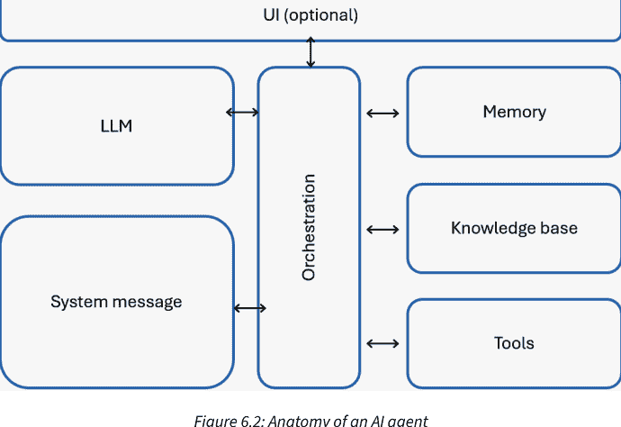

现在让我们详细介绍这些组件，以设计 `AskMamma`：

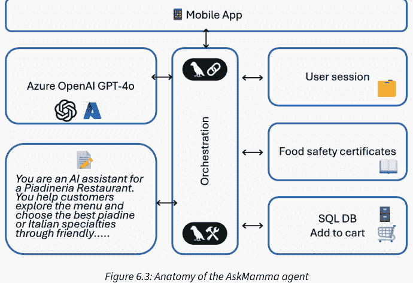

让我们探索图 6.3 显示的每个组件：

- **UI：** 智能体将存在于餐厅移动应用程序的上下文中。在本节中，我们将逐一关注核心组件，而在下一节中，我们将看到使用 Streamlit UI 显示的最终结果。
- **LLM：** 我们将使用 AzureOpenAI GPT-4o，因为它提供了顶尖的推理能力，同时对延迟进行了优化——这使其成为实时餐厅交互的理想选择。


> 注意
>
> 选择 LLM 意味着要平衡以下因素：
>
> - 质量与成本：更大的模型更智能，但价格更贵。
> - 速度与力量：更小的模型响应更快，但可能会忽略细节。
> - 上下文需求：更长的对话或大型文档？使用具有更大上下文窗口的模型。
> - 多模态：如果你的智能体需要查看图像，请选择 GPT-4o。
>
> 选择适合应用需求的模型，而不仅仅是最大的那个。

- **系统消息：** 我们正在指示智能体成为意大利餐厅的智能 AI 助手。
- **编排：** 我们将利用 `LangChain` 进行编排，利用 `LangSmith` 进行可观测性和可追溯性。
- **记忆：** 我们的智能体将赋予短期记忆，以跟踪正在进行的对话。
- **知识库：** 我们的智能体将了解餐厅老板多年获得的所有相关证书和奖励。
- **工具：** 除了提到的 RAG 工具外，我们还有两个额外的工具：
  - **数据库工具：** 该工具将检索库存物品、其价格、供应商、过敏原和其他相关信息。
  - **添加购物车工具：** 这是一个 API 工具，将与餐厅应用程序的后端进行通信。事实上，用户的购物车由数据库驱动，该工具将根据用户的查询将项目添加到数据库中。

请注意，在这一场景中，我们使用了三种不同类型的工具：作为检索器的非结构化知识库和结构化数据库，以及 API 集成。

> 注意
>
> 我们将在实现中将知识库视为一个工具，利用第 5 章探索的智能体 RAG（agentic RAG）概念。

让我们看看实践中如何这样做。

## 开发智能体

让我们看看如何逐步构建 `AskMamma` 智能体：

1. **导入库并初始化模型：** 在这里，我们将初始化所需的两个模型：作为智能体大脑的 LLM（AzureOpenAI GPT-4o）以及我们用于对非结构化 PDF 进行向量化索引的嵌入模型（AzureOpenAI text-embedding-3-large）。

```python
import os
from dotenv import load_dotenv
from langchain_openai import (
AzureChatOpenAI
)
import requests
from langchain.agents import (
    AgentExecutor, create_openai_tools_agent
)
from langchain_core.prompts import (
    ChatPromptTemplate, MessagesPlaceholder
)
from langchain.tools import BaseTool, StructuredTool
```

```python
## 加载环境变量
load_dotenv()
```

```python
## 访问环境变量
openai_version = os.getenv("AZURE_OPENAI_VERSION")
azure_endpoint = os.getenv("AZURE_OPENAI_ENDPOINT")
openai_key = os.getenv("AZURE_OPENAI_API_KEY")
azure_deployment = os.getenv("AZURE_OPENAI_CHAT_DEPLOYMENT")
```

```
## 初始化 Azure OpenAI 模型
model = AzureChatOpenAI(
    azure_deployment=azure_deployment,
    api_endpoint=azure_endpoint,
    api_key=openai_key,
    api_version=openai_version,
)
```

```python
from langchain_openai import AzureOpenAIEmbeddings

embeddings = AzureOpenAIEmbeddings(
    azure_deployment="text-embedding-3-large",
    api_key=openai_key
)
```

2. **初始化 SQL 工具：** 在这里我们将利用 LangChain 的内置组件。这是一个可以与 SQL 数据库工作的工具集，包括但不限于推理架构、运行查询和检查查询正确性。

要初始化工具，你需要一个 LLM 和数据库实例。对于后者，我们将使用具有以下架构的 SQL 实例：

| suppliers | | products |
| --- | --- | --- |
| Supplier ID PK | <--> Supplier ID FK |
| Supplier Name | | Product ID PK |
| Contact Email | | Category |
| Country | | Price |
| | | Stock |
| | | Allergens |
| | | Description |
| | | Calories |
| | | Vegetarian |

关系：一个供应商 -> 多个产品

图 6.4：餐厅数据库的结构

你可以在书籍的 GitHub 仓库中找到数据库。

现在让我们初始化工具包并获取第一个工具：

```python
from langchain_community.utilities.sql_database import SQLDatabase
db = SQLDatabase.from_uri("sqlite:///piaderia.db")
```


# 智能代理与工具集成示例

```python
from langchain_community.agent_toolkits.sql.toolkit import (
SQLToolkit
)

sql_toolkit = SQLToolkit(db=db, llm=model)
```

输出如下：

> [QuerySQLDatabaseTool(description=此工具的输入是详细且正确的 SQL 查询，输出是数据库结果。如果查询错误，将返回错误消息。如果返回错误，请重写查询、检查查询并再次尝试。如果遇到 Unknown column 'xxxx' in 'field list' 的问题，请使用 db_schema 查询正确的表字段。=<langchain_community.utilities.sql_database.SQLDatabase object at 0x00000250e33160f0>]

如所示，此工具带有名称（`QuerySQLDatabaseTool`）和对其能力的描述，以便智能体知道如何调用它。

## 初始化 `add_to_cart` 工具

在这里我们需要编写一个正确的 HTTP 操作将项目添加到餐厅应用程序的后端中。为此，我们首先需要准备一个托管会话上下文中用户项目的数据库。在这种情况下，我初始化了一个空的 `db.json` 对象如下：

```json
{
  "cart": []
}
```

在运行智能体之前，我们需要确保此数据库是开启的（为了演示，我们将在本地运行）。

## 注意事项

| 注意事项 |
| :--- |
| 此 DB 与 SQL 工具部分提到的 SQL DB 不同！让我们清楚地区分这两者：<br><br>SQL DB：这是餐厅的商店记录系统，所有者可以在此跟踪库存、价格、供应商等。<br>`db.json`：这是在会话上下文中支持用户购物车的 DB。它是应用程序数据库。 |


现在我们已经有了购物车 DB，就可以定义我们的工具了：

```python
## 定义一个向购物车添加物品的工具
@tool
def add_to_cart(item_name: str, item_price: float) -> str:
    """将商品添加到购物车中"""
    url = 'http://localhost:3000/cart' # 确保这与 JSON Server 的端点匹配
    cart_item = {
        'name': item_name,
        'price': item_price
    }

    response = requests.post(url, json=cart_item)

    if response.status_code == 201:
        return f"{item_name} 已成功添加到购物车。"
    else:
        return f"添加商品到购物车失败: {response.status_code} - {response.text}" 
```

如你所见，我们使用 `@tool` 装饰器定义了工具，这是 LangChain 的典型用法。我们添加了名称（`add_to_cart`）和描述（格式为 `"""docstring"""`）。我们还指定了正确调用此工具所需的两个参数：物品名称和相对价格；这意味着代理（agent）将在调用工具之前尽力获取这两个元素。最后，正确的“动作”（action）是针对实时购物车 DB 端点的 POST 方法。

## 初始化 RAG 工具

在这里，我们希望让我们的代理植根于某些关于餐厅食品合规证书和多年来获得的奖项的上下文。以下是从 PDF 中提取的几个段落：

| 披萨店卫生与食品安全合规报告 | 第 1 页：起源与家族传统 |
| :--- | :--- |
| 第 2 页：HACCP 认证 | 危害分析关键控制点（HACCP）是我们食品安全运营的基础。我们建立了完整的 HACCP 系统，用于识别和监控食品准备和供应过程所有的关键控制点。我们父母的根源可以追溯到意大利艾米利亚-罗马罗马尼亚地区罗马米尼附近的一个小村庄。制作面条不仅仅是食物——它更是一个文化符号。这一传统的创始人 Luca 和 Sofia 在一个家庭农场里长大。他们的祖父母拥有一座家庭农场，传统的配方在那里自豪地代代传承。 |
| 食品处理的每个阶段都面临风险，包括储存、准备、烹饪和供应。我们的员工接受过训练，能够识别此类危害，例如温度和过敏原问题。 | 从小起，Luca 和 Sofia 就沉浸在揉面团的节奏、清晨的烘焙以及迷迭草厨房和新鲜扁饼的香气中。他们的童年既是乐场也是教室。他们不仅学会了制作食物，还学会了如何尊重食物。 |
| 我们的 HACCP 计划由外部认证机构进行审查和审计，确保我们符合最新的科学和法律安全标准。我们保留了所有监控活动、纠正措施和验证结果的记录，可根据要求提供。 | 带着与世界分享这份遗产的梦想，他们着手建立一家餐厅，在尊重其传统的同时，欢迎来自世界各地的美食爱好者。 |

图 6.5：我们将作为知识库使用的食品证书快照

> **快速提示：** 想要查看此图像的高分辨率版本吗？请在下一代 Packt Reader 中打开此书，或在 PDF/ePub 版本中查看。购买此书将免费赠送下一代 Packt Reader。扫描二维码 或访问 packtub.com/unlock，然后使用搜索框通过名称查找此书。双检显示的版本以确保你获取的是正确的版本。


为了创建我们的工具，我们首先需要对 PDF 进行适当的向量化并索引到向量 DB 中。为此，我们将使用 LangChain 中一些预构建的组件进行文档处理，并使用 FAISS 向量数据库作为存储。

### 定义

Facebook AI Similarity Search (FAISS) 是由 Meta AI 开发的一个开源向量数据库和库，用于密集向量的高效相似性搜索和聚类。它实现了高维向量的快速检索，是语义搜索、推荐系统和基于 LLM 的检索等应用的理想选择。

让我们从初始化 `vector_store` 对象开始。

```python
import faiss
from langchain_community.docstore.in_memory import InMemoryDocStore
from langchain_community.vectorstores import FAISS
# 使用 L2（欧式）距离创建一个 FAISS 索引，其维度
# 与嵌入函数的输出相同（例如，简单嵌入
# #vector 的长度）
index = faiss.IndexFlatL2(len(embeddings.query("hello world")))
```

```python
vector_store = FAISS(
    embedding_function=embeddings,
    index=index,
    docstore=InMemoryDocStore(),
    index_to_docstore_id={},
)
```

然后我们可以利用 LangChain 的库对文档进行分块和处理：

```python
from langchain_text_splitters import CharacterTextSplitter
from langchain.document_loaders import PyPDFDirectoryLoader
```

```python
file_path = ("documents")
loader = PyPDFDirectoryLoader(file_path)
documents = loader.load()
text_splitter = CharacterTextSplitter(
    chunk_size=1000, chunk_overlap=0
)
```

```python
docs = text_splitter.split_documents(documents)
```

注意，在这种情况下，我们利用了一个文本分割器库——`CharacterTextSplitter`，它根据字符数分割文本。然而，LangChain 提供了各种类型的分割器，在将大型文档馈入向量存储之前，将其拆分成更小的、易于管理的块。一些最流行的包括：

- `RecursiveCharacterTextSplitter`（推荐）：尝试在更有意义的边界上进行分割（例如：段落 -> 句子 -> 单词 -> 字符）。当分块太大时，递归地回退到单元。
- `TokenTextSplitter`：基于 token 计数分割（对于具有严格限制的 LLM，如 OpenAI 的 GPT 模型有用）。用于将输入与模型上下文窗口对齐。
- `NLKTextSplitter` / `SpacyTextSplitter`：感知的分割器，使用 NLP 库的句子分割。适用于需要更多语法保留的情况。

一旦我们将文档拆分为可管理的块并传递给 `vector_store.add_documents()`，每个块都会使用嵌入模型转换成高维向量表示。

```python
vector_store.add_documents(documents=docs)
```

这些向量被索引在向量存储中，允许后续进行相似性搜索。这是一个示例：

- 分块 1："Mozzarella 是一种意大利奶酪..." 向量：[0.21, -0.45, ...]
- 分块 2："Prosciutto（火腿肉）与甜瓜非常配对..." 向量：[0.67, 0.10, ...]
- 分块 3："我们的 piadine 每天新鲜制作..." 向量：[0.33, -0.88, ...]

这些嵌入与元数据（例如，源文档、文件位置）一起存储在向量数据库中。当用户提问时，他们的查询会被嵌入并与存储的向量进行比较，以检索相关的块。

此过程允许系统根据语义含义“检索”知识，而不仅仅是关键词。

## 现在我们拥有了创建 RAG 工具的所有原料：

```python
retriever = vector_store.as_retriever()

from langchain.tools.retriever import create_retriever_tool

rag_tool = create_retriever_tool(
    retriever,
    "document_search",
    ""
    搜索并返回关于餐厅证书和所有者历史的信息。
    ""
)
```

如你所见，LangChain 中的 `vector_store` 对象带有一个方法 (`.as_retriever`)，可以自动将其转换为检索器对象。通过这样做，我们可以使用 `create_retriever_tool` 函数创建我们的工具，正如我们在许多示例中学到的，该函数需要一个工具名称和一个对工具能力的描述。

## 初始化系统消息

在创建代理之前我们需要的最后一个原料是系统消息（system message）。在 LangChain 中，我们可以利用 `ChatTemplate` 类，该类旨在为对话语言模型构建提示。

它具有以下功能：

- **基于角色的消息**：定义特定角色的消息以设置对话的和流。
- **动态变量**：在消息中包含占位符，可以在运行时使用用户输入或其他动态数据进行填充。
- **上下文管理**：使用 `MessagesPlaceholder` 作为占位符维护对话历史和中间步骤，使 AI 能够生成连贯且符合上下文的响应。

对于我们的 "AskMamma" 助手，我们将具有以下结构：

```python
# 定义提示模板
prompt = ChatPromptTemplate.from_messages(
    ("system", """你是一个 Piadineria 餐厅的 AI 助手。
    你通过友好、交互式的问题帮助客户探索菜单并选择最佳的 piadine 饼或意大利特产。
    当用户询问产品详情（配料、过敏原、素食选项、价格等）时，你可以查询产品数据库。
    当用户准备好下单时，询问他们是否想将选定的项目添加到购物车。
    如果他们确认，使用你的工具将项目添加到购物车。
    当使用工具时，仅响应最终结果。
    例如：
    Human: 将 Classic Piadina 加入购物车，价格为 5.50
    AI: 'Classic Piadina'已成功添加到购物车。"""),
    MessagesPlaceholder("chat_history", optional=True),
    ("human", "{input}"),
    MessagesPlaceholder("agent_scratchpad")
)
```

让我们将其拆分为三个组成部分：

- **系统消息 (System message)**：这是指令性消息，设定了 AI 的整体行为和边界。

  `("system", """You are an AI assistant for a Piadineria Restaurant. ...")`

- **`MessagesPlaceholder("chat_history")`**：这是一个动态占位符，会将完整的对话历史（如果可用）插入提示词中，以便 AI 了解之前说过的内容的上下文。注意它被标记为 `optional=True`，因此对话可以新开始，也可以继续进行的会话。

- **带有输入占位符的人类消息**：这是插入当前用户消息的地方。`{input}` 占位符将在将在运行时替换为用户刚刚输入的内容（例如，“你们有无麸质的选项吗？”）。

```python
("human", "{input}")
```

**`MessagesPlaceholder("agent_scratchpad")`**：在工具增强型工作流期间，这是注入中间代理推理或工具使用痕迹的地方。

> 注意
> 
> 这种结构化格式非常适用于以下情况的代理系统：
> 
> * 你需要持久内存（`chat_history`）
> * 代理可以调用工具（例如添加到购物车、查询产品）
> * 你希望预先给出清晰的行为指令（通过系统消息）
> 
> 它确保 AI 行为的一致性，适应上下文，并像真实的助手一样执行操作——而不会产生幻觉或超出允许范围做出响应。


## 初始化代理

我们现在拥有了初始化代理的所有原料。为此，我们将利用 LangChain 中提供的 `create_openai_agent` 构建函数，它设计用于构建一个利用 OpenAI 工具调用能力的 AI 代理。

> 定义
> 
> OpenAI 的工具调用能力（以前称为函数调用）使语言模型能够以结构化和动态的方式与外部工具或函数交互。在 AI 代理的领域中，工具调用成为更大编排拼图的一部分，正如我们多次提到的，我们在 LLM 之上额外添加了一层智能，使代理能够决定是否使用工具、选择调用哪种工具、将工具链联起来以及执行后续操作等。因此，虽然工具调用的机制仍然存在，但开发者正逐渐远离编写原始的工具调用逻辑，转向能够为你处理这些推理的代理接口。


让我们初始化它：

```python
## 设置工具包
toolkit = [rag_toolkit, add_to_cart, *sql_toolkit.get_tools()]
```

```python
from langchain_community.chat_message_histories import ChatMessageHistory
from langchain_core.runnables.history import RunnableWithMessageHistory
```

```python
message_history = ChatMessageHistory()
```

```python
# 构建 OpenAI Tools 代理
agent = create_openai_tools_agent(model, toolkit, prompt)
```

```python
# 通过传入代理和工具创建代理执行器
agent_executor = AgentExecutor(agent=agent, tools=toolkit, verbose=True)
```

```python
agent_with_chat_history = RunnableWithMessageHistory(
    agent_executor,
    # 这是必要的，因为在大多数现实场景中，需要一个 session id
    # 在这里并没有真正使用它，因为我们使用的是简单的内存 ChatMessageHistory
    lambda session_id: message_history,
    input_messages_key="input",
    history_messages_key="chat_history",
)
```

现在是时候测试它了。在运行代理之前，我们需要部署 `db.json`，以便代理在需要时可以使用 `add_to_cart` 工具执行 POST 请求。要运行你的数据库，请在终端中执行以下命令：

```bash
npm install -g json-server
cd path_to_your_db
json-server --watch db.json
```

# 6 

现在你的 `db.json` 运行在本地的 3000 端口（默认端口）：

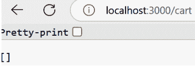

图 6.6：作为本地运行的应用数据库

太好了，现在我们可以运行我们的代理了。为了模拟对话，我将使用一个 while 循环：


## 交互循环

```python
while True:
    user_input = input("在此输入你的问题（或输入 'exit' 退出）： ")
    if user_input.lower() == 'exit':
        break
    result = agent_with_chat_history.invoke(
        {"input": user_input},
        # 这是必要的，因为在大多数现实场景中，需要一个 session id
        # 在这里并没有真正使用它，因为我们使用的是简单的内存 ChatMessageHistory
        config={}
    )
```

运行代码后，我发送了以下输入（注意我发送了一些问题，以假设之前的上下文被保留，从而测试短期记忆）：

- 你好
- 你们有哪些食品认证？
- 你们有里里塔奶士吗？
- 是的，把它加入购物车
- 那个物品的供应商是谁？

让我们看看结果。现在我保持了代理的详细模式（`verbose`），这意味着我们可以看到中间步骤和工具输出。随后，输出在某些中间步骤中截断了，但你可以在 GitHub 仓库中查看完整版本。

## 使用 LangChain 构建你的第一个 AI 代理

为了让以下内容更易读，我将突出显示用户输入、AI 输出和推理步骤。在其之间，我会添加我的注释，以突出一些值得记住的特定代理模式：

**User**: Hello

代理理解这是一个需要特定工具的简单交互。

**AI**: Hi there! Welcome to Piadineria Restaurant. How can I assist you today? Are you looking to explore our menu or need help with something specific?

**User**: Which food certificates do you have?

代理理解它需要使用特定的查询调用特定的 RAG 工具来回答这个问题。

```text
> Entering new AgentExecutor chain...

Invoking: `document_search` with `{'query': 'food certificates'}`

Piadineria Hygiene & Food Safety Compliance Report
Page 2: HACCP Certification
Hazard Analysis [...]
> Finished chain.
```

**AI**: 我们有多种食品安全认证和合规措施：

1. **HACCP 认证**：我们有一套完整的危害分析和关键控制点 (HACCP) 系统，用于识别和监控产品准备过程中的关键点。该系统由外部认证机构每季度审核一次。
2. **当地食品培训与 PIC**：piadineria 的每个食品处理人员都根据当地法规完成了食品安全培训。我们在每个地点都配备了负责人 (PIC) 来监督卫生标准并执行最佳实践。你想了解更多关于我们的菜单或其他信息吗？

**User**: Do you have ricotta cheese in stock?

代理理解它需要调用 SQL 工具。首先，它需要通过 `sql_db_list_tables` 和 `sql_db_schema` 工具理解架构，然后将使用 `sql_db_query` 运行实际查询。

```text
> Entering new AgentExecutor chain...

Invoking: `sql_db_list_tables` with `{}`
responded: Let me check the availability of ricotta cheese for you. I'll need a moment to look it up.
products, suppliers
Invoking: `sql_db_schema` with `{'table_names': 'products'}`
[]
Invoking: `sql_db_query` with `{'query': 'SELECT * FROM products WHERE "Product Name" = \'Ricotta Cheese\'}`
[]
> Finished chain.
```

**AI**: 是的，我们有里里塔奶士！详情如下：

**产品名称**: Ricotta Cheese

**类别**: Cheese

**价格**: 7.75

**库存**: 15 单位

**过敏原**: 乳制品

**描述**: 奶油般的里里塔奶士，适合甜点或意面。

**卡路里**: 120

**素食**: 是

你想把它加入购物车吗，还是需要其他帮助？

**User**: Yes, add it to cart

代理理解它需要调用 `add_to_cart` 工具，并且它能够从之前的对话中检索所需的两个参数——名称和价格。

```text
> Entering new AgentExecutor chain...
Invoking: `add_to_cart` with `{'item_name': 'Ricotta Cheese', 'item_price': 7.75}`
```

“里科塔奶酪”已成功添加到购物车。里科塔奶酪已成功添加到您的购物车。您还有其他想添加的物品或需要其他帮助吗？

> 链执行完毕。

一旦执行了此工具，如果你重新运行 `db.json` 服务器，你将看到它已相应更新：

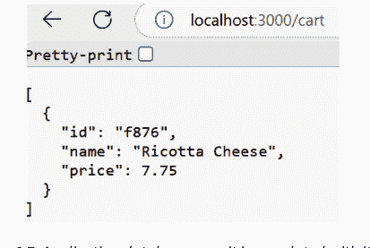

**AI**: 里科塔奶酪已成功添加到您的购物车。您还有其他想添加的物品或需要其他帮助吗？

**User**: 那个物品的供应商是谁？

代理能够再次调用 SQL 工具，这次它将执行连接（join）操作，以查找两个表并提取里科塔奶酪的供应商。此外，我们没有指定物品，而是依赖于代理的上下文感知能力。

```text
> Entering new AgentExecutor chain...

Invoking: `sql_db_list_tables` with `{}`
products, suppliers
Invoking: `sql_db_schema` with `{'table_names': 'products, 'suppliers'}`
[]]
Invoking: `sql_db_query` with `{'query': 'SELECT suppliers."Supplier Name" FROM suppliers JOIN products ON suppliers."Supplier ID" = products."Supplier ID" WHERE products."Product Name" = \'Ricotta Cheese\'}}`
[]]
> Finished chain.
```

**AI**: 我们里科塔奶酪的供应商是 **Dolce Italia**。

您还有其他想知道或添加到订单中的内容吗？

**User**: 谢谢！

**AI**: 不客气！如果您有任何其他问题或需要进一步帮助，请随时询问。祝您用餐愉快！

如您所示，代理能够执行以下操作：

- 根据用户的请求调用正确的工具，这归功于每个工具都配备了自然语言描述
- 在用户会话的上下文中保持记忆
- 以对话的方式与用户交互

仅需三个工具，我们就能通过强大的代理来实现良好的用户体验。

然而，我们还缺少拼图中的重要的一块：我们如何监控代理的行为？事实上，在现实场景中，可观测性、可追溯性以及评估和持续改进是在设计端到端架构时需要考虑的关键元素。

在下一节中，我们将探索如何用几行代码来实现这些。

## 可观测性、可追溯性和评估

可观测性、可追溯性和评估是实现这些目标的关键组件。我们提供了对 AI 代理内部工作机制的洞察，便于调试并实现持续改进。

可观测性是指根据系统的外部输出理解其内部状态。在 AI 代理中，这涉及监控输入、输出、中间过程以及与外部工具或 API 的交互。可追溯性通过提供代理决策过程的详细记录来补充可观测性，包括所采取的动作序列及其背后的原理。它们允许开发者精确定位问题、理解代理行为并确保系统按预期运行。

评估涉及根据指标或基准评估 AI 代理的性能。这可以包括准确性、相关性、连贯性或其他特定领域的标准。定期评估有助于识别改进领域、验证更新并确保代理符合所需标准。它在维护用户信任和满意度方面也起着至关重要的作用。

> **注意**
>
> 根据任务和背景，可以使用多种方法来评估 AI 代理。这些包括：
>
> - 人机回评估（Human-in-the-loop），由人类评审员评估代理响应的质量和帮助性。
> - LLM 裁判（LLM-as-a-judge），由受信任的模型（例如 GPT-4）对响应的相关性或准确性评分。
> - 知识库（KB）验证，适用于检索增强系统，其中检索文档的正确性至关重要。
> - 自动指标，例如用于摘要或问答任务的 BLEU、ROUGE 或精确匹配。

随着 AI 代理变得越来越复杂——能够进行推理、使用工具并维护多轮记忆——对健壮的可观测性和评估的需求变得至关重要。与传统的软件系统不同（在传统系统中错误可以追溯到特定的代码行或逻辑分支），AI 代理在概率性和动态性的环境中运行。它们的决策不仅取决于输入数据，还取决于提示词结构、检索到的上下文、工具交互以及之前的对话轮次。这使得调试和性能评估本质上变得更加困难。为了解决这个问题，LangSmith 等工具应运而生，提供了一种结构化的方法来实时监控、跟踪和评估代理行为。

LangSmith 是 LangChain 生态系统的一部分，旨在增强 AI 应用中的可观测性、可追溯性和评估。它提供了记录和可视化代理交互、分析性能指标以及进行系统性评估的工具。

LangSmith 的核心功能包括：

- **执行跟踪**：可视化展示代理的每一步决策，包括输入、输出和工具使用
- **性能洞察**：监控延迟、Token 数量和错误模式等关键统计数据以优化您的系统
- **灵活评估**：使用内置或自定义逻辑运行结构化评估，以评估响应质量
- **提示词版本控制**：跟踪、比较和迭代提示词，以随时间推移优化代理行为
- **协作友好**：与团队共享运行结果、反馈和评估，以支持共同开发

LangSmith 与各种 AI 框架无缝集成（不限于 LangChain！），为监控和改进 AI 代理提供了统一的接口。

让我们在实践中看看它。

第一步是在以下链接的 LangSmith 设置页面：[https://smith.langchain.com/settings](https://smith.langchain.com/settings) 上创建一个 API 密钥。

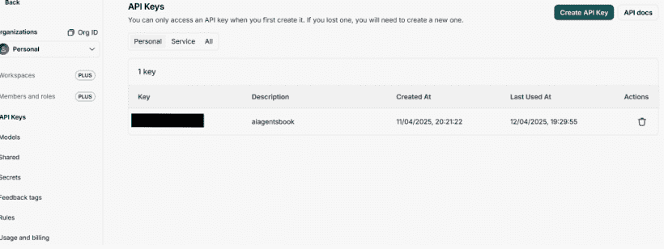

图 6.8：LangSmith 管理界面

注意，如果你还没有账户，将被提示注册（免费的）。

然后，安装 LangSmith 依赖：

```bash
pip install -U langsmith
```

使用你的变量设置环境。在我们案例中，由于我们在 Jupyter Notebook 中演示代理，我将使用 `os` 模块直接初始化变量：

```python
from langsmith import Client

client = Client(
    api_key=os.getenv("LANGSMITH_API_KEY"),
    api_url=os.getenv("LANGSMITH_ENDPOINT"),
)
```

现在我们有了初始化 `LangChainTracer` 对象的所有原料，`LangChainTracer` 是一个回调处理器，用于捕捉应用程序的详细执行跟踪（如链、工具和语言模型交互），并将这些信息发送到 LangSmith。

```python
from langchain.callbacks.tracers import LangChainTracer
tr = LangChainTracer(client=client, project_name="askmama")
```

如您所示，初始化 `LangChainTracer` 需要 `client` 和可选的 `project_name` 参数——这将是存储和存档日志的文件夹。该跟踪器钩入 LangChain 的执行流，捕获链、工具调用和语言模型调用的开始和结束事件。

跟踪器是我们需要为现有代理添加的唯一额外元素。我们可以在调用代理时将其作为 `config` 参数传递：

```python
agent_with_chat_history.invoke(
    {"input": user_input},
    # 这是因为在大多数现实场景中，需要会话 id
    # 在这里我们没有真正使用它，因为我们使用的是简单的内存 ChatMessageHistory
    config={"configurable": {"session_id": "foo"},
        "callbacks": [tracer]}
)
```

此配置确保代理执行的每一步都记录在 LangSmith 中，允许您可视化操作序列、检查输入输出并识别任何错误或性能瓶颈。

例如，一旦我们运行代理，我们将在 LangSmith 仪表板上看到一个新初始的项目：

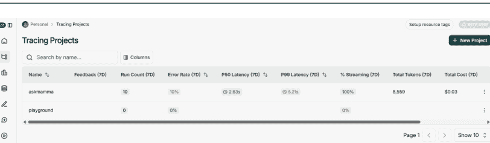

图 6.9：LangSmith 的追踪项目

我们确实可以看到许多有趣的统计数据，如错误率、总成本、运行次数等。让我们从 Askmamma 项目概览中获取更多细节：

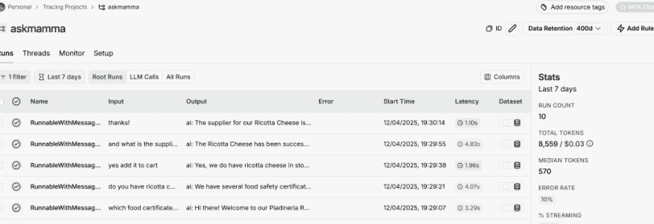

图 6.10：LangSmith 的项目概览

在这里，我们可以看到三个主要信息来源：

1. **运行 (Runs)**：一次运行是与智能体的单次交互。例如，如果用户输入“Hi”，这就是一次运行。

在每次运行下，我们都可以探索关于智能体活动的许多细节以回答问题。例如，当我们问“你有哪些食品证书？”时，智能体执行了几个步骤，我们可以在 LangSmith 中看到所有的步骤：

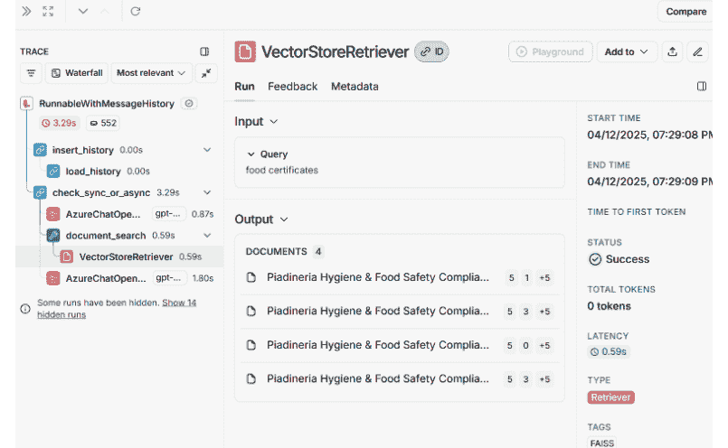

图 6.11：LangSmith 的运行概览

我们还可以检查那些失败的任务：

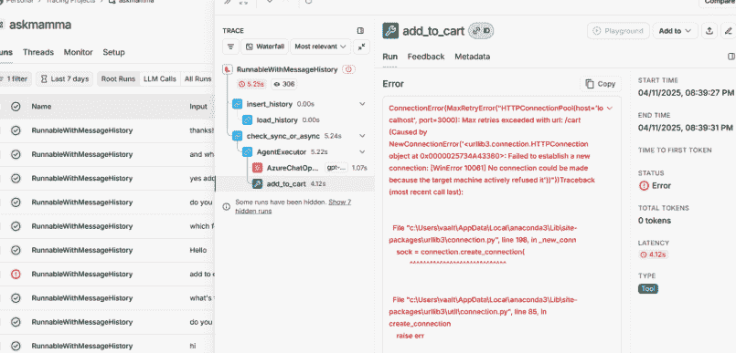

图 6.12：LangSmith 运行步骤概览

在这种情况下，原因是调用 `add_to_cart` 工具时，由于数据库离线，智能体无法继续执行。

**线程 (Threads)**：线程可以定义为一个会话。线程由唯一标识标记，你可以将它们初始化为名称。例如，在我们的场景中，我们初始化了一个名为 `<foo>` 的线程：

事实上，你可以在 LangSmith 中看到这个线程：


线程可以帮助你组织运行，并对智能体后台发生的情况有一个更高层次的视角：

### 使用 LangChain 构建你的第一个 AI 代理

个人 > 追踪项目 > askmamma `<foo>`

### 线程 `<foo>`

| 追踪计数 | 总 Token | 延迟 |
| :--- | :--- | :--- |
| 10 | 8,559 / $0.02532 | 2.33s 5.2% |

- 轮 1
- 轮 2
- 轮 3
- 轮 4
- 轮 5
- 轮 6
- 轮 7
- 轮 8


3. **监控 (Monitor)**：在这里，你可以看到一些实用的图表来对智能体进行 360 度视图，包括追踪计数、LLM 调用次数、成功率等：

askmamma

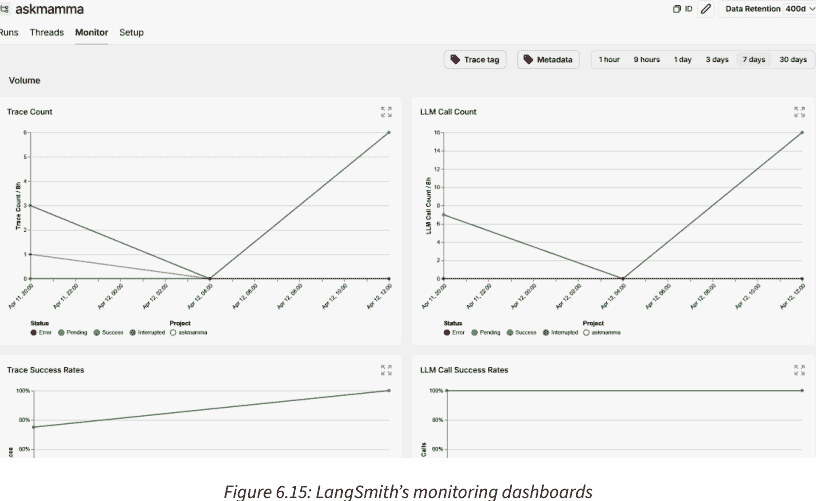

在评估方面，AI 代理以及更广泛的由 LLM 驱动的应用不能依赖传统的机器学习评估器，例如准确率、假阳性率、ROC 曲线等。事实上，AI 输出在设计上是对话性的，这意味着我们需要新的工具和技术来评估我们 AI 驱动解决方案的性能。

通常，为了评估 LLM 或智能体流水线的质量，你有**三个主要组件**需要处理：

1. **数据集 (Dataset)**：这是测试用例的集合——输入以及可选的预期输出——你的模型或智能体将基于这些进行评估。将其视为你的地面真值或基准集。
2. **目标函数 (Target function)**：这是你想要测试的实际内容——在我们案例中是智能体的输出。当你运行评估时，LangSmith 将每个数据集输入传递给此目标函数并捕获输出——就像自动化测试执行一样。输出将与预期输出比较或取决于你选择的评估器进行独立评估。
3. **评估器 (Evaluator)**：评估器用于判断目标函数输出的质量。它们可以是基于 LLM 的评估器，如 BLEU 或 ROUGE 等字符串指标，或者传统的指标，如准确率（在我们使用 LLM 进行分类或预测等任务时）。

> **定义**
>
> BLEU（双语言评估对理解）和 ROUGE（面向摘要评估的召回率定向理解）是*自然语言处理* (NLP) 中最广泛使用的两种自动评估器，特别是对于文本生成、翻译和摘要任务。
>
> BLEU 是一种基于精确率的指标，通过衡量生成的文本与一个或多个参考文本之间的 n-gram 重叠次数来评估生成文本的质量，通常用于机器翻译。
>
> ROUGE 是一种基于召回率的指标，通过比较参考文本的内容有多少比例出现在输出中来评估文本生成，通常用于摘要任务。

让我们看一个使用我们的 AskMamma 代理的例子。在场景下，我们将利用 LangSmith SDK，你可以从 UI Playground 运行示例评估：

- **初始化数据集**：在这里，我们将初始化一个带有输入和输出的数据集。你可以在 LangSmith 中看到这个数据集：


# 使用 LangSmith 和 Streamlit 评估与部署 AI 代理

## 初始化 LangSmith 客户端

首先，我们需要初始化 `LangSmith` 客户端，用于创建数据集、记录实验和管理评估。

```python
from langsmith import Client

client = Client(
    api_key=os.getenv("LANGSMITH_API_KEY")
)

dataset = client.create_dataset(
    name="askmamma",
    description="A dataset for testing askmamma agent"
)
```

## 创建示例

接下来，我们为数据集添加示例，每个示例包含一个输入问题和一个标准答案。

```python
examples = [
    {
        "inputs": {"question": "你有哪些食品证书？"},
        "outputs": {"answer": "我有食品安全许可证、HACCP 和有机食品认证。"}
    }
]
client.create_examples(dataset_id=dataset.id, examples=examples)
```

然后，你可以从 UI Playground 运行示例评估。

## 定义评估器

评估器将判断目标函数输出的质量。对于 AI 驱动的评估，我们将 LLM 指向其他 LLM 的“法官”。让我们初始化 LLM 作为法官。在这种情况下，我们将使用正确性指标。

```python
from openai import AzureOpenAI

openai_client = AzureOpenAI(
    endpoint=os.getenv("AZURE_OPENAI_ENDPOINT"),
    api_key=os.getenv("AZURE_OPENAI_API_KEY"),
    api_version=os.getenv("AZURE_OPENAI_API_VERSION")
)

from langsmith import wrappers
```

```python
eval_instructions = "你是一个专门负责学生答案的专家教授。"
```

```python
def correctness(
    inputs: dict, outputs: dict, reference_outputs: dict
) -> bool:
    user_content = f"""你正在评估以下问题：\n{inputs['question']}\n真实答案：\n{reference_outputs['answer']}\n你正在评估以下预测答案：\n{outputs['response']}\n用 1-5 分回答，1 分最低，5 分最高。\n你的回答仅包含分数。"""
    response = openai_client.chat.completions.create(
        model="gpt-4",
        temperature=0,
        messages=[
            {"role": "system", "content": eval_instructions},
            {"role": "user", "content": user_content},
        ]
    ).choices[0].message.content
    return response.strip()
```

## 初始化目标函数

最后是评估的逻辑，我们希望你的智能体输出结构与我们定义的评估器相匹配。

```python
def target(inputs: dict) -> dict:
    response = agent_with_chat_history.invoke(
```

# 6 

# 151

```python
{"input": inputs['question']},
# 之所以这样做是因为在大多数真实场景中，
# 需要一个会 id
# 在这里并没有真正使用它，因为我们使用的是简单的
# 内存 ChatMessageHistory

config={"configurable": {"session_id": "foo"},
  "callbacks": [tracer]},

return {"response": response['output']}
```

就是这些了！让我们运行评估器。

```python
experiment_results = client.evaluate(
  target,
  data="QA Askmamma",
  evaluators[
    correctness,
    # 可以在此处添加多个评估器
  ],
  experiment_prefix="first-eval-in-langsmith",
  max_concurrency=2
)
```

你可以从 UI 中检查结果。

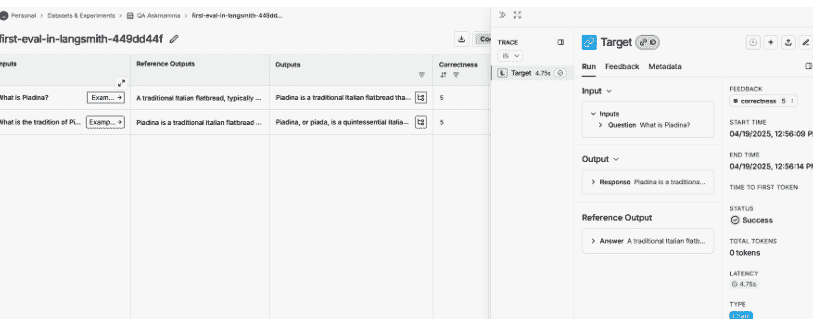

图 6.17：LangSmith 的评估结果

如你所见，我们的实际输出返回的正确性得分为 5。对于每个示例，你可以检查相关的指标，如实际输出、延迟、令牌等。

此外，在 AI 代理的语境下，我们还需要考虑工具管理：

- 工具调用（`tool calling`）是否正常？

- 代理是否能够调用多个工具来解决复杂问题？

- 代理是否足够智能，在不需要时不去调用工具？

换句话说，你需要评估代理的轨迹。让我们来看一个如何做的示例（注意以下代码是来自 LangSmith 官方文档的适配版本，你可以在此处找到：https://docs.smith.langchain.com/evaluation/how_to_guides）。

## 初始化新数据集

在这种情况下，我们需要按照如下方式添加预期的中间步骤。

```python
import uuid

questions = [
  ("Do you have ricotta cheese in stock",
  {
    "reference": "Yes we do have ricotta cheese in stock.",
    "expected_steps": ["sql_db_list_tables",
    "sql_db_schema", "sql_db_query_checker",
    "sql_db_query"]
  },
  ),
  ("hi",
  {
    "reference": "Hello, how can I assist you?",
    "expected_steps": [], # 期望直接回答
  },
  ),
  ("Can you add ricotta cheese to the cart with price 5.50?",
  {
    "reference": "The item 'ricotta cheese' has been added to the cart.",
    "expected_steps": ["add_to_cart"]
  }
  ),
  ("Do you have food safety certificate?",
  {
    "reference": "Yes, we have a food safety certificate",
    "expected_steps": ["document_search"]
  },
  ),
]
```

```python
uid = uuid.uuid4()
dataset_name = f"Agent Tool Eval Example {uid}"
ds = client.create_dataset(
  dataset_name,
  description="Example agent evals dataset using search and
calendar checks."
)
client.create_examples(
  inputs=[{"input": q[0]} for q in questions],
  outputs=[q[1] for q in questions],
  dataset_id=ds.id,
)
```

## 初始化评估器

在这里，我们将评估中间步骤的正确性，确保调用了正确的工具。

```python
from typing import Optional

from langchain.schemas import Example, Run

def intermediate_step_correctness(
    run: Run, example: Optional[Example] = None
) -> dict:
    if run.outputs is None:
        raise ValueError("Run outputs cannot be None")
    intermediate_steps = run.outputs.get("intermediate_steps") or []
    trajectory = [action.tool for action, _ in intermediate_steps]
    # 这是我们上传到数据集的内容
    expected_trajectory = example.outputs["expected_steps"]

## 使用 LangChain 构建你的第一个 AI 代理

    score = int(trajectory == expected_trajectory)
    return {"key": "Intermediate steps correctness", "score": score}
```

## 注意

为了获取代理的中间步骤访问，我们需要确保 `return_intermediate_steps` 参数等于 `True`。


```python
agent_executor = AgentExecutor(agent=agent,
    tools=toolkit,
    verbose=True, return_intermediate_steps=True)
```

我们还需要确保用正确的 schema 初始化我们的评估器，以便它能够解析我们在测试数据集中拥有的多个输出。

```python
def prepare_data(run: Run, example: Example) -> dict:
    return {
        "input": example.inputs["input"],
        "prediction": run.outputs["output"],
        "reference": example.outputs["reference"],
    }
```

根据参考答案判断 QA 答复是否“正确”。

```python
qa_evaluator = LangChainStringEvaluator(
    "qa", prepare_data=prepare_data, config={"llm": model}
)
```

## 定义目标函数

在这里，我们只是在创建一个函数，该函数将使用适当的配置参数调用我们的代理。

```python
def agent(inputs: dict):
    return agent_with_chat_history.invoke(
        inputs, config={"configurable": {"session_id": "foo"}})
    )
```

现在我们拥有了运行评估的所有材料。

```python
chain_results = evaluate(
    agent,
    data=dataset_name,
    evaluators=[intermediate_step_correctness, qa_evaluator],
    experiment_prefix="Agent Eval Example",
    max_concurrency=1,
)
```

## 让我们检查 LangSmith UI 中的结果

### Agent Eval Example-440d2zfa

| 输入 | 参考输出 | 输出 | 正确性 | 中间 | 延迟 | 状态 | 令牌 |

|---|---|---|---|---|---|---|---|

| Do you have safety... | Exp... | We have a food safety certificate. | us, our restaurant has formi... | 1 correct | 1.00 | 3.3s | SUCCESS | 631 |

| Do you ricotta cheese... | Exp... | We do ricotta cheese in stock. | Yes, we Have Ricotta Cheese | 1 correct | 0.0 | 2.8s | SUCCESS | 181 |

| hi | | Hello, can i assist you? | Hello agent Can assist you today?... | 1 correct | 0.0 | 0.64s | SUCCESS | 462 |

| Can you add ricotta cheese... | Exp... | The item 'ricotta cheese' has been add... | 1 correct | 1.00 | 1.42s | SUCCESS | 1010 |

图 6.18：评估结果仪表盘

太棒了！你可以看到，我们的代理失败了。让我们了解为什么一个界面被评估为错误。

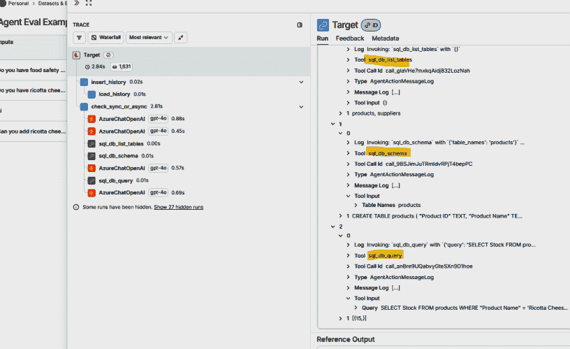

图 6.19：评估结果仪表盘

### 参考输出

- 参考：We have a food safety certificate

- 预期步骤：

  - `sql_db_list_tables`

  - ...

- 输出：We do ricotta cheese in stock.

- 预期步骤：

  - `add_to_cart`

## 在移动应用中注入 AI 代理

AI 代理可以通过多种方式消费：作为交互式应用程序、由业务流程触发、或嵌入现有应用程序中。在我们的场景中，我们将探索最后一种方案。

假设我们有一个餐厅的移动应用程序，并希望注入由 AI 代理驱动的对话式界面。新 UI 的外观将如下：


图 6.20：移动应用的 UI

# 6 

# 157

为了开发 UI，我们将利用 `Streamlit`，这是一个开源 Python 库，可以轻松构建和共享交互式应用，特别是数据科学和机器学习工作流。你不需要花费时间进行前端开发，只需专注于 Python 代码，`Streamlit` 会自动处理 UI。

在其功能中，`Streamlit` 拥有社区支持的组件和模板，可以轻松与 `LangChain` 流线集成（例如创建聊天界面或文本生成演示）。这种协同效应让我们利用 `Streamlit` 的交互性和易用界面以及 `LangChain` 强大的语言处理能力快速启动 LLM 应用。

### 内存管理

我们首先初始化一个兼容 `Streamlit` 的消息历史对象作为对话历史的后端存储。在这种情况下，我们将利用 `LangChain` 内存类内置的 `ConversationBufferMemory`，它将所有消息保留在缓冲区中（即运行列表）。

```python
from langchain_community.chat_message_histories import (
  ChatMessageHistory
)
from langchain_core.runnables.history import (
  RunnableWithMessageHistory
)
from langchain_community.chat_message_histories import (
  StreamlitChatMessageHistory
)
msgs = StreamlitChatMessageHistory()
memory = ConversationBufferMemory(
  chat_memory=msgs, return_messages=True,
  memory_key="chat_history", output_key="output"
)
```

通过这种方法，我们将向 `agent_executor` 传递一个兼容 `Streamlit` 的内存对象。

```python
agent_executor = AgentExecutor(
    agent=agent, tools=toolkit, memory=memory,
    return_intermediate_steps=True,
    handle_parsing_errors=True, verbose=True
)
```

### 初始化 Streamlit 状态

在 `Streamlit` 中，状态是指跨越用户交互保留变量的能力，例如即使在重新运行后，也能记住用户输入过或点击过的内容。

```python
if 'chat_history' not in st.session_state:
    st.session_state['chat_history'] = []

if "messages" not in st.session_state:
    st.session_state.messages = []
```

前面的代码确保了当用户打开应用时，内存中有一个地方可以同时存储对话历史（`chat_history`）和屏幕上显示的消息。其中一个用于追踪说过过的内容，另一个用于显示的内容。如果没有这些，应用将将不知道如何保存或检索之前的消息。


# 渲染基于持久化的消息

在这个代码块中，我们想要显示用户与 AI 之间的完整历史，从内存中提取它们，以便之前发生的所有内容都能显示。

```python
avatars = {"human": "user", "ai": "assistant"}
for idx, msg in enumerate(st.session_state.messages):
    with st.chat_message(avatars[msg["type"]]):
        # 如果保存了任何中间步骤，则渲染
        for step in st.session_state.steps.get(str(idx), []):
            if step["tool"] is None:
                continue
            with st.status(f"**{step['tool']}**: {step['input']}", state="complete"):
                st.write(step[0])
                st.write(step[1])
```

# 渲染当前状态

这显示仅存储在当前状态中的消息——通常来自当前的运行。

```python
for message in st.session_state.messages:
    with st.chat_message(message["role"]):
        st.markdown(message["content"])
```

# 渲染 AI 的聊天界面

这段代码在你的 Streamlit 应用底部设置了聊天界面，邀请用户提问——例如“菜单里有什么？”。当用户发送消息时，它会立即作为用户气泡显示在聊天中。然后，AI（`agent_executor`）会接管：它处理提示词，可能在此过程中使用工具，并在助手气泡中回复答案。

```python
prompt = st.chat_input("What is in the menu?")
if prompt:
    st.chat_message("user").write(prompt)
    with st.chat_message("assistant"):
        st_cb = StreamlitCallbackHandler(st.container(), expand_new_thoughts=False)
        response = agent_executor.invoke({"input": prompt}, {"callbacks": [st_cb]})
        st.write(response["output"])
        st.session_state.steps[str(len(st.session_state.messages)) - 1] = response["intermediate_steps"]
```

这里很棒的一点是，AI 的推理步骤——例如在后台使用的工具——被 `StreamlitCallbackHandler` 捕获，并存储在`st.session_state`中。这让你能够详细可视化这些步骤，让用户一窥 AI 是如何得出答案的。

一旦你的代码准备就绪并保存在`app.py`文件中，你可以通过`streamlit run app.py`运行它并在本地查看结果。最终结果看起来如下：

## 使用 LangChain 构建你的第一个 AI Agent


图 6.21：AskMamma 对话界面的 UI

如你所见，我们能够与 AskMamma 交互并代表我们执行某些操作，例如向购物车中添加一个项目。

## 总结

在本章中，我们探索了创建功能性 AI Agent 所需的基础概念和实际步骤。从理解 LangChain 的基础到实现高级功能，你对 AI 开发领域获取了宝贵的见解。

通过利用 LangChain 强大的工具和框架，你可以创建能够执行复杂任务并做出明智决策的智能代理。在本章中获得的知识和技能将为 AI 领域的进一步探索和创新奠定坚实的基础。

在下一章中，我们将开始看到多个代理在更复杂的场景下协同工作，进入多代理应用领域。

## 参考文献

- Semantic kernel 插件：https://learn.microsoft.com/en-us/semantic-kernel/concepts/plugins?platform=programming-language-csharp
- LangChain 工具：https://python.langchain.com/docs/how_to/tool_calling/
- LangChain 生态系统：https://www.langchain.com/
- LangSmith：https://docs.smith.langchain.com/
- LangSmith 中间步骤评估：https://docs.smith.langchain.com/evaluation/how_to_guides
- LangChain 教程：https://github.com/langchain-ai/langsmith-cookbook/blob/main/testing-examples/agent_steps/evaluating_agents.ipynb

# 订阅获取免费电子书

新框架、演进中的架构、研究发布、生产环境分析——AI_Distilled 将噪音过滤掉，为亲手操作 LLM 和 GenAI 系统的工程师和研究人员提供一份每周简报。现在订阅即可获得免费电子书，以及帮助你保持专注并掌握最新信息的每周见解。

请访问 https://packt.link/TRO5B 订阅或扫描下方的二维码。


