# 6 使用 LangChain 构建你的第一个 AI 代理

在之前的章节中，我们探索了 AI 代理（Agents）背后的理论——它们的架构、工具的作用、内存与规划，以及 LangChain 等框架如何实现这些组件的编排。现在，是时候从理论转向实践了。

在本章中，我们将介绍如何使用 LangChain 构建你的第一个 AI 代理。我们将通过一个实际的用例来实现这一点：为一家数字化的披萨店（digital Pineria）创建一个电子商务助手。从理解场景和组装核心构建块，到开发和评估代理的性能，你将获得 LangChain 能力的实践经验。你还将探索如何使用 LangSmith 等工具对代理行为进行追踪和观察，最后学习如何将此助手扩展为移动端体验。

我们将涵盖以下主题：

- LangChain 生态系统介绍
- 开箱即用组件概述
- 用例——电子商务 AI 代理

在本章结束时，你不仅将拥有一个可以运行的 AI 代理原型，还将理解在现实应用中构建和维护智能、可信助手所需的模式和组件。

## 技术要求

为了复现用于 Piadineria 餐厅的 AI 驱动助手，请按照以下步骤操作：

### 克隆项目仓库

首先克隆包含笔记本、源代码和必要资源的 GitHub 仓库：

```bash
git clone https://github.com/PacktPublishing/AI-Agents-in-Practice
cd "your_folder"
```

### 安装 Python 包

创建虚拟环境并安装 `requirements.txt` 中列出的依赖项，或手动安装以下包：

- langchain, openai, python-dotenv
- faiss-cpu, sqlite3, pandas, requests
- 用于评估和分析的 langsmith

```bash
pip install -r requirements.txt
```

### 配置环境变量

在项目根目录下创建一个 `.env` 文件，并填入你的配置密钥：

```
AZURE_OPENAI_API_VERSION=
AZURE_OPENAI_ENDPOINT=
AZURE_OPENAI_API_KEY=
AZURE_OPENAI_CHAT_DEPLOYMENT_NAME=
LANGSMITH_API_KEY=
LANGSMITH_ENDPOINT=
LANGSMITH_PROJECT=
```

> **注意：** 在此情况下，我们将利用 Azure OpenAI GPT-4 作为大语言模型（LLM），其费用为每 100 万 token 输入 2.50 美元，每 100 万 token 输出 10 美元（你可以在此处查看完整页面：https://azure.microsoft.com/en-us/pricing/details/cognitive-services/openai-service/?msockid=12c6546e7da69082d28419716658f0）。

如果你想使用免费的 LLM，可以利用 Hugging Face (HF) Hub 及其与 LangChain 的原生集成。安装所需的包：

```bash
pip install langchain-huggingface
```

你将有两种选择：

**直接从 `from_model_id` 方法加载你的模型：**

```python
from langchain_huggingface import HuggingFacePipeline
llm = HuggingFacePipeline.from_model_id(
    model_id="microsoft/Phi-3-mini-4k-instruct",
    task="text-generation",
    pipeline_kwargs={
        "max_tokens": 100, "top_k": 50,
        "temperature": 0.1,
    },
)
llm.invoke("Your query here")
```

> **快速提示：** 使用 AI 代码解释器和**快速复制（Quick Copy）**功能增强你的编码体验。在下一代 Packt Reader 中打开本书。点击**复制（Copy）**按钮 (1) 将代码快速复制到你的编码环境中，或点击**解释（Explain）**按钮 (2) 让 AI 助手向你解释一段代码。

```javascript
function calculate(a, b) {
    return {sum: a + b};
};
```

购买本书免费赠**下一代 Packt Reader**。扫描二维码访问 packpub.com/unlock，然后使用搜索栏通过名称查找此书。双检显示的版本以确保获取正确版本。

**使用 Hugging Face 端点**（你可以创建一个免费账户来访问它——在此处了解更多关于 HF 账户的信息：https://huggingface.co/pricing）：

```python
from langchain_huggingface import HuggingFaceEndpoint
llm = HuggingFaceEndpoint(
    repo_id="meta-llama/Meta-Llama-3-8B-Instruct",
    task="text-generation", max_new_tokens=100,
    do_sample=False
)
llm.invoke("Hugging Face is")
```

例如，如果你想在 LangChain 中利用 HF 的聊天模型，请使用以下代码：

```python
from langchain_huggingface import (
    HuggingFaceEndpoint,
    ChatHuggingFace
)
llm = HuggingFaceEndpoint(
    repo_id="microsoft/Phi-3-mini-4k-instruct",
    task="text-generation", max_new_tokens=512,
    do_sample=False, repetition_penalty=1.03,
)
chat = ChatHuggingFace(llm=llm, verbose=True)
```

你可以在此处找到完整教程：https://python.langchain.com/v0.2/api_reference/huggingface/chat_models/langchain_huggingface.chat_models.ChatHuggingFace.html

### 准备本地资源


确保项目目录中存在以下文件和文件夹：

- `piadiniera.db`：包含产品和供应商的 SQLite 数据库
- `docs/`：包含 PDF 文件的文件夹（例如：食品安全证书、所有者历史）

## 运行购物车 API

在 `localhost:3000` 上启动一个 JSON 服务器以启用购物车管理工具：

```
json-server --watch cart-data.json --port 3000
```

## 熟悉笔记本

打开仓库中提供的 Jupyter 笔记本并开始与 AI 代理交互以完成以下操作：

- 查询产品详情
- 将商品添加到购物车
- 搜索餐厅文档
- 使用 LangSmith 集成评估代理响应

## 启动移动应用程序

启动 Streamlit 前端以与代理交互（应用将运行在你的本地主机`8080`）：

```
streamlit run app.py
```

# LangChain 生态系统介绍

LangChain 于 2022 年 10 月推出，是一个开源框架，旨在简化由大语言模型（LLM）驱动的应用程序开发。最初，它提供了将 LLM 连接到外部数据源和实用程序的工具，有助于创建更具动态性和上下文感知能力的应用程序。

随着时间的推移，LangChain 从最初的框架演变为一个全面的生态系统。这一转变源于 AI 应用复杂性的增加，以及对管理整个 LLM 驱动解决方案更健壮工具的需求。现在，LangChain 涵盖了一套组件和集成，旨在支持开发者从原型设计到部署的全周期。

根据官方文档，整个 LangChain 生态系统允许你构建、运行和部署 AI 驱动的解决方案。让我们根据上图详细说明这三个步骤。

## 构建——架构基础

生态系统的基础是两个开源库：`LangChain` 和 `LangGraph`。

这两个组件代表了 AI 应用逻辑的核心构建块：

- `LangChain` 提供了链（chains）、代理（agents）、工具和内存等模块化组件，帮助开发者编排模型行为。它关注可组合性和集成，便于工作流的开发和扩展。
- `LangGraph` 虽然较新，但它引入了基于状态机的强大范式——这种计算模型定义了一系列状态及其转换，并通过事件或条件进行控制。它允许使用基于图的抽象构建多代理系统和复杂的控制流（例如：循环、分支、条件推理）。这对于需要持久状态和复杂规划的应用特别有价值。

> 注意
>
> 在本章中，我们将利用 `LangChain` 作为库，而在下一章处理多代理系统时，我们将使用 `LangGraph`。

这些工具共同构 `LangChain` 生态系统的构建时逻辑和控制平面。它们是开源的，确保了灵活性、透明度和社区驱动的创新。

## 运行——运营层

一旦构建了代理，下一步就是部署。这就是 `LangGraph Platform` 发挥作用的地方。`LangGraph Platform` 提供了一个托管环境来实现以下操作：

- 托管并部署 `LangGraph` 代理或工作流
- 流式交互
- 集成人工回路（human-in-the-loop）流
- 处理实时并发和状态管理

该平台弥补了实验与生产之间的鸿沟，抽象了在云环境中运行 LLM 代理通常涉及的设施开销。

与平台配套的是集成层（Integrations layer，同样开源的），它允许开发者将其代理连接到以下内容：

- APIs 和 webhooks（后者是允许外部系统在 LangChain 执行过程中发生特定事件时接收实时通知或数据的一种）
- 向量数据库和数据存储器
- 外部工具，如计算器、检索系统或第三方系统

这些集成为代理提供了实用的能力，使其能够根据外部数据和系统执行有意义的动作，我们将在下一段中介绍其中一些。

## 管理 — 可观测性与迭代

管理通常是决定现实世界 AI 应用成败的关键。在 LangChain 生态系统中，这由 `LangSmith` 处理。

`LangSmith` 是一个商业平台，旨在解决这些核心需求：

- 调试代理行为
- 监控使用情况和性能
- 评估输出质量
- 管理提示词（prompts）和数据集
- 用于监督改进的标注和反馈循环

与传统的日志或 APM 工具不同，`LangSmith` 是专为 LLM 原生应用构建的，它不仅能洞察“发生了什么”，还能理解“为什么发生”——从提示词结构到工具调用以及中间推理步骤。

通过将 `LangSmith` 集成到你的代理开发周期中，你可以确保能够做到以下：

- 追踪失败或意外输出
- 评估提示词版本或工具逻辑的有效性
- 在生产环境中不断完善和优化应用程序

考虑到上述组件，LangChain 生态系统不再仅仅是一个开发友好的框架——它是一个面向 AI 代理整个生命周期（以及更广泛的 AI 驱动解决方案）的结构化平台。

在下一节中，我们将深入探讨可以在“构建”级别利用的某些预构建组件，并准备用它们来初始化我们的 AI 代理。

## 预构建组件概述

LangChain 提供了一套全面的预构建组件，促进了复杂的语言模型应用的开发。这些组件被分为四个主要类别：检索增强生成 (RAG)、存储与索引，以及提取：

- **RAG:** 如前面的章节所示，RAG 使语言模型能够在生成响应之前，动态地从外部源（通常是文档存储器或向量数据库）中检索相关信息，从而超越其静态知识。LangChain 为整个 RAG 生命周期提供了原生支持：
  - **文档摄取与分片：** 加载材料（如 PDF、Notion 页面、HTML 或 markdown）并使用灵活的 `TextSplitters` 将其拆分为具有语义意义的分片。这些分片更便于嵌入和检索。
  - **嵌入生成：** 每个分片都使用嵌入模型（例如 OpenAI、Cohere、H Face）嵌入到高维向量。
  - **存储在向量数据库中：** 这些向量存储在可插拔的向量存储器中（如 `FAISS`、`Chroma`、`Weaviate` 和 `Pinecone`），允许基于相似性的高效检索。
  - **检索器接口：** LangChain 同时支持基础检索器和高级检索策略，如 `MultiQueryRetriever`、`ParentDocumentRetriever` 和 `ContextualCompressionRetriever`，每种策略都是针对在精度、召回率和相关性有不同权衡的用例而设计的。

RAG 检索对于文档问答、法律助手、客户支持机器人和研究副驾驶等应用至关重要——任何需要对外部数据进行实时对齐的场景。

- **存储与索引：** 支持流水线的是一套专门用于存储和索引的工具。这些组件处理数据的后端准备，确保在检索期间可以高效地访问：
  - **文档加载器：** LangChain 包含了针对 50 多种数据源的文档加载器，如本地文件、APIs、网页、Notion 数据库、Google Docs 等。这些加载器将内容标准化为 LangChain 的文档格式。
  - **文本拆分器：** 它们根据字符数、句子或递归启发式对文档进行分割，同时保留内容的逻辑完整性（例如将段落保留或将标题与内容连接）。
  - **向量存储器：** LangChain 通过通用接口与许多向量数据库集成。开发者可以在不更改检索逻辑的情况下，切换 `FAISS`、`Chroma`、`Qdrant` 或 Azure Cognitive Search。
  - **元数据与过滤：** 嵌入元数据（如来源、日期或主题）与文档分片一起存储，允许过滤检索或混合检索（结合关键词搜索和向量搜索）。

这一层是任何依赖大规模结构化或半结构化知识访问的系统的基础。

- **提取：** LangChain 还提供了信息提取能力，涉及从非结构化文本中识别并结构化特定信息。这对于需要从文档、聊天或响应中挖掘数据并以结构化形式（例如 JSON 或数据库记录）提供的领域非常有用：
  - 用例包括自动填写表单、将会议记录总结到 CRM 字段中、将法律文本转换为条款映射，或从事件描述中提取时间线。

- **代理 (Agents)：** LangChain 中的代理框架引入了更深层次的自主性和灵活性。与静态链不同，代理可以对任务进行推理，选择使用哪种工具，并根据中间步骤的结果进行调整：
  - **工具抽象：** 工具是封装了元数据（名称、描述、输入模式）的 Python 函数，代理可以在相关时调用它们。LangChain 与 OpenAI 的函数/工具调用能力无缝集成。
  - **工具包 (Toolkits)：** 为常用平台（如 SQL 数据库、文件系统、Python REPL 或浏览器自动化）提供预包工具集。工具包极大缩短了生产时间。
  - **代理执行器 (Agent executors)：** 这些组件编排代理的推理逻辑、跟踪内存、调用工具并管理中间输出。选项包括 `React-OpenAIToolsAgent` 和 `ConversationalAgent`，取决于所需的结构和灵活性水平。
  - **多工具推理：** 代理通过链式工具调用、解释结果和规划下一步来执行多步任务——适用于复杂工作流，例如“寻找供应商、检查库存、生成报价”。

LangChain 代理可以像动态助手一样，跨系统编排逻辑，无论是客户支持、销售自动化还是研究任务。

即使并非详尽（会随时间不断更新），上述列表让我们了解 LangChain 预构建组件背后的“模型”。事实上，这四类组件代表了 LangChain 不仅仅构建 LLM 封装器，而是构建可组合 AI 系统的承诺——而且正如我们反复提到的，模块化和可组合性是构建代理系统的关键！

通过抽象常见挑战（例如如何摄取文档，以及检索知识、提取的数据或跨工具推理），LangChain 让开发者能够有信心地构建智能、可扩展且生产级的 AI 解决方案。

现在我们拥有了构建第一个 AI 代理所需的所有工具，让我们编码吧！

# 用例 — 电子商务 AI 代理

AI 代理正在改变企业与客户互动的方式——提供个性化、实时的协助，这种协助既具有对话性又具有深度功能。在食品和零售行业，这种转变为通过智能自动化增强客户体验、简化运营以及建立品牌忠诚度开启了新的可能性。在本节中，我们将探索该行业中的一个具体案例。

## 场景描述

我们将为一个真实场景构建一个 AI 智能体：一家名为 **Mammachepiada** 的现代家族经营的意大利餐厅。这家比饼店（piaderia）的名字源于表达“Mamma che piada”，大致翻译为“哇，好棒的比饼啊！”——它最近通过推出在线商店扩大了业务。

Mammachepiada 的核心特色是新鲜制作的 piadina 比饼，里面填充了高质量的意大利食材：生意大利火腿（prosciutto crudo）、stracchino 奶酪、烤蔬菜、日干番茄等。除了这些即食餐点外，商店还出售单独食材——例如手工奶酪、腌制蔬菜和橄榄油——供想要在家里重现这种体验的顾客。

该业务以电子商务商店的形式运营，客户可以进行以下操作：

- 订购新鲜制作的 piadina 和餐点进行本地送货（特定半径内）
- 购买全国发货的食材和产品

本章的目标是创建一个数字助手——一个 AI 智能体——它可以帮助客户自然地与商店进行交互。用户可能想要执行以下任何操作：

- 检查菜单上的可用物品
- 询问产品成分
- 询问库存可用物品
- 获取 piadina 搭配建议
- 创建自定义购物车并下单

该智能体将准备好协助完成这些任务。

结果将是一个亲切、高效的界面，将 Mammachepiada 的魅力带入数字世界——桥接传统与技术，连接语言与行动。

我们将这个 AI 智能体命名为 `AskMamma`。

在接下来的章节中，我们将逐步介绍如何一步创建这个 AI 智能体界面，整合检索能力、外部工具和逻辑，以便以一种让客户感到自然的方式处理现实世界中的交互。

## AskMamma 的构建模块

在第 1 章中，我们概述了 AI 智能体的主要组成部分：

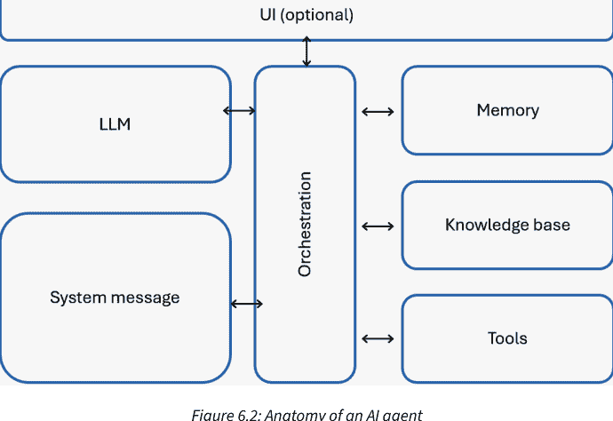

现在让我们详细介绍这些组件，以设计 `AskMamma`：

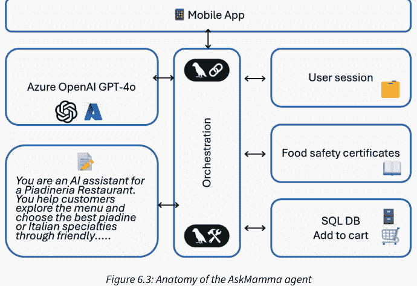

让我们探索图 6.3 显示的每个组件：

- **UI：** 智能体将存在于餐厅移动应用程序的上下文中。在本节中，我们将逐一关注核心组件，而在下一节中，我们将看到使用 Streamlit UI 显示的最终结果。
- **LLM：** 我们将使用 AzureOpenAI GPT-4o，因为它提供了顶尖的推理能力，同时对延迟进行了优化——这使其成为实时餐厅交互的理想选择。


> 注意
>
> 选择 LLM 意味着要平衡以下因素：
>
> - 质量与成本：更大的模型更智能，但价格更贵。
> - 速度与力量：更小的模型响应更快，但可能会忽略细节。
> - 上下文需求：更长的对话或大型文档？使用具有更大上下文窗口的模型。
> - 多模态：如果你的智能体需要查看图像，请选择 GPT-4o。
>
> 选择适合应用需求的模型，而不仅仅是最大的那个。

- **系统消息：** 我们正在指示智能体成为意大利餐厅的智能 AI 助手。
- **编排：** 我们将利用 `LangChain` 进行编排，利用 `LangSmith` 进行可观测性和可追溯性。
- **记忆：** 我们的智能体将赋予短期记忆，以跟踪正在进行的对话。
- **知识库：** 我们的智能体将了解餐厅老板多年获得的所有相关证书和奖励。
- **工具：** 除了提到的 RAG 工具外，我们还有两个额外的工具：
  - **数据库工具：** 该工具将检索库存物品、其价格、供应商、过敏原和其他相关信息。
  - **添加购物车工具：** 这是一个 API 工具，将与餐厅应用程序的后端进行通信。事实上，用户的购物车由数据库驱动，该工具将根据用户的查询将项目添加到数据库中。

请注意，在这一场景中，我们使用了三种不同类型的工具：作为检索器的非结构化知识库和结构化数据库，以及 API 集成。

> 注意
>
> 我们将在实现中将知识库视为一个工具，利用第 5 章探索的智能体 RAG（agentic RAG）概念。

让我们看看实践中如何这样做。

## 开发智能体

让我们看看如何逐步构建 `AskMamma` 智能体：

1. **导入库并初始化模型：** 在这里，我们将初始化所需的两个模型：作为智能体大脑的 LLM（AzureOpenAI GPT-4o）以及我们用于对非结构化 PDF 进行向量化索引的嵌入模型（AzureOpenAI text-embedding-3-large）。

```python
import os
from dotenv import load_dotenv
from langchain_openai import (
AzureChatOpenAI
)
import requests
from langchain.agents import (
    AgentExecutor, create_openai_tools_agent
)
from langchain_core.prompts import (
    ChatPromptTemplate, MessagesPlaceholder
)
from langchain.tools import BaseTool, StructuredTool
```

```python
## 加载环境变量
load_dotenv()
```

```python
## 访问环境变量
openai_version = os.getenv("AZURE_OPENAI_VERSION")
azure_endpoint = os.getenv("AZURE_OPENAI_ENDPOINT")
openai_key = os.getenv("AZURE_OPENAI_API_KEY")
azure_deployment = os.getenv("AZURE_OPENAI_CHAT_DEPLOYMENT")
```

```
## 初始化 Azure OpenAI 模型
model = AzureChatOpenAI(
    azure_deployment=azure_deployment,
    api_endpoint=azure_endpoint,
    api_key=openai_key,
    api_version=openai_version,
)
```

```python
from langchain_openai import AzureOpenAIEmbeddings

embeddings = AzureOpenAIEmbeddings(
    azure_deployment="text-embedding-3-large",
    api_key=openai_key
)
```

2. **初始化 SQL 工具：** 在这里我们将利用 LangChain 的内置组件。这是一个可以与 SQL 数据库工作的工具集，包括但不限于推理架构、运行查询和检查查询正确性。

要初始化工具，你需要一个 LLM 和数据库实例。对于后者，我们将使用具有以下架构的 SQL 实例：

| suppliers | | products |
| --- | --- | --- |
| Supplier ID PK | <--> Supplier ID FK |
| Supplier Name | | Product ID PK |
| Contact Email | | Category |
| Country | | Price |
| | | Stock |
| | | Allergens |
| | | Description |
| | | Calories |
| | | Vegetarian |

关系：一个供应商 -> 多个产品

图 6.4：餐厅数据库的结构

你可以在书籍的 GitHub 仓库中找到数据库。

现在让我们初始化工具包并获取第一个工具：

```python
from langchain_community.utilities.sql_database import SQLDatabase
db = SQLDatabase.from_uri("sqlite:///piaderia.db")
```


# 智能代理与工具集成示例

```python
from langchain_community.agent_toolkits.sql.toolkit import (
SQLToolkit
)

sql_toolkit = SQLToolkit(db=db, llm=model)
```

输出如下：

> [QuerySQLDatabaseTool(description=此工具的输入是详细且正确的 SQL 查询，输出是数据库结果。如果查询错误，将返回错误消息。如果返回错误，请重写查询、检查查询并再次尝试。如果遇到 Unknown column 'xxxx' in 'field list' 的问题，请使用 db_schema 查询正确的表字段。=<langchain_community.utilities.sql_database.SQLDatabase object at 0x00000250e33160f0>]

如所示，此工具带有名称（`QuerySQLDatabaseTool`）和对其能力的描述，以便智能体知道如何调用它。

## 初始化 `add_to_cart` 工具

在这里我们需要编写一个正确的 HTTP 操作将项目添加到餐厅应用程序的后端中。为此，我们首先需要准备一个托管会话上下文中用户项目的数据库。在这种情况下，我初始化了一个空的 `db.json` 对象如下：

```json
{
  "cart": []
}
```

在运行智能体之前，我们需要确保此数据库是开启的（为了演示，我们将在本地运行）。

## 注意事项

| 注意事项 |
| :--- |
| 此 DB 与 SQL 工具部分提到的 SQL DB 不同！让我们清楚地区分这两者：<br><br>SQL DB：这是餐厅的商店记录系统，所有者可以在此跟踪库存、价格、供应商等。<br>`db.json`：这是在会话上下文中支持用户购物车的 DB。它是应用程序数据库。 |


现在我们已经有了购物车 DB，就可以定义我们的工具了：

```python
## 定义一个向购物车添加物品的工具
@tool
def add_to_cart(item_name: str, item_price: float) -> str:
    """将商品添加到购物车中"""
    url = 'http://localhost:3000/cart' # 确保这与 JSON Server 的端点匹配
    cart_item = {
        'name': item_name,
        'price': item_price
    }

    response = requests.post(url, json=cart_item)

    if response.status_code == 201:
        return f"{item_name} 已成功添加到购物车。"
    else:
        return f"添加商品到购物车失败: {response.status_code} - {response.text}" 
```

如你所见，我们使用 `@tool` 装饰器定义了工具，这是 LangChain 的典型用法。我们添加了名称（`add_to_cart`）和描述（格式为 `"""docstring"""`）。我们还指定了正确调用此工具所需的两个参数：物品名称和相对价格；这意味着代理（agent）将在调用工具之前尽力获取这两个元素。最后，正确的“动作”（action）是针对实时购物车 DB 端点的 POST 方法。

## 初始化 RAG 工具

在这里，我们希望让我们的代理植根于某些关于餐厅食品合规证书和多年来获得的奖项的上下文。以下是从 PDF 中提取的几个段落：

| 披萨店卫生与食品安全合规报告 | 第 1 页：起源与家族传统 |
| :--- | :--- |
| 第 2 页：HACCP 认证 | 危害分析关键控制点（HACCP）是我们食品安全运营的基础。我们建立了完整的 HACCP 系统，用于识别和监控食品准备和供应过程所有的关键控制点。我们父母的根源可以追溯到意大利艾米利亚-罗马罗马尼亚地区罗马米尼附近的一个小村庄。制作面条不仅仅是食物——它更是一个文化符号。这一传统的创始人 Luca 和 Sofia 在一个家庭农场里长大。他们的祖父母拥有一座家庭农场，传统的配方在那里自豪地代代传承。 |
| 食品处理的每个阶段都面临风险，包括储存、准备、烹饪和供应。我们的员工接受过训练，能够识别此类危害，例如温度和过敏原问题。 | 从小起，Luca 和 Sofia 就沉浸在揉面团的节奏、清晨的烘焙以及迷迭草厨房和新鲜扁饼的香气中。他们的童年既是乐场也是教室。他们不仅学会了制作食物，还学会了如何尊重食物。 |
| 我们的 HACCP 计划由外部认证机构进行审查和审计，确保我们符合最新的科学和法律安全标准。我们保留了所有监控活动、纠正措施和验证结果的记录，可根据要求提供。 | 带着与世界分享这份遗产的梦想，他们着手建立一家餐厅，在尊重其传统的同时，欢迎来自世界各地的美食爱好者。 |

图 6.5：我们将作为知识库使用的食品证书快照

> **快速提示：** 想要查看此图像的高分辨率版本吗？请在下一代 Packt Reader 中打开此书，或在 PDF/ePub 版本中查看。购买此书将免费赠送下一代 Packt Reader。扫描二维码 或访问 packtub.com/unlock，然后使用搜索框通过名称查找此书。双检显示的版本以确保你获取的是正确的版本。


为了创建我们的工具，我们首先需要对 PDF 进行适当的向量化并索引到向量 DB 中。为此，我们将使用 LangChain 中一些预构建的组件进行文档处理，并使用 FAISS 向量数据库作为存储。

### 定义

Facebook AI Similarity Search (FAISS) 是由 Meta AI 开发的一个开源向量数据库和库，用于密集向量的高效相似性搜索和聚类。它实现了高维向量的快速检索，是语义搜索、推荐系统和基于 LLM 的检索等应用的理想选择。

让我们从初始化 `vector_store` 对象开始。

```python
import faiss
from langchain_community.docstore.in_memory import InMemoryDocStore
from langchain_community.vectorstores import FAISS
# 使用 L2（欧式）距离创建一个 FAISS 索引，其维度
# 与嵌入函数的输出相同（例如，简单嵌入
# #vector 的长度）
index = faiss.IndexFlatL2(len(embeddings.query("hello world")))
```

```python
vector_store = FAISS(
    embedding_function=embeddings,
    index=index,
    docstore=InMemoryDocStore(),
    index_to_docstore_id={},
)
```

然后我们可以利用 LangChain 的库对文档进行分块和处理：

```python
from langchain_text_splitters import CharacterTextSplitter
from langchain.document_loaders import PyPDFDirectoryLoader
```

```python
file_path = ("documents")
loader = PyPDFDirectoryLoader(file_path)
documents = loader.load()
text_splitter = CharacterTextSplitter(
    chunk_size=1000, chunk_overlap=0
)
```

```python
docs = text_splitter.split_documents(documents)
```

注意，在这种情况下，我们利用了一个文本分割器库——`CharacterTextSplitter`，它根据字符数分割文本。然而，LangChain 提供了各种类型的分割器，在将大型文档馈入向量存储之前，将其拆分成更小的、易于管理的块。一些最流行的包括：

- `RecursiveCharacterTextSplitter`（推荐）：尝试在更有意义的边界上进行分割（例如：段落 -> 句子 -> 单词 -> 字符）。当分块太大时，递归地回退到单元。
- `TokenTextSplitter`：基于 token 计数分割（对于具有严格限制的 LLM，如 OpenAI 的 GPT 模型有用）。用于将输入与模型上下文窗口对齐。
- `NLKTextSplitter` / `SpacyTextSplitter`：感知的分割器，使用 NLP 库的句子分割。适用于需要更多语法保留的情况。

一旦我们将文档拆分为可管理的块并传递给 `vector_store.add_documents()`，每个块都会使用嵌入模型转换成高维向量表示。

```python
vector_store.add_documents(documents=docs)
```

这些向量被索引在向量存储中，允许后续进行相似性搜索。这是一个示例：

- 分块 1："Mozzarella 是一种意大利奶酪..." 向量：[0.21, -0.45, ...]
- 分块 2："Prosciutto（火腿肉）与甜瓜非常配对..." 向量：[0.67, 0.10, ...]
- 分块 3："我们的 piadine 每天新鲜制作..." 向量：[0.33, -0.88, ...]

这些嵌入与元数据（例如，源文档、文件位置）一起存储在向量数据库中。当用户提问时，他们的查询会被嵌入并与存储的向量进行比较，以检索相关的块。

此过程允许系统根据语义含义“检索”知识，而不仅仅是关键词。

## 现在我们拥有了创建 RAG 工具的所有原料：

```python
retriever = vector_store.as_retriever()

from langchain.tools.retriever import create_retriever_tool

rag_tool = create_retriever_tool(
    retriever,
    "document_search",
    ""
    搜索并返回关于餐厅证书和所有者历史的信息。
    ""
)
```

如你所见，LangChain 中的 `vector_store` 对象带有一个方法 (`.as_retriever`)，可以自动将其转换为检索器对象。通过这样做，我们可以使用 `create_retriever_tool` 函数创建我们的工具，正如我们在许多示例中学到的，该函数需要一个工具名称和一个对工具能力的描述。

## 初始化系统消息

在创建代理之前我们需要的最后一个原料是系统消息（system message）。在 LangChain 中，我们可以利用 `ChatTemplate` 类，该类旨在为对话语言模型构建提示。

它具有以下功能：

- **基于角色的消息**：定义特定角色的消息以设置对话的和流。
- **动态变量**：在消息中包含占位符，可以在运行时使用用户输入或其他动态数据进行填充。
- **上下文管理**：使用 `MessagesPlaceholder` 作为占位符维护对话历史和中间步骤，使 AI 能够生成连贯且符合上下文的响应。

对于我们的 "AskMamma" 助手，我们将具有以下结构：

```python
# 定义提示模板
prompt = ChatPromptTemplate.from_messages(
    ("system", """你是一个 Piadineria 餐厅的 AI 助手。
    你通过友好、交互式的问题帮助客户探索菜单并选择最佳的 piadine 饼或意大利特产。
    当用户询问产品详情（配料、过敏原、素食选项、价格等）时，你可以查询产品数据库。
    当用户准备好下单时，询问他们是否想将选定的项目添加到购物车。
    如果他们确认，使用你的工具将项目添加到购物车。
    当使用工具时，仅响应最终结果。
    例如：
    Human: 将 Classic Piadina 加入购物车，价格为 5.50
    AI: 'Classic Piadina'已成功添加到购物车。"""),
    MessagesPlaceholder("chat_history", optional=True),
    ("human", "{input}"),
    MessagesPlaceholder("agent_scratchpad")
)
```

让我们将其拆分为三个组成部分：

- **系统消息 (System message)**：这是指令性消息，设定了 AI 的整体行为和边界。

  `("system", """You are an AI assistant for a Piadineria Restaurant. ...")`

- **`MessagesPlaceholder("chat_history")`**：这是一个动态占位符，会将完整的对话历史（如果可用）插入提示词中，以便 AI 了解之前说过的内容的上下文。注意它被标记为 `optional=True`，因此对话可以新开始，也可以继续进行的会话。

- **带有输入占位符的人类消息**：这是插入当前用户消息的地方。`{input}` 占位符将在将在运行时替换为用户刚刚输入的内容（例如，“你们有无麸质的选项吗？”）。

```python
("human", "{input}")
```

**`MessagesPlaceholder("agent_scratchpad")`**：在工具增强型工作流期间，这是注入中间代理推理或工具使用痕迹的地方。

> 注意
> 
> 这种结构化格式非常适用于以下情况的代理系统：
> 
> * 你需要持久内存（`chat_history`）
> * 代理可以调用工具（例如添加到购物车、查询产品）
> * 你希望预先给出清晰的行为指令（通过系统消息）
> 
> 它确保 AI 行为的一致性，适应上下文，并像真实的助手一样执行操作——而不会产生幻觉或超出允许范围做出响应。


## 初始化代理

我们现在拥有了初始化代理的所有原料。为此，我们将利用 LangChain 中提供的 `create_openai_agent` 构建函数，它设计用于构建一个利用 OpenAI 工具调用能力的 AI 代理。

> 定义
> 
> OpenAI 的工具调用能力（以前称为函数调用）使语言模型能够以结构化和动态的方式与外部工具或函数交互。在 AI 代理的领域中，工具调用成为更大编排拼图的一部分，正如我们多次提到的，我们在 LLM 之上额外添加了一层智能，使代理能够决定是否使用工具、选择调用哪种工具、将工具链联起来以及执行后续操作等。因此，虽然工具调用的机制仍然存在，但开发者正逐渐远离编写原始的工具调用逻辑，转向能够为你处理这些推理的代理接口。


让我们初始化它：

```python
## 设置工具包
toolkit = [rag_toolkit, add_to_cart, *sql_toolkit.get_tools()]
```

```python
from langchain_community.chat_message_histories import ChatMessageHistory
from langchain_core.runnables.history import RunnableWithMessageHistory
```

```python
message_history = ChatMessageHistory()
```

```python
# 构建 OpenAI Tools 代理
agent = create_openai_tools_agent(model, toolkit, prompt)
```

```python
# 通过传入代理和工具创建代理执行器
agent_executor = AgentExecutor(agent=agent, tools=toolkit, verbose=True)
```

```python
agent_with_chat_history = RunnableWithMessageHistory(
    agent_executor,
    # 这是必要的，因为在大多数现实场景中，需要一个 session id
    # 在这里并没有真正使用它，因为我们使用的是简单的内存 ChatMessageHistory
    lambda session_id: message_history,
    input_messages_key="input",
    history_messages_key="chat_history",
)
```

现在是时候测试它了。在运行代理之前，我们需要部署 `db.json`，以便代理在需要时可以使用 `add_to_cart` 工具执行 POST 请求。要运行你的数据库，请在终端中执行以下命令：

```bash
npm install -g json-server
cd path_to_your_db
json-server --watch db.json
```

# 6 

现在你的 `db.json` 运行在本地的 3000 端口（默认端口）：

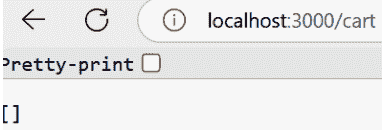

图 6.6：作为本地运行的应用数据库

太好了，现在我们可以运行我们的代理了。为了模拟对话，我将使用一个 while 循环：


## 交互循环

```python
while True:
    user_input = input("在此输入你的问题（或输入 'exit' 退出）： ")
    if user_input.lower() == 'exit':
        break
    result = agent_with_chat_history.invoke(
        {"input": user_input},
        # 这是必要的，因为在大多数现实场景中，需要一个 session id
        # 在这里并没有真正使用它，因为我们使用的是简单的内存 ChatMessageHistory
        config={}
    )
```

运行代码后，我发送了以下输入（注意我发送了一些问题，以假设之前的上下文被保留，从而测试短期记忆）：

- 你好
- 你们有哪些食品认证？
- 你们有里里塔奶士吗？
- 是的，把它加入购物车
- 那个物品的供应商是谁？

让我们看看结果。现在我保持了代理的详细模式（`verbose`），这意味着我们可以看到中间步骤和工具输出。随后，输出在某些中间步骤中截断了，但你可以在 GitHub 仓库中查看完整版本。

## 使用 LangChain 构建你的第一个 AI 代理

为了让以下内容更易读，我将突出显示用户输入、AI 输出和推理步骤。在其之间，我会添加我的注释，以突出一些值得记住的特定代理模式：

**User**: Hello

代理理解这是一个需要特定工具的简单交互。

**AI**: Hi there! Welcome to Piadineria Restaurant. How can I assist you today? Are you looking to explore our menu or need help with something specific?

**User**: Which food certificates do you have?

代理理解它需要使用特定的查询调用特定的 RAG 工具来回答这个问题。

```text
> Entering new AgentExecutor chain...

Invoking: `document_search` with `{'query': 'food certificates'}`

Piadineria Hygiene & Food Safety Compliance Report
Page 2: HACCP Certification
Hazard Analysis [...]
> Finished chain.
```

**AI**: 我们有多种食品安全认证和合规措施：

1. **HACCP 认证**：我们有一套完整的危害分析和关键控制点 (HACCP) 系统，用于识别和监控产品准备过程中的关键点。该系统由外部认证机构每季度审核一次。
2. **当地食品培训与 PIC**：piadineria 的每个食品处理人员都根据当地法规完成了食品安全培训。我们在每个地点都配备了负责人 (PIC) 来监督卫生标准并执行最佳实践。你想了解更多关于我们的菜单或其他信息吗？

**User**: Do you have ricotta cheese in stock?

代理理解它需要调用 SQL 工具。首先，它需要通过 `sql_db_list_tables` 和 `sql_db_schema` 工具理解架构，然后将使用 `sql_db_query` 运行实际查询。

```text
> Entering new AgentExecutor chain...

Invoking: `sql_db_list_tables` with `{}`
responded: Let me check the availability of ricotta cheese for you. I'll need a moment to look it up.
products, suppliers
Invoking: `sql_db_schema` with `{'table_names': 'products'}`
[]
Invoking: `sql_db_query` with `{'query': 'SELECT * FROM products WHERE "Product Name" = \'Ricotta Cheese\'}`
[]
> Finished chain.
```

**AI**: 是的，我们有里里塔奶士！详情如下：

**产品名称**: Ricotta Cheese

**类别**: Cheese

**价格**: 7.75

**库存**: 15 单位

**过敏原**: 乳制品

**描述**: 奶油般的里里塔奶士，适合甜点或意面。

**卡路里**: 120

**素食**: 是

你想把它加入购物车吗，还是需要其他帮助？

**User**: Yes, add it to cart

代理理解它需要调用 `add_to_cart` 工具，并且它能够从之前的对话中检索所需的两个参数——名称和价格。

```text
> Entering new AgentExecutor chain...
Invoking: `add_to_cart` with `{'item_name': 'Ricotta Cheese', 'item_price': 7.75}`
```

“里科塔奶酪”已成功添加到购物车。里科塔奶酪已成功添加到您的购物车。您还有其他想添加的物品或需要其他帮助吗？

> 链执行完毕。

一旦执行了此工具，如果你重新运行 `db.json` 服务器，你将看到它已相应更新：

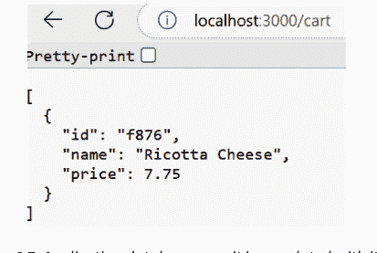

**AI**: 里科塔奶酪已成功添加到您的购物车。您还有其他想添加的物品或需要其他帮助吗？

**User**: 那个物品的供应商是谁？

代理能够再次调用 SQL 工具，这次它将执行连接（join）操作，以查找两个表并提取里科塔奶酪的供应商。此外，我们没有指定物品，而是依赖于代理的上下文感知能力。

```text
> Entering new AgentExecutor chain...

Invoking: `sql_db_list_tables` with `{}`
products, suppliers
Invoking: `sql_db_schema` with `{'table_names': 'products, 'suppliers'}`
[]]
Invoking: `sql_db_query` with `{'query': 'SELECT suppliers."Supplier Name" FROM suppliers JOIN products ON suppliers."Supplier ID" = products."Supplier ID" WHERE products."Product Name" = \'Ricotta Cheese\'}}`
[]]
> Finished chain.
```

**AI**: 我们里科塔奶酪的供应商是 **Dolce Italia**。

您还有其他想知道或添加到订单中的内容吗？

**User**: 谢谢！

**AI**: 不客气！如果您有任何其他问题或需要进一步帮助，请随时询问。祝您用餐愉快！

如您所示，代理能够执行以下操作：

- 根据用户的请求调用正确的工具，这归功于每个工具都配备了自然语言描述
- 在用户会话的上下文中保持记忆
- 以对话的方式与用户交互

仅需三个工具，我们就能通过强大的代理来实现良好的用户体验。

然而，我们还缺少拼图中的重要的一块：我们如何监控代理的行为？事实上，在现实场景中，可观测性、可追溯性以及评估和持续改进是在设计端到端架构时需要考虑的关键元素。

在下一节中，我们将探索如何用几行代码来实现这些。

## 可观测性、可追溯性和评估

可观测性、可追溯性和评估是实现这些目标的关键组件。我们提供了对 AI 代理内部工作机制的洞察，便于调试并实现持续改进。

可观测性是指根据系统的外部输出理解其内部状态。在 AI 代理中，这涉及监控输入、输出、中间过程以及与外部工具或 API 的交互。可追溯性通过提供代理决策过程的详细记录来补充可观测性，包括所采取的动作序列及其背后的原理。它们允许开发者精确定位问题、理解代理行为并确保系统按预期运行。

评估涉及根据指标或基准评估 AI 代理的性能。这可以包括准确性、相关性、连贯性或其他特定领域的标准。定期评估有助于识别改进领域、验证更新并确保代理符合所需标准。它在维护用户信任和满意度方面也起着至关重要的作用。

> **注意**
>
> 根据任务和背景，可以使用多种方法来评估 AI 代理。这些包括：
>
> - 人机回评估（Human-in-the-loop），由人类评审员评估代理响应的质量和帮助性。
> - LLM 裁判（LLM-as-a-judge），由受信任的模型（例如 GPT-4）对响应的相关性或准确性评分。
> - 知识库（KB）验证，适用于检索增强系统，其中检索文档的正确性至关重要。
> - 自动指标，例如用于摘要或问答任务的 BLEU、ROUGE 或精确匹配。

随着 AI 代理变得越来越复杂——能够进行推理、使用工具并维护多轮记忆——对健壮的可观测性和评估的需求变得至关重要。与传统的软件系统不同（在传统系统中错误可以追溯到特定的代码行或逻辑分支），AI 代理在概率性和动态性的环境中运行。它们的决策不仅取决于输入数据，还取决于提示词结构、检索到的上下文、工具交互以及之前的对话轮次。这使得调试和性能评估本质上变得更加困难。为了解决这个问题，LangSmith 等工具应运而生，提供了一种结构化的方法来实时监控、跟踪和评估代理行为。

LangSmith 是 LangChain 生态系统的一部分，旨在增强 AI 应用中的可观测性、可追溯性和评估。它提供了记录和可视化代理交互、分析性能指标以及进行系统性评估的工具。

LangSmith 的核心功能包括：

- **执行跟踪**：可视化展示代理的每一步决策，包括输入、输出和工具使用
- **性能洞察**：监控延迟、Token 数量和错误模式等关键统计数据以优化您的系统
- **灵活评估**：使用内置或自定义逻辑运行结构化评估，以评估响应质量
- **提示词版本控制**：跟踪、比较和迭代提示词，以随时间推移优化代理行为
- **协作友好**：与团队共享运行结果、反馈和评估，以支持共同开发

LangSmith 与各种 AI 框架无缝集成（不限于 LangChain！），为监控和改进 AI 代理提供了统一的接口。

让我们在实践中看看它。

第一步是在以下链接的 LangSmith 设置页面：[https://smith.langchain.com/settings](https://smith.langchain.com/settings) 上创建一个 API 密钥。

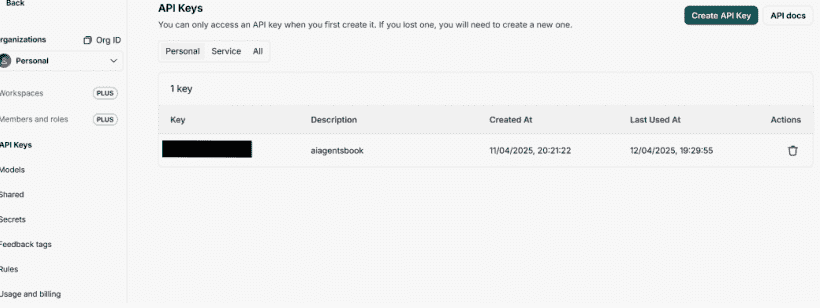

图 6.8：LangSmith 管理界面

注意，如果你还没有账户，将被提示注册（免费的）。

然后，安装 LangSmith 依赖：

```bash
pip install -U langsmith
```

使用你的变量设置环境。在我们案例中，由于我们在 Jupyter Notebook 中演示代理，我将使用 `os` 模块直接初始化变量：

```python
from langsmith import Client

client = Client(
    api_key=os.getenv("LANGSMITH_API_KEY"),
    api_url=os.getenv("LANGSMITH_ENDPOINT"),
)
```

现在我们有了初始化 `LangChainTracer` 对象的所有原料，`LangChainTracer` 是一个回调处理器，用于捕捉应用程序的详细执行跟踪（如链、工具和语言模型交互），并将这些信息发送到 LangSmith。

```python
from langchain.callbacks.tracers import LangChainTracer
tr = LangChainTracer(client=client, project_name="askmama")
```

如您所示，初始化 `LangChainTracer` 需要 `client` 和可选的 `project_name` 参数——这将是存储和存档日志的文件夹。该跟踪器钩入 LangChain 的执行流，捕获链、工具调用和语言模型调用的开始和结束事件。

跟踪器是我们需要为现有代理添加的唯一额外元素。我们可以在调用代理时将其作为 `config` 参数传递：

```python
agent_with_chat_history.invoke(
    {"input": user_input},
    # 这是因为在大多数现实场景中，需要会话 id
    # 在这里我们没有真正使用它，因为我们使用的是简单的内存 ChatMessageHistory
    config={"configurable": {"session_id": "foo"},
        "callbacks": [tracer]}
)
```

此配置确保代理执行的每一步都记录在 LangSmith 中，允许您可视化操作序列、检查输入输出并识别任何错误或性能瓶颈。

例如，一旦我们运行代理，我们将在 LangSmith 仪表板上看到一个新初始的项目：

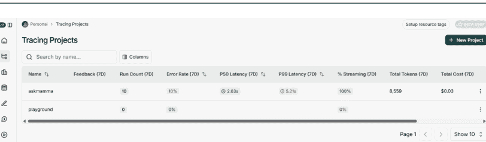

图 6.9：LangSmith 的追踪项目

我们确实可以看到许多有趣的统计数据，如错误率、总成本、运行次数等。让我们从 Askmamma 项目概览中获取更多细节：

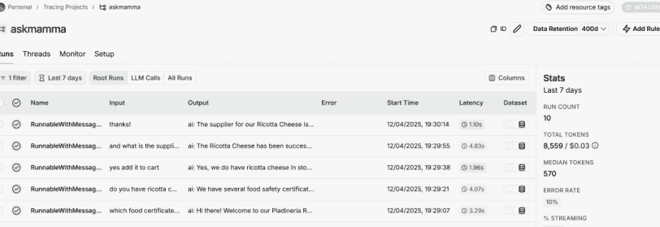

图 6.10：LangSmith 的项目概览

在这里，我们可以看到三个主要信息来源：

1. **运行 (Runs)**：一次运行是与智能体的单次交互。例如，如果用户输入“Hi”，这就是一次运行。

在每次运行下，我们都可以探索关于智能体活动的许多细节以回答问题。例如，当我们问“你有哪些食品证书？”时，智能体执行了几个步骤，我们可以在 LangSmith 中看到所有的步骤：

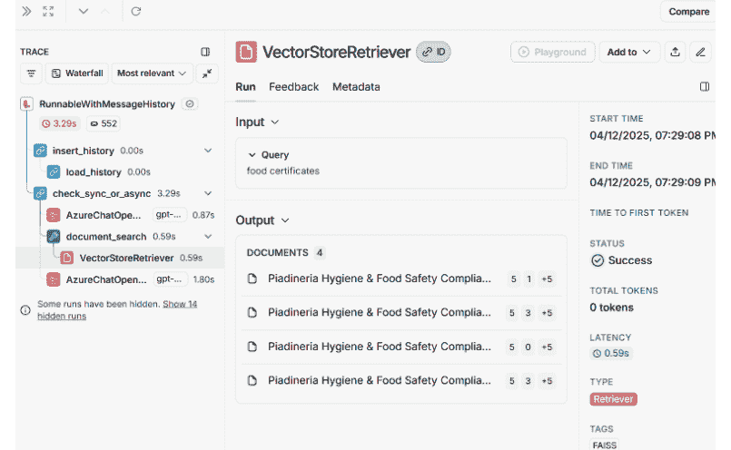

图 6.11：LangSmith 的运行概览

我们还可以检查那些失败的任务：

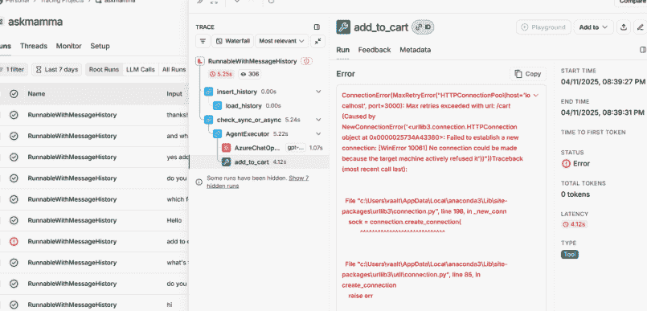

图 6.12：LangSmith 运行步骤概览

在这种情况下，原因是调用 `add_to_cart` 工具时，由于数据库离线，智能体无法继续执行。

**线程 (Threads)**：线程可以定义为一个会话。线程由唯一标识标记，你可以将它们初始化为名称。例如，在我们的场景中，我们初始化了一个名为 `<foo>` 的线程：

事实上，你可以在 LangSmith 中看到这个线程：

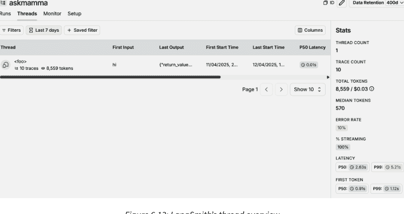

线程可以帮助你组织运行，并对智能体后台发生的情况有一个更高层次的视角：

### 使用 LangChain 构建你的第一个 AI 代理

个人 > 追踪项目 > askmamma `<foo>`

### 线程 `<foo>`

| 追踪计数 | 总 Token | 延迟 |
| :--- | :--- | :--- |
| 10 | 8,559 / $0.02532 | 2.33s 5.2% |

- 轮 1
- 轮 2
- 轮 3
- 轮 4
- 轮 5
- 轮 6
- 轮 7
- 轮 8

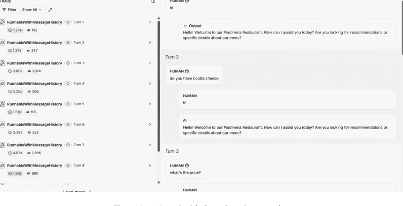

3. **监控 (Monitor)**：在这里，你可以看到一些实用的图表来对智能体进行 360 度视图，包括追踪计数、LLM 调用次数、成功率等：

askmamma

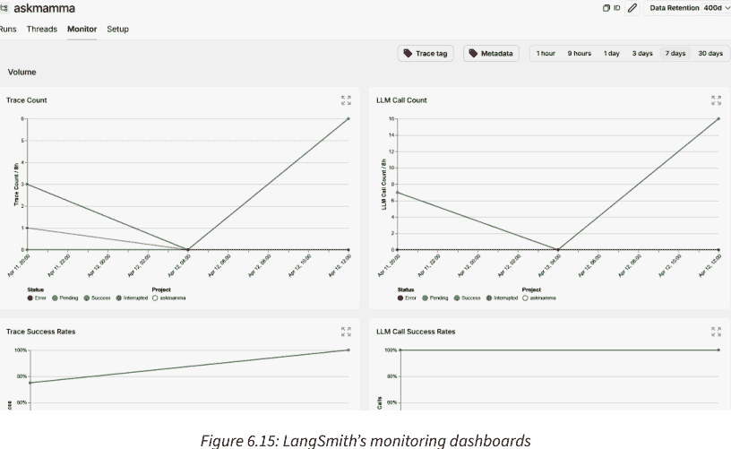

在评估方面，AI 代理以及更广泛的由 LLM 驱动的应用不能依赖传统的机器学习评估器，例如准确率、假阳性率、ROC 曲线等。事实上，AI 输出在设计上是对话性的，这意味着我们需要新的工具和技术来评估我们 AI 驱动解决方案的性能。

通常，为了评估 LLM 或智能体流水线的质量，你有**三个主要组件**需要处理：

1. **数据集 (Dataset)**：这是测试用例的集合——输入以及可选的预期输出——你的模型或智能体将基于这些进行评估。将其视为你的地面真值或基准集。
2. **目标函数 (Target function)**：这是你想要测试的实际内容——在我们案例中是智能体的输出。当你运行评估时，LangSmith 将每个数据集输入传递给此目标函数并捕获输出——就像自动化测试执行一样。输出将与预期输出比较或取决于你选择的评估器进行独立评估。
3. **评估器 (Evaluator)**：评估器用于判断目标函数输出的质量。它们可以是基于 LLM 的评估器，如 BLEU 或 ROUGE 等字符串指标，或者传统的指标，如准确率（在我们使用 LLM 进行分类或预测等任务时）。

> **定义**
>
> BLEU（双语言评估对理解）和 ROUGE（面向摘要评估的召回率定向理解）是*自然语言处理* (NLP) 中最广泛使用的两种自动评估器，特别是对于文本生成、翻译和摘要任务。
>
> BLEU 是一种基于精确率的指标，通过衡量生成的文本与一个或多个参考文本之间的 n-gram 重叠次数来评估生成文本的质量，通常用于机器翻译。
>
> ROUGE 是一种基于召回率的指标，通过比较参考文本的内容有多少比例出现在输出中来评估文本生成，通常用于摘要任务。

让我们看一个使用我们的 AskMamma 代理的例子。在场景下，我们将利用 LangSmith SDK，你可以从 UI Playground 运行示例评估：

- **初始化数据集**：在这里，我们将初始化一个带有输入和输出的数据集。你可以在 LangSmith 中看到这个数据集：


# 使用 LangSmith 和 Streamlit 评估与部署 AI 代理

## 初始化 LangSmith 客户端

首先，我们需要初始化 `LangSmith` 客户端，用于创建数据集、记录实验和管理评估。

```python
from langsmith import Client

client = Client(
    api_key=os.getenv("LANGSMITH_API_KEY")
)

dataset = client.create_dataset(
    name="askmamma",
    description="A dataset for testing askmamma agent"
)
```

## 创建示例

接下来，我们为数据集添加示例，每个示例包含一个输入问题和一个标准答案。

```python
examples = [
    {
        "inputs": {"question": "你有哪些食品证书？"},
        "outputs": {"answer": "我有食品安全许可证、HACCP 和有机食品认证。"}
    }
]
client.create_examples(dataset_id=dataset.id, examples=examples)
```

然后，你可以从 UI Playground 运行示例评估。

## 定义评估器

评估器将判断目标函数输出的质量。对于 AI 驱动的评估，我们将 LLM 指向其他 LLM 的“法官”。让我们初始化 LLM 作为法官。在这种情况下，我们将使用正确性指标。

```python
from openai import AzureOpenAI

openai_client = AzureOpenAI(
    endpoint=os.getenv("AZURE_OPENAI_ENDPOINT"),
    api_key=os.getenv("AZURE_OPENAI_API_KEY"),
    api_version=os.getenv("AZURE_OPENAI_API_VERSION")
)

from langsmith import wrappers
```

```python
eval_instructions = "你是一个专门负责学生答案的专家教授。"
```

```python
def correctness(
    inputs: dict, outputs: dict, reference_outputs: dict
) -> bool:
    user_content = f"""你正在评估以下问题：\n{inputs['question']}\n真实答案：\n{reference_outputs['answer']}\n你正在评估以下预测答案：\n{outputs['response']}\n用 1-5 分回答，1 分最低，5 分最高。\n你的回答仅包含分数。"""
    response = openai_client.chat.completions.create(
        model="gpt-4",
        temperature=0,
        messages=[
            {"role": "system", "content": eval_instructions},
            {"role": "user", "content": user_content},
        ]
    ).choices[0].message.content
    return response.strip()
```

## 初始化目标函数

最后是评估的逻辑，我们希望你的智能体输出结构与我们定义的评估器相匹配。

```python
def target(inputs: dict) -> dict:
    response = agent_with_chat_history.invoke(
```


```python
{"input": inputs['question']},
# 之所以这样做是因为在大多数真实场景中，
# 需要一个会 id
# 在这里并没有真正使用它，因为我们使用的是简单的
# 内存 ChatMessageHistory

config={"configurable": {"session_id": "foo"},
  "callbacks": [tracer]},

return {"response": response['output']}
```

就是这些了！让我们运行评估器。

```python
experiment_results = client.evaluate(
  target,
  data="QA Askmamma",
  evaluators[
    correctness,
    # 可以在此处添加多个评估器
  ],
  experiment_prefix="first-eval-in-langsmith",
  max_concurrency=2
)
```

你可以从 UI 中检查结果。

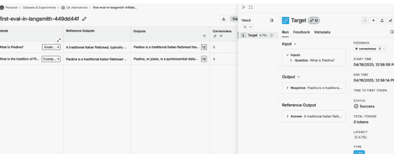

图 6.17：LangSmith 的评估结果

如你所见，我们的实际输出返回的正确性得分为 5。对于每个示例，你可以检查相关的指标，如实际输出、延迟、令牌等。

此外，在 AI 代理的语境下，我们还需要考虑工具管理：

- 工具调用（`tool calling`）是否正常？

- 代理是否能够调用多个工具来解决复杂问题？

- 代理是否足够智能，在不需要时不去调用工具？

换句话说，你需要评估代理的轨迹。让我们来看一个如何做的示例（注意以下代码是来自 LangSmith 官方文档的适配版本，你可以在此处找到：https://docs.smith.langchain.com/evaluation/how_to_guides）。

## 初始化新数据集

在这种情况下，我们需要按照如下方式添加预期的中间步骤。

```python
import uuid

questions = [
  ("Do you have ricotta cheese in stock",
  {
    "reference": "Yes we do have ricotta cheese in stock.",
    "expected_steps": ["sql_db_list_tables",
    "sql_db_schema", "sql_db_query_checker",
    "sql_db_query"]
  },
  ),
  ("hi",
  {
    "reference": "Hello, how can I assist you?",
    "expected_steps": [], # 期望直接回答
  },
  ),
  ("Can you add ricotta cheese to the cart with price 5.50?",
  {
    "reference": "The item 'ricotta cheese' has been added to the cart.",
    "expected_steps": ["add_to_cart"]
  }
  ),
  ("Do you have food safety certificate?",
  {
    "reference": "Yes, we have a food safety certificate",
    "expected_steps": ["document_search"]
  },
  ),
]
```

```python
uid = uuid.uuid4()
dataset_name = f"Agent Tool Eval Example {uid}"
ds = client.create_dataset(
  dataset_name,
  description="Example agent evals dataset using search and
calendar checks."
)
client.create_examples(
  inputs=[{"input": q[0]} for q in questions],
  outputs=[q[1] for q in questions],
  dataset_id=ds.id,
)
```

## 初始化评估器

在这里，我们将评估中间步骤的正确性，确保调用了正确的工具。

```python
from typing import Optional

from langchain.schemas import Example, Run

def intermediate_step_correctness(
    run: Run, example: Optional[Example] = None
) -> dict:
    if run.outputs is None:
        raise ValueError("Run outputs cannot be None")
    intermediate_steps = run.outputs.get("intermediate_steps") or []
    trajectory = [action.tool for action, _ in intermediate_steps]
    # 这是我们上传到数据集的内容
    expected_trajectory = example.outputs["expected_steps"]

## 使用 LangChain 构建你的第一个 AI 代理

    score = int(trajectory == expected_trajectory)
    return {"key": "Intermediate steps correctness", "score": score}
```

## 注意

为了获取代理的中间步骤访问，我们需要确保 `return_intermediate_steps` 参数等于 `True`。


```python
agent_executor = AgentExecutor(agent=agent,
    tools=toolkit,
    verbose=True, return_intermediate_steps=True)
```

我们还需要确保用正确的 schema 初始化我们的评估器，以便它能够解析我们在测试数据集中拥有的多个输出。

```python
def prepare_data(run: Run, example: Example) -> dict:
    return {
        "input": example.inputs["input"],
        "prediction": run.outputs["output"],
        "reference": example.outputs["reference"],
    }
```

根据参考答案判断 QA 答复是否“正确”。

```python
qa_evaluator = LangChainStringEvaluator(
    "qa", prepare_data=prepare_data, config={"llm": model}
)
```

## 定义目标函数

在这里，我们只是在创建一个函数，该函数将使用适当的配置参数调用我们的代理。

```python
def agent(inputs: dict):
    return agent_with_chat_history.invoke(
        inputs, config={"configurable": {"session_id": "foo"}})
    )
```

现在我们拥有了运行评估的所有材料。

```python
chain_results = evaluate(
    agent,
    data=dataset_name,
    evaluators=[intermediate_step_correctness, qa_evaluator],
    experiment_prefix="Agent Eval Example",
    max_concurrency=1,
)
```

## 让我们检查 LangSmith UI 中的结果

### Agent Eval Example-440d2zfa

| 输入 | 参考输出 | 输出 | 正确性 | 中间 | 延迟 | 状态 | 令牌 |

|---|---|---|---|---|---|---|---|

| Do you have safety... | Exp... | We have a food safety certificate. | us, our restaurant has formi... | 1 correct | 1.00 | 3.3s | SUCCESS | 631 |

| Do you ricotta cheese... | Exp... | We do ricotta cheese in stock. | Yes, we Have Ricotta Cheese | 1 correct | 0.0 | 2.8s | SUCCESS | 181 |

| hi | | Hello, can i assist you? | Hello agent Can assist you today?... | 1 correct | 0.0 | 0.64s | SUCCESS | 462 |

| Can you add ricotta cheese... | Exp... | The item 'ricotta cheese' has been add... | 1 correct | 1.00 | 1.42s | SUCCESS | 1010 |

图 6.18：评估结果仪表盘

太棒了！你可以看到，我们的代理失败了。让我们了解为什么一个界面被评估为错误。

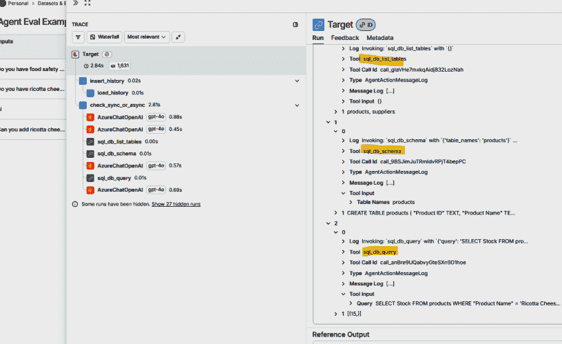

图 6.19：评估结果仪表盘

### 参考输出

- 参考：We have a food safety certificate

- 预期步骤：

  - `sql_db_list_tables`

  - ...

- 输出：We do ricotta cheese in stock.

- 预期步骤：

  - `add_to_cart`

## 在移动应用中注入 AI 代理

AI 代理可以通过多种方式消费：作为交互式应用程序、由业务流程触发、或嵌入现有应用程序中。在我们的场景中，我们将探索最后一种方案。

假设我们有一个餐厅的移动应用程序，并希望注入由 AI 代理驱动的对话式界面。新 UI 的外观将如下：

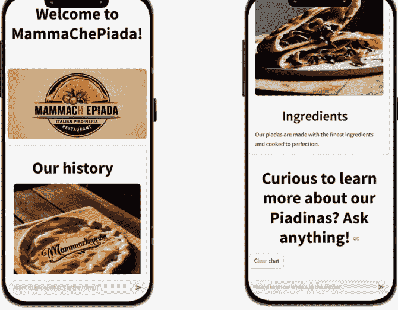

图 6.20：移动应用的 UI


为了开发 UI，我们将利用 `Streamlit`，这是一个开源 Python 库，可以轻松构建和共享交互式应用，特别是数据科学和机器学习工作流。你不需要花费时间进行前端开发，只需专注于 Python 代码，`Streamlit` 会自动处理 UI。

在其功能中，`Streamlit` 拥有社区支持的组件和模板，可以轻松与 `LangChain` 流线集成（例如创建聊天界面或文本生成演示）。这种协同效应让我们利用 `Streamlit` 的交互性和易用界面以及 `LangChain` 强大的语言处理能力快速启动 LLM 应用。

### 内存管理

我们首先初始化一个兼容 `Streamlit` 的消息历史对象作为对话历史的后端存储。在这种情况下，我们将利用 `LangChain` 内存类内置的 `ConversationBufferMemory`，它将所有消息保留在缓冲区中（即运行列表）。

```python
from langchain_community.chat_message_histories import (
  ChatMessageHistory
)
from langchain_core.runnables.history import (
  RunnableWithMessageHistory
)
from langchain_community.chat_message_histories import (
  StreamlitChatMessageHistory
)
msgs = StreamlitChatMessageHistory()
memory = ConversationBufferMemory(
  chat_memory=msgs, return_messages=True,
  memory_key="chat_history", output_key="output"
)
```

通过这种方法，我们将向 `agent_executor` 传递一个兼容 `Streamlit` 的内存对象。

```python
agent_executor = AgentExecutor(
    agent=agent, tools=toolkit, memory=memory,
    return_intermediate_steps=True,
    handle_parsing_errors=True, verbose=True
)
```

### 初始化 Streamlit 状态

在 `Streamlit` 中，状态是指跨越用户交互保留变量的能力，例如即使在重新运行后，也能记住用户输入过或点击过的内容。

```python
if 'chat_history' not in st.session_state:
    st.session_state['chat_history'] = []

if "messages" not in st.session_state:
    st.session_state.messages = []
```

前面的代码确保了当用户打开应用时，内存中有一个地方可以同时存储对话历史（`chat_history`）和屏幕上显示的消息。其中一个用于追踪说过过的内容，另一个用于显示的内容。如果没有这些，应用将将不知道如何保存或检索之前的消息。


# 渲染基于持久化的消息

在这个代码块中，我们想要显示用户与 AI 之间的完整历史，从内存中提取它们，以便之前发生的所有内容都能显示。

```python
avatars = {"human": "user", "ai": "assistant"}
for idx, msg in enumerate(st.session_state.messages):
    with st.chat_message(avatars[msg["type"]]):
        # 如果保存了任何中间步骤，则渲染
        for step in st.session_state.steps.get(str(idx), []):
            if step["tool"] is None:
                continue
            with st.status(f"**{step['tool']}**: {step['input']}", state="complete"):
                st.write(step[0])
                st.write(step[1])
```

# 渲染当前状态

这显示仅存储在当前状态中的消息——通常来自当前的运行。

```python
for message in st.session_state.messages:
    with st.chat_message(message["role"]):
        st.markdown(message["content"])
```

# 渲染 AI 的聊天界面

这段代码在你的 Streamlit 应用底部设置了聊天界面，邀请用户提问——例如“菜单里有什么？”。当用户发送消息时，它会立即作为用户气泡显示在聊天中。然后，AI（`agent_executor`）会接管：它处理提示词，可能在此过程中使用工具，并在助手气泡中回复答案。

```python
prompt = st.chat_input("What is in the menu?")
if prompt:
    st.chat_message("user").write(prompt)
    with st.chat_message("assistant"):
        st_cb = StreamlitCallbackHandler(st.container(), expand_new_thoughts=False)
        response = agent_executor.invoke({"input": prompt}, {"callbacks": [st_cb]})
        st.write(response["output"])
        st.session_state.steps[str(len(st.session_state.messages)) - 1] = response["intermediate_steps"]
```

这里很棒的一点是，AI 的推理步骤——例如在后台使用的工具——被 `StreamlitCallbackHandler` 捕获，并存储在`st.session_state`中。这让你能够详细可视化这些步骤，让用户一窥 AI 是如何得出答案的。

一旦你的代码准备就绪并保存在`app.py`文件中，你可以通过`streamlit run app.py`运行它并在本地查看结果。最终结果看起来如下：

## 使用 LangChain 构建你的第一个 AI Agent


图 6.21：AskMamma 对话界面的 UI

如你所见，我们能够与 AskMamma 交互并代表我们执行某些操作，例如向购物车中添加一个项目。

## 总结

在本章中，我们探索了创建功能性 AI Agent 所需的基础概念和实际步骤。从理解 LangChain 的基础到实现高级功能，你对 AI 开发领域获取了宝贵的见解。

通过利用 LangChain 强大的工具和框架，你可以创建能够执行复杂任务并做出明智决策的智能代理。在本章中获得的知识和技能将为 AI 领域的进一步探索和创新奠定坚实的基础。

在下一章中，我们将开始看到多个代理在更复杂的场景下协同工作，进入多代理应用领域。

## 参考文献

- Semantic kernel 插件：https://learn.microsoft.com/en-us/semantic-kernel/concepts/plugins?platform=programming-language-csharp
- LangChain 工具：https://python.langchain.com/docs/how_to/tool_calling/
- LangChain 生态系统：https://www.langchain.com/
- LangSmith：https://docs.smith.langchain.com/
- LangSmith 中间步骤评估：https://docs.smith.langchain.com/evaluation/how_to_guides
- LangChain 教程：https://github.com/langchain-ai/langsmith-cookbook/blob/main/testing-examples/agent_steps/evaluating_agents.ipynb

# 订阅获取免费电子书

新框架、演进中的架构、研究发布、生产环境分析——AI_Distilled 将噪音过滤掉，为亲手操作 LLM 和 GenAI 系统的工程师和研究人员提供一份每周简报。现在订阅即可获得免费电子书，以及帮助你保持专注并掌握最新信息的每周见解。

请访问 https://packt.link/TRO5B 订阅或扫描下方的二维码。


现在，在多代理系统中，同样的日历功能可以由专门的“日历代理”（Calendar Agent）来处理。该代理将超越基础的数据检索。它可以执行以下操作：

- 理解模糊的查询，例如“我下一次下午什么时候有空？”
- 检测并解决调度冲突（例如，两次会议重叠）
- 与其他代理协商变更——例如，提议一个所有参与者都方便的新会议时间

这种从简单功能到智能代理的转变，说明了多代理系统如何为基础任务带来更丰富的推理能力、灵活性和自主性。

我们为什么要这样做呢？我们不能依靠简单的工具来完成吗？简单的答案是——考虑这个简单的例子——可能是肯定的，我们可以依靠简单的工具。然而，在某些情况下，你可能希望有一个非常专门的代理而不是工具，这样你就可以为其提供清晰的系统消息（system message）并进一步扩展它的能力。此外，这个日历代理本身可能用于不同的流程和应用程序，使其成为你组织中可重复的组件。

让我们考虑另一个例子——这次稍微复杂一些。假设我们想启用一个 AI 应用，帮助你在多个商店进行在线购物。这是一个你可能想要执行的典型查询：“从 XYW 购买新款鞋，欧码 39 码。”

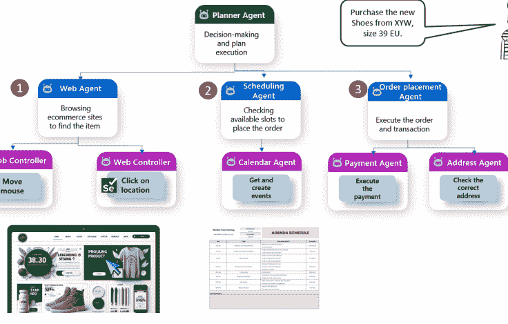

图 7.1：分层多代理系统示例

> **快速提示：** 需要查看此图像的高分辨率版本吗？请在下一代 Packt Reader 中打开本书，或在 PDF/ePub 版本中查看。

> **下一代 Packt Reader** 购买本书时免费赠送。扫描二维码或访问 packtub.com/unlock，使用搜索框通过名称找到它。请双检显示的版本，以确保你获得的是正确的版本。


在单代理设置中，该代理将按顺序搜索鞋子、管理调度、填写地址详情并处理支付。但在模块化的多代理设计中，此任务被拆分为专门的组件：

1. 规划代理（Planner Agent）解释指令并协调后续执行。
2. Web 代理（Web Agent）浏览电子商务平台，使用低级 Web 控制代理（例如，Selenium 驱动的机器人）与界面交互——点击、滚动和视觉化搜索。
3. 调度代理（Scheduling Agent）检查日历以查看送货可用性，调用日历代理来获取或创建事件。
4. 下单代理（Order Placement Agent）通过与以下项协调来完成购买：
   - 支付代理（Payment Agent），负责安全处理交易
   - 地址代理（Address Agent），验证并格式化收货地址

每个代理独立运行，但为更大的任务做出贡献。规划代理充当指挥的角色，协调一个由智能表演者组成的团队：Web 代理、调度、下单代理、Web 控制器、日历代理、地址代理和支付代理。

这种方法非常符合我们在之前的章节中涵盖的模块化和抽象两个核心概念，提供了若干优势：

- **可扩展性（Scalability）：** 多代理系统在设计上具有自然扩展性。由于每个代理都封装了特定的功能或责任，代理可以**独立地**部署在不同的服务器、容器、甚至地理区域中。如果某个代理成为瓶颈（例如，流量高峰期间的网络爬虫代理），可以对其进行水平扩展——复制并负载均衡——而不影响系统的其他部分。这种分布式特性使得构建随用户需求而增长的 AI 应用变得更加容易。

- **可维护性（Maintainability）：** 模块化促进了可维护性。由于每个代理都是自包含的，并通过协议或接口通信，因此可以对其进行更新、重构或替换，而无需重写整个系统。例如，将摘要代理更换为更先进的模型（甚至是不同的模型提供商）不会影响处理检索、过滤或用户交互的代理逻辑。这种清晰的关注点分离（separation of concerns）使得长期演进和实验变得更容易更安全。

- **专业化（Specialization）：** 每个代理都可以根据其工作进行微调，或使用最佳工具进行构建。某些代理可能使用代码生成 LLM（如 GPT-4），而其他代理可能基于检索增强架构或基于规则的逻辑。同样（使用 Python、JavaScript 等）或框架，只要它们遵循共享协议。这种灵活性允许团队优化性能和成本，为系统的每个组件选择合适的方法。

最后，为了构建和理解多代理系统，我们必须从两个主要视角转向微服务世界：基础设计以及一种使多代理智能能够实际运行的基础设施模式。

## 定义

微服务是一种软件架构模式，将应用程序拆分为较小的、独立的服务，每个服务负责单一功能，并通过 HTTP 或消息队列等轻量级协议进行通信。这种模块化方法实现了可扩展性、灵活性和更易于维护，构成了现代分布式系统的基础——并且日益地，构成了多 AI 系统的基础。


从设计角度来看，微服务建立在模块化原则之上——每个代理都有单一职责。换句话说，多代理设计就是微服务设计。你可以将一个代理更换为更智能的代理而不干扰系统的其他部分。

从基础设施角度来看，微服务为部署此类分布式系统提供了骨干。每个代理可以是：

- 容器化的（例如 Docker）并作为 API 部署
- 托管在云原生环境中（例如 Kubernetes），并进行独立扩展
- 通过服务网格或消息代理连接，实现安全的通信
- 在多语言环境中开发（例如，一个代理运行 Python，另一个运行 JavaScript）


图 7.2：多代理系统的微服务后端

让我们重新回到 7.1 中的例子。规划代理将任务（“买鞋，39 码”）拆分为子任务，由模块化代理——Web 代理、调度代理、下单代理来处理，每个代理都有自己的辅助项（例如支付代理和地址代理）。这些代理可以作为：

- 部署在 Kubernetes 集群中的独立微服务
- 按需启动的无服务器函数
- 通过事件驱动架构协调的具有持久内存和状态的后台

没有微服务基础设施，构建、部署和管理此类分布式代理系统将变得脆弱且低效。模块化设计与可扩展托管使得这一切成为可能。

同时，我们还需要定义代理之间相互通信的方式，这引入了多代理设计工作流的主题。

# 为你的多代理系统理解并设计不同的工作流

当我们从单代理系统转向多代理架构时，代理交互的方式变得至关重要。不同的工作流（换句话说，通信模式）塑造了代理如何协作、共享信息和决策。选择正确的工作流取决于任务的性质、每个代理的角色以及预期结果。

让我们探索五种核心多代理工作流（见图 7.3）：

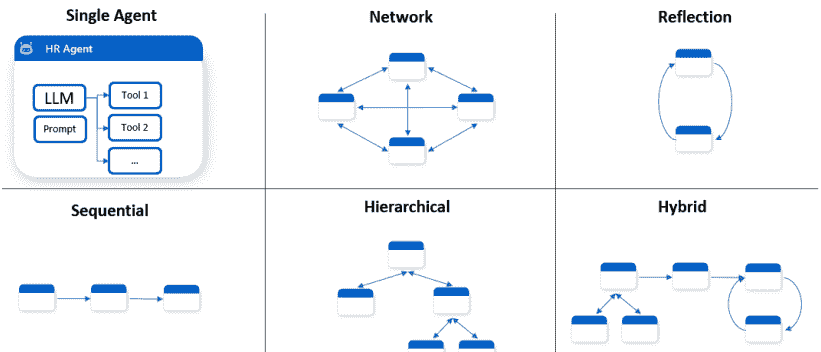

图 7.3：不同类型的代理工作流

以下是五个核心多智能体工作流的详细介绍：

## 网络（Network）

所有智能体都是全连接图中的节点，每个智能体都可以与任何其他智能体直接通信。这允许高度交互、动态的协作。

让我们考虑以下示例。在一家快速发展的初创公司中，AI 团队协作对新的移动应用程序发布进行构思、验证和规划。每个智能体都有明确的领域，但它们以动态、迭代的方式工作，就像真实的产品团队一样：

- **Agent A—市场研究智能体**：该智能体持续监控消费者趋势、商店数据和竞争对手活动。它识别出对 AI 驱动的健康应用的兴趣日益增长，并分享一份强调未满足用户需求的报告。

- **Agent B—产品设计智能体**：该智能体利用来自市场研究智能体的见解，草拟健康应用的初步概念，包括用户流和功能原型。它参考了 UX 风格指南并适配之前的成功模式。它将这些分享给团队以获取反馈。

- **Agent C—监管合规智能体**：一旦提出新的功能想法，该智能体就会审查其潜在的法律或隐私问题——例如健康数据的处理——并建议修改以保持应用程序符合 GDPR 和 HIPAA。

- **Agent D—项目经理智能体**：该智能体跟踪进度和任务之间的依赖关系。它提议时间表并标记风险，例如可能需要额外合规审批的设计功能。当决策等待或任务阻塞他人时，它还会提醒团队。

图 7.4：网络工作流
