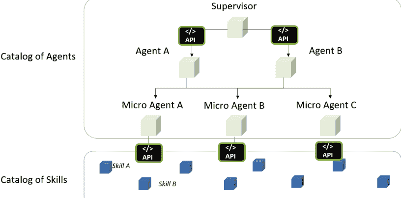
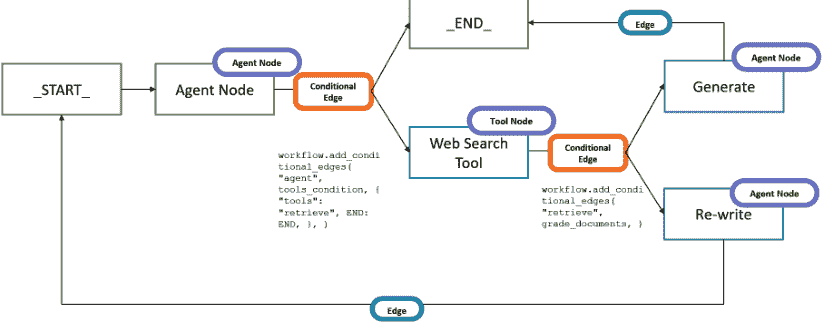
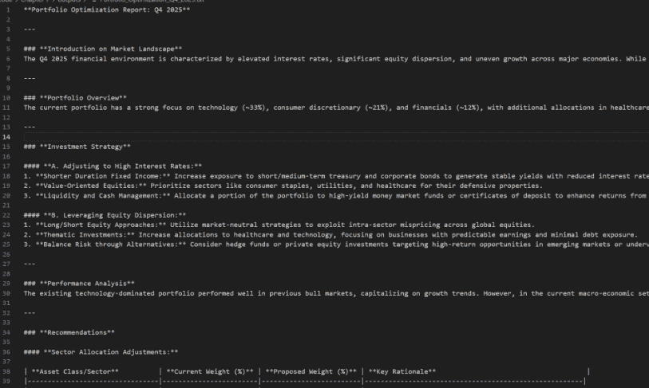

现在，在多代理系统中，同样的日历功能可以由专门的“日历代理”（Calendar Agent）来处理。该代理将超越基础的数据检索。它可以执行以下操作：

- 理解模糊的查询，例如“我下一次下午什么时候有空？”
- 检测并解决调度冲突（例如，两次会议重叠）
- 与其他代理协商变更——例如，提议一个所有参与者都方便的新会议时间

这种从简单功能到智能代理的转变，说明了多代理系统如何为基础任务带来更丰富的推理能力、灵活性和自主性。

我们为什么要这样做呢？我们不能依靠简单的工具来完成吗？简单的答案是——考虑这个简单的例子——可能是肯定的，我们可以依靠简单的工具。然而，在某些情况下，你可能希望有一个非常专门的代理而不是工具，这样你就可以为其提供清晰的系统消息（system message）并进一步扩展它的能力。此外，这个日历代理本身可能用于不同的流程和应用程序，使其成为你组织中可重复的组件。

让我们考虑另一个例子——这次稍微复杂一些。假设我们想启用一个 AI 应用，帮助你在多个商店进行在线购物。这是一个你可能想要执行的典型查询：“从 XYW 购买新款鞋，欧码 39 码。”


图 7.1：分层多代理系统示例

> **快速提示：** 需要查看此图像的高分辨率版本吗？请在下一代 Packt Reader 中打开本书，或在 PDF/ePub 版本中查看。

> **下一代 Packt Reader** 购买本书时免费赠送。扫描二维码或访问 packtub.com/unlock，使用搜索框通过名称找到它。请双检显示的版本，以确保你获得的是正确的版本。


在单代理设置中，该代理将按顺序搜索鞋子、管理调度、填写地址详情并处理支付。但在模块化的多代理设计中，此任务被拆分为专门的组件：

1. 规划代理（Planner Agent）解释指令并协调后续执行。
2. Web 代理（Web Agent）浏览电子商务平台，使用低级 Web 控制代理（例如，Selenium 驱动的机器人）与界面交互——点击、滚动和视觉化搜索。
3. 调度代理（Scheduling Agent）检查日历以查看送货可用性，调用日历代理来获取或创建事件。
4. 下单代理（Order Placement Agent）通过与以下项协调来完成购买：
   - 支付代理（Payment Agent），负责安全处理交易
   - 地址代理（Address Agent），验证并格式化收货地址

每个代理独立运行，但为更大的任务做出贡献。规划代理充当指挥的角色，协调一个由智能表演者组成的团队：Web 代理、调度、下单代理、Web 控制器、日历代理、地址代理和支付代理。

这种方法非常符合我们在之前的章节中涵盖的模块化和抽象两个核心概念，提供了若干优势：

- **可扩展性（Scalability）：** 多代理系统在设计上具有自然扩展性。由于每个代理都封装了特定的功能或责任，代理可以**独立地**部署在不同的服务器、容器、甚至地理区域中。如果某个代理成为瓶颈（例如，流量高峰期间的网络爬虫代理），可以对其进行水平扩展——复制并负载均衡——而不影响系统的其他部分。这种分布式特性使得构建随用户需求而增长的 AI 应用变得更加容易。

- **可维护性（Maintainability）：** 模块化促进了可维护性。由于每个代理都是自包含的，并通过协议或接口通信，因此可以对其进行更新、重构或替换，而无需重写整个系统。例如，将摘要代理更换为更先进的模型（甚至是不同的模型提供商）不会影响处理检索、过滤或用户交互的代理逻辑。这种清晰的关注点分离（separation of concerns）使得长期演进和实验变得更容易更安全。

- **专业化（Specialization）：** 每个代理都可以根据其工作进行微调，或使用最佳工具进行构建。某些代理可能使用代码生成 LLM（如 GPT-4），而其他代理可能基于检索增强架构或基于规则的逻辑。同样（使用 Python、JavaScript 等）或框架，只要它们遵循共享协议。这种灵活性允许团队优化性能和成本，为系统的每个组件选择合适的方法。

最后，为了构建和理解多代理系统，我们必须从两个主要视角转向微服务世界：基础设计以及一种使多代理智能能够实际运行的基础设施模式。

## 定义

微服务是一种软件架构模式，将应用程序拆分为较小的、独立的服务，每个服务负责单一功能，并通过 HTTP 或消息队列等轻量级协议进行通信。这种模块化方法实现了可扩展性、灵活性和更易于维护，构成了现代分布式系统的基础——并且日益地，构成了多 AI 系统的基础。


从设计角度来看，微服务建立在模块化原则之上——每个代理都有单一职责。换句话说，多代理设计就是微服务设计。你可以将一个代理更换为更智能的代理而不干扰系统的其他部分。

从基础设施角度来看，微服务为部署此类分布式系统提供了骨干。每个代理可以是：

- 容器化的（例如 Docker）并作为 API 部署
- 托管在云原生环境中（例如 Kubernetes），并进行独立扩展
- 通过服务网格或消息代理连接，实现安全的通信
- 在多语言环境中开发（例如，一个代理运行 Python，另一个运行 JavaScript）



图 7.2：多代理系统的微服务后端

让我们重新回到 7.1 中的例子。规划代理将任务（“买鞋，39 码”）拆分为子任务，由模块化代理——Web 代理、调度代理、下单代理来处理，每个代理都有自己的辅助项（例如支付代理和地址代理）。这些代理可以作为：

- 部署在 Kubernetes 集群中的独立微服务
- 按需启动的无服务器函数
- 通过事件驱动架构协调的具有持久内存和状态的后台

没有微服务基础设施，构建、部署和管理此类分布式代理系统将变得脆弱且低效。模块化设计与可扩展托管使得这一切成为可能。

同时，我们还需要定义代理之间相互通信的方式，这引入了多代理设计工作流的主题。

# 为你的多代理系统理解并设计不同的工作流

当我们从单代理系统转向多代理架构时，代理交互的方式变得至关重要。不同的工作流（换句话说，通信模式）塑造了代理如何协作、共享信息和决策。选择正确的工作流取决于任务的性质、每个代理的角色以及预期结果。

让我们探索五种核心多代理工作流（见图 7.3）：


图 7.3：不同类型的代理工作流

以下是五个核心多智能体工作流的详细介绍：

## 网络（Network）

所有智能体都是全连接图中的节点，每个智能体都可以与任何其他智能体直接通信。这允许高度交互、动态的协作。

让我们考虑以下示例。在一家快速发展的初创公司中，AI 团队协作对新的移动应用程序发布进行构思、验证和规划。每个智能体都有明确的领域，但它们以动态、迭代的方式工作，就像真实的产品团队一样：

- **Agent A—市场研究智能体**：该智能体持续监控消费者趋势、商店数据和竞争对手活动。它识别出对 AI 驱动的健康应用的兴趣日益增长，并分享一份强调未满足用户需求的报告。

- **Agent B—产品设计智能体**：该智能体利用来自市场研究智能体的见解，草拟健康应用的初步概念，包括用户流和功能原型。它参考了 UX 风格指南并适配之前的成功模式。它将这些分享给团队以获取反馈。

- **Agent C—监管合规智能体**：一旦提出新的功能想法，该智能体就会审查其潜在的法律或隐私问题——例如健康数据的处理——并建议修改以保持应用程序符合 GDPR 和 HIPAA。

- **Agent D—项目经理智能体**：该智能体跟踪进度和任务之间的依赖关系。它提议时间表并标记风险，例如可能需要额外合规审批的设计功能。当决策等待或任务阻塞他人时，它还会提醒团队。

图 7.4：网络工作流

第 7 章

171

这种设置（如图 7.4 所示）模仿了跨功能敏捷团队，在持续协调和快速反馈中蓬勃发展。

## 反思（Reflection）

一种自我评估循环，智能体对其自身的输出进行反思或批判（或让另一个智能体执行），允许通过反馈进行迭代改进。例如，考虑一个想要使用写作助手生成科学论文草稿的大学小组。主智能体生成内容，而“评审员”智能体评估清晰度、逻辑和引用准确性。它会标记薄弱的论点或缺失的参考文献。

第一个智能体随后相应修改文本并重新提交评审。此循环重复，直到输出达到出版质量。

图 7.5：反思工作流

反思工作流对于质量控制以及精炼与生成同样重要的任务非常有效。

## 顺序（Sequential）

智能体被组织成线性流水线。每个智能体执行特定任务并将其输出传递给链中的下一个智能体。例如，考虑一个媒体机构如何使用由专业智能体组成的顺序链来自动完成创建和发布突发新闻文章的过程：

- **Agent A—新闻聚合器**：监控来自新闻线路、社交媒体和新闻稿的推送，以识别新兴故事。它选择一个突发新闻事件并提取相关事实。

- **Agent B—事实检查员**：根据政府数据库、之前的新闻报道和知识图谱等可信源对收集的信息进行验证。它在故事进展之前标记任何差异并确保准确性。

- **Agent C—写作智能体**：获取经过验证的数据并撰写一篇引人入胜的新闻文章，遵循新闻语调和出版标准。

- **Agent D—SEO 和社交优化智能体**：精炼文章标题、头部元描述、标签并调整格式，以实现在搜索引擎和社交平台上获得最大的触达率。

- **Agent E—发布智能体**：在网页、移动端和通讯邮件平台上调度并发布文章。

图 7.6：顺序工作流

通过这种工作流，你将对智能体有更多的控制，因为你正在给它们一个清晰的执行顺序。

## 层级（Hierarchical）

经理监督并委托任务给从属智能体，并汇总它们的输出。通信通常从上到下和从下向上流动。例如，考虑一家部署了层级 AI 系统的 SaaS 公司。当客户提交“为什么我这个月被收了两次费？”时，经理智能体解析请求并委托子任务：

- 账单智能体检查交易历史。
- 技术智能体检查系统日志是否存在重复收费。
- FAQ 智能体检查这是否为已知问题。

一旦每个从属智能体做出响应，经理汇总并交付一个连贯、统一的答案。这种设置反映了现实世界的管理，促进了模块化和专门化处理。

第 7 章

173

图 7.7：层级工作流

如果执行顺序不是预先规定的（与顺序模式不同），但你仍然需要在顶层保留某种监控循环（与网络模式不同），这种模式就特别有用。

## 混合（Hybrid）

结合了多种模式（例如，带有反思循环的层级主体，或带有嵌入网络的顺序步骤），允许灵活、分层的协作。让我们重新回到顺序架构中的媒体出版流水线，并在其中一个步骤中添加层级结构：

- **Agent A—新闻聚合器**：监控来自新闻线路、社交媒体和新闻稿的推送，以识别新兴故事。它选择一个突发新闻事件并提取相关事实。

- **Agent B—事实检查员**：根据政府数据库、之前的新闻报道和知识图谱等可信源对收集的信息进行验证。它在故事进展之前标记任何差异并确保准确性。

- **Agent C—写作智能体**：获取经过验证的数据并撰写一篇引人入胜的新闻文章，遵循新闻语调和出版标准。

- **Agent D—SEO 和社交优化智能体**：精炼文章标题、头部元描述、标签并调整格式，以实现在搜索引擎和社交平台上获得最大的触达率。

- **Agent E—发布智能体**：在网页、移动端和通讯邮件平台上调度并发布文章。

图 7.8：混合模式

执行它们，无缝地协调多个功能或插件。此外，与主要关注基于文本的对话历史的传统代理系统不同，TaskWeaver 将聊天历史与代码执行历史以及内存数据状态相结合，使其成为处理表格和数据库等结构化高维数据的理想选择。

## TaskWeaver 的核心特性

- **复杂任务规划与反思性执行：** `TaskWeaver`实现了智能任务分解、进度跟踪和反思性执行，允许代理根据执行反馈动态调整策略。


# TaskWeaver

- **丰富的数据处理和有状态执行：** 该框架支持 `DataFrames` 等丰富的 Python 数据结构，跨任务维护计算状态，并在执行前通过验证生成的代码来确保一致的用户体验。

- **可定制、可扩展且安全：** 开发者可以轻松使用领域特定的插件扩展 `TaskWeaver`，封装自定义算法，并通过会话隔离和安全代码执行来安全地管理多智能体工作流。

- **开发者友好且透明：** `TaskWeaver` 提供了简单的安装体验，拥有开箱即用的插件、便于调试的详细日志，以及开放、透明的架构，帮助用户理解并控制执行过程。

鉴于其代码驱动的方法和对结构化数据的强大支持，`TaskWeaver` 特别适用于数据密集型应用、分析工作流、科学研究、金融建模以及任何对精度、可复性和执行透明度要求关键的环境。

# OpenAI Agents SDK

`OpenAI Agents SDK` 是一个轻量级但强大的框架，旨在简化构建和编排多智能体工作流。它由 OpenAI 开发，提供了一种模块化方法来连接代理、为其分配工具、应用护栏，并在它们之间无缝传输控制权。

它是提供者无关（provider-agnostic），这意味着它可以与 OpenAI 的 API 工作，同时也兼容 100 多种不同的 LLM，对于不同的 AI 后端极具灵活性。

`Agents SDK` 的主要特性包括：

- **用于代理协作的交接（Hand-offs）：** `OpenAI Agents` 引入了“交接”——一种根据任务上下文在代理之间传递控制权的整洁原生机制，使多智能体协作变得直观且自然。

- **内置护栏：** 安全是核心关注点；你可以为输入验证、输出检查和自定义约束定义护栏，提高工作流的可靠性和伦理行为。

- **原生追踪和调试工具：** SDK 包含内置的追踪支持，允许你视觉化代理交互、监控执行路径并轻松调试多智能体工作流，这对于透明度和优化至关重要。

- **简单快速的 API：** 代理易于定义（名称、指令和工具），并可以用极少的样板代码组合成复杂的工作流。它是为快速原型设计设计的，且不牺牲深度。

- **多提供者支持：** 虽然它与 OpenAI 的模型紧密集成，但并没有被锁定——你可以轻松地连接到其他模型提供者，支持多样化的部署需求。

总的来说，`OpenAI Agent SDK` 赋予开发者构建智能多智能体系统的能力，这些系统能够推理、委托任务并自主与工具交互。

# LangGraph

`LangGraph` 是 LangChain 生态系统的扩展，旨在通过基于图的架构编排多智能体系统。

| 定义 |
| :--- |
| 在数学中，图是由节点（也称为顶点）通过边连接形成的结构，用于对对象对之间的关系或连接进行建模。图是网络理论、计算机科学和组合数学等领域的基础。 |

在 `LangGraph` 的语文中，图通过以下元素来建模 AI 工作流：

- **节点（Nodes）：** 在 `LangGraph` 中，每个节点代表工作流中的特定任务或操作。节点可以是 LLM 代理、工具或自定义函数，根据输入执行文档检索、数据处理、文本生成或决策等操作。

- **边（Edges）：** 边定义了控制权如何在节点之间移动，规定了执行的顺序。它们还可以包含条件逻辑，允许工作流根据上一个节点的状态或输出进行动态路由。

- **状态（State）：** 状态是在执行过程中跨越节点传输的共享数据结构。它携带了必要的上下文——如消息、中间结果或相关数据——节点利用这些信息来执行任务并协调行动。

- **条件逻辑（Conditional logic）：** `LangGraph` 通过条件边实现了动态决策。这些边评估当前状态以确定下一步，支持工作流中的分支、循环和实时调整。

- **工作流编译（Workflow compilation）：** 一旦定义定义，`LangGraph` 就会将节点、边和条件逻辑编译成可执行的图。该编译后的工作流负责管理执行顺序、状态转换和节点之间的协调，确保任务以高效且可靠的方式得以执行。

例如，在图 7.9 中，你可以看到一个 `LangGraph` 工作流，其中我们有一个第一个条件边判断是否需要代理；然后根据输出，它决定是必须重写查询还是可以直接作为最终结果显示给用户。



图 7.9：`LangGraph` 工作流示例

## 第7章

通过结合这些元素，`LangGraph` 允许开发者构建模块化、可复用且动态的工作流，能够利用 LLM 和外部工具驱动复杂的多智能体交互和复杂的决策。

在 `AutoGen`、`TaskWeaver`、`Agents SDK` 或 `LangGraph` 之间没有绝对的“最佳”编排器。每个工具的设计都有不同的哲学和优势，正确的选择在很大程度上取决于你的特定用例、技术偏好以及你旨在构建的工作流的复杂度。有些人倾向于轻量级的快速原型设计；另一些则倾向于多代理之间的有状态交互。

在下一节中，我们将利用 `LangGraph` 进行实操用例，探索如何一步步构建多智能体系统。

## 使用 `LangGraph` 构建你的第一个智能体应用

是时候动手了！在这一节中，我们将使用 `LangGraph` 构建一个智能体应用。请注意，我不会在这里包含所有代码，而是包含理解构建块的相关部分。你可以在书籍的 GitHub 仓库找到完整代码：https://github.com/PackPublishing/AI-Agents-in-Practice。

让我们介绍一下我们要用应用程序解决的挑战。

管理投资组合是一项复杂的任务，需要不断关注市场趋势、资产表现和风险。许多个人投资者和财务顾问难以手动分析大量数据以做出决策。该应用程序旨在通过使用一组智能代理分析用户的组合、提取相关的市场洞察并提供操作建议来缓解这一挑战。

目标是交付一份自动生成的综合报告，帮助用户优化投资回报或降低风险。为了演示方便，我们假设组合以 JSON 文件表示，结构如下：

```json
{
  "symbol": "AAPL",
  "sector": "Technology",
  "quantity": 13,
  "purchase_price": 1202.57,
  "total_invested": 15633.41,
  "purchase_date": "2022-03-12"
}
```

小贴士：使用 AI 代码解释器和快速复制功能增强你的编码体验。在下一代 Packt Reader 中打开此书。点击复制按钮 (1) 快速复制代码到你的开发环境中，或点击解释按钮 (2) 让 AI 助手向你解释一段代码。

```javascript
function calculate(a, b) {
  return {sum: a + b};
}
```

购买此书将免费获得下一代 Packt Reader。扫描二维码或访问 packpub.com/unlock，然后通过名称搜索此书。请仔细检查显示的版本以确保获取的是正确版本。

让我们检查图 7.10 所示的每个组件：

- **search_agent**: 专门用于检索相关网站以回答用户问题，并提供了以下工具：

- **tavily_tool**: LangChain 中可用的一个预构建工具，专门设计用于从 Tavily API 检索搜索结果

> **定义：**
>
> Tavily 是一个由 AI 驱动的搜索 API，旨在通过提供实时、高质量的网页搜索结果来增强检索增强生成 (RAG) 和基于智能体的应用。它允许开发者通过简单、快速且具有成本效益的 API 调用，将外部知识集成到 LLM 工作流中。Tavily 通常用于通过将响应置于最新的网络内容中来提高 AI 生成响应的准确性和相关性。

让我们初始化这个智能体，从工具的初始化开始：

```python
# 从 .env 文件加载环境变量
load_dotenv()
## 初始化 Azure OpenAI 模型
llm = AzureOpenAI(
    openai_api_version=openai_api_version,
    azure_deployment=azure_chat_deployment,
)
```

```python
tavily_tool = TavilySearchResults(max_results=5,
    tavily_api_key=tavily_api_key)
```

现在，我们可以创建智能体将其初始化为 `LangGraph` 图中的节点：

```python
search_agent = create_react_agent(llm, tools=[tavily_tool])

def search_node(state: State) -> Command[Literal["supervisor"]]:
    result = search_agent.invoke(state)
    return Command(update={
```

## 多智能体应用

```python
"messages": [
HumanMessage(
  content=result["messages"][-1].content,
  name="search"
)
},
# 我们希望我们的工作人员在完成后“始终”向主管“汇报”
goto="supervisor",
```

- **read_portfolio_agent**: 专门用于从提供的路径读取投资组合，并提供了以下工具：

  - read_portfolio: 硬编码函数，用于读取保存为 JSON 文件的投资组合

让我们初始化工具和智能体：

```python
@tool
def read_sample_portfolio(
  json_path: str = "sample_portfolio.json"
  """
  读取 sample_portfolio.json 文件并将其内容作为
  字符串返回。
  每个条目包括股票代码、行业、数量、购买
  价格和购买日期。
  """
  if not os.path.exists(json_path):
    return f"未找到文件: {json_path}"

  with open(json_path, "r") as f:
    portfolio = json.load(f)

  if not isinstance(portfolio, list):
    return "意外的投资组合格式。"

  response = "Sample Portfolio:\n"
  for stock in portfolio:
    response += (
```


```python
f"{stock['symbol']} {stock['sector']}: "
f"{stock['quantity']}shares @${stock['purchase_price']}"
f"(Bought on {stock['purchase_date']})\n"

  return response
```

```python
read_portfolio_agent = create_react_agent(
    llm, tools=[read_sample_portfolio]
)
```

```python
def read_portfolio_node(
    state: State
) -> Command[Literal["supervisor"]]:
    result = read_portfolio_agent.invoke(state)
    return Command(
        update={
            "messages": [
                HumanMessage(content=result["messages"][-1].content, name="read_portfolio")
            ],
        },
        # 我们等待我们的工作人员“始终”向主管“汇报”
        goto="supervisor"
    )
```

- **doc_writer**: 专门用于编写结构化大纲的详细报告，并提供了以下工具：

  - write_document: 硬编码函数，将智能体的输出结果写入预定义的目录中

```python
from pathlib import Path
from tempfile import TemporaryDirectory
from typing import Dict, Optional
from typing_extensions import TypedDict
```

## 定义一个真实的目录路径

```python
REAL_DIRECTORY = Path(r"your_path")

#TEMP_DIRECTORY = TemporaryDirectory()
WORKING_DIRECTORY = Path(REAL_DIRECTORY)
```

```python
@tool
def write_document(
    content: Annotated[
        str, "写入文档的文本内容."],
        file_name: Annotated[str, "保存文档的文件路径."],
) -> Annotated[str, "保存的文档路径."]:
    """
    创建并保存一个文本文档。
    """
    with (WORKING_DIRECTORY / file_name).open("w") as file:
        file.write(content)
    return f"文档已保存至 {file_name}"
"""
```

你是一个报告生成专家。给定来自其他智能体的输入，你将生成关于如何优化提供的投资组合的详细报告。

报告将包含以下大纲：

- **市场格局介绍**
- **投资组合概览**
- **投资策略**
- **性能分析**
- **建议**
- **结论**
- **参考文献**

一旦生成报告，请使用你的 `write_document` 工具将其保存。

```python
doc_writer_agent = create_react_agent(
    llm,
    tools=[write_document],
    prompt=report_prompt,
)
```

```python
def doc_writing_node(state: State):
    result = doc_writer_agent.invoke(state)
    return Command(
        update={
            "messages": [
                HumanMessage(content=result["messages"][-1].content, name="doc_writer")
            ],
        },
        # 我们等待我们的工作人员“始终”向主管“汇报”
        goto="supervisor"
    )
```

# 188 多代理应用

```
'doc_writer': {'messages': [HumanMessage(content='2025年第四季度投资组合优化的报告已成功生成。您可以在文件 **Portfolio_Optimization_Q4_2025.txt** 中找到它。如果您需要进一步的帮助或任何修改，请随时告诉我！', additional_kwargs={}, response_metadata={}, name='doc_writer', id='8f9e6a9-fafc-4d6c-bbbc-3951465a3cbe')])}
---
{'supervisor': {'next': '__end__'}}
```

你将在指定的文件夹（通常为 outputs）中找到你的文档。


图 7.12：本地文件夹中创建的 .txt 文件示例

以下是输出内容：



图 7.12：代理生成的最终报告示例

如你所见，输出结果遵循了我们在报告生成代理中作为系统消息所指定的大纲。

## 总结

在本章中，我们超越了单一工具增强代理的世界，探索了多代理系统（multi-agent systems）这一令人兴奋的领域。我们看到代理如何像人类团队一样协作，每个代理都专注于自己的任务，但共同工作解决任何单一代理无法独立的复杂问题。

我们还确定了，设计多代理系统既是一项架构挑战，也是一项 AI 挑战，它需要对模块化、通信、协调和可靠性进行深思熟虑。通过与微服务架构进行类比，我们意识到代理可以（并且应该）是模块化的、独立的，并经过智能编排以形成可扩展的且具韧性的系统。

我们引入了如 `AutoGen`、`TaskWeaver` 和 `LangGraph` 等多代理编排器，并对通过后者进行了一次实操演示，构建了我们的第一个多代理应用。

本章也标志着本书第二部分的结束。在下一章中，我们将转换思路，探索一个关键主题——构建负责任的 AI 系统。随着我们创建出日益自治的代理和多代理生态系统，设计安全性、透明度、安全性和伦理对齐变得变得至关重要。

## 参考文献

- LangGraph: https://www.langchain.com/langgraph
- 使用 LangGraph 构建多代理系统: https://langchain-ai.github.io/langgraph/concepts/multi_agent/
- LangGraph 代理概念: https://langchain-ai.github.io/langgraph/concepts/agentic_concepts/
- OpenAI Agents SDK: https://github.com/openai/openai-agents-python
- AutoGen: https://github.com/microsoft/autogen


- TaskWeaver: `https://github.com/microsoft/TaskWeaver`

# 现在解锁本书专属福利

扫描此二维码或访问 `packtpub.com/unlock`，然后通过书名搜索此书

注意：在开始之前准备好您的购买发票。


