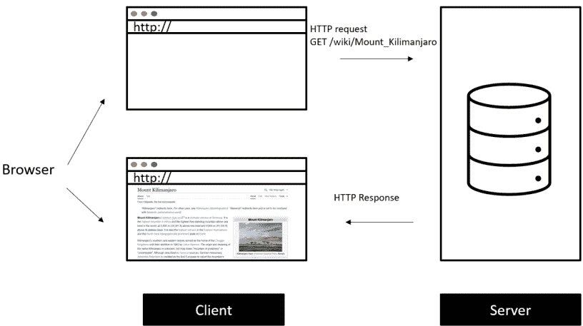
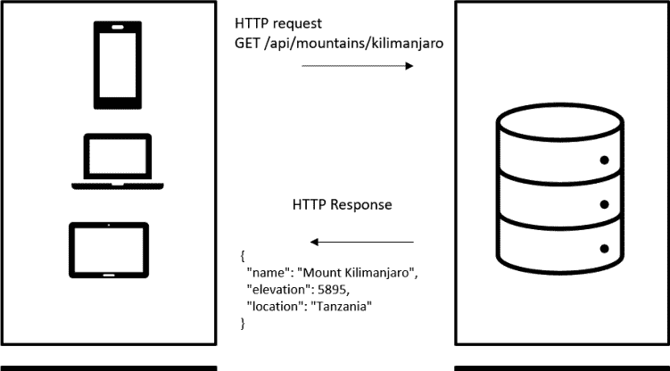
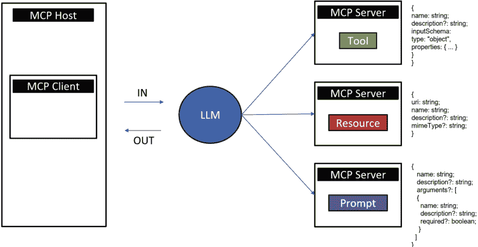
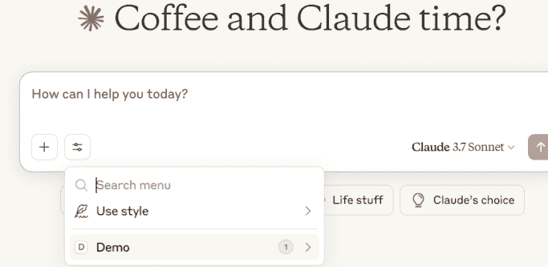
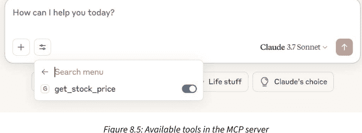
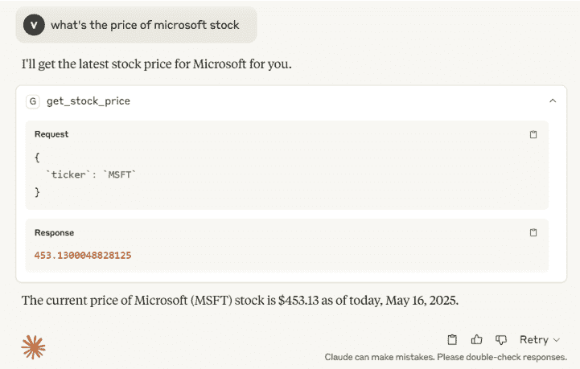

# 第 3 部分

# 通往开放、代理化生态系统的之路

本部分介绍了企业级 AI 代理的新兴格局，特别关注了使大规模代理部署成为可能的设施、协议和负责任的设计实践。

我们首先从探索下一代开放协议开始，这些协议旨在标准化和扩展多代理协作——例如 MCP、A2A 和 NLWeb——它们注将在实现跨平台和跨代理的互操作性方面发挥基础性作用。

我们将深入探讨企业在部署自治代理时如何确保负责任的 AI 实践。主题包括评估、安全过滤器、防护护栏，以及在高风险场景下“人类回路”（human-in-the-loop）系统的重要性。你还将学习优化成本和维持规模性能的策略。

最后，本部分反思了代理系统更广泛的演进——从原型到生产——并对该领域的未来方向以及短期内对智能软件的预期提供了前瞻性视角。

本部分包含以下章节：

- 第 8 章，编排智能：下一代代理协议蓝图
- 第 9 章，在现实世界 AI 中应对伦理挑战

# 编排智能：下一代代理协议蓝图

在人工智能（AI）发展的不断演变的格局中，协议正迅速成为连接模型、工具和外部系统的纽带。在过去的几个月里，我们看到围绕新协议的活动激增，这些旨在增强智能代理之间的互操作性和协作。其中最著名的包括 Anthropic 的模型上下文协议 (MCP)、Google 的 Agent2Agent (A2A) 以及 Virtuals 的代理商业协议 (ACP)。

初看之下，这些可能只是已经拥挤的 AI 生态系统中的又一波框架。毕竟，`LangChain`、`Semantic Kernel` 和 `AutoGen` 等框架长期以来一直承诺重用的、模块化的 AI 组件，如插件、工具、提示词和代理。但协议运行在不同的抽象层级。编排器帮助构建和控制智能工作流，而协议定义了这些组件如何跨系统进行通信，提供了一致性和结构。

在本章中，我们将涵盖以下主题：

- 什么是协议？
- 理解模型上下文协议
- Agent2Agent
- 代理商业协议

## 技术要求

本章的所有代码和必要的依赖项列在 `requirements.txt` 中。要设置环境，只需克隆仓库并按照说明操作。或者，你可以从零开始并遵循官方 SDK：`https://github.com/modelcontextprotocol/python-sdk`。

## 什么是协议？

协议只是定义两个系统如何通信的规则集。最熟悉的例子是 HTTP——浏览器用于与网站通信的协议。当你访问 URL 时，浏览器发送请求，服务器返回页面或数据。

# 8 

假设你正在访问乞力马扎罗的维基百科页面。你的浏览器发送以下内容：

```
GET /wiki/Mount_Kilimanjaro HTTP/1.1
Host: en.wikipedia.org
User-Agent: Mozilla/5.0 (Windows NT 10.0; Win64; x64) AppleWebKit/537.36 (KHTML, like Gecko) Chrome/125.0.0.0 Safari/537.36
Accept: text/html,application/xhtml+xml,application/xml;q=0.9,image/webp/*;q=0.8
Accept-Language: en-US,en;q=0.5
Connection: keep-alive
```

服务器返回 HTML 页面，由你的浏览器渲染：



图 8.1：浏览器渲染网页

现在，想象一下如果你不是显示整个页面，而是只需要数据。这就是表述状态转移（REST）API 的用用场。REST API 允许应用程序通过 HTTP 以机器可读的格式交换数据。客户端可能会发送以下内容：

```
GET /api/mountains/kilimanjaro
```

它们可能会接收到如下：

```json
{
  "name": "Mount Kilimanjaro",
  "elevation": 5895,
  "location": "Tanzania"
}
```

## 第8章

197



# REST Client

# 服务器

图 8.2：REST API 请求示例

这种同样的原理——在标准协议上进行结构化通信——是 MCP 等新型 AI 原生协议的核心。

## 理解模型上下文协议 (MCP)

MCP 是一项基础协议，旨在标准化大语言模型（LLMs）与外部工具、数据源和工作流的交互方式。类似于 Web 的 HTTP，MCP 为 AI 代理提供了一个统一一致的接口，用于查询和调用模型之外的能力。

在 MCP 之前，AI 工具领域是碎片化的：

- 碎片化的编排器：如 `LangChain`、`AutoGen`、`Semantic Kernel` 等框架拥有自己的工具注册表和代理逻辑，但缺乏工具调用的共享标准。
- 自定义集成：每个系统都使用定制代码来集成工具，使得重用和互操作性变得困难。
- 提供者依赖：编排器与提供者的 API 密耦合，而 API 可能会发生不可预测的更改。
- 缺乏通用协议：代理和模型缺乏一种跨主机和平台的通用方法来发现、描述或调用工具。

MCP 通过引入客户端服务器架构并标准化工具和资源接口解决了这些局限性。

从架构角度来看，MCP 由以下组件组成：

- **MCP 主机 (host)**：运行 LLM 并促进通信的应用或环境。示例包括 `Claude Desktop`、`GitHub Copilot` 和 `Cursor`。
- **MCP 服务器 (server)**：以结构化、可发现的格式暴露工具、资源或提示（prompts）的外部服务。
- **MCP 客户端 (client)**：主机内部的组件，连接到一个或多个 MCP 服务器。它处理协议消息和路由。



图 8.3：MCP 组件

与硬编码工具逻辑的传统客户端不同，MCP 允许 LLM 根据用户意图选择调用哪个服务器（基于 JSON-RPC 的调用）。

## 定义

JSON-RPC 2.0 是一种轻量级、无状态的协议，用于通过远程过程调用（RPC）进行系统间的结构化通信。它使用 JSON 编码请求和响应，允许一个系统调用另一个系统执行的函数，并以一致的格式接收结果或错误消息。

一个典型的 JSON-RPC 请求如下：

```
{
  "jsonrpc": "2.0",
  "method": "get_stock_price",
  "params": { "ticker": "AAPL" },
  "id": 1
}
```

一个有效的响应如下：

```
{
  "jsonrpc": "2.0",
  "result": 189.23,
  "id": 1
}
```

MCP 使用 JSON-RPC 2.0 来结构化请求和响应。它支持多种传输方式（包括 HTTP 和 STDIO），MCP 服务器可以封装传统的 REST API，将标准化的 MCP 请求转换为自定义后端逻辑。

MCP 将能力分为三种服务器类型：

- **工具 (Tools)** 是 AI 模型可以调用的可执行函数，用于执行特定操作，例如获取股票价格、转换格式和查询 API。这些工具使用 JSON Schema 描述，使其能够被模型发现并安全调用。

例如，你可以看到上述工具的 JSON 定义：

```json
  "name": "get_stock_price",
  "description": "Fetch the latest stock price",
  "inputSchema": {
    "type": "object",
    "properties": {
      "ticker": { "type": "string" }
    }
  }
}
```

此 Schema 允许 LLM 理解输入是什么以及工具执行的操作。工具定义促进了跨不同主机的一致性和重用性。

- **资源 (Resources)**：资源代表 AI 模型可能需要检索和使用的结构化数据对象，如文档、JSON 数据集或数据库输出。例如，一个受任合同分析的符合 MCP 标准的 AI 代理可能会通过其 URI 从文档管理系统中检索法律文件，提取相关条款，并将其映射到存储在 JSON 数据集中的合规检查清单中。同样，在客户服务自动化流中，AI 可以从数据库输出中获取客户交互日志，处理数据以检测情感或未解决的问题，并生成摘要。这些资源使用统一资源标识符 (URI) 进行引用，并包含 MIME 类型和描述等元数据，允许模型高效地解释内容的格式和结构。

在这里你可以看到与 URI 引用相关的典型 Schema 示例：

```json
{
  "uri": "resource://finance/market_data",
  "name": "Market Data",
  "description": "Recent market summaries",
  "mimeType": "application/json"
}
```

资源允许以最小的解析或硬编码逻辑访问静态或动态数据，提供了一种检索相关信息的声明式方法。

- **提示 (Prompts)**：MCP 中的提示是可重用的提示模板，可以引导模型完成特定的工作流或任务。这些对于实现多步推理或与用户上下文的精细化交互特别有用。

例如，考虑这样一个场景：AI 助手被要求为财务分析师总结季度报告。使用 MCP 中的可重用提示，助手首先提取收入、运营支出净利润等关键指标。然后将其与之前的季度进行比较，并突出异常或趋势。

这种多步交互完全由提示模板引导，确保了输出结构的一致性以及符合分析师过去偏好的定制摘要。这里是一个示例（为了演示目的，提示已截断）：

```json
{
  "name": "summarize_report",
  "description": "Summarize a financial report [...]",
  "arguments": [
    { "name": "report_uri", "required": true}
  ]
}
```

提示在工具执行之上添加了一个语义层，实现了更丰富的交互和直接嵌入协议接口的上下文引导。

让我们逐步构建并暴露一个简单的符合 MCP 的工具。这将展示从 Python 到在支持的 MCP 主机（如 `Claude Desktop`）内部进行实时交互的全周期。

首先，我们定义一个简单的 Python 函数，使用 `yfinance` 包获取收盘价：

```python
def get_stock_price(ticker: str) -> float:
  stock = yf.Ticker(ticker)
  return stock.history(period="1d")["Close"].iloc[-1]
```

该函数的功能完全如其名——接受股票代码作为输入并返回最近的收盘价。

我们使用 `FastMCP` 工具将此函数暴露为工具：

```python
mcp = FastMCP("Demo")

@mcp.tool()
def get_stock_price(ticker: str) -> float:
  """Fetch the latest stock price"""
  stock = yf.Ticker(ticker)
  return stock.history(period="1d")["Close"].iloc[-1]
```

`FastMCP` 注册该工具并创建一个通过 STDIO 使用 MCP 的服务器接口。

现在，你可以通过你喜欢的主机使用你的服务器。在示例中，我们将连接到 `Claude Desktop`。按照以下步骤操作：

1. 运行命令：

```bash
uv mcp install server.py
```

2. 这将更新 `claude_desktop_config.json`：

```json
{
  "mcpServers": {
    "Demo": {
      "command": "uv",
      "args": [
        "run",
        "--with",
        "mcp[cli]",
        "mcp",
        "run",
        "C:/path/to/server.py"
      ]
    }
  }
}
```

3. 重启 `Claude Desktop`。现在你应该可以在服务器面板看到你的自定义工具：



4. 在 Demo 服务器下，你可以看到可用的 MCP 资源类型。在我们案例中，我们将看到 `get_stock_price` 工具：



5. 设置完成后，你可以通过使用自然语言查询来测试集成，例如：“今天微软的收价是多少是多少”



正如你所看到的，驱动 `Claude Desktop` 的 LLM——在我们案例中是 `Claude 3.7 Sonnet`（你可以在聊天栏右下角的列表中选择模型）理解为了回答你的问题需要调用 `get_stock_price` 工具。

# 编排智能：下一代代理协议蓝图

从身份验证的角度来看，MCP 通过强制客户端与模型之间的身份验证和安全通信来处理身份验证和安全。它使用 OAuth 2.0 或类似的基于令牌的机制对用户和服务进行身份验证，确保只有经过授权的实体才能发起或访问模型交互。安全性方面，MCP 支持端到端加密、审计和访问控制策略，这有助于保护传输中和存储状态下的敏感数据。此外，它还可以与身份提供者集成，并实施基于角色的访问控制 (RBAC)，以符合组织标准。

最后，MCP 通过为上下文定义标准化的机制（例如回退策略）和错误处理来确保系统行为的健壮性。它采用了定义良好的 JSON-RPC 错误代码——例如解析错误 (32700)、无效请求 (32608)、“未找到方法”(32601)、无效参数 (32602) 和内部错误 (32603)—实现可以扩展到 32000 以上的自定义代码。MCP 错误响应通过请求-响应循环、传输层告警和专用协议处理器进行通信，从而实现结构化的错误检测和恢复。

对于容错性，MCP 支持智能回退：客户端可以配置错误阈值，当超过阈值或服务下降时，将触发自动切换到备份模型或服务器版本——理想情况下不会丢失对话上下文——从而确保高可用性。

这些机制共同为运行在动态或分布式环境中的 AI 系统提供了一个韧性的、自愈的工作流。

MCP 正在为更具互操作性的 AI 未来奠定基础。它为工具生态系统带来了结构，实现了可复组件，并允许模型以可发现、安全且标准化的方式与工具交互。

在了解 MCP 如何帮助 AI 代理连接工具和数据之后，我们将下一步探索 AI 代理如何相互连接——这就是 Google 的 A2A 协议发挥用场的地方，它促进了代理之间的直接通信。

# Agent2Agent (代理代理)

A2A 由 Google 开发，是一种促进自主代理之间无缝通信与协调的协议，无论它们的底层平台或供应商如何。

虽然 A2A 专注于代理与代理交互，但它补充了 MCP 的代理与工具之间的通信。在实践中，代理可能会使用 MCP 访问外部工具或数据源，并使用 A2A 向其他代理委托任务或共享信息。这种分层方法使得构建复杂的、互操作的 AI 生态系统成为可能。
