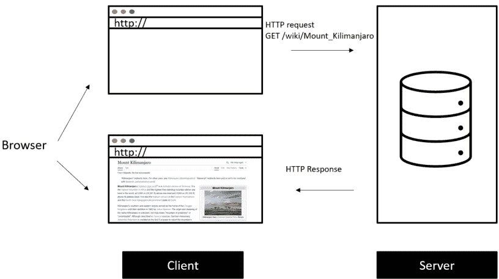
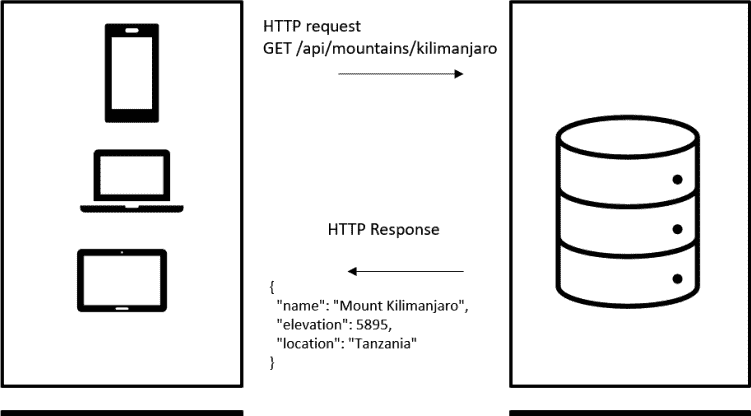
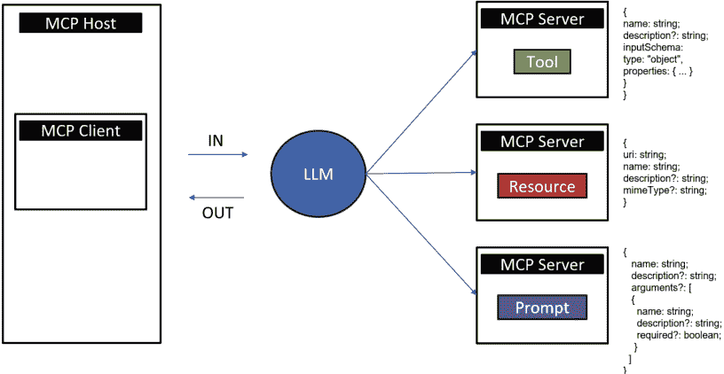
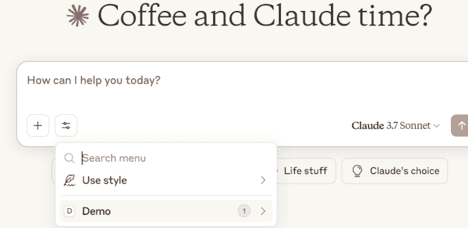
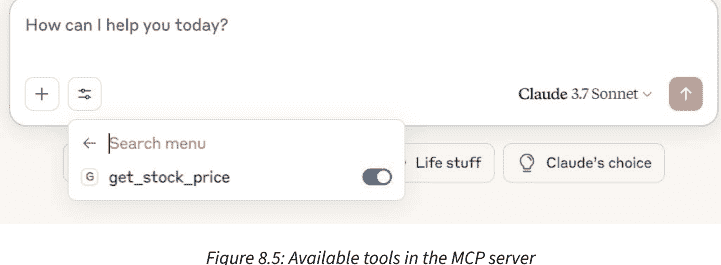
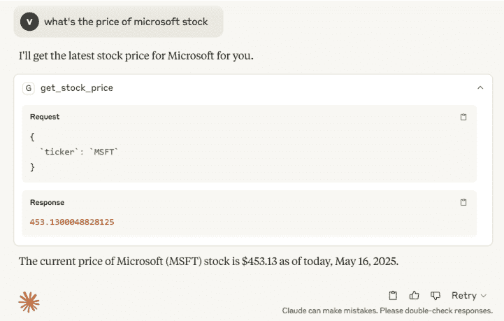
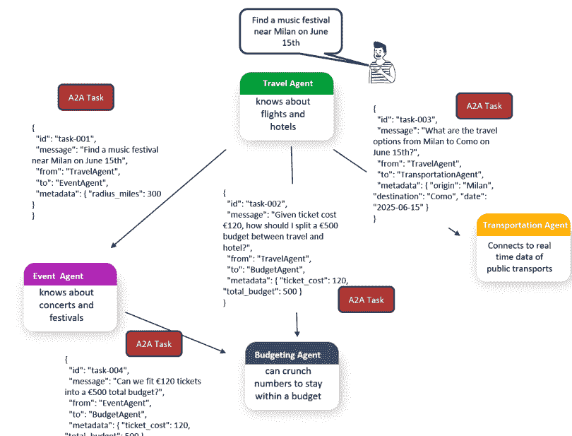

# 8 编排智能：下一代代理协议蓝图

在人工智能（AI）发展的不断演变的格局中，协议正迅速成为连接模型、工具和外部系统的纽带。在过去的几个月里，我们看到围绕新协议的活动激增，这些旨在增强智能代理之间的互操作性和协作。其中最著名的包括 Anthropic 的模型上下文协议 (MCP)、Google 的 Agent2Agent (A2A) 以及 Virtuals 的代理商业协议 (ACP)。

初看之下，这些可能只是已经拥挤的 AI 生态系统中的又一波框架。毕竟，`LangChain`、`Semantic Kernel` 和 `AutoGen` 等框架长期以来一直承诺重用的、模块化的 AI 组件，如插件、工具、提示词和代理。但协议运行在不同的抽象层级。编排器帮助构建和控制智能工作流，而协议定义了这些组件如何跨系统进行通信，提供了一致性和结构。

在本章中，我们将涵盖以下主题：

- 什么是协议？
- 理解模型上下文协议
- Agent2Agent
- 代理商业协议

## 技术要求

本章的所有代码和必要的依赖项列在 `requirements.txt` 中。要设置环境，只需克隆仓库并按照说明操作。或者，你可以从零开始并遵循官方 SDK：`https://github.com/modelcontextprotocol/python-sdk`。

## 什么是协议？

协议只是定义两个系统如何通信的规则集。最熟悉的例子是 HTTP——浏览器用于与网站通信的协议。当你访问 URL 时，浏览器发送请求，服务器返回页面或数据。

# 8 

假设你正在访问乞力马扎罗的维基百科页面。你的浏览器发送以下内容：

```
GET /wiki/Mount_Kilimanjaro HTTP/1.1
Host: en.wikipedia.org
User-Agent: Mozilla/5.0 (Windows NT 10.0; Win64; x64) AppleWebKit/537.36 (KHTML, like Gecko) Chrome/125.0.0.0 Safari/537.36
Accept: text/html,application/xhtml+xml,application/xml;q=0.9,image/webp/*;q=0.8
Accept-Language: en-US,en;q=0.5
Connection: keep-alive
```

服务器返回 HTML 页面，由你的浏览器渲染：



图 8.1：浏览器渲染网页

现在，想象一下如果你不是显示整个页面，而是只需要数据。这就是表述状态转移（REST）API 的用用场。REST API 允许应用程序通过 HTTP 以机器可读的格式交换数据。客户端可能会发送以下内容：

```
GET /api/mountains/kilimanjaro
```

它们可能会接收到如下：

```json
{
  "name": "Mount Kilimanjaro",
  "elevation": 5895,
  "location": "Tanzania"
}
```

## 第8章

197



# REST Client

# 服务器

图 8.2：REST API 请求示例

这种同样的原理——在标准协议上进行结构化通信——是 MCP 等新型 AI 原生协议的核心。

## 理解模型上下文协议 (MCP)

MCP 是一项基础协议，旨在标准化大语言模型（LLMs）与外部工具、数据源和工作流的交互方式。类似于 Web 的 HTTP，MCP 为 AI 代理提供了一个统一一致的接口，用于查询和调用模型之外的能力。

在 MCP 之前，AI 工具领域是碎片化的：

- 碎片化的编排器：如 `LangChain`、`AutoGen`、`Semantic Kernel` 等框架拥有自己的工具注册表和代理逻辑，但缺乏工具调用的共享标准。
- 自定义集成：每个系统都使用定制代码来集成工具，使得重用和互操作性变得困难。
- 提供者依赖：编排器与提供者的 API 密耦合，而 API 可能会发生不可预测的更改。
- 缺乏通用协议：代理和模型缺乏一种跨主机和平台的通用方法来发现、描述或调用工具。

MCP 通过引入客户端服务器架构并标准化工具和资源接口解决了这些局限性。

从架构角度来看，MCP 由以下组件组成：

- **MCP 主机 (host)**：运行 LLM 并促进通信的应用或环境。示例包括 `Claude Desktop`、`GitHub Copilot` 和 `Cursor`。
- **MCP 服务器 (server)**：以结构化、可发现的格式暴露工具、资源或提示（prompts）的外部服务。
- **MCP 客户端 (client)**：主机内部的组件，连接到一个或多个 MCP 服务器。它处理协议消息和路由。



图 8.3：MCP 组件

与硬编码工具逻辑的传统客户端不同，MCP 允许 LLM 根据用户意图选择调用哪个服务器（基于 JSON-RPC 的调用）。

## 定义

JSON-RPC 2.0 是一种轻量级、无状态的协议，用于通过远程过程调用（RPC）进行系统间的结构化通信。它使用 JSON 编码请求和响应，允许一个系统调用另一个系统执行的函数，并以一致的格式接收结果或错误消息。

一个典型的 JSON-RPC 请求如下：

```
{
  "jsonrpc": "2.0",
  "method": "get_stock_price",
  "params": { "ticker": "AAPL" },
  "id": 1
}
```

一个有效的响应如下：

```
{
  "jsonrpc": "2.0",
  "result": 189.23,
  "id": 1
}
```

MCP 使用 JSON-RPC 2.0 来结构化请求和响应。它支持多种传输方式（包括 HTTP 和 STDIO），MCP 服务器可以封装传统的 REST API，将标准化的 MCP 请求转换为自定义后端逻辑。

MCP 将能力分为三种服务器类型：

- **工具 (Tools)** 是 AI 模型可以调用的可执行函数，用于执行特定操作，例如获取股票价格、转换格式和查询 API。这些工具使用 JSON Schema 描述，使其能够被模型发现并安全调用。

例如，你可以看到上述工具的 JSON 定义：

```json
  "name": "get_stock_price",
  "description": "Fetch the latest stock price",
  "inputSchema": {
    "type": "object",
    "properties": {
      "ticker": { "type": "string" }
    }
  }
}
```

此 Schema 允许 LLM 理解输入是什么以及工具执行的操作。工具定义促进了跨不同主机的一致性和重用性。

- **资源 (Resources)**：资源代表 AI 模型可能需要检索和使用的结构化数据对象，如文档、JSON 数据集或数据库输出。例如，一个受任合同分析的符合 MCP 标准的 AI 代理可能会通过其 URI 从文档管理系统中检索法律文件，提取相关条款，并将其映射到存储在 JSON 数据集中的合规检查清单中。同样，在客户服务自动化流中，AI 可以从数据库输出中获取客户交互日志，处理数据以检测情感或未解决的问题，并生成摘要。这些资源使用统一资源标识符 (URI) 进行引用，并包含 MIME 类型和描述等元数据，允许模型高效地解释内容的格式和结构。

在这里你可以看到与 URI 引用相关的典型 Schema 示例：

```json
{
  "uri": "resource://finance/market_data",
  "name": "Market Data",
  "description": "Recent market summaries",
  "mimeType": "application/json"
}
```

资源允许以最小的解析或硬编码逻辑访问静态或动态数据，提供了一种检索相关信息的声明式方法。

- **提示 (Prompts)**：MCP 中的提示是可重用的提示模板，可以引导模型完成特定的工作流或任务。这些对于实现多步推理或与用户上下文的精细化交互特别有用。

例如，考虑这样一个场景：AI 助手被要求为财务分析师总结季度报告。使用 MCP 中的可重用提示，助手首先提取收入、运营支出净利润等关键指标。然后将其与之前的季度进行比较，并突出异常或趋势。

这种多步交互完全由提示模板引导，确保了输出结构的一致性以及符合分析师过去偏好的定制摘要。这里是一个示例（为了演示目的，提示已截断）：

```json
{
  "name": "summarize_report",
  "description": "Summarize a financial report [...]",
  "arguments": [
    { "name": "report_uri", "required": true}
  ]
}
```

提示在工具执行之上添加了一个语义层，实现了更丰富的交互和直接嵌入协议接口的上下文引导。

让我们逐步构建并暴露一个简单的符合 MCP 的工具。这将展示从 Python 到在支持的 MCP 主机（如 `Claude Desktop`）内部进行实时交互的全周期。

首先，我们定义一个简单的 Python 函数，使用 `yfinance` 包获取收盘价：

```python
def get_stock_price(ticker: str) -> float:
  stock = yf.Ticker(ticker)
  return stock.history(period="1d")["Close"].iloc[-1]
```

该函数的功能完全如其名——接受股票代码作为输入并返回最近的收盘价。

我们使用 `FastMCP` 工具将此函数暴露为工具：

```python
mcp = FastMCP("Demo")

@mcp.tool()
def get_stock_price(ticker: str) -> float:
  """Fetch the latest stock price"""
  stock = yf.Ticker(ticker)
  return stock.history(period="1d")["Close"].iloc[-1]
```

`FastMCP` 注册该工具并创建一个通过 STDIO 使用 MCP 的服务器接口。

现在，你可以通过你喜欢的主机使用你的服务器。在示例中，我们将连接到 `Claude Desktop`。按照以下步骤操作：

1. 运行命令：

```bash
uv mcp install server.py
```

2. 这将更新 `claude_desktop_config.json`：

```json
{
  "mcpServers": {
    "Demo": {
      "command": "uv",
      "args": [
        "run",
        "--with",
        "mcp[cli]",
        "mcp",
        "run",
        "C:/path/to/server.py"
      ]
    }
  }
}
```

3. 重启 `Claude Desktop`。现在你应该可以在服务器面板看到你的自定义工具：



4. 在 Demo 服务器下，你可以看到可用的 MCP 资源类型。在我们案例中，我们将看到 `get_stock_price` 工具：



5. 设置完成后，你可以通过使用自然语言查询来测试集成，例如：“今天微软的收价是多少是多少”



正如你所看到的，驱动 `Claude Desktop` 的 LLM——在我们案例中是 `Claude 3.7 Sonnet`（你可以在聊天栏右下角的列表中选择模型）理解为了回答你的问题需要调用 `get_stock_price` 工具。

# 编排智能：下一代代理协议蓝图

从身份验证的角度来看，MCP 通过强制客户端与模型之间的身份验证和安全通信来处理身份验证和安全。它使用 OAuth 2.0 或类似的基于令牌的机制对用户和服务进行身份验证，确保只有经过授权的实体才能发起或访问模型交互。安全性方面，MCP 支持端到端加密、审计和访问控制策略，这有助于保护传输中和存储状态下的敏感数据。此外，它还可以与身份提供者集成，并实施基于角色的访问控制 (RBAC)，以符合组织标准。

最后，MCP 通过为上下文定义标准化的机制（例如回退策略）和错误处理来确保系统行为的健壮性。它采用了定义良好的 JSON-RPC 错误代码——例如解析错误 (32700)、无效请求 (32608)、“未找到方法”(32601)、无效参数 (32602) 和内部错误 (32603)—实现可以扩展到 32000 以上的自定义代码。MCP 错误响应通过请求-响应循环、传输层告警和专用协议处理器进行通信，从而实现结构化的错误检测和恢复。

对于容错性，MCP 支持智能回退：客户端可以配置错误阈值，当超过阈值或服务下降时，将触发自动切换到备份模型或服务器版本——理想情况下不会丢失对话上下文——从而确保高可用性。

这些机制共同为运行在动态或分布式环境中的 AI 系统提供了一个韧性的、自愈的工作流。

MCP 正在为更具互操作性的 AI 未来奠定基础。它为工具生态系统带来了结构，实现了可复组件，并允许模型以可发现、安全且标准化的方式与工具交互。

在了解 MCP 如何帮助 AI 代理连接工具和数据之后，我们将下一步探索 AI 代理如何相互连接——这就是 Google 的 A2A 协议发挥用场的地方，它促进了代理之间的直接通信。

# Agent2Agent (代理代理)

A2A 由 Google 开发，是一种促进自主代理之间无缝通信与协调的协议，无论它们的底层平台或供应商如何。

虽然 A2A 专注于代理与代理交互，但它补充了 MCP 的代理与工具之间的通信。在实践中，代理可能会使用 MCP 访问外部工具或数据源，并使用 A2A 向其他代理委托任务或共享信息。这种分层方法使得构建复杂的、互操作的 AI 生态系统成为可能。


A2A 的前提是，代理应该能够向另一个代理请求协助或共享信息，即使它们是由不同的构建的，或者运行在不同的平台上。这对于规模化 AI 解决方案至关重要：与其让一个巨大的 AI 尝试做所有事情，不如让由较小 AI 组成的网络各司其擅长的工作，并通过交流来完成复杂任务。

A2A 的核心是在代理之间建立一种通用的面向任务的对话。它不是自由形式聊天；它将交互结构化为任务、结果以及可选的后续问题。关键原则包括：

- 代理可发现性：为了进行通信，代理需要知道如何找到对方以及每个代理拥有什么能力。A2A 引入了“代理卡片”（agent card）的概念——一种元数据描述，代理可以发布身份、支持的任务、输入/输出格式和端点 URL。这通常是一个机器可读的 JSON 文件。例如，让我们考虑以下天气代理的卡片：


```json
{
  "name": "WeatherBot",
  "description": "Provides accurate weather forecasts and historical data",
  "url": "https://weatherbot.example.com/a2a",
  "version": "1.0.0",
  "capabilities": {
    "streaming": true,
    "pushNotifications": true,
    "stateTransitionHistory": true
  },
  "authentication": {
    "schemes": ["bearer", "apiKey"],
  },
  "defaultInputModes": ["text/plain"],
  "defaultOutputModes": ["application/json"],
  "skills": [
    {
      "id": "forecast",
      "name": "Weather Forecast",
      "description": "提供指定位置和日期的天气预报。",
      "tags": ["weather", "forecast"],
      "examples": ["明天米兰的天气预报是什么？"]
    },
    {
      "id": "historical",
      "name": "Historical Weather Data",
      "description": "检索历史天气数据进行分析。",
      "tags": ["weather", "historical"],
      "examples": ["上周罗马的温度是多少度？"]
    }
  ]
}
```

让我们拆解每个组件：

- `name`: 代理的人类可读名称
- `description`: 代理用途和功能的简要摘要
- `url`: 代理接受 A2A 协议请求的端点
- `version`: 代理或其遵循的 A2A 协议的版本
- `capabilities`: 指示代理对特定功能的支持：
  - `streaming`: 支持通过服务器发送事件 (SSE) 进行实时数据流
  - `pushNotifications`: 可以向客户端发送异步更新
  - `stateTransitionHistory`: 维护任务状态变更的历史
- `authentication`: 指定代理支持的身份验证方法，如负载令牌 (bearer tokens) 或 API 密钥
- `defaultInputModes`: 代理期望的输入数据默认内容类型（例如纯文本）
- `defaultOutputModes`: 代理在响应中产生的默认内容类型（例如 JSON）
- `skills`: 代理提供的特定功能列表：
  - `id`: 技能的唯一标识符
  - `name`: 技能的人类可读名称
  - `description`: 关于该技能作用的详情
  - `tags`: 与技能关联的关键词，便于发现
  - `examples`: 技能可以处理的示例查询或任务

这种结构化格式允许其他代理有效地发现并与天气代理交互，促进了多代理系统中的无缝协作。

- **结构化请求（任务）：** A2A 以任务请求的形式使通信正式化。一个代理（请求者）向另一个代理（提供者）发送 JSON 格式的任务，其中包含了请求的内容和任何必要参数。代理 A 可能会向代理 B 发送一个“将以下文本翻译成西班牙语”的任务并附带文本。这些任务具有定义的模式，因此代理 B 知道去哪里查找指令和数据。

- **异步交互：** 如果任务需要时间或多个步骤，代理可能不会立即做出响应。A2A 通过允许代理响应中间状态更新（例如“任务已接受”或“已完成 50%”）并在完成后发送完成消息来支持异步处理。它可以使用 HTTP 长轮询或 SSE 进行流更新。这很重要，因为两个代理的运行速度可能不同，或者其中一个可能必须执行长时间的工作（例如搜索大型数据库）——协议确保了请求代理不会处于信息真空。

- **多轮澄清：** 通常情况下，代理的请求可能是模糊或不完整的。A2A 允许请求者提出澄清性问题。这在任务范围内创建了一个微对话。例如，代理 B 可能会回复：“我可以翻译文本，但你没有指定是哪种西班牙语。应该是中立的还是地区特有的？”代理 A 随后可以回答，然后任务继续。

- **标准数据格式：** 交换的内容（如任务和结果的有效负载）采用标准格式（结构化数据使用 JSON，需要时使用二进制文件的引用）。如果代理需要向另一个代理发送大文件，可能会提供 URL 或句柄，而不是在 JSON 中提供原始字节，具体取决于实现。A2A 刻意构建在网络标准之上（HTTP 用于传输、JSON 用于数据、OAuth 用于授权）之上，使其能够自然地融入现有网络中。

# 编排智能：下一代代理协议蓝图

想象一个多代理工作流场景。用户提出请求：“为我计划一次周末音乐节旅行，包括机票、交通和酒店。预算控制在 500 欧元以内。”一个单体式代理可能难以应对所有方面，但一组代理可以高效地处理这些任务：

- 旅游代理了解机票和酒店
- 活动代理了解演唱会和节庆
- 预算代理可以进行数字计算以保持在预算之内
- 交通代理通过实时数据了解可用的公共交通工具

让我们来看下方的插图：



图 8.7：多个代理通过 A2A（代理对代理）进行通信的示例

# 8 

**快速提示：** 想要查看此图像的高分辨率版本吗？请在下一代 Packt Reader 中打开本书，或在 PDF/ePub 版本中查看。

**下一代 Packt Reader** 随书免费赠送。扫描二维码或访问 `packtpub.com/unlock`，使用搜索栏通过名称查找本书。请仔细检查显示的版本以确保获取的是正确的版本。


交互从旅游代理开始，它是初始协调。用户的请求包含多个组件：寻找合适的音乐活动、识别交通方案、预订住宿以及控制预算。旅游代理并不依赖单一的单体系统，而是将请求的不同部分委托给更擅长处理这些部分的代理。

它首先联系活动代理，任务是在特定日期在米兰附近寻找一个节庆。一旦确定了相关活动，活动代理会独立地联系预算代理，评估 120 欧元的票价在用户 500 欧元的预算内是否可行。这种绕过原始旅游代理的横向通信是 A2A 的特征——代理可以在彼此之间发起任务，无需中央编排。

同时，旅游代理咨询了交通代理，探索米兰与活动地点之间的旅行方案，并指定日期和出发地。它还直接与预算代理对接，提供预期成本的早期明细，并请求对旅行和住宿进行建议分配。

每个代理都作为一个专家系统运行，专注于特定领域——活动、交通和预算——它们通过交换结构化的任务消息进行流式协作。结果是一个协调一致的、感知上下文的响应，对终端用户来说这种感觉是完整的，尽管它是通过去中心化的、异步的代理协作产生的。

## 提示

在这种场景下，你可能会想：为什么不单独使用像 LangGraph 之类的框架呢？

此类框架擅长在单个应用程序内编排多个代理——只要它们属于同一个代码库或运行环境，它就可以协调旅游、活动和预算代理。

然而，当你需要代理跨跨系统具有自主性、可发现性和互操作性时，A2A 就派上用场了。通过 A2A，每个代理可以位于不同的云端，由不同的团队构建，或使用不同的框架——但仍然可以通过共享协议进行协作。

将其类比为微服务：AI 框架管理紧耦合的系统，而 A2A 则允许实现松耦合的分布式代理生态系统。


总结来说，A2A 是允许这些代理协作的胶水。如果没有它，你可能需要一个代理拥有所有领域的知识，或者为彼此的领域使用专有 API。有了 A2A，任何理解该协议的代理都可以从任何其他代理处寻求帮助，按需形成一个临时的专家团队。这很容易看出它与软件架构中微服务的相似之处；每个代理都像一个具有清晰 API（即其任务）的微服务，而 A2A 就是交换语言。

Google 设计 A2A 时强调了开放性和厂商中立性。它并不绑定于 Google 的内部技术；他们发布了规范和参考实现，并一直与合作伙伴一起推动采用。事实上，微软宣布其代理（在 Microsoft 365 Copilot 生态系统中）兼容 A2A，以便与 Google 的代理进行协作，这是对跨平台支持的显著展示。这种跨厂商的代理通信对于“代理网络（agentic web）”至关重要，因为用户不可避免会使用来自不同来源的代理。A2A 意味着你的个人 AI 助手可以直接与（例如）银行的 AI 代理通信以协商贷款报价，而不仅仅是通过僵化的 API 传递消息。

总结来说，A2A 填补了代理编排的空白，标准化了自主 AI 服务对话和协作的方式。

第 8 章

211

> 注意

MCP 和 A2A 是互补的。MCP 标准化了代理访问工具和外部数据的方式（例如，获取机票或酒店）。A2A 允许代理之间进行对话，跨系统共享任务、结果和决策。将 MCP 视为代理到工具的桥梁，将 A2A 视为代理到代理的握手。

在 MCP 和 A2A 的基础上，我们有了代理使用工具和相互通信的协议。拼图的下一步是让代理参与交易和协议，这就是 ACP 出现的地方。

# 代理商业协议

随着 AI 代理变得越来越自主并开始代表企业或个人采取，一个新问题随之产生：代理能够可靠地相互签订合同或交易吗？ACP 由一家名为 Virtuals 的公司开发，是一项巨大的尝试，旨在赋予代理以结构化、最小信任的方式进行经济交换和协作协议的能力。ACP 本质上是为 AI 代理构建一个商业层，允许它们买卖服务、为对方的工作补偿，并确保所有方履行其义务。

考虑一个未来的场景，你有一个管理个人任务的 AI 代理。你可能需要它雇佣另一个代理（例如，一个自由职业平面设计师代理）为你的项目创建一个 Logo。它们如何形式化这种安排？你的代理如何支付给设计师代理，它又如何确保交付的 Logo 符合要求？今天，人类可能会使用一个自由职业平台，该平台托管款项并在批准后释放款项。ACP 将这种机制针对 AI 对 AI 的交易进行了泛化。

ACP 的核心，是使用智能合约和区块链技术在代理之间创建不可篡改的协议。

## 定义

**区块链** 是一种分布式、去中心化的账本，以安全、不可篡改的方式在许多计算机上记录交易。每个**区块（block）**都包含一个交易列表，这些区块按时间顺序链接形成**链（chain）**。区块链通过共识机制和密码学确保数据完整性，并作为加密货币、智能合约和去中心化应用的基础。


智能合约是编写在代码中存储在区块链上的自动执行数字协议。当满足特定条件时，它会自动执行定义的规则和操作，而无需人工干预。智能合约是不可变的（一旦部署就无法更改）且是透明的，使其成为双方之间受信任的自动化交易的理想选择。

当两个代理决定交易时，他们不仅仅依赖于信任；他们创建了一个记录在区块链上的数字合同。该合同定义了条款（例如，“代理 X 将在 Z 时间之前交付资产 Y，代理 A 将支付 $W 作为回报”），并将款项进行托管。由于它在区块链上，任何一方都不能单方面更改或取消对方的同意（除非触发惩罚）。

例如，你的个人代理和设计师可以建立一个 ACP 合同：你的代理将约定的费用（可能是数字货币或代币）存入合约。设计师代理将 Logo 文件交付给合约。现在，合约如何知道释放资金呢？这就是验证的介入。

ACP 引入了**评估代理（evaluator agents）**（或**预言机/oracles**）的概念来判断合同条款是否已满足。继续之前的例子，一个评估代理（可以是中立的第三方 AI 或双方选择的服务）会检查交付的 Logo 是否符合要求。如果要求很简单（“PNG 格式的图像文件”），简单的程序检查可能足够了。如果要求是主观的（“一个看起来专业且符合品牌指南的 Logo”），评估代理可能会使用机器视觉或引入人工参与来评估质量。一旦评估代理信号交付物是可接受的，智能合约将自动把款项释放到设计师的账户。

这种设置确保了**无需信任的去中心化互操作（trustless interaction）**：设计师代理信任如果它做得好就能得到报酬，而你的代理信任它不会无缘无故亏钱。双方都没有完全信任对方；他们都信任协议和所选的评估者。ACP 利用加密

在签署合同时通过签名证明代理的身份，这样代理事后无法否认协议，这类似于文档数字签名的工作原理。

Virtuals 通过多智能体供应链等场景展示了这种方法的威力。在一次演示中，他们展示了一个由 AI 代理运行的柠檬水摊，其中不同的代理自主谈判了物资采购（柠檬、糖和杯子）以及销售，所有操作都使用 ACP 智能合约来处理支付并执行货物交付。

如果你想查看现场演示，可以访问 `https://echonade-demo.virtuals.io/`。

虽然柠檬水摊只是一个玩具，但它反映了真实的业务流程。人们可以想象大规模的应用：代表公司的代理谈判货运合同（货物必须在某日期前到达，否则付款金额将减少），或者一个 AI 内容生产者向媒体剪辑集售卖其内容的使用权。ACP 为这些代理提供了数字基础设施，使其能够在无需对每笔交易进行持续的人类监督或干预的情况下进行运行。

在底层，ACP 通常涉及链上和链下组件的结合：

- **智能合约**：这些链上组件持有资金并存储协议状态。它们通常是 ACP 为常见交易类型（如托管合约、拍卖合约等）指定的通用模板。
- **代理钱包/身份**：每个代理都是一个加密钱包（类似于加密货币钱包），代理用它发送/接收资金并签署合约。该钱包与代理的身份绑定。Virtuals 让带有钱包和身份的代理的设置可以集成到代理的正常运行环境中。
- **链外通信**：形成合约的谈判可能首先通过 A2A 或类似的通信进行（例如，一个代理说“我可以在明天之前以 $Y 的价格为你完成任务 X”，另一个代理说“成交”）。一旦达成共识，他们就会移动到 ACP 将其正式化。ACP 并不取代 A2A；相反，它可以作为后续步骤被调用。将 A2A 视为讨论条款，将 ACP 视为在虚线处签字并处理支付。
- **评估器/预言机（oracles）**：这些可能是链下服务或半自主代理，用于向智能合约提供结果。许多区块链合约（如去中心化金融中的合约）使用预言机来获取现实数据（例如价格推送）。在 ACP 的案例中，预言机报告任务完成情况或质量。对于某些领域可以存在标准的评估器代理，例如许多合约用于设计工作的“图像质量评估器”代理服务。该协议确保预言机的输入是合约释放资金的必要条件，使得预言机实际上成为了参与者共同认可的裁决。

# 编排智能：下一代代理协议蓝图

人们可能会担心性能和成本：区块链交易可能很慢或产生费用。ACP 可能构建在支持智能合约的区块链（如以太坊或其他区块链）上，Virtuals 的工作之一就是对其进行优化。账本的选择可能在协议中抽象（即，根据参与者的偏好，ACP 可以在不同的区块链网络上使用，只要它们支持所需的逻辑即可）。

ACP 尚处于早期阶段。Virtuals 在 2025 年发布了它，初步采用是在试点项目和实验平台中。他们对实现“代理经济”感到兴奋，但也面临着挑战。例如，并非每笔交易都可以在写入区块链时产生开销，因此 ACP 可能被留给对信任至关重要的重大或高价值交互。对于快速、低风险的交换，代理可能仍然使用更简单的方法。此外，法律和伦理问题将会出现：如果两个代理签订了合同并出了问题，谁来负责？从法律角度来看，它们背后的人类或公司预计将是真正的主体，因此 ACP 合同最终可能需要关联法律身份。

尽管存在这些挑战，ACP 代表了一个具有前瞻性的代理生态系统。它推向“代理帮助人类完成任务”的边界，走向了“代理代表人类参与商业和协作”。如果 MCP 和 A2A 等协议为代理提供了行动和通信的工具，那么 ACP 则为它们提供了承诺和交易的手段——这是资源或资金发生易手的复杂协作之基础。

通过对 MCP、A2A 和 ACP 的理解，我们可以看到每个者解决的是不同层的问题：MCP 用于代理-工具/数据接口，A2A 用于代理-代理对话，而 ACP 用于代理-代理协议和价值交换。这些技术正在汇聚，以实现某些人所谓的“代理网络（agentic web）”，这是我们的下一个文本。

# 走向代理网络

代理网络（agent web）一词指的是世界维网（World Wide Web）的演变，其中自主代理是第一等参与者，而不仅仅是人类。这是一个愿景：网站和在线服务暴露供 AI 代理易于使用的接口（除了人类点击和打字之外，或者取代它们）。迈向这一愿景的一个具体步骤是微软在 2025 年宣布的自然语言网络（NLWeb）计划，旨在让与服务的交互像对话一样简单。

第 8 章

215

# 从传统网页到代理网络

今天的网页是为使用浏览器的人类构建的。尽管许多内容在某种程度上是机器可读的（感谢于 HTML 标签、API 等），但想要在网页上执行某些事的 AI 代理通常必须执行人类做的事：导航页面、填写表单、点击按钮——本质上是**网页爬取**或**自动化**。这是脆弱且无效的。代理网络建议网站应该为代理提供更直接的通信渠道，通常通过自然语言理解或专门为 AI 设计的标准化 API。

微软的 NLWeb 通过鼓励网站提供自然语言接口来实现这一点。在实际操作中，网站可以托管一个端点——接受直白语言并返回结构化结果。例如，机票预订网站将允许代理“寻找从西雅图到东京且低于1000美元的航班”。

在底层，NLWeb 接口通常连接到移动应用可能使用的后端。许多网站已开始嵌入 AI 机器人，但不仅仅是为了客户服务。

[图 8.8：NLWeb 后端架构示例]

# NLWeb 的关键组件

微软的 NLWeb 方法包含旨在标准化的几个组件：

- **语义标记和 schema**：网站可以使用 schema（如 `schema.org` 词汇）对其内容进行注释，以帮助 AI 理解。例如，餐厅可以列出其项目、价格和营业时间。


# 统一 API 与 MCP 兼容性

许多网络服务都有 API。NLWeb 并不一定用自然语言取代所有 API；而是补充了它们。事实上，微软已与 MCP 对齐——每个启用了 NLWeb 的服务都可以作为 MCP 服务器被访问。这意味着开发者编写了 MCP 集成，任何代理都可以读取。

# 面向代理的标准化端点

类似于 A2A 中的代理，NLWeb 环境将在已知位置发布其代理接口（例如`./well-known/nlweb.json`或类似路径）。这可以列出网站可以处理的查询类型、示例提示和技术细节。本质上，这是给代理的宣言：“这里是与我交流的方法。”代理的搜索引擎可能会爬取这些内容，就像爬虫索引 HTML 一样。

# 自然语言到操作的流水线

在网站端，实现 NLWeb 可能涉及使用 LLM 或语义解析器将代理的请求翻译成数据库查询或函数调用。微软一直在开发工具（如提示词模板和适配器），以帮助网站开发者无需重复造轮子即可完成工作。例如，网站可以使用在其 FAQ 和文档上微调的预训练语言模型来处理用户问题，但将其限制在来自网站自身数据的真实性回答上（避免幻觉）。

让我们考虑购物和服务中的一个具体例子。假设你想让你的个人 AI 在多个零售商处比较某款笔记本电脑的价格。在传统网页上，AI 可能必须爬取每个网站，处理不同的布局，并在网站更改时面临崩溃风险。在代理网络上，每个零售商将有一个自然语言接口。你的 AI 基本上可以向每个卖家/零售商发送相同的查询：“你们有 XYZ 型笔记本电脑吗，且价格是多少？”每个网站的代理接口都会解析并返回结构化响应（例如，“是的，价格为 1200 美元，这是产品页面链接”）。你的 AI 会汇总这些响应并为你提供最佳方案。如果你决定购买，你的 AI 甚至可以通过零售商的代理 API 完成交易（可能通过安全令牌提供支付信息等），这同样涉及在网页上像素位置的操作。

# 当前进展与应用

到 2025 年中期，代理网络（agent web）概念仍处于早期采用阶段。微软已开始在其部分服务中推出 NL-Web（自然语言网络）功能（例如，Bing 搜索本身就可以作为一个 NLWeb 节点，这意味着其他代理可以通过自然语言 API 查询 Bing，而不是旧的基于关键词的 API）。少数合作伙伴（如电子商务网站和信息供应商）已加入试点计划，开放对代理友好的接口。

一个直接的领域是企业软件。企业解决方案（CRM 和 ERP 系统）正在拥抱类似 Copilot 的 AI 功能。通过 NLWeb 原则，CRM 系统可以允许代理请求：“给我提供本季度营收排名前 5 的客户列表”，并交付结果表格或生成简短的报告叙述。如果所有企业应用都开放此类接口，管理业务流程的代理就可以无缝地从所有应用中提取数据以回答复杂的查询（这以前可能需要手动集成多个 API 或导出数据）。

另一个领域是内容消费。例如，新闻和知识类网站可以提供 NLWeb 接口，允许代理（如新闻摘要工具）请求“总结今天关于气候的热点新闻”。网站可以返回摘要（可能由其自身的 AI 使用文章全文生成，而外部代理可能因为付费墙无法访问这些内容）。这种方法尊重了内容所有权——新闻网站在内部控制摘要并仅提供结果，同时让用户的代理能够方便地获取其所需的信息。

代理网络也意味着一些挑战：

- **标准化 vs 创造性**：我们需要通用的标准（例如如何格式化请求、如何处理特定用户请求的验证等），否则每个网站都可能以不同的方式实现 NLWeb，代理将不得不不断适应。目前 W3C 或行业协会等机构正在努力创建这些标准，并在 `schema.org` 和 OpenAPI 规范的基础上进行构建。

- **资源消耗**：如果代理开始使用网站的频率达到与人类一样高（甚至更多），网络服务需要处理这种负载。它们可能必须区分人类流量和代理流量以进行管理。某些网站甚至可能对代理访问进行变现（类似于 API 经常需要 API 密钥或付费计划）。

- **滥用与审核**：开放代理意味着恶意机器人也可能尝试利用接口。强效的身份验证和速率限制将是必要的。此外，网站将希望确保代理不会在违反条款的情况下抓取所有内容。平衡开放性与防止滥用将是一个关键关注点。

尽管面临这些挑战，但已经存在真实的动力。大型科技公司正意识到这种转变；随着 AI 代理变得越来越普遍，网络需要适应，否则将面临像爬虫和非官方 API 那样混乱的权宜之计。背后的理念是通过创建共享标准（如 MCP 和 A2A）来解决问题，以便代理能够可靠且有意义地与在线服务进行交互。你已经可以看到这些努力正在发生，例如微软的 NLWeb 以及谷歌的 PaLM API 和工具，所有目标都是为了让网络对代理更加友好。

我们看到的是一场更大变革的开始：软件服务不再仅仅为人类构建，还为代理构建。如果这一愿景得以实现，使用互联网可能会变得更加直观——更少的点击和搜索，更多的是告诉你的 AI 你想要什么，并让它处理其余一切，就像有一个知道如何为你浏览网页的智能助手。这是一个强大的想法，但只有当这些标准被广泛采用时它才能生效。

# 总结

本章强调了 AI 的重大转变：从孤立系统转向由协议驱动的互联智能代理生态系统。我们讨论了以下作为代理协作、工具交互甚至经济交易骨干的协议：

- MCP 允许代理以标准化的方式访问工具和数据，类似于 HTTP 打开了网络。它允许代理获取实时内容并执行训练数据之外的操作，使其更具适应性且更强大。

- A2A 实现了代理之间的结构化通信，允许它们委托任务、共享专业知识并协作实现复杂目标。它构想了一个模块化的未来，智能分布在专业的代理之间。

- ACP 引入了通过区块链智能合约在代理之间进行经济交易的机制。这建立了信任和责任制，为自主代理市场和业务自动化铺平了道路。

- 代理网络（NLWeb）扩大了范围，展望了一个代理成为第一等用户的网络。通过将自然语言映射到 API，代理可以像人类一样在互联网上导航和行动，只是速度更快、更有效。

这些创新共同为“代理互联网”奠定了基础，并具有明确的方向：未来无处不在、协作式且智能的代理将改变我们的生活、工作以及与技术互动的方式。

在我们前进的同时，最重要的是意识到负责任的 AI 和伦理考量不是可选的——它们是基础性的。这些将是下一章的重点。

# 参考文献

- MCP Protocol SDK: https://github.com/modelcontextprotocol/python-sdk

- Introducing the Model Context Protocol. Anthropic (2024年11月25日): https://www.anthropic.com/index/model-context-protocol

- Google’s Agent2Agent Protocol (A2A): A Guide With Examples. DataCamp (2025年5月6日): https://www.datacamp.com/blog/a2a-agent2agent

- Microsoft Launches NLWeb to Simplify Website-Agent Interactions. Forbes (2025年5月21日): https://www.forbes.com/sites/janakirammvs/2025/05/21/microsoft-launches-nlweb-to-simplify-website-agent-interactions/

- Microsoft Build 2025: The age of AI agents and building the open agentic web. Official Microsoft blog (2025年5月19日): https://blogs.microsoft.com/blog/2025/05/19/microsoft-build-2025-the-age-of-ai-agents-and-building-the-open-agentic-web/

# 订阅免费电子书

新框架、演进中的架构、研究发布、生产拆解——AI_Distilled 将噪音过滤掉，为实际操作 LLM 和生成式 AI 系统的工程师和研究人员提供每周简报。现在订阅即可获得一本免费电子书，以及帮助你保持专注并掌握资讯的每周见解。

请访问 https://packt.link/TR05B 订阅或扫描下方二维码。

---
