# OpenAI Agents SDK 构建构建指南


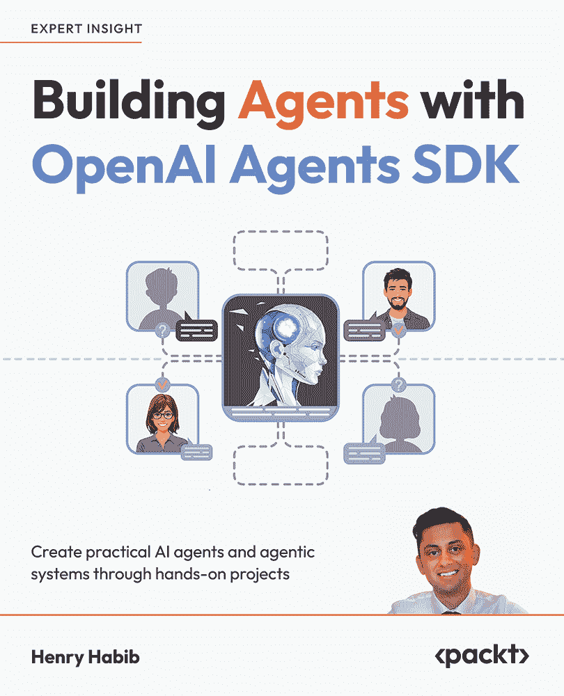


*致 Soniya, Booboo, Mom, Dad, Maheen, Karan, Riri 和 Cece。*
– Henry*

# 贡献者

# 关于作者

Henry Habib 为财富 500 强企业提供分析和运营方面的建议，特别关注构建智能 AI 驱动的解决方案、工具和代理，以产生影响并提高生产力。

他教授关于如何为工作构建 AI 代理和自动化以及其他生成式 AI 主题的在线课程，积累了超过 40 万学生的网络。他还为企业和政府组织提供技术课程。作为无代码和生成式 AI 革命的倡导者，他相信现在任何人无需任何深层技术技能即可创建强大智能的应用程序来实现工作自动化。

他还运营 `The Intelligent Worker`，这是一个教授职场人士如何利用生成式 AI、无代码、自动化等技术提高效率的平台，提供课程和免费通讯邮件。他也是许多大型财富 500 强组织的生成式 AI 演讲师。

作为讲师，Henry 热衷于学生如何在任何与生成式 AI、自动化、无代码、数据和生产力相关的课题上取得成功。他通过创建引人入胜且实用的课程并随时准备回答任何问题来实现这一点。

Henry 与妻子住在加拿大多伦多，空闲时喜欢构建随机的 AI 应用和打网球。

# 关于评审员

Sankara Reddy Thamma 是一位资深解决方案架构师、技术交付专家和 AI 创新者，拥有超过 15 年的经验，在银行、医疗保健、公用事业和制造业等行业推动了大规模企业现代化、云迁移和 AI 驱动的自动化计划。他的技术专长涵盖遗留大型机、IBM DataStage、大数据生态系统、Snowflake、Databricks、代理 AI 和多云平台（AWS、Azure 和 GCP），并结合对云现代化和遗留现代化的深厚造诣，使其成为转型复杂企业格局值得信赖的领导者。

他贡献的核心是对代理 AI 的变革性愿景。除了企业成果外，Thamma 在推进 AI 和技术社区方面发挥着积极作用。他是 IEEE 的高级成员，在 AI、机器学习、生成式 AI 和数据工程等领域担任同行评审员做出贡献。他的贡献扩展到技术出版领域，担任 Packt Publishing 和 Manning Publications 的技术书籍评审员，同时支持领先的 AI 日志和编辑委员会。他的专业知识在全球范围内获得认可，在英国和印度获得了基于代理的加速器进行智能代码转换的专利。

作为一名已发表的研究人员，他在 IEEE、Springer 和 Scopus 期刊上发表过著作，内容涵盖了安全提示词工程、神经可视化和医疗保健中的应用 AI 等主题。他将尖端研究与应用企业解决方案相结合的能力，使其在理论与实践的交汇点处于独特地位。

# 订阅免费电子书

新框架、不断演变的架构、研究发布、生产分解——`AI_Distilled` 将噪音过滤，为实际操作 LLM 和生成式 AI 系统的工程师和研究人员提供一份每周简报。现在订阅即可获得免费电子书，以及帮助您保持专注并掌握资讯的每周见解。

在 [`packt.link/8Oz6Y`](https://packt.link/8Oz6Y) 订阅或扫描下方的二维码。


# 前言

*使用 OpenAI Agents SDK 构建代理*的出现正值 AI 以及我们工作方式发生重大转变的时期。第一浪潮是 ChatGPT，这是一种消费级应用的大语言模型（`LLM`），它为所有人提供了生成和处理自然语言的强大新方法。现在，我们正在进入下一个阶段：AI 代理。与围绕僵性、确定规则（如“如果 X，则 Y”）构建的传统软件不同，代理可以处理模糊性，适应不断变化的目标，并通过步骤推理来完成任务。它们不仅限于回答问题；它们可以计划、编排工作流、检索和合成信息、使用外部工具，甚至相互协作。通过这样做，它们开始承担曾认为只有人类才能完成。这种转型仍处于早期。

`OpenAI Agents SDK` 处于这场变革的核心。它为从简单助手到复杂多代理系统的构建、部署和管理提供了一个实用且最佳的框架。就像 Microsoft PowerPoint 是构建幻灯片演示的平台一样，`OpenAI Agents SDK` 将成为开发者和技术爱好者构建 AI 代理和代理系统的标准。

本书是你掌握这项技能的指南。它采用了实战、基于示例的方法。我们从开始学习代理的解剖结构、其优缺点以及 `OpenAI Agents SDK` 如何工作。然后，深入研究 SDK 的每项功能，例如工具、内存、知识、多代理交接和防护措施。最后，我们将所学知识结合，构建一个完整的端到端实用 AI 代理解决方案。

到结束时，你不仅在理论上理解了 AI 代理，还通过 `OpenAI Agents SDK` 构建了端到端的代理系统。你不仅能够回答“什么是 AI 代理？”的问题，还能在实践中设计和实施 AI 代理。学习最好的方法是构建，而这本书正是为了让你开始构建 AI 代理而写的。

本书分为三个部分：


- `Part 1`, `AI Agents`，为本书的其他部分奠定了概念和实践基础。我们首先定义什么是智能体（Agent），它如何与传统的机器人或 API 客户端不同，以及为什么智能体已成为软件、数据和业务流程自动化的一种极具吸引力的模式。随后，我们将构建一个 AI 智能体的心理模型，你可以在贯本书中使用：智能体的大脑（模型）、智能体的手和眼睛（工具接口）以及参考教科书（内存和知识），所有这些都在显式约束和护栏下运行。然后，我们将学习构建 AI 智能体的最佳框架核心组件——`OpenAI Agents SDK`。
- `Part 2`, `OpenAI Agents SDK` 是本书的技术核心。在这里，我们从“理念上的智能体”转向“工程化的智能体”，使用 `OpenAI Agents SDK` 作为我们的主要工具。每一章都会深入深化一种特定的能力以及 `OpenAI Agents SDK` 的原语集。对于每个组件，我们都会讨论理论，然后将其应用于示例和演示中，以构建实用的 AI 智能体和智能体系统。具体而言，我们将通过工具扩展智能体（从简单函数到托管工具和作为工具的智能体）、添加内存和知识检索、构建带有有意交接的多智能体系统，并学习如何管理智能体系统。
- `Part 3`, `Build AI Agents` 是本书的关键部分。在这里，我们将使用 `OpenAI Agents SDK` 组装一个端到端的智能体系统，不是孤立的功能，而是作为一个贯的应用程序。我们将之前介绍的组件（工具、内存和检索、会话、模型和上下文管理、护栏、多智能体编排等）并将它们集成到具有清晰输入输出的生产级应用程序和工作流中。

# 本书适合读者

如果你是一名软件开发者、顾问或渴望利用 AI 智能体力量的技术专业人士，那么本书就是为你设计的。无论你是探索最新 AI 框架的 `Python` 开发者，还是对工作流自动化好奇的业务分析师，亦或是寻求构建实用 AI 驱动解决方案的效率爱好者，本书都将赋予你将想法转化为运行的 AI 智能体和智能体系统的技能。

我们假设你对 `Python` 编程概念有基本的了解，并且对 `APIs`、开发环境和云服务等技术工具表示熟悉。你不需要具备先 AI 或机器学习的经验，因为这些概念是循序渐进的。

读完本书，你将同时拥有使用 `OpenAI Agents SDK` 设计、实现和扩展 AI 智能体的概念基础和实践经验，从简单的智能体转向复杂的、能够产生现实影响的多智能体系统。

# 本书涵盖内容

- `Chapter 1`, `Introduction to AI Agents` 解释了什么是 AI 智能体以及为什么它们代表了如此强大的任务自动化范式。它为理解它们在现代工作流中的作用奠定了基础。
- `Chapter 2`, `Introduction to OpenAI Agents SDK` 介绍了 `OpenAI Agents SDK` 的架构、核心概念和原语，为你提供了处理基于智能体的系统的基础。
- `Chapter 3`, `Environment Setup and Developing Your First Agent` 将带你设置开发环境并从零开始构建简单的智能体，提供了进入智能体开发的实用第一步。
- `Chapter 4`, `Agent Tools and MCPs` 展示了如何通过工具扩展智能体（从自定义 `Python` 函数到 OpenAI 托管工具），同时涵盖了智能体如何通过“模型上下文协议”（`MCP`）进行交互。
- `Chapter 5`, `Memory and Knowledge` 展示了如何通过集成对话历史和向量数据库为智能体提供内存和检索能力，使其能够有效使用过去的上下文和外部文档。
- `Chapter 6`, `Multi-Agent Systems and Handoffs` 探索了智能体之间的协作，包括它们如何将任务移交给专门的子智能体以解决复杂的多个步骤问题。
- `Chapter 7`, `Model and Context Management` 涵盖了自定义底层 `LLMs` 及其设置以微调智能体行为的技术。
- `Chapter 8`, `Agent System Management` 重点关注操作实践，如监控、可观测性、护栏和策略执行，以确保智能体可靠安全地运行。
- `Chapter 9`, `Building AI Agents and Agentic Systems` 通过引导你构建完整的、现实世界的智能体解决方案将所有内容整合在一起，将工具、内存、交接和系统管理结合成凝聚的应用程序。

# 从书中获得最大收益

如果你记住以下几点，学习过程将会更容易：

- **理论**：我们通常会从解释特定概念和原语背后的理论开始。
- **示例**：我们将用完整的端到端示例来说明每个概念，以确保你可以有效使用所学的所有概念。
- **项目**：在书的最后，我们将所学的所有内容应用于完整的端到端 AI 智能体和智能体系统构建中。
- **深度思考**：思考如何使用 AI 智能体和 `OpenAI Agents SDK` 来解决你的问题。

以下是你需要的软件/硬件列表：

| 本书涵盖的软件/硬件 | 系统要求 |
| :--- | :--- |
| Python 3.10 或更高 | Windows, macOS 或 Linux |
| OpenAI API key | |

## 下载示例代码

本书的代码包托管在 GitHub 上：[`github.com/PacktPublishing/Building-Agents-with-OpenAI-Agents-SDK`](https://github.com/PacktPublishing/Building-Agents-with-OpenAI-Agents-SDK)。我们从丰富的书籍和视频目录中也提供了可用代码包，地址为 [`github.com/PacktPublishing`](https://github.com/PacktPublishing)。快去看看吧！

## 下载彩色图片

我们还提供了一个书中使用的截图/图表的彩色 PDF 文件。你可以在这里下载：[`packt.link/gbp/978180612012`](https://packt.link/gbp/978180612012)。

## 使用规范

书中使用了多种文本规范。

`文本中代码`: 表示代码单词、数据库表名、文件夹名、文件名、扩展名、路径、虚拟 URL、用户输入和 X 句。例如，“我们随后调用 `Runner.run_sync` 函数，传递新创建的 `agent` 对象以及 `input_context`，在这种情况下，它是客户可能会的问题”。

代码块设置如下：

```python
from agents import Agent, Runner, CodeInterpreterTool
from agents.tool import CodeInterpreter
### 实例化工具
tool_config = CodeInterpreter(
    container={"type":"auto"},
    type="code_interpreter"      
)
codetool = CodeInterpreterTool(tool_config=tool_config)
```

**粗体**：表示新术语、重要词汇或你在屏幕上看到的文字，例如菜单或对话框中的文字。例如：“通常情况下，你有一个控制工作流的智能体（通常称为**编排器**）和一组被调用以执行特定任务的智能体（通常称为**执行者**）。”

关于 AI 使用的免责声明


作者承认使用了 ChatGPT 等尖端 AI 技术，其唯一目的是优化语言表达、头脑风暴、完善清晰度并为书中提供通用帮助，从而确保读者拥有流畅的阅读体验。需要注意的是，内容本身由作者编写并由专业出版团队进行编辑。

# 与我们联系

我们随时欢迎读者的反馈！

- **一般反馈**：请向 `feedback@packtpub.com` 发送邮件，并在邮件主题中注明书名。如果您对本书的任何方面有任何疑问，请发送邮件至 `questions@packtpub.com` 联系我们。
- **错误勘正**：尽管我们已尽全力确保内容的准确性，但错误在所难免。如果您在书中发现错误，如能向我们报告，我们将不胜感激。请访问 [`www.packtpub.com/submit-errata`](http://www.packtpub.com/submit-errata)，点击 `Submit Errata` 并填写表单。

- **盗版问题**：如果您在互联网上发现我们作品的任何形式的非法复制版，如果您能向我们提供地址或网站名称，我们将不胜感激。请通过 `copyright@packtpub.com` 联系我们并附上材料链接。

- **如果您兴趣成为作者**：如果您在某个领域拥有专长，并对编写或贡献书籍感兴趣，请访问 [`authors.packtpub.com/`](http://authors.packtpub.com/)。

# 加入我们的 Discord 和 Reddit 社区

您并不是唯一一个在碎片化工具、持续更新和不明确的最佳实践中摸索的人。加入一个不断发展的专业人士社区，交流未记录在文档中的见解。

| 通过我们作者提供的更新、讨论和幕后见解保持关注。加入我们的 Discord 空间：[`packt.link/z8ivB`](https://packt.link/z8ivB) 或扫描以下二维码： | 与同行交流，分享想法并讨论现实世界的生成式 AI（GenAI）挑战。在 Reddit 上关注我们：[`packt.link/0rExL`](https://packt.link/0rExL) 或扫描以下二维码： |

# 您的书籍附带专属福利 - 如何解锁

## 立即解锁本书的专属福利

扫描此二维码或访问 [`packtpub.com/unlock`](https://packtpub.com/unlock)，然后按书名搜索本书。确保版本是正确的。 |  |

- **注意**：在开始之前请准备好您的购买发票。


使用我们的下一代阅读器增强阅读体验：

-  **多设备进度同步**：通过无缝进度同步从任何设备进行学习。
-  **高亮与笔记**：将您的阅读转化为持久的知识。
-  **书签**：随时回顾您最重要的学习内容。
-  **深色模式**：切换到深色或深褐色模式，以最小眼睛疲劳专注于阅读。

使用我们的 AI 助手（测试版）更智能地学习：

-  **总结**：总结关键章节或整个章节。
-  **AI 代码解释**：在下一代 Packt Reader 中，点击每个代码块上方的 `Explain`按钮获取 AI 驱动的代码解释。

**注意**：AI 助手是下一代 Packt Reader 的一部分，仍处于测试阶段。

随时随地学习：

 使用无 DRM 的 PDF 和 ePub 版本离线访问内容——兼容您喜欢的电子阅读器。

# 解锁您的书籍专属福利

您的书籍附带以下专属福利：

-  下一代 Packt Reader
-  AI 助手（测试版）
-  无 DRM 的 PDF/ePub 下载

如果您尚未解锁，请使用以下指南。该过程仅需几分钟，且只需操作一次。

# 如何通过三个简单步骤解锁这些福利

## 第 1 步

准备好本书的购买发票，因为您在第 3 步中需要它。如果您收到的是纸质发票，请用手机扫描并准备好 PDF、JPG 或 PNG 格式。

关于查找发票的更多帮助，请访问 [`www.packtpub.com/unlock-benefits/help`](https://www.packtpub.com/unlock-benefits/help)。

**注意**：您是直接从 Packt 购买的这本书吗？您不需要发票。完成第 2 步后，您可以直接进入专属内容。

## 第 2 步

扫描此二维码或访问 [`packtpub.com/unlock`](https://packtpub.com/unlock)。 |  |

在打开的页面上（如果您使用的是电脑，页面将类似于图 0.1），按书名搜索本书。确保您选择了正确的版本。

## 第 3 步

登录您的 Packt 账户或免费创建一个新账户。登录后，上传您的发票。格式可以是 PDF、PNG 或 JPG，大小不能超过 10 MB。按照屏幕上的剩余指令完成操作。

##

如果您遇到困难并需要帮助，访问 [`www.packtpub.com/unlock-benefits/help`](https://www.packtpub.com/unlock-benefits/help) 查看有关查找发票的详细常见问题。以下二维码将带您进入帮助页面：|  |

# 分享您的想法

读完本书后，我们想听听您的想法！请[点击此处直接进入亚马逊评论页](https://packt.link/r/1806112000)为本书提供您的反馈。

您的评论对我们以及技术社区至关重要，并将帮助我们确保交付优质内容。

# 第一部分

## AI 智能体

第一部分为本书的内容奠定了概念和实践基础。我们首先定义什么是智能体、它与传统的机器人或 API 客户端有什么区别，以及为什么智能体成为跨软件、数据和业务流程的一种极具吸引力的模式。随后，我们将构建一个贯穿全书的 AI 智能体模型：智能体的大脑（模型）、智能体的手和眼睛（工具接口）以及参考书（内存和知识），所有这些都在显式的约束和边界内运行。我们将学习构建 AI 智能体的最佳框架的核心：OpenAI Agents SDK。

这一部分非常务实。在建立了“为什么”和“是什么”之后，我们将让您进入实践。您将安装先决条件、搭建最小项目并启动您的第一个工作智能体。

本部分包含以下章节：

- *第 1 章, *AI 智能体简介*
- *第 2 章, *OpenAI Agents SDK 简介*
- *第 3 章, *环境搭建与开发您的第一个智能体*


AI 代理正在改变我们的工作方式。软件通常创建的是确定性的（如果 *X*，则 *Y*）且僵化的系统，这些系统无法处理歧义或适应不同的目标——但这种情况正在改变。随着**大语言模型**（**LLMs**）的进步，人们正在创建能够独立推理步骤并采取行动以完成目标的智能系统。这些 AI 代理正在承担越来越多以前被认为只有人类才能完成的工作，而这才刚刚开始。

读完这本书，你将成为通过 `OpenAI Agents SDK` 创建 AI 代理的专家。学习这一点的最佳方法是亲手实践，开始使用该框架构建 AI 代理系统。然而，在此之前，我们需要从最基础的层面开始，回答这个问题：“什么是 AI 代理？”

本章将涵盖你回答该问题需要的所有知识，更重要的是，它为我们在书中其余部分的构建奠定了基础。我们将*准确地*解释什么是 AI 代理，以及它与传统系统的区别。这很重要，因为许多读者经常会将 AI 代理与复杂的应用程序（如聊天机器人或欺诈检测系统）混淆。在开始构建它们之前，理解 AI 代理系统是如何运作的至关重要。我们将探索 AI 代理在生产力之外的实际应用。最后，我们将介绍构建 AI 代理时可用的不同设计模式和框架，并理解为什么 `OpenAI Agents SDK` 是大多数生产系统的务实之选。

以下是第一章将涵盖的内容：

*   AI 代理系统概述及其与更传统的系统相比的优缺点
*   AI 代理的实际应用
*   AI 代理是如何构建的，通过理解其解剖结构以及用于构建它们的不同设计/框架模式

在本引言章节结束时，我们将对每个现实世界中的 AI 代理如何组装的建立一个强有心理蓝图，这将成为我们开始构建自己的代理时的指南针。

## 技术要求

本章将从理论角度对 AI 代理进行概述，以便在开始构建之前建立良好的基础。因此，我们将在本章中不任何代码或开发任何应用程序。然而，为了跟进并完成书中范围内讨论的练习和项目，请确保你的开发环境中已完成以下设置：

*   **操作系统**：Windows 10/11、macOS 或基于 Linux 的发行版（推荐使用 Ubuntu）。
*   **Python 版本**：Python 3.8 或更高版本。你可以通过终端或命令提示符中运行 `python --version` 来验证 Python 版本。
*   **OpenAI 账户**：在 `https://platform.openai.com/signup` 注册。
*   **OpenAI API key**：通过创建 OpenAI 账户获取。你需要它来利用 `OpenAI Agents SDK`。
*   **代码编辑器**：VS Code、PyCharm 或你喜欢的任何 IDE/编辑器。

在整书中，实际示例和每章的完整代码将通过相应的 GitHub 仓库提供：`https://github.com/PacktPublishing/Building-Agents-with-OpenAI-Agents-SDK`。

```
https://github.com/PacktPublishing/Building-Agents-with-OpenAI-Agents-SDK
```

鼓励你克隆该仓库，复用并适配提供的代码示例，并在学习章节时根据需要参考它。

## AI 代理概述

在深入探索 AI 代理之前，我们必须首先对 AI 代理到底是什么建立直观的理解，它从根本上与传统软件有何不同，以及这带来了哪些优缺点。这是困难的，因为存在不同的定义，而且这些定义通常随着技术的进步而演变。通过预先明确关键概念——包括其智能自主性、推理能力和自适应问题解决等优点——我们可以为理解其实际应用和构建方法铺路。

### 什么是 AI 代理？

**AI 代理**是一种*能够通过感知周围世界并采取行动来独立运行以完成特定目标的智能系统*。AI 代理的关键区别特征包括：它能够从广泛且有时具有歧义的目标进行思考和推理，能够创建完成该目标的计划，并能够使用一组可以与世界交互的工具自主地完成该目标。

这与其他传统的软件系统形成鲜明对比，传统系统是确定性的（即它们根据预定义的计划遵循严格指令集），并且在遇到计划之外的情况时无法推理。相反，AI 代理可以**观察**其环境，对需要做什么进行**推理**，并以连续的方式采取**行动**。

AI 代理通过将 LLM 的智能和推理能力与通过标准化 API 调用行动相结合来实现这一点。让我们通过一个简单的类比来探索 AI 代理的概念和优势，以巩固理解并将其与经典的软件自动化框架区分开。

### 通过简单的类比理解 AI 代理

想象你是一家五星级餐厅的主厨，你需要培训两个初级厨师，*Carlos* 和 *Adam*。Carlos 就像传统的自动化软件系统或模型，而 Adam 就像一个 AI 代理。你*训练*这两个厨师的方式以及这两个厨师*运行*的方式是完全不同的。

Carlos 需要你教教他准备每道菜时具体要做什么。如果你在教他做煎姆蛋，你必须教他如何打开冰箱、拿一个鸡蛋、打开炉子、倒一些油、打鸡蛋等等。每一步都必须细致地定义并展示给 Carlos 看。当要求做煎姆蛋时，Carlos 会完全按照原样执行任务，完美无缺。

Adam 的工作方式不同，更像人类。你不是给他提供预定义的步骤，而是向他展示如何在厨房周围执行动作——这是如何从冰箱中取出食材，这是如何操作炉炉的，这些是烹饪的基础知识，等等。当要求做煎姆蛋时，Adam 依靠他的推理能力和被赋予的一组工具/知识来完成该任务，而不是遵循预定义的步骤。

Carlos 和 Adam 都是出色的厨师，但都有不同的优缺点。特别是，Adam 可以应对复杂性和歧义性。因为他能够推理并被教导如何执行通用动作，他可以做的不仅仅是煎姆蛋——理论上他可以做各种食物，因为所有食物都使用相同的动作。

这作为 AI 代理与经典自动化软件/模型之间的完美类比。简而言之，*赋予 AI 代理的智能自主性使其能够执行一系列无法复制的多样歧义任务*。

**注意**

必须说明，智能自主性也意味着需要安全措施。如果代理的“大脑”（AI 模型）信息不准确，自主代理可能会做出错误的决定。我们稍将讨论如何引导和约束代理（通过提示词指令和护栏），以确保其自主性是以负责任的方式行使。这里的关键结论是，AI 代理带来了智能的、以目标为导向的独立性，这它们与传统的自动化系统区分开来。

### AI 代理与传统系统的优缺点


上述类比描述了 AI 代理除了`拥抱复杂性`的能力外，它们与其他系统相比的关键区别和优势。Adam 具有`目标导向的自主性`，这让他能够烹饪不仅仅是煎饼；他可以制作炒蛋、水煮蛋，甚至是单面蛋。事实上，只要他的动作集足以执行该任务，Adam 就能创造出他未经过显式训练的新型/新颖作品。如果合适，Adam 还可以以另一种顺序完成任务。

Adam 展现了推理能力，这意味着他可以进行`自适应问题解决`，这使他能够执行以下操作，而这对 Carlos 来说是不可能的：

*   改变烹饪风格以满足客户需求——Adam 可以做出程度较软或较硬的煎饼，因为他知道让食物在灶上停留时间越长，就会越干。
*   如果缺少食材，Adam 可以折中方案并查看是否有任何替代方案。他能够处理现实世界中的模糊性并从中成长。

Carlos 会发现这些任务是不可能的，因为他只接受过训练，只能以一种方式烹饪，且无法进行其他推理。如果有任何外部因素阻止他打开冰箱或打开炉灶，Carlos 将无法进行并停滞，而 Adam 则可以适应。

然而，AI 代理模型也存在缺点，对于某些用例，这些缺点可能巨大且影响巨大，以至于它们不是最佳选择。Adam 的大脑由 LLM 驱动，容易产生`幻觉`，这意味着 AI 代理可能会产生幻觉并执行无意义的行为。这可能导致，例如，Adam 做了一道牛排，但自信地声称它是豆腐（这可能给素食主义者带来糟糕的结果）。Adam 可能会采取新颖且未见的方法来完成任务（`鲁莽的冒险`），有时会损害其目的。例如，他可能会发现保持炉持续开启会导致烹饪更快，但没有意识到这是危险的，并可能会烧掉餐厅。AI 代理通常选择自己的路径来实现目标，这可能不是最优化或理想的路径。

Adam 还必须花时间进行推理，这意味着他天生速度较慢且消耗更多能量。事实上，AI 代理的资源消耗可能比其传统软件对应高 100 倍，耗时更长。最后，Adam 还可能难以解释他采取某些行动的推理原因（`缺乏可解释性`），这是许多深度学习模型中常见的缺点。

现在我们理解了什么是 AI 代理以及它的优缺点，我们可以推论它与其他传统系统相比的实际应用。

## AI 代理的实际应用

AI 代理不仅仅是一个时尚的理念——它们正在成为公司利用 AI 解决实际问题的核心。特别是，AI 代理的早期采用者正在组织的各个层级使用它们，从销售产品和解决问题的面向客户 AI 代理角色，到内部生产力（如软件开发或研究）。

### 生产力提升

AI 代理最明显且最直接的动力是提高生产力，主要通过替代或增强传统软件系统无法替代或增强的人类工作。通过自主处理这些任务，AI 代理释放了人类，让他们专注于更高层次、更具战略性和创造性的工作。

以客户支持为例。传统上，客户支持中心可能需要几十或数百名人类代理来处理查询。传统的软件系统可能会用来自树状层次问答组合的自动聊天机器人来取代，但它们的影响是有限的，因为它们无法采取行动且难以处理模糊性。传统系统可能回答*我如何重置密码？*，但难以处理*你能查看我最近的一笔交易并告诉我在哪里买的吗，然后为我处理退货并同时向我的会计师发送确认邮件吗？*。拥有正确架构和工具的 AI 代理可以轻松解决这些查询，并在必要时引入人类。事实上，预计 AI 在不久的未来将处理 95% 的客户服务（https://www.tidio.com/blog/ai-customer-service-statistics/）。

软件开发也是 AI 代理密集活跃的典型功能。众所周知，`GitHub Copilot` 等 AI 编码助手已证明能帮助开发者完成任务的速度快 55%，并帮助开发者*保持心流*，他们报告说，编码时的挫败感减少了 60%（https://github.blog/news-insights/research/research-quantifying-github-copilots-impact-on-developer-productivity-and-happiness）。AI 代理更进了一步。现在有几家公司正在创建完全自主的 AI 代理，它们可以在整个开发周期中解决代码中的错误并构建新功能（理解用户需求、编写代码、测试代码、管理拉请求、更新 Jira 以及与经理沟通）。`GitHub Copilot` 之外的示例还包括 `Devin` 和 `Cursor`。

还有针对特定领域的 AI 代理，旨在提高特定任务（如人事、法律等）或行业（银行、零售等）的生产力。例如，在人力资源领域，AI 代理可以自动化候选筛选、预测员工流失率并个性化入职流程。在法律领域，`MinterEllison` 等公司部署了 `Lantern` 等 AI 工具来加速文档审查，每小时处理数千份文档——比人类审查员快得多。在银行领域，JPMorgan Chase` 等机构利用 AI 代理通过自动化个性化投资建议和相关研究来增强客户服务。

总体而言，AI 代理通过执行或增强人类任务充当了生产力的催化剂。

### 更好的交互性

AI 代理从根本上改变了我们与计算机交互的方式。传统上，大多数交互遵循固定模式，必须由熟悉该领域的专家执行。例如，考虑一个在零售业工作的经理。分析他们的商店销售情况与其他商店的对比，需要一位专门的数据分析师，能够将经理的请求转换为可以在数据库上运行的 `SQL query`。或者，这种请求可以通过相同任务的更高抽象来完成，例如与 `Power BI` 或 `Excel` 交互，但这仍然要求经理熟悉这些工具（以及所有相关的菜单、表单等）。

然而，AI 代理完全消除了这一障碍。AI 代理通过自然语言接收用户请求，并包含执行 `SQL queries` 的必要工具。`LLM` 可以完全将用户请求转换为所需的 `SQL query`，并向用户解释结果。通过这种方式，经理可以直接与数据交互。

这不仅限于文本；AI 代理正不断变得更加多模态，能够与语音和视觉交互。例如，支持语音的 AI 代理允许医生口述笔记并自动编写发送给患者药房的处方。零售商正在使用视觉功能审核货架，自动订购更多库存并在货架为空时指示员工补货。


总而言之，AI 智能体正在推动从`工具`到`伙伴`的转变。软件不再要求用户去适应（学习其界面并以僵化的方式输入数据），而是由软件适应用户，从而消除了整个学习障碍及其相关的摩擦。

### 新兴业务

AI 智能体不仅在提高生产力和交互性；整个全新的业务和策略正基于 AI 智能体被构建。一个很好的类比是互联网。互联网让某些任务变得更快——例如，写电子邮件比通过邮寄发送实体信件快得多。它还创造了完全全新的业务模式，如电子商务、数字市场、在线服务等。

例如，像 `Jasper.ai` 和 `Copy.ai` 这样的企业已经出现，它们提供了专门设计的 AI 智能体驱动型平台，能够自主生成营销内容、社交媒体帖子和销售文案。这些由 AI 驱动的解决方案使能够能够加速内容创建，减少营销费用，并将信息传递规模扩大到远超传统方法实现的水平。

## AI 智能体的构建方法论

现在我们已经从概念上理解了 AI 智能体及其实际应用，我们来讨论 AI 智能体的解剖结构，并解释设计和构建它们的逐步阶段方法。理解这种解剖结构将帮助我们系统地设计和实现智能体，从而确保每个组件都得到考虑并正常运行。

### AI 智能体的解剖结构

AI 智能体遵循典型的模式，可以分解为三个基本组件。具体来说，AI 智能体的解剖结构包含以下内容：

*   **模型 (Model)**：这是操作的`大脑`。它解释输入、对操作进行推理并生成输出。通常，这是一个带有系统指令和控制逻辑框架的 LLM，使其能够进行推理和迭代。
*   **工具接口 (Tooling interface)**：这是`手和眼睛`。它赋予智能体行动的能力，例如通过 API 或本地函数调用发送电子邮件或搜索网络。
*   **记忆与知识 (Memory and knowledge)**：这是`参考教科书`。它包含了帮助 AI 智能体执行任务的信息，如数据库、文档等。

### 模型

所有智能 AI 智能体都由一个`底层模型`驱动，使它们能够理解输入、创建行动计划、生成行动输入、审查行动响应，并迭代该过程直到实现目标。核心模型在技术上并不非要是 LLM——它可以是任何遵循我们之前描述的`观察(observe)`、`推理(reason)`和`行动(act)`原则的系统。但在实践中，这通常是一个强大的 LLM，例如 OpenAI 的 `GPT-4o` 模型或 Google Gemini 的 `2.5 Pro` 模型。

模型充当 AI 智能体的大脑，这意味着选择正确 LLM 的重要性不言而喻。在决定使用哪个模型时，有几个因素需要考虑。在尝试使用 LLM 执行任何任务时，存在以下权衡：

*   **成本 (Cost)**：LLM 的成本差异巨大，通常按 token（或词块）的美元金额表示。基础模型比专门微调的重型推理模型便宜得多。
*   **延迟 (Latency)**：LLM 的响应速度各不相同，这不仅取决于 LLM 的架构，还取决于 LLM 在何处以及如何托管。
*   **性能 (Performance)** 这个因素无疑是最多样化的。由于 LLM 的泛滥，存在许多根据用例而异的优势。某些 LLM 擅长编程任务，而另一些在创意练习中表现更好。某些 LLM 是多模态的——它们不仅可以输入和输出文本，还可以图像、视频和音频。LLM 在上下文窗口方面也不同，这决定了它们一次可以读取或写入多少内容。
*   **偏见 (Bias)**：LLM 在知识和倾向上也存在差异，在决定为你的 AI 智能体选择什么模型时，需要理解这一点。许多模型具有知识截止日期（即它们只“知道”到特定日期的事件），如果我们正在创建一个回溯近期事件的 AI 智能体，这可能会带来麻烦。此外，LLM 可能具有政治或信息方面的倾向，这可能会在无意中（或有时是有意的）偏斜它们的回答。一个例子是 `DeepSeek`，根据《卫报》报道，它具有明显的亲中国倾向（`https://www.theguardian.com/technology/2025/jan/28/we-tried-out-deepseek-it-works-well-until-we-asked-it-about-tiananmen-square-and-taiwan`）。

**注意**

性能和偏见的某些方面（例如知识截止日期和政治倾向）可以通过`检索增强生成` (`RAG`)、细致的提示词或训练后改进等策略来解决。这些将在稍后介绍。

请注意，驱动 AI 智能体的模型并非为每个 AI 智能体专门构建或训练的。相反，这些是通用的预训练模型，只是被赋予了特殊指令来得像智能体。也就是说，ChatGPT、旅行规划 AI 智能体、GitHub Copilot 和客户服务 AI 智能体之间的底层模型可能共享相同的底层模型 `OpenAI GPT-4o`。这些应用之间的区别不在模型，而是提供给模型的指令以及模型与其他组件的交互方式。

这些“指令”通过定义一个`系统提示词 (system prompt)` 来提供给模型。系统提示词告诉模型如何行动并驱动其底层行为。AI 智能体性能的大多数调试都是通过调整其系统提示词，以获得更理想的结果。一个很好的类比是，当你写一个系统提示词时，你正在定义模型的身份和目的。因此，提供准确且细致的系统提示词非常重要。

#### 控制逻辑框架

AI 智能体的另一个关键方面是`控制逻辑框架`，它是智能体迭代观察、推理和行动的能力，直到实现预定目标。这种循环并不一定由模型本身完成；相反，是智能体框架代码强制模型运行此循环。这通常集成在 AI 智能体的模型组件中，伪代码总结如下：

```
读取用户目标并创建行动计划
对于计划中的每个步骤：
    创建行动输入
    执行行动
    获取结果
    将结果加入记忆
    如有必要或未实现目标则修改行动计划
    如果目标实现：
        向用户返回输出
```

智能体框架在实际方法上有所不同，存在多种变体，但大多数都遵循上述的高层规划和执行结构。常见的包括思维链 (`CoT`) 和 `ReAct`。事实上，某些框架甚至让智能体生成答案，然后进行第二轮处理，由智能体（作为裁判）评估第一个智能体的答案和逻辑。


AI 代理与其他应用程序交互的机制，是通过为 AI 代理提供一个在这些应用程序中`如何执行以及何时执行动作的框架`。例如，一个辅助电子邮件工具的 AI 代理框架可能包含以下动作（再次用伪代码表示）：

```
Action #1: Send an email
    Description: 向用户发送电子邮件
    Parameters: to_email_address, email_subject, email_body
Action #2: List all emails
    Description: 列出所有邮件，包括 email_id
    Parameters: search_term (optional)
Action #3: Read an email
    Description: 返回邮件内容
    Parameter: email_id
```

当使用这些工具创建 AI 代理时，其模型和控制逻辑框架将决定何时使用这些动作，并为这些动作确定正确的输入值。

例如，一个 AI 代理可能被分配一项任务：找到所有与 `coffee expansion proposal`（咖啡扩张提案）相关的邮件，对它们进行总结，并将摘要发送给用户的经理。在这种情况下，AI 代理将首先调用 `List all emails` 动作，搜索词为 `coffee expansion proposal` 或类似内容；使用 `Read an email` 动作读取这些邮件；使用 LLM 进行进行总结；最后使用 `Send an email` 动作发送摘要。

将这些工具注册到 AI 代理的行为取决于所 fact 使用的代理框架。然而，在所有情况下，AI 代理都可以执行以下操作：

* **表现出对这些工具存在性的感知** – 通常通过自动将工具名称、定义和参数添加到模型的系统提示词（system prompt）中来实现。
* **执行工具动作** – 通常通过所选的代理框架自动完成。这些可以是客户端上的 `function calls` 形式（即运行 AI 代理的机器也包含了工具动作的逻辑），也可以是服务器端机器上的 `API calls`（服务器包含工具动作的逻辑，AI 代理只需向服务器调用以执行这些动作）。
* **接收工具动作的输出并将其传递给模型** – 同样，这通常是通过所选的代理框架自动完成的。
* 我们之前定义 AI 代理为能够与外部世界进行迭代交互以实现目标。从本质上说，这意味着工具接口（即 AI 代理与外部世界交互的方式）是一个关键组件。正因如此，编写工具（编写逻辑、提供详细指令和输入参数、将其注册到 AI 代理、确定动作的正确选择和粒度、错误处理、如何向 AI 代理暴露它们等）是书中的核心模块，我们专门用了一个章节来讨论。

## 记忆与知识

回想一下我们将 AI 代理称为智能系统。

关于 AI 代理的记忆和知识是两个独立但相关的概念。两者的目的都是根据用户的整体请求为模型提供相关的上下文。这提升了 AI 代理的智能性和有效性。让我们讨论每个概念，以及它们如何在机械上被使用以为 AI 代理提供更多上下文。

**记忆**指的是 AI 代理`记住与用户当前及之前交互中的相关信息`。通常有两种类型的记忆，将在接下来的小节中讨论。

### 工作记忆

**工作记忆**是存储在 AI 代理`当前会话`的交互历史记录中的信息。最好在传统的聊天语境中考虑这一点。假设你问 ChatGPT `太阳有多热？`，它给出了回答。你在同一次次会话中的下一条消息是 `它有多大？`。ChatGPT 足够智能，能够理解你的随后的请求与太阳有关，因为在它的工作历史中包含了你之前的交互/聊天内容。

从机制上讲，最近的聊天被保留在发送给模型的 prompt 中，以便 LLM 始终能够并在理解用户请求的上下文。这就是为什么你可以提后续问题，而这些基于聊天的系统可以正确回答。请注意，将工作记忆注入到系统指令中也是非常常见的。

工作记忆是有限制的。例如，`GPT-4o` 可能只能处理 `128K` tokens，超过此限制后，早期的消息会被弃，新的会被添加。根据使用的代理框架，可以使用上下文窗口或滑动窗口等策略来保留最相关的近期信息。

### 长期记忆

**长期记忆**是存储自 AI 代理之前会话交互历史中的信息。这使得 AI 代理能够从经典的`无状态`体验（每个请求的处理都独立于之前的交互）转变为`有状态`体验（每个请求都受到从之前交互中检索到的信息的影响）。从消费者角度来看被认为是智能的 AI 代理通常具有某种长期记忆实现。例如，考虑一个帮助你写邮件的 AI 代理。

从机制上讲，这是通过 AI 代理将交互中的信息存储在数据库中实现的，之后它可以再次读取，这两者都可以通过工具交互完成。例如，AI 代理可能具有以下工具，使其能够存储和召回记忆：

```
Action #1: Store information
    Description: 存储关于用户的重要信息
    Parameters: information
Action #2: Read information
    Description: 获取关于用户的重要信息
```

记忆和知识的实现取决于所选的代理框架和模型。在大多数情况下，工作记忆和训练知识是典型的——启用这些组件不需要额外的功能。然而，长期记忆或相关知识确实需要专门的工具，这会增加 AI 代理的复杂性。这些方面将在专门的章节中讨论。

**知识**指的是 AI 代理从存储的知识库中`召回相关信息`。与记忆不同，召回的信息不是生成自与用户的交互，而是来自知识源。这些包括文档、数据库、文件、文本语料库等。通常有两种类型的知识，将在接下来的小节中讨论。

### 训练知识

**训练知识**指的是通过训练数据固有存储在模型中的信息。例如，所有 LLM 都能轻松回答 `太阳有多大？`这个问题，因为回答该问题的信息存在于 LLM 训练的语料中。这也被被称为`通用知识`。它是 LLM 由于其训练方式而拥有的“内置”知识。

LLM 的训练知识通常是其最大的优势之一——能够在几秒钟内召回海量的有用通用知识并使其适应用户的请求是非常强大的。然而，从 AI 代理的角度来看，这并没有很大帮助。AI 代理通常不是为了召回通用知识；连接到聊天交互的 LLM 可以更好地实现这一目的。此外，LLM 无法召回训练知识截止日期之后的信息，也无法召回非公开信息——这是构建高效且有影响力的 AI 代理所需的元素。事实上，我们通常会在生成响应时刻意指示模型忽略任何训练知识。

相反，AI 代理应该能够实时检索与用户请求相关的特定上下文信息。这就是另一种知识非常有帮助的地方。

### 检索知识


`Retrieved knowledge`（检索知识）指的是根据用户请求，从知识库中实时检索的信息。与在模型训练时就已经确定且固定不变的训练知识不同，检索知识是动态且具有自适应性的。知识库可以是文档、数据库等。这里的关键因素是，在 AI 智能体运行期间，只有基于用户上下文的 relevant 信息会被检索并添加到模型中。

在实现机制上，这是通过类似于长期记忆的工具来实现的。这些工具为 AI 智能体提供了检索机制，例如向量数据库（使用 `RAG` 模式）、结构化 API、文件库搜索（如 `SharePoint` 或 `Google Drive`）以及 `web search`（网络搜索）。AI 智能体利用用户的输入在这些来源中搜索相关文档或记录，然后将它们作为上下文提供给模型以生成响应。

将检索知识集成到 AI 智能体中有许多益处。特别是，AI 智能体可以执行以下操作：

* 使用最新或专有内容回答问题
* 提供引用或参考文献以实现追溯性（相比之下，`LLM` 极难通过其训练知识提供来源）

这种相关知识对于使 AI 智能体变得有用且产生影响力至关重要。考虑一个担任组织人力资源角的 AI 智能体。它回答有关组织休假政策、福利、病假等问题的唯一方法就是通过知识检索方法。销售 AI 智能体可能会搜索公司的 `customer relationship management`（`CRM`）系统，以查找用户询问的客户的备注。

现在我们已经了解了 AI 智能体的构造，可以根据它们在处理模型、工具接口以及内存和知识组件方面的不同，区分不同的设计和实现模式。

## 设计模式

所有 AI 智能体设计模式都包含核心三个组件，但在实现这些组件的方式上有所不同。特别是，它们的区别取决于它们如何控制控制逻辑框架（我们之前讨论过的）以及其工具的复杂程度。这些包括 `ReAct`、`CoT`、`planner-executor` 以及 `hierarchical/multi-agent`（分层/多智能体）。

### CoT

`CoT`（思维链）简单地鼓励模型在生成最终答案之前产生逐步的推理轨迹。对其的字面解释是：告诉某人思考问题，创建一个解决该问题的计划，然后采取步骤来解决它。`CoT` 的一个局限性是它无法采取行动，更重要的是，它无法根据行动的结果调整其计划。

### ReAct (Reasoning + Acting)

`ReAct`（推理+行动）是我们之前用伪代码提到并描述的模式。这种设计模式强制 AI 智能体对问题进行迭代推理，并选择采取的工具或行动，将结果反馈回持续循环，直到实现目标。`ReAct` 与 `CoT` 的区别在于它能够行动并根据该行动的结果调整计划。这最适用于需要推理并与工具交互以解决复杂任务的真实世界智能体。这种模式通常是大多数传统 AI 智能体的首选。

### Planner-execution

`planner-execution`（规划-执行）模式将执行规划的系统与执行执行的系统分开。智能体首先生成一个高层计划，然后由另一个智能体（或多个智能体）执行该计划中的每个任务。这种模式对于非常长期的复杂任务，或可以很容易模块化并委托给子智能体的任务非常。

### Hierarchical/multi-agent

`hierarchical/multi-agent`（分层/多智能体）模式将任务分配给多个在该特定领域或任务上具有专家水平的专门智能体。这种模式还可以以分布式的方式工作，这意味着系统可以同时完成任务，而不是顺序完成。该系统类似于普通公司，包含一个经理（CEO），他将任务委托给具有自己领域的专业工人（`CMO`、`COO`、`CFO` 等）。

例如，如果我们构建一个解决客户投诉的 AI 智能体，可能会有一个智能体接收投诉并产生行动计划，然后由专门的智能体来执行这些任务，每个智能体都有自己的模型、工具基础设施以及内存和知识（例如，可以查询客户信息的客户智能体、审查政策的合规智能体，以及为客户起草回复的响应智能体）。

注意

这些模式并不是互斥的。事实上，大多数真实世界的智能体（特别是那些使用接下来简要讨论的框架构建的）倾向于根据任务的复杂性和可用工具混合这些方法。例如，`OpenAI Agents SDK` 框架结合了 `ReAct` 和 `hierarchical/multi-agent` 模式。

除了设计模式，公司还构建了不同的框架来开发和部署 AI 智能体，这些框架根据所使用的设计模式及其功能集而异。这些包括 `OpenAI Agents SDK`、`LangChain`、`LangGraph`、`AutoGen`、`AutoGPT` 和 `Crew AI`。

总体而言，`OpenAI Agents SDK` 因其极简性和灵活性而脱颖而出。它包含一种强大的无关架构，可以结合强大的 OpenAI 组件（如 `web search` 或 `computer use`）和自定义工具。它具有非常有用的集成追踪、护栏以及其他企业级安全和观测功能，这些是其他框架具备的。最后，它是一个持续受到关注和增长的开源项目——例如它在模块发布几周后添加了 `Model Context Protocol`（`MCP`）集成。

# 总结

在本章中，我们学习了 AI 智能体、它们的实际应用及其构建方法。

AI 智能体是智能系统，能够通过推理、规划以及通过工具与世界交互来独立实现目标。与需要严格、预定义指令的传统自动化系统不同，AI 智能体可以处理模糊性，并根据整体目标动态调整其步骤和行动。

AI 智能体通过增强或替代传统人类完成的工作来帮助组织更快工作。它们还让个人能够无缝地与工具和数据直接交互。最后，组织正在利用 AI 智能体架构创建全新的业务。

AI 智能体的核心构造由以下部分组成：模型、工具接口以及内存和知识组件。设计模式指导这些组件如何协同工作。例如，`ReAct` 允许智能体在每个行动步骤进行推理和调整，而多智能体系统通过将任务分配给专门的子智能体来提高效率。


一个 `SDK`，或`软件开发包`，是一组精选的库、工具和文档，让开发者能够站在他人的肩膀上。我非常喜欢这个（带点俏说的）定义，因为它用通俗易懂的话描述了每个开发者对 `SDK` 的渴望：写更少的代码。良好的 `SDK` 可以消除接线、配置和样板代码的繁琐工作，让开发者能够专注于让其应用程序脱颖出的特性。

OpenAI Agents SDK 用于构建 AI 代理（agents），其简洁性非常优人。它没有让你面对自定义配置语言或迷复杂的类层次结构，而是提供了一组清晰的原始语——`agents`、`runners`、`tools`、`handoff`、`guardrails` 和 `tracing`——这些都是用地道的 Python 实现的。通过这六个构建块（你甚至可以称它们为积木块），你可以在几分钟内启动一个单代理或多代理原型。

在第二章中，你将学习以下内容：

*   **OpenAI Agents SDK 的设计原则**，包括最小抽象和多代理编排框架——Python 风格、灵活且可扩展
*   **构成 SDK 的核心原始语**，包含每个原始语的详细示例以及如何使用它们

当你完成这一章时，你将不仅知道每个原始语的作用，还会理解为什么 SDK 的极简主义架构是一个实用的启动平台，帮助你快速且可靠地构建出本书其余部分将引导你构建的代理系统。

## 技术要求

在整本书中，每一章的实用示例和完整代码将通过附带的 GitHub 仓库提供：[`github.com/PacktPublishing/Building-Agents-with-OpenAI-Agents-SDK`](https://github.com/PacktPublishing/Building-Agents-with-OpenAI-Agents-SDK)。

我们鼓励你克隆该仓库，复用并适配提供的代码示例，并在学习章节时根据需要参考它。

## OpenAI Agents SDK 的设计特性

OpenAI Agents SDK 的设计考虑了几个关键原则，旨在易用性与开发者的灵活性之间取得平衡。理解这些设计选择将有助于理明为什么 SDK 将是这样工作的（以及它与其他解决方案有何不同）。

### 构建 AI 代理的框架

在高级层次，OpenAI Agents SDK 构建 AI 代理的方式与使用 Web 框架（如 `Django`、`Ruby on Rails` 等）构建网站的方式相同。这些框架抽象了 AI 代理开发和编排的低级部分。这使得开发者能够专注于更高层的影响力逻辑，并尽可能地部署代理，而无需担心脚手架代码。

通过 SDK，我们可以用几行 Python 代码创建一个代理：

```python
agent = Agent(name="Assistant", instructions="You are an AI agent",
    model="gpt-4o")
result = Runner.run_sync(agent, "Tell me a joke")
print(result.final_output)
```

这个示例使用 OpenAI GPT-4o 模型实例化了一个基础 AI 代理，并带有一些基础的系统指令。使代理能够进行迭代思考的控制逻辑框架已经嵌入到代理内部，这是框架带来的直接结果。然后，我们在用户查询上运行代理，并打印模型的输出。

**注意**

到此为止，我们引入代码是为了理解实现 SDK 的简单性和易用性。要实际运行代码，需要安装并导入必要的库，我们将在下一章中详细介绍。

如果没有 SDK，编排这些内容将显著需要数千行代码，更不用说为了创建一个 OpenAI Agents SDK 自动提供的追踪和日志系统而额外需要的数千行代码了。

OpenAI Agents SDK 的设计旨在解决构建不仅需要文本生成的 LLM 驱动流程时面临的固有挑战。这些挑战包括让模型对多步问题进行推理、与外部数据源和 API 交互（工具使用），以及在多个 AI 实体之间协调动作。

### 多代理编排

作为子集，该框架还允许开发者构建多代理解决方案。事实上，这是该框架的前身 `Swarm` 的原始目的（其核心思想是你可以以群集的方式产生一系列代理来完成任务）。这里的想法是，对于特定任务，你不能让一个代理完成一切。相反，你拥有一个*代理团队*，每个代理都专精某项任务，并在必要时相互*交接（*hand off*）委托。

想象一个客户支持工作流：

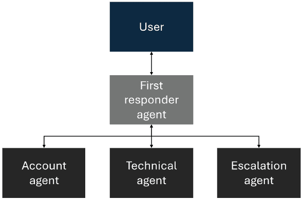

图 2.1：客户支持工作流

让我们分解并讨论一下代理工作流：

*   **首次响应代理**：接听、理解问题、执行简单的 FAQ 请求，并在根据需要交接给其他代理
*   **账户代理**：可以查询客户订单和状态
*   **技术代理**：可以修复用户身份验证漏洞并为客户设置新的连接线
*   **升级代理**：在最后的手段下引入人工参与

每个代理都专注于自己的领域，但对终端用户来说，体验感觉像是一次单一、连贯的对话。所有的上下文传递、角色切换和错误处理都发生在 SDK 的编排层中（通过一个名为 `handoffs` 的原始语完成）。你只需配置一次交接路由，让框架完成编排即可。这只需要几行代码：

```python
account_agent = Agent(name="Account agent")
technical_agent = Agent(name="Technical agent")
escalation_agent = Agent(name="Escalation agent")
first_responder_agent = Agent(
    name="First Responder",
    handoffs=[account_agent, technical_agent, escalation_agent]
)
```

## 最小抽象

OpenAI Agents SDK 背后的指导哲学之一是“用少的原始语实现快速上手”。SDK 没有引入层层又层的新类，而是给了我们一套简短易记的词汇。现实地，如果你能记住核心原始语及其工作原理，你就掌握了该框架的 80%。

这些原始语包括：`agents`、`runner`、`tools`、`handoffs`、`guardrails` 和 `tracing`。我们将在下一节深入探讨这些每一个框架，而本书的结构刻意模仿了这些原始语——因为通过每一个一个是学习该框架的最佳方式。

本质上就是这样。没有隐藏的元语言，也没有你看不见的生成代码的不透明运行时。你用纯 Python 将代理组装在一起，用 `@function_tool` 装饰几个函数，然后点击 `run`。这很重要，因为它提供了一个快速上手的体验：大多数开发者可以在午饭时间浏览一下文档或示例笔记本，并在下午构建出一个可以运行的原型。

这个 SDK 更像是一个轻量级库而不是一个庞大的框架，但这种特性也有一些权衡。与 `LangChain` 等其他综合框架不同，OpenAI Agents SDK 本身并不提供成百上千种文档加载器或内存存储器的即用集成；这些概念需要用户自行开发。

## Python 风格、可扩展且开源

OpenAI Agents SDK 使用 Python 编写并使用流利的 Python 通。没有需要斗争的 YAML 配置文件，没有需要记忆的私有作用域，也没有隐藏真实工作的元编程魔法。代理只是一个 Python 对象，工具只是一个带有特殊装饰器的普通 Python 函数。你使用每天使用的 Python 语言结构来编排它们。这使得对于 Python 开发者来说非常有用且简单，并与其他广喜的 `Flask` 和 `Pydantic` 等极简主义库有相似之处。


OpenAI Agents SDK 的默认构造已“开箱即用”，但同时也刻意留了可扩展性。你可以用自己的组件热替换任何特定的构造模块：

- 智能体对象中使用的 `model` 可以更换为任何 LLM，例如本地部署的 LLAMA 模型（前提是符合 `Chat Completions` 标准，该标准是 OpenAI 在与基础 LLM 交互时开发的标准协议；我们将在 `第 10 章` 中详细讨论这一点）。我们之前讨论过，该框架完全完全模型无关的。

- 此框架中的 `tools` 只是添加了装饰器的 Python 函数，这意味着它们可以随时轻松切换为另一个 Python 函数或托管的 API 调用，包括连接到 MCP 服务器。

- `tracing` 默认发送到 OpenAI 内部的 `Traces` 仪表板，也可以连接到任何遥测工具，如 `Azure Monitor Logs` 或 `DataDog`。

从技术上讲，甚至智能体执行循环也是模块化的。高层运行器（runner）处理重试、步骤限制和并发调用，但高级用户可以跳过它，在现有的事件循环或任务队列中直接驱动低级原语。

例如，高级用户与其调用 `Runner.run_sync(agent, input)`，不如使用 `agent.run_step(...)` 方法手动逐步步进智能体的执行逻辑，或者使用 `agent.get_initial_state()` 和 `agent.step(...)` 控制循环。这在需要将智能体执行与其他异步操作交替进行的环境中特别有用（例如在 FastAPI 路由内部），允许对时序、并发或资源管理进行完全控制。

最后，该 SDK 是开源的，这意味着该框架受益于完全的透明度以及不断增长的开发者群体，他们持续改进该框架并使其更具韧性。

总的来说，OpenAI Agents SDK 提供了一个精简且符合 Python 风格的框架，专门为简化和加速复杂 AI 代理（agents）的创建与编排而设计。通过提供极简但强大的抽象（智能体 agents、运行器 runners、工具 tools、交接 handoffs、护栏 guardrails 和追踪 tracing），该 SDK 使开发者能够无需与过多的样板代码或隐藏配置作斗，快速构建复杂的多智能体解决方案。它的可扩展性以及与现有 Python 结构的兼容性，使得在创建 AI 智能体时既能实现快速部署，又能进行深度定制。

# 核心原语 (Core primitives)

正如我们之前提到的，OpenAI Agents SDK 引入了一些核心概念（通常称为 `primitives`），我们可以使用它们来构建智能体系统。这些是使用该 SDK 构建任何智能体驱动应用的构建区块。

为了理解什么是原语，假设你正在设计一个机器人助手来帮助管理智能家居。助手应该能够关闭灯光、调整温度器、响应语音命令，并在窗户未关闭时通知你。与其从零开始构建一切，SDK 给了你一小组基础组件：一个用于定义智能体知道什么（`state`），一个用于定义它可以做什么（`tools`），一个用于定义它如何思考（`policy`），等等。这些就是 `primitives`。你像组装机器的不同零件一样组合它们，从而创建一个完备的智能体。

将原语想象成乐高套装中的乐高积木。它们是你构建任何东西时使用的最小标准单元。SDK 之后可能会包含预设的配方（类似于乐高说明书），但积木本身就是原语。

## 智能体 (Agent)

`agent` 原语是 OpenAI Agents SDK 最基础的概念。它本质上充当 LLM 外围的一个高度可配置的封装，使其具有“代理性”（即为其提供人设或 `system instructions`、工具接口，以及其自主决策和追求目标所需的其他设置）。当使用 `agent` 原语实例化智能体时，它具有以下配置：

- **Name (名称)**：智能体的名称，通常仅用于标识识别。

- **Instructions (指令)**：这些与我们在上一章讨论的系统提示词（system prompt）相同；它们为 LLM 提供关于其角色、目标、行为和人设的指南。

- **Model (模型)**：驱动智能体智能的底层 LLM。

- **Tools (工具)**：智能体可以调用以获取答案的工具列表。

- **Handoffs (交接)**：智能体可以委托的其他智能体列表。

- 这是一个智能体实例化的示例：

```
Customer_service_agent = Agent(
    name="Customer Service Agent",
    model="gpt-4o",
    instructions="""
        你是一个 AI 代理，负责以积极乐观的方式解决客户问题。
    """,
    tools=[get_account_information, refund_customer_payment,
        track_customer_order],
)
```

**Note**

`Agent` 类还可以接收其他有用参数，如护栏（guardrails）、输出类型等。这些将在后续章节中介绍。

意乎情的是，这些组件的大部分与我们在上一章讨论的 AI 智能体结构相匹配。这种可配置性使得开发者能够快速启动特定的智能体，以适应大型应用程序中的特定角色或任务。

该智能体既可以用自然语言响应，也可以调用它被赋予工具之一。值得注意的是，该 SDK 提供单一的 `Agent` 类，而不是某些框架为每种智能体类型拥有不同的类。在这里，智能体的行为完全取决于之前的配置。

## Runner

这个原语是智能体背后的引擎。在上一章中，我们讨论了成功代理应用的一个关键要素是其迭代和自主解决问题的能力（即它可以根据接收到的进一步输入做出决策并改变，以实现目标）。这种智能体循环功能已内置在该原语中。`Runner`（有时称为 `Agent Loop`）是与 LLM 交互、管理工具调用、决定下一步做什么以及重复该过程的循环过程。

回想一下，我们在以下伪代码中对这一系列操作进行了泛化：

```
读取目标并创建行动计划
对于计划中的每个步骤：
    创建行动输入
    执行行动
    获取结果
    将结果加入内存
    必要或未实现目标时修改行动计划
    如果目标已实现：
        将输出返回给用户
```

通过自动化这一核心逻辑，智能体循环显著简化了开发者的任务。它抽象了 LLM 交互和工具使用的低级编排，让开发者能够专注于通过指令定义智能体的高层行为，并通过工具定义其所需的能力，而不是深陷执行循环的机制中。管理这种推理循环在历史上一直是构建代理式 AI 最困难的部分之一（开发者必须捕获模型的思维链并自己实现循环逻辑）。

要调用运行原语，只需调用 `Runner` 类中的 `run` 方法：

```
result = await Runner.run(agent, "我的订单号是 XYZ - 帮我查查订单在哪里")
```

**Note**

`Runner.run()` 有一个非常有用的参数 `max_turns`，它可以限制智能体可以进行的循环次数。通过限制边界，`max_turns` 充当了安全阀，防止因错误的配置或不可解决的任务而导致无限循环。我们将在后续章节中详细介绍这一点。


`tool`（工具）原语是 OpenAI Agents SDK 中的核心概念，并且在简单性方面堪称“部署得当”。在我看来，它是该 SDK 最“美丽”的特性之一。任何 Python 函数都可以通过添加特定的工具装饰器来转换为 `tool`。该装饰器能够让智能体的 LLM 能够通过其名称、文档字符串（docstring）和参数自动隐式地理解该 `tool`。如果智能体的 LLM 决定调用该工具，LLM 将自动创建调用它时所需的必要参数/架构（schema）。

例如，我们可以创建一个根据订单 ID 返回订单状态的 Python 函数，并使用相关装饰器将其添加为一种工具。该装饰器会自动解析函数的文档字符串和参数，并将它们作为系统指令提供给 LLM，以便智能体知道它自己拥有哪些工具、可以做什么以及应该提供哪些输入参数。以下是创建工具的代码：

```python
Customer_service_agent = Agent(
    instructions="""
        你是一个 AI 智能体，以积极乐融的方式帮助解决客户问题。
    """,
    tools=[get_order_status],
)
@function_tool
def get_order_status(order_id: str) -> str:
    """根据 order_id 获取订单状态
    Args:
        order_id: 订单的 order_id
    """
## 调用 API 获取订单状态
return order_status
```

请注意，OpenAI Agents SDK 还允许开发者实例化用户定义函数之外的其他类型工具——托管工具（hosted tools）和作为工具的智能体（agents as tools）：

*   **托管工具 (Hosted tools)**：这些是由 OpenAI 具体提供并托管的内置工具。它们包含了你可能希望智能体拥有的常用工具，例如搜索网页、搜索文件、生成图像等。它们还包括连接到本地计算机 shell/终端的能力，或通过托管的**模型上下文协议** (`MCP`) 服务器的功能。
*   **作为工具的智能体 (Agents as tools)**：这些是你之前实例化的智能体，然后被转换为工具。然而，在实践中这种情况很少见，因为调用智能体通常是通过交接（handoff）实现的，交接更像是上下文的传递。

## 交接 (Handoff)

`handoff` 原语控制了智能体委托或转移控制权给其他智能体的机制。这使得多智能体编排成为可能，并且是该 SDK 前身 Swarm 的基础功能之一。智能体可以针对特定任务进行专门化，而交接允许你拥有一个专门的智能体系统（每个智能体都有自己的的人设和工具）来解决目标，而不是让智能体控制一切。

想象你正在创建一个创建研究报告的智能体。Agent A 专门负责制定研究计划。它将该计划传递给 Agent B，Agent B 搜索网络、提炼发现，然后将总结交给 Agent C，Agent C 专门负责接收发现并根据所需的规格创建最终报告。Agents SDK 平滑地管理每一次交接。通过以下方式可以使用该原语轻松创建这种架构：

```python
research_plan_agent = Agent(name="Research plan agent")
web_search_agent = Agent(name="Web search agent")
final_report_agent = Agent(name="Final report agent")
research_report_agent = Agent(
    name="Research report agent",
    handoffs=[research_plan_agent, web_search_agent, final_report_agent]
)
```

智能体交接（agent handoff）与工具调用（tool calling）之间的区别是什么？

*   **上下文转移 (Transfer of context)**：在交接期间，SDK 将必要的上下文（如对话历史，而不是预定义的硬性参数）传递给下一个智能体，让工作不中断地进行。
*   **控制权转移 (Transfer of control)**：交接让另一个“驱动器”接管整体目标，而不是“外包”特定的子任务。被“调用”的智能体可以调用自己的工具，然后根据需要交接给另一个智能体。

## 护栏 (Guardrails)

`Guardrails`（护栏）是 SDK 中的一种原语，作为对用户输入和智能体输出执行验证的安全机制。它们的实例化方式与工具相同（例如，在自定义 Python 函数上指定指定的装饰器），并根据你定义的逻辑触发。例如，我们可以设置一个护栏，确保用户是在询问我们的客户服务智能体客户问题，而不是随机内容。

```python
@input_guardrail
async def input_guardrail(
    ctx: RunContextWrapper[None], agent: Agent,
 input: str | list[TResponseInputItem]
) -> GuardrailFunctionOutput:
    # 判断输入是否与客户服务查询相关的逻辑
    if is_customer_service_query:
        return GuardrailFunctionOutput(
        output_info = "这是一个客户查询问题",
        tripwire_triggered = False,
    )
    else:
        return GuardrailFunctionOutput(
        output_info = "这不是一个客户查询问题",
        tripwire_triggered = True,
    )
```

如果护栏未能通过任何验证，将触发“触发表”（tripwire），并在 Python 中抛出特定的错误类型。此错误可以用任何需要的方式进行处理。例如，你可能希望该错误触发向用户发送消息，告知他们这不是对智能体的有效使用方式，或者故意停止任何后续执行并返回错误代码。

```python
try:
    await Runner.run(agent, "宇宙的意义是什么?")
    except InputGuardrailTripwireTriggered:
        print("请输入与客户服务相关的查询，而不是随机问题")
```

AI 智能体中的护栏概念非常重要，但很少被讨论。例如，你可能希望运行护栏，因为执行任何智能体或工具在计算上都是昂贵的。

**注意**

护栏通常以嵌入了验证规则的装饰 Python 函数的形式存在。这些可以应用于用户的初始输入或智能体的输出。然而，这些函数本身可以调用另一个智能体来检查候选输入或输出。这意味着你不仅可以将智能体作为工具，还可以作为护栏。

## 追踪 (Tracing)

`tracing` 原允许允许通过捕获和记录运行期间的详细执行流来观察和调试智能体系统。追踪就像智能体推理循环的飞行记录器。这包含了智能体做的每一个决策、工具调用、中间消息和交接。如果没有追踪，理解智能体如何以及为什么得出结果是非常困难，特别是在复杂的多智能体工作流中。

SDK 提供了一个手动使用的内置追踪工具，但更常见的方法是通过 SDK 集成的追踪系统自动启用。该系统可以将轨迹持久化到本地或发送到远程追踪后端，例如 OpenAI 的内置 UI 或你自己的观测设置。

让我们来看一个简单的例子。假设我们想调试客户服务智能体接收用户请求时的行为：

```python
From agents import Runner, enable_tracing
await Runner.run(agent, "请取消我的最后一个订单。")
```

一旦启用追踪，SDK 将捕获并记录以下内容：

*   初始用户输入和系统指令
*   模型的内部推理（思考）
*   任何工具的调用（带有参数和输出）
*   任何触发的交接（带有完整的上下文）
*   返回给用户的最终响应

所有这些都可以在 OpenAI Traces UI 或你偏好的 UI（如 DataDog）中查看：

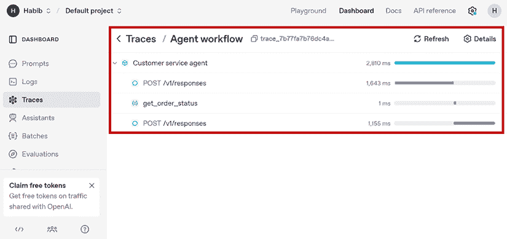


### 图 2.2：通过追踪捕获并记录详细执行流

### 注意
追踪（Tracing）与护栏（guardrails）结合使用时格外强大。例如，当护栏触发器被激活时，追踪允许你精确捕获是什么输入导致了问题，以及到那时为止了哪些步骤。这使得在敏感应用程序中调优智能体或验证业务逻辑变得简单得多。

# 总结

在本章中，我们深入探讨了 OpenAI Agents SDK 及其特殊之处。我们看到了它极简主义的抽象哲学如何剥离样板代码，让纯 Python 代码发挥作用，同时仍然强大到足以创建复杂的 智能体和多智能体解决方案。我们还看到了它是如何完全开源的，邀请了社区审查并实现了大量的扩展。

随后，我们查看了构成 SDK 的核心原语。特别是，我们关注了以下内容：

*   **Agent (智能体)**：一个将 LLM 转换为自主智能体的轻量级封装。它带有名称、系统指令、可选的工具带以及一个用于潜在交接的同伴智能体列表。
*   **Runner (运行器)**：驱动智能体迭代推理循环的执行引擎，处理重试并强制执行限制以防止无限循环。
*   **Tools (工具)**：普通的 Python 函数（或托管的 API/智能体），经过装饰后，模型可以发现它们的用途、构建有效的参数，并在需要时恰好地调用它们。
*   **Handoffs (交接)**：一种编排机制，允许智能体将控制权（以及完整的对话上下文）委托另一个智能体，从而实现优雅的多智能体工作流。
*   **Guardrails (护栏)**：封装循环每一步的策略检查，确保输出、工具调用和交接保持在业务和合规边界内。
*   **Tracing (追踪)**：对每个提示、响应和工具调用的自动、结构化日志——对于调试、可观察性和事后分析至关重要。

有了这些像乐高积木一样的原语，我们只需几行代码就能在几分钟内快速搭建实用的智能体。在下一章中，我们将设置环境并创建第一个智能体，将所有这些概念付诸实践。

# 订阅获取免费电子书

新框架、演进中的架构、研究发布、生产环境分析——AI_Distilled 将噪音过滤为面向一线操作 LLM 和生成式 AI 系统的工程师和研究人员的每周简报。现在订阅即可获得一本免费电子书，以及帮助你保持专注和获取资讯的每周见解。

在 `https://packt.link/8Oz6Y` 订阅或扫描下方二维码。


# 3

## 环境设置与开发你的第一个智能体

时候到了。我们可以开始大显身手，构建我们的第一个 AI 智能体了。虽然 OpenAI Agents SDK 相对直观，但我们首先需要确保环境配置恰当，并理解一些与 SDK 相关的基础 Python 概念。一个运行的环境是书中其他所有内容的启动台，从编写和运行智能体到测试工具、调试追踪以及编排多智能体工作流。

以下是你将在本章中学习到的内容：

*   **环境设置**：我们将安装 Python、设置虚拟环境、安装 `openai-agents` SDK 并安全地配置你的 OpenAI API 密钥。我们还将通过运行测试脚本来验证你的环境已就绪。
*   **开发前提**：该 SDK 围绕我们需要注意的 Python Python 概念构建，包括类型提示、文档字符串字面量、装饰器、异步编程（`async`/`await`）以及用于结构化数据验证的 Pydantic 库。在我们构建工具以及智能体之间交互数据时，这些是必要的。
*   **构建你的第一个 AI 智能体**：设置完成后，我们将创建第一个真实的智能体（它是一个客服助手），然后逐步增强它。我们将添加一个工具来处理订单状态查询，然后引入到用于客户留存的专门智能体的交接。本节将整个开发循环付诸行动，涵盖了我们之前讨论的**控制逻辑框架**的内部机制。

在本章中，我们将开始编码。在本章结束时，你将拥有一个功能完整的 SDK 环境、对 SDK 依赖的 Python 概念有基本的理解，以及一个可以接收输入、调用工具并将控制权交给其他智能体的真实运行 AI 智能体。让我们开始吧。

## 技术要求

在整书中，每一章的实用示例和完整代码将通过附的 GitHub 仓库提供：`https://github.com/PacktPublishing/Building-Agents-with-OpenAI-Agents-SDK`。

鼓励你克隆该仓库，复用并适配提供的代码示例，并在推进章节学习时根据需要参考它。

## 环境设置

使用 OpenAI Agents SDK 的第一步是成功设置你的环境，包括安装 SDK 并配置你的系统以运行它。我们将涵盖前提条件、如何使用虚拟环境设置项目，以及如何在 Windows 和 macOS 上安装 SDK。我们还需要获取 OpenAI API 密钥并确保它可以被安全地存储和访问。遵循这些步骤将有助于避免常见的安装问题，并确认你的环境已准备好开发。

### 注意
本章介绍了如何为了在本地运行 SDK 而设置环境。如果你无法在本地运行 SDK（可能是由于你的机器上缺少前提条件）或不希望这样做，那么书中涵盖的大部分内容可以使用 Google Colab 进行远程运行。如果你想采用这种方法，请跳至标题为 *Alternative methods: Google Colab* 的章节

## Python 版本与依赖

如之前所述，OpenAI Agents SDK 构建在 Python 之上。这意味着你的机器必须安装了 Python，特别是 Python 3.9 或更高版本。将你所需的 Python 实例放在你的 `PATH` 变量中（如果你在 Windows 上）也是非常有用的，这样 `python` 命令就可以你的 PowerShell/命令提示符中可用。

要验证你的机器上 Python 安装是否正确，请根据你的操作系统打开相应的控制台环境。如果你在 Windows 10 上，通常是 PowerShell 或命令提示符；如果你在 Windows 11 或 macOS 上，则是 Terminal。未来，这将简称为你的控制台。

打开你的控制台并输入以下命令。这将返回 Python 版本。验证它是否高于 3.9。如果不是或命令返回错误，请按照 `https://www.python.org/downloads/` 上对应操作系统的安装说明进行。输入此命令：

```
$ python – version
>>> Python 3.10.6
```

## 项目目录、虚拟环境与安装

清晰且组织良好的项目结构是构建可维护应用程序的第一步。在书中，每个示例将位于自己不同的项目文件夹中，组织在章节文件夹内，并且都在一个中央根目录内。随着我们的项目在书中变得复杂，拥有一个专用的目录对于管理智能体、工具和配置文件是至关重要的。

创建所需的项目文件夹，使其看起来如下配置。这代表了从根目录到章节的路径：

```
Root
└─ Chapter3
└─ Chapter4
```

你可以手动创建这些文件夹，也可以在控制台终端中使用 `mkdir` 命令。


由于我们将安装 `openai-agents` 库，因此必须创建一个虚拟环境，将 SDK 与你的其他 Python 项目隔离开。要创建虚拟环境，请确保你处于根目录，并在控制台终端中输入以下命令：

```
$ python -m venv .venv
```

这将创建一个新的虚拟环境，所有内容都包含你的 `.venv` 文件夹中。接下来，我们必须激活虚拟环境，以便我们后续所有的 Python 语句都能通过虚拟环境中的 Python 解释器（以及其中安装的库）运行。

在 macOS 上，请使用以下命令：

```
source .venv/bin/activate
```

在 Windows 上，使用此命令：

```
.venv/Scripts/activate
```

激活后，你的提示符通常会加上环境名称（例如 `.venv`）。这意味着你安装的任何 Python 包或运行的任何命令将使用这个隔离环境。请注意，在任何新的终端会话中运行代码之前，你都需要激活虚拟环境。每当本书要求你 `activate your virtual environment` 时，意味着运行这些命令将终端置于此隔离环境中。

接下来，我们将使用 Python 的包管理器 `pip`，通过在控制台终端中运行以下命令来下载并安装 OpenAI Agents SDK：

```
$ pip install openai-agents
```

此命令将下载并安装 SDK 及其所有依赖项。你应该能看到控制台输出结束于 `Successfully installed openai-agents`，这表明该库已安装。此时，你已经拥有了 Python、虚拟环境以及开始构建智能体（agents）所需的所有库——下一步是设置 OpenAI 的 API 访问。

## 注册 OpenAI API 并设置 API Key

为了使用 OpenAI 的大语言模型（`LLMs`），你需要一个拥有正余额的 OpenAI 账户以及一个 OpenAI API Key。API 密钥作为将你的 API 请求与账户关联的唯一标识符。

按照以下步骤生成 OpenAI API Key：

1. 访问 [`platform.openai.com/`](https://platform.openai.com/) 并注册账户或登录现有账户。请注意，你需要一个有效的电子邮件地址。
2. 从右上菜单选择 `Settings`，然后从左侧菜单选择 `Billing`。填写你的支付详情，然后选择 `Add to credit balance`。输入 `$10` 为你的 OpenAI API 积分余额充值 10 美元。
3. 接下来，从左侧菜单选择 `API keys` 并选择 `Create secret key`。为此 API Key 命名，例如 `OpenAIAgentsSDKKey` 并选择 `Default` 项目。然后选择 `Create secret key` 生成你的私有 OpenAI API Key。
4. 此时，你将看到你的 OpenAI Key 以及 `Save your key` 提示。注意，这是你查看和复制 API Key 的唯一机会——之后，你将无法再次从 OpenAI 获取它。点击 `Copy` 按钮将 API Key 复制到剪贴板，然后暂时将其粘贴到机器上的某处（例如 `.txt` 文件）。
5. 下图显示了 OpenAI 平台仪表板中的 API Key 管理界面：

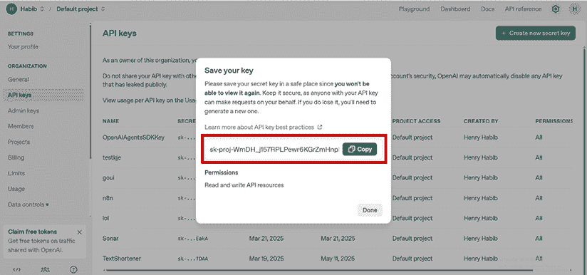

图 3.1：OpenAI UI 中的  

生成密钥后，下一步是保护它。这对于保护你的账户免受未经授权的使用至关重要。

**注意**

此 API Key 是你 OpenAI 账户的身份验证层。因此，你必须像密码一样对待此 API Key 并采取相应的安全措施。不要共享它或将其提交到任何开放仓库中。从技术上讲，任何拥有此 API Key 的人都可以代表你操作并消耗你的 API 积分。正因如此，我们始终使用环境变量来处理 API Key，而不是显式写入。

由于此 API Key 最终授予了对你账户的权限，即使在本地开发期间也对其进行保护。最好的方法是在项目根目录下创建一个 `.env` 文件，用于存储 API Key。在 `.env` 文件中，输入以下内容并将其替换为你的 OpenAI API Key：

```
OPENAI_API_KEY="sk-..."
```

接下来，你必须安装 `python-dotenv` 以将存储在 `.env` 文件中的环境变量加载到你的应用程序中。在根目录中打开控制台终端，激活环境，并运行以下命令：

```
$ pip install python-dotenv
```

你完成后的根目录看起来如下：

```
Root
└─ .venv
└─ .env
└─ Chapter3
└─ Chapter4
└─ ...
```

这是 CLI 环境的截图：

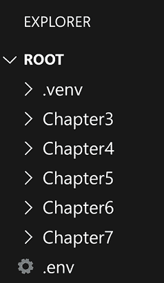

图 3.2：CLI 环境

**注意**

如果你怀疑他人拥有你的密钥或你不小心泄露了它，可以随时返回 OpenAI 撤销密钥。只需返回 OpenAI 账户，进入 `API keys`，并选择要禁用的 API Key 附近的 `Revoke`。

## 验证环境设置

现在让我们整合所有内容，并验证是否可以使用 SDK 初始化并运行智能体。创建一个名为 `Chapter3` 的新文件夹，在该目录下创建一个名为 `verify_environment_setup.py` 的新文件并输入以下内容：

```python
import os
from dotenv import load_dotenv
from agents import Agent, Runner
## 从.env 文件加载环境变量
load_dotenv()
### 获取 API key
api_key = os.getenv("OPENAI_API_KEY")
## 检查 API Key 是否可用：
if not api_key:
    print("Error: OPENAI_API_KEY not found. 请在你的.env 文件中设置它
else:
    print("API Key loaded.")
    # 创建智能体并运行
    agent = Agent(name="Echo Agent", instructions="Return the words 'Setup successful'")
    result = Runner.run_sync(agent, "Run setup")
    print(result.final_output)
```


在下一节中，我们将探索另一种远程环境。

## 替代方法：Google Colab

如果你不想搭建本地开发环境，或者你在没有管理员权限的设备上工作，`Google Colab` 提供了一个方便且基于云的替代方案。它允许你在 Jupyter Notebook 风格的环境中运行 Python 代码，而无需你进行任何配置。

要在 Colab 中使用 OpenAI Agents SDK，请遵循以下步骤：

1. 在 [`colab.research.google.com/`](https://colab.research.google.com/) 注册账户并新建笔记本：

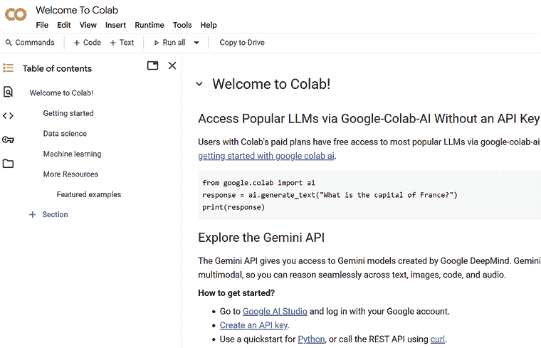

图 3.3：Google Colab UI

1. 系统已经为你安装了 Python，但你仍然需要安装 OpenAI Agents SDK。在第一个代码单元格顶部，运行以下命令安装 SDK：

```
!pip install openai-agents
```

2. 通过将 OpenAI API key 存储在环境变量中设置你的密钥：

```python
import os
os.environ["OPENAI_API_KEY"] = "your-api-key-here"
```

3. 现在你可以导入 SDK 并开始使用了。按照本节的说明导入所有所需的库。

4. 如果你的笔记本涉及多个文件（例如从单独的 Python 模块加载工具或代理），请使用 Colab 的 `Files`（文件）面板来上传它们。

在 Colab 中运行 SDK 支持我们书中涵盖的几乎所有工作流，并且具有易于分享和复制的优点。虽然对于涉及本地系统资源或自定义网络的高级用例可能存在某些局限，但 Colab 对于大多数代理开发场景都是足够的。

在下一节中，我们将通过深入研究驱动 SDK 的核心原语，探索如何创建和构建你的第一个真实代理。

## 开发前提

要使用 OpenAI Agents SDK，你需要的不仅仅是一个可以运行的安装和环境。该 SDK 在设计时考虑了特定的 Python 风格架构模式，熟悉这些原则将使使用 SDK 变得简单得多。在本节中，我们将快速介绍使用 SDK 所需的三个关键 Python 原则。

请注意，这并不是一个详尽的 Python 教程。学习 Python 基础不是本课程的范围。不过，本节将使你与书中整个 SDK 示例中所使用的技术保持一致。

## Python 函数架构

SDK 通过 Python 代码使用，因此你将编写自己的函数可能可能是类来扩展代理的功能。例如，Agents SDK 允许你将工具定义为简单的 Python 函数，代理可以调用这些函数。因此，你应该熟悉如何创建和使用 Python 函数：

```python
### 一个 Python 函数示例
def echo(message):
    return f"Message: {message}"
```

此外，这里需要掌握的最重要概念是 Python 函数周围的架构，例如类型提示（type hints）、文档字符串（docstrings）和装饰器（decorators）——这些都被 OpenAI Agents SDK 广泛使用：

* **类型提示（Type hints）**：Python 支持可选的类型提示（也称为类型注解），可用于指定 Python 函数输入和输出的变量类型。OpenAI Agents SDK 将类型提示作为框架的功能性部分。例如，当你创建一个自定义工具时，SDK 会检查你的函数的类型提示并将其传递给 LLM，使其能够准确理解你的工具期望的参数以及参数格式。在接的示例中，类型提示指定了函数的预期输入是整数，输出是字符串。

* **文档字符串（Docstrings）**：文档字符串是直接位于函数定义之后的字符串，其目的是记录该函数的作用、输入和输出。在 OpenAI Agents SDK 的语文中，文档字符串作为元数据，可以帮助 LLM 更好地理解函数（或工具）的功能。请注意，这在技术上不是强制要求的，但对于正确的 AI 代理可解释性非常有帮助。

* **装饰器（Decorators）**：装饰器是高阶函数，用于封装另一个函数以修改或增强其行为。在 OpenAI Agents SDK 的语文中，装饰器通常用于将函数标记为工具（例如 `@function_tool`），并添加元数据，如工具名称、描述或参数模式。

下面的代码段展示了一个完整的示例，将所有三个元素（装饰器、类型提示和文档字符串）整合在一个与 OpenAI Agents SDK 兼容的工具函数中：

```python
@function_tool # 装饰器
def get_order_status(orderID: int) -> str: # 类型提示
    """ 
    根据订单 ID 返回订单状态
    Args:
        orderID (int) - 客户订单的 ID
    Returns:
        string - 客户订单的状态消息
    """
    if orderID in (100, 101):
        return "Delivered"
    elif orderID in (200, 201):
        return "Delayed"
    elif orderID in (300, 301):
        return "Cancelled"
```

理解如何使用这些元素正确构建你的函数将使你的代理工具更具可读性、可维护性并与 SDK 的内置功能兼容。

## Python 异步编程

大多数现代 Python 程序是“同步”的，这意味着程序中的每一步都按顺序逐个执行。简而言之，在开始某一步之前，上一步必须成功完成。这与“异步”编程形成对比，异步编程并发处理操作，而幸运的是 Python 也通过 `asyncio` 库和 `async`/`await` 命令支持这种特性。

OpenAI Agents SDK 同时提供了同步和异步运行代理的方法。然而，运行代理的首选方式是异步，特别是对于复杂的用例（例如运行多个代理或工具）。代理工作流是异步的，花费大量时间等待外部操作，如 API 调用、工具执行、LLM 响应等。为了高效地管理这些并让你的代理能够同时做多件事，OpenAI Agents SDK 使用了 Python 的异步特性而不会阻塞整个程序。

Python 异步编程的基础可以总结如下：

* 使用 `async def` 代替传统的 `def` 语句定义 `async` 函数
* `async` 函数必须通过在执行前前加 `await` 来调用
* `async` 函数只能由其他 `async` 函数或事件循环调用
* 可以使用 `asyncio.run()` 命令在 Python 中创建事件循环

**注意**：对于书中涵盖的许多示例，使用同步调用实际上是可以的，因为（至少在开始阶段）我们不会处理多代理查询、多工具调用或流式输出。然而，理解 `async` 的工作原理并优先运行 `async` 仍然是一件好事，因为 SDK 的设计初衷就是为了利用这一特性。

随着章节的深入，你将遇到同步和异步模式。牢固掌握 Python `async` 模型将帮助你更好地理解代理交互在底层是如何协调的以及如何更高效地扩展你的工作流。

## Python Pydantic 数据验证

Pydantic 是一个用于数据验证的全面 Python 库。简而言之，该库允许开发者定义一种数据结构（称为模型），该库会自动验证特定的数据输入是否符合该数据结构。

OpenAI Agents SDK 在多种不同方式中使用 Pydantic：


- **工具的结构化输入**：在构建工具时，不仅可以像之前讨论的那样使用类型提示来定义预期输入参数，还可以使用 `Pydantic` 数据结构模型。这允许 SDK 在将输入传递给函数之前对其进行验证，并提供一个 LLM 在调用工具时可以理解并遵循的清晰模式（schema）。
- **代理的结构化输出**：你可以在 `Pydantic` 中定义一个数据结构并将其设置为代理的预期输出。通过这种方式，你可以确保从代理接收到的任何输出都始终符合你设置的 `Pydantic` 数据模型结构。这意味着你的输出遵循一致的结构化格式，这对于下游处理或 API 响应非常理想。
- **代理执行中的护栏（Guardrails）**：`Pydantic` 模型也可以用于代理的逻辑中，通过护栏功能在执行期间强制执行约束。代理工作流中的某一步步骤在继续下一个决策之前可能需要数据验证或护栏检查，在此处使用 `Pydantic` 有助于捕捉任何错误（通过使用护栏触发器）。

以下代码段演示了如何定义一个结构化的 `Pydantic` 模型并将其作为 OpenAI 工具的输入，实现自动验证和模式清晰化：

```
from pydantic import BaseModel, Field
from openai import OpenAI
from openai.agent import tool
## Step 1: 使用 Pydantic 定义结构化输入
class PersonInput(BaseModel):
    name: str = Field(..., description="人的全名")
    age: int = Field(..., ge=0, le=150, description="人的年龄（岁为单位）")
    email: str = Field(..., description="人的电子邮件地址")
## Step 2: 使用 @function_tool 装饰器创建工具
@function_tool
def process_person(input: PersonInput) -> str:
    """处理人的信息并返回摘要。"""
return f"{input.name} is {input.age} years old. Contact: {input.email}"
```

了解 `Pydantic` 的知识对于理解 SDK 如何确保数据可靠性很有帮助。从技术上来说，使用 Agents SDK 并不需要成为 `Pydantic` 专家，但能够识别何时该使用 `Pydantic` 模型而不是普通的类型提示会有帮助。在复杂代理交换结构化数据的情况下，可以使用 `Pydantic` 模型来定义这些结构。

## 开发你的第一个 AI 代理

现在我们的环境已经配置好，并且理解了核心的 Python 开发概念，是时候进入最令人兴奋的部分：构建并执行我们的第一个 AI 代理了。我们将首先运行代理，然后逐步分析它，检查输出以及代理所经历的内部阶段。之后，我们将为代理添加更多复杂度（例如：集成工具、使用多个代理等），使其变得更加复杂。其结构所示：


图 3.4: 代理组件

### 一个简单的客户服务代理

假设我们正在构建一个客户服务代理，该代理可以供我们公司处理客户请求。在 `Chapter3` 文件夹下创建一个名为 `customer_service_agent.py` 的新 Python 文件，并编写定义代理、提供输入以及运行代理所需的代码。

以下代码段演示了如何使用 OpenAI Agents SDK 创建并执行一个基础客户服务代理：

```
### 必要的导入
import os
from dotenv import load_dotenv
from agents import Agent, Runner
### 从 .env 文件加载环境变量
load_dotenv()
### 获取 API 密钥
api_key = os.getenv("OPENAI_API_KEY")
### 定义代理
agent = Agent(name="Customer service agent",
              instructions="你是一个 AI 代理，帮助本地纸张公司回复客户查询",
              model="gpt-4o")
### 运行控制逻辑框架
result = Runner.run_sync(agent, "我如何取消订单？")
### 打印结果
print(result.final_output)
```

在激活环境并运行此文件后，你将获得以下输出：

```
要取消订单，请直接联系我们的客户服务团队。您可以通过电话 [您的电话号码] 或发送电子邮件 [您的电子邮件地址] 与我们联系。请务必准备好订单号，以便我们快速为您提供帮助。
```

**注意**

在这个特定的示例中，代理正尝试对客户的查询做出最佳响应，由于 LLM 的概率性质，你看到的响应可能会有所不同。

让我们逐步分析：

1.  我们首先加载了在 Python 中构建和运行代理所需的所有库和环境变量；这与我们在本章之前章节中所做的类似。
2.  然后我们实例化了一个名为 `agent` 的新 `Agent` 类，并定义了它的三个参数：`name`、`instructions` 和 `model`。这些构成了代理**系统提示词（system prompt）**的一部分，我们在书中之前已经定义过，即它是告诉代理模型如何行动并驱动其底层行为的提示词。在这种情况下，它是为了指示代理充当客户支持代理，回复本地纸张公司的客户查询。
3.  然后我们调用了 `Runner.run_sync` 函数，传入新创建的 `agent` 对象以及 `input_context`（在这种情况下，这是一个客户可能会提出的问题）。在底层，这个 `Runner` 类负责我们之前在 *第 1 章 中描述的控制逻辑框架。它根据 `agent` 的定义，结合 `input_context`，接收 LLM 的响应，然后开始循环：
    - 如果 LLM 返回它认为是最终的输出，则返回结果并结束循环。
    - 如果 LLM 返回一个想要执行的操作，无论是调用工具还是交接（handoff），`Runner` 类都会执行这些工具调用，追加输出并重新运行代理循环。这个过程将持续到实现目标（或超过指定的最大迭代次数）。
4.  然后，`Runner.run_sync` 返回一个 `RunResult` 对象，可以对其进行解析。最后显示 `final_output`。

在这种情况下，代理的复杂程度非常简单。它只是调用带有系统提示词和输入提示词的 LLM，然后返回响应。因此，在我们的第一个案例中，循环运行了一次：
- 调用 LLM，系统提示词为 `你是一个 AI 代理，帮助本地纸张公司回复客户查询`，输入提示词为 `我如何取消订单？`。
- LLM 返回了 `final_output`（这是一个对象，因此不想执行交接或调用工具）。
- 循环结束，因为它是最终输出，结果显示给用户。

在添加更多复杂度之前，理解这个循环非常重要。记住，无论代理变得多复杂，`Runner` 都会在 LLM 输出的驱动下，每一步都持续进行这种推理。SDK 的优势在于它为我们抽象了很大一部分过程。

## 添加工具

我们将首先添加一个工具，允许代理根据订单 ID 查看订单交付状态。这通常通过数据库查询完成，但为了简单起见，我们将硬编码逻辑。函数或工具的底层复杂度并不重要；SDK 为我们完成的是为代理提供关于是否调用工具、创建工具输入、运行工具以及解释工具输出的决策能力。

我们必须先从 `agents` 类中进行额外的导入：


```
from agents import Agent, Runner, function_tool
```

让我们在 agent 定义的正上方添加以下代码段：

```python
### 创建一个工具
@function_tool
def get_order_status(orderID: int) -> str:
    """
    根据订单 ID 返回订单状态
    """
if orderID in (100, 101):
        return "Delivered"
elif orderID in (200, 201):
        return "Delayed"
elif orderID in (300, 301):
        return "Cancelled"
```

然后，我们通过为 `tools` 添加另一个参数来修改修改 agent 的定义：

```python
### 定义一个 agent
agent = Agent(name="Customer service agent",
              instructions="你是一个 AI Agent，负责帮助本地报纸公司回答客户的查询",
              model="gpt-4o",
              tools=[get_order_status])
```

最后，我们编辑 `input_context` 以使 prompt 与我们刚刚添加的工具相关：

```python
result = Runner.run_sync(agent, "我的订单状态如何？我的订单 ID 是 200")
```

运行我们的新 Python 程序后，输出如下：

```
您的 ID 为 200 的订单目前延迟了。如果您有任何其他问题或需要帮助，请随时告诉我！
```

在这个示例中，我们为客户服务 agent 添加了一个名为 `get_order_status` 的工具。为了将该工具添加到 agent 中，我们需要做两件事：

1.  我们为自定义的 Python 函数添加了 `@function_tool` 装饰器。该装饰器会告知 SDK 工具的名称、参数、目的和返回类型，这些都是通过函数的类型提示（type hints）和文档字符串（docstrings）完成的。这一点非常重要：任何 Python 函数只要被装饰了 `@function_tool` 类装饰器，就可以变成被 agent 调用的工具。
2.  我们将函数名称添加到一个列表中，并在实例化 `agent` 对象时将其传递给 `tools` 参数。

完成这些操作后，agent 就可以根据其整体目标和收到的输入任务来决定是否使用该工具。在我们的案例中，用户显式地询问了订单状态并提供了一个订单 ID。

在控制逻辑框架循环期间，LLM 并没有返回 `final_output`（对象）。相反，它被提供了名为 `get_order_status` 的工具（及其元数据），并决定在循环中必须执行该工具，同时将 `orderID` 输入参数设置为 `200`。`Runner` 类随后使用输入执行该函数，并将函数的输出（`Delayed`）添加到 agent 的 `input_context`（对象）中，开始下一次循环迭代。此时，LLM 获取的不仅是原始用户输入（例如 `我的订单 200 状态如何？`），还有函数的输出（例如 `订单已延迟`）。随后，LLM 构造出一个 `final_output` 消息，并将其显示给用户。

这里的系列步骤可能会让人感到困惑，但它们是可以可视化的。事实上，OpenAI 对每一次 agent 运行都维护着一份非常详尽的日志，显示了每一次 LLM 调用、工具执行和交接（handoff）——这被称为 `trace`（追踪记录）。要找到我们最近一次 agent 调用的 trace，请按照以下步骤操作：

1.  访问 [`platform.openai.com/`](https://platform.openai.com/) 并使用之前登录的相同账户（即你生成 API key 的账户）进行登录。
2.  从右上菜单选择 `Dashboard`，然后从左侧菜单选择 `Traces`。
3.  选择 `Created` 时间最晚的 trace。你应该能看到一个如下所示的 trace：

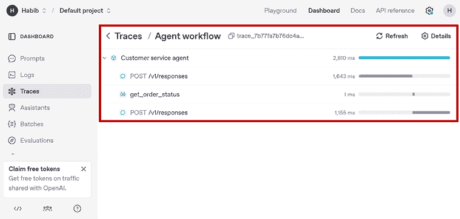

图 3.5：OpenAI UI 中的追踪示例，显示不同的步骤

此 trace 告诉了你关于 agent 运行所需的所有信息，你可以点击 trace 中的每一个单独步骤来获取更多详细信息。在我的案例中，我看到 `Runner` 类首先使用我们之前描述的系统 prompt 和输入 prompt 调用了 LLM。该 LLM 调用的结果是执行一个函数调用，并将 `"orderID": 200` 作为输入参数。

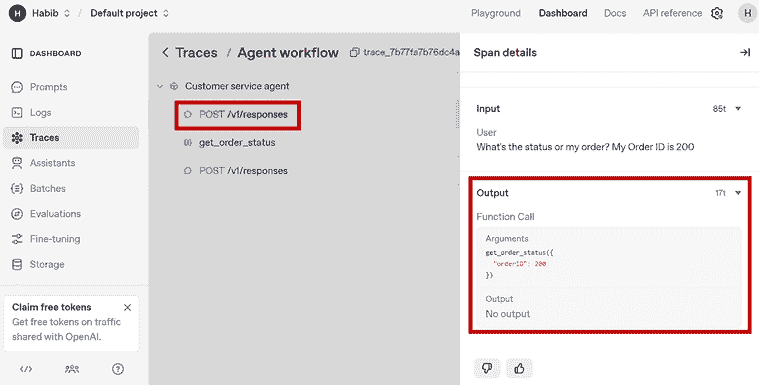

图 3.6：OpenAI UI 中的追踪示例，显示第一步的详情

1.  然后，调用了 `get_order_status` 工具，该工具返回了字符串 `Delayed`。

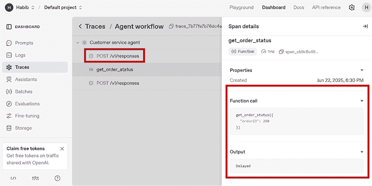

图 3.7：OpenAI UI 中的追踪示例，显示第二步的详情

1.  最后，进行了最后一次 LLM 调用，输入为（`我的订单状态如何？` `我的订单 ID 是 200` 以及 `函数调用 get_order_status("orderID": 200) 返回 Delayed`）。LLM 返回了 `您的 ID 为 200 的订单目前延迟了。如果您有任何其他问题或需要帮助，请随时告诉我！`，这正是我们之前看到的。

## 添加交接（handoff）

OpenAI Agents SDK 的一个有用功能是允许 agent 将任务交给另一个 agent。如果你希望进行多 编排或 agent 专业化，这将会非常有用。例如，你可能希望将一个问题分解为由不同 agent 处理的任务。在我们的示例中，如果客户想要取消订单，我们可能希望我们的 agent 将任务交给另一个专门负责留存的 agent。

### 创建留存 agent

让我们创建一个专门负责客户留存的 agent。首先，创建一个专门处理客户留存问题的 agent：

```python
### 定义留存 agent
customer_retention_agent = Agent(
    name="Customer Retention Agent",
    instructions="你是一个 AI agent，负责响应想要注销账户的客户并留住他们的业务。要非常有礼貌、亲切。合适的提供最高 10%的折扣",
    model="gpt-4.1"
)
```

### 为主 agent 添加交接

然后，为我们的原始 agent 添加一个新的名为 `handoffs` 的列表参数，并将新创建的 agent 加入其中。

```python
 定义 定义一个 agent
agent = Agent(name="Customer service agent",
              instructions="你是一个 AI Agent，负责帮助本地报纸公司回答客户的查询",
              model="gpt-4o",
              tools=[get_order_status],
              handoffs=[customer_retention_agent])
```

**注意**

值得知道的是，仅仅 agent 可以访问某个工具并不意味着 agent 就会使用它。事实上，决策是根据用户请求的上下文做出的。如果用户询问的是 `我如何修改密码？`，那么它就不需要调用 `get_order_status` 工具了。


```
对于您的订单反复延迟，我深表歉意。我理解这种经历让您感到多么沮丧和失望，我希望能够补救。
虽然我知道您正在考虑取消，但我非常希望能有机会为您补偿。作为对您耐心的感谢，我可以为您的订单提供 10% 的折扣，并且将亲自监控您的订单，以确保不再出现任何问题。
如果您仍然倾向于取消，我完全尊重您的决定并立即协助处理。请告诉您希望如何进行——您的满意度对我们至关重要！
```

在这种情况下，我们创建了两个智能体：之前那个担任客服经理的智能体，以及另一个名为 `customer_retention_agent` 的智能体，专门负责客户留存。客服经理智能体处理客户的任何请求，然后是回复查询、调用 `get_order_status` 工具，或者将任务移交给客户留存智能体。

在这个示例中，在控制逻辑框架循环期间，LLM 再次没有返回 `final_output`。相反，它决定将任务和上下文传递给另一个智能体。SDK 中的 `Runner` 类看到这一点，并将上下文切换到另一个智能体（使用相同的用户问题）。然后，该智能体现在“接管”，处理用户请求并产生最终答案。

这一系列步骤也可以在该流的追踪中看到：


图 3.9：OpenAI UI 中的追踪示例，显示所有步骤

这种多智能体设置可以扩展到许多智能体和复杂的路由逻辑。这里的强大在于，每个智能体都可以拥有自己的人设和能力，而你通过交接机制让模型决定哪个智能体是合适的。SDK 的作用是根据模型输出的指示，无缝将控制权（包括任何对话历史）从一个智能体传递给另一个智能体。

# 总结

在本章中，我们搭建了使用 OpenAI Agents SDK 所需的环境。我们在隔离的 Python 环境中安装了 SDK，配置了 OpenAI API 密钥，并通过运行一个最小智能体验证了我们的设置。

我们还涵盖了 SDK 高度依赖的关键 Python 构造。我们讨论了类型提示（type hints）和文档字符串（docstrings）如何提供 LLM 用于解释您工具的元数据，以及装饰器如何将函数标记为可调用工具。然后，我们学习了 Python 中的异步执行以及为什么它对智能体相关重要。最后，我们查看了 Pydantic 模型如何验证结构化的输入和输出。

随后，我们构建了第一个真实的智能体，它是一个简单的客服助手，然后通过添加工具和交接扩展了它的功能。我们添加了一个新工具，当客户想要订单状态时，智能体可以执行该工具。我们通过创建一个类型良好且文档齐全的自定义 Python 函数（`get_order_status`）来实现此点，然后对其添加了 `@function_tool` 装饰器。

接着，我们通过创建多个智能体并允许它们相互交接，引入了多智能体编排是如何运作的。在我们的示例中，我们创建了一个专门负责留存的客户智能体，如果需要，我们的主智能体可以将其移交。

在每项增强中，我们都讨论了 SDK 的控制逻辑框架如何在后台处理推理、工具执行和智能体切换，让您能够用最少的代码构建复杂的自适应系统。

我们对 AI 智能体和 SDK 的了解仅浅于表面。在下一章中，我们将深入探讨构建和集成 AI 智能体工具。

| 立即解锁此书的专属福利：扫描此二维码或访问 [packtpub.com/unlock](https://packtpub.com/unlock)，然后按名称搜索此书。 |  |
| *注意：在开始之前请准备好您的购买发票。* | |

# 第二部分：OpenAI Agents SDK

*第二部分*是本书的核心。在这里，我们从“作为理念的智能体”转向“作为工程系统的智能体”，使用 OpenAI Agents SDK 作为我们的主要工具。每一章都深入了 OpenAI Agents SDK 的一种特定能力和原语集。对于每个组件，我们都会讨论理论，然后将其应用于示例和演示，以构建实用的 AI 智能体和智能体系统。

具体来说，你将通过工具（从简单函数到托管工具和作为工具的智能体）扩展你的智能体，添加内存和知识检索，并通过刻意的交组成多智能体系统。你将学习如何调整模型和上下文，如何构建多智能体系统，以及如何使用护栏和策略对其进行部署和监控。

本部分包含以下章节：

*   *第 4 章*, *智能体工具与 MCP*
*   *第 5 章*, *内存与知识*
*   *第 6 章*, *多智能体系统与交接*
*   *第 7 章*, *模型与上下文管理*
*   *第 8 章*, *智能体系统管理*

# 4：智能体工具与 MCP

现在我们已经构建了第一个运行的 AI 智能体，现在是时候给它一些真实的能力了。在本章中，我们将超越基础知识，深入探讨 OpenAI Agents SDK 中最重要的元素之一：工具。`工具` 是让智能体与外部世界交互的基础，例如查询数据库、调用 API、执行计算、生成内容，甚至与其他智能体交互。

以下是你将在本章中学习到的：

*   **自定义工具**：学习如何定义 Python 函数并使用 `@function_tool` 装饰器将其注册为工具。我们将探索如何配置工具元数据、使用 Pydantic 验证输入以及控制如何向智能体描述工具。
*   **智能体工具行为**：通过利用 `tool_choice` 和 `tool_use_behavior` 等参数，理解如何影响智能体何时以及如何使用工具。
*   **OpenAI 托管工具**：使用 OpenAI 的内置工具，如 `WebSearchTool`、`FileSearchTool` 和 `CodeInterpreterTool` 来扩展智能体能力。
*   **作为工具的智能体**：学习如何将整个智能体变为可调用，实现模块化编排和分层工作流。
*   **MCP**：连接到外部 MCP 服务器以检索工具，而不是自己构建。

在本章结束时，你将能够为智能体配备强大的能力，从简单的算术到实时 API 访问，从生成图像到查询向量数据库，并连接外部 MCP 服务器。你还将能够控制智能体如何使用工具。让我们开始吧。

## 技术要求

请遵循 *第 3 章* 中的详细步骤设置你的环境。

在本书中，每章的实用示例和完整代码将通过附带的 GitHub 仓库发布：https://github.com/PacktPublishing/Building-Agents-with-OpenAI-Agents-SDK](https://github.com/PacktPublishing/Building-Agents-with-OpenAI-Agents-SDK)。

鼓励你克隆仓库，复用并调整提供的代码示例，并在学习各章节时随时参考。

## 使用 Python 函数使用自定义工具


在本节中，我们将探索如何使用 `OpenAI Agents SDK` 中的 `Python` 函数来定义和配置自定义工具。提醒一下，工具是智能体能力的核心部分，它们使智能体能够超越其内部知识，执行诸如获取数据、处理用户请求或触发操作等任务。我们将从使用 `@function_tool` 装饰器定义简单工具开始，然后过渡更高级的功能，例如重写工具参数以及使用 `Pydantic` 模型进行复杂的输入验证。

### 定义新工具

正如我们在上一章中讨论的，OpenAI Agents SDK 提供了一个 `@function_tool` 装饰器，可以将任何 Python 函数转换为智能体可以调用的工具。例如，我们将回到上一章中编写的代码，该代码创建一个简单的工具并使用该工具调用智能体：

```
### 必要的导入
import os
from dotenv import load_dotenv
from agents import Agent, Runner, function_tool
### 从 .env 文件加载环境变量
load_dotenv()
### 访问 API key
api_key = os.getenv("OPENAI_API_KEY")
### 创建一个工具
@function_tool
def get_order_status(orderID: int) -> str:
    """ 
    根据订单 ID 返回订单状态
    Args:
        orderID (int) - 客户订单的订单 ID
    Returns:
        string - 客户订单的状态消息
    """
if orderID in (100, 101):
        return "Delivered"
elif orderID in (200, 201):
        return "Delayed"
elif orderID in (300, 301):
        return "Cancelled"
### 定义一个智能体
agent = Agent(name="Customer service agent",
              instructions="你是一个 AI 智能体，帮助当地报纸公司回答客户查询",
              model="gpt-4o",
              tools=[get_order_status])
### 运行控制逻辑框架
result = Runner.run_sync(agent, "我的订单状态如何？我的订单 ID 是 200")
### 打印结果
print(result.final_output)
```

通过对任何 Python 函数使用装饰器，SDK 分别从函数的名称（`get_order_status`）、描述（`Returns the order status given an order ID`）和其输入模式（`orderID: int`）推断出工具名称、目的和插入参数。清晰且人类可读的名称和文档字符串（docstring）非常重要，因为智能体在决定是否使用该工具时会这些描述。它应该解释工具的作用以及预期的输入（包括单位或格式）。在这种情况下，我们不需要手动编写 JSON 模式；SDK 会根据函数签名生成它。

然而，如果需要，可以通过重写函数的默认特性来显式地定义这些工具参数。以下是一个示例：

```
### 创建一个工具
@function_tool(
        name_override="Get Status of Current Order",
        description_override="根据客户订单 ID 返回订单状态",
        docstring_style="Args: Order ID in Integer format"
)
def get_order_status(orderID: int) -> str:
    """ 
    根据订单 ID 返回订单状态
    Args:
        orderID (int) - 客户订单的订单 ID
    Returns:
        string - 客户订单的状态消息
    """
if orderID in (100, 101):
        return "Delivered"
elif orderID in (200, 201):
        return "Delayed"
elif orderID in (300, 301):
        return "Cancelled"
```

通常，这样做是为了让开发者对智能体如何表示和解释工具拥有更多控制权。例如，`name_override` 参数允许你定义一个比从函数本身导出的更具描述性或更友好的名称。当函数名称过于通用，或者表达不足以让智能体准确推断其目的时，这特别有用。

当工具行为模糊、需要强制执行本地化或格式标准，或者多个工具具有相似结构但在智能体必须区分的细微方面有所不同时，这种级别的显式控制可能非常有价值。

**注意**

`@function_tool` 装饰器同时支持同步和异步函数。如果你的函数使用 `async def`，SDK 将正确处理它，智能体将能够自动等待其结果。当你的工具与外部 API、数据库或其他异步工作流交互时，这种灵活性非常有用。

## 智能体和工具行为

智能体自主决定何时调用工具以及调用哪个工具。我们之前已经讨论过，此决策由控制逻辑框架中的 LLM 做出，该框架是由 `Runner` 类管理的决策树循环。在循环的每个周期中，会发生以下情况：

1. `Runner` 类将当前的消息列表发送给 LLM。
2. LLM 回复“最终答案”或“工具调用”（为了简单起见，我们现在假设只有这两种选项）。
3. 如果响应是“工具调用”，Runner 类执行相应的 Python 函数，并将它们的基于字符串的输出附加到消息历史中，然后重复循环直到产生最终答案。

默认情况下，模型将决定是否以及何时使用工具。然而，我们最终可以影响工具决策步骤，在某些特定用例中，我们可能需要这样做。SDK 通过几个设置为开发者提供了控制权。

### 工具选择

其中一个设置是 `ModelSettings.tool_choice` 参数，它赋予了我们控制模型方法的能力：

- `auto`: 模型自行决定是否调用工具以及调用哪一个（默认）。
- `required`: 强制模型使用工具。
- `none`: 防止模型使用工具

当你想要刻意控制智能体的行为时，修改此设置非常有用。例如，如果你创建一个必须从数据库检索数据且从不依赖其内部知识的智能体，你可以将 `tool_choice` 设置为 `required`，这将确保智能体每次调用工具。

在以下示例中，我们显式将 `tool_choice` 设置为 `required`，以确保模型必须使用 `get_order_status` 工具。这保证了所有响应都来自可靠源。

```
from agents import Agent, Runner, function_tool, ModelSettings
@function_tool
def get_order_status(orderID: int) -> str:
    if orderID in (100, 101):
        return "Delivered"
elif orderID in (200, 201):
        return "Delayed"
elif orderID in (300, 301):
        return "Cancelled"
agent = Agent(
    name="Strict customer service agent",
    instructions="你是一个客户智能体，必须使用后端系统检查订单状态。不要猜测。",
    model="gpt-4o",
    tools=[get_order_status],
    model_settings=ModelSettings(tool_choice="required")
)
result = Runner.run_sync(agent, "你能检查订单 ID 为 101 的状态吗？")
print(result.final_output)
```

这增强了智能体行为的准确性和信任度。如果没有可用工具适用于该任务，且要求使用工具（`tool_choice="required"`），模型将抛出错误或拒绝回答，因为它不被允许在不使用工具的情况下回答。这确保了所有输出都基于可靠的、显式定义的逻辑。


SDK 还允许你指定特定的工具名称，例如 `tool_choice="get_weather"`。这将强制模型调用该特定工具而不调用其他工具。在孤立地验证或测试单个工具，或者当你为了一致性或控制力而完全跳过模型的工具选择逻辑时，这是一个非常实用的选项。

### 工具使用行为

Agent 和工具行为中的另一个关键设置是名之其实传的 `Agent.tool_use_behavior`，它控制在工具被调用并返回其输出*之后*会发生什么。该设置的选项如下：

*   `run_llm_again`: 在工具执行后，agent 将输出作为控制逻辑框架的一部分返回给 LLM，然后 LLM 决定是否已经达到了可以返回最终答案的“最终输出”结儿状态。这使得模型能够解释工具的输出，并根据用户的问题在文中创建回复。这是默认选项。
*   `stop_on_first_tool`: 第一个工具输出被视为“最终响应”，不再进行后续的模型调用。
*   `agent.StopAtTools.stop_at_tool_names`: 一个字符串列表，代表我们希望 agent 停止运行并直接使用工具输出响应的工具列表。

这些选项允许你根据任务构建出行为更具确定性或更灵活的 agent。例如，`stop_on_first_tool` 选项在工具输出即答案时（例如，如数据库响应、计算结果等）特别有用——在任何地方，将输出回传给 LLM 都没有意义的。

如果你有一组工具，当这些工具被触发时应该立即终止 agent 的执行并原样返回工具输出，那么最后一个选项就会很有用。这可能符合前述描述，也可能是我们希望 agent 停止执行的“触发点”（例如，用户要求联系经理）。

以下是 `agent.StopAtTools.stop_at_tool_names` 选项的一个用例示例。在这里，我们的客服 agent 拥有一个执行敏感操作的工具（例如生成发票），此时直接显示工具输出以保持准确性、格式或法律措辞更好：

```
from agents import Agent, Runner, function_tool, StopAtTools
@function_tool
def create_invoice(orderID: int) -> str:
    return f"Invoice for Order {orderID}: $123.45 (Generated on 2025-07-05)"
agent = Agent(
    name="Invoice generator agent",
    instructions="Generate and return an invoice when requested.",
    model="gpt-4o",
    tools=[create_invoice],
    stop=StopAtTools.stop_at_tool_names(["create_invoice"])
)
result = Runner.run_sync(agent, "Please create an invoice for Order 300")
print(result.final_output)
```

在这个示例中，agent 调用 `create_invoice` 工具并直接返回原始输出字符串，而经过任何额外的 LLM 处理。这保留了工具输出的原始内容。

### 使用 Pydantic 处理复杂工具输入

我们在上一章中讨论过，SDK 支持使用 `Pydantic` 处理复杂的工具输入，并讨论了它的优势，即在数据验证方面的优势。作为提醒，你不再在输入参数中使用如 `str` 或 `int` 等简单类型提示，而是可以定义一个 Pydantic `BaseModel` 对象来表示分级或详细的输入结构。当作为函数参数使用时，SDK 将整个模型视为单个参数，自动生成相应的嵌套 JSON schema。这使得 LLM 更容易理解并调用具有正确输入 schema 的复杂输入工具。

让我们来测试一下，并通过一个具体的示例。延续我们的客服主题，假设我们想创建一个处理退款的工具。问题是，处理退款需要复杂的输入：订单 ID、客户电子邮件、原因等。为了增加复杂性，工具应该能够一次处理多个退款。在这种情况下，让我们定义一个 `BaseModel` 类名为 `RefundRequest`：

```python
from pydantic import BaseModel, List
class RefundRequest(BaseModel):
    order_id: str
    customer_email: str
    reason: str
    requests: List[str]
```

现在我们已经完成了定义，可以将 `RefundRequest` 作为输入传递给我们的自定义函数。

```python
@function_tool
def process_refund(request: RefundRequest) -> str:
    """处理退款请求并返回确认"""
    # 这里是与内部系统的交互逻辑
    return f"订单 {request.order_id} 的退款请求已提交。确认信息将发送至 {request.customer_email}.")
```

当 agent 决定使用 `process_refund` 时，它从 schema 中知道请求是一个 `RefundRequest` 对象列表，每个对象都需要三个字段。模型的结构对 LLM 可见。

使用 Pydantic 进行结构化输入在处理涉及多个字段、可选参数或重复对象的真实工作流时特别强大。

此外，它还有一个优势是 `非 LLM 输入验证`。如果 LLM 幻觉并传递了格式错误的数据，SDK 将抛出错误来捕捉问题。你可以捕获此错误，使你的应用程序更加健壮。这在定义上非确定性的 agent-LLM 交互中特别有用。

例如，假设模型错误地省略了一个必需字段，或为某个值提供了错误的类型（可能是由于幻觉）。假设它提交了以下 JSON：

```json
{
  "order_id": 12345,
  "customer_email": "customer@example.com"
}
```

此负载缺少所需的 `reason` 字段，并且将 `order_id` 类型类型整数而非字符串。当 SDK 尝试从这些数据实例化 `RefundRequest` 模型时，它将自动抛出 Pydantic 的 `ValidationError` 对象。##自定义工具示例

现在我们已经讨论了如何定义新工具以及配置其 agent 调用行为，让我们将其投入实际应用，并完整构建几个具体的示例。每个示例都是一个可以运行的独立脚本（假设你已经成功配置了环境）。

### 算术计算工具

我们将创建的第一个带有工具的 agent 是执行算术计算的 agent，这是 LLM 非常容易产生幻觉的问题。事实上，数学运算不应由 LLM 执行。因此，我们将构建一个调用执行数学运算工具的 agent。

在这种情况下，我们将构建一个计算贷款还款额的 agent。创建一个名为 `mortgage_agent.py` 的新 Python 脚本，代码如下：


```python
## Required 导入
from dotenv import load_dotenv
from agents import Agent, Runner, function_tool

### 从 .env 文件加载环境变量
load_dotenv()

@function_tool
def calculate_mortgage(
    principal_amount: float, annualized_rate: float, number_of_years: int
) -> str:
    """
    此函数计算贷款还款额。

    Args:
        principal_amount: 贷款金额。
        annual_rate: 百分比形式的年利率。
        years: 贷款期限（年）。
    Returns:
        一条说明每月还款金额的消息。
    """
    monthly_rate = (annualized_rate / 100) / 12
    months = number_of_years * 12
    payment = principal_amount * (monthly_rate) / (1 - (1 + monthly_rate) ** -months)
    print(payment)
    return f"${payment:,.2f}."

### 定义一个使用贷款计算器工具的代理
mortgage_agent = Agent(
    name="MortgageAdvisor",
    instructions=("你是一个贷款助手"),
    tools=[calculate_mortgage]
)

### 使用一个示例问题运行代理
result = Runner.run_sync(mortgage_agent, "如果我借$800,000，利率为 6%，期限 30 年，我的每月还款是多少？")
print(result.final_output)
```

在这个脚本中，`calculate_mortgage` 被装饰为一个自定义工具。它接受三个输入并返回一个带有格式化贷款金额的字符串。

当运行此脚本时，代理应该识别出用户的问题是关于计算贷款还款的，并使用相应的参数调用 `calculate_mortgage` 工具。工具将计算金额（每月约 4,796.84），然后将输出发送给 LLM。LLM 然后将输出一条完整的消息作为最终答案。

在我的情况下，最终答案如下：

但注意，由于 LLM 是非确定性的，你可能会看到略有不同的输出（但还款金额应该是相同的，因为它是由工具计算的）。

现在，让我们调整代码，始终强制代理调用工具，并返回工具的输出而不是再次调用 LLM。我们将添加两个参数：`tool_use_behavior="stop_on_first_tool"` 和 `ModelSettings.tool_choice="required"`。这是更新后的代理实例化：

```python
### 添加导入
from agents import Agent, Runner, function_tool
### 定义一个使用贷款计算器工具的代理
mortgage_agent = Agent(
    name="MortgageAdvisor",
    instructions=("你是一个贷款助手"),
    tools=[calculate_mortgage],
    tool_use_behavior="stop_on_first_tool",
    model_settings=ModelSettings(
        tool_choice="required"
    )
)
```

运行此代码将跳过 LLM 的任何进一步推理或重写。相反，代理将直接返回工具产生的结果作为最终输出。我们可能希望这样做以保证响应的确定性和可审计性，特别是在准确性至关重要的场景中，例如贷款申请。它还通过减少循环中 LLM 的次数来提高性能。

这个示例展示了拥有工具的明显益处：计算是精确的，代理不需要依赖其训练过的知识（这可能会导致——而且事实上，它正因此犯算术错误而闻名）。

### 外部 API 调用工具

我们将制作的下一个自定义工具使用外部 API 调用。API 是连接不同程序和资源的连接器。Gmail API 允许你读取电子邮件、发送电子邮件和查看日历邀请。Airbnb API 允许你查找 Airbnb 房源、发布房源或发送消息。API 还用于访问实时数据，例如客户记录、天气信息或加密货币价格。

在这个示例中，我们将创建一个获取比特币美元（USD）当前价格的工具。创建一个名为 `crypto_pricing_agent.py` 的新 Python 脚本，代码如下：

```python
import requests
from agents import Agent, Runner, function_tool
### 创建工具
@function_tool
def get_price_of_bitcoin() -> str:
    """获取比特币的价格."""
    url = "https://api.coingecko.com/api/v3/simple/price?ids=bitcoin&vs_currencies=usd"
    response = requests.get(url)
    price = response.json()["bitcoin"]["usd"]
    return f"${price:,.2f} USD."
### 创建代理
crypto_agent = Agent(
    name="CryptoTracker",
    instructions="你是一个加密货币助手。使用工具获取实时数据。",
    tools=[get_price_of_bitcoin]
)
### 使用一个示例提示运行代理
result = Runner.run_sync(crypto_agent, "比特币的价格是多少？")
print(result.final_output)
```

在这个示例中，我们创建了一个 Python 函数 `get_price_of_bitcoin`，它通过 `requests` 库调用 `CoinGecko API`（一个用于加密货币价格免费公共 API）。当代理调用工具时，工具调用 API，从 API 接收到的信息随后传回给代理。

运行此代理将始终带我们获得比特币的最新价格。在写作时，输出为：

```
比特币当前价格为 $108,575
```

这是因为它可以将加密货币字符串列表作为输入传递给 Python 函数。为了实现这一点，我们必须使用 Pydantic 模型。让我们定义以下 Pydantic 模型：

```python
from pydantic import BaseModel
from typing import List

class Crypto(BaseModel):
    """coin_ids: 加密货币名称列表"""
    coin_ids: List[str]
```

接下来，我们必须更新工具以添加 Pydantic 模型作为输入，并对逻辑进行修改：

```python
### 创建工具
@function_tool
def get_crypto_prices(crypto: Crypto) -> str:
    """获取一组加密货币的当前价格。
    Args:
        crypto: 一个包含 coin_ids 的对象（例如 bitcoin, ethereum, litecoin）
    """
    ids = ",".join(crypto.coin_ids)
    url = f"https://api.coingecko.com/api/v3/simple/price?ids={ids}&vs_currencies=usd"
    response = requests.get(url)
    data = response.json()
    return str(data)

### 创建代理
crypto_agent = Agent(
    name="CryptoTracker",
    instructions="你是一个加密货币助手。使用工具获取实时数据。获取加密货币价格时，所有请求仅调用一次工具。",
    tools=[get_crypto_prices]
)
```

有了这个结构，LLM 看到一个清晰的模式：一个包含必需字段 `coin_ids` 的对象，其必须是字符串列表。SDK 将自动验证传递的数据是否符合此结构。例如，如果我们现在修改提示词为“比特币和以太坊的价格是多少？”并运行脚本，它会回答：

```
{'bitcoin': {'usd': 108575.0}, 'ethereum': {'usd': 2534.56}}
```


通过使用此类工具，代理可以访问模型训练数据范围之外的实时信息。这有效地扩展了模型的能力，使其对实时环境具有动态的感知能力。

### 数据库查询工具

在之前的示例中，我们演示了工具如何处理精确计算和实时 API 访问。另一个强大的用例是让代理查询结构化的内部数据源（如数据库），而无需硬编码查询语句或依赖模型编写原始 SQL。相反地，我们可以将逻辑封装在一个连接数据库的工具中。这类似于 API 调用。

让我们构建一个简单的代理，它通过查询客户支持数据库来检索最近的支持工单。为了实现这一点，我们将使用 Python 字典来模拟一个数据库，以避免对真实数据库连接的需要，但在连接到真实数据库时，相同的结构也是通适的。

创建一个名为 `database_query.py` 的新脚本并运行以下代码：

```python
from agents import Agent, Runner, function_tool
from pydantic import BaseModel
from typing import List
### 创建模拟数据库
TICKETS_DB = {
    "henry@gmail.com": [
        {"id": "TCKT-001", "issue": "Login not working",
            "status": "resolved"},
        {"id": "TCKT-002", "issue": "Password reset failed",
            "status": "open"},
    ],
    "tom@gmail.com": [
        {"id": "TCKT-003", "issue": "Billing error",
            "status": "in progress"},
    ]
}
### 定义 Pydantic 模型
class CustomerQuery(BaseModel):
    email: str
### 定义执行数据库查询的工具
@function_tool
def get_customer_tickets(query: CustomerQuery) -> str:
    """根据邮箱检索客户的最近支持工单."""
    tickets = TICKETS_DB.get(query.email.lower())
    if not tickets:
        return f"No tickets found for {query.email}."
    response = "\n".join(
        [f"ID: {t['id']}, Issue: {t['issue']}, Status: {t['status']}"
for t in tickets]
    )
    return f"Tickets for {query.email}:\n{response}"
### 创建代理
support_agent = Agent(
    name="SupportHelper",
    instructions="You are a customer support agent. Use tools to fetch user support history when asked about their tickets.",
    tools=[get_customer_tickets]
)
### 运行代理
result = Runner.run_sync(support_agent, "Can you show me the ticket history for henry@gmail.com?")
print(result.final_output)
```

在这个例句中，我们定义了一个 `CustomerQuery` Pydantic 模型，它强制执行了预期的输入结构。`get_customer_tickets` 函数使用此输入在模拟支持数据库的模拟字典中查找工单。

当代理接收到类似“Can you show me the ticket history for henry@gmail.com?” 这样的提示词时，它会正确地提取邮箱，将其传递给工具，并返回一个格式良好的工单摘要：

```
Here is the ticket history for henry@gmail.com:
1\. **ID:** TCKT-001
   - **Issue:** Login not working
   - **Status:** Resolved
2\. **ID:** TCKT-002
   - **Issue:** Password reset failed
   - **Status:** Open
```

这种模式适用于许多企业级用例，例如查找客户数据、查询库存数据库等。

### 链式工具调用

代理背后的 LLM 不仅可以决定是否使用工具以及何时使用，还可以根据需要决定调用工具的顺序。这在代理必须执行多步操作，并将第一次工具调用的输出作为第二次工具调用的输入时，显得尤为有用。如果需要，代理还可以多次调用同一个工具。

例如，接上我们的客户服务主题，我们有一个名为 `get_customer_orders` 的工具（检索特定客户 ID 的所有订单）以及另一个名为 `get_order_information` 的工具（检索特定订单 ID 的状态）。创建一个名为 `tool_chaining.py` 的新 Python 脚本，包含以下代码：

```python
### 必要的导入
from typing import List
from pydantic import BaseModel
from agents import Agent, Runner, function_tool
### 定义第一个工具以获取给定客户的所有订单
@function_tool
def get_customer_orders(customer_id: str) -> str:
    """
    检索与给定客户 ID 关联的所有订单 ID。
    Args:
        customer_id: 客户 ID
    """
### 伪实现
if customer_id == "CUST123":
        return ["ORD001", "ORD002", "ORD003"]
### 定义第二个工具以获取特定订单的状态
@function_tool
def get_order_information(order_id: str) -> str:
    """
    获取特定订单的详细信息。
    """
### 伪实现
    status_map = {
        "ORD001": "Shipped",
        "ORD002": "Processing",
        "ORD003": "Delivered"
    }
    return f"Order {order_id} is currently {status_map.get(order_id, 'Unknown')}."
### 定义代理
customer_service_agent = Agent(
    name="CustomerSupportAgent",
    instructions="You are a customer service assistant.",
    tools=[get_customer_orders, get_order_information]
)
### 运行代理
result = Runner.run_sync(customer_service_agent, "Please check the status of my orders? My customer ID is CUST123.")
print(result.final_output)
```

在这个例句中，代理能够链式调用工具。当被询问订单状态时，它首先调用 `get_customer_orders` 获取订单列表，然后针对每个 ID 顺序调用 `get_order_information`。这种多步推理完全由 LLM 的控制框架驱动，我们可以通过 `Traces` 模块验证这一系列操作：

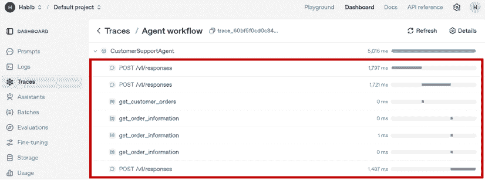

图 4.2：Traces 模块中的列表

这展示了代理跨工具进行多步推理并进行后续调用的能力。你不需要手动编写工作流；SDK 会进行编排。

### OpenAI 托管工具

使用 OpenAI 构建的 SDK 的优势在于，它提供了一系列强大且预构建的工具。这些工具只需要极少的设置；它们完全托管在服务器上（类似于 LLM 同样托管在 OpenAI 服务器上）。它们还会不断更新，这意味着在调用这些工具时可以使用最新的技术。

**注意**

OpenAI 托管工具像模型调用一样，会产生 Token 费用。当模型调用其中一个工具时，工具调用以及模型与工具之间传递任何数据都会计入 Token。

托管工具包含在 OpenAI 的响应框架中。当你通过 Agents SDK 指定托管工具时，模型会感知这些工具，并像处理自定义 Python 函数一样调用它们。目前可用的托管工具如下表所示：

| 托管工具 | 功能 |
| :--- | :--- |
| `WebSearchTool` | 在网络上进行实时以以最新信息 |
| `FileSearchTool` | 通过向量库进行文件信息搜索和检索 |
| `ImageGenerationTool` | 生成图像 |
| `CodeInterpreterTool` | 在沙箱 Python 执行环境中运行 |
| `ComputerTool` | 打开计算机/浏览器实例并执行任务 |
| `LocalShellTool` | 在本地机器上执行 Shell 命令 |

表 4.1：OpenAI 托管工具及其用途


总而言之，对于 OpenAI 托管的工具已经涵盖的用例，创建自定义工具通常没有意义。例如，`WebSearchTool` 在搜索和查询网页方面表现出色，因此，“重复造轮”并编写我们自己的 Python 函数来实现这一功能是没意义的。使用这些工具只需导入类、实例化它、定义一组输入并将其传递给智能体（agent）即可。

我们将介绍每一个 OpenAI 托管的工具，讨论它们的用例、参数，并创建一个利用这些工具的智能体。

## WebSearchTool

`WebSearchTool` 允许智能体执行网页搜索。它是最容易实现的工具之一。事实上，我的大多数企业级智能体都有这个工具，以防用户询问智能体未经过训练的信息。该工具在处理有关最新进展、时间敏感型事实或任何需要实时数据的查询时效果最好。

该工具接受两个可选输入：

* `user_location`：返回特定位置的搜索结果。你可以使用 `UserLocation` 格式指定位置，它是一个包含 `type`、`country`、`city` 和 `region` 键的字典。如果你有答案会随位置变化的查询，这将非常有用，例如：“哪里有奶茶最好喝？”
* `search_context_size`：指定每个网站检索的信息量（以及搜索多少个网站）。你可以指定“low”（低）、“medium”（中）或“high”（高）。默认选项是“medium”。

让我们开始使用这个工具吧。我们将创建一个为我们执行简单网页搜索查询的智能体。首先创建一个名为 `web_search_tool.py` 的新 Python 文件并复制以下代码：

```python
from agents import Agent, Runner, WebSearchTool
### Instantiate the tool
websearchtool = WebSearchTool()
### Create an agent
agent = Agent(
    name="WebTool",
    instructions="You are an AI agent that answers web questions. Answer in one sentence.",
    tools=[websearchtool]
)
result = Runner.run_sync(agent, "Who won the 2025 Stanley Cup?")
print(result.final_output)
```

运行该代码将得到以下输出：

```
佛罗里达黑豹队获得了 2025 年斯坦丹利杯，以六局击败了埃德蒙顿油人队，获得了他们的连续第二个冠军。([reuters.com](https://www.reuters.com/sports/florida-panthers-beat-edmonton-oilers-game-6-win-second-straight-stanley-cup-2025-06-18/?utm_source=openai))
```

在这个示例中，智能体可以访问可以在互联网搜索答案的工具。当工具被调用时，OpenAI 将对该查询执行网页搜索，读取结果（可能是新闻文章甚至是维基百科页面），并返回带有相关信息的文本片段。智能体获取这些信息并为用户制定答案。

如果我们没有 `WebSearchTool` 运行同一个智能体，它无法提供答案，因为这条信息不在它的训练数据中：*我无法提供实时信息或有关 2025 年发生事件的详情*。

接下来，我们将为 `WebSearchTool` 类添加一个位置参数。让我们调整智能体来搜索信息，假设他们在加拿大的多伦，并询问前三家意大利餐厅：

```python
from agents import Agent, Runner, WebSearchTool
### Instantiate the tool
websearchtool = WebSearchTool(user_location={
            "type": "approximate",
            "country": "CA",
            "city": "Toronto",
            "region": "Ontario",
        })
### Create an agent
agent = Agent(
    name="WebTool",
    instructions="You are an AI agent that answers web questions. Answer in one sentence.",
    tools=[websearchtool]
)
result = Runner.run_sync(agent, "What are the top 3 Italian restaurants?")
print(result.final_output)
```

输出结果如下：

```
### Output
根据最近的赞誉和评论，多伦多的排名前三意大利餐厅是：
1\. **Don Alfonso 1890**: 位于威斯汀海港城堡酒店的 38 层，该餐厅自 2022 年以来一直保留着米其林星级，并于 2022 年被 50 Top Italy 评为（意大利以外）世界最佳意大利餐厅。([en.wikipedia.org](https://en.wikipedia.org/wiki/Don_Alfonso_1890?utm_source=openai))
2\. **Osteria Giulia**: 位于 Yorkville，Osteria Giulia 自 2022 年以来一直拥有米其林星级，并在 2024 年加拿大 100 最佳餐厅名单中排名第 17。([en.wikipedia.org](https://en.wikipedia.org/wiki/Osteria_Giulia?utm_source=openai))
3\. **DaNico**: 同样拥有米其林星，DaNico 在 2025 年加拿大 100 最佳餐厅中排名第 59。([en.wikipedia.org](https://en.wikipedia.org/wiki/DaNico?utm_source=openai))
```

通过这种方式，我们用不到 15 行代码就创建了一个基于网络的智能体。没有其他 SDK 能让你以如此少的投入获得如此的功能。

## FileSearchTool

`FileSearchTool` 允许智能体查询文档向量存储。最常见的用例是查询内部知识库或大型文本语料。在本章中，我们仅演示如何使用该工具，但在未来的章节中将深入探讨。

要使用此工具，你必须先将文件上传到 OpenAI 平台并创建向量存储。此过程发生在 SDK 本身之外。

按照以下步骤创建向量存储：

1. 从右上角选择 **Dashboard**（仪表），然后选择 **Storage**（存储），最后切换到 **Vector stores**（向量存储）。

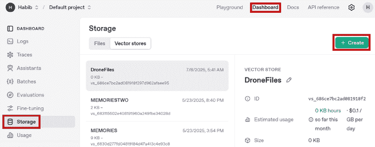
图 4.3：OpenAI 仪表中的存储页面

2. 选择 **Create**（创建）创建一个新的向量存储。输入如 `DroneFiles` 的向量存储名称。
3.向下滚动并选择 **+ Add files**（添加文件）向向量存储添加文件。
4. 上传 `droneManual.pdf` 文件（可以在仓库的*第 4 章* 下找到）。将其命名为 `DroneManual.pdf` 并为 **Purpose** 选择 `user_data`。然后，选择 **Attach**（附加）。
5. 我们上传的 PDF 现在已添加到新的向量存储中，且所有启用 RAG 的相关操作（如生成嵌入等）已完成。同样，后续章节将详细详细介绍这一点。
6. 复制并保存你刚刚创建的向量存储的向量存储 ID。

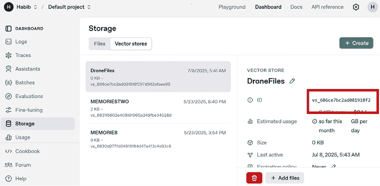
图 4.4：OpenAI 仪表中的向量存储 ID

现在我们已经有了向量存储 ID，可以将其作为 `FileSearchTool` 类的输入。事实上，该工具接收以下关键输入：


*   `vector_store_ids`: 这是一个必需的输入，代表在调用此工具时要搜索的向量库 ID 列表。请注意，提供给 `Agents SDK` 的 OpenAI API 密钥必须指向拥有该向量库访问权限账户（否则你将遇到权限错误）。
*   `max_num_results`: 一个整数，代表要返回的搜索结果数量。
*   `include_search_results`: 一个布尔值，决定是否在工具输出中包含搜索结果的全文。

我们将创建一个利用我们刚刚创建的新向量库的智能体。让我们先创建一个名为 `file_search_tool.py` 的新 Python 文件，并复制以下代码：

```python
from agents import Agent, Runner, FileSearchTool
### 实例化工具
filesearchtool = FileSearchTool(
    vector_store_ids=['vs_686ce7bc2ad081918f297d962afaee95']
) # 替换为你自己的向量库 ID
### 创建智能体
agent = Agent(
    name="WebTool",
    instructions="You are an AI agent that answers questions from the listed vector stores. Answer in one sentence.",
    tools=[filesearchtool]
)
result = Runner.run_sync(agent, "How high can you fly this drone?")
print(result.final_output)
```

运行此脚本将得到以下答案，该智能体是从我们上传的手册中提取的：

```python
### Output
The drone can be flown up to a maximum altitude of 60 feet (20 meters).
```

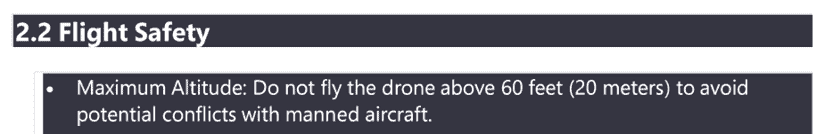

通过这种方式，`FileSearchTool` 使智能体能够根据提供的书面材料为其回答的依据。智能体不再仅仅依赖 LLM 的预训练知识，而是能够从你自己的内部文档中获取相关信息。

## ImageGenerationTool

`ImageGenerationTool` 使智能体能够根据文本提示创建图像。这通常连接到 OpenAI 的图像生成服务。集成此工具后，智能体可以响应诸如“生成一张大象图像”之类的提示。通常，最常见的用例是生成视觉效果（产品模型、演示、设计等）。

在输入方面，`ImageGenerationTool` 类接受一个 `ImageGeneration` 对象作为 `tool_config` 参数，在其中你可以指定图像的大小、质量、格式、压缩和背景。你必须指定类型，目前该类型始终等于 `image_generation`。

让我们构建可以生成图像的智能体。创建一个名为 `image_generation_tool.py` 的新 Python 文件，并复制以下代码：

```python
from agents import Agent, Runner, ImageGenerationTool
from agents.tool import ImageGeneration
### 实例化工具
tool_config = ImageGeneration(
    type="image_generation",      
)
imagetool = ImageGenerationTool(tool_config=tool_config)
### 创建智能体
agent = Agent(
    name="ImageTool",
    instructions="You are an AI agent that generates images.",
    tools=[imagetool]
)
result = Runner.run_sync(agent, "Generate an image of an elephant.")
print(result.final_output)
```

运行此脚本将获得指向以下图像的 URL：


图 4.5：运行上述代码后生成的输出

**注意**

你可能会遇到 `PermissionDeniedError` 对象。如果发生这种情况，请按照说明在 OpenAI 平台设置中验证你的组织。

在此工具中，OpenAI 的服务器将为该提示生成图像，并返回图像托管的 URL。然后你可以通过工作流来获取该图像、将其保存到某处或发送给某人。该工具非常适合创意或视觉任务。例如，智能体可以动态创建数据可视化（通过描述生成图表图像）或仅为回答配插。

**注意**

图像生成比文本输出更容易产生幻觉。生成的图像可能不准确，甚至与输入提示逻辑上不一致。

## CodeInterpreterTool

`CodeInterpreterTool` 使智能体能够在沙箱环境中编写并执行 Python 代码。该工具对于任何数据分析或计算任务都极其有用。我们之前讨论过数学计算应该由工具来执行（而不是 LLM，因为存在幻觉风险），并且我们之前已经通过构建一个计算每月抵押贷款还款额的自定义 Python 函数实现了这一点。`CodeInterpreterTool` 更进了一步：它不需要定义抵押贷款还款的实际公式，该工具可以根据简单的提示推导出自己的公式，然后执行该代码。

此工具在沙箱环境中执行代码。因此，该工具在使用前需要初始化一个容器对象。它可以自动创建（工具在运行时创建自己的容器），也可以显式创建（你使用 OpenAI 端点创建容器然后传递容器 ID）。在这种情况下，为了简单起见，我们选择了 `auto` 选项。

让我们直接进入示例。创建一个名为 `code_interpreter_tool.py` 的新文件并运行以下代码：

```python
from agents import Agent, Runner, CodeInterpreterTool
from agents.tool import CodeInterpreter
### 实例化工具
tool_config = CodeInterpreter(
    container={"type":"auto"},
    type="code_interpreter"      
)
codetool = CodeInterpreterTool(tool_config=tool_config)
### 创建智能体
agent = Agent(
    name="CodeTool",
    instructions="You are an AI agent that writes and runs code to answer questions.",
    tools=[codetool]
)
result = Runner.run_sync(agent, "What is my monthly payment for $800,000 at 6% for 30 years?")
print(result.final_output)
```

运行此代码将得到以下输出：

```
The monthly payment for $800,000 at 6% over 30 years is approximately $4,796.40.
```

为了得出答案，智能体调用了 `CodeInterpreterTool` 并编写了代码，在容器中运行，然后将答案传回 LLM。

事实上，我们可以通过查看 Traces 模块来验证这一点

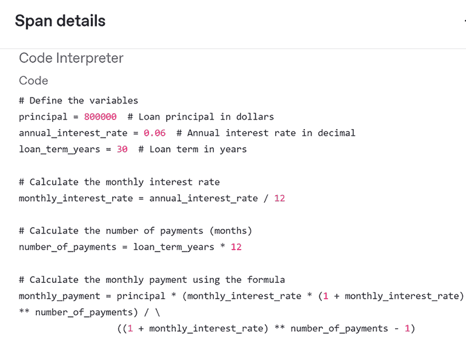

图 4.6：Traces 模块中的 Code Interpreter 输出

**注意**

容器中可以执行的代码有固有的限制，例如处理配额、可以安装的 Python 库等。要查看完整列表，请访问 [`platform.openai.com/docs/tools-code-interpreter`](https://platform.openai.com/docs/tools-code-interpreter)。

`CodeInterpreterTool` 使智能体能够处理计算、数据处理或生成图表等输出的任务，纯 LLM 在这些任务上可能会遇到困难或速度缓慢。这就像是给智能体配备了一个智能数据分析师。


Agents SDK 中最强大的架构模式之一是可以使用*整个智能体作为另一个智能体的工具*。这被称为 `agent-as-tool pattern`（智能体工具模式），它允许智能体以分层化的方式协同工作。通常，你有一个控制工作流的智能体（通常称为 `orchestrator`协调器），以及一组被调用以完成特定任务的智能体（通常称为 `workers` 工作者）。

工作者智能体作为模块化组件运行，每个都有自己的系统提示词（system prompts）、推理过程甚至工具。从协调器的角度来看，它们被调用的方式与其他任何传统工具无异。无论协调器调用的是 Python 自定义工具、OpenAI 托管的工具还是智能体，其方式都是相同的。

## 交接（Handoff）与智能体工具模式

注意，`agent-as-tool pattern` 与 `handoffs`（交接）有本质区别，我们将在稍后的章节中详细介绍后者。在交接模式中，一个智能体会会将控制权完全委托另一个智能体，如*图 4.7* 所示。一旦发生交接，第二个智能体将完全接管任务或对话，直到任务完成或它选择将控制权交回：

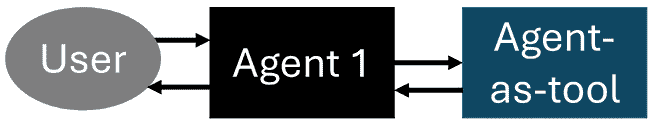

图 4.7：智能体工具模式

在 `agent-as-tool pattern` 中，协调智能体保留对整个工作流的完全控制权，并简单调用另一个智能体来处理特定的子任务，如*图 4.8* 所示：

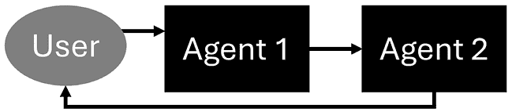

图 4.8：交接模式

一个很好的例子是你拨打客服热线。客服经理可以将你转接到另一个部门以继续对话（这就是交接模式），也可以让你稍等，同时他们向同事询问/收集必要信息，然后在完成后回来与你通电话（这就是 `agent-as-tool pattern`）。

这两种编排模式在 SDK 中都完全支持，并可以组合使用以处理更复杂的工作流。我们需要考虑的关键权衡是控制权：交接提供了模块化的自主性，而智能体工具模式则需要考虑控制权。

在以下情况下你应该选择交接模式：

- 它非常适合进入工作者的领域
- 需要通过工作者来完成任务
- 不需要中间的监督

相比之下，在以下情况下你应该选择 `agent-as-tool pattern`：

- 保持对话的中心化控制非常重要
- 工作者的输入需要被汇总为答案

这两种方法都有自己的优缺点，选择哪种取决于你的工作流需要多程度的可见性。

## 功能性

SDK 允许你通过 `as_tool()` 将任何智能体转换为工具，这会返回一个 `FunctionTool` 对象。在调用 `as_tool()` 时，你需要为智能体指定名称和描述，这对于协调智能体决定何时调用至关重要。

让我们来看一个示例。创建一个名为 `agents_as_tool.py` 的 Python 并运行以下代码：

```python
from agents import Agent, Runner, WebSearchTool, CodeInterpreterTool
from agents.tool import CodeInterpreter
### 实例化工具
websearchtool = WebSearchTool()
### 创建工作者智能体
location_agent = Agent(
    name="LocationAgent",
    instructions="你是一个通过网络搜索获取城市经纬度的智能体。",
    tools=[websearchtool]
)
### 实例化工具
tool_config = CodeInterpreter(
    container={"type":"auto"},
    type="code_interpreter"
)
codetool = CodeInterpreterTool(tool_config=tool_config)
### 创建另一个工作者智能体
distance_calculator_agent = Agent(
    name="DistanceCalculatorAgent",
    instructions="你是一个编写并运行 Python 代码计算两个经纬度之间距离的智能体。",
    tools=[codetool]
)
### 创建协调智能体
agent = Agent(
    name="Agent",
    instructions="你是一个计算地点距离的智能体。使用 Location Agent 获取经纬度。使用 Distance Agent 计算距离。",
    tools=[
        location_agent.as_tool(
            tool_name="LocationAgent",
            tool_description="返回特定位置的经纬度"
        ),
        distance_calculator_agent.as_tool(
            tool_name="DistanceCalculatorAgent",
            tool_description="计算两个经纬度点之间的距离"
        )]
)
result = Runner.run_sync(agent, "多伦多和温哥华之间的直线距离是多少？")
print(result.final_output)
```

让我们逐步分析这段代码。

首先，我们创建了两个智能体：

- `LocationAgent`：其唯一目标是通过 `WebSearchTool` 获取给定城市的经纬度。
- `DistanceCalculatorAgent`：配备了 `CodeInterpreterTool`，允许它编写并执行 Python 代码来计算距离。

重要的部分是对这些智能体调用 `.as_tool()`。这会将每个智能体封装成可调用的工具，并为其分配 `tool_name` 参数和 `tool_description` 参数，以便协调智能体能够判断何时以及如何调用它们。这些名称和描述起了关键作用。

最后，我们创建了一个协调智能体。它的指令引导它使用工作智能体（已封装为工具）来完成更大的目标：计算城市之间的距离。当我们使用输入查询“多伦多和温哥华之间的直线距离是多少？”运行此智能体时，系统会在后台链式调用工具。首先，调用了两次 `LocationAgent`（一次针对多伦多，一次针对温哥华）。然后，`DistanceCalculatorAgent` 处理这些坐标计算出最终结果。

这个 `final_output` 对象包含了正确的答案：

```
多伦多和温哥华之间的直线距离约为 3363.64 公里。
```


代理化 AI（Agentic AI）开发仍然处于新阶段，但正在迅速流行。随着开发者开始构建更多的智能体和工具，并没有标准化的方法将工具连接到智能体；每个 SDK 的实现方式都不同。我们已经熟悉 `Agents SDK` 如何将工具连接到智能体，但这与 `LangGraph` 或 `CrewAI` 等框架有显著差异。这非常困难——如果你在 `Agents SDK` 中构建了一个出色的工具，很难将其迁移到其他框架。此外，如果别人已经为另一个框架创建了执行 `X` 的工具，那么再开发一个执行 `X` 的工具就没有意义了。

因此，需要一种标准的协议来定义工具与智能体之间的连接，并适用于所有 SDK，`MCP` 就此诞生了。

## 什么是 MCP？

MCP 是一种标准化协议，定义了 AI 代理如何发现和调用托管在本地或外部服务器上的工具。可以将 `MCP` 想象为 AI 代理及其工具的通用适配器或 `USB-C` 接口。遵循这一标准，工具提供者可以开发一个 `MCP server`，它可以插入到任何兼容 `MCP` 的主机（例如使用 `Agents SDK` 构建的智能体），从而确保不同模型和框架之间的互操作性。

MCP 的主要优势在于为工具营造了一个即插即用的生态系统。开发者可以为自己的数据库实现一次 `MCP server`，它将立即兼容来自 `OpenAI`、`Anthropic` 或任何支持该协议的供应商的代理。不需要额外的集成。

**注意**

MCP 是一个非常广泛的话题。单单 `MCP` 就可以写一整本书。虽然我们将展示如何使用 `Agents SDK` 连接到 `MCP server`，但我们不会深入介绍整个协议。那超出了本书的范围。

## 将 MCP server 作为工具添加

`Agents SDK` 能够轻松地从 `MCP server` 消费工具。你只需要实例化与服务器的连接，并将其作为工具传递给你的智能体。`Agents SDK` 将自动处理连接，查询服务器的可用工具，并将它们提供给智能体。

**注意**

在与外部 `MCP servers` 一工作时，考虑安全和隐私影响至关重要。应该强制身份验证，以确保只有授权的智能体才能访问提供的工具，并且速率限制可以帮助你的系统和 `MCP server` 免受误用或意外过载的影响。你还应该留意数据暴露（即：如果没有适当的保护措施，发送敏感输入或接收来自外部 `MCP tools` 的未过滤输出可能会引入风险）。

让我们来看示例。创建一个新的 Python 脚本 `mcp_tool.py` 并运行以下代码：

```
from agents import Agent, Runner, HostedMCPTool
from agents.tool import Mcp
### 创建工具
tool_config = Mcp(
        server_label="CryptocurrencyPriceFetcher",
        server_url="https://mcp.api.coingecko.com/sse",
        type="mcp",
        require_approval="never"
    )
mcp_tool = HostedMCPTool(tool_config=tool_config)
### 创建智能体
agent = Agent(
    name="Crypto Agent",
    instructions="You are an AI agent that returns crypto prices.",
    tools=[mcp_tool]
)
result = Runner.run_sync(agent, "What's the price of bitcoin?")
print(result.final_output)
```

在代码中，我们没有自己创建一个调用 API 并返回最新比特币价格的工具，而是利用了由 `Coin Gecko` 构建的 `MCP server`，它包含了我们可能需要的所有工具。我们不需要创建自定义函数；只需利用 `Coin Gecko` 已经创建的工具。

让我们分解一下。`Mcp` 配置指定了工具的标签、服务器的 URL、工具类型（"mcp"`）以及 `require_approval` 设置，后者告诉智能体在使用工具之前是否需要提示人类批准。在例例中，我们将 `require_approval` 设置为 `"never"`，这意味着智能体可以自主调用该工具。`server_url` 参数是 `Coin Gecko` 的 `MCP server` 端点，你可以在他们的网站上找到它。该 URL 应该指向一个有效的、符合 MCP 的端点，实时提供工具定义。

当我们定义智能体时，将 `MCP tool` 添加到它的工具参数列表中。由于 `MCP server` 在技术上可能包含多个工具（例如，一个用于比特币价格，另一个用于以太坊等），智能体可以对可用选项进行推理，并为任务选择正确的工具。

当运行智能体时，在后台，智能体将用户消息发送给 LLM，LLM 评估消息并决定调用来自 `MCP server` 的工具。`SDK` 处理使用正确的参数调用工具并将结果传回给 LLM，然后 LLM 返回最终答案。

**注意**

实际的工具逻辑不在你的本地机器上执行。请求被发送到 `MCP server`，由它远程托管并运行该工具。你的机器上不会发生任何处理，类似于你进行 API 调用。

简而言之，将 `MCP` 与 `Agents SDK` 集成通过允许智能体无缝访问标准化的外部工具和服务生态系统，开启了强大的新功能。

# 总结

在本章中，我们通过将智能体连接到工具（自定义、托管、智能体和外部服务器），赋予了智能体执行实际工作的能力。我们从 `@function_tool` 的自定义 Python 工具开始，展示了如何注册和描述工具，以便智能体能够理解并使用它们。我们探索了如何通过 `tool_choice` 和 `tool_use_behavior` 参数影响工具决策逻辑。

随后，我们构建了多个真实的工具和智能体，使用了四种不同的范式：通过 Python 函数的自定义工具、通过 `OpenAI` 的托管工具、作为工具的智能体以及通过 `MCP` 的外部服务器工具。

有了这些模式，你现在拥有了构建智能体所需的所有技能，它们不仅能够理解和推理，还能采取行动、连接实时系统并与外部服务无缝集成。

在下一章中，我们将探索如何管理智能体的知识和记忆。


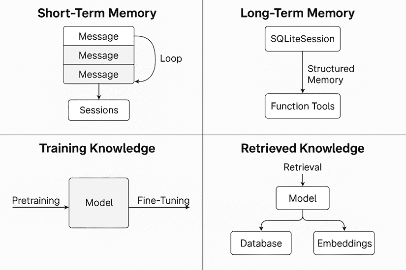

图 5.1：记忆与知识模式

在本章结束时，你将学会如何让智能体（agents）更智能，并能够进行有意义的对话、记住偏好并在需要时访问外部数据源。让我们开始吧。

## 技术要求

请遵循第三章中的详细步骤设置你的环境。

在本书中，每个章节的实用示例和完整代码将通过附的 GitHub 仓库提供：[`github.com/PacktPublishing/Building-Agents-with-OpenAI-Agents-SDK`](https://github.com/PacktPublishing/Building-Agents-with-OpenAI-Agents-SDK)。

鼓励你克隆该仓库，复用并调整提供的代码示例，并在阅读章节时根据需要参考它。

## 工作内存

正如之前讨论的，`working memory`（也称为`短期记忆`）是存储在 AI 智能体当前会话交互历史中的信息。我们之前给出的例子是：工作内存让你能够先问“太阳有多热？”，然后问“它有多大？”，而智能体可以确定第二个请求中的“它”指的是太阳。

到目前为止，所有的 AI 智能体都没有通过这个测试；它们对记忆一没有任何概念。事实上，到目前为止，所有的 AI 智能体都是`stateless`（无状态）的，这意味着它们不会保留来自之前交互的任何信息。每个智能体都被视为一个完全全新的系统，对之前发生过的事情没有任何记忆。无状态系统在大多数计算机系统中很常见。例如，大多数 API 作为一个独立且隔离的事务运行（它们不会记住你之前问过什么，也不会用此决定下一次输出）。`Stateful`（有状态）系统则是相反的；它们维护之前交互的信息并用它产生未来的输出。例如，你的 Netflix 页面是有状态的：它记得你之前看过的的内容并推荐类似的电影。记忆让 AI 智能体从无状态系统变为有状态系统。

如何在无状态和有状态的 AI 智能体之间选择？这取决于它的用途。对话型 AI 智能体（即聊天机器人）需要多步输入或在回答中需要上下文，因此必须是有状态的系统。例如，一个没有记忆的聊天机器人会让用户感到非常沮丧。另一方面，如果 AI 智能体的用途是简单的、常规的、单次的、重复的且不学习的，那么无状态系统就可以了。请注意，创建有状态的 AI 智能体是有成本的：管理内存的开销，本章的一半内容都在致力于此。

## 管理输入和响应

给智能体提供记忆最基本的方法是手动操作。记得智能体是通过 `Runner` 类执行的，该类接受一个 `input` 参数：

```
Runner.run_sync(agent, "How hot is the sun?")
```

`input` 参数可以是字符串（这是我们目前为止所做的），也可以是 `ResponseInputItem` 对象的列表。`ResponseInputItem` 对象是跟踪消息的 OpenAI 标准规范。每条消息都有一个 `"role"` 和一个 `"content"` 字段。如果你以前用过 OpenAI API，那么这对你来说应该很熟悉。以下是一个 `ResponseInputItem` 对象的示例：

```
{"role": "user", "content": "How hot is the sun?"}
```

`"role"` 字段可以取三个可能的值：

*   `"system"`：作为 LLM 整体指令集的作用的消息
*   `"user"`：用户提交的消息，其优先级低于系统消息
*   `"assistant"`：由 LLM 生成的消息

为了给智能体提供记忆，我们可以简单地将 `ResponseInputItem` 对象添加到运行中的列表中，并在每次调用智能体时将该列表传递给 `Runner` 类。让我们测试一下。创建一个名为 `memory_tracking_messages_simple.py` 的新文件并运行以下代码：

```python
from agents import Agent, Runner
### 创建智能体
agent = Agent(
    name="QuestionAnswer",
    instructions="You are an AI agent that answers questions.",
)
# 创建空列表（这将包含消息）
messages = []
### 初始消息
messages.append({"role": "user", "content": "How hot is the sun?"})
### 调用智能体
result = Runner.run_sync(agent, messages)
print(result.final_output)
# 将响应添加到消息列表
messages.append({"role": "assistant", "content": result.final_output})
# 将第二个问题添加到消息列表
messages.append({"role": "user", "content": "How big is it?"})
### 调用智能体
result = Runner.run_sync(agent, messages)
print(result.final_output)
```

 **快速提示**：使用 **AI Code Explainer** 和 **Quick Copy** 功能增强你的编码体验。在下一代 Packt Reader 中打开此书。点击 **Copy** 按钮 (**1**) 快速快速将代码复制到你的编码环境中，或点击 **Explain** 按钮 (**2**) 让 AI 助手向你解释一段代码。


 **下一代 Packt Reader** 随书免费赠送。


让我们浏览这段代码段，看看智能体在处理第二条消息时如何记住用户的第一条消息。我们首先创建名为 `messages` 的空列表，它将包含历史。然后我们添加了用户的第一个消息：“太阳有多热？”这条消息被传递给 `run_sync()` 函数，模型给出了温度相关的回答。该答案存储在 `result.final_output` 变量中，我们随后将其添加回消息历史，但这次标记为 `"assistant"` 角色，因为它是模型的输出。接下来，我们添加了用户的后续问题：“它有多大？”此时，消息历史有三项：

*   原始问题（太阳有多热？）
*   模型的响应
*   用户的第二个问题（它有多大？）

通过再次将整个消息列表传递给 `run_sync()` 方法，模型可以获取之前的对话内容，并能够正确确定第二个问题中的“它”指的是第一条消息中的“太阳”。我们的响应看起来如下：

```
## 第一条响应
太阳的温度在不同区域有所不同：
1. **核心**：约 1500 万摄氏度（2700 万华氏度）。
2. **表面（光球层）**：约 5500 摄氏度（9932 华氏度）。
3. **日冕**：范围在 100 万到 300 万摄氏度之间（180 万到 540 万华氏度）。
核心是发生核聚变的地方，产生太阳的能量，而日冕是外层大气，温度惊讶地比表面高得多。
## 第二条响应
太阳的直径约为 139 万公里（864 万英里）。它大约是地球直径的 109 倍，占据太阳系总质量的 99% 以上。
```


我们实际上可以让之前的代码段变得更加动态，使得用户消息不再是硬编码的，并且用户能够提交多条消息，就像真实的聊天一样。

为了实现这一点，我们可以使用 Python 原生的 `input` 和 `while` 循环功能。创建一个名为 `memory_tracking_messages_simple_loop.py` 的新文件并运行以下代码：

```python
from agents import Agent, Runner
### 创建 agent
agent = Agent(
    name="QuestionAnswer",
    instructions="You are an AI agent that answers questions.",
)
messages = []
while True:
    question = input("You: ")
    messages.append({"role": "user", "content": question})
    result = Runner.run_sync(agent, messages)
    print("Agent: ", result.final_output)
    messages.append({"role": "assistant", "content": result.final_output})
```

该程序会向你索要一个提示词（prompt），你可以直接在运行 Python 程序的终端中输入。它随后会给出 agent 的响应并询问你下一个提示词，同时维护其消息历史。现在，我们已经将 agent 从单次交互系统转变为可以记住之前消息的多轮对话系统（假设在同一个会话中）。我们通过添加循环来实现，在每次迭代中都会发生以下操作：

- 用户输入提示词。
- 提示词作为 `ResponseInputItem` 对象添加到名为 `messages` 的运行中的 `ResponseInputItem` 对象列表中。
- `messages` 对象通过 `Runner` 类传递给 agent。
- 模型输出作为 `ResponseInputItem` 添加到 `messages` 中。

此循环会一直持续，直到遇到错误或用户强制退出程序（通过点击 `Ctrl` + `C`）。这里是一个对话示例，证明 agent 具有记忆（因为它记得我在第一次对话中提到的名字）：

```
You: My name is Henry
Agent: Nice to meet you, Henry! How can I assist you today?
You: What's my name?
Agent: Your name is Henry.
```

### Note

你可能会好奇，如果 `messages` 列表无限增长会怎样？这最终不会变成一个问题吗？这是一个很好的问题，是的，消息历史的增长是需要考虑的。别担心，我们将在本章的晚些时候介绍处理该问题的策略。

SDK 还提供了一个从 `result` 对象返回消息列表的函数，让手动对话管理变得更加容易。`result.to_input_list()` 函数返回一个 `ResponseInputItem` 对象列表，随后你可以向其中添加额外的 `ResponseInputItem` 对象。这使得代码变得整洁了一些（但功能仍然相同），如下所示：

```python
from agents import Agent, Runner
### 创建 agent
agent = Agent(
    name="QuestionAnswer",
    instructions="You are an AI agent that answers questions.",
)
messages = []
while True:
    question = input("You: ")
    messages.append({"role": "user", "content": question})
    result = Runner.run_sync(agent, messages)
    print("Agent: ", result.final_output)
    messages = result.to_input_list()
```

在实践中，这种技术构成了有状态对话代理的基础。从这里开始，可以在上面叠加更高级的记忆技术，以实现跨会话的记忆化、提取结构化数据、调整记忆以及处理大型对话，但一切都始于跟踪对话历史。

## 使用 Sessions 进行对话管理

OpenAI Agents SDK 提供了一种名为 `Sessions` 的对话管理原语。它充当类，允许你自动存储、召回和编辑对话中的消息。这意味着你不需要手动调用 `.to_input_list()` 函数或手动管理对话消息；SDK 会帮你处理好。`Sessions` 类需要一个输入：一个代表会话唯一标识符的字符串，称为 `session_id`。

让我们修改之前的脚本并为其添加会话。创建一个名为 `conversations_with_sessions.py` 的新文件并运行以下代码：

```python
from agents import Agent, Runner, SQLiteSession
### 创建 agent
agent = Agent(
    name="QuestionAnswer",
    instructions="You are an AI agent that answers questions.",
)
### 创建会话
session = SQLiteSession("first_session")
while True:
    question = input("You: ")
    result = Runner.run_sync(agent, question, session=session)
    print("Agent: ", result.final_output)
```

运行这段代码后（如你所见，它要简单得多），让我们再次尝试我们的测试用例：

```
You: My name is Henry
Agent: Nice to meet you, Henry! How can I assist you today?
You: What's my name?
Agent: Your name is Henry.
```

在这种情况下，对话历史通过 `Sessions` 类进行管理。与其手动添加消息或调用 `.to_input_list()`，不如说 `session` 对象在后台跟踪整个交互历史。

`Sessions` 在管理多个用户或对话时特别有用。通过为每个交互线程使用唯一的 `session_id` 值，代理 可以维护独立的内存上下文。例如，你可能根据用户名和对话 ID 生成 `session_id` 值，确保每个用户或对话都有自己相互隔离的历史。

这为构建真正有状态的代理奠定了基础。请注意，`SQLiteSession` 默认情况下是内存中的（不跨重启持久化）。我们将在*长期记忆*部分讨论如何将会话持久化到磁盘。但在之前，我们必须解决大型线程的问题。

## 管理大型对话

为什么管理大型线程对代理 来说是个问题？代理是由 LLM 驱动的。LLM 有一个核心问题是**上下文窗口**（即 LLM 一次只能接收和处理特定数量的字符或“标记”）。如果对话持续进行，简单地追加每条消息最终会达到这个限制，此时提示词变得过大而无法处理。

然而，即使没有这个技术限制，管理大型对话线程也是重要的。长提示词和上下文会显著降低速度并增加成本。因此，通过丢弃或压缩旧信息来管理短期记忆很重要。我们将讨论两种解决此问题的模式：滑动窗口和消息总结。

### 滑动窗口

**滑动窗口**是最简单且成本效益最高的记忆策略。它通过仅保留消息日志中最近的 *N* 条消息来工作，作为一个先进先出的（**FIFO**）队列。随着新消息到来，旧消息会被丢弃，确保提示词保持在模型的限制范围内。

这种方法适用于只需要短期记忆的代理，例如专注于解决单个查询线程的客户服务代理，但它确实存在忘记会话早期引入的重要信息的风险。例如，如果用户在对话早期分享了关键信息（如姓名、目标或限制），而窗口大小太小，代理 可能会完全丢失这些信息。

### 消息总结

更高级的策略是**消息总结**，这意味着这种方法不是遗忘旧消息，而是将它们压缩成一个在整个会话期间持续的简要摘要。这允许代理在长对话中保留关键事实、决策或用户偏好，实际上桥接了短期和长期记忆。

总结通常涉及以下内容：


*   持续监控消息历史的大小，如果超过特定阈值，则收集最旧的 `N` 条消息。
*   将最旧的 `N` 条消息传递给 LLM，并使用提示词对其总结。
*   在消息日志用最旧的 `N` 条消息替换为摘要后的回复。由于摘要输出的长度小于最旧 `N` 条消息的长度，这有效地缩短了消息日志的上下文窗口。

这种方法允许代理在不超出 token 限制的情况下保留长期上下文。当然，这里的权衡是高昂的成本和延迟，因为每个摘要任务都需要额外额外的 LLM 调用。在实践中，许多代理会结合使用这两种模式：使用滑动窗口移除旧消息，并使用摘要链以压缩的形式保留较早的上下文。

短期记忆的核心在于让代理在单个会话中具备感知能力。使用 OpenAI Agents SDK，通过 `Sessions` 类启用这一点是最直接的。然而，它也存在局限性，要让这种内存具有可扩展性（不超出上下文限制），需要周全策略，例如滑动窗口或消息摘要。

以下是一个滑动窗口模式的示例：

```python
from agents import Agent, Runner
from collections import deque
### 创建代理
agent = Agent(
    name="QuestionAnswer",
    instructions="You are an AI agent that answers questions."
)
# 滑动窗口大小（仅保留最近的 5 条消息）
WINDOW_SIZE = 5
messages = deque(maxlen=WINDOW_SIZE)
while True:
    question = input("You: ")
    messages.append({"role": "user", "content": question})
    # 仅使用最近的 N 条消息运行代理
    result = Runner.run_sync(agent, list(messages))
    print("Agent:", result.final_output)
    messages.append({"role": "assistant", "content": result.final_output})
```

接下来，我们将探索长期记忆，并查看代理如何跨会话或在长时间保留信息。

### 长期记忆

**长期记忆**是代理在多个会话中很一段时间内记住相关细节的能力。这种“超能力”让代理能够跨多个会话保留和检索信息。它是创建真正具有状态的、个性化的且持久的 AI 体验的基础。这有时被认为是 AI 代理与人类代理之间的终极“障碍”，因为人类代理可以自然地记住重要的事实、偏好或过去的对话，并将它们分配给每一个人，而 AI 代理通常在这方面很困难。

我们之前在单会话的语境讨论过无状态和有状态的区别。这同样扩展到多会话交互。没有长期记忆的代理在会话之间本质上是无状态的。没有长期记忆的 AI 代理无法记住用户名、过去的偏好或已完成的任务等信息，即使在关闭或重启后也是如此。例如，如果用户告诉客户服务代理“我更希望我的订单发送到后门而不是前门”，然后在一周后返回，具备长期记忆的代理可以主动将所需的送货方式设置为“后门”。

让代理拥有长期记忆的关键在于**记忆存储与检索**。这是将代理的记忆存储在持久化状态中，以便日后检索的想法。有很多不同的模式可以实现这一目标，我们将在本节中介绍。

## 持久化消息日志

建立长期记忆最简单的模式也是最直观的：只需在代理会话结束时将消息日志的全部内容存储在某处，然后在代理重启时检索它。Agents SDK 提供了一种实现此功能的机制，使用了之前讨论过的 `Sessions` 类（`SQLiteSession`）。该类不仅可以接受会话 ID，还可以接受 `db_path` 参数，可以在其中输入计算机上的文件位置，它将自动保存并加载消息日志到本地机器的 SQL 数据库。

让我们来看一个示例。创建一个名为 `ltm_sessions.py` 的新 Python 文件并运行以下代码：

```python
from agents import Agent, Runner, SQLiteSession
### 创建代理
agent = Agent(
    name="QuestionAnswer",
    instructions="You are an AI agent that answers questions.",
)
### 创建会话
session = SQLiteSession("first_session", db_path="messages.db")
while True:
    question = input("You: ")
    result = Runner.run_sync(agent, question, session=session)
    print("Agent: ", result.final_output)
```

在这种情况下，我们为 `session` 对象添加了 `db_path` 参数，这告诉 Agents SDK 将对话存储在我们的本地机器，并在代理重新实例化时再次加载对话。我们可以通过运行程序、传递信息、退出程序、再次运行程序并查看代理是否记得这些信息来测试这是否有效。

让我们运行程序并告诉代理我们的名字：

```text
You: Hello, I'm Henry
Agent: Hi Henry! What would you like to talk about today?
```

接下来，点击 `Ctrl` + `C` 退出程序。之后，重新运行程序并询问我的名字：

```text
You: What's my name?
Agent:  You mentioned your name is Henry. How can I assist you further?
```

通过这种方式，我们创建一个具有长期记忆的代理。它还会记住你如何与它交互，因为它在你的本地机器上存储了消息日志，并在每次启动程序时加载它。你可能会在运行代码的根目录下看到一个 `messages.db` 文件；这就是保存消息日志的地方。使用内置 `session` 对象进行持久化的用处是它是无缝的，换句话说，你不需要为存储聊天记录实现自己的文件格式或数据库模式。然而，这种模式确实有一些明显的局限性，即随着会话数量或对话长度的增加，存储和加载完整的消息日志可能会变得效率低下。此外，正如我们之前讨论的，消息日志可能会膨胀到 LLM 因为上下文窗口限制而无法再次处理。

## 结构化记忆检索

**结构化记忆检索**利用工具调用（tool-calling）来解决代理记忆问题。具体来说，这种模式关注以下概念：

*   代理不是存储每一条消息，而是访问一个工具，只存储用户共享的重要信息
*   代理不是加载每一条消息，而是访问一个工具，只检索并加载相关的片段信息

这样，代理在某个会话中的提示词和消息日志就可以保持整洁，但如果模型认为它应该咨询长期记忆（例如，用户询问“之前”或在过去的会话中提到的内容），它就可以调用该函数来获取相关信息。

让我们来看一个示例。创建一个名为 `ltm_structured_memory_call.py` 的新 Python 文件。首先，我们将初始化内存文件。在这里我们检查是否已存在 JSON 文件。如果没有，我们将创建一个带有默认结构：


```python
from agents import Agent, Runner, function_tool
import os
import json
### 如果 JSON 文件不存在，则创建
FILENAME = 'memory.json'
memory_default = {
    "user_profile": [],
    "order_preferences": [],
    "other": []
}
if not os.path.exists(FILENAME):
    with open(FILENAME, 'w') as f:
        json.dump(memory_default, f, indent=4)
        print(f"Created '{FILENAME}' with default data.")
else:
    print(f"'{FILENAME}' already exists.")
```

接下来，我们将定义一个用于保存记忆片段的工具。此函数允许智能体在 JSON 文件中存储重要事实：

```python
@function_tool
def save_memory(memory_type: str, memory: str) -> str:
    """
    将记忆保存到记忆存储中。
    Args:
        memory_type: 要存储的记忆类型。在 user_profile, order_preferences 或 other 之间选择。
        memory: 要保存的记忆
    """
with open(FILENAME, 'r') as f:
        data = json.load(f)
    data[memory_type].append(memory)

    with open(FILENAME, 'w') as f:
        json.dump(data, f, indent=4)
    print(f"Memory ({memory}) saved")
    return f"Memory ({memory}) saved"
```

我们还会创建一个加载记忆的函数。此函数从 JSON 记忆存储器中检索相关事实：

```python
@function_tool
def load_memory(memory_type: str) -> str:
    """
    从记忆存储中加载一组记忆。
    Args:
        memory_type: 要加载的记忆类型。在 user_profile, order_preferences 或 other 之间选择。
    """
with open(FILENAME, 'r') as f:
        data = json.load(f)
    return "|".join(data[memory_type])
```

最后，我们创建智能体，赋予其访问工具的权限，并运行交互循环：

```python
### 创建智能体
agent = Agent(
    name="QuestionAnswer",
    instructions="你是一个回答问题的 AI 智能体。你可以访问两个工具，允许你保存和加载记忆。当你学到一个重要事实时，请保存记忆。当问及关于用户的问题时，请加载记忆。",
    tools=[save_memory, load_memory]
)
while True:
    question = input("You: ")
    result = Runner.run_sync(agent, question)
    print("Agent: ", result.final_output)
```

让我们分析一下这段代码中发生了什么，从保存和加载记忆的两个函数工具开始。

`save_memory` 函数允许智能体在特定类别下（如 `user_profile` 或 `order_preferences`）存储重要事实。该函数将信息写入本地 `memory.json` 文件，并将新信息片段追加到相关部分。例如，如果用户说：“*我更倾向于前门送货*”，智能体可以调用 `save_memory("user_profile", "Prefers deliveries through the front door")`，该事实将被添加到持久化存储中。在这种情况下，持久化存储仅仅是一个本地 JSON 文件，但也可以同样轻松作为数据库。

另一方面，`load_memory` 函数旨在检索之前存储的事实。当用户引用之前对话中的偏好或细节时，例如问道：“*我的送货偏好是什么？*”，智能体可以调用 `load_memory("order_preferences ")` 来从该类别中获取并总结相关的存储事实。

这些函数为智能体提供了一种结构化且轻量级的长期记忆机制。智能体并不存储完整的消息转录，而是保留重要且可重用的提炼见解。这比保留每一条消息日志具有更强的扩展性。它也符合人类思考记忆的方式。想象一下，你和朋友聊天，他们告诉你有*他们喜欢吃寿司*。在这种情况下，你不会简单地记住整个对话转录。相反，你只是“记录”了*他们喜欢寿司*这个重要信息，并将其“存储”在你的记忆中。

让我们通过示例来尝试。运行代码后，输入以下内容：

```
You: I like to have orders sent to the office
Memory (User prefers orders to be sent to the office.) saved
Agent: Got it! I'll remember that you prefer to have orders sent to the office.
```

智能体识别出这是一个有用的偏好，将调用 `save_memory` 工具。如果你打开 `memory.json`，甚至可以看到这一点：

```json
{
    "user_profile": [
    ],
    "order_preferences": [
        "User prefers orders to be sent to the office."
    ],
    "other": []
}
```

现在，退出当前会并重新运行之前的 Python 程序开启新会，然后询问智能体我们的偏好：

```
You: Where do I like my orders sent?
Agent: You like your orders sent to the office.
```

在这种情况下，智能体调用了 `load_memory` 工具来检索 `order_preferences` 下的所有记忆。它找到了相关信息并提供了正确的回答。

这种结构化的长期记忆方法更具扩展性、语义上更精确，并且避免了超出上下文窗口限制的陷阱。它为更高级的记忆系统奠定了基础，在这些系统中，事实可以被嵌入和索引。

**注意**

我们在这里实现的结构化记忆模式对于简单场景简单有效。然而，随着你的智能体随时间积累更多事实（或者如果你需要支持模糊搜索），这种基础的键值方法可能会变得局限。这就是向量数据库和语义嵌入大显用场的地方。与其将事实存储在 JSON 文件中，你可以将每个记忆表示为向量，并进行语义搜索。我们稍后会讨论这一概念。

当你构建更复杂的智能体时，你可能希望结合这些长期记忆模式（持久消息日志和结构化记忆），而 OpenAI SDK 足够灵活同时支持两者。

### 训练知识

如所述，**训练知识**指的是通过训练数据固有存储在模型中的信息。每个大语言模型（LLM）最初都带有源自其初始训练的海量数据集（通常是大型文本语料）。模型拥有固有知识的好处在于知识本身具有以下优势：

- **检索速度快**：由于固有知识固化在模型权重中，模型可以非常快速地检索信息，仅限于 LLM 的计算速度。
- **覆盖范围广**：由于训练数据是海量的（互联网语料），固有知识可以非常详细地涵盖许多主题。

改变模型固有知识的过程被称为**微调**（fine-tuning）。与引导模型现有知识的提示或检索技术不同，微调通过在精选的数据集上重新训练模型来直接重塑模型。此过程更新了模型的权重，使其能够采用以前无法良好处理的新术语、模式或行为。结果是一个在特定领域或任务上更专业、更准确的模型。

让我们以医疗领域为例。像 GPT-4o 这样的通用型 LLM 可能理解广泛的健康主题，但在被要求解释复杂报告或根据细致指南建议治疗方案时，可能会表现不从心。通过在结构化患者记录和医生笔记的数据集上对模型进行微调，我们可以创建一个定制的模型，能够回答更细致的健康问题。


微调适用于医学等领域，在这些领域中领域知识至关重要，准确性直接影响结果。然而，它存在一些严重的局限性和缺点：

* `计算密集型（且昂贵）`：微调需要大量的计算资源和 GPU 时间，特别是在处理高容量模型时。虽然市场上有一些微调服务选项，但即使是它们也可能贵得令人接受（通常训练一个模型的成本从 10,000 美元起，这还不包括托管模型的费用）。
* `缺乏灵活性`：一旦模型完成微调，它就必须与“基础”模型分开维护。当新知识出现或基础模型更新时，整个微调过程必须重新开始。

* `知识混合`：在微调时，加入的知识可能会“混合”或反驳模型最初训练时使用的其他信息。结果是模型可能会变得困惑，并在优先考虑其训练数据中的信息时提供自矛盾的陈述。从技术上讲，无法保证 `LLM` 会优先考虑其经过微调的信息。

因此，对于许多实际应用，特别是那些不需要如此严格的领域控制的应用，使用替代方案（如提示工程或检索增强生成）通常更高效，我们将在接下来讨论这些。

### 检索知识

如前所述，`retrieved knowledge`指的是根据用户请求从知识库中实时检索的信息。与训练知识（在模型训练时是静态且固定的）不同，检索到的知识对于对话上下文是动态的。其模式如下：

1. 用户提出一个需要外部知识的问题。
2. 代理系统从知识源检索与该问题相关的数据。这是通过工具调用实现的，工具调用可以搜索数据库、文本文件、嵌入文档的向量存储、搜索引擎 API 等。
3. 然后将检索到的信息输入到 `LLM` 中。
4. `LLM` 生成一个结合或基于检索到的信息的答案。

这会将外部知识整合到代理中。在这种语境下，“外部”知识指的是任何并非本质上存储在模型训练权重中的信息。

回想，我们已经在`第 4 章`中中创建了利用检索知识的代理。在我们创建的许多示例代理中，我们使用了为用户检索相关信息的工具。例如，这里是我们创建的一个在被提问时会检索比特币价格的代理：

```python
import requests
from agents import Agent, Runner, function_tool
### 创建工具
@function_tool
def get_price_of_bitcoin() -> str:
    """获取比特币价格."""
    url = "https://api.coingecko.com/api/v3/simple/price?ids=bitcoin&vs_currencies=usd"
    response = requests.get(url)
    price = response.json()["bitcoin"]["usd"]
    return f"${price:,.2f} USD."
### 创建代理
crypto_agent = Agent(
    name="CryptoTracker",
    instructions="你是一个加密货币助手。使用工具获取实时数据。",
    tools=[get_price_of_bitcoin]
)
# 使用示例提示运行代理
result = Runner.run_sync(crypto_agent, "What's the price of Bitcoin?")
print(result.final_output)
```

这里是另一个从数据库中检索知识的示例：

```python
from agents import Agent, Runner, function_tool
from pydantic import BaseModel
from typing import List
### 创建模拟数据库
TICKETS_DB = {
    "henry@gmail.com": [
        {"id": "TCKT-001", "issue": "Login not working",
            "status": "resolved"},
        {"id": "TCKT-002", "issue": "Password reset failed",
            "status": "open"},
    ],
    "tom@gmail.com": [
        {"id": "TCKT-003", "issue": "Billing error",
            "status": "in progress"},
    ]
}
### 定义 Pydantic 模型
class CustomerQuery(BaseModel):
    email: str
### 定义执行数据库查询的工具
@function_tool
def get_customer_tickets(query: CustomerQuery) -> str:
    """根据邮箱检索客户最近的工工单."""
    tickets = TICKETS_DB.get(query.email.lower())
    if not tickets:
        return f"No tickets found for {query.email}."
    response = "\n".join(
        [f"ID: {t['id']}, Issue: {t['issue']}, Status: {t['status']}"
  for t in tickets]
    )
    return f"Tickets for {query.email}:\n{response}"
### 创建代理
support_agent = Agent(
    name="SupportHelper",
    instructions="你是一个客户支持代理。在被问及其工单时，使用工具获取用户的支持历史。",
    tools=[get_customer_tickets]
)
### 运行代理
result = Runner.run_sync(support_agent, "Can you show me the ticket history for henry@gmail.com?")
print(result.final_output)
```

这两个示例都遵循了我们之前提出的模式，如下：

1. `用户发起请求且代理检索信息`：在两个示例中，用户都提出了一个超出其训练范围的问题。这包括实时数据（例如比特币价格）或用户特定信息（例如支持历史）。代理检测到它无法通过内置知识回答问题。它调用了检索工具：
* 在 `CryptoTracker` 示例中，代理使用对 `Gecko API` 的 HTTP 调用
* 在 `SupportHelper` 示例中，代理根据电子邮件地址执行模拟数据库查询
2. `检索外部知识`：工具以结构化格式（例如 API 的 JSON 响应，或数据库中的工单列表）检索相关信息，并将检索到的数据传回模型。
3. `LLM 整合信息`：然后 LLM 使用这些输入生成一个反映该知识的自然语言回复。


在我们继续之前，请注意，我们将对该主题进行简化的概述，而不是讨论其背后深且复杂的数学概念。若要从更详细的角度了解嵌入（embeddings）的工作原理，请参考此书：[`www.packtpub.com/en-mx/product/vector-search-for-practitioners-with-elastic-9781805121022/chapter/chapter-1-introduction-to-vectors-and-embeddings-2/section/chapter-1-introduction-to-vectors-and-embeddings-ch02lvl1sec02?srsltid=AfmBOoqKY6Vgqv9_MDNW5p4mDEXQBdQXQWFt9fRFM63RMebJWEWx8ide`](https://www.packtpub.com/en-mx/product/vector-search-for-practitioners-with-elastic-9781805121022/chapter/chapter-1-introduction-to-vectors-and-embeddings-2/section/chapter-1-introduction-to-vectors-and-embeddings-ch02lvl1sec02?srsltid=AfmBOoqKY6Vgqv9_MDNW5p4mDEXQBdQXQWFt9fRFM63RMebJWEWx8ide)。

首先，让我们定义一下术语。

`Embeddings`（嵌入）是文本的数值表示。将其想象为一种秘密语言，其语法是数字列表，且只有机器能理解。这些嵌入捕捉了单词、句子甚至整篇文档的精髓。例如，以下句子的嵌入列如下所示（这仅用于说明）：

| **Sentence** | **Embedding** |
| :--- | :--- |
| I like apples | `[3432, 75, 32, …, 76, 980]` |
| I like bananas | `[85, 1, 4, …, 695, 47]` |
| This is very difficult | `[5, 596, 1254, …, 7, 1]` |
| This is like fitting a square peg into a round hole | `[5, 4, 365, …, 748, 9]` |

表 5.1：示例嵌入

由于嵌入捕捉了文本的“意义”或“精髓”，两个关于相同主题或含义相似的文本将产生非常相似的向量。例如，`I like apples` 的嵌入与 `I like bananas` 的嵌入相比，会比与随机内容（如：`All legislative Powers herein granted shall be vested in a Congress of the United States, which shall consist of a Senate and House of Representatives`）更相似。这就是语义搜索大显武的地方。

`Semantic search`（语义搜索）通过使用语义含义（换句话说，即比较它们的嵌入）而不是比较关键词来比较两段文本的过程。我们通过计算两个嵌入在向量空间中的距离来比较它们，这被称为 `cosine similarity`（余弦相似度）。`Cosine similarity` 衡量两个向量之间角度的余弦值，结果是一个 0 到 1 之间的数字。

数学原理在这里并不重要；其含义是：余弦相似度越高，两个文本的语义关系就越紧密：

*   `Cosine similarity close to 1`：文本非常相似，或具有相似的上下文或含义
*   `Cosine similarity close to 0`：文本不相关

以下是不同文本嵌入之间的余弦相似度：

| **Test** | **Base text** | **Comparison text** | **Cosine similarity of embeddings** |
| :--- | :--- | :--- | :--- |
| 1 | I like apples | I like bananas | `0.90` |
| | | All legislative Powers herein granted shall be vested in a Congress of the United States, which shall consist of a Senate and House of Representatives | `0.71` |
| 2 | This is very difficult | I’m fitting a square peg into a round hole | `0.88` |
| | | All legislative Powers herein granted shall be vested in a Congress of the United States, which shall consist of a Senate and House of Representatives | `0.64` |

表 5.2：不同文本嵌入之间的余弦相似度表

在表表中，你可以看到，通过余弦相似度，文本 `I like apples` 与文本 `I like bananas` 的语义相似性高于其与《美国宪法》摘录的相似性。`This is very difficult` 与 `I’m fitting a square peg into a round hole` 的情况也是如此。在这个例子中，这两段文本没有任何关键词，但它们在语义上是相似的，因此具有非常高的余弦相似度分。

最后，我们有 `vector stores`（向量存储），它们仅仅是针对存储文本及其嵌入而优化的数据库。简单的数据库可能存储类似表格结构的数据，而向量存储存储的是这些大型嵌入向量。向量存储还有另一个特殊属性：当新文档添加到向量存储中时，数据库会自动将文本 `chunks`（分块）为较小的片段，为每个块生成嵌入，并对其进行 `indexes`（索引，即与支持快速检索的字典一起存储），以便进行快速相似搜索。这种 `chunk and index step` 是启用语义搜索所。每个块通常包含数百个 token 的文本，并使用专用模型进行嵌入。

现在我们理解了这些术语，让我们讨论一下在对非结构化数据执行 RAG 模型时，这一切是如何工作的：文档摄取和检索。

### 文档摄取 (Document ingestion)

在我们检索任何内容之前，首先需要准备知识库。这涉及到将原始文本转换为适用于语义搜索的格式。摄取过程通常如下：

1.  `Chunking`（分块）：原始文档被分成较小的片段（块）。
2.  `Generate embeddings`（生成嵌入）：每个块通过嵌入模型生成向量。
3.  `Store in a vector store`（存储在向量存储中）：这些嵌入及其关联的块存储在已索引的向量存储中。

### 检索 (Retrieval)

一旦文档摄取，我们就有了所需的。根据查询动态检索数据的过程如下：

1.  `Embed the query`（嵌入查询）：当用户提交问题时，系统首先使用相同的嵌入模型将查询转换为嵌入。
2.  `Perform a semantic search`（执行语义搜索）：向量存储使用 `cosine similarity` 将查询嵌入与块嵌入进行比较。此步骤通常返回前 *N* 个语义相关的块。

之后，由之前描述的 `augment` 和 `generate` 步骤接。区别在于在 `retrieve` 步骤中，输出是语义相似的块，而不是 API 调用的加密货币价格或数据库查询的状态。

### 在 Agents SDK 中使用向量存储和 FileSearchTool

幸运的是，OpenAI Agents SDK 自动处理非结构化文本的 RAG 过程，涵盖文档摄取和检索部分，因此你不需要手动操作。让我们通过一个示例，首先创建一个向量存储：

1.  访问平台 [`platform.openai.com/`](https://platform.openai.com/) 并登录。
2.  从右上角选择 `Dashboard`，然后选择 `Storage`，再切换到 `Vector stores`。
3.  选择 `Create` 创建新的向量存储。输入向量存储名称 `USConstitution`。
4.  滚动并并通过 `+ Add files` 向向量存储添加文件。
5.  上传 `USConstitution.txt` 文件（可以在仓库的第五章 下找到）。将其命名为 `USConstitution.txt` 并为 `Purpose` 选择 `user_data`。然后，选择 `Attach`。


4. 我们上传的 TXT 文件现在已成功添加到我们的新的向量存储库中，所有启用 RAG 的相关操作（如生成嵌入、索引等）都已完成。

5. 复制并保存你刚刚创建的新的向量存储库 ID。

既然我们已经创建了向量存储库，让我们使用 Agents SDK 通过 `FileSearchTool` 进行检索，我们在上一节中详细介绍过该工具。提醒一下，该类接受向量存储库 ID 列表作为输入，它会自动搜索并检索正确的分块，然后将其传递给 LLM 进行增强。使用我们在上一节中构建的向量存储库，我们可以构建一个通过引用 `USConstitution` 文件来回答问题的智能体。

创建一个名为 `us_constitution_agent.py` 的新 Python 文件并运行以下代码：

```python
from agents import Agent, Runner, FileSearchTool, SQLiteSession
### 实例化工具
filesearchtool = FileSearchTool(
    vector_store_ids=['vs_687ed4bb479c81919b530ab152f373d8']
) # 替换为你自己的向量存储库 ID
### 创建智能体
agent = Agent(
    name="USConstitutionTool",
    instructions="你是一个 AI 智能体，回答来自列出的向量存储库的问题，其中包含《美国宪法》。用一句话回答。",
    tools=[filesearchtool]
)
### 创建会话
session = SQLiteSession("first_session")
while True:
    question = input("You: ")
    result = Runner.run_sync(agent, question, session=session)
    print("Agent: ", result.final_output)
```

运行此程序后，你可以提问任何问题，智能体将对其给定的向量存储库执行 RAG 以回答问题，例如所示：

```
You: 议员需要多大年龄？
Agent:  议员必须至少 30 岁。
```

事实上，你可以通过进入该智能体运行的 `Traces` 模块查看 RAG 搜索返回的所有分块：

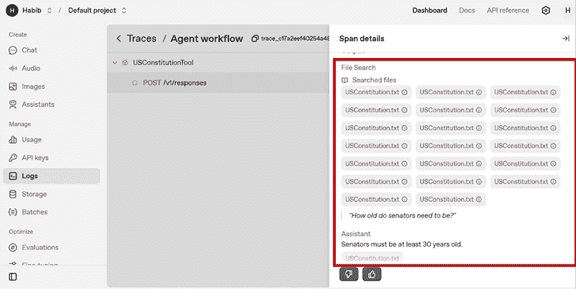

图 5.3: OpenAI Dashboard logs

通过这种方式，Agents SDK 自动化了文档摄取和检索过程，让你只需几行代码即可为智能体添加检索知识的能力。然而，了解背后正在发生什么仍然有用，这样你就能理解该过程及其局限性。

## 局限性

为智能体添加检索知识具有某些局限性和陷阱，特别是使用非结构化数据时。以下是非结构化数据可能出现的三个最常见问题：

* **问题模糊**：如果用户问“你们的退货政策是什么？”，他们是在询问在线订单、店内退货还是特定产品？这可能导致智能体产生错误的答案。
* **未找到相关信息**：有时知识库中没有答案。此时智能体可能会产生幻觉并胡造内容。
* **冲突或多源信息**：如果来自 `retrieval` 步骤的信息不一致（例如，两个文档说不同的退货窗口），智能体可能会忽略其中一个。

总的来说，构建任何基于知识的智能体意味着要注意上述陷阱，并理解即使是最好的 AI 智能体也可能陷入其中。与任何依赖于真实世界信息的系统一样，可能会出现间隙、矛盾或误解。然而，由于具备了记忆和知识，我们现在拥有了一个强大得多的智能体：它记得上下文并可以引入外部事实，使其成为一个强大的智能体。

# 总结

在本章中，我们为智能体配备了两个实用的技能集，使其变得更加智能：记忆和知识。

我们首先实现了短期记忆，手动跟踪消息历史，并使用 `Sessions` 类支持多轮对话。我们通过引入滑动消息窗口和消息摘要技术，解决了上下文窗口增长的挑战。

接下来，我们探索了长期记忆。我们使用带有文件支持的数据库的 `SQLiteSession` 使智能体记忆在会话之间保持持久化，并通过工具调用（tool-calling）引入了结构化记忆召回。这种方法使智能体只存储最相关的事实，在减少内存膨胀的同时提高了召回准确性。

然后我们查看了两种不同类型的模型知识：

* **训练知识**：在模型初始训练期间“刻入”到模型中的静态信息。
* **检索知识**：在运行时通过工具调用获取的动态的、特定于语境的数据。我们探索了 RAG 模式，即智能体从 API、数据库或知识库中提取外部数据，并将其输入 LLM 以生成知情的响应。

通过这些模式，你的智能体现在可以持有记忆、保留用户特定的上下文，并根据需要引入相关知识，使其在真实世界应用中的真正实用性更近了一步。

在下一章中，我们将重点转向多智能体系统，其中多个专门的智能体可以协作完成更复杂的任务。

| 立即解锁此书的专属福利 | 扫描此二维码或访问 [`packtpub.com/unlock`](https://packtpub.com/unlock)，然后按书名搜索此书。 |  |
| **注意**：在开始之前准备好你的购买发票。 |

# 6

# 多智能体系统与交接 (Handoffs)

某些任务是个人人类无法完成的。相反，需要一个人类组织（即团队）。想想任何大型公司。这些大企业之所以能够实现目标，是因为不同人类的共同工作。同样，单智能体系统是有局限性的。然而，多智能体系统可以完成任何事情。

虽然智能体可能非常强大，但它有其局限性。当问题跨越领域、需要专业知识或需要并行处理时，单个智能体往往力不从心。例如，一个客服智能体可能很好地处理查询，但当任务涉及财务分析、法律推理或技术故障排除时，它可能会失败。通过将责任分配给多个智能体，你可以获得比单个智能体更高的准确性、扩展性和弹性。

在本章中，我们将探索如何构建多智能体系统，即多个智能体协作工作的系统。无论你是构建一个简单的路由器还是复杂的层次结构，理解智能体如何交互、委托和协作都是释放智能体全部能力的关键。OpenAI Agents SDK 了一个启用多智能体系统的原语：交接（handoff）。

你将在本章学习：

* **编排类型**：我们将首先对比两种多智能体编排策略——确定性（硬编码）和动态（系统驱动），并演示它们的示例。
* **交接 (Handoffs)**：你将学习如何使用 Agents SDK 中的交接功能将控制从一个智能体转移到另一个智能体，允许智能体在保持上下文的同时委托任务。
* **多智能体模式**：最后，我们将探索多智能体系统的架构模式（集中化、去中心化、层次化和群集），并展示如何使用 SDK 实现每模式。

在本章结束时，你将学会如何设计和实现镜像真实团队的多智能体系统。

## 技术要求

请遵循*3 章* 中的详细步骤设置你的环境。


在本本书中，每一章的实用示例和完整代码将通过附带的 GitHub 仓库提供：https://github.com/PacktPublishing/Building-Agents-with-OpenAI-Agents-SDK](https://github.com/PacktPublishing/Building-Agents-with-OpenAI-Agents-SDK)。

鼓励你克隆仓库、重用并适配提供的代码示例，并在学习章节时根据需要参考它们。

## 多智能体编排 (Multi-agent orchestrations)

在构建使用多个代理的系统时，关键决策之一是确定如何管理代理之间的信息和任务流。广而言，你可以采取两种策略：

* **确定性编排（Deterministic orchestration）**：由你自己编写逻辑并显式地控制代理之间的相互作用；参见`图 6.1`：

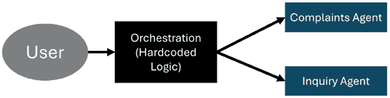

图 6.1：确定性编排

* **动态编排（Dynamic orchestration）**：将流决策交给另一个系统（如 LLM），使系统能够动态调整其行为；参见`图 6.2`：

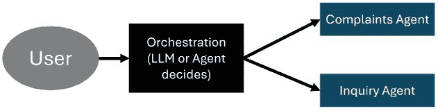

图 6.2：动态编排

在本节中，我们将讨论这两种方法以及各自的优缺点。值得注意的是，许多编排实际上涉及到这两种方法的结合。在智能体系统中，你可能希望它的某些部分是显式确定的，以获得更大的控制和自主性；而你可能又希望其他区域更具动态性，并能更好地处理歧义。

## 确定性编排

**确定性编排**是指不同代理之间的交互流是硬编码的（或是确定的）。这种方法的核心在于对代理如何运行以及何时运行保持控制。在 във设置中，你可以提前定义精确的工作流，通过编码规定由哪些代理处理哪些任务的顺序和规则。一个很好的类比是场编排良好的舞蹈，每一步都经过了计划。没有即兴发挥，代理流绝不会偏离你提供给它们的脚本。

确定性编排的主要优势是可预测性。对于相同的输入，代理流将始终以相同的方式展开，易于测试、审计和调试。由于你确切知道工作流将产生多少代理调用，因此衡量成本和运行时间也很简单。确定性模式在那些需要稳定、可重复的结果，且需要确保不会发生意外情况的系统中特别有用。

与所有确定性系统一样，主要的缺点是灵活性。我们在*第 1 章*中讨论过这一点，但确定性编排模式无法适应代理控制逻辑未显式定义的请求或情况。如果你发现需要新的步骤或想处理新类型的请求，你需要更改并重新部署你的代理逻辑。随着工作流变得越来越复杂，维护所有分支和路径可能会变成负担。

让我们来看一个确定性方法的示例。在这个例子中，我们将通过一个确定性编排模式，使用硬编码逻辑在两个客户服务代理之间路由请求。这将向你展示可预测的、基于规则的委托是如何工作的，以及为什么它既强大又局限。创建一个名为 `deterministic_approach.py` 的新 Python 文件并运行以下代码：

```python
from agents import Agent, Runner
### Create two agents
complaints_agent = Agent(
    name="Complaints Agent",
    instructions="Handle any customer complaints with empathy and clear next steps."
)
inquiry_agent = Agent(
    name="General Inquiry Agent",
    instructions="Answer general questions about our services promptly."
)
# Create orchestration
def orchestrate(user_message: str):
    # Deterministically delegates requests to the right customer service agent.
    if ("complaint" in user_message.lower() 
        or "problem" in user_message.lower()):
        print('Redirecting you to the Complaints agent')
        chosen_agent = complaints_agent
    else:
        print('Redirecting you to the Inquiry agent')
        chosen_agent = inquiry_agent
    result = Runner.run_sync(chosen_agent, user_message)
    return result.final_output
while True:
    question = input("You: ")
    result = orchestrate(question)
    print("Agent: ", result)
```

 **快速提示**：使用 **AI 代码解释器**和**快速复制**功能来增强你的编码体验。在下一代 Packt Reader 中打开此书。点击**复制**按钮 (**1**) 快速将代码复制到你的编码环境中，或点击**解释**按钮 (**2**) 让 AI 助手向你解释一段代码。


 购买此书将免费赠送**下一代 Packt Reader**。扫描二维码 或访问 [packtpub.com/unlock](https://packtpub.com/unlock)，然后使用搜索栏通过名称找到此书。双检显示的版本以确保你获得的是正确的。


在这段代码中，这里是关键要点：

* 确定性编排让你对代理流有完全控制，使其具有可预测性并易于测试。
* 缺点是缺乏灵活性；如果用户以非预期的方式表达，系统可能会误导请求。

调用哪个代理的选择由 `orchestrate` 函数管理，该函数根据用户的内容硬编码了调用哪个代理的逻辑。这是确定的，因为如果用户的问题包含 `complaint`（投诉）或 `problem`（问题），该系统始终重定向到 `complaints_agent`。

这是一个交互示例：

```
You: I have a complaint, my meal was too hot
Redirecting you to the Complaints agent
Agent: 很抱歉听到您的食物太热了。我理解这可能会让人不舒服。为了弥补这一点，我想免费为您提供一份替代餐。此外，请告诉我们您将来希望如何调整食物温度，我们将确保符合您的偏好。还有什么我可以帮您的吗？
```

从这中，可以很清楚地看到这个系统的弱点。用户可能有投诉，但可能没有在信息中实际使用 `complaint` 或 `problem` 词。在这种情况下，用户将会被重定向到错误的代理。以下是这种情况的例子：

```
You: my meal is too hot
Redirecting you to the Inquiry agent
Agent: Try eating in smaller bites.
```

## 动态编排

**动态编排**是指不同代理之间的交互流是动态的，由外部系统自主控制（通常是人类，但在本例中是 LLM）。这提供了一种更灵活的编排模式，因为代理选择和流的责任被交给了另一个由 LLM 驱动的代理。事实上，在本书到为止的几乎所有情况下，我们创建的系统都使用了动态编排，因为一个代理一直在控制如何处理用户的响应（无论是工具调用、调用哪个工具等）。


动态编排的优点和缺点分别对应确定性编排的缺点和优点。灵活性是其主要优势。动态系统可以处理更广泛的对话输入，而无需为每种可能的场景编写硬编码逻辑。只要指令得当，代理（Agents）就可以处理不熟悉的问题并制定新的解决方案，使得这种方法非常适用于客户支持、销售分诊和其他开放式任务。然而，权衡是预测性；你无法总是预先知道对话将采取哪条路径，这可能意味着不可预测的答案、成本和运行时间。

让我们回到之前的示例，并将其转换为动态编排。第一步是创建一个分诊代理（triage agent），它可以根据用户的查询选择调用哪个代理。创建一个名为 `dynamic_approach.py` 的新 Python 文件，并运行以下代码：

```python
from agents import Agent, Runner
### 创建两个代理
complaints_agent = Agent(
    name="Complaints Agent",
    instructions="以同理心和清晰的后续步骤处理任何客户投诉。"
)
inquiry_agent = Agent(
    name="General Inquiry Agent",
    instructions="及时回答关于我们服务的通用问题。"
)
triage_agent = Agent(
    name="Triage Agent",
    instructions="分诊用户的请求并调用合适的代理",
    tools=[
        complaints_agent.as_tool(
            tool_name="ComplaintsAgent",
            tool_description="介绍自己为投诉代理。以同理心和清晰的后续步骤处理任何客户投诉。"
        ),
        inquiry_agent.as_tool(
            tool_name="GeneralInquiryAgent",
            tool_description="介绍自己为通用查询代理。及时回答关于我们服务的通用问题。"
        )]
)
while True:
    question = input("You: ")
    result = Runner.run_sync(triage_agent, question)
    print("Agent: ", result.final_output)
```

在这种情况下，让我们尝试使用一个分诊代理应该解释为投诉的提示词（不使用“complaint”一词），然后相应地发送给 `complaints_agent`：

```
You: 我的食物太热了
Agent: 听到您的食物是这样我很抱歉。我理解这有多么让人意料。您希望我们为您更换食物，还是我可以协助您退款或提供积分？请告诉我您想如何处理。
```

我们可以通过查看 `Traces` 模块来验证它是否已发送到正确的代理：

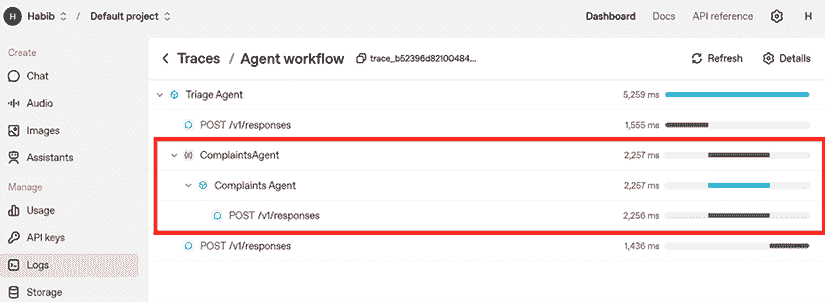

图 6.3: 上一个示例的轨迹

通过这种方式，我们能够将决策过程委托给分诊代理，而不是预先硬编码逻辑。代理解释用户消息背后的意图（识别投诉），并动态决定将消息路由到正确的代理。这使得我们的系统能够更自然、更高效地响应各种输入，而无需使用僵硬的 `if-else` 结构来处理每种可能的情况。

此类编排的另一个优点是它可以处理多个请求。例如，如果用户的请求是“我的食物太热了，我该如何获取收据？”分诊代理将同时调用 `complaints_agent` 和 `inquiry_agent` 来一次性回答该问题：

```
You: 我的食物太热了，我该如何获取收据？
Agent: 以下是我为您提供帮助的方法：
对于热食物：
- 让食物冷却几分钟，期间我们提供一杯免费饮品以帮助平衡。
- 如果问题仍然，我们可以安排更换。请告诉您的偏好！
对于收据：
- 检查您的确认邮件以获取副本。
- 登录我们在网站上的账户，您可以在那里从订单历史中查看并下载。
如果您需要进一步帮助，请随时提问！
```

这是它在 `Traces` 模块中的样子：

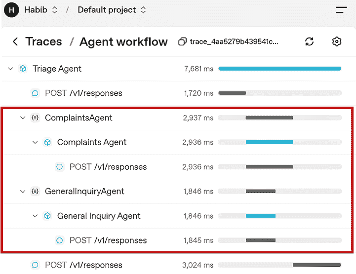

图 6.4: 代理工作流的轨迹示例

这一切都是在代理的推理过程中动态发生的，而不是通过固定的代码分支。我们只定义了代理及其能力；分诊代理的 LLM 负责了决策过程。

## OpenAI Agents SDK 中的交接 (Handoffs)

现在我们已经理解了多代理系统中的不同编排方法，让我们讨论一下 OpenAI Agents SDK 中提供的、使这些可能的构造。SDK 提供的最重要的原语之一是交接（handoffs）。

`handoff` 是代理将控制权传递给另一个代理的机制。它等同于一个代理说：“我要把这项任务交给你。你可以比我回答得更好。这里是所有细节。”在多代理系统中，交接是必要的，因为它是连接不同代理的 `layer`（层）。

### 注意

代理之间交互通常有两种方式，其中一种我们已经在 第 4 章 中详细介绍过，即为 `as_tool()`。

`as_tool()` 函数允许代理成为一个可以添加到另一个代理的工具。可以将其想象为调用一个辅助函数：主代理保持控制，临时咨询子代理以获取输入或决策。然而，在这里我们将介绍交接。相比之下，交接是从代理到另一个代理的完全控制权转移。原始代理不再参与。

你可以在下面的图中找到这两种方法的视觉示例。在“代理作为工具”模式中，编排代理保留整体控制权并调用另一个代理处理特定的子任务，如图 6.5 所示：


图 6.5: 代理作为工具模式

在“交接”模式中，一个代理将控制权完全委托给另一个，如图 6.6 所示：


图 6.6: 交接模式

在本节中，我们将介绍如何设置交接、如何自定义其行为、交接期间传递了哪些信息、如何过滤或修改这些信息，以及如何处理错误或多步交接。之后，我们将使用交接构建不同的多代理系统。

## 交接简介

定义交接非常简单：实例化新代理时，只需设置一个名为 `handoff`。该参数可以接受之前构建的其他代理列表。列表中的每个代理都可以作为起始代理转移控制权的潜在代理。

让我们直接开始构建一个带有交接的多代理系统。我们将从之前的示例开始，简单地将 `tools` 参数更改为 `handoff`，然后删除之前的 `as_tool()` 函数。创建一个名为 `basic_handoff.py` 的新 Python 文件，并输入以下代码：

```python
from agents import Agent, Runner
### 创建两个代理
complaints_agent = Agent(
    name="Complaints Agent",
    instructions="以同理心和清晰的后续步骤处理任何客户投诉。"
)
inquiry_agent = Agent(
    name="General Inquiry Agent",
    instructions="及时回答关于我们服务的通用问题。"
)
### 创建带有交接的分诊代理
triage_agent = Agent(
    name="Triage Agent",
    instructions="分诊用户的请求并调用合适的代理",
    handoffs=[complaints_agent, inquiry_agent]
)
while True:
    question = input("You: ")
    result = Runner.run_sync(triage_agent, question)
    print("Agent: ", result.final_output)
```


在这个程序中，`triage_agent` 有两个可以接收任务交付的代理：`complaints_agent`（投诉代理）和 `inquiry_agent`（咨询代理）。打个比方，我们创建了一个三人的办公室：`triage_agent` 负责接待，然后根据客户的问题将客户引导至合适的人。

`triage_agent` 如何知道应该将任务交给哪个代理呢？类似于 `Tool` 原语块，`Handoff` 原语块会将子代理的名称和指令暴露给 `triage_agent`，因此它知道这两个代理的角色，并可以借此判断是否应该将任务移交给它们。

让我们尝试一下并验证代理是否正在执行交接操作：

```
You: 我的饭太热了
Agent:  您好，很抱歉听到你的饭太热了。我理解这会给你带来不便。我可以为您提供几个选项来帮助解决这个问题吗？我们可以提供重新做一份餐，或者如果您介意的话，可以提供部分退款。请告诉我哪种方案最适合您！
```

如果我们查看 `Traces` 模块，可以确认 `triage_agent` 正在将任务传递给 `complaints_agents`：

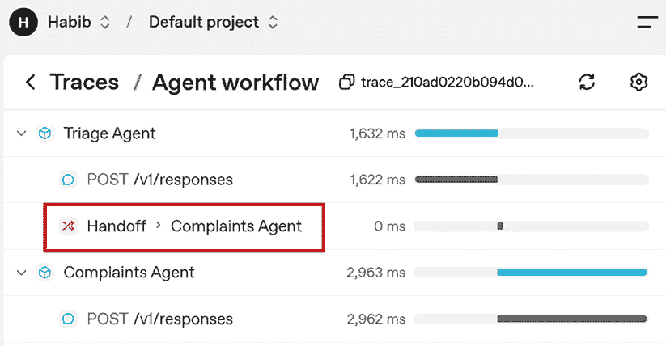

图 6.7: 从一个代理到另一个代理的交接

`Traces` 模块显示了任务转移到了 `complaints_agent`，之后由 `complaints_agent` 完全接管任务。

## 多代理切换

注意，`complaints_agent` 本身也是一个代理，因此它可以拥有自己的工具和交接。目前，一旦 `complaints_agent` ，，无法转移到任何其他代理。为了修复这个问题，让我们为 `complaints_agent` 和 `inquiry_agent` 都添加交接功能，并允许 `Runner` 不再每次都调用同一个 `triage_agent`，而是调用上一个响应用户的代理。这将让我们能够看到真正的动态多代理系统的威力，它可以在所有代理之间轻松切换。我们还将修改代码，以便能够与代理进行多轮对话。

创建一个名为 `multi_agent_switching.py` 的新 Python 文件并运行以下代码：

```python
from agents import Agent, Runner, SQLiteSession, trace
### 创建两个代理
complaints_agent = Agent(
    name="Complaints Agent",
    instructions="介绍自己为投诉代理。以同理心和清晰的后续步骤处理任何客户投诉。"
)
sales_agent = Agent(
    name="Sales Agent",
    instructions="介绍自己为销售代理。及时回答关于我们服务的通用问题。"
)
### 创建带有交接功能的分诊代理
triage_agent = Agent(
    name="Triage Agent",
    instructions="回答通用问题。分诊用户请求并调用合适的代理",
)
# 设置所有代理之间的相互交接
complaints_agent.handoffs = [sales_agent, triage_agent]
sales_agent.handoffs = [complaints_agent, triage_agent]
triage_agent.handoffs = [complaints_agent, sales_agent]
### 创建会话
session = SQLiteSession("first_session")
last_agent = triage_agent
with trace("Multi-agent system"):
    while True:
        question = input("You: ")
        result = Runner.run_sync(last_agent, question, session=session)
        print("Agent: ", result.final_output)
        last_agent = result.last_agent
```

让我们检查代码中发生了什么，特别是高亮显示的部分。

我们首先建立了三个代理。接着，我们在所有三个代理之间建立了相互交接关系。这是关键所在：在此之前，一旦控制权移交给如 `complaints_agent` 这样的次代理，对话在会话剩余的时间内就会锁定在那个代理上。现在，通过显式地为每个代理分配 `.handoffs` 以包含其他代理，任何代理都可以委托给任何其他代理，包括在需要时回传给 `triage_agent`。这为完全动态的多代理系统奠定了基础。

,我们还引入了持久化的 `SQLiteSession`，以确保对话状态在多轮之间得以保持，这是我们在上一章中学习到的内容。这使得我们能够基于之前的交流进行后续构建，并让代理记住对话在何处中断。结合 `trace()` 上下管理器（我们将在下一节深入探讨），我们可以记录所有的交互，以供以后调试或检查。

`last_agent` 变量跟踪最近活跃的代理。在循环内部，我们通过调用 `Runner.run_sync(last_agent, question, session=session)` 继续对话。这确保了当前处理对话的代理将接收下一个用户输入，而不是总是从分诊代理重启。一旦处理完响应，我们就用 `result.last_agent` 更新 `last_agent`，从而根据交互流实现代理之间的无缝交接。

例如，让我们与多代理系统进行以下对话。请注意，它会根据对话中的消息在多个代理之间进行无缝切换：

```
You: 你好，我是 Henry
Agent:  你好 Henry！今天有什么可以帮你的吗？
You: 把我转接到投诉代理 - 我的饭太热了
Agent:  你好 Henry，我是负责协助你的投诉代理。我理解你的饭太热了，对于带来的不便我深表歉意。你能详细描述一下情况吗，以便我为你提供帮助？
You: 我有一个通用咨询 - 我如何获取收据？
Agent:  对于收据查询，你通常有
```

这是该示例在 `Traces` 模块中的外观：

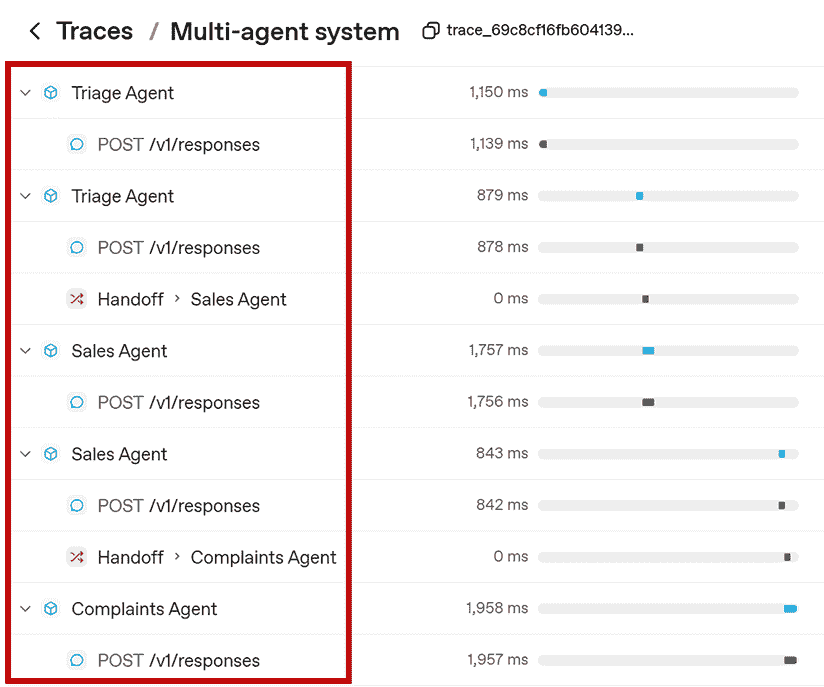

图 6.8: 此示例中的 Traces 模块

这种结构为真正的多代理对话开启了大门，代理不仅可以轮流，还可以根据上下文智能地决定何时切换。我们现在创建了一个灵活的代理网络，可以在对话过程中分配代理。

## 自定义交接

OpenAI Agents SDK 允许你自定义交接的属性，这在某些情况下非常有用。首先需要知道的是 SDK 提供了带有额外属性实例化交接对象的方法。这些属性如下：

- `agent`: 交接的目标代理。
- `tool_name_override` 和 `tool_description_override`: 允许你在 `Traces` 模块中覆盖交接描述。正如你所看到的，默认是“转移到 X”。
- `on_handoff`: 在交接发生时触发的函数。这在发生交接时调用函数非常有用（例如通知用户或用于日志记录）。Agents SDK 将对话历史传递给回调函数。
- `input_type` 和 `input_filter`: 允许你精炼交接预期的输入（例如，你可以指令 LLM 传递到目前对话的摘要，或者将对话历史裁剪为最后五条消息）。

### 注意

交接中的一个关键考虑是决定哪些上下文被带入。默认情况下，SDK 会自动传输交接点之前的完整对话历史。这包含了所有用户输入、系统指令以及之前代理的消息和操作（基本上是原始代理访问的所有内容）。从用户的角度来看，不需要重复任何内容。

让我们来看一个自定义交接示例。我们将使用我最常用的属性，即 `on_handoff` 属性。我们将定义一个自定义函数，在系统交接时打印输出。


```python
from agents import Agent, Runner, SQLiteSession, trace, handoff
from pydantic import BaseModel
import os
### 创建两个代理
complaints_agent = Agent(
    name="Complaints Agent",
    instructions="将自己介绍为投诉代理。以同理心和清晰的后续步骤处理任何客户投诉。"
)
sales_agent = Agent(
    name="Sales Agent",
    instructions="将自己介绍为销售代理。及时回答有关我们服务的通用问题。"
)
### 创建带有交接功能（handoffs）的分诊代理
triage_agent = Agent(
    name="Triage Agent",
    instructions="回答通用问题。分诊用户的请求并调用相应的代理",
)
```

在第一个部分中，我们设置了三个代理：一个负责投诉，一个负责销售，以及一个决定将请求路由到何处的分诊代理。到目前为止，这听起来应该很熟悉——它与你之前看到的设置相同，但现在我们正在为这些代理的定制化交接（customized handoffs）做准备。

接下来，让我们定义一个模型和日志函数，然后创建交接对象：

```python
class NameOfAgentToBeHandedOff(BaseModel):
    name_of_agents_to_be_handed_off: str
# 创建日志函数
def log(ctx, name_of_agent):
    msg = f"系统已将您转接到另一个代理：{name_of_agent.name_of_agents_to_be_handed_off}"
print(msg)
# 创建自定义交接
complaints_handoff = handoff(agent=complaints_agent, on_handoff=log, input_type=NameOfAgentToBeHandedOff)
sales_handoff = handoff(agent=sales_agent, on_handoff=log, input_type=NameOfAgentToBeHandedOff)
triage_handoff = handoff(agent=triage_agent, on_handoff=log, input_type=NameOfAgentToBeHandedOff)
# 设置所有代理之间的相互交接
complaints_agent.handoffs = [sales_handoff, triage_handoff]
sales_agent.handoffs = [complaints_handoff, triage_handoff]
triage_agent.handoffs = [complaints_handoff, sales_handoff]
### 创建会话
session = SQLiteSession("first_session")
last_agent = triage_agent
with trace("Multi-agent system"):
    while True:
        question = input("You: ")
        result = Runner.run_sync(last_agent, question, session=session)
        print("Agent: ", result.final_output)
        last_agent = result.last_agent
```

让我们回顾一下与上一个部分相比对该程序所做的更改。

首先注意到的是，我们现在不再直接将代理分配给 `.handoffs`，而是使用 SDK 中的 `handoff()` 函数来构建每个交接。这允许我们以更高级的方式自定义交接的行为。在我们的案例中，我们正在使用 `on_handoff` 参数为每个交接挂载了一个日志函数。

我们定义了一个简单的 `log()` 函数，它在每次发生交接时都会打印一条消息。它接收交接上下文（`ctx`）和模型输入（`name_of_agent`），然后打印出指示对话正在转移到哪个代理的消息。这为我们提供了一种实时跟踪和调试代理转换的有效方法。

为了确保我们的日志函数接收结构化输入，我们使用 Pydantic 定义了 `NameOfAgentToBeHandedOff` 类。这为交接应使用的输入数据类型设定了清晰的预期，并允许 SDK 在发生交接时验证并将相关字段传递到我们的 `log()` 函数中。

然后，每个交接使用此结构进行初始化：

```python
complaints_handoff = handoff(
    agent=complaints_agent, on_handoff=log, 
    input_type=NameOfAgentToBeHandedOff)
```

这告诉 SDK：“当交接给 `complaints_agent` 时，触发 `log()` 函数并提供一个类型为 `NameOfAgentToBeHandedOff` 的结构化输入。”我们对每个代理重复此操作，以便跨整个系统的每一次交接都能被跟踪。

最后，我们不再仅仅将裸代理代理分配给 `.handoffs`，而是分配相应的交接对象：

```python
complaints_agent.handoffs = [sales_handoff, triage_handoff]
```

这让我们对转换如何发生拥有完全控制权，并允许我们通过副作用（如日志记录、分析甚至自定义提示词）挂钩到这些转换中。当我们运行程序并执行交接时，将打印出以下日志：

```
You: I want to make a complaint
系统已将您转接到另一个代理：投诉代理
Agent:  你好，我是投诉代理，我在这里为您提供帮助。可以告诉我发生了什么吗？您的反馈非常重要，我想确保我们正在处理您关注的问题。
```

简而言之，这种模式为简单的委托机制添加了可编程的钩子（hook），因此你可以跟踪代理行为、强制转换规则，甚至动态编辑上下文。这在日志记录和审计至关重要的现实应用中非常有用。

## 交接提示词引导 (Handoff prompting)

代理交接给其他代理的能力与你给每个代理的指令一样重要。参与交接的代理应该具有关于何时、如何交接，以及在交接后该做什么的清晰指令。为了做到这一点，OpenAI Agents SDK 实际上为你提供了一个推荐的提示词前缀，可以添加到你的代理中：

```python
from agents import Agent, Runner
from agents.handoff_prompt import RECOMMENDED_PROMPT_PREFIX
print(RECOMMENDED_PROMPT_PREFIX)
### 创建两个代理
complaints_agent = Agent(
    name="Complaints Agent",
    instructions=f"{RECOMMENDED_PROMPT_PREFIX}.将自己介绍为投诉代理。以同理心和清晰的后续步骤处理任何客户投诉。"
)
inquiry_agent = Agent(
    name="General Inquiry Agent",
    instructions=f"{RECOMMENDED_PROMPT_PREFIX}.将自己介绍为销售代理。及时回答有关我们服务的通用问题。"
)
### 创建带有交接功能的分诊代理
triage_agent = Agent(
    name="Triage Agent",
    instructions=f"{RECOMMENDED_PROMPT_PREFIX}.分诊用户的请求并调用相应的代理",
    handoffs=[complaints_agent, inquiry_agent]
)
while True:
    question = input("You: ")
    result = Runner.run_sync(triage_agent, question)
    print("Agent: ", result.final_output)
```

如你所示，`RECOMMENDED_PROMPT_PREFIX` 是一个字符串，代表要添加到所有代理的提示词前缀：

```
## 系统上下文
你是一个名为 Agents SDK 的多代理系统的一部分，该系统旨在简化代理协作和执行。Agents 使用两个主要的抽象：代理（Agents）和交接（Handoffs）。代理包含了指令和工具，并在适当将对话交给另一个代理。交接通过调用函数实现，函数通常命名为 transfer_to_<agent_name>。代理之间的转换在后台无缝处理；不要在与用户的对话中提及或强调这些转换。
```

为了构建更好的带有交接的多代理系统，还有其他与提示词相关的任务：

- **显式的交接指令**：每个代理的系统提示词都应该指定委托任务的精确条件。例如，“如果用户询问有关销售的问题，请将其路由到销售代理。”指令越明确，代理系统就越好。
- **显式的代理指令**：每个代理的指令应清晰地定义其目的以及何时使用它。这有助于协调器或“分诊”代理路由到合适的代理。


现在我们已经更深入了如何在 OpenAI Agents SDK 中使用交接（handoffs），让我们来学习不同的多智能体系统模式，以及如何利用交接来实现每种模式。

## 多智能体模式

描述多个智能体如何组织和结构化是指它们的架构模式。在本节中，我们将学习两种主要的多智能体架构模式、它们的优缺点，以及我们如何使用 OpenAI Agents SDK 实现它们。

两种多智能体架构模式如下：

- 集中心化系统（Centralized system）
- 去中心化系统（Decentralized system）

让我们逐一介绍。

## 集中心化系统

`centralized system` 模式是一种多智能体系统，其中有一个中心智能体将请求路由到其他合适的智能体。这是最常见的架构模式。中心智能体通常被称为“经理”（manager）、“调度器”（orchestrator）或“分诊”（triage）智能体，而其他智能体通常被称为“专门”（specialized）智能体。中心智能体负责路由用户的请求，而每个专门智能体都是某个特定领域的专家。

这种模式的优点是组织良好且职责分清晰。中心智能体专门负责路由请求；这是它唯一的工作。专门智能体针对其特定目的进行了“微调”（无论是通过提示词、工具选择、模型选择还是真正的“微调”权重）。

一个拥有许多专门智能体的结构通常优于一个完成所有任务的智能体；这和为什么在公司里你为每个领域（人力资源、销售、工程等）设置了独立角色的原因是一样的。系统中还可以很方便地添加额外的专门智能体。

这种方法最大的缺点是，系统的优劣取决于其中心智能体。如果中心智能体错误地将请求路由到智能体，整个系统就会失败。在该系统中，通常专门智能体之间无法相互通信。相反，它们是孤立的（silo-ed）。对于某些需要领域间互动和团队协作的任务的任务，这并不是最优的。

这种系统最适用于自然上“自上而下”的架构。例如客户支持机器人，你通常向一个分诊智能体描述你的问题，然后由它将其交交给处理你查询的正确智能体。另一个例子是企业内部助手，帮助员工处理人力资源、IT 和设施请求。员工首先向中心助手描述他们的需求，然后由助手将查询路由到相关的专门部门智能体。这反映了许多真实世界的帮助台工单系统的工作方式。

我们在这里不会介绍示例，因为本章之前的所有示例都是使用中心化系统完成的，其中有一个中心分诊智能体，然后将请求路由到其他专门智能体。

### 分级系统

分级系统（hierarchical system）是中心化系统的子集。`hierarchical system` 类似于中心化系统，但具有许多层级（想象一个由多个智能体组成的金字塔，它们变得越来越专门）。这通常是组织运作的方式；你有一个 CEO（或顶级调度器），然后下面有一系列专门的智能体，如 CFO、COO 和 CHRO，它们下面又有一系列专门的智能体。分级系统有一组中间智能体，用于进一步划分任务并为它们所属的专门智能体集提供上下文/指令。

这种分级模式通过将复杂任务分解为可管理的子组件，然后进一步分解，擅长处理复杂任务。它还促进了常见子任务的重用，并帮助保持每个智能体的范围集中。缺点是，如果任务不需要，这种结构可能会引入不必要的开销。层级越多意味着成本越高、延迟越高、风险风险以及更复杂的通信。管理不善的分级结构还会扭曲或混淆信息，使调试变得几乎不可能。

如之前所述，这类系统的最佳用例是处理大型、复杂的查询，例如深度研究。

让我们创建一个分级系统的示例来回答复杂的研究问题。我们将创建一个中心化分诊智能体、两个经理智能体（一个管理科学问题，另一个管理历史问题）以及一个专门智能体子集（每个经理三个，每个专门一个子领域）。

创建一个名为 `hierarchical.py` 的新 Python 文件并运行以下代码：

```
from agents import Agent, Runner, SQLiteSession, trace
# 创建我们的智能体
# 专门的科学智能体
physics_agent = Agent(name="Physics Agent", instructions="Answer questions about physics.")
chemistry_agent = Agent(name="Chemistry Agent", instructions="Answer questions about chemistry.")
medical_agent = Agent(name="Medical Agent", instructions="Answer questions about medical science.")
### 专门的历史智能体
politics_agent = Agent(name="Politics Agent", instructions="Answer questions about political history.")
warfare_agent = Agent(name="Warfare Agent", instructions="Answer questions about wars and military history.")
culture_agent = Agent(name="Culture Agent", instructions="Answer questions about cultural history.")
# 具有各自领域交接功能的经理智能体
science_manager = Agent(
    name="Science Manager",
    instructions="Manage science-related queries and route them to the appropriate subdomain agent.",
    handoffs=[physics_agent, chemistry_agent, medical_agent]
)
history_manager = Agent(
    name="History Manager",
    instructions="Manage history-related queries and route them to the appropriate subdomain agent.",
    handoffs=[politics_agent, warfare_agent, culture_agent]
)
# 顶级分诊智能体
triage_agent = Agent(
    name="Research Triage Agent",
    instructions="Triage the user's question and decide whether it's science or history related, and route accordingly.",
    handoffs=[science_manager, history_manager]
)
### 创建会话
session = SQLiteSession("hierarchy")
last_agent = triage_agent
with trace("Hierarchical system"):
    while True:
        question = input("You: ")
        result = Runner.run_sync(last_agent, question, session=session)
        print("Agent: ", result.final_output)
        last_agent = result.last_agent
```

让我们尝试这个智能体并查看跟踪日志：

```
You: Which war after the year 1600 led to the greatest death toll?
Agent:  1600 年以后伤亡最大的战争是第二次世界大战。据估计导致了约 7000 万到 8500 万人的死亡，包括军事人员和平民。
```

现在，让我们看看在 **Traces** 模块中它是什么样的。

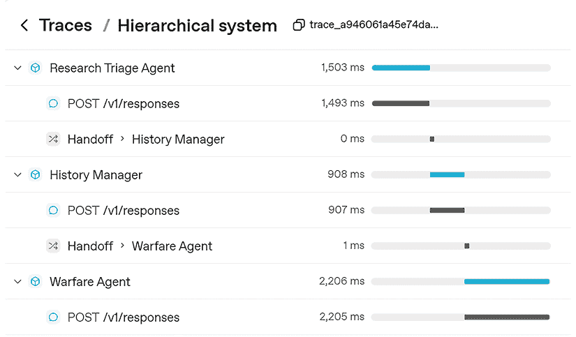

图 6.9：示例的跟踪模块

让我们走一下这里发生了什么。

当用户输入问题时，首先到达顶级智能体，即研究分诊智能体。该智能体的工作是判断问题与科学还是历史相关。在这种情况下，问题显然具有历史属性，因此分诊智能体将其交交给 **History Manager**。一旦 **History Manager** 接收到查询，它会进一步检查主题，并决定哪个专门智能体最适合回答它。由于问题是关于战争和伤亡人数的，**History Manager** 将问题路由给 **Warfare Agent**。

**Warfare Agent** 是军事历史领域的专家，因此它会处理问题并生成响应。然后答案将向上链返回给用户。


这种分层委托确保了每个智能体都在界定的责任范围内运行，反映了结构化组织中拆解复杂任务的方式。然而，用户只会体验到单次无缝交互。

我们可以在 `Traces` 模块中清楚地看到这一点：分发智能体（triage agent）将任务传递给 `History Manager`（历史管理器），后者再将其传递给 `warfare agent`（战争智能体）。用户现在直接与 `Warfare Agent`max，因为他们的问题与战争有关。

在更真实的示例中，专门的智能体可能会包含与其目的相关的工具和知识子集。例如，`Warfare Agent` 可以配备查询历史冲突数据库或访问全球冲突长期研究文档的工具。同样，`Chemistry Agent`（化学智能体）可能会访问科学论文摘要器或周期表计算器。

## 去中心化系统

`去中心化系统`与集中式系统完全相反。在这里，没有单一的分发智能体；相反，多个智能体直接协作处理用户的请求。在这个系统中，不存在信息孤岛；所有智能体都可以相互通信。一个很好的类比是圆桌会议，没有领导者，而是所有智能体都参与讨论以产生最终答案。

这种模式的优势在于它能够激发创造力，因此在头脑风暴、构思或辩论类练习中表现出色。去中心化智能体可以通过迭代对话或想法交换协作增强解决方案，正如某些关于智能体自弈（self-play）的研究（参见 Google AlphaZero）。去中心化系统使智能体能够从不同角度解决问题。

这里很大的缺点是缺乏协调性。在去中心化系统中管理对话流需要确定性的编排（记住，确定性编排指的是硬编码的控制逻辑以及该系统提供的所有缺点），因为 OpenAI Agents SDK 不支持这一点。

再次，这类系统的最佳用例是需要创造力和新颖思维的场景：头脑风暴、构思、谈判、辩论等。

让我们来看一个示例。我们将创建两个专注于对立观点的专家智能体：其中一个扮演房东，另一个扮演租客。然后，我们将强制这两个智能体就一个特定的争议性话题（例如“应该有租金控制吗？”）进行对话。在几轮往返之后，我们将把对话历史传递给另一个智能体，由它总结主要论点并返回给我们。

创建一个名为 `decentralized.py` 的新 Python 文件并运行以下代码：

```python
from agents import Agent, Runner, SQLiteSession, trace
# 创建我们的智能体
landlord_agent = Agent(
    name="Landlord Agent",
    instructions="从房东的角度反对租金控制。提出强有力的经济和产权论点。"
)
tenant_agent = Agent(
    name="Tenant Agent",
    instructions="从租客的角度支持租金控制。强调可负担能力、住房权利和租客保护。"
)
summarizer_agent = Agent(
    name="Summarizer Agent",
    instructions="以中立简洁的方式总结房东和租客智能体提出的主要论点。"
)
### 创建会话
session = SQLiteSession("decentralized")
landlord_turn = True
conversation_history = []
with trace("Decentralized system"):
    print("Topic: Should there be rent control?")
    for _ in range(6):  # 6 轮往返
        if landlord_turn:
            agent = landlord_agent
        else:
            agent = tenant_agent
        prompt = "\n".join([f"{msg['role']}: {msg['content']}"
        for msg in conversation_history])
        response = Runner.run_sync(agent, 
            prompt or "Debate starting now.", session=session)
        print(f"{agent.name}: {response.final_output}")
        conversation_history.append({"role": agent.name, 
            "content": response.final_output})
        landlord_turn = not landlord_turn
    # 辩论结束后，让协调员总结
    summary_prompt = "\n".join([f"{msg['role']}: {msg['content']}"
    for msg in conversation_history])
    result = Runner.run_sync(summarizer_agent, summary_prompt, 
        session=session)
    print("\nSummary of the Debate:")
    print(result.final_output)
```

在此文件中，我们创建了两个对立的智能体（`Landlord Agent` 和 `Tenant Agent`），它们都有一套特定的观点和定制的指令集，用于针对某一争议性问题的一面进行论证。这些智能体并不由分发或管理智能体编排，而是通过在往返对话中交替发言，模拟辩论过程。

这说明了去中心化系统如何在不依赖中央决策者的情况下促进动态多智能体交互。每个智能体都是自主的，但仍然建立在其他贡献之上。结果是一个分层的、协作的对话，它通过涌现行为而非僵化的编排不断演进。

如果我们运行程序，可以在对话历史中看到整个谈判过程以及以下摘要版本：

```
在关于租金控制的辩论中，房东智能体认为，收入限制会阻碍对物业维护的投资，通过阻碍新投资减少住房供应，由于未能反映供需关系导致市场扭曲，并通过鼓励租客留在可能不再符合其需求的单元内降低租客的流动性。他们还声称这侵犯了产权，通常不公平地偏袒长期租客，增加了行政负担，并破坏了对房东的公平补偿。
相反，租客智能体支持租金控制，是为了稳定租金、减轻经济焦虑、促进住房安全并确保公平获取。他们强调了对租客免受剥削的保护以及对社区关系的维护。租客智能体认为，租金控制鼓励了住房的有效利用，并应该是解决更广泛问题的一部分
```

我们还可以在 `Traces` 模块中看到往返过程：

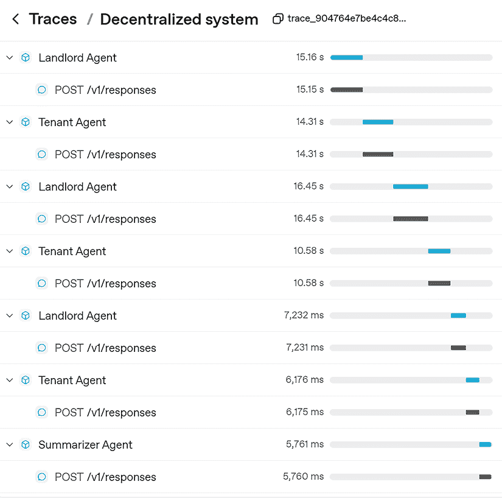

图 6.10: 此示例的 traces 模块

再次，这种模式对于依赖观点多样性和交换的场景非常出色。

### 群系统

去中心化系统的一个子集是`群系统`（swarm system），其中包含许多简单的智能体协作工作（通常是并行）以产生答案。这依赖于一个被称为`涌现属性`的概念，即全局系统通过许多不智能且简单的微系统变得智能和复杂。一个很好的类比是人体中的细胞。每个细胞本身并不那么智能，专注于完成一小部分任务。然而，数百万个专门化的细胞聚集在一起可以产生人类，这是一个智能系统。另一个与数据科学相关的例子是`随机森林模型`。该模型依赖于数百个弱模型，这些模型汇聚在一起就能产生一个智能的预测模型。


群集模式（Swarm patterns）特别适用于那些从探索中受益的任务，例如创意生成、优化或具有多种潜在方法的方案解决工作。一种常见的用例是生成多种解决方案候选，然后对其进行精炼或筛选。

让我们来看一个非常简单的例子。在这个例子中，我们将创建一个程序，并行启动 10 个智能体（agents），它们在城市中扮演不同的角色（医生、机械师、厨师等）。每个智能体都将回答同一个问题：“让你从零开始设计你的梦想城市，它会有什么？”随后，我们将这些结果传递给另一个智能体，由它来汇总所有要点并向我们返回最终的总结。

### 实现

创建一个名为 `swarm.py` 的新 Python 文件并输入以下代码：

```python
from agents import Agent, Runner, SQLiteSession, trace
import concurrent.futures
# 创建我们的智能体
roles = [
    "Urban Planner", "Artist", "Chef", "Engineer", "Teacher",
    "Doctor", "Mechanic", "Lawyer", "Historian", "Environmentalist"
]
city_agents = [
    Agent(
        name=f"{role} Agent",
        instructions=f"You are a {role.lower()}. Answer the question: 'If you were to design your dream city from scratch, what would it have?' Be creative and imaginative, but concise"
    ) for role in roles
]
# 定义总结智能体
summary_agent = Agent(
    name="City Design Aggregator",
    instructions="You are a city designer. You've just received 10 creative responses from different citizens. Read all of their responses 并将 them 整合为一个连贯、富有想象且完善的城市计划。"
)
### 创建会话
session = SQLiteSession("swarm")
conversation_history = []
with trace("Swarm system"):
    prompt = "Design your dream city from scratch. What would it have?"
# 逐个收集回复
for agent in city_agents:
        result = Runner.run_sync(agent, prompt, session=session)
        print(f"{agent.name}: {result.final_output}\n")
        conversation_history.append(
            f"{agent.name}: {result.final_output}")
    # 将回复合并为一个提示词
    combined_responses = "\n\n".join(conversation_history)
    final_result = Runner.run_sync(summary_agent, combined_responses, 
        session=session)
    # 输出最终城市计划
print("\nFinal City Design Summary:")
    print(final_result.final_output)
```

在这段代码中，我们定义了一个由 10 个智能体组成的“群集”，每个智能体根据其在城市中的角色拥有自己的身份和创意视角。所有智能体都会收到关于设计梦想城市的相同提示词，并使用线程池独立并行响应。由于每个智能体都被指示利用其领域专业知识，群集方法允许我们从 10 个不同的视角来探索设计空间。

一旦收集了所有回复，我们将它们传递给 `summary_agent` 对象，由它将集体输入合成一个单一的、富有想象力的城市计划。这个最终输出代表了许多独立思考者贡献其想法所产生的*涌现*结果。

最终的城市计划整合了所有子智能体的想法：

```text
Final City Design Summary:
创建一个梦想城市需要综合来自各种角度的想法，以形成一个连贯且创新的城市景观。以下是整合后的计划：
### 生态平衡与可持续性：
1. **绿色基础设施**：广大的公园、城市森林、屋顶花园和社区花园，促进生物多样性并提供休闲空间。
2. **可持续建筑**：配备太阳能电池板、绿色屋顶、节能系统和自然材料的建筑，以最大限地减少对环境的影响。
### 交通与连接：
3. **综合公共交通**：电车、巴士、自行车道和人行道的无缝网络，减少对汽车的依赖并鼓励环保通勤。
4. **智能技术**：用于高效能源利用、交通管理和公共服务的 IoT 系统，增强了连接性和便利性。
### 文化与社区丰富：
5. **文化枢纽**：拥有剧院、画廊和多元文化节的动态区域，庆祝全球传统和创意。
6. **混合用途开发**：融合住宅、商业和文化空间，打造充满活力的易于步行的社区。
### 能源与资源管理：
7. **可再生能源**：风力涡电机和太阳能发电站提供清洁电源供应，以及创新的水回收和节水系统。
8. **水资源管理**：先进的回收和保护措施，将自然水道整合到城市规划中。
### 住房与社会公平：
9. **包容性住房**：负担得起的多样化选择，确保所有收入水平的人都能享有，促进社会公平和社区。
10. **社区空间**：图书馆、文化中心、体育设施和社区中心，促进参与和包容性。     
### 教育、创新与安全：
11. **教育与创新中心**：先进的学校和研究设施，支持终身学习和创意。12. **韧性基础设施**：适应气候的设计和韧性基础设施，用于管理和缓解环境变化及极端天气。
### 本地与可持续食品系统：
13. **本地食品网络**：城市农场和农市场促进新鲜的本地农产品和食品安全。
通过整合这些元素，城市将在可持续性、创新和包容性方面蓬勃发展，为未来的城市发展设定基准。
```

总结，OpenAI Agents SDK 提供了实现多智能体系统所有架构模式的灵活性。正如在本节中看到的，每种模式都可以使用 SDK 的智能体创建、交接（handoff）和内存管理功能实现为独立的脚本。

# 总结

在本章中，我们通过在 OpenAI Agents SDK 中引入编排和交接策略，探索了如何协调多个智能体来解决复杂任务。

我们首先区分了确定性编排和动态性编排。随后，我们引入了交接机制，这是 OpenAI Agents SDK 的核心原语，允许一个智能体将控制权交给另一个智能体。我们通过多智能体切换进一步扩展了这一点，允许智能体在较长的对话中使用持久化内存相互传输控制权，并通过回调函数和提示词自定义交接。

最后，我们探索了四种不同的多智能体系统模式：中心化、分层（中心化的子集）、去中心化和群集（去中心化的子集）。

在下一章中，我们将学习如何管理智能体的底层引擎：大语言模型（LLM）。

## 模型与上下文管理

到目前为止，在使用 OpenAI Agents SDK 构建智能体时，我们主要依赖默认的 GPT-4o 模型。然而，Open Agents SDK 最强大的功能之一是其模型无关的设计。也就是说，你并不受限于单一的模型提供商或配置。这种灵活性在复杂工作流或多智能体系统中变得尤为宝贵，因为过程的不同阶段可能受益于不同的能力或成本/延迟。


考虑一个多智能体系统，它从一个分诊代理（triage agent）开始，其简单的工作向用户提出简单的问题。对于这项任务，使用 `GPT-4` 可能并不合适。相反，我们可能想要简单的模型或非 OpenAI 的开源模型，例如 `LLaMA`，它的成本几乎为零。同时，一些要求更高的任务（例如执行研究或数学运算）可能需要先进的 Anthropic 模型。同时，头脑风暴代理可能需要标准的 `GPT-4o` LLM，但需要更高的温度（temperature）。

`OpenAI Agents SDK` 支持这种架构模式。每个智能体可以使用不同的模型及其自有的配置设置。

你将在本章中学到以下内容：

- **模型管理**：我们将首先学习如何调整模型、模型设置，以及如何将第三方模型集成到智能体中。
- **上下文管理**：你将学习如何利用本地上下文将信息传递给工具，而不让 LLM 获知这些信息。

在本章结束时，你将学会如何在智能体解决方案中有效地管理模型和上下文。

## 技术要求

请遵循第 3 章中的详细步骤设置你的环境。

在本书中，每章的实用示例和完整代码将通过附带的 GitHub 仓库提供 [`github.com/PacktPublishing/Building-Agents-with-OpenAI-Agents-SDK`](https://github.com/PacktPublishing/Building-Agents-with-OpenAI-Agents-SDK)。

鼓励你克隆仓库，复用并适配提供的代码示例，并在学习章节时根据需要参考它。

## 模型管理

在 `OpenAI Agents SDK` 中，每个智能体必须由一个 `LLM` 驱动。`LLM`充当智能体的大，能够读取信息、调用工具并生成响应。到目前为止，我们在实例化智能体时使用的是默认配置。这会将智能体的模型默认为 `GPT-4o` 并使用默认模型设置。在本节中，我们重点介绍如何以及何时修改此参数。

### 调整底层模型

`OpenAI Agents SDK` 允许你显式地选择要使用的底层模型。每个模型都有其优缺点，为你正在构建的特定类型的智能体选择正确的模型是有益的。例如，`GPT-4o` 可以产生快速且准确的响应，而 `o3-pro` 可以推理并解决复杂问题，但速度慢得多。

要调整模型，你可以在实例化智能体时直接使用 `model` 参数。此演示将展示如何调整智能体使用的模型：

```
agent = Agent(
    name="SampleAgent",
    instructions="You are an AI agent",
    model="gpt-4o"
)
```

该参数可以接受 OpenAI 的任何有效模型名称。要查看所有模型名称列表及其优处和成本，请访问 [`platform.openai.com/docs/models`](https://platform.openai.com/docs/models)。

让我们通过一个例子来说明为什么使用此参数选择正确的模型是至关重要的。在这个例子中，我们将创建两个智能体，每个智能体使用不同的模型参数（`GPT-4o` 与 `o3-pro`）。我们将看到它们如何回答同一个问题，以及每个回答需要多长时间。

创建一个名为 `different_models.py` 的新 Python 文件并输入以下代码。此演示将向我们展示如何拥有不同底层模型的智能体：

```
from agents import Agent, Runner
import time
# 创建两个智能体
gpt4o_agent = Agent(
    name="GPT4o Agent",
    instructions="You are an AI Agent",
    model="gpt-4o"
)
o3pro_agent = Agent(
    name="o3-pro Agent",
    instructions="You are an AI Agent",
    model="o3-pro"
)
prompt = "How many integers from 1 to 10000 (inclusive) are divisible by 3 or by 5 but not by both? Do reasoning but only return only the answer."
print("gpt4o agent")
start_fast = time.time()
response = Runner.run_sync(gpt4o_agent, prompt)
print(response.final_output)
end_fast = time.time()
print(f"Time taken: {end_fast - start_fast:.2f} seconds")
print("---")
start_fast = time.time()
print("o3pro agent")
response = Runner.run_sync(o3pro_agent, prompt)
print(response.final_output)
end_fast = time.time()
print(f"Time taken: {end_fast - start_fast:.2f} seconds")
print("---")
```

运行此程序将得到以下输出：

```
gpt4o agent
3334
Time taken: 1.18 seconds
---
o3pro agent
4001
Time taken: 8.41 seconds
---
```

在实践中，`GPT-4o` 智能体通常在几秒内响应，但遗憾的是它对这个复杂的数学题给出了错误答案。然而，`o3-pro` 智能体回答正确，但花费的时间是八倍（实际上成本可能比标准的 `GPT-4o` 模型高出 10 倍）。

因此，准确性与延迟/成本之间存在固有的权衡，但 `OpenAI Agents SDK` 允许你为智能体选择正确的模型。

### 调整模型设置

让我们不仅选择使用哪个模型。通常，你希望保持相同的模型，但你可能希望微调模型生成响应的方式。OpenAI SDK 暴露了 `ModelSettings` 对象传递给智能体。

- `temperature`：控制输出的随机性。较低的值（如 `0.2`）使模型更具确定性，而较高的值（如 `0.8`）生成更具创意或多样化的响应。
- `max_tokens`：限制模型可以生成的标记（或单词）数量。这有助于控制智能体响应长度。

你可以在 OpenAI 参考指南中找到这些设置的完整列表：[`openai.github.io/openai-agents-python/ref/model_settings/#agents.model_settings`](https://openai.github.io/openai-agents-python/ref/model_settings/#agents.model_settings)

我们将通过一个例子来说更改模型设置对其产生的影响。与之前的例子类似，我们将创建两个智能体：一个是高温度和长 `max_tokens` 设置，另一个是低温度和短 `max_tokens` 设置。

创建一个名为 `different_model_settings.py` 的新 Python 文件并输入以下代码：

```
from agents import Agent, Runner
from agents.model_settings import ModelSettings
### 创建智能体
creative_agent = Agent(
    name="CreativeAgent",
    instructions="You are an AI agent that answers questions.",
    model="gpt-4o",
    model_settings=ModelSettings(
        temperature=1.0,
        max_tokens=300
    )
)
precise_agent = Agent(
    name="PreciseAgent",
    instructions="You are an AI agent that answers questions.",
    model="gpt-4o",
    model_settings=ModelSettings(
        temperature=0.2,
        max_tokens=50
    )
)
prompt = "Describe the future of AI in customer service."
print("Creative agent:")
response = Runner.run_sync(creative_agent, prompt)
print(response.final_output)
print("---")
print("Precise agent:")
response = Runner.run_sync(precise_agent, prompt)
print(response.final_output)
print("---")
```

运行此脚本将产生两种非常不同的输出风格。`creative_agent` 对象产生了更长、更有想象力的响应，有时会包含推测或未来的语言。`precise_agent` 对象则给出了更短、更谨慎的总结。事实上，由于 `max_tokens` 参数非常小，`precise_agent` 对象实际上被截断了。以下显示了两个输出：


```
创意型代理：
AI 在客户服务领域的未来将是变革性的，继续提升效率、个性化和客户满意度。以下是一些关键趋势和发展：
1. **高级聊天机器人和虚拟助手**：AI 驱动的聊天机器人将变得更加复杂，处理复杂的查询，更好地理解上下文，并提供更像人类的交互。它们将无缝集成到多个通信渠道中。
…
6. **AI 代理协作**：人类代理将越来越多与 AI 协同工作，利用 AI 驱动的洞察增强自身的响应能力。AI 将处理例行查询，释放人类专注于复杂问题。
7. **自服务优化**：AI 将增强自服务平台，让客户更容易、更快地找到解决方案，无需人工干预。
---
精准型代理：
AI 在客户服务领域的未来有望带来变革，提供增强的效率、个性化和可扩展性。以下是一些关键趋势和发展：
1. **24/7 全天候**：AI 驱动的聊天机器人和虚拟助手将提供全天候
```

这个简单的示例展示了调整模型设置（例如控制随机性的 `temperature` 和控制响应长度的 `max_tokens`）如何显著改变代理的语气和冗长程度，而无需更改底层模型。这使你能够将同一个模型适配到不同类型的代理，例如客户服务销售机器人与研究想法生成器，只需修改模型设置即可。

## 第三方模型

正如我们在本章开头提到的，OpenAI Agents SDK 是模型无关的（model-agnostic）。它可以运行于任何提供商的任何模型，只要它遵循某些特性。虽然 GPT-4o 和其他 OpenAI 模型是极好的默认选择，但在许多情况下，使用不同的 LLM 可能会更好。例如，Anthropic 的 Claude 模型可能能够更好地遵循某些指令，或者你可能出于成本考虑想使用 Meta 的 LLaMA 模型。

OpenAI Agents SDK 通过 `LiteLLM` 实现了兼容其他模型。`LiteLLM` 是一个轻量级的 Python 库，为许多流行的 LLM 提供商（Anthropic、Google 等）提供了统一的 API。使用 `LiteLLM` 集成第三方模型变得非常简单。`LiteLLM` 在后台处理 API 密钥管理、请求路由和响应格式化，因此你可以在不更改代理代码的情况下切换模型提供商。

第一步是安装 `LiteLLM` 库。为此，打开你的终端并输入以下命令：

```
$ pip install "openai-agents[litellm]"
```

之后，我们需要一个非 OpenAI 模型提供者的 API 密钥。在本示例中，我们将选择 Anthropic。获取 Anthropic API 密钥，请访问 `https://www.anthropic.com/` 创建账户并进入账户仪表板。在 `API keys` 下点击 `Create new key`，然后复制你的 API 密钥。之后，回到我们在*第 3 章*中设置的 `.env` 文件，添加包含以下内容的新行：

```
ANTHROPIC_API_KEY=sk-ant-api03-[your-remaining-api-key]-995
```

安装好 `LiteLLM` 并配置所需的 API 密钥后，我们现在可以使用 Anthropic 的 LLMs 构建 AI 代理。为此，你只需要在实例化代理时将 `model` 参数设置为指定模型参数和模型的 LiteLLM 字符串即可。以下是一些 LiteLLM 字符串示例：

* `litellm/gemini/gemini-pro`
* `litellm/anthropic/claude-opus-4-20250514`
* `litellm/meta_llama/Llama-3.3-70B-Instruct`

让我们来看一个简单的示例。创建一个名为 `third_party_models.py` 的文件并输入以下代码：

```python
from agents import Agent, Runner
import time
### 创建一个代理
agent = Agent(
    name="Claude Agent",
    instructions="You are an AI Agent",
    model="litellm/anthropic/claude-opus-4-20250514"
)
question = "我该如何重启电脑？请用几个字回答。"
response = Runner.run_sync(agent, question)
print(response.final_output)
```

运行此程序将像以前一样创建并执行一个代理，但它使用的是 Anthropic Claude 模型来执行。以下是一个响应示例。

```
**Windows:** 开始菜单 → 电源 → 重启
**Mac:** 苹果菜单 → 重启
**或者:** 长按电源按钮，然后重新开启
```

通过这种方式，你可以无缝切换代理底层的 LLM，而无需重构你的逻辑或流水线。无论是由 GPT-4o、Claude 还是 LLaMA 驱动，代理的行为都是相同的（只要模型接口在 `LiteLLM` 内部处理）。

这种抽象在你为特定用例对不同提供商进行基准测试，或者在具有不同隐私、延迟或成本限制的环境中部署代理时非常有用。例如，你可能想在开发期间使用 GPT-4o 进行原型设计，并在环境中切换到 Claude 以获得更好的摘要。

## 上下文管理

`context` 指代理可以访问的所有内容。一个很好的类比是：代理的 LLM 是它的大脑，而代理的上下文（context）是传递给大脑以生成响应的信息。我们已经讨论了向代理暴露重要信息的几种方法，包括通过系统指令、之前的对话历史、提示词注入（prompt injections），甚至通过工具调用进行知识检索。

在本节中，我们将上下文范围缩小到**本地上下文（local context）**。这指的是实例化代理所需的信息，并作为工具（tools）和钩子（hooks）的依赖。

## 本地上下文

本地上下文允许代理访问某些信息（在代理实例化时产生），而这些数据无需显式地成为 LLM 提示词的一部分。这对于存储用户特定信息（例如用户 ID、名称、偏好）非常有用，以便工具根据这些信息获取或计算答案。这开启了一种强大的设计模式。它允许代理使用特权或应用程序数据（如用户偏好、身份验证令牌或内部状态）运行，而无需将这些数据嵌入发送给模型的提示词中。这意味着代理可以根据敏感或专利信息做出决策或生成个性化输出，同时将这些信息完全留在 LLM 的提示词之外。

在 OpenAI Agents SDK 中，你通过创建一个对象并在调用 `Runner` 时通过 `context` 参数传递它来实现本地上下文。在使用该对象实例化代理后，任何工具都可以使用它，只要该工具也包含 `context` 参数。

让我们通过一个具体的例子来说明。假设我们的客户服务代理可以根据用户配置和活跃订单检查订单物流状态。我们将通过提供一个包含用户名和订单详情的 `OrderContext` 对象，以及一个使用这些信息提供物流更新的工具函数来模拟这一点。

首先，创建一个新的 Python 文件名为 `local_context.py` 并输入以下代码：


```python
from dataclasses import dataclass
from agents import Agent, Runner, RunContextWrapper, function_tool
@dataclass
class OrderContext:
    customer_name: str
    order_id: str
    shipping_status: str
order_context = OrderContext(
    customer_name="Henry Habib",
    order_id="123",
    shipping_status="Delayed"
)
@function_tool
def get_shipping_status(wrapper: RunContextWrapper[OrderContext]) -> str:
    """Provide the shipping status for the current order."""
    ctx = wrapper.context
    return (
        f"Hi {ctx.customer_name}, your order {ctx.order_id} is currently: "
f"{ctx.shipping_status}."
    )
agent = AgentOrderContext
question = "Where is my order?"
result = Runner.run_sync(agent, input=question, context=order_context)
print(result.final_output)
```

我们首先定义了一个名为 `OrderContext` 的数据类，它包含了三个字段：客户姓名、订单 ID 以及当前的物流状态。此对象代表了我们希望智能体（agent）访问的本地上下文（即工具函数可以直接调用的信息）。

然后，我们创建了一个包含示例客户和订单信息的 `OrderContext` 对象。在实际应用中，此上下文可能会根据该智能体在何处被“调用”而为每个用户会话动态生成。

接下来，当我们定义名为 `get_shipping_status` 的工具函数时，我们让它接收一个上下文对象（`RunContextWrapper[OrderContext]`）作为参数。这告诉智能体将上下文对象作为参数传递给工具函数。当我们定义一个名为 `"Shipping Support Agent"`（物流支持智能体）的智能体时，它配备了 `get_shipping_status` 工具，但最重要的是，智能体使用了相同的 `OrderContext` 类型进行参数化，因此它知道自己将接收什么类型的上下文。这非常重要。这是在智能体实例化时（`agent = Agent[OrderContext]`）完成的。

由于智能体具有这个额外的参数，在调用 `Runner.run_sync()` 时，必须定义该类型的上下文对象。SDK 会自动将查询路由到工具，工具使用上下文数据生成响应。

这是一个示例响应，显示了智能体将上下文信息传递给了工具函数调用：

```
Hi Henry Habib, your order (123) is currently delayed. If you have any further questions or need assistance, please let me know!
```

这说明了本地上下文的核心优势之一：智能体可以使用从未出现在模型提示词（prompt）中的敏感信息来生成准确且个性化的响应。总而言之，本地上下文对象为你的智能体提供了一种“内部内存”，这种内存并不会直接暴露给用户或模型提示词。它是向智能体工具链中注入领域知识或用户特定数据的一种形式。

# 总结

在本章中，我们涵盖了如何选择和配置每个智能体背后的模型。我们学习了如何为每个智能体调整模型及其设置。我们学习了如何通过 `LiteLLM` 集成第三方模型，从而在 Claude、Gemini 和 LLaMA 等提供商之间轻松切换。最后，我们介绍了本地上下文，这是一种让智能体访问敏感或会话特定数据的方法，而无需将其包含在模型提示词中。

这些技术的结合让你能够完全控制智能体的思考和响应方式。在下一章中，我们将重点转向智能体的管理、管理和安全保障。你将学习如何监控智能体活动、执行护栏（guardrails）以及在生产环境中应用治理最佳实践。

| |
## 立即解锁本书的专属福利

扫描此二维码或访问 [`packtpub.com/unlock`](https://packtpub.com/unlock)，然后按名称搜索此书。 |  |

| **注意**：在开始之前请准备好您的购买发票。 |

# 8

## 智能体系统管理

随着你的智能体系统复杂性增加，保持它们的可靠性和易理解性与构建核心逻辑同样重要。多智能体系统可能会变得难以推理，因为许多智能体、工具和交接（handoff）以非显的方式相互交互。为了管理这种复杂性，OpenAI Agents SDK 提供了强大的可视化、护栏、可观测性和测试功能。

以下是你将在本章学习到的内容：

*   **智能体可视化**：你将学习如何生成多智能体系统的图形图表，展示智能体、工具及其交互，以提高清晰度和调试效率。
*   **护栏 (Guardrails)**：你将看到如何实现输入和输出护栏，确保不、无关或违反策略的内容在进入或离开系统之前被拦截。
*   **日志、追踪和可观测性**：你将探索 `Traces` 模块如何记录模型调用、工具调用、交接和护栏触发，以及你如何添加自定义的追踪（traces）和跨（spans）。
*   **智能体测试**：你将学习智能体的端到端测试和单元测试方法，帮助即使在存在非确定性行为的情况下验证系统的可靠性。

在本章结束时，你将学会如何管理、监控和验证智能体系统。

## 技术要求

请遵循第 3 章中的详细步骤设置环境。

实际示例和每章完整代码可以通过配套仓库获取：[`github.com/PacktPublishing/Building-Agents-with-OpenAI-SDK`](https://github.com/PacktPublishing/Building-Agents-with-OpenAI-SDK)。

鼓励你克隆仓库，复用并调整代码示例，并在学习过程中参考它们。

## 智能体可视化

正如我们在前几章看到的，智能体可能涉及多个复杂的组件，特别是在多智能体系统中。由于智能体、工具、交接和 MCP 服务器的混合，这可能会变得难以理解。坦率地说，OpenAI Agents SDK 提供了一个可视化工具，可以为你的智能系统生成图形表示，展示智能体、工具及其关系。

让我们直接开始创建智能系统的可视化图。为了创建可视化图，我们必须首先安装依赖项。在终端中激活环境，然后运行以下命令安装依赖：

```
$ pip install "openai-agents[viz]"
```

之后，让我们回到之前章节中创建的层级智能体系统。我们还将为该智能体系统添加一些工具，观察它们是如何被可视化的。创建一个名为 `visualization.py` 的 Python 文件并运行以下代码，从创建工具开始：

```python
from agents import Agent, Runner, SQLiteSession, trace, function_tool
from agents.extensions.visualization import draw_graph
### 创建工具
@function_tool
def calculate_physics_equation(equation):
    pass
@function_tool
def perform_culture_survey(goal):
    pass
```

在这里，我们定义了示例工具：一个用于计算物理方程，另一个用于执行文化调查。它们稍会被挂载到相关的智能体。

接下来，定义特定的领域智能体：


```python
# 创建我们的代理
### 专业的科学代理
physics_agent = Agent(name="Physics Agent", instructions="Answer questions about physics.", tools=[calculate_physics_equation])
chemistry_agent = Agent(name="Chemistry Agent", instructions="Answer questions about chemistry.")
medical_agent = Agent(name="Medical Agent", instructions="Answer questions about medical science.")
### 专业的历史代理
politics_agent = Agent(name="Politics Agent", instructions="Answer questions about political history.")
warfare_agent = Agent(name="Warfare Agent", instructions="Answer questions about wars and military history.")
culture_agent = Agent(name="Culture Agent", instructions="Answer questions about cultural history.", tools=[perform_culture_survey])
```

此部分创建了科学和历史子代理。其中一些代理关联了工具，而另一些则仅依赖指令。

现在，创建管理代理来协调它们各自的领域：

```python
# 具有向各自领域交接能力的管理代理
science_manager = Agent(
    name="Science Manager",
    instructions="管理科学相关的查询并将其路由到适当的子代理。",
    handoffs=[physics_agent, chemistry_agent, medical_agent]
)
history_manager = Agent(
    name="History Manager",
    instructions="管理历史相关的查询并将其路由到适当的子代理。",
    handoffs=[politics_agent, warfare_agent, culture_agent]
)
```

管理代理充当协调员。它们本身不回答问题，而是将任务路由给正确的专业代理。

最后，定义顶层分拣代理并可视化图表：

```python
# 顶层分拣代理
triage_agent = Agent(
    name="Research Triage Agent",
    instructions="分拣用户问题并判断其与科学还是历史相关，并进行相应的路由。",
    handoffs=[science_manager, history_manager]
)
### 绘制代理图
draw_graph(triage_agent, filename="graph_visualization")
```

该代理位于顶部，接收用户问题，并决定将查询转发给哪个管理代理。来自 `agents.extensions.visualization` 类的 `draw_graph` 函数接收任何代理作为输入，绘制多代理系统可视化图，并将其保存到项目根目录下，命名为 `graph_visualization.png`：

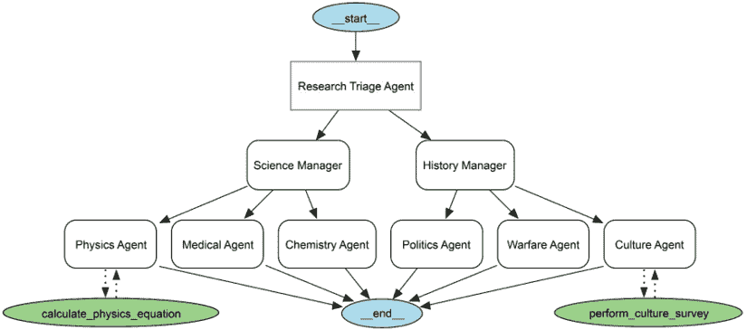

图 8.1: 可视化图示例

**快速提示**：需要查看此图像的高分辨率版本？请在下一代 Packt Reader 中打开此书，或在 PDF/ePub 版本中查看。

**购买此书将免费赠送**下一代 Packt Reader**。扫描二维码或访问 [`packtpub.com/unlock`](https://packtpub.com/unlock)，然后使用搜索栏通过名称查找此书。双检显示的版本以确保你获得的是正确的版本。


在可视化图中，代理被绘制为方框（节点），工具被绘制为椭圆，箭头表示交互（实线箭头表示代理之间的交接，虚线箭头表示代理到工具的调用）。图中总有一个起始节点和一个或多个结束节点，决定了代理流的可能路径。

这个工具（双关语）对于大型多代理系统的管理、清晰化和调试非常有用。通过检查此可视化图，我们可以验证系统结构是否符合预期。例如，如果我们预期某个工具应该被连接或某个代理有一个未显示的交接，图表将迅速揭示任何缺失的配置。此外，它还可以作为合作伙伴、利益相关者或系统未来维护者的宝贵文档，为他们提供代理交互的概述。

## 护栏 (Guardrails)

`Guardrails` 是另一个实 OpenAI Agents SDK 原，通过执行验证检查来辅助多代理系统。这些检查可以在用户输入传递给代理系统时执行，也可以在代理输出传输给用户时执行。

在代理系统中拥有护栏的好处是它可以使其更具韧性。它们充当保护层，确保无效、不或不受理想的输入输出在引起问题之前被拦截。这有助于防止有害响应、强制合规规则并保持一致的用户体验。在更复杂的系统中，护栏还可以作为保持代理符合组织政策和特定领域限制的方法，而不会让主代理过载验证逻辑。在实践中，这意味着你的代理可以专注于其核心任务，而护栏则处理边界情况、策略执行和安全考量。

输入和输出护栏使用相似的模式：

1. 我们必须首先定义一个返回 `GuardrailFunctionOutput` 对象的护栏函数。它还可以接收上下文、触发护栏的代理以及用户的提示词/代理输出作为输入。`GuardrailFunctionOutput` 包含一个 `tripwire_triggered` 布尔值，该值指示是否执行了护栏触发器。

2. 在护栏函数内部，我们必须包含逻辑来判断我们的护栏触发器是否应该被激活。在这里我们可以使用硬编码逻辑（例如，如果用户提示词包含“负”一词，我们应该触发触发器并停止代理）或基于代理的逻辑（例如，我们创建另一个代理，其唯一工作是推理是否应该触发触发器）。

3. 最后，我们必须优雅地处理触发器（抛出一个特定的异常）并向用户输出内容。

我们将首先查看输入护栏，然后转向输出护栏。

## 输入护栏

将输入护栏想象成机场登机口的空乘人员，确保只有持票乘客进入飞机，其他人都不行。这些护栏当了第一道防线，确保只有相关的用户提示词被传递给你的代理系统，其他统行。例如，你可能会使用输入护栏来检测用户的请求是否违反了使用策略，或者检查请求是否是代理不应该处理的内容。防止滥用代理系统可以节省大量资金，因为你可以在查询运行代理系统之前拦截它们，从而节省 Token 和处理成本。

让我们回到之前章节中创建的客户服务示例，并为其添加一个输入护栏。现在，我们将根据一些非常简单的逻辑强制触发触发器，例如，如果提示词包含“投诉”一词（实际上，可以是任何词）。


### 创建一个工具
```python
@function_tool()
def get_order_status(orderID: int) -> str:
    """
    根据订单 ID 返回订单状态
    Args:
        orderID (int) - 客户订单的 ID
    Returns:
        string - 客户订单的状态消息
    """
if orderID in (100, 101):
        return "Delivered"
elif order_ID in (200, 201):
        return "Delayed"
elif orderID in (300, 301):
        return "Cancelled"
```

现在，我们来定义我们的防护栏（guardrail）。此函数会检查用户的提示词（prompt）是否包含“complaint”（投诉）一词，如果是，它将触发触发器（tripwire）：

```python
### 创建一个防护栏
@input_guardrail
def complaint_detector_guardrail(
    ctx: RunContextWrapper[None],
    agent: Agent,
    prompt: str | list[TResponseInputItem]
) -> GuardrailFunctionOutput:
    tripwire_triggered = False
if "complaint" in prompt:
         tripwire_triggered = True
return GuardrailFunctionOutput(
        output_info="The word Complaint has been detected",
        tripwire_triggered=tripwire_triggered,
    )
```

工具和防护栏都就绪后，我们现在可以定义代理（agent）。注意看防护栏是如何通过 `input_guardrails` 参数附加到 agent 上的：

```python
### 定义一个 agent
agent = Agent(name="Customer service agent",
              instructions="你是一个 AI Agent，帮助为当地报纸公司回答客户查询",
              model="gpt-4o",
              tools=[get_order_status],
              input_guardrails=[ complaint_detector_guardrail])
```

最后，我们用一个简单的循环将它们整合起来并与 agent 交互。防护栏将在输入传递给 agent 之前检查每一个输入：

```python
with trace("Input Guardrails"):
    while True:
        question = input("You: ")
        result = Runner.run_sync(agent, question)
        print("Agent: ", result.final_output)
```

让我们按照之前设定的模式，分析这里的输入防护栏功能。首先，我们定义了一个防护栏函数（`complaint_detector_guardrail`），它接受 `RunContextWrapper`、agent 和用户的提示词。该函数必须始终返回一个 `GuardrailFunctionOutput` 对象，指示是否触发了触发器。

其次，在函数内部，我们编写了检测逻辑。在这个示例中，我们检查提示词中是否出现了“complaint”单词。如果是，`tripwire_triggered` 标记将设置为 `True`，防护栏报告其已触发。注意，这是非常简单的防护栏逻辑。传统上，在这里你可能需要更复杂的逻辑来（例如）扫描违反策略的行为或恶意输入。

最后，当触发器被触发时，SDK 会抛出一个 `InputGuardrailTripwireTriggered` 异常。这会中断正常的执行流，防止 agent 处理请求，转而显示错误。目前该错误没有被处理，因此不会产生良好的客户体验，但它仍然实现了我们的预期结果。

让我们尝试一下。运行程序并输入以下消息：

```text
You: What's the status of my order? My order ID is 200
Agent: The status of your order with ID 200 is: Delayed. If you have any further questions or need assistance, please let me know!
```

触发器没有被触发，因为用户的提示词中不包含“complaint”单词。让我们再次尝试并故意触发器：

```text
You: I have a complaint
InputGuardrailTripwireTriggered error
```

在这里，我们可以看到系统抛出了 `InputGuardrailTripwireTriggered` 错误并停止了执行。现在，让我们修改脚本以更优雅地处理触发器异常。可以通过在代码末尾添加以下内容：

```python
...
with trace("Input Guardrails"):
    while True:
        try:
            question = input("You: ")
            result = Runner.run_sync(agent, question)
            print("Agent: ", result.final_output)
        except InputGuardrailTripwireTriggered:
            print ("The tripwire has been triggered. Please call us instead to register complaints.")
```

然后，重试我们之前的提示词：

```text
You: I have a complaint
The tripwire has been triggered. Please call us instead to register complaints.
```

在这里，我们可以看到触发器仍然被触发，我们的 agent 执行停止了，但异常被优雅地处理，并向用户显示了一条友好的消息。

我们还可以在 `Traces` 模块看到输入防护栏：

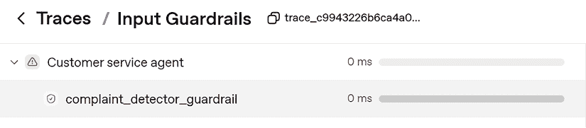

图 8.2: Traces 模块中的输入防护栏

### 注意

注意的是，输入防护栏仅对多代理系统中的第一个 agent 执行。这意味着它们充当整个工作流的初始网关，在用户输入流向其他 agent 之前对其进行筛选。

在这个示例中，触发输入防护栏触发器的逻辑相当基础。例如，如果客户使用了“complaint”以外的单词，触发器将无法被触发。

让我们更新之前的示例并使防护栏逻辑更加复杂。创建一个名为 `input_guardrail.py` 的新 Python 文件并运行以下代码。首先，导入必要的包并设置环境：

```python
### 必要的导入
import os
from dotenv import load_dotenv
from agents import Agent, Runner, trace
from agents import GuardrailOutput, InputGuardrailTripwireTriggered, input_guardrail, RunContextWrapper, TResponseInputItem
from pydantic import BaseModel
### 从 .env 文件加载环境变量
load_dotenv()
### 获取 API key
api_key = os.getenv("OPENAI_API_KEY")
```

接下来，创建一个检查状态的简单工具。这与之前的相同，但现在它将作为客服工作流的一部分：

```python
### 创建一个工具
@function_tool()
def get_order_status(orderID: int) -> str:
    """
    根据订单 ID 返回订单状态
    Args:
        orderID (int) - 客户订单的 ID
    Returns:
        string - 客户订单的状态消息
    """
if orderID in (100, 101):
        return "Delivered"
elif orderID in (200, 201):
        return "Delayed"
elif orderID in (300, 301):
        return "Cancelled"
```

现在，让我们定义一个防护栏 agent 使用 Pydantic 模型来指示提示词是否与客户服务相关：

```python
class GuardrailTrueFalse(BaseModel):
    is_relevant_to_customer_service_orders: bool
```

有了这个模型，我们现在可以创建防护栏 agent。它的唯一工作是判断用户的提示词是否与客户服务相关：

```python
# 创建一个防护栏 agent
guardrail_agent = Agent(
    name="Guardrail check",
    instructions="你是一个 AI agent，检查用户的提示词是否与回答客服和订单相关问题",
    output_type=GuardrailTrueFalse,
)
```

接下来是防护栏函数本身。该函数运行防护栏 agent，如果提示词不相关则触发触发器：


### 创建防护栏

```python
@input_guardrail
async def relevant_detector_guardrail(
    ctx: RunContextWrapper[None],
    agent: Agent,
    prompt: str | list[TResponseInputItem]
) -> GuardrailFunctionOutput:

    result = await Runner.run(guardrail_agent, input=prompt)
    tripwire_triggered = False
if result.final_output.is_relevant_to_customer_service_orders == False:
         tripwire_triggered = True
return GuardrailFunctionOutput(
        output_info="The word Complaint has been detected",
        tripwire_triggered=tripwire_triggered
    )
```

最后，让我们定义主客户服务代理，挂载防护栏并在简单的循环中运行它：

```python
### 定义一个代理
agent = Agent(name="Customer service agent",
              instructions="You are an AI Agent that helps respond to customer queries for a local paper company",
              model="gpt-4o",
              tools=[get_order_status],
              input_guardrails=[relevant_detector_guardrail])
with trace("Input Guardrails"):
    while True:
        try:
            question = input("You: ")
            result = Runner.run_sync(agent, question)
            print("Agent: ", result.final_output)
        except InputGuardrailTripwireTriggered:
            print ("This comment is irrelevant to customer service.")
```

让我们检查一下这里做了哪些更改。首先，我们不再使用硬编码的关键词检查，而是依赖另一个代理（`guardrail_agent`）来评估用户的输入。该代理配置了清晰的指令，用于判断提示是否与客户服务和订单查询相关，且其输出使用 Pydantic 模型（`GuardrailTrueFalse`）进行类型化。

其次，在 `relevant_detector_guardrail` 函数中，我们使用用户的输入异步调用 `guardrail_agent`。然后检查结果：如果代理指示提示不相关，我们将 `tripwire_triggered` 标志标记为 `True`。这使得防护栏变得更加灵活，因为它可以处理广泛的措辞或意图，而不是依赖单一的关键词匹配。

总体而言，这种模式要健壮且可扩展得多，因为它允许你使用轻量级、廉价的模型进行过滤和验证，同时将更强大（且成本更高）的模型留给处理实际的客户交互。

如果我们运行程序并询问与客户服务无关的问题，它会停止执行并告诉我们此评论与客户服务无关：

```
You: What's the meaning of life?
This comment is irrelevant to customer service
```

### 注意

这里有一个微小但重要的调整是防护栏函数被定义为 `async`。这是必要的，因为防护栏本身在异步调用另一个代理（`Runner.run`）。在实践中，这意味着每当防护栏函数调用其他代理时，你就需要使用异步防护栏函数。

现在我们已经熟悉了输入防护栏，让我们把注意力转向输出防护栏。

## 输出防护栏

输出防护栏的作用类似，但它们验证的不是进入你的代理系统的内容，而是验证输出的内容。可以将它们想象成空乘人员，确保乘客有序下机，并确保没有不安全的物品离开飞机。在实践中，输出防护栏在代理响应返回给用户之前作为最后一个检查点。它们使你的代理系统能够执行约束条件，例如格式合规性、敏感数据脱敏或确保输出符合政策指南。

在我们的客户支持场景中，假设我们确保代理的最终响应始终包含一个有效的交付订单状态声明（例如，“您的订单 #5474 正在送途中，将于明天到达。”）。如果代理输出了无关的内容（例如没有状态详情的道歉，或者更糟糕的幻觉），我们希望系统在它到达客户之前将其拦截。

与输入防护栏类似，输出防护栏被实现为返回 `GuardrailFunctionOutput` 对象的函数，其逻辑用于判断是否触发了触发器。如果输出无效或不安全，触发器将阻止响应到达用户。区别在于，由于输出可以是结构化对象（如果代理定义了 `output_type`），防护栏函数会接收该输出对象。

让我们来看一个示例。创建一个名为 `output_guardrail_agent.py` 的新 Python 文件并运行以下程序。我们首先导入所需的模块并加载环境变量：

```python
### 必要的导入
import os
from dotenv import load_dotenv
from agents import Agent, Runner, function_tool, trace
from agents import GuardrailFunctionOutput, OutputGuardrailTripwireTriggered, output_guardrail, RunContextWrapper
from pydantic import BaseModel
### 从 .env 文件加载环境变量
load_dotenv()
### 访问 API key
api_key = os.getenv("OPENAI_API_KEY")
```

接下来，我们为输出定义了简单的 Pydantic 模型：

```python
class MessageOutput(BaseModel):
    response: str
class GuardrailTrueFalse(BaseModel):
    is_relevant_to_customer_service: bool
```

该代理检查主代理的响应是否适用于客户服务：

```python
### 创建一个防护栏代理
guardrail_agent = Agent(
    name="Guardrail check",
    instructions="You are an AI agent that checks if the agent response is relevant to answering a customer service question and not hallucinating",
    output_type=GuardrailTrueFalse
)
```

然后我们编写强制防护栏的函数：

```python
### 创建防护栏
@output_guardrail
async def relevant_detector_guardrail(
    ctx: RunContextWrapper[None],
    agent: Agent,
    output: MessageOutput
) -> GuardrailFunctionOutput:

    result = await Runner.run(guardrail_agent, input=output)
    tripwire_triggered = False
if result.final_output.is_relevant_to_customer_service == False:
         tripwire_triggered = True
return GuardrailFunctionOutput(
        output_info="",
        tripwire_triggered=tripwire_triggered
    )
```

在这里，我们定义了一个故意会产生“幻觉”的客户服务代理，以展示防护栏如何捕捉输出：

```python
### 定义一个代理
agent = Agent(name="Customer service agent",
              instructions="You are an AI Agent that outputs song lines and poems", # 强制模型产生幻觉并触发输出防护栏
              output_guardrails=[relevant_detector_guardrail])
```

最后，我们在循环中运行代理并捕获触发防护栏的情况：

```python
with trace("Output Guardrails"):
    while True:
        try:
            question = input("You: ")
            result = Runner.run_sync(agent, question)
            print("Agent: ", result.final_output)
        except OutputGuardrailTripwireTriggered:
            print ("The agent system did not produce an output. Please try again")
```

在这个示例中，我们创建了一个输出防护栏。我们为 `relevant_detector_guardrail` 函数装饰了 `@output_guardrail`，这意味着该防护栏会在代理生成响应后运行。在防护栏内部，我们使用代理的输出异步调用防护栏代理。如果结果显示响应无效，防护栏将通过抛出 `OutputGuardrailTripwireTriggered` 异常来停止执行。

如果触发器触发，异常会被捕获，我们不会向用户显示代理幻觉或无关的响应，而是显示安全的备消息：“代理系统没有产生输出。请重试。”

如果我们运行程序，无论输入什么，都会触发输出防护栏，因为我们已经配置让代理故意产生幻觉：

```
You: what's the status of my return?
The agent system did not produce an output. Please try again
```


输出护栏（Output guardrails）可以针对多种场景进行定制。它们可以被用于确保每个响应都包含清晰且有效的订单状态，验证结果是否符合特定的模式（schema），或者自动移除敏感细节（如个人身份信息）。通过在流水线的最末端应用这些检查，你可以确保响应完全你应用程序所需的精确标准。

将输出护栏想象成最后的安全防护网。即使系统的早期组件表现得不可预测，这些护栏也能确保最终返回给用户的内容是安全的、合规的符合业务需求的。

## 日志、追踪与可观测性

管理代理（agents）不仅意味着实施护栏，还意味着拥有良好的观测性基础设施，以完全理解你的代理正在做什么。OpenAI Agents SDK 通过强大的 `Traces` 模块记录代理运行期间的事件序列（模型调用、工具调用、交接、护栏触发等）。

所有代理运行都会自动启用追踪，并可以通过 OpenAI 仪表板进行访问。这为调试和监控提供了一个开箱即用的解决方案，能够捕捉丰富的事件集。这些记录的事件作为跨度（spans）存储在运行的整个追踪（trace）中。理解追踪（traces）和跨度（spans）之间的区别很有用：

- **Trace (追踪)**：代表你的代理系统的一个完整执行流。它就像是针对特定用户提示从开始到结束发生的所有事件的时间线。与一次运行相关事件都分组在此追踪下。
- **Span (跨度)**：追踪中的单个事件或操作，具有开始时间和结束时间。跨度可以嵌套，并且还可以包含对调试有用的额外属性数据。

将追踪看作一次用户请求的完整执行过程，而将跨度看作该执行过程中的各个步骤。

追踪和跨度模型是非常强大的：这意味着你可以追踪复杂的序列，并查看哪些操作花费了多少时间以及它们是如何相互相关的。例如，你可以看到整个追踪耗时 3.2 秒，其中 1.5 秒是 LLM 在思考，0.5 秒是数据库工具调用，以此此类推。

`Traces dashboard` 提供了这些事件的可视化序列，可以展开查看细节，如提示词或工具的输入/输出。这在开发过程中非常有用，可以逐步查看代理内部执行的操作。

让我们来看一个例子。创建一个名为 `basic_trace.py` 的新 Python 文件并运行以下程序：

```python
from agents import Agent, Runner
from dotenv import load_dotenv
load_dotenv()
### 创建一个代理
agent = Agent(
    name="QuestionAnswerAgent",
    instructions="You are an AI agent that answers questions in as few words as possible"
)
result = Runner.run_sync(agent, "Where is the Eiffel Tower?")
print(result.final_output)
```

在不编写任何额外代码的情况下，SDK 在 `Traces` 模块中自动完成了完成了日志记录。如果我们打开 `Traces dashboard`，可以看到追踪和相应的跨度：

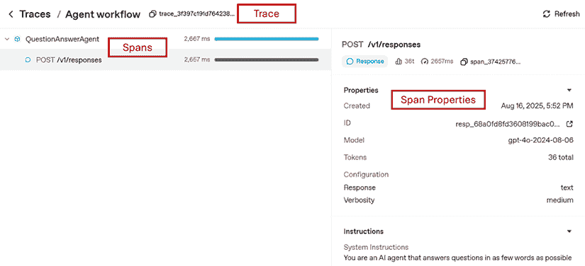

图 8.3：Traces 模块中的跨度

现在，让我们通过自定义追踪、自定义跨度以及将追踪和跨度分组，增加日志和可观测性的复杂性。

## 自定义追踪和跨度

使用 `trace` 函数可以为追踪自定义属性（例如自定义名称）。追踪调用中的任何内容（代码执行、代理运行等）都将记录在该追踪下。让我们来看一个例子。创建一个名为 `custom_trace.py` 的 Python 脚本，输入以下代码：

```python
from agents import Agent, Runner, trace
from dotenv import load_dotenv
load_dotenv()
### 创建一个代理
agent = Agent(
    name="QuestionAnswerAgent",
    instructions="You are an AI agent that answers questions in as few words as possible"
)
with trace("Henry's Workflow"):
    result = Runner.run_sync(agent, "Where is the Eiffel Tower?")
    print(result.final_output)
```

在这里，我们为追踪提供了名为“Henry’s Workflow”的自定义名称。这将使我们能够更容易在 `Traces` 模块中找到该追踪：

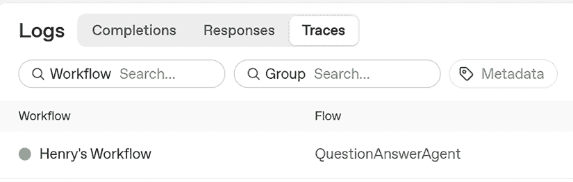

图 8.4：Traces 模块中的日志

注意，你也可以 `traces.start()` 和 `traces.finish()`，但不建议这样做。

正如我们之前讨论过的，跨度会自动为代理交接和工具调用等操作创建，但在多代理系统中，创建自己的自定义跨度来记录某些特定内容可能是很有用的。这里的处不仅在于日志记录，你还可以看到跨度花费了多长时间。

要创建自定义跨度，我们可以直接使用 SDK 的 `custom_span` 函数。创建一个名为 `custom_span.py` 的新 Python 文件并运行以下程序：

```python
from agents import Agent, Runner, trace, custom_span
from dotenv import load_dotenv
import time
load_dotenv()
### 创建一个代理
agent = Agent(
    name="QuestionAnswerAgent",
    instructions="You are an AI agent that answers questions in as few words as possible"
)
with trace("Henry's Workflow"):
    with custom_span("Task 1"):
        time.sleep(5)
    with custom_span("Task 2"):
        result = Runner.run_sync(agent, "Where is the Eiffel Tower?")
    with custom_span("Task 3"):
        time.sleep(5)
    with custom_span("Task 4"):
        time.sleep(5)
```

在这个示例中，我们创建了五个自定义跨度，每个都有不同的名称。目前，自定义跨度要么执行代理运行，要么睡眠五秒。由于这些自定义跨度，我们可以在 `Traces dashboard` 中看到与之相关的日志：

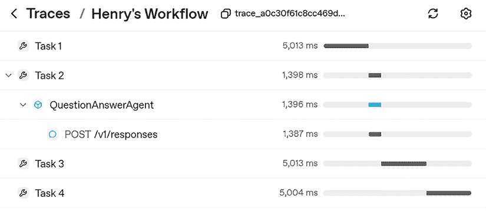

图 8.5：Traces module 中的任务

你可以将自定义跨度放在代理系统的各个位置。这有助于将复杂的工作流分解为更小的步骤。通过策略性地添加跨度，你可以精确定时间花费在哪里。

## 多追踪分组

你可能希望将多次代理运行合并到一个追踪中。默认情况下，分别调用两次 `Runner.run` 将产生独立的追踪，但在语义上，你可能认为它们是一个工作流的一部分。我们可以使用 `trace()` 上文管理器将它们联系在一起。

创建一个名为 `multiple_agents_in_one_trace.py` 的新 Python 文件并运行以下程序：

```python
from agents import Agent, Runner, trace, custom_span
from dotenv import load_dotenv
import time
load_dotenv()
### 创建一个代理
agent = Agent(
    name="QuestionAnswerAgent",
    instructions="You are an AI agent that answers questions in as few words as possible"
)
with trace("Henry's Workflow"):
    with custom_span("Task 1"):
        result = Runner.run_sync(agent, "Where is the Statue of Liberty?")
    with custom_span("Task 2"):
        result = Runner.run_sync(agent, "Where is the Eiffel Tower?")
    with custom_span("Task 3"):
        result = Runner.run_sync(agent, "Where is the Notre Dame?")
    with custom_span("Task 4"):
        result = Runner.run_sync(agent, "Where is the Burj Khalifa?")
```

在 `Traces module` 中，所有这些运行现在都将属于同一个追踪（而不是独立的追踪）。

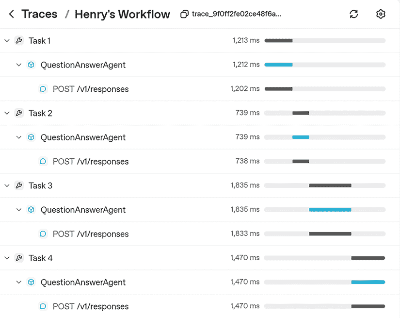

图 8.6：Traces module 中的多个任务


这也可以发生在不同的 Python 程序之间，通过在 traces 调用中传递一个唯一的 `trace_id`。创建一个名为 `multiple_agents_in_one_trace_2.py` 的新 Python 文件，并运行程序三次以模拟三次调用，从而在 Traces（追踪）模块中看到它们：

```python
from agents import Agent, Runner, trace, custom_span
from dotenv import load_dotenv
import time
load_dotenv()
### 创建一个代理
agent = Agent(
    name="QuestionAnswerAgent",
    instructions="你是一个 AI 代理，尽可能用少的语言回答问题"
)
with trace("Henry's Workflow", trace_id="A1B2C3"):
    with custom_span("Task 1"):
        result = Runner.run_sync(agent, "Where is the Statue of Liberty?")
```

由于我们传递了 `trace_id` 参数，我们现在可以根据意愿多次独立运行该程序，它仍然会在 Traces 模块中被分组在一个 trace 下：


图 8.7：Traces 模块中相同 trace ID 下的任务

这对于长时间运行或分布式工作流非常有益，因为流程的不同部分可能在不同的时间甚至在不同的机器上执行。通过分配相同的 `trace_id` 值，你可以将来自多个会话的活动缝合为一个贯的 trace，更容易查看工作流的完整生命周期。

就像 traces 一样，span（跨度）也可以分组。spans 甚至可以嵌套。假设你有一个执行两个主要任务的代理工作流：研究和文本生成。每个部分都可以有自己的代理集和工具调用。通过自定义 spans，这些活动可以分组，以便它们在 Traces 模块中以“组合”的形式出现。

创建一个名为 `nested_spans.py` 的新 Python 文件并运行以下程序：

```python
from agents import Agent, Runner, trace, custom_span, function_tool
from dotenv import load_dotenv
import time
load_dotenv()
@function_tool
def get_fun_facts():
    return "The Eiffel Tower is in Paris"
@function_tool
def clean_up_poem(poem_string: str):
    return poem_string.upper()
### 创建研究代理
research_agent = Agent(
    name="Research",
    instructions="You are an AI agent that performs research",
    tools=[get_fun_facts]
)
### 创建文本生成代理
text_generation_agent = Agent(
    name="Text Generation",
    instructions="You are an AI agent that pertakes research that's performed and writes a poem",
    tools=[clean_up_poem]
)
with trace("Henry's Research Workflow"):
    with custom_span("Research Task"):
        result = Runner.run_sync(research_agent, "The Eiffel Tower")
    with custom_span("Text Generation Task"):
        result = Runner.run_sync(text_generation_agent,
            result.final_output)
    print(result.final_output)
```

这会将研究和文本生成任务分别分组。

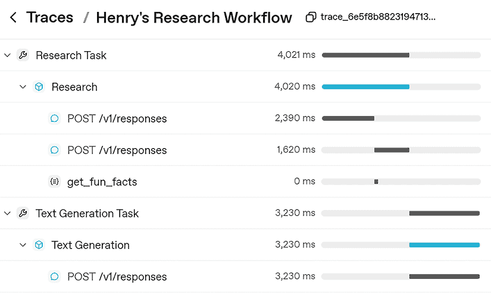

图 8.8：Traces 将多个对象分到一起

这意味着你可以更容易地找到这些任务并看到它们花费多长时间，这对于调试和管理非常有用。

## 禁用追踪

有时，你可能想要禁用追踪。这可能是因为监管要求不保留任何日志或数据，或者可能存在某些你不希望存储在日志中的敏感材料。在这种情况下，你可以通过在 Python 脚本顶部放置以下代码来禁用追踪，该代码设置了 `OPENAI_AGENTS_DISABLE_TRACING` 环境变量：

```python
import os
os.environ["OPENAI_AGENTS_DISABLE_TRACING"] = "1"
```

## 代理测试

代理管理的另一个重要方面是测试，这对于确认其按预期运行并随时间推移保持可靠至关重要。当代理连接到更广泛的工作流或直接暴露给终端用户时，这一点变得更加关键。挑战在于，代理的行为通常不可预测且具有非确定性（相同的输入可以产生不同的输出），使得代理比传统软件更难验证。幸运的是，OpenAI Agents SDK 提供了结构化的方法，为测试过程带来严谨性和一致性。

我们将讨论两种类型测试测试类型：

- 端到端测试（End-to-end testing）：整个代理系统是否按预期运行？
- 单元测试（Unit testing）：整个代理系统中的某个组件是否按预期运行？

那么，让我们开始吧！

## 端到端测试

端到端测试评估代理系统何时产生理想的输出。对于我们的客户支持代理，端到端测试可能涉及模拟真实的用户问题，并查看代理是否返回了帮助性的答案、使用了正确的工具或恰当地执行了交接。

传统上，这涉及定义输入和预期输出，并验证我们的系统是否产生了预期输出。然而，由于代理系统及其非确定性，事实证明这是困难的，但并非不可能。一种方法是由人工验证代理系统是否产生了理想输出。另一种更自动的方法是让 LLM（甚至是另一个代理）来判断代理系统是否产生了理想输出。

让我们写一个简单的脚本，为之前编写的客户服务代理进行端到端测试：一个返回状态的客户服务代理。创建一个名为 `test_to_end.py` 的 Python 脚本并编写以下代码。我们首先导入所需的模块并加载环境变量：

```python
### 必要的导入
import os
from dotenv import load_dotenv
from agents import Agent, Runner, function_tool
from pydantic import BaseModel
### 加载环境变量
load_dotenv()
### 获取 API key
api_key = os.getenv("OPENAI_API_KEY")
```

接下来，我们定义一个给定 ID 后返回状态的工具：

```python
### 创建工具
@function_tool(
        name_override="Get Status of Current Order",
        description_override="根据 ID 返回订单状态",
        docstring_style="Args: 格式的整数"
)
def get_order_status(orderID: int) -> str:
    """
    根据 ID 返回订单状态
    Args:
        orderID (int) - 客户订单 ID
    Returns:
        string - 客户订单的状态消息
    """
if orderID in (100, 101):
        return "Delivered"
elif orderID in (200, 201):
        return "Delayed"
elif orderID in (300, 301):
        return "Cancelled"
```

现在，我们将此工具封装到简单的客户服务代理中：

```python
### 定义代理
agent = Agent(name="Customer service agent",
              instructions="你是一个 AI 代理，帮助回复本地纸公司的客户查询",
              model="gpt-4o",
              tools=[get_order_status])
```

让我们通过询问订单 200 的状态来测试代理：

```python
### 运行逻辑框架
result = Runner.run_sync(agent, "What's the status of my order? My Order ID is 200")
### 打印结果
print(result.final_output)
```

我们知道这个代理利用 `function_tool` 返回订单状态。现在，让我们为这个代理系统构建一些端到端测试。这从为每个场景定义输入和预期输出开始。然后，我们将编写一个脚本，遍历每个场景，使用输入运行代理系统，然后将代理系统的输出与预期输出进行比较。


### 创建 Scenario 类

```python
### create Scenario class
class Scenario(BaseModel):
    scenario: str
    input: str
    expected_output: str
list_of_scenarios = [
    Scenario(
        scenario="Delivered example",
        input="Hi there, could you check my customer order? It's 101",
        expected_output="The order is delivered"
    ),
    Scenario(
        scenario="Delayed",
        input="My order ID is two hundred, why has my package not been delivered yet?",
        expected_output="The order is delayed"
    ),
    Scenario(
        scenario="Order does not exist",
        input="What's the status of my Order? Its number is 400",
        expected_output="No status or order can be found"
    )
]
```

我们需要一个简单的输出类型（`True`/`False）和一个专用的测试智能体来评估结果：

```python
### create output type
class OutputTrueFalse(BaseModel):
    test_succeeded: bool
### create testing agent
testing_agent = Agent(name="Testing agent",
              instructions="You are an AI Agent that tests expected outputs from desired outputs of an agentic AI system",
              output_type=OutputTrueFalse)
```

最后，遍历每个场景并检查智能体是否产生了预期的结果：

```python
### Run test
for scenario in list_of_scenarios:
    print(f"Running scenario {scenario.scenario}")
    result = Runner.run_sync(testing_agent, f"Input: {scenario.input} ||| Expected Output: {scenario.expected_output}")
    print(result.final_output)
    print('---')
```

如果运行运行这个程序，它将遍历每个场景并执行端到端测试（由智能体或 LLM 为我们执行比较）：

```
Running scenario Delivered example
test_succeeded=True
---
Running scenario Delayed
test_succeeded=True
---
Running scenario Order does not exist
test_succeeded=True
---
```

现在，如果对对智能体系统进行了更改，只需重新运行它，它将执行相同的测试。

由于所有测试都成功了，这表明智能体成功使用了工具并将结果包含在响应中。如果测试失败，可能意味着智能体没有调用工具（可能是提示词问题）或格式化答案不符合意料。在实际场景中，您将分析失败原因以改进智能体（可能调整指令或工具实现）。

## 单元测试

单元测试评估系统中特定行为或组件的性能。对于智能体系统，这可能意味着确保某些工具正在被调用、某些智能体被正确移交、某些护栏（guardrails）被触发等。为了做到这一点，我们可以利用 SDK 的 `result` 和 `context` 对象并检查它们，以确保某些预期得到满足。

让我们来看一个示例，在之前示例的脚本基础上进行扩展。假设我们想要测试在调用智能体时 `function_tool` 是否真的被调用了。为了做到这一点，我们可以检查 `result` 对象并验证 `function_tool` 中的 `get_order_status` 函数是否确实被调用。在之前的脚本中添加以下代码：

```python
from agents import ToolCallItem
### Run a unit test to check if the function_tool was called
result = Runner.run_sync(agent, "Please provide me the status of order 101")
### Inspect items in the result
items = result.new_items
print("Tool calls made during this run:")
for item in items:
    if isinstance(item, ToolCallItem):
        print(f"- {item.raw_item.name} was called")
### Assert that get_order_status was called
if any(item.raw_item.name == "get_order_status" for item in items if isinstance(item, ToolCallItem)):
    print("get_order_status was called as expected")
else:
    print("get_order_status was not called")
```

在此代码段中，我们对客服智能体进行了简单的查询，然后检查 `result` 对象的 `new_items` 属性。这让我们能够确切看到智能体决定调用哪些工具。通过检查 `get_order_status` 工具是否出现在此列表中，我们可以确认智能体的控制逻辑按预期工作。在这种情况下，我们确实确认了 `get_order_status` 被调用了：

```
Tool calls made during this run:
- get_order_status was called
get_order_status was called as expected
```

这样的单元测试非常有价值，因为它们让你对智能体行为的特定方面充满信心。与其只验证最终输出，您可以检查中间步骤，例如是否调用了正确的工具、是否发生了正确的智能体移交，或者是否触发了护栏。这种细粒度的控制有助于定位问题，并确保您的系统在持续迭代时保持可靠性。

# 总结

在本章中，我们关注了如何对使用 OpenAI Agents SDK 构建的智能体系统进行管理、监控和验证。我们从可视化开始，学习了如何生成显示智能体、工具和移交流程的图表，使系统架构更容易理解和调试。然后，我们引入了输入和输出护栏，它们作为保护层来执行策略并防止不安全或相关的交互。从那里，我们探索了 `Traces` 模块，它记录了每次运行的追踪（traces）和跨（spans），让你对智能体的内部行为有详细的洞察。最后，我们查看了测试，包括端到端测试和单元测试，以系统地验证智能体的可靠性。


- *编排多智能体工作流*：接下来，我们将编排一个多智能体工作流来自动化个性化的客户触达。一个智能体将收集信息（来自数据库、过去的聊天记录和网络搜索），并将其传递给第二个智能体，由后者编写自定义电子邮件。此示例演示了智能体如何通过按顺序协作来完成从端到端的复杂任务。

在本章的末尾时，你将学会如何应用 `OpenAI Agents SDK` 从零开始构建真实的 AI 智能体系统。我们将整合之前章节中中学到的所有内容，包括工具、内存、会话和多智能体编排。这个最终项目将汇集你所学的所有知识，为你做好准备，使你能够在现实世界中创建自己的强大 AI 智能体。

## 技术要求

请遵循 *第 3 章*中列出的详细步骤来设置你的环境。

在本书中，每个章节的实用示例和完整代码已发布在本书的 GitHub 仓库中：[`github.com/PacktPublishing/Building-Agents-with-OpenAI-Agents-SDK`](https://github.com/PacktPublishing/Building-Agents-with-OpenAI-Agents-SDK)。

鼓励你克隆该仓库，复用并调整提供的代码样本，并在阅读本书的过程中根据需要参考它们。

## 构建一个客服员工 AI 智能体

我们的第一个案例研究涵盖了一个为名为 *PaperCo* 的虚拟公司提供的 AI 驱动客服聊天机器人。该公司向企业客户提供纸制品。

我们将构建的 AI 智能体将充当虚拟客服员工，处理客户问题、投诉和订单查询。它将整合我们之前讨论过的多个高级功能：

* 用于从数据库查询订单状态的函数工具
* 用于在公司政策文档中查找信息的向量搜索工具
* 用于忽略无关用户提示的输入护栏（input guardrail）
* 如果用户表达取消服务的意图，则交给专门的子智能体（留存智能体）

所有这些组件共同工作，创建一个健壮且交互式的聊天机器人，它既能检索事实性数据，又能智能地管理对话流。下图展示了其工作原理：

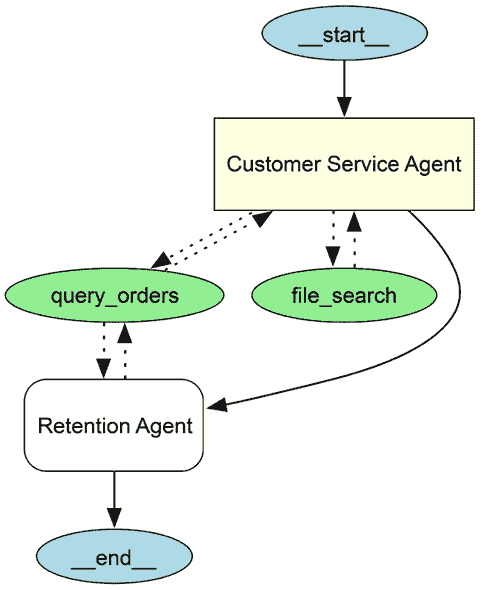

图 9.1: 智能体可视化

让我们来看这个 AI 智能体的每个组件：

* **订单数据库和查询工具**：一个存储订单的 SQLite 数据库和一个智能体可以调用以查找订单状态的函数工具（`query_orders`）。工具强制客户在检索订单信息之前提供密钥（以确保信息安全）。
* **知识库搜索工具**：一个基于文件的向量搜索工具（`file_search`），允许智能体从客服政策文档中检索答案（用于通用 FAQ 问题或公司政策信息）。
* **输入护栏（相关性检查器）**：一个护栏智能体，用于检查用户查询并拦截与客户服务无关的查询（以防止离题请求）。之前的图中没有包含护栏。
* **留存智能体**：一个专门负责“留存”场景的智能体。如果客户说他们想取消服务，该智能体将接管对话。它会以同理心处理这种情况并尝试留住客户（甚至提供激励）。
* **主客服智能体**：用户交互的主要智能体（`"Customer Service Agent"`），即入口点。它使用上述工具和护栏，并知道何时交给留存智能体。该智能体通过会话维护跨轮对话的对话状态，因此它可以处理多轮对话。

这些部分共同构成了一个整体，展示了 AI 智能体如何作为一个胜任的客服员工。在接下来的章节中，我们将深入研究每个组件，探索如何逐步实现它们。

## 设置数据库

首先，我们需要一些数据供智能体运行。对于我们的示例，我们将创建一个小型 SQLite 数据库来存储订单信息，并预加载一些示例订单。

下面的设置脚本将创建一个 SQLite 数据库文件并在 orders 表中填充一些虚假订单记录。它还定义了两个测试查询函数来验证数据。

创建一个名为 `setup.py` 的新 Python 文件并运行以下程序：

```python
import sqlite3
### 设置 SQLite 数据库
conn = sqlite3.connect("paper_data.db")
cursor = conn.cursor()
### 如果 orders 表存在则删除
cursor.execute("DROP TABLE IF EXISTS orders")
### 创建 orders 表
cursor.execute("""
CREATE TABLE IF NOT EXISTS orders (
    order_id INTEGER PRIMARY KEY,
    authorization_key TEXT,
    order_status TEXT
)
""")
### 插入虚假订单数据
orders_data = [
    (1001, "154857", "shipped"),
    (1002, "154857", "processing"),
    (1003, "958542", "delivered"),
    (1004, "445720", "cancelled"),
]
cursor.executemany("INSERT OR IGNORE INTO orders (order_id, authorization_key, order_status) VALUES (?, ?, ?)", orders_data)
conn.commit()
conn.close()
```

在此代码中，我们使用 Python 创建了一个名为 `paper_data.db` 的新 SQLite 数据库文件和 orders 表。然后，我们插入了四个示例订单，每个订单都关联一个客户授权密钥。

## 设置向量存储

下一步是创建一个向量存储，其中包含智能体可以查询的客服信息。要完成此操作，请按照步骤操作：

1. 前往 OpenAI 平台 [`platform.openai.com/`](https://platform.openai.com/) 并使用与生成 API 密钥时相同的账户登录。
2. 选择右上角的 **Dashboard**，选择 **Storage**，切换到 **Vector stores**。

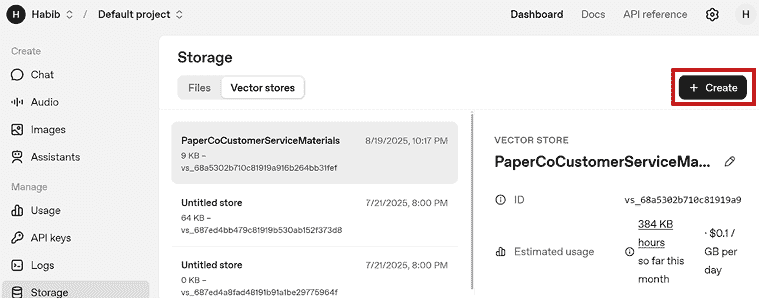

图 9.2: 向量存储

 **快速小贴**：需要此图的高分辨率版本吗？在 next-gen Pack Reader 中打开本书，或在 PDF 版本中查看。

**next-gen Pack Reader** 随本书购买赠赠。扫描二维码或访问 [`packtpub.com/unlock`](https://packtpub.com/unlock)，然后使用搜索栏按名称查找此书。双检显示的版本以确保获取正确的版本。


1. 点击 **Create** 创建一个新的向量存储。输入向量存储名称——例如 `PaperCoServiceMaterials`。
2. 向下滚动并通过 **Add files** 向向量存储添加文件。
3. 上传 **PaperCoServiceMaterials** 文件（可以在本书的 *第 4 章*GitHub 仓库中找到）。将其命名为 `PaperCoServiceMaterials.docx` 为 **Purpose** 字段选择 `user_data`。然后点击 **Attach**。
4. 我们上传的 `.docx` 文件已成功添加到新的向量存储中，所有与启用 RAG（如生成嵌入等）的相关操作已完成。
5. 复制并保存刚刚创建的向量存储 ID。该 ID 将出现在向量页的右上角。

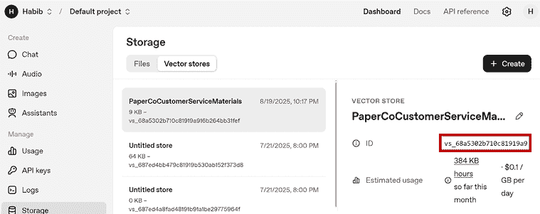

图 9.3: Storage 页面

在本节中，我们将设置一个包含客服材料的向量存储，AI 智能体将利用这些材料回答问题。

## 创建查询数据的函数工具


下一步是创建一个代理（agent）可以使用查询订单数据库的函数工具。正如我们之前学到的，`OpenAI Agents SDK` 允许我们通过封装 Python 函数来创建一个工具。在本文中，我们将定义一个名为 `query_orders` 的函数，它将在 `orders` 表上执行 SQL 查询并返回结果。该函数将使用 `@function_tool` 装饰器，使其成为代理可以访问的工具。重要的是，我们的 `query_orders` 工具将强制查询仅返回与给定授权密钥匹配的订单结果（防止 AI 访问它不应访问的订单）。

创建一个名为 `agent.py` 的 Python 文件并输入以下代码：

```python
from agents import ( 
    Agent, Runner, SQLiteSession, trace, 
    function_tool, FileSearchTool
)
import sqlite3
from agents import (
    GuardrailFunctionOutput, InputGuardrailTripwireTriggered, 
    input_guardrail, RunContextWrapper, TResponseInputItem
)
from pydantic import BaseModel
from dotenv import load_dotenv
from agents.extensions.visualization import draw_graph
load_dotenv()
@function_tool
def query_orders(sql_query: str, authorization_key: str):
    """
    在 orders 表上执行指定的 SQL 查询并返回结果。
    你必须提供 authorization_key。
    Table: orders
        order_id INTEGER PRIMARY KEY,
        authorization_key TEXT,
        order_status TEXT
    只有匹配提供的 authorization_key 的行可以被访问。
    """
    db_path = "paper_data.db"
try:
        conn = sqlite3.connect(db_path)
        cursor = conn.cursor()
        # 将用户的查询封装为由 authorization_key 过滤的子查询
        sub_query = f"(SELECT * FROM orders where authorization_key = {authorization_key}) a"
        filtered_query = sql_query.replace("orders", sub_query)
        cursor.execute(filtered_query)
        result = cursor.fetchall()
        conn.close()
        return result
    except Exception as e:
        return f"Error querying orders.db: {e}"
```

在这里，我们定义了带有两个参数的 `query_orders`：`sql_query`（包含代理想要执行的 SQL 查询字符串）和 `authorization_key`（应与客户授权密钥匹配的字符串）。函数连接到 `paper_data.db` 并执行 SQL 查询。

在函数内部，发生了一些巧妙的操作来强制执行检查：它获取传入的 SQL 查询，并将任何对 `orders` 表的引用替换为通过提供的 `authorization_key` 参数过滤的子查询。

换句话说，如果代理尝试运行诸如 `SELECT * FROM orders WHERE order_id = 1003` 的查询，该函数将将其转换为 `SELECT * FROM (SELECT * FROM orders WHERE authorization_key = 958542) a WHERE order_id = 1003`。通过这样，只有当订单具有匹配的授权密钥时，查询才会返回结果，从而防止了未经授权的数据访问。

### 注意
虽然使用 `authorization_key` 过滤查询是一个非常有用的教学示例，但它不应被视为生产系统的最佳实践。在查询中硬编码或直接传递授权密钥会引入风险，例如 SQL 注入漏洞或密钥泄露。在真实的代理系统中，你通常会通过安全的身份验证和授权层（例如 `OAuth`、API 令牌、基于角色的访问控制）来存储和验证授权凭据。

## 创建向量库搜索工具

除了特定的订单查询外，我们的客户服务聊天机器人还应该处理通用问题。例如，用户可能会问“你们的退货政策是什么？”或提到某些需要参考公司指南的内容。为了让代理能够准确回答此类问题，我们将使用 `FileSearchTool`，这是一个由 OpenAI 托管的工具，可以搜索文档的向量库索引。我们已经创建了一个向量库，其中包含一个列出客户服务相关文档。

在 `agent.py` 中添加以下代码。这将使用向量库 ID 实例化 `FileSearchTool`，以便代理可以查询它：

```python
file_search_tool = FileSearchTool(
    vector_store_ids=['<在此输入你的向量库 ID>']
)
```

代理现在能够搜索向量库来回答问题了。

## 创建输入护栏（input guardrail）

我们还将添加一个输入护栏，以确保我们的代理系统不被误用。如果用户询问完全无关的问题（例如“给我讲个笑话”），我们的聊天机器人不应该尝试回答。为了处理这种情况，我们将包含一个输入护栏，它将拦截用户的问题并判断其是否与客户服务相关。

我们将通过创建一个轻量级分类代理（`guardrail_agent`）来实现，它的唯一工作是检查输入并输出一个布尔标记，指示该查询是否与客户服务相关。然后，我们将使用 `@input_guardrail` 装饰器将此检查插入我们的主代理中。如果护栏判断用户提示词不相关，它将抛出 `InputGuardrailTripwireTriggered` 异常，我们可以捕获该异常并优雅地处理离题查询。

让我们定义护栏代理和护栏函数。在 `agent.py` 脚本中添加以下代码：

```python
class GuardrailTrueFalse(BaseModel):
    is_relevant_to_customer_service: bool
### 创建护栏代理
guardrail_agent = Agent(
    name="Guardrail check",
    instructions="你是一个检查用户提示是否与客户服务相关的 AI 代理",
    output_type=GuardrailTrueFalse,
)
### 创建护栏
@input_guardrail
async def relevant_detector_guardrail(
    ctx: RunContextWrapper[None],
    agent: Agent,
    prompt: str | list[TResponseInputItem]
) -> GuardrailFunctionOutput:

    result = await Runner.run(guardrail_agent, input=prompt)
    tripwire_triggered = False
    if result.final_output.is_relevant_to_customer_service == False:
         tripwire_triggered = True
return GuardrailFunctionOutput(
        output_info="",
        tripwire_triggered=tripwire_triggered
    )
```

`relevant_detector_guardrail` 函数会在代理处理用户提示之前异步运行。简单来说，当用户说话时，护栏代理会对其分析。如果护栏代理判断查询不相关，就会触发“触发”，阻止主代理正常响应。

## 创建留存代理（retention agent）

接下来，我们需要设置一个留存代理。这是一个处理表示想要取消订单或不满的客户的专用代理。

我们将作为一个 `Agent` 实例定义留存代理，并赋予其特定的指令。在 `agent.py` 文件中添加以下代码：

```python
retention_agent = Agent(
    name="Retention Agent",
    instructions=(
        "你是一个留存代理。你的目标是鼓励客户不要取消服务，"
        "理解他们的痛点并对处境表示同情。如果客户坚持要取消，"
        "你可以向其账户提供高达 100 美元的积分额度作为留存激励。"
    ),
    tools=[query_orders],
)
```

我们的留存代理将非常有礼貌、富有同理心，并在需要时提供额度（最高 100 美元）来说服客户不要取消服务。

## 创建客户服务代理

此时，我们已经拥有了创建主客户服务代理所需的所有组件。该代理将整合到目前为止提到的所有内容（工具、护栏和交接）。在 `agent.py` 文件中添加以下代码：


```python
customer_service_agent = Agent(
    name="Customer Service Agent",
    instructions=(
        "Introduce yourself as the complaints agent."
        "Handle any customer complaints with empathy and clear next steps."
        "Use the file_search_tool to get general answers to questions"
        "For specific order related queries, you the query_orders function_tool"
        "To use the query_order tool, you will need the user's authorization key"
    ),
    tools=[query_orders, file_search_tool],
    input_guardrails=[relevant_detector_guardrail],
    handoffs=[retention_agent]
)
```

让我们来拆解一下这些参数：

- `name` 和 `instructions`：我们将客户服务智能体命名为 `"Customer Service Agent"`，并指令它表现得投诉代理。我们给它的提示词（prompt）非常详细，并就何时使用某些工具以及何时进行交接（handoffs）提供了指导。我们还明确提到了在使用 `query_orders` 时需要授权密钥。

- `tools`：我们传递了 `query_orders` 和 `file_search_tool`。这意味着智能体的 LLM 可以在推理过程中选择调用这些函数。

- `input_guardrails`：我们挂载了 `relevant_detector_guardrail`。这意味着输入到该智能体的每个用户输入都将通过该守卫函数。如果守卫判断输入内容不相关，它将阻止智能体继续正常运行。

- `handoffs`：我们在列表中包含了 `retention_agent`。通过这种方式，我们实际上创建了一个多智能体系统。如果对话需要留存专家，OpenAI Agents SDK 可以执行交接。

到此为止，我们的客户服务智能体已经完全定义好了。它拥有获取信息所需的工具、一个保持其运行不偏离轨迹的守卫，以及一个用于特定场景的备份智能体。现在，让我们为我们的智能体系统构建运行器（runner）。

## 构建运行器

在实际应用中，我们将此部署到聊天界面。在这里，我们将在终端中模拟交互循环。我们将使用 `SQLiteSession` 对象来维护对话状态（以便智能体在不同轮次之间记住上下文），并使用 `Runner.run_sync()` 方法在循环中处理用户输入。我们还将处理由守卫触发的异常，以便在用户询问范围之外的内容时通知他们。

在 `agent.py` 中添加以下代码：

```python
### 创建会话
session = SQLiteSession("session")
last_agent = customer_service_agent
with trace("Customer service agent"):
    while True:
        try:
            question = input("You: ")
            result = Runner.run_sync(last_agent, question, session=session)
            print("Agent: ", result.final_output)
            last_agent = result.last_agent
        except InputGuardrailTripwireTriggered:
            print ("This comment is irrelevant to customer service.")
```

我们现在准备好开始模拟我们的智能体系统了。

## 测试智能体

让我们测试一下智能体并开始模拟我们的智能体系统。首先，我们将尝试询问智能体一些与客户服务无关的问题，以验证它是否能成功触发守卫机制：

```
You: What's 5 + 15?
This comment is irrelevant to customer service.
```

现在，让我们询问智能体一个关于订单的问题。注意它主动向我们索要授权密钥：

```
You: What's the status of my order? It's 1002
Agent: To check the status of your order, I'll need your authorization key. Could you please provide that?
You: Sure, it's 154857
Agent: Your order with ID 1002 is currently in the "processing" status. If there's anything else you need or if you have any concerns, feel free to let me know!
```

此时，尝试问一个通用的客户服务问题并验证它可以执行向量搜索：

```
You: How much do I need to order to qualify for the bulk discount?
Agent: To qualify for a bulk discount, you need to place an order over $500\. This qualifies for a 5% discount which is applied automatically. If you need any further assistance, feel free to ask!
```

最后，要求智能体注销我们的账户，并观察向留存智能体的交接。我们还会看到它向我们发送了留存优惠：

```
You: I want to cancel my account
Agent: I'm sorry to hear you're considering canceling your account. Could you let me know what's prompting this decision? I'd love to help resolve any issues or concerns you might have. If there's something specific bothering you, maybe I can assist or find a suitable solution for you.
You: It's just too expensive
Agent: I understand how important it is to manage expenses. To help with that, I can offer you a $100 credit on your account, which can ease the cost a bit. Would that work for you?
```

我们所有的测试都成功了。这样，我们构建了一个全功能的 AI 智能体系统，它通过机器人充当客服员工。这个示例展示了一个协同使用多个高级功能的完整智能体。主智能体可以检索事实数据、搜索文档、维护上下文，甚至委托给专门的智能体，同时确保其处于自己的领域内。

在结束本节之前，让我们回过头思考一下我们刚刚构建的内容。你已经看到客户服务智能体如何将多个组件（查询数据的工具、检索文档的向量搜索、保持轨迹的守卫以及与专门智能体的交接）整合到一个协作系统中。这个示例很重要，因为它展示了如何编排 SDK 的不同功能来创建一个真实的智能体。

在下一节中，我们将在此基础上继续，使用 AI 智能体为 *PaperCo* 实现自动化工作流。

## 编排自动化多智能体工作流

我们的第二个案例研究展示了如何在工作流中使用 AI 智能体。我们的公司 *PaperCo* 希望定期向客户发送跟进邮件，关注他们的兴趣并微妙地推广产品优惠。与其手动研究每个客户并编写邮件，我们可以构建一个智能体系统来完成任务。

此工作流将涉及两个顺序执行的智能体：

- **客户研究智能体**：该智能体收集有关客户的信息——包括来自数据库的基本信息、最近的记录（以回想起兴趣或个人信息），甚至是与这些兴趣相关的最新新闻。

- **邮件创建智能体**：该智能体接收研究智能体汇总的信息，为客户生成一封简短且个性化的邮件，同时提到产品优惠。

下图显示了这些组件是如何组合的：

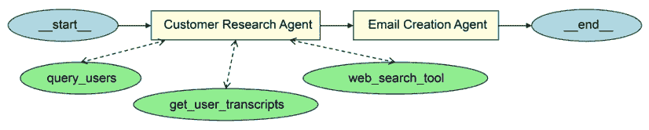

图 9.4：工作流组件图

让我们来看每个组件：

- **用户数据库和查询工具**：一个包含客户详细信息（姓名、电子邮件、位置等）的 SQLite 数据库，以及一个通过 ID 检索客户信息的 `query_users` 工具函数。

- **客户记录数据和检索工具**：一个包含客户过去对话记录的 JSON 文件，以及一个用于提取特定用户记录的 `get_user_transcripts` 工具。记录包含了客户在之前的聊天中提到的个人兴趣（例如他们喜欢的运动或食物）。

- **网络搜索工具**：一个允许智能体执行网络搜索的工具（`web_search_tool`）。智能体将使用它寻找与客户兴趣相关的最新信息（例如，如果客户喜欢某支球队，智能体可能会找到最近的比赛结果或关于该球队的新闻）。


- **客户研究代理（Customer research agent）**：一个使用上述工具来编制“客户画像”或简报的代理。它将输出一份摘要或相关信息的集合，用于个性化电子邮件。
- **邮件创建代理（Email creation agent）**：一个接收研究输出并生成实际电子邮件的代理。它被配置为生成结构化结果（包含主题和正文等字段），并将个性化元素（兴趣爱好或新闻）与营销信息（例如 `PaperCo` 的新优惠活动）相结合。该代理还将使用另一个更倾向于个性化写作的 GPT 模型。

我们还将创建一个简单的循环（编排工作流），它会遍历客户列表，为每个客户运行研究代理，然后在保存生成的邮件之前将结果传递给邮件代理。

*这些组件共同构成了一个完整的工作流，将零散的数据转换为精细的、个性化的客户电子邮件。在下一节中，我们将从设置客户数据库开始，它是研究代理工作的基础。*

## 设置客户数据库

与第一个示例一样，我们将从设置一些数据开始。为此，我们将创建一个名为 `customer_details.db` 的数据库，其中包含一个名为 `users` 表，用于存储基础客户信息（例如姓名、电子邮件、位置、业务类型和电话号码）。此示例的设置脚本将创建数据库并填充几个示例用户。

创建一个名为 `setup.py` 的新 Python 文件并运行以下代码设置数据库：

```python
import sqlite3
### 设置 SQLite 数据库
conn = sqlite3.connect("customer_details.db")
cursor = conn.cursor()
### 为客户详情创建 users 表
cursor.execute("""
CREATE TABLE IF NOT EXISTS users (
    user_id INTEGER PRIMARY KEY,
    first_name TEXT,
    last_name TEXT,
    email TEXT,
    location TEXT,
    business_type TEXT,
    phone_number TEXT
)
""")
### 插入虚假用户数据
users_data = [
    (1, "Emily", "Clark", "emily.clark@example.com", "New York", "Retail", "555-1234"),
    (2, "Michael", "Nguyen", "michael.nguyen@example.com", "San Francisco", "E-commerce", "555-5678"),
    (3, "Sophia", "Patel", "sophia.patel@example.com", "Chicago", "Wholesale", "555-8765"),
    (4, "David", "Martinez", "david.martinez@example.com", "Houston", "Manufacturing", "555-4321"),
]
cursor.executemany(
    "INSERT OR IGNORE INTO users (user_id, first_name, last_name, email, location, business_type, phone_number) VALUES (?, ?, ?, ?, ?, ?, ?)",
    users_data
)
conn.commit()
conn.close()
```

每个用户都有电子邮件和基础个人资料。这些细节可能用于为客户量身定制邮件，或者至少填充收件人字段。

## 设置转记录 JSON 文件

我们还需要一个名为 `customer_transcripts.json` 的 JSON 文件，其中包含每个客户的历史对话转记录。这些转记录基本上是之前的支持聊天日志，其中包含了客户提到他们的爱好或偏好的个人对话（这些是能够让邮件看起来更具个性化的细节细节）。

创建一个名为 `customer_transcripts.json` 的新文件，并从本书的 GitHub 仓库中复制该文件的内容：

```json
{
"conversations": [
{
"user_id": 1,
"date": "2024-06-01",
"transcripts": "Hi, I have a question about my order... (conversation with support agent)... I'm a big fan of the New York Knicks... (more chat)..."
},
{
"user_id": 2,
"date": "2024-06-02",
"transcripts": "Can I change my delivery address?... I'm a sushi fan... also I love the San Francisco Giants... (more chat)..."
},
    ...
  ]
}
```

每个对话日志都包含 `user_id`、日期和一段合并的对话转记录。在这个示例中，我们可以看到用户 1 提到自己是纽约尼克斯队（篮球球队）的粉丝，而用户 2 则谈到了喜欢寿司以及是金山巨人队（棒球球队）的粉丝。

## 创建检索数据和搜索网页的函数工具

数据就绪后，我们需要创建代理可以用来获取这些数据的工具。我们将创建两个函数工具：

- `query_users`：在 `users` 表上运行 SQL 查询并获取用户信息
- `get_user_transcripts`：加载转记录 JSON 并提取给定用户的所有转记录，并将它们作为一个大字符串返回。

创建一个名为 `agent.py` 的新 Python 文件并输入以下代码来创建这两个函数工具：

```python
from agents import (
    Agent, Runner, SQLiteSession, trace, 
    function_tool, WebSearchTool
)
import sqlite3
from pydantic import BaseModel
from dotenv import load_dotenv
from agents.extensions.visualization import draw_graph
import json
load_dotenv()

@function_tool
def query_users(sql_query: str):
    """
    在 users 表上执行指定的 SQL 查询并返回结果。
    Table: users
    """
    db_path = "customer_details.db"
    try:
        conn = sqlite3.connect(db_path)
        cursor = conn.cursor()
        cursor.execute(sql_query)
        result = cursor.fetchall()
        conn.close()
        return result
    except Exception as e:
        return f"Error querying users: {e}"

@function_tool
def get_user_transcripts(user_id: int) -> str:
    """
    从 customer_transcripts.json 提取并返回给定 user_id 的所有转记录的长字符串。
    """
    json_path = "Chapter9/WorkflowAutomation/customer_transcripts.json"
    try:
        with open(json_path, "r", encoding="utf-8") as f:
            data = json.load(f)
        transcripts = [
                conv["transcripts"]
                for conv in data.get("conversations", [])
                if conv.get("user_id") == user_id
            ]
        return "\n\n".join(transcripts) if transcripts else ""
    except Exception as e:
        return f"Error reading transcripts: {e}"
```
*(注：此处根据上下文逻辑对翻译代码块进行了微调，以确保逻辑自洽，同时保持代码结构完整。)*

我们还将使用一个 OpenAI 托管的工具来启用我们的代理执行网页搜索。在 `agent.py` 文件中添加以下代码创建该工具：

```python
web_search_tool = WebSearchTool()
```

到此，我们已经拥有了构建代理所需的一切。

## 创建客户研究代理

现在，让我们创建此工作流中的第一个代理。该代理的工作是为邮件提供全面的上下文，然后生成一份包含以下信息的报告：

- 客户的基础详情（姓名、位置等）
- 从转记录中汲取的关于个人兴趣或笔记的摘要
- 与这些兴趣相关的、两个当前新闻事项或事实的摘要

让我们创建该代理。在 `agent.py` 中添加以下代码：


```python
customer_research_agent = Agent(
    name="Customer Research Agent",
    instructions=(
        "你是一个 AI 智能体，负责对客户进行研究以创建客户画像。"
"给定一个客户 ID，你应该创建一个包含以下内容的客户报告："
"- 获取客户详情"
"- 读取关于客户兴趣的之前的客户转记录，用于个性化电子邮件"
"- 针对其在转记录中记录的兴趣点，总结最新新闻（搜索网络）"
    ),
    tools=[web_search_tool, query_users, get_user_transcripts]
)
```

在这个智能体中，`instructions`（指令）是至关重要的。在这里，我们解释了它的角色，然后列出了所需的特定任务。我们还包含了我们创建的所有工具。

## 创建邮件创建智能体

该智能体将接收来自研究智能体的输出作为输入，并生成实际的电子邮件。为了确保邮件结构良好（易于发送），我们将让该智能体生成带有特定字段的 `JSON` 对象：收件人邮箱、发件人邮箱、主题和邮件正文（我们可以用 `HTML` 生成正文）。

我们将使用 `Pydantic` 模型来定义邮件预期的输出架构（例如 `To` 字段、`Subject` 字段等）。通过向 `agent.py` 中添加以下代码来定义模型：

```python
class EmailOutput(BaseModel):
    to_email: str
    from_email: str
    subject: str
    html_email: str
```

现在，我们可以创建邮件智能体并告诉它使用这种输出类型：

```python
email_creation_agent = Agent(
    name="Email Creation Agent",
    instructions=(
        "你是一个 AI 智能体，通过生成电子邮件与 PaperCo 的客户保持联系。"
        "你的目标是根据另一个智能体提供的信息创建一个电子邮件。"
        "以微妙的方式使用这些信息，就像你正尝试与他们分享与其兴趣相关的新闻故事或个人特色一样。"
        "邮件的目标是亲切并与他们取得联系，同时也让他们知道我们在纸制品产品上的最新优惠。"
        "纸制品最新优惠包括一项高级订阅计划，所有订单均可享 90 折优惠。"
        "邮件应该非常简洁，只需几句话，并且直击主题"
    ),
    output_type=EmailOutput,
    model="gpt-4.1-2025-04-14"
)
```

在这个智能体中，我们将 `output_type` 设置为 `EmailOutput`，这样智能体就会尝试输出符合 `EmailOutput` 架构的 `JSON`。SDK 将通过 `Pydantic` 解析模型的输出，因此我们直接在 Python 中得到一个 `EmailOutput` 对象结果（具有易访问的字段）。

例如，假设研究智能体发现一位名为 Sarah 的客户最近提到了她对可持续办公用品的热。邮件创建智能体可能会输出类似的内容：

```json
{
  "to_email": "sarah@example.com",
  "from_email": "support@paperco.com",
  "subject": "关于环保用品的简短说明",
  "html_email": "<p>Hi Sarah,</p><p>我们看到可持续发展对你很重要，所以我们认为你会喜欢这篇关于环保办公趋势的最新文章。我们很高兴地分享，我们新的高级订阅计划让您的所有订单（包括我们的再生纸系列）都能享 10 折优惠。</p><p>Best,<br>PaperCo Team</p>"
}
```

这显示了智能体并非仅仅输出纯文本，而是将输出结构化为定义良好的、准备好发送的 `JSON` 对象。这样，开发者可以直接将其接入他们的邮件投递系统，而无需额外的解析或格式化。

我们还手动将模型调整为 `GPT-4.1`。撰写一封将个人色彩与促销活动缝融合的良好邮件可能需要更强大的模型（如 `GPT-4`）才能做好，因此我们显式选择了一个更长个性化写作的 `GPT-4` 变体。

## 编排工作流

最后，我们需要在一个脚本将两个智能体连接在一起，为每个客户运行工作流。为此，对于每个 `user_id`，我们将执行以下操作：

1. 使用 `user_id` 作为输入运行 `customer_research_agent`。这将返回一个包含画像/新闻摘要的结果。
2. 获取研究智能体的结果并将其作为输入传递给 `email_creation_agent`。
3. 获取最终的邮件输出（将是一个 `EmailOutput` 对象）。
4. 将该输出保存到文件中。

向 `agent.py` 添加以下代码：

```python
for user_id in ["1", "2", "3", "4"]:
    with trace(f"Workflow automation agent for user: {user_id}"):
        result = Runner.run_sync(customer_research_agent, input=user_id)
        print(result.final_output)
        email = Runner.run_sync(email_creation_agent, result.final_output)
        print(email.final_output)
        # 将邮件写入新的 JSON 文件，标题等于 user_id
        with open(f"{user_id}.json", "w", encoding="utf-8") as f:
            json.dump(email.final_output.dict(), f, ensure_ascii=False,
                indent=2)
```

在这里，我们遍历 `user_id`s（从 `1` 到 `4`）。对于每一个 ID，我们将操作封装在 `trace` 中，这将帮助我们看到用户的操作。现在，我们有了测试所需的一切。

## 测试工作流

让我们运行程序并观察发生了什么。在这里，我们将查看 `1` 的结果。首先要提到的是 `customer_research_agent` 创建了关于该客户的报告。我们可以在 **轨迹** 模块中看到这一点：

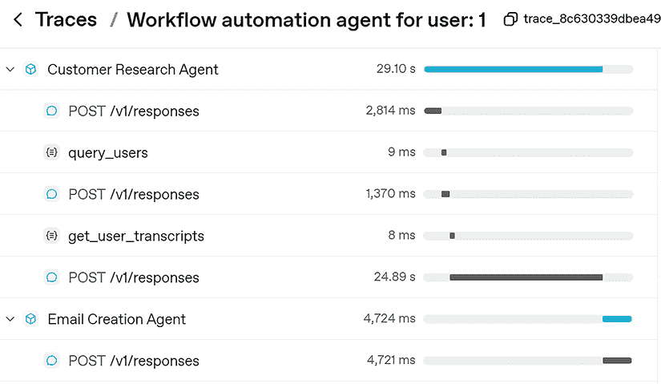

图 9.5：此工作流的轨迹

此智能体的输出如下：

```
客户画像：Emily Clark
个人信息：
姓名：Emily Clark
邮箱：emily.clark@example.com
...
客户兴趣：根据之前的互动，Emily 对篮球有浓厚兴趣，特别是纽约尼克的粉丝。她喜欢和朋友一起打球，并最近购买了运动鞋。此外，她在打球后喜欢吃意大利披萨。
与其相关的最新新闻：
Mikal Bridges 的续约：
2025 年 8 月 1 日，Mikal Bridges 与纽约尼克斯签署了为期四年、价值 1.5 亿美元的续约合同。该合同包括 2029-30 赛季的球员选择权和交易补偿条款，使其在六个月内不可被转会。通过接受略低于顶薪合同的薪水，Bridges 为尼克斯提供了额外的薪资灵活性以增强阵容。自 2024 年加入尼克斯以来，Bridges 一直是球队成功的关键，帮助他们进入了 25 年来的首次东区决赛。
```


随后，报告被馈送给下一个代理（`email_creation_agent`）。该代理获取报告并在生成 `EmailOutput` 对象之前创建一封个性化的电子邮件。然后，该对象被保存到名为 `1.json` 的文件中，如下：

```json
{
  "to_email": "emily.clark@example.com",
  "from_email": "hello@paperco.com",
  "subject": "Big Knicks News & Exclusive PaperCo Offer!",
  "html_email": "<p>Hi Emily,</p><p>Exciting times for Knicks fans—Mikal Bridges just signed a new contract extension, and Coach Mike Brown is now at the helm! With games heating up and sunny weather ahead, it's the perfect season for basketball.<p><p>在您为秋季准备之际，我们想与您分享最新的 PaperCo 高级订阅：每笔订单享 9 折优惠，让您的零售采购更加轻松。如果您想了解更多信息，请告诉我们！</p><p>保持活力，Go Knicks!<br/>The PaperCo Team</p>"
}
```

这种方式，我们有两个代理协作为该客户创建了一封个性化的推广电子邮件，以向其推销优惠。扩展此工作流有很多方法。例如，您可以使用工具让代理通过 `简单邮件传输协议`（`SMTP`）工具自动发送电子邮件。您还可以创建另一个代理来决定目标客户。一旦您学会了如何以这种方式混合组合工具和代理，可能性就是无限的。

# 总结

在最后一个最后一个章节中，我们构建了两个全面的代理驱动解决方案，将您所有的技能汇聚了一起。首先，我们为 `PaperCo` 开发了一个客户服务聊天机器人，它结合了多种高级功能。它使用数据库工具进行订单查询（带有权限检查），使用知识库搜索查询常见问题（FAQ），设置输入相关性护栏，并将取消请求移交给专门的留存代理。接下，我们创建了一个工作流自动化系统来使客户外联邮件个性化。在在那个案例研究中，一个研究代理收集了每位客户的详细信息和兴趣（通过数据库查询、转录检索和网络搜索），然后将其交给电子邮件代理，由其生成了带有新产品优惠的定制消息。

回顾您在整本书中的旅程，您从理解什么是 AI 代理以及它们为什么重要开始。您学习了 `OpenAI Agents SDK` 的基础，设置了环境，并从零开始构建简单的代理。从那里开始，您通过工具和协议扩展了代理的能力，为它们提供了内存和检索机制，探索了多代理交接，并练习了模型和上下文的管理。您还学习了如何对您的系统进行监控、安全和治理，以便它们在生产环境中可靠地运行。这些步骤都为您在最后一个章节中组装的复杂端端系统做好了准备。

关键收获是，您现在拥有一套完整的工具包，用于构建可以处理有意义的真实世界任务的代理。您可以设计不仅响应单个提示词（prompt），而且与数据源集成、记忆上下文、与其他代理协作并在定义的策略内安全运行的代理。这种技能使您能够超越实验，迈向实地部署，无论您是在自动化重复的业务工作流、创建专门的助手，还是创新全新的应用程序。

最重要的是，您应该意识到这仅仅是一个开始。代理系统领域正在快速演进，您所获得的知识让您处于这场变革的最前沿。以 `OpenAI Agents SDK` 为基础，您完全有能力探索新架构、集成新兴工具并推向 AI 代理成就的边界。可能性是广阔的，下一代智能系统将由像您这样的构建者来塑造。

祝 AI 代理构建愉快！

## 立即解锁本书的专属福利

扫描此二维码或访问 [`packtpub.com/unlock`](https://packtpub.com/unlock)，然后按书名搜索此书

**注意**：在开始之前请准备好您的购买发票。


[www.packtpub.com](https://www.packtpub.com)

订阅我们的在线数字图书馆，即可访问超过 7,000 本书和视频，以及行业领先的工具，帮助您规划个人发展并推进职业生涯。

# 为什么要订阅？

- 通过来自 4,000 多名行业专业人士实用电子书和视频，减少学习时间，投入更多时间编写代码
- 通过专为您定制的技能计划（Skill Plans）提高学习效率
- 每月获得一本免费电子书或视频
- 完全可检索，方便访问关键信息
- 内容可以复制粘贴、打印和书签标记

在 [www.packtpub.com](https://www.packtpub.com)，您还可以阅读免费技术文章集，订阅一系列免费时事邮件，并接收 Packt 图书和电子书的专属折扣和优惠。

# 您可能感兴趣的其他书籍

如果您喜欢这本书，你可能对 Packt 的其他书籍感兴趣：


**AI Agents in Practice (实战 AI 代理)**

Valentina Alto

ISBN: 978-1-80580-135-1

- 构建代理组件，如 LLM、内存系统、工具集成和上下文管理
- 使用 LangChain 等框架开发生产就绪代理
- 使用编排（orchestration）创建有效的多代理系统
- 为特定行业实现代理
- 设计具有短期和长期记忆的代理架构
- 通过监控、护栏和人类监督实施负责任 AI
- 优化生产环境中的 AI 代理性能和成本


**Generative AI with LangChain (基于 LangChain 的生成式 AI)**

Ben Auffarth, Leonid Kuligin

ISBN: 1-83702014

- 使用 LangGraph 设计并实现多代理系统
- 实现在部署前识别问题的测试策略
- 部署可观测性和监控解决方案
- 构建带有重排序的代理式 RAG 系统
- 使用 LangGraph 和 MCP 构建可扩展的生产级 AI 代理
- 使用最新的 LLM 以及供应商，如 Google Gemini、Anthropic、Mistral、DeepSeek 和 OpenAI 的 `o3-mini`
- 设计符合现代伦理实践的安全合规 AI 系统

# Packt 正在寻找您这样的作者

如果您有意成为 Packt 的作者，请访问 [authors.packtpub.com](https://authors.packtpub.com) 并立即申请。我们已经与成千上万像您这样的开发者和技术人员合作过，帮助他们向全球技术社区分享见解。您可以提交通用申请、申请我们正在招募作者的热门主题，或者提交自己的想法。

# 分享您的想法

现在您已经完成了 *Building Agents with OpenAI Agents SDK*，我们想听听您的想法！如果您是从亚马逊购买的书，请[点击此处直接进入该书的亚马逊评论页面](https://packt.link/r/1806112000) 并分享您的反馈或在您购买的网站上评价。

您的评价对我们和技术社区至关重要，并将帮助我们确保交付优质内容内容

# 索引

符号

`@function_tool` 装饰器

A

代理即工具模式

功能


## 相比交接 92, 93

## 代理循环 28

## 代理原语 27, 28

## 代理 SDK
向量存储和 `FileSearchTool`，使用 126-128

## 代理测试
端到端测试 203-207
单元测试 207, 208

代理可视化 178-180

## AI 代理 5
解剖 10
构建、框架 22
构建方法论 10
客户服务代理 48-51
开发 48
设计模式 16
交接，添加 55-57
多代理编排 23, 24
概述 4
实际应用 7
工具，添加 51-55
通过简单类比 5

## AI 代理，解剖
控制逻辑框架 12
长期记忆 14, 15
记忆与知识 14
模型 10, 11
检索到的知识 16
工具接口 12, 13
训练知识 15, 16
工作记忆 14

## AI 代理，设计模式
CoT 17
分级/多代理模式 17, 18
规划器-执行模式 17
ReAct 17

## AI 代理，实际应用
更好的交互性 9
企业 9
生产力提升 7, 8

## AI 代理，对比传统系统
优缺点 6, 7

## Anthropic API key
引用链接 171

## API key
设置 38
算术计算工具 70-72
增强步骤 122

## 自动化多代理工作流
组件 227
客户数据库，设置 228, 229
客户研究代理，创建 232
邮件代理，创建 233, 224
用于检索数据的函数工具 230-232
用于搜索的函数工具 230-232
编排 226, 234, 235
测试 235-237
JSON 记录，设置 229, 230
中心系统模式 151, 152
分级系统 152-156
链式工具调用 78-80
分块 125
`CodeInterpreter` 89-91
上下文管理 172
本地上下文 173, 174
控制逻辑框架 12
`Copy.ai` 9
余弦相似度 124
CoT 17
客户数据库
设置 228, 229
客户关系管理 (CRM) 16
客户研究代理
创建 232
客户服务代理
创建 223, 224
客户服务员工 AI 代理
构建 214-216
组件 215, 216
客户服务代理，创建 223, 224
数据库，设置 216, 217
用于查询数据的函数工具 219, 220
输入防护栏，创建 221, 222
留存代理，创建 222
运行器，构建 224
测试 225, 226
向量存储搜索工具，创建 221
向量存储，设置 217-219

## 自定义工具，使用 Python 函数
代理和工具行为 65-68
链式工具调用 78-80
使用 Pydantic 的复杂工具输入 68-70
定义 62-64
示例 70-78
使用 62

## D
数据库
设置 216, 217
数据库查询工具 76-78
去中心化系统模式 156-159
群群系统 160-163

## 设计模式 16
确定性编排 133-136

## 开发前提，使用 OpenAI Agents SDK 44


# Python
- Python 异步编程 46, 47
- Python 函数架构 44-46
- Python Pydantic 数据验证 47, 48

# E
- 动态编排 136-139
- 邮件创建代理
- 创建 233, 234
- 嵌入 123
- 涌现属性 160
- 端到端测试 203-207
- 环境搭建 36
- API key，设置 38-40
- Google Colab, 替代方法 43, 44
- 安装 37, 38
- 项目目录 37, 38
- Python 版本与依赖 36, 37
- 注册， OpenAI API 38-40
- 验证 41-43
- 虚拟环境 37, 38
- 外部 API 调用工具 73-76

# F
- `FileSearchTool` 84-87
- 微调 118
- 有限上下文窗口 110
- 先进先出 (FIFO) 110
- 函数工具
- 创建，用于查询数据 219, 220

# G
- 通用知识 15
- 生成步骤 122
- `get_shipping_status` 函数 174
- Google Colab 43, 44
- 护栏原语 31, 32
- 护栏 181, 182
- 输入护栏 182-190
- 输出护栏 190-193

# H
- 交接 55, 141, 142
- 定制 146-149
- OpenAI Agents SDK 中的 139, 141
- 多代理切换 143-145
- 提示词 149-151
- 代理即工具 92, 93
- 交接原语 30, 31
- 层级/多代理模式 17, 18
- 层级系统 152-155

# I
- `ImageGenerationTool` 87, 88
- 输入护栏创建 221, 222
- 输入护栏 182-190

# J
- `Jasper.ai` 9

# L
- 大语言模型 (LLMs) 3, 39, 40
- `LiteLLM` 171
- 本地上下文 173, 174
- 日志 193-195
- 长期记忆 14, 15, 112
- 持久消息日志 112-114
- 结构化记忆检索 114-118

# M
- 记忆 14
- 记忆存储与检索 112
- 消息摘要 110, 111
- 模型 10
- 模型无关设计 165
- 模型上下文协议 (MCP) 18, 30, 97
- 服务器，作为工具添加 97, 99
- 模型管理 166
- 参数，修改 166-168
- 设置 168-171
- 第三方模型 171, 172
- 多代理编排 132
- 确定性编排 133-136
- 动态编排 136-139
- 策略 132, 133
- 多代理模式 151
- 中心化系统模式 151, 152
- 去中心化系统模式 156-159
- 多代理系统 131
- 多个 span，组合在一起 198-202
- 多个 trace，组合在一起 198-202

# O
- 可观测性 193-195
- OpenAI Agents SDK 18
- 特性，设计 22-26
- 交接 139-141
- 原语 26, 27
- OpenAI Agents SDK，原语
- 代理原语 27, 28
- 护栏原语 31, 32
- 交接原语 30, 31
- 运行器原语 28
- 工具原语 29, 30


## 追踪 (Tracing)
- `tracing primitive` 32, 33

# OpenAI API
- 注册 38-40
- OpenAI 托管工具 80, 81
- `CodeInterpreterTool` 89-91
- `FileSearchTool` 84-87
- `ImageGenerationTool` 87, 88
- `WebSearchTool` 81-84

# P
- 输出护栏 190-193
- 规划器-执行模式 17
- `primitives` 26
- `Pydantic` 47
- 使用，用于工具输入 68-70

# Python
- 异步编程 46, 47
- 函数架构 44-46
- `Pydantic` 数据验证 47, 48
- 版本与依赖 36, 37

# R
- 推理+行动 (ReAct) 17
- 留存代理
    - 创建 222
- 检索增强生成 (RAG) 11, 84, 122
- 获取的知识 16, 119-122
- 局限性 128, 129
- 非结构化数据 123-125
- `Runner primitive` 28

# S
- 语义嵌入 84
- 语义搜索 124
- 会话 (Sessions)
- 使用，用于对话管理 108, 109
- 短记忆 103
- 简单邮件传输协议 (SMTP) 工具 237
- 滑动消息窗口 110
- 软件开发包 (SDK) 21
- 跨度 (spans)
    - 自定义属性 195-197
    - 有状态系统 103
    - 无状态系统 103
    - 结构化记忆提取 114-118
    -  swarm 智能系统 (swarm system) 160-163
    - 系统提示词 11

# T
- 工具接口 12
- `tool primitive` 29, 30
- 追踪 (trace) 52
    - 自定义属性 195-197
    - 禁用 202
    - 仪表板 194
    - 模块 193
    - 追踪 (tracing) 193
    - `tracing primitive` 32, 33
    - 训练 14, 16, 119, 122
    - 转转录 229, 230

# U
- 单元测试 207, 208
- 非结构化数据 123-125
- 文摄入 125
- `FileSearchTool` 在 SDK 中使用 126-128
- 检索 125
- 向量存储，在 SDK 中使用 126-128

# V
- 向量存储 84
- 设置 217-219
- 向量搜索工具 221

# W
- `WebSearchTool` 81-84
- 工作记忆 14, 103
- 聊天对话 106-108
- 对话管理，使用会话 108, 109
- 输入和响应管理 103-106
- 长对话对话线程管理 110
- 消息摘要 110, 111
- 滑动消息窗口 110

