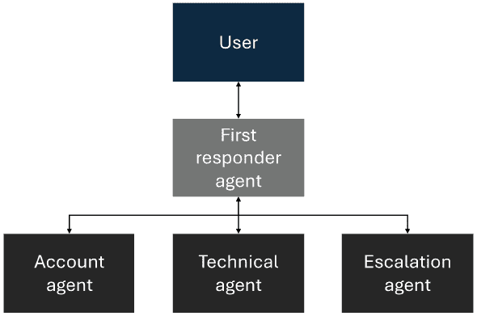
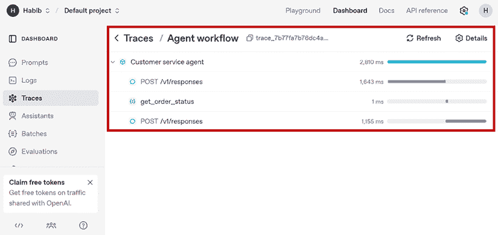

# 2 OpenAI Agents SDK 简介

一个 `SDK`，或`软件开发包`，是一组精选的库、工具和文档，让开发者能够站在他人的肩膀上。我非常喜欢这个（带点俏说的）定义，因为它用通俗易懂的话描述了每个开发者对 `SDK` 的渴望：写更少的代码。良好的 `SDK` 可以消除接线、配置和样板代码的繁琐工作，让开发者能够专注于让其应用程序脱颖出的特性。

`OpenAI Agents SDK` 用于构建 `AI` 代理（agents），其简洁性非常优人。它没有让你面对自定义配置语言或迷复杂的类层次结构，而是提供了一组清晰的原始语——`agents`、`runners`、`tools`、`handoff`、`guardrails` 和 `tracing`——这些都是用地道的 `Python` 实现的。通过这六个构建块（你甚至可以称它们为积木块），你可以在几分钟内启动一个单代理或多代理原型。

在第二章中，你将学习以下内容：

* **OpenAI Agents SDK 的设计原则**，包括最小抽象和多代理编排框架——Python 风格、灵活且可扩展

* **构成 SDK 的核心原始语**，包含每个原始语的详细示例以及如何使用它们

当你完成这一章时，你将不仅知道每个原始语的作用，还会理解为什么 `SDK` 的极简主义架构是一个实用的启动平台，帮助你快速且可靠地构建出本书其余部分将引导你构建的代理系统。

# 技术要求

在整本书中，每一章的实用示例和完整代码将通过附带的 `GitHub` 仓库提供：[`github.com/PacktPublishing/Building-Agents-with-OpenAI-Agents-SDK`](https://github.com/PacktPublishing/Building-Agents-with-OpenAI-Agents-SDK)。

我们鼓励你克隆该仓库，复用并适配提供的代码示例，并在学习章节时根据需要参考它。

# OpenAI Agents SDK 的设计特性

`OpenAI Agents SDK` 的设计考虑了几个关键原则，旨在易用性与开发者的灵活性之间取得平衡。理解这些设计选择将有助于理明为什么 `SDK` 将是这样工作的（以及它与其他解决方案有何不同）。

## 构建 AI 代理的框架

在高级层次，`OpenAI Agents SDK` 构建 `AI` 代理的方式与使用 Web 框架（如 `Django`、`Ruby on Rails` 等）构建网站的方式相同。这些框架抽象了 `AI` 代理开发和编排的低级部分。这使得开发者能够专注于更高层的影响力逻辑，并尽可能地部署代理，而无需担心脚手架代码。

通过 `SDK`，我们可以用几行 `Python` 代码创建一个代理：

```python
agent = Agent(name="Assistant", instructions="You are an AI agent",
    model="gpt-4o")
result = Runner.run_sync(agent, "Tell me a joke")
print(result.final_output)
```


这个示例使用 OpenAI GPT-4o 模型实例化了一个基础 AI 代理，并带有一些基础的系统指令。使代理能够进行迭代思考的控制逻辑框架已经嵌入到代理内部，这是框架带来的直接结果。然后，我们在用户查询上运行代理，并打印模型的输出。

**注意**

到此为止，我们引入代码是为了理解实现 SDK 的简单性和易用性。要实际运行代码，需要安装并导入必要的库，我们将在下一章中详细介绍。

如果没有 SDK，编排这些内容将显著需要数千行代码，更不用说为了创建一个 OpenAI Agents SDK 自动提供的追踪和日志系统而额外需要的数千行代码了。

OpenAI Agents SDK 的设计旨在解决构建不仅需要文本生成的 LLM 驱动流程时面临的固有挑战。这些挑战包括让模型对多步问题进行推理、与外部数据源和 API 交互（工具使用），以及在多个 AI 实体之间协调动作。

### 多代理编排

作为子集，该框架还允许开发者构建多代理解决方案。事实上，这是该框架的前身 `Swarm` 的原始目的（其核心思想是你可以以群集的方式产生一系列代理来完成任务）。这里的想法是，对于特定任务，你不能让一个代理完成一切。相反，你拥有一个*代理团队*，每个代理都专精某项任务，并在必要时相互*交接（*hand off*）委托。

想象一个客户支持工作流：



图 2.1：客户支持工作流

让我们分解并讨论一下代理工作流：

*   **首次响应代理**：接听、理解问题、执行简单的 FAQ 请求，并在根据需要交接给其他代理
*   **账户代理**：可以查询客户订单和状态
*   **技术代理**：可以修复用户身份验证漏洞并为客户设置新的连接线
*   **升级代理**：在最后的手段下引入人工参与

每个代理都专注于自己的领域，但对终端用户来说，体验感觉像是一次单一、连贯的对话。所有的上下文传递、角色切换和错误处理都发生在 SDK 的编排层中（通过一个名为 `handoffs` 的原始语完成）。你只需配置一次交接路由，让框架完成编排即可。这只需要几行代码：

```python
account_agent = Agent(name="Account agent")
technical_agent = Agent(name="Technical agent")
escalation_agent = Agent(name="Escalation agent")
first_responder_agent = Agent(
    name="First Responder",
    handoffs=[account_agent, technical_agent, escalation_agent]
)
```

## 最小抽象

OpenAI Agents SDK 背后的指导哲学之一是“用少的原始语实现快速上手”。SDK 没有引入层层又层的新类，而是给了我们一套简短易记的词汇。现实地，如果你能记住核心原始语及其工作原理，你就掌握了该框架的 80%。

这些原始语包括：`agents`、`runner`、`tools`、`handoffs`、`guardrails` 和 `tracing`。我们将在下一节深入探讨这些每一个框架，而本书的结构刻意模仿了这些原始语——因为通过每一个一个是学习该框架的最佳方式。

本质上就是这样。没有隐藏的元语言，也没有你看不见的生成代码的不透明运行时。你用纯 Python 将代理组装在一起，用 `@function_tool` 装饰几个函数，然后点击 `run`。这很重要，因为它提供了一个快速上手的体验：大多数开发者可以在午饭时间浏览一下文档或示例笔记本，并在下午构建出一个可以运行的原型。

这个 SDK 更像是一个轻量级库而不是一个庞大的框架，但这种特性也有一些权衡。与 `LangChain` 等其他综合框架不同，OpenAI Agents SDK 本身并不提供成百上千种文档加载器或内存存储器的即用集成；这些概念需要用户自行开发。

## Python 风格、可扩展且开源

OpenAI Agents SDK 使用 Python 编写并使用流利的 Python 通。没有需要斗争的 YAML 配置文件，没有需要记忆的私有作用域，也没有隐藏真实工作的元编程魔法。代理只是一个 Python 对象，工具只是一个带有特殊装饰器的普通 Python 函数。你使用每天使用的 Python 语言结构来编排它们。这使得对于 Python 开发者来说非常有用且简单，并与其他广喜的 `Flask` 和 `Pydantic` 等极简主义库有相似之处。

OpenAI Agents SDK 的默认构造已“开箱即用”，但同时也刻意留了可扩展性。你可以用自己的组件热替换任何特定的构造模块：

- 智能体对象中使用的 `model` 可以更换为任何 LLM，例如本地部署的 LLAMA 模型（前提是符合 `Chat Completions` 标准，该标准是 OpenAI 在与基础 LLM 交互时开发的标准协议；我们将在 `第 10 章` 中详细讨论这一点）。我们之前讨论过，该框架完全完全模型无关的。
- 此框架中的 `tools` 只是添加了装饰器的 Python 函数，这意味着它们可以随时轻松切换为另一个 Python 函数或托管的 API 调用，包括连接到 MCP 服务器。
- `tracing` 默认发送到 OpenAI 内部的 `Traces` 仪表板，也可以连接到任何遥测工具，如 `Azure Monitor Logs` 或 `DataDog`。

从技术上讲，甚至智能体执行循环也是模块化的。高层运行器（`runner`）处理重试、步骤限制和并发调用，但高级用户可以跳过它，在现有的事件循环或任务队列中直接驱动低级原语。

例如，高级用户与其调用 `Runner.run_sync(agent, input)`，不如使用 `agent.run_step(...)` 方法手动逐步步进智能体的执行逻辑，或者使用 `agent.get_initial_state()` 和 `agent.step(...)` 控制循环。这在需要将智能体执行与其他异步操作交替进行的环境中特别有用（例如在 FastAPI 路由内部），允许对时序、并发或资源管理进行完全控制。

最后，该 SDK 是开源的，这意味着该框架受益于完全的透明度以及不断增长的开发者群体，他们持续改进该框架并使其更具韧性。

总的来说，OpenAI Agents SDK 提供了一个精简且符合 Python 风格的框架，专门为简化和加速复杂 AI 代理（`agents`）的创建与编排而设计。通过提供极简但强大的抽象（智能体 `agents`、运行器 `runners`、工具 `tools`、交接 `handoffs`、护栏 `guardrails` 和追踪 `tracing`），该 SDK 使开发者能够无需与过多的样板代码或隐藏配置作斗，快速构建复杂的多智能体解决方案。它的可扩展性以及与现有 Python 结构的兼容性，使得在创建 AI 智能体时既能实现快速部署，又能进行深度定制。

# 核心原语 (Core primitives)

正如我们之前提到的，OpenAI Agents SDK 引入了一些核心概念（通常称为 `primitives`），我们可以使用它们来构建智能体系统。这些是使用该 SDK 构建任何智能体驱动应用的构建区块。

为了理解什么是原语，假设你正在设计一个机器人助手来帮助管理智能家居。助手应该能够关闭灯光、调整温度器、响应语音命令，并在窗户未关闭时通知你。与其从零开始构建一切，SDK 给了你一小组基础组件：一个用于定义智能体知道什么（`state`），一个用于定义它可以做什么（`tools`），一个用于定义它如何思考（`policy`），等等。这些就是 `primitives`。你像组装机器的不同零件一样组合它们，从而创建一个完备的智能体。

将原语想象成乐高套装中的乐高积木。它们是你构建任何东西时使用的最小标准单元。SDK 之后可能会包含预设的配方（类似于乐高说明书），但积木本身就是原语。

## 智能体 (Agent)

`agent` 原语是 OpenAI Agents SDK 最基础的概念。它本质上充当 LLM 外围的一个高度可配置的封装，使其具有“代理性”（即为其提供人设或 `system instructions`、工具接口，以及其自主决策和追求目标所需的其他设置）。当使用 `agent` 原语实例化智能体时，它具有以下配置：

- **Name (名称)**：智能体的名称，通常仅用于标识识别。
- **Instructions (指令)**：这些与我们在上一章讨论的系统提示词（`system prompt`）相同；它们为 LLM 提供关于其角色、目标、行为和人设的指南。
- **Model (模型)**：驱动智能体智能的底层 LLM。
- **Tools (工具)**：智能体可以调用以获取答案的工具列表。
- **Handoffs (交接)**：智能体可以委托的其他智能体列表。

这是一个智能体实例化的示例：

```
Customer_service_agent = Agent(
    name="Customer Service Agent",
    model="gpt-4o",
    instructions="""
        你是一个 AI 代理，负责以积极乐观的方式解决客户问题。
    """,
    tools=[get_account_information, refund_customer_payment,
        track_customer_order],
)
```

**Note**

`Agent` 类还可以接收其他有用参数，如护栏（`guardrails`）、输出类型等。这些将在后续章节中介绍。

意乎情的是，这些组件的大部分与我们在上一章讨论的 AI 智能体结构相匹配。这种可配置性使得开发者能够快速启动特定的智能体，以适应大型应用程序中的特定角色或任务。

该智能体既可以用自然语言响应，也可以调用它被赋予工具之一。值得注意的是，该 SDK 提供单一的 `Agent` 类，而不是某些框架为每种智能体类型拥有不同的类。在这里，智能体的行为完全取决于之前的配置。

## Runner

这个原语是智能体背后的引擎。在上一章中，我们讨论了成功代理应用的一个关键要素是其迭代和自主解决问题的能力（即它可以根据接收到的进一步输入做出决策并改变，以实现目标）。这种智能体循环功能已内置在该原语中。`Runner`（有时称为 `Agent Loop`）是与 LLM 交互、管理工具调用、决定下一步做什么以及重复该过程的循环过程。

回想一下，我们在以下伪代码中对这一系列操作进行了泛化：

```
读取目标并创建行动计划
对于计划中的每个步骤：
    创建行动输入
    执行行动
    获取结果
    将结果加入内存
    必要或未实现目标时修改行动计划
    如果目标已实现：
        将输出返回给用户
```

通过自动化这一核心逻辑，智能体循环显著简化了开发者的任务。它抽象了 LLM 交互和工具使用的低级编排，让开发者能够专注于通过指令定义智能体的高层行为，并通过工具定义其所需的能力，而不是深陷执行循环的机制中。管理这种推理循环在历史上一直是构建代理式 AI 最困难的部分之一（开发者必须捕获模型的思维链并自己实现循环逻辑）。

要调用运行原语，只需调用 `Runner` 类中的 `run` 方法：

```
result = await Runner.run(agent, "我的订单号是 XYZ - 帮我查查订单在哪里")
```

**Note**

`Runner.run()` 有一个非常有用的参数 `max_turns`，它可以限制智能体可以进行的循环次数。通过限制边界，`max_turns` 充当了安全阀，防止因错误的配置或不可解决的任务而导致无限循环。我们将在后续章节中详细介绍这一点。

`tool`（工具）原语是 OpenAI Agents SDK 中的核心概念，并且在简单性方面堪称“部署得当”。在我看来，它是该 SDK 最“美丽”的特性之一。任何 Python 函数都可以通过添加特定的工具装饰器来转换为 `tool`。该装饰器能够让智能体的 LLM 能够通过其名称、文档字符串（`docstring`）和参数自动隐式地理解该 `tool`。如果智能体的 LLM 决定调用该工具，LLM 将自动创建调用它时所需的必要参数/架构（`schema`）。

例如，我们可以创建一个根据订单 ID 返回订单状态的 Python 函数，并使用相关装饰器将其添加为一种工具。该装饰器会自动解析函数的文档字符串和参数，并将它们作为系统指令提供给 LLM，以便智能体知道它自己拥有哪些工具、可以做什么以及应该提供哪些输入参数。以下是创建工具的代码：

```python
Customer_service_agent = Agent(
    instructions="""
        你是一个 AI 智能体，以积极乐融的方式帮助解决客户问题。
    """,
    tools=[get_order_status],
)
@function_tool
def get_order_status(order_id: str) -> str:
    """根据 order_id 获取订单状态
    Args:
        order_id: 订单的 order_id
    """
## 调用 API 获取订单状态
return order_status
```

请注意，OpenAI Agents SDK 还允许开发者实例化用户定义函数之外的其他类型工具——托管工具（`hosted tools`）和作为工具的智能体（`agents as tools`）：

*   **托管工具 (Hosted tools)**：这些是由 OpenAI 具体提供并托管的内置工具。它们包含了你可能希望智能体拥有的常用工具，例如搜索网页、搜索文件、生成图像等。它们还包括连接到本地计算机 shell/终端的能力，或通过托管的**模型上下文协议** (`MCP`) 服务器的功能。
*   **作为工具的智能体 (Agents as tools)**：这些是你之前实例化的智能体，然后被转换为工具。然而，在实践中这种情况很少见，因为调用智能体通常是通过交接（`handoff`）实现的，交接更像是上下文的传递。

## 交接 (Handoff)

`handoff` 原语控制了智能体委托或转移控制权给其他智能体的机制。这使得多智能体编排成为可能，并且是该 SDK 前身 Swarm 的基础功能之一。智能体可以针对特定任务进行专门化，而交接允许你拥有一个专门的智能体系统（每个智能体都有自己的的人设和工具）来解决目标，而不是让智能体控制一切。

想象你正在创建一个创建研究报告的智能体。Agent A 专门负责制定研究计划。它将该计划传递给 Agent B，Agent B 搜索网络、提炼发现，然后将总结交给 Agent C，Agent C 专门负责接收发现并根据所需的规格创建最终报告。Agents SDK 平滑地管理每一次交接。通过以下方式可以使用该原语轻松创建这种架构：

```python
research_plan_agent = Agent(name="Research plan agent")
web_search_agent = Agent(name="Web search agent")
final_report_agent = Agent(name="Final report agent")
research_report_agent = Agent(
    name="Research report agent",
    handoffs=[research_plan_agent, web_search_agent, final_report_agent]
)
```

智能体交接（`agent handoff`）与工具调用（`tool calling`）之间的区别是什么？

*   **上下文转移 (Transfer of context)**：在交接期间，SDK 将必要的上下文（如对话历史，而不是预定义的硬性参数）传递给下一个智能体，让工作不中断地进行。
*   **控制权转移 (Transfer of control)**：交接让另一个“驱动器”接管整体目标，而不是“外包”特定的子任务。被“调用”的智能体可以调用自己的工具，然后根据需要交接给另一个智能体。

## 护栏 (Guardrails)

`Guardrails`（护栏）是 SDK 中的一种原语，作为对用户输入和智能体输出执行验证的安全机制。它们的实例化方式与工具相同（例如，在自定义 Python 函数上指定指定的装饰器），并根据你定义的逻辑触发。例如，我们可以设置一个护栏，确保用户是在询问我们的客户服务智能体客户问题，而不是随机内容。

```python
@input_guardrail
async def input_guardrail(
    ctx: RunContextWrapper[None], agent: Agent,
 input: str | list[TResponseInputItem]
) -> GuardrailFunctionOutput:
    # 判断输入是否与客户服务查询相关的逻辑
    if is_customer_service_query:
        return GuardrailFunctionOutput(
        output_info = "这是一个客户查询问题",
        tripwire_triggered = False,
    )
    else:
        return GuardrailFunctionOutput(
        output_info = "这不是一个客户查询问题",
        tripwire_triggered = True,
    )
```

如果护栏未能通过任何验证，将触发“触发表”（`tripwire`），并在 Python 中抛出特定的错误类型。此错误可以用任何需要的方式进行处理。例如，你可能希望该错误触发向用户发送消息，告知他们这不是对智能体的有效使用方式，或者故意停止任何后续执行并返回错误代码。


```python
try:
    await Runner.run(agent, "宇宙的意义是什么?")
    except InputGuardrailTripwireTriggered:
        print("请输入与客户服务相关的查询，而不是随机问题")
```

AI 智能体中的护栏概念非常重要，但很少被讨论。例如，你可能希望运行护栏，因为执行任何智能体或工具在计算上都是昂贵的。

**注意**

护栏通常以嵌入了验证规则的装饰 Python 函数的形式存在。这些可以应用于用户的初始输入或智能体的输出。然而，这些函数本身可以调用另一个智能体来检查候选输入或输出。这意味着你不仅可以将智能体作为工具，还可以作为护栏。

## 追踪 (Tracing)

`tracing` 原允许允许通过捕获和记录运行期间的详细执行流来观察和调试智能体系统。追踪就像智能体推理循环的飞行记录器。这包含了智能体做的每一个决策、工具调用、中间消息和交接。如果没有追踪，理解智能体如何以及为什么得出结果是非常困难，特别是在复杂的多智能体工作流中。

SDK 提供了一个手动使用的内置追踪工具，但更常见的方法是通过 SDK 集成的追踪系统自动启用。该系统可以将轨迹持久化到本地或发送到远程追踪后端，例如 OpenAI 的内置 UI 或你自己的观测设置。

让我们来看一个简单的例子。假设我们想调试客户服务智能体接收用户请求时的行为：

```python
From agents import Runner, enable_tracing
await Runner.run(agent, "请取消我的最后一个订单。")
```

一旦启用追踪，SDK 将捕获并记录以下内容：

* 初始用户输入和系统指令
* 模型的内部推理（思考）
* 任何工具的调用（带有参数和输出）
* 任何触发的交接（带有完整的上下文）
* 返回给用户的最终响应

所有这些都可以在 OpenAI Traces UI 或你偏好的 UI（如 DataDog）中查看：



### 图 2.2：通过追踪捕获并记录详细执行流

### 注意

追踪（Tracing）与护栏（guardrails）结合使用时格外强大。例如，当护栏触发器被激活时，追踪允许你精确捕获是什么输入导致了问题，以及到那时为止了哪些步骤。这使得在敏感应用程序中调优智能体或验证业务逻辑变得简单得多。

# 总结

在本章中，我们深入探讨了 OpenAI Agents SDK 及其特殊之处。我们看到了它极简主义的抽象哲学如何剥离样板代码，让纯 Python 代码发挥作用，同时仍然强大到足以创建复杂的智能体和多智能体解决方案。我们还看到了它是如何完全开源的，邀请了社区审查并实现了大量的扩展。

随后，我们查看了构成 SDK 的核心原语。特别是，我们关注了以下内容：

* **Agent (智能体)**：一个将 LLM 转换为自主智能体的轻量级封装。它带有名称、系统指令、可选的工具带以及一个用于潜在交接的同伴智能体列表。
* **Runner (运行器)**：驱动智能体迭代推理循环的执行引擎，处理重试并强制执行限制以防止无限循环。
* **Tools (工具)**：普通的 Python 函数（或托管的 API/智能体），经过装饰后，模型可以发现它们的用途、构建有效的参数，并在需要时恰好地调用它们。
* **Handoffs (交接)**：一种编排机制，允许智能体将控制权（以及完整的对话上下文）委托另一个智能体，从而实现优雅的多智能体工作流。
* **Guardrails (护栏)**：封装循环每一步的策略检查，确保输出、工具调用和交接保持在业务和合规边界内。
* **Tracing (追踪)**：对每个提示、响应和工具调用的自动、结构化日志——对于调试、可观察性和事后分析至关重要。

有了这些像乐高积木一样的原语，我们只需几行代码就能在几分钟内快速搭建实用的智能体。在下一章中，我们将设置环境并创建第一个智能体，将所有这些概念付诸实践。

# 订阅获取免费电子书

新框架、演进中的架构、研究发布、生产环境分析——AI_Distilled 将噪音过滤为面向一线操作 LLM 和生成式 AI 系统的工程师和研究人员的每周简报。现在订阅即可获得一本免费电子书，以及帮助你保持专注和获取资讯的每周见解。

在`https://packt.link/8Oz6Y`订阅或扫描下方二维码。


