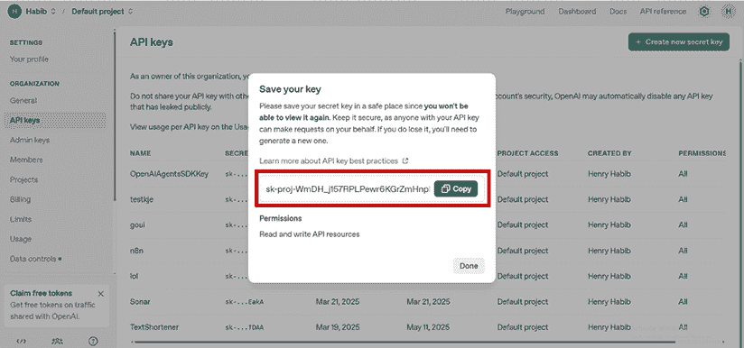
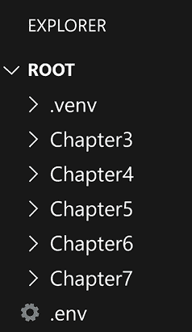
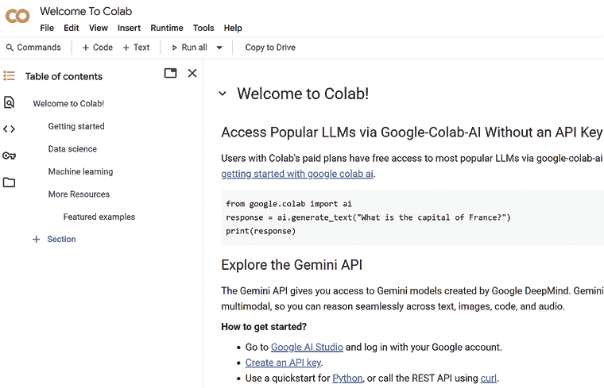
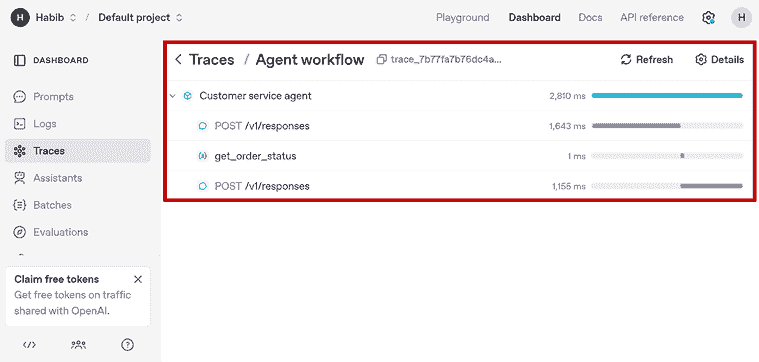
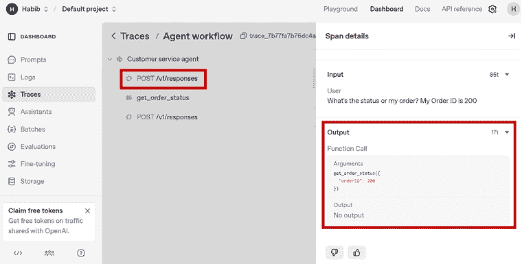
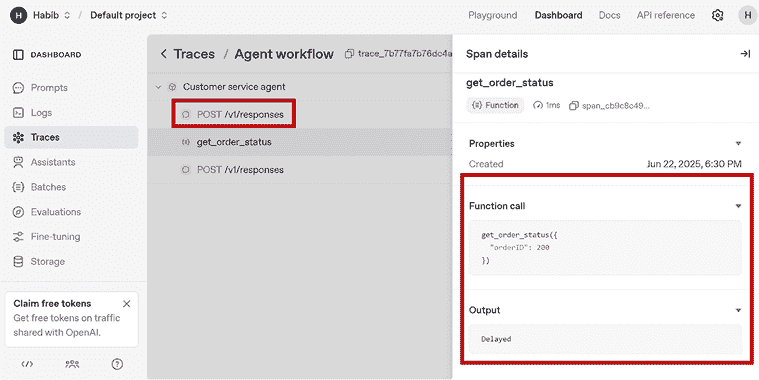

# 3 环境设置与开发你的第一个智能体

时候到了。我们可以开始大显身手，构建我们的第一个 AI 智能体了。虽然 OpenAI Agents SDK 相对直观，但我们首先需要确保环境配置恰当，并理解一些与 SDK 相关的基础 Python 概念。一个运行的环境是书中其他所有内容的启动台，从编写和运行智能体到测试工具、调试追踪以及编排多智能体工作流。

以下是你将在本章中学习到的内容：

* **环境设置**：我们将安装 Python、设置虚拟环境、安装`openai-agents` SDK 并安全地配置你的 OpenAI API 密钥。我们还将通过运行测试脚本来验证你的环境已就绪。
* **开发前提**：该 SDK 围绕我们需要注意的 Python Python 概念构建，包括类型提示、文档字符串字面量、装饰器、异步编程（`async`/`await`）以及用于结构化数据验证的 Pydantic 库。在我们构建工具以及智能体之间交互数据时，这些是必要的。
* **构建你的第一个 AI 智能体**：设置完成后，我们将创建第一个真实的智能体（它是一个客服助手），然后逐步增强它。我们将添加一个工具来处理订单状态查询，然后引入到用于客户留存的专门智能体的交接。本节将整个开发循环付诸行动，涵盖了我们之前讨论的**控制逻辑框架**的内部机制。

在本章中，我们将开始编码。在本章结束时，你将拥有一个功能完整的 SDK 环境、对 SDK 依赖的 Python 概念有基本的理解，以及一个可以接收输入、调用工具并将控制权交给其他智能体的真实运行 AI 智能体。让我们开始吧。

## 技术要求

在整书中，每一章的实用示例和完整代码将通过附的 GitHub 仓库提供：`https://github.com/PacktPublishing/Building-Agents-with-OpenAI-Agents-SDK`。

鼓励你克隆该仓库，复用并适配提供的代码示例，并在推进章节学习时根据需要参考它。

## 环境设置

使用 OpenAI Agents SDK 的第一步是成功设置你的环境，包括安装 SDK 并配置你的系统以运行它。我们将涵盖前提条件、如何使用虚拟环境设置项目，以及如何在 Windows 和 macOS 上安装 SDK。我们还需要获取 OpenAI API 密钥并确保它可以被安全地存储和访问。遵循这些步骤将有助于避免常见的安装问题，并确认你的环境已准备好开发。

### 注意

本章介绍了如何为了在本地运行 SDK 而设置环境。如果你无法在本地运行 SDK（可能是由于你的机器上缺少前提条件）或不希望这样做，那么书中涵盖的大部分内容可以使用 Google Colab 进行远程运行。如果你想采用这种方法，请跳至标题为 *Alternative methods: Google Colab* 的章节

## Python 版本与依赖

如之前所述，OpenAI Agents SDK 构建在 Python 之上。这意味着你的机器必须安装了 Python，特别是 Python 3.9 或更高版本。将你所需的 Python 实例放在你的`PATH`变量中（如果你在 Windows 上）也是非常有用的，这样`python`命令就可以你的 PowerShell/命令提示符中可用。

要验证你的机器上 Python 安装是否正确，请根据你的操作系统打开相应的控制台环境。如果你在 Windows 10 上，通常是 PowerShell 或命令提示符；如果你在 Windows 11 或 macOS 上，则是 Terminal。未来，这将简称为你的控制台。

打开你的控制台并输入以下命令。这将返回 Python 版本。验证它是否高于 3.9。如果不是或命令返回错误，请按照`https://www.python.org/downloads/`上对应操作系统的安装说明进行。输入此命令：

```
$ python – version
>>> Python 3.10.6
```

## 项目目录、虚拟环境与安装

清晰且组织良好的项目结构是构建可维护应用程序的第一步。在书中，每个示例将位于自己不同的项目文件夹中，组织在章节文件夹内，并且都在一个中央根目录内。随着我们的项目在书中变得复杂，拥有一个专用的目录对于管理智能体、工具和配置文件是至关重要的。

创建所需的项目文件夹，使其看起来如下配置。这代表了从根目录到章节的路径：

```
Root
└─ Chapter3
└─ Chapter4
```

你可以手动创建这些文件夹，也可以在控制台终端中使用`mkdir`命令。

由于我们将安装`openai-agents`库，因此必须创建一个虚拟环境，将 SDK 与你的其他 Python 项目隔离开。要创建虚拟环境，请确保你处于根目录，并在控制台终端中输入以下命令：

```
$ python -m venv .venv
```

这将创建一个新的虚拟环境，所有内容都包含你的`.venv`文件夹中。接下来，我们必须激活虚拟环境，以便我们后续所有的 Python 语句都能通过虚拟环境中的 Python 解释器（以及其中安装的库）运行。

在 macOS 上，请使用以下命令：

```
source .venv/bin/activate
```

在 Windows 上，使用此命令：

```
.venv/Scripts/activate
```

激活后，你的提示符通常会加上环境名称（例如`.venv`）。这意味着你安装的任何 Python 包或运行的任何命令将使用这个隔离环境。请注意，在任何新的终端会话中运行代码之前，你都需要激活虚拟环境。每当本书要求你`activate your virtual environment`时，意味着运行这些命令将终端置于此隔离环境中。

接下来，我们将使用 Python 的包管理器`pip`，通过在控制台终端中运行以下命令来下载并安装 OpenAI Agents SDK：

```
$ pip install openai-agents
```

此命令将下载并安装 SDK 及其所有依赖项。你应该能看到控制台输出结束于`Successfully installed openai-agents`，这表明该库已安装。此时，你已经拥有了 Python、虚拟环境以及开始构建智能体（agents）所需的所有库——下一步是设置 OpenAI 的 API 访问。

## 注册 OpenAI API 并设置 API Key

为了使用 OpenAI 的大语言模型（`LLMs`），你需要一个拥有正余额的 OpenAI 账户以及一个 OpenAI API Key。API 密钥作为将你的 API 请求与账户关联的唯一标识符。

按照以下步骤生成 OpenAI API Key：

1. 访问[`platform.openai.com/`](https://platform.openai.com/)并注册账户或登录现有账户。请注意，你需要一个有效的电子邮件地址。
2. 从右上菜单选择`Settings`，然后从左侧菜单选择`Billing`。填写你的支付详情，然后选择`Add to credit balance`。输入`$10`为你的 OpenAI API 积分余额充值 10 美元。
3. 接下来，从左侧菜单选择`API keys`并选择`Create secret key`。为此 API Key 命名，例如`OpenAIAgentsSDKKey`并选择`Default`项目。然后选择`Create secret key`生成你的私有 OpenAI API Key。
4. 此时，你将看到你的 OpenAI Key 以及`Save your key`提示。注意，这是你查看和复制 API Key 的唯一机会——之后，你将无法再次从 OpenAI 获取它。点击`Copy`按钮将 API Key 复制到剪贴板，然后暂时将其粘贴到机器上的某处（例如`.txt`文件）。
5. 下图显示了 OpenAI 平台仪表板中的 API Key 管理界面：



图 3.1：OpenAI UI 中的

生成密钥后，下一步是保护它。这对于保护你的账户免受未经授权的使用至关重要。

**注意**

此 API Key 是你 OpenAI 账户的身份验证层。因此，你必须像密码一样对待此 API Key 并采取相应的安全措施。不要共享它或将其提交到任何开放仓库中。从技术上讲，任何拥有此 API Key 的人都可以代表你操作并消耗你的 API 积分。正因如此，我们始终使用环境变量来处理 API Key，而不是显式写入。

由于此 API Key 最终授予了对你账户的权限，即使在本地开发期间也对其进行保护。最好的方法是在项目根目录下创建一个`.env`文件，用于存储 API Key。在`.env`文件中，输入以下内容并将其替换为你的 OpenAI API Key：

```
OPENAI_API_KEY="sk-..."
```

接下来，你必须安装`python-dotenv`以将存储在`.env`文件中的环境变量加载到你的应用程序中。在根目录中打开控制台终端，激活环境，并运行以下命令：

```
$ pip install python-dotenv
```

你完成后的根目录看起来如下：

```
Root
└─ .venv
└─ .env
└─ Chapter3
└─ Chapter4
└─ ...
```

这是 CLI 环境的截图：



图 3.2：CLI 环境

**注意**

如果你怀疑他人拥有你的密钥或你不小心泄露了它，可以随时返回 OpenAI 撤销密钥。只需返回 OpenAI 账户，进入`API keys`，并选择要禁用的 API Key 附近的`Revoke`。

## 验证环境设置

现在让我们整合所有内容，并验证是否可以使用 SDK 初始化并运行智能体。创建一个名为`Chapter3`的新文件夹，在该目录下创建一个名为`verify_environment_setup.py`的新文件并输入以下内容：

```python
import os
from dotenv import load_dotenv
from agents import Agent, Runner
## 从.env 文件加载环境变量
load_dotenv()
### 获取 API key
api_key = os.getenv("OPENAI_API_KEY")
## 检查 API Key 是否可用：
if not api_key:
    print("Error: OPENAI_API_KEY not found. 请在你的.env 文件中设置它
else:
    print("API Key loaded.")
    # 创建智能体并运行
    agent = Agent(name="Echo Agent", instructions="Return the words 'Setup successful'")
    result = Runner.run_sync(agent, "Run setup")
    print(result.final_output)
```

在下一节中，我们将探索另一种远程环境。

## 替代方法：Google Colab

如果你不想搭建本地开发环境，或者你在没有管理员权限的设备上工作，`Google Colab`提供了一个方便且基于云的替代方案。它允许你在 Jupyter Notebook 风格的环境中运行 Python 代码，而无需你进行任何配置。

要在 Colab 中使用 OpenAI Agents SDK，请遵循以下步骤：

1. 在[`colab.research.google.com/`](https://colab.research.google.com/)注册账户并新建笔记本：



图 3.3：Google Colab UI

2. 系统已经为你安装了 Python，但你仍然需要安装 OpenAI Agents SDK。在第一个代码单元格顶部，运行以下命令安装 SDK：

```
!pip install openai-agents
```

3. 通过将 OpenAI API key 存储在环境变量中设置你的密钥：

```python
import os
os.environ["OPENAI_API_KEY"] = "your-api-key-here"
```

4. 现在你可以导入 SDK 并开始使用了。按照本节的说明导入所有所需的库。

5. 如果你的笔记本涉及多个文件（例如从单独的 Python 模块加载工具或代理），请使用 Colab 的`Files`（文件）面板来上传它们。

在 Colab 中运行 SDK 支持我们书中涵盖的几乎所有工作流，并且具有易于分享和复制的优点。虽然对于涉及本地系统资源或自定义网络的高级用例可能存在某些局限，但 Colab 对于大多数代理开发场景都是足够的。

在下一节中，我们将通过深入研究驱动 SDK 的核心原语，探索如何创建和构建你的第一个真实代理。

## 开发前提

要使用 OpenAI Agents SDK，你需要的不仅仅是一个可以运行的安装和环境。该 SDK 在设计时考虑了特定的 Python 风格架构模式，熟悉这些原则将使使用 SDK 变得简单得多。在本节中，我们将快速介绍使用 SDK 所需的三个关键 Python 原则。

请注意，这并不是一个详尽的 Python 教程。学习 Python 基础不是本课程的范围。不过，本节将使你与书中整个 SDK 示例中所使用的技术保持一致。


## Python 函数架构

SDK 通过 Python 代码使用，因此你将编写自己的函数（可能也可能是类）来扩展代理的功能。例如，`Agents SDK` 允许你将工具定义为简单的 Python 函数，代理可以调用这些函数。因此，你应该熟悉如何创建和使用 Python 函数：

```python
### 一个 Python 函数示例
def echo(message):
    return f"Message: {message}"
```

此外，这里需要掌握的最重要概念是 Python 函数周围的架构，例如类型提示（type hints）、文档字符串（docstrings）和装饰器（decorators）——这些都被 `OpenAI Agents SDK` 广泛使用：

* **类型提示（Type hints）**：Python 支持可选的类型提示（也称为类型注解），可用于指定 Python 函数输入和输出的变量类型。`OpenAI Agents SDK` 将类型提示作为框架的功能性部分。例如，当你创建一个自定义工具时，SDK 会检查你的函数的类型提示并将其传递给 LLM，使其能够准确理解你的工具期望的参数以及参数格式。在接下来的示例中，类型提示指定了函数的预期输入是整数，输出是字符串。

* **文档字符串（Docstrings）**：文档字符串是直接位于函数定义之后的字符串，其目的是记录该函数的作用、输入和输出。在 `OpenAI Agents SDK` 的语境中，文档字符串作为元数据，可以帮助 LLM 更好地理解函数（或工具）的功能。请注意，这在技术上不是强制要求的，但对于正确的 AI 代理可解释性非常有帮助。

* **装饰器（Decorators）**：装饰器是高阶函数，用于封装另一个函数以修改或增强其行为。在 `OpenAI Agents SDK` 的语境中，装饰器通常用于将函数标记为工具（例如 `@function_tool`），并添加元数据，如工具名称、描述或参数模式。

下面的代码段展示了一个完整的示例，将所有三个元素（装饰器、类型提示和文档字符串）整合在一个与 `OpenAI Agents SDK` 兼容的工具函数中：

```python
@function_tool # 装饰器
def get_order_status(orderID: int) -> str: # 类型提示
    """ 
    根据订单 ID 返回订单状态
    Args:
        orderID (int) - 客户订单的 ID
    Returns:
        string - 客户订单的状态消息
    """
    if orderID in (100, 101):
        return "Delivered"
    elif orderID in (200, 201):
        return "Delayed"
    elif orderID in (300, 301):
        return "Cancelled"
```

理解如何使用这些元素正确构建你的函数将使你的代理工具更具可读性、可维护性并与 SDK 的内置功能兼容。

## Python 异步编程

大多数现代 Python 程序是“同步”的，这意味着程序中的每一步都按顺序逐个执行。简而言之，在开始某一步之前，上一步必须成功完成。这与“异步”编程形成对比，异步编程并发处理操作，而幸运的是 Python 也通过 `asyncio` 库和 `async`/`await` 命令支持这种特性。

`OpenAI Agents SDK` 同时提供了同步和异步运行代理的方法。然而，运行代理的首选方式是异步，特别是对于复杂的用例（例如运行多个代理或工具）。代理工作流是异步的，花费大量时间等待外部操作，如 API 调用、工具执行、LLM 响应等。为了高效地管理这些并让你的代理能够同时做多件事，`OpenAI Agents SDK` 使用了 Python 的异步特性而不会阻塞整个程序。

Python 异步编程的基础可以总结如下：

* 使用 `async def` 代替传统的 `def` 语句定义 `async` 函数

* `async` 函数必须通过在执行前加 `await` 来调用

* `async` 函数只能由其他 `async` 函数或事件循环调用

* 可以使用 `asyncio.run()` 命令在 Python 中创建事件循环

**注意**：对于书中涵盖的许多示例，使用同步调用实际上是可以的，因为（至少在开始阶段）我们不会处理多代理查询、多工具调用或流式输出。然而，理解 `async` 的工作原理并优先运行 `async` 仍然是一件好事，因为 SDK 的设计初衷就是为了利用这一特性。

随着章节的深入，你将遇到同步和异步模式。牢固掌握 Python `async` 模型将帮助你更好地理解代理交互在底层是如何协调的以及如何更高效地扩展你的工作流。

## Python Pydantic 数据验证

`Pydantic` 是一个用于数据验证的全面 Python 库。简而言之，该库允许开发者定义一种数据结构（称为模型），该库会自动验证特定的数据输入是否符合该数据结构。

`OpenAI Agents SDK` 在多种不同方式中使用 `Pydantic`：

- **工具的结构化输入**：在构建工具时，不仅可以像之前讨论的那样使用类型提示来定义预期输入参数，还可以使用 `Pydantic` 数据结构模型。这允许 SDK 在将输入传递给函数之前对其进行验证，并提供一个 LLM 在调用工具时可以理解并遵循的清晰模式（schema）。

- **代理的结构化输出**：你可以在 `Pydantic` 中定义一个数据结构并将其设置为代理的预期输出。通过这种方式，你可以确保从代理接收到的任何输出都始终符合你设置的 `Pydantic` 数据模型结构。这意味着你的输出遵循一致的结构化格式，这对于下游处理或 API 响应非常理想。

- **代理执行中的护栏（Guardrails）**：`Pydantic` 模型也可以用于代理的逻辑中，通过护栏功能在执行期间强制执行约束。代理工作流中的某一步骤在继续下一个决策之前可能需要数据验证或护栏检查，在此处使用 `Pydantic` 有助于捕捉任何错误（通过使用护栏触发器）。

以下代码段演示了如何定义一个结构化的 `Pydantic` 模型并将其作为 OpenAI 工具的输入，实现自动验证和模式清晰化：

```python
from pydantic import BaseModel, Field
from openai import OpenAI
from openai.agent import tool
## Step 1: 使用 Pydantic 定义结构化输入
class PersonInput(BaseModel):
    name: str = Field(..., description="人的全名")
    age: int = Field(..., ge=0, le=150, description="人的年龄（岁为单位）")
    email: str = Field(..., description="人的电子邮件地址")
## Step 2: 使用 @function_tool 装饰器创建工具
@function_tool
def process_person(input: PersonInput) -> str:
    """处理人的信息并返回摘要。"""
    return f"{input.name} is {input.age} years old. Contact: {input.email}"
```

了解 `Pydantic` 的知识对于理解 SDK 如何确保数据可靠性很有帮助。从技术上来说，使用 `Agents SDK` 并不需要成为 `Pydantic` 专家，但能够识别何时该使用 `Pydantic` 模型而不是普通的类型提示会有帮助。在复杂代理交换结构化数据的情况下，可以使用 `Pydantic` 模型来定义这些结构。

## 开发你的第一个 AI 代理

现在我们的环境已经配置好，并且理解了核心的 Python 开发概念，是时候进入最令人兴奋的部分：构建并执行我们的第一个 AI 代理了。我们将首先运行代理，然后逐步分析它，检查输出以及代理所经历的内部阶段。之后，我们将为代理添加更多复杂度（例如：集成工具、使用多个代理等），使其变得更加复杂。其结构所示：


图 3.4: 代理组件

### 一个简单的客户服务代理

假设我们正在构建一个客户服务代理，该代理可以供我们公司处理客户请求。在 `Chapter3` 文件夹下创建一个名为 `customer_service_agent.py` 的新 Python 文件，并编写定义代理、提供输入以及运行代理所需的代码。

以下代码段演示了如何使用 `OpenAI Agents SDK` 创建并执行一个基础客户服务代理：

```python
### 必要的导入
import os
from dotenv import load_dotenv
from agents import Agent, Runner
### 从 .env 文件加载环境变量
load_dotenv()
### 获取 API 密钥
api_key = os.getenv("OPENAI_API_KEY")
### 定义代理
agent = Agent(name="Customer service agent",
              instructions="你是一个 AI 代理，帮助本地纸张公司回复客户查询",
              model="gpt-4o")
### 运行控制逻辑框架
result = Runner.run_sync(agent, "我如何取消订单？")
### 打印结果
print(result.final_output)
```

在激活环境并运行此文件后，你将获得以下输出：

```
要取消订单，请直接联系我们的客户服务团队。您可以通过电话 [您的电话号码] 或发送电子邮件 [您的电子邮件地址] 与我们联系。请务必准备好订单号，以便我们快速为您提供帮助。
```

**注意**

在这个特定的示例中，代理正尝试对客户的查询做出最佳响应，由于 LLM 的概率性质，你看到的响应可能会有所不同。

让我们逐步分析：

1. 我们首先加载了在 Python 中构建和运行代理所需的所有库和环境变量；这与我们在本章之前章节中所做的类似。

2. 然后我们实例化了一个名为 `agent` 的新 `Agent` 类，并定义了它的三个参数：`name`、`instructions` 和 `model`。这些构成了代理**系统提示词（system prompt）**的一部分，我们在书中之前已经定义过，即它是告诉代理模型如何行动并驱动其底层行为的提示词。在这种情况下，它是为了指示代理充当客户支持代理，回复本地纸张公司的客户查询。

3. 然后我们调用了 `Runner.run_sync` 函数，传入新创建的 `agent` 对象以及 `input_context`（在这种情况下，这是一个客户可能会提出的问题）。在底层，这个 `Runner` 类负责我们之前在第 1 章中描述的控制逻辑框架。它根据 `agent` 的定义，结合 `input_context`，接收 LLM 的响应，然后开始循环：

    - 如果 LLM 返回它认为是最终的输出，则返回结果并结束循环。

    - 如果 LLM 返回一个想要执行的操作，无论是调用工具还是交接（handoff），`Runner` 类都会执行这些工具调用，追加输出并重新运行代理循环。这个过程将持续到实现目标（或超过指定的最大迭代次数）。

4. 然后，`Runner.run_sync` 返回一个 `RunResult` 对象，可以对其进行解析。最后显示 `final_output`。

在这种情况下，代理的复杂程度非常简单。它只是调用带有系统提示词和输入提示词的 LLM，然后返回响应。因此，在我们的第一个案例中，循环运行了一次：

- 调用 LLM，系统提示词为 `你是一个 AI 代理，帮助本地纸张公司回复客户查询`，输入提示词为 `我如何取消订单？`。

- LLM 返回了 `final_output`（这是一个对象，因此不想执行交接或调用工具）。

- 循环结束，因为它是最终输出，结果显示给用户。

在添加更多复杂度之前，理解这个循环非常重要。记住，无论代理变得多复杂，`Runner` 都会在 LLM 输出的驱动下，每一步都持续进行这种推理。SDK 的优势在于它为我们抽象了很大一部分过程。

## 添加工具

我们将首先添加一个工具，允许代理根据订单 ID 查看订单交付状态。这通常通过数据库查询完成，但为了简单起见，我们将硬编码逻辑。函数或工具的底层复杂度并不重要；SDK 为我们完成的是为代理提供关于是否调用工具、创建工具输入、运行工具以及解释工具输出的决策能力。

我们必须先从 `agents` 类中进行额外的导入：

```python
from agents import Agent, Runner, function_tool
```

让我们在 agent 定义的正上方添加以下代码段：

```python
### 创建一个工具
@function_tool
def get_order_status(orderID: int) -> str:
    """
    根据订单 ID 返回订单状态
    """
    if orderID in (100, 101):
        return "Delivered"
    elif orderID in (200, 201):
        return "Delayed"
    elif orderID in (300, 301):
        return "Cancelled"
```

然后，我们通过为 `tools` 添加另一个参数来修改 agent 的定义：

```python
### 定义一个 agent
agent = Agent(name="Customer service agent",
              instructions="你是一个 AI Agent，负责帮助本地报纸公司回答客户的查询",
              model="gpt-4o",
              tools=[get_order_status])
```

最后，我们编辑 `input_context` 以使 prompt 与我们刚刚添加的工具相关：

```python
result = Runner.run_sync(agent, "我的订单状态如何？我的订单 ID 是 200")
```

运行我们的新 Python 程序后，输出如下：

```
您的 ID 为 200 的订单目前延迟了。如果您有任何其他问题或需要帮助，请随时告诉我！
```

在这个示例中，我们为客户服务 agent 添加了一个名为 `get_order_status` 的工具。为了将该工具添加到 agent 中，我们需要做两件事：

1. 我们为自定义的 Python 函数添加了 `@function_tool` 装饰器。该装饰器会告知 SDK 工具的名称、参数、目的和返回类型，这些都是通过函数的类型提示（type hints）和文档字符串（docstrings）完成的。这一点非常重要：任何 Python 函数只要被装饰了 `@function_tool` 类装饰器，就可以变成被 agent 调用的工具。

2. 我们将函数名称添加到一个列表中，并在实例化 `agent` 对象时将其传递给 `tools` 参数。

完成这些操作后，agent 就可以根据其整体目标和收到的输入任务来决定是否使用该工具。在我们的案例中，用户显式地询问了订单状态并提供了一个订单 ID。

在控制逻辑框架循环期间，LLM 并没有返回 `final_output`（对象）。相反，它被提供了名为 `get_order_status` 的工具（及其元数据），并决定在循环中必须执行该工具，同时将 `orderID` 输入参数设置为 `200`。`Runner` 类随后使用输入执行该函数，并将函数的输出（`Delayed`）添加到 agent 的 `input_context`（对象）中，开始下一次循环迭代。此时，LLM 获取的不仅是原始用户输入（例如 `我的订单 200 状态如何？`），还有函数的输出（例如 `订单已延迟`）。随后，LLM 构造出一个 `final_output` 消息，并将其显示给用户。

这里的系列步骤可能会让人感到困惑，但它们是可以可视化的。事实上，OpenAI 对每一次 agent 运行都维护着一份非常详尽的日志，显示了每一次 LLM 调用、工具执行和交接（handoff）——这被称为 `trace`（追踪记录）。要找到我们最近一次 agent 调用的 trace，请按照以下步骤操作：

1. 访问 [`platform.openai.com/`](https://platform.openai.com/) 并使用之前登录的相同账户（即你生成 API key 的账户）进行登录。

2. 从右上菜单选择 `Dashboard`，然后从左侧菜单选择 `Traces`。

3. 选择 `Created` 时间最晚的 trace。你应该能看到一个如下所示的 trace：



图 3.5：OpenAI UI 中的追踪示例，显示不同的步骤

此 trace 告诉了你关于 agent 运行所需的所有信息，你可以点击 trace 中的每一个单独步骤来获取更多详细信息。在我的案例中，我看到 `Runner` 类首先使用我们之前描述的系统 prompt 和输入 prompt 调用了 LLM。该 LLM 调用的结果是执行一个函数调用，并将 `"orderID": 200` 作为输入参数。



图 3.6：OpenAI UI 中的追踪示例，显示第一步的详情

1. 然后，调用了 `get_order_status` 工具，该工具返回了字符串 `Delayed`。




## 图 3.7：OpenAI UI 中的追踪示例，显示第二步的详情

1. 最后，进行了最后一次 LLM 调用，输入为（``我的订单状态如何？`` ``我的订单 ID 是 200`` 以及 ``函数调用 get_order_status("orderID": 200) 返回 Delayed``）。LLM 返回了 ``您的 ID 为 200 的订单目前延迟了。如果您有任何其他问题或需要帮助，请随时告诉我！``，这正是我们之前看到的。

## 添加交接（handoff）

OpenAI Agents SDK 的一个有用功能是允许 agent 将任务交给另一个 agent。如果你希望进行多编排或 agent 专业化，这将会非常有用。例如，你可能希望将一个问题分解为由不同 agent 处理的任务。在我们的示例中，如果客户想要取消订单，我们可能希望我们的 agent 将任务交给另一个专门负责留存的 agent。

### 创建留存 agent

让我们创建一个专门负责客户留存的 agent。首先，创建一个专门处理客户留存问题的 agent：

```python
### 定义留存 agent
customer_retention_agent = Agent(
    name="Customer Retention Agent",
    instructions="你是一个 AI agent，负责响应想要注销账户的客户并留住他们的业务。要非常有礼貌、亲切。合适的提供最高 10%的折扣",
    model="gpt-4.1"
)
```

### 为主 agent 添加交接

然后，为我们的原始 agent 添加一个新的名为 ``handoffs`` 的列表参数，并将新创建的 agent 加入其中。

```python
# 定义一个 agent
agent = Agent(name="Customer service agent",
              instructions="你是一个 AI Agent，负责帮助本地报纸公司回答客户的查询",
              model="gpt-4o",
              tools=[get_order_status],
              handoffs=[customer_retention_agent])
```

**注意**

值得知道的是，仅仅 agent 可以访问某个工具并不意味着 agent 就会使用它。事实上，决策是根据用户请求的上下文做出的。如果用户询问的是 ``我如何修改密码？``，那么它就不需要调用 ``get_order_status`` 工具了。

```
对于您的订单反复延迟，我深表歉意。我理解这种经历让您感到多么沮丧和失望，我希望能够补救。
虽然我知道您正在考虑取消，但我非常希望能有机会为您补偿。作为对您耐心的感谢，我可以为您的订单提供 10% 的折扣，并且将亲自监控您的订单，以确保不再出现任何问题。
如果您仍然倾向于取消，我完全尊重您的决定并立即协助处理。请告诉您希望如何进行——您的满意度对我们至关重要！
```

在这种情况下，我们创建了两个智能体：之前那个担任客服经理的智能体，以及另一个名为 ``customer_retention_agent`` 的智能体，专门负责客户留存。客服经理智能体处理客户的任何请求，然后是回复查询、调用 ``get_order_status`` 工具，或者将任务移交给客户留存智能体。

在这个示例中，在控制逻辑框架循环期间，LLM 再次没有返回 ``final_output``。相反，它决定将任务和上下文传递给另一个智能体。SDK 中的 ``Runner`` 类看到这一点，并将上下文切换到另一个智能体（使用相同的用户问题）。然后，该智能体现在“接管”，处理用户请求并产生最终答案。

这一系列步骤也可以在该流的追踪中看到：


图 3.9：OpenAI UI 中的追踪示例，显示所有步骤

这种多智能体设置可以扩展到许多智能体和复杂的路由逻辑。这里的强大在于，每个智能体都可以拥有自己的人设和能力，而你通过交接机制让模型决定哪个智能体是合适的。SDK 的作用是根据模型输出的指示，无缝将控制权（包括任何对话历史）从一个智能体传递给另一个智能体。

# 总结

在本章中，我们搭建了使用 OpenAI Agents SDK 所需的环境。我们在隔离的 Python 环境中安装了 SDK，配置了 OpenAI API 密钥，并通过运行一个最小智能体验证了我们的设置。

我们还涵盖了 SDK 高度依赖的关键 Python 构造。我们讨论了类型提示（type hints）和文档字符串（docstrings）如何提供 LLM 用于解释您工具的元数据，以及装饰器如何将函数标记为可调用工具。然后，我们学习了 Python 中的异步执行以及为什么它对智能体相关重要。最后，我们查看了 Pydantic 模型如何验证结构化的输入和输出。

随后，我们构建了第一个真实的智能体，它是一个简单的客服助手，然后通过添加工具和交接扩展了它的功能。我们添加了一个新工具，当客户想要订单状态时，智能体可以执行该工具。我们通过创建一个类型良好且文档齐全的自定义 Python 函数（``get_order_status``）来实现此点，然后对其添加了 ``@function_tool`` 装饰器。

接着，我们通过创建多个智能体并允许它们相互交接，引入了多智能体编排是如何运作的。在我们的示例中，我们创建了一个专门负责留存的客户智能体，如果需要，我们的主智能体可以将其移交。

在每项增强中，我们都讨论了 SDK 的控制逻辑框架如何在后台处理推理、工具执行和智能体切换，让您能够用最少的代码构建复杂的自适应系统。

我们对 AI 智能体和 SDK 的了解仅浅于表面。在下一章中，我们将深入探讨构建和集成 AI 智能体工具。

| 立即解锁此书的专属福利：扫描此二维码或访问 [packtpub.com/unlock](https://packtpub.com/unlock)，然后按名称搜索此书。 |  |

| *注意：在开始之前请准备好您的购买发票。* | |

