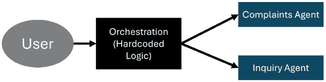
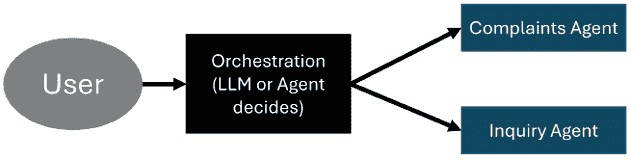
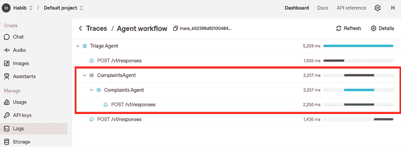
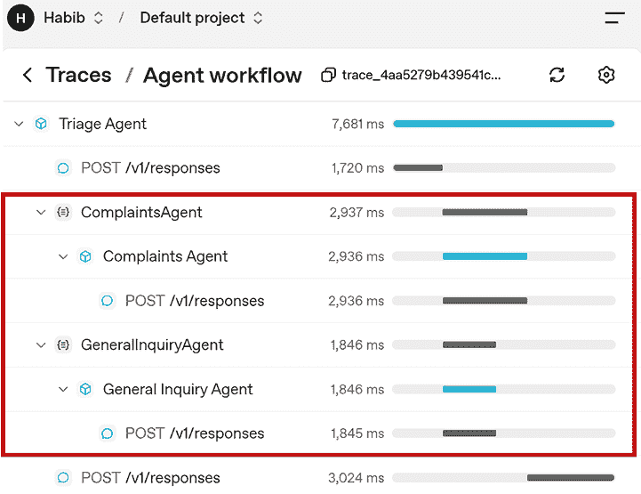
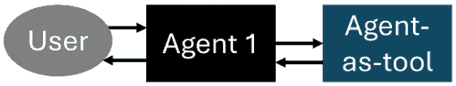
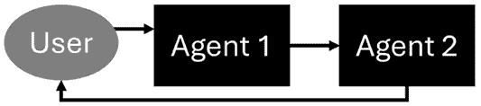
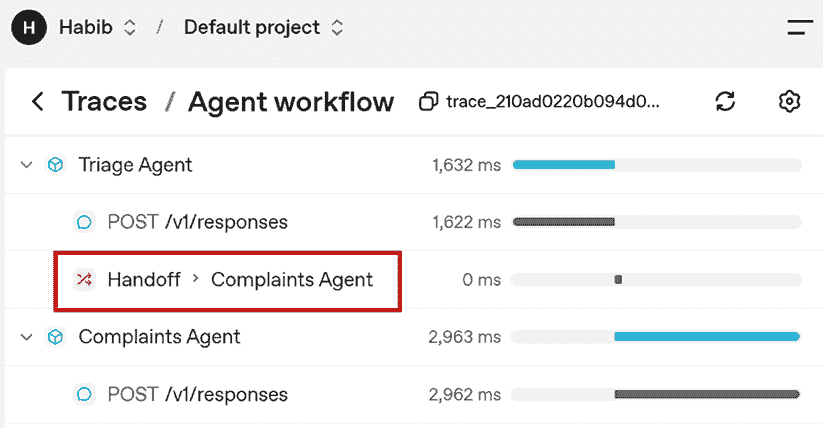
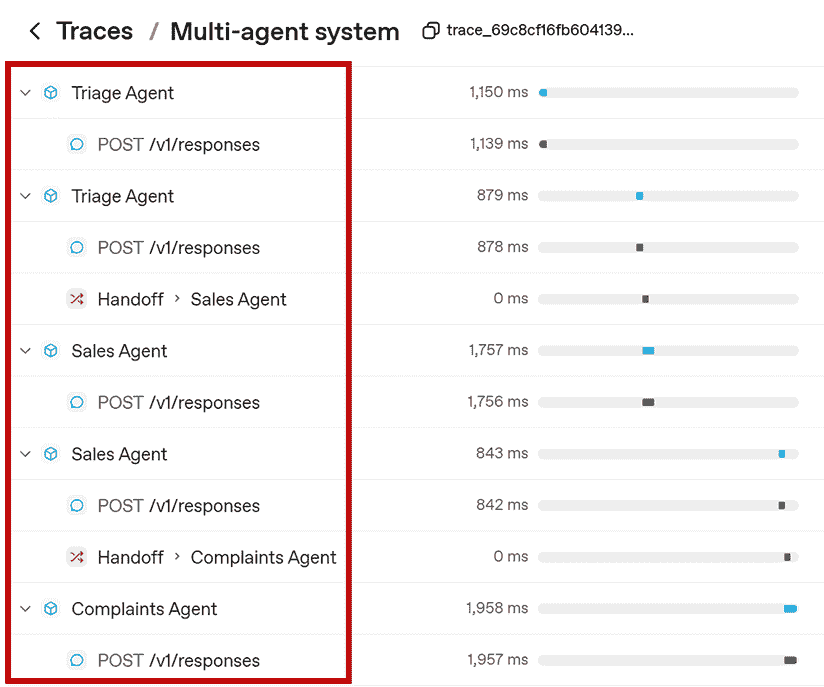
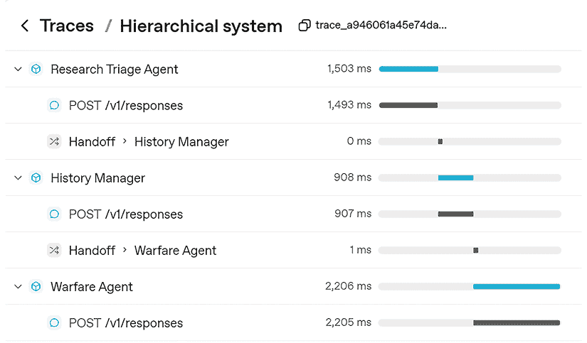
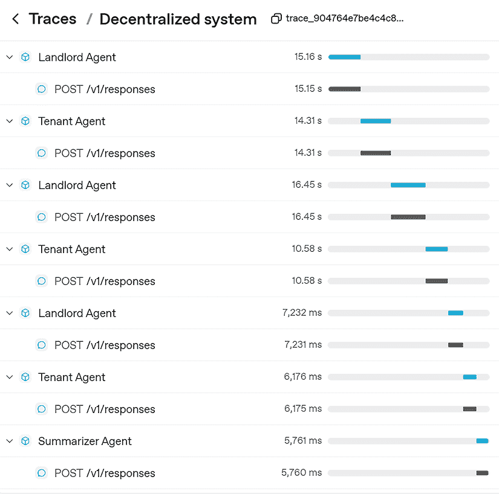

# 5 多智能体系统与交接 (Handoffs)

某些任务是个人人类无法完成的。相反，需要一个人类组织（即团队）。想想任何大型公司。这些大企业之所以能够实现目标，是因为不同人类的共同工作。同样，单智能体系统是有局限性的。然而，多智能体系统可以完成任何事情。

虽然智能体可能非常强大，但它有其局限性。当问题跨越领域、需要专业知识或需要并行处理时，单个智能体往往力不从心。例如，一个客服智能体可能很好地处理查询，但当任务涉及财务分析、法律推理或技术故障排除时，它可能会失败。通过将责任分配给多个智能体，你可以获得比单个智能体更高的准确性、扩展性和弹性。

在本章中，我们将探索如何构建多智能体系统，即多个智能体协作工作的系统。无论你是构建一个简单的路由器还是复杂的层次结构，理解智能体如何交互、委托和协作都是释放智能体全部能力的关键。OpenAI Agents SDK 了一个启用多智能体系统的原语：交接（handoff）。

你将在本章学习：

- **编排类型**：我们将首先对比两种多智能体编排策略——确定性（硬编码）和动态（系统驱动），并演示它们的示例。
- **交接 (Handoffs)**：你将学习如何使用 Agents SDK 中的交接功能将控制从一个智能体转移到另一个智能体，允许智能体在保持上下文的同时委托任务。
- **多智能体模式**：最后，我们将探索多智能体系统的架构模式（集中化、去中心化、层次化和群集），并展示如何使用 SDK 实现每模式。

在本章结束时，你将学会如何设计和实现镜像真实团队的多智能体系统。

## 技术要求

请遵循*第 3 章*中的详细步骤设置你的环境。

在本书中，每一章的实用示例和完整代码将通过附带的 GitHub 仓库提供：https://github.com/PacktPublishing/Building-Agents-with-OpenAI-Agents-SDK](https://github.com/PacktPublishing/Building-Agents-with-OpenAI-Agents-SDK)。

鼓励你克隆仓库、重用并适配提供的代码示例，并在学习章节时根据需要参考它们。

## 多智能体编排 (Multi-agent orchestrations)

在构建使用多个代理的系统时，关键决策之一是确定如何管理代理之间的信息和任务流。广而言，你可以采取两种策略：

- **确定性编排（Deterministic orchestration）**：由你自己编写逻辑并显式地控制代理之间的相互作用；参见`图 6.1`：



图 6.1: 确定性编排

- **动态编排（Dynamic orchestration）**：将流决策交给另一个系统（如 LLM），使系统能够动态调整其行为；参见`图 6.2`：



图 6.2: 动态编排

在本节中，我们将讨论这两种方法以及各自的优缺点。值得注意的是，许多编排实际上涉及到这两种方法的结合。在智能体系统中，你可能希望它的某些部分是显式确定的，以获得更大的控制和自主性；而你可能又希望其他区域更具动态性，并能更好地处理歧义。

## 确定性编排

**确定性编排**是指不同代理之间的交互流是硬编码的（或是确定的）。这种方法的核心在于对代理如何运行以及何时运行保持控制。在确定性设置中，你可以提前定义精确的工作流，通过编码规定由哪些代理处理哪些任务的顺序和规则。一个很好的类比是场编排良好的舞蹈，每一步都经过了计划。没有即兴发挥，代理流绝不会偏离你提供给它们的脚本。

确定性编排的主要优势是可预测性。对于相同的输入，代理流将始终以相同的方式展开，易于测试、审计和调试。由于你确切知道工作流将产生多少代理调用，因此衡量成本和运行时间也很简单。确定性模式在那些需要稳定、可重复的结果，且需要确保不会发生意外情况的系统中特别有用。

与所有确定性系统一样，主要的缺点是灵活性。我们在*第 1 章*中讨论过这一点，但确定性编排模式无法适应代理控制逻辑未显式定义的请求或情况。如果你发现需要新的步骤或想处理新类型的请求，你需要更改并重新部署你的代理逻辑。随着工作流变得越来越复杂，维护所有分支和路径可能会变成负担。

让我们来看一个确定性方法的示例。在这个例子中，我们将通过一个确定性编排模式，使用硬编码逻辑在两个客户服务代理之间路由请求。这将向你展示可预测的、基于规则的委托是如何工作的，以及为什么它既强大又局限。创建一个名为`deterministic_approach.py`的新 Python 文件并运行以下代码：

```python
from agents import Agent, Runner
### Create two agents
complaints_agent = Agent(
    name="Complaints Agent",
    instructions="Handle any customer complaints with empathy and clear next steps."
)
inquiry_agent = Agent(
    name="General Inquiry Agent",
    instructions="Answer general questions about our services promptly."
)
# Create orchestration
def orchestrate(user_message: str):
    # Deterministically delegates requests to the right customer service agent.
    if ("complaint" in user_message.lower() 
        or "problem" in user_message.lower()):
        print('Redirecting you to the Complaints agent')
        chosen_agent = complaints_agent
    else:
        print('Redirecting you to the Inquiry agent')
        chosen_agent = inquiry_agent
    result = Runner.run_sync(chosen_agent, user_message)
    return result.final_output
while True:
    question = input("You: ")
    result = orchestrate(question)
    print("Agent: ", result)
```

 **快速提示**：使用 **AI 代码解释器**和**快速复制**功能来增强你的编码体验。在下一代 Packt Reader 中打开此书。点击**复制**按钮 (**1**) 快速将代码复制到你的编码环境中，或点击**解释**按钮 (**2**) 让 AI 助手向你解释一段代码。


 购买此书将免费赠送**下一代 Packt Reader**。扫描二维码或访问 [packtpub.com/unlock](https://packtpub.com/unlock)，然后使用搜索栏通过名称找到此书。双检显示的版本以确保你获得的是正确的。


在这段代码中，这里是关键要点：

- 确定性编排让你对代理流有完全控制，使其具有可预测性并易于测试。
- 缺点是缺乏灵活性；如果用户以非预期的方式表达，系统可能会误导请求。

调用哪个代理的选择由`orchestrate`函数管理，该函数根据用户的内容硬编码了调用哪个代理的逻辑。这是确定的，因为如果用户的问题包含`complaint`（投诉）或`problem`（问题），该系统始终重定向到`complaints_agent`。

这是一个交互示例：

```
You: I have a complaint, my meal was too hot
Redirecting you to the Complaints agent
Agent: 很抱歉听到您的食物太热了。我理解这可能会让人不舒服。为了弥补这一点，我想免费为您提供一份替代餐。此外，请告诉我们您将来希望如何调整食物温度，我们将确保符合您的偏好。还有什么我可以帮您的吗？
```

从这中，可以很清楚地看到这个系统的弱点。用户可能有投诉，但可能没有在信息中实际使用`complaint`或`problem`词。在这种情况下，用户将会被重定向到错误的代理。以下是这种情况的例子：

```
You: my meal is too hot
Redirecting you to the Inquiry agent
Agent: Try eating in smaller bites.
```

## 动态编排

**动态编排**是指不同代理之间的交互流是动态的，由外部系统自主控制（通常是人类，但在本例中是 LLM）。这提供了一种更灵活的编排模式，因为代理选择和流的责任被交给了另一个由 LLM 驱动的代理。事实上，在本书到目前为止的几乎所有情况下，我们创建的系统都使用了动态编排，因为一个代理一直在控制如何处理用户的响应（无论是工具调用、调用哪个工具等）。

动态编排的优点和缺点分别对应确定性编排的缺点和优点。灵活性是其主要优势。动态系统可以处理更广泛的对话输入，而无需为每种可能的场景编写硬编码逻辑。只要指令得当，代理（Agents）就可以处理不熟悉的问题并制定新的解决方案，使得这种方法非常适用于客户支持、销售分诊和其他开放式任务。然而，权衡是预测性；你无法总是预先知道对话将采取哪条路径，这可能意味着不可预测的答案、成本和运行时间。

让我们回到之前的示例，并将其转换为动态编排。第一步是创建一个分诊代理（triage agent），它可以根据用户的查询选择调用哪个代理。创建一个名为`dynamic_approach.py`的新 Python 文件，并运行以下代码：

```python
from agents import Agent, Runner
### 创建两个代理
complaints_agent = Agent(
    name="Complaints Agent",
    instructions="以同理心和清晰的后续步骤处理任何客户投诉。"
)
inquiry_agent = Agent(
    name="General Inquiry Agent",
    instructions="及时回答关于我们服务的通用问题。"
)
triage_agent = Agent(
    name="Triage Agent",
    instructions="分诊用户的请求并调用合适的代理",
    tools=[
        complaints_agent.as_tool(
            tool_name="ComplaintsAgent",
            tool_description="介绍自己为投诉代理。以同理心和清晰的后续步骤处理任何客户投诉。"
        ),
        inquiry_agent.as_tool(
            tool_name="GeneralInquiryAgent",
            tool_description="介绍自己为通用查询代理。及时回答关于我们服务的通用问题。"
        )]
)
while True:
    question = input("You: ")
    result = Runner.run_sync(triage_agent, question)
    print("Agent: ", result.final_output)
```

在这种情况下，让我们尝试使用一个分诊代理应该解释为投诉的提示词（不使用“complaint”一词），然后相应地发送给`complaints_agent`：

```
You: 我的食物太热了
Agent: 听到您的食物是这样我很抱歉。我理解这有多么让人意料。您希望我们为您更换食物，还是我可以协助您退款或提供积分？请告诉我您想如何处理。
```

我们可以通过查看`Traces`模块来验证它是否已发送到正确的代理：



图 6.3: 上一个示例的轨迹

通过这种方式，我们能够将决策过程委托给分诊代理，而不是预先硬编码逻辑。代理解释用户消息背后的意图（识别投诉），并动态决定将消息路由到正确的代理。这使得我们的系统能够更自然、更高效地响应各种输入，而无需使用僵硬的`if-else`结构来处理每种可能的情况。

此类编排的另一个优点是它可以处理多个请求。例如，如果用户的请求是“我的食物太热了，我该如何获取收据？”分诊代理将同时调用`complaints_agent`和`inquiry_agent`来一次性回答该问题：

```
You: 我的食物太热了，我该如何获取收据？
Agent: 以下是我为您提供帮助的方法：
对于热食物：
- 让食物冷却几分钟，期间我们提供一杯免费饮品以帮助平衡。
- 如果问题仍然，我们可以安排更换。请告诉您的偏好！
对于收据：
- 检查您的确认邮件以获取副本。
- 登录我们在网站上的账户，您可以在那里从订单历史中查看并下载。
如果您需要进一步帮助，请随时提问！
```

这是它在`Traces`模块中的样子：



图 6.4: 代理工作流的轨迹示例

这一切都是在代理的推理过程中动态发生的，而不是通过固定的代码分支。我们只定义了代理及其能力；分诊代理的 LLM 负责了决策过程。

## OpenAI Agents SDK 中的交接 (Handoffs)

现在我们已经理解了多代理系统中的不同编排方法，让我们讨论一下 OpenAI Agents SDK 中提供的、使这些可能的构造。SDK 提供的最重要的原语之一是交接（handoffs）。

`handoff`是代理将控制权传递给另一个代理的机制。它等同于一个代理说：“我要把这项任务交给你。你可以比我回答得更好。这里是所有细节。”在多代理系统中，交接是必要的，因为它是连接不同代理的`layer`（层）。

### 注意

代理之间交互通常有两种方式，其中一种我们已经在第 4 章中详细介绍过，即为`as_tool()`。

`as_tool()`函数允许代理成为一个可以添加到另一个代理的工具。可以将其想象为调用一个辅助函数：主代理保持控制，临时咨询子代理以获取输入或决策。然而，在这里我们将介绍交接。相比之下，交接是从代理到另一个代理的完全控制权转移。原始代理不再参与。

你可以在下面的图中找到这两种方法的视觉示例。在“代理作为工具”模式中，编排代理保留整体控制权并调用另一个代理处理特定的子任务，如图 6.5 所示：



图 6.5: 代理作为工具模式


在“交接”模式中，一个代理将控制权完全委托给另一个，如图 6.6 所示：



图 6.6: 交接模式

在本节中，我们将介绍如何设置交接、如何自定义其行为、交接期间传递了哪些信息、如何过滤或修改这些信息，以及如何处理错误或多步交接。之后，我们将使用交接构建不同的多代理系统。

## 交接简介

定义交接非常简单：实例化新代理时，只需设置一个名为`handoff`的参数。该参数可以接受之前构建的其他代理列表。列表中的每个代理都可以作为起始代理转移控制权的潜在代理。

让我们直接开始构建一个带有交接的多代理系统。我们将从之前的示例开始，简单地将`tools`参数更改为`handoff`，然后删除之前的`as_tool()`函数。创建一个名为`basic_handoff.py`的新 Python 文件，并输入以下代码：

```python
from agents import Agent, Runner

### 创建两个代理
complaints_agent = Agent(
    name="Complaints Agent",
    instructions="以同理心和清晰的后续步骤处理任何客户投诉。"
)
inquiry_agent = Agent(
    name="General Inquiry Agent",
    instructions="及时回答关于我们服务的通用问题。"
)

### 创建带有交接的分诊代理
triage_agent = Agent(
    name="Triage Agent",
    instructions="分诊用户的请求并调用合适的代理",
    handoffs=[complaints_agent, inquiry_agent]
)

while True:
    question = input("You: ")
    result = Runner.run_sync(triage_agent, question)
    print("Agent: ", result.final_output)
```

在这个程序中，`triage_agent`有两个可以接收任务交付的代理：`complaints_agent`（投诉代理）和`inquiry_agent`（咨询代理）。打个比方，我们创建了一个三人的办公室：`triage_agent`负责接待，然后根据客户的问题将客户引导至合适的人。

`triage_agent`如何知道应该将任务交给哪个代理呢？类似于`Tool`原语块，`Handoff`原语块会将子代理的名称和指令暴露给`triage_agent`，因此它知道这两个代理的角色，并可以借此判断是否应该将任务移交给它们。

让我们尝试一下并验证代理是否正在执行交接操作：

```
You: 我的饭太热了
Agent:  您好，很抱歉听到你的饭太热了。我理解这会给你带来不便。我可以为您提供几个选项来帮助解决这个问题吗？我们可以提供重新做一份餐，或者如果您介意的话，可以提供部分退款。请告诉我哪种方案最适合您！
```

如果我们查看`Traces`模块，可以确认`triage_agent`正在将任务传递给`complaints_agents`：



图 6.7: 从一个代理到另一个代理的交接

`Traces`模块显示了任务转移到了`complaints_agent`，之后由`complaints_agent`完全接管任务。

## 多代理切换

注意，`complaints_agent`本身也是一个代理，因此它可以拥有自己的工具和交接。目前，一旦`complaints_agent`被调用，无法转移到任何其他代理。为了修复这个问题，让我们为`complaints_agent`和`inquiry_agent`都添加交接功能，并允许`Runner`不再每次都调用同一个`triage_agent`，而是调用上一个响应用户的代理。这将让我们能够看到真正的动态多代理系统的威力，它可以在所有代理之间轻松切换。我们还将修改代码，以便能够与代理进行多轮对话。

创建一个名为`multi_agent_switching.py`的新 Python 文件并运行以下代码：

```python
from agents import Agent, Runner, SQLiteSession, trace

### 创建两个代理
complaints_agent = Agent(
    name="Complaints Agent",
    instructions="介绍自己为投诉代理。以同理心和清晰的后续步骤处理任何客户投诉。"
)
sales_agent = Agent(
    name="Sales Agent",
    instructions="介绍自己为销售代理。及时回答关于我们服务的通用问题。"
)

### 创建带有交接功能的分诊代理
triage_agent = Agent(
    name="Triage Agent",
    instructions="回答通用问题。分诊用户请求并调用合适的代理",
)

# 设置所有代理之间的相互交接
complaints_agent.handoffs = [sales_agent, triage_agent]
sales_agent.handoffs = [complaints_agent, triage_agent]
triage_agent.handoffs = [complaints_agent, sales_agent]

### 创建会话
session = SQLiteSession("first_session")
last_agent = triage_agent

with trace("Multi-agent system"):
    while True:
        question = input("You: ")
        result = Runner.run_sync(last_agent, question, session=session)
        print("Agent: ", result.final_output)
        last_agent = result.last_agent
```

让我们检查代码中发生了什么，特别是高亮显示的部分。

我们首先建立了三个代理。接着，我们在所有三个代理之间建立了相互交接关系。这是关键所在：在此之前，一旦控制权移交给如`complaints_agent`这样的次代理，对话在会话剩余的时间内就会锁定在那个代理上。现在，通过显式地为每个代理分配`.handoffs`以包含其他代理，任何代理都可以委托给任何其他代理，包括在需要时回传给`triage_agent`。这为完全动态的多代理系统奠定了基础。

我们还引入了持久化的`SQLiteSession`，以确保对话状态在多轮之间得以保持，这是我们在上一章中学习到的内容。这使得我们能够基于之前的交流进行后续构建，并让代理记住对话在何处中断。结合`trace()`上下文管理器（我们将在下一节深入探讨），我们可以记录所有的交互，以供以后调试或检查。

`last_agent`变量跟踪最近活跃的代理。在循环内部，我们通过调用`Runner.run_sync(last_agent, question, session=session)`继续对话。这确保了当前处理对话的代理将接收下一个用户输入，而不是总是从分诊代理重启。一旦处理完响应，我们就用`result.last_agent`更新`last_agent`，从而根据交互流实现代理之间的无缝交接。

例如，让我们与多代理系统进行以下对话。请注意，它会根据对话中的消息在多个代理之间进行无缝切换：

```
You: 你好，我是 Henry
Agent:  你好 Henry！今天有什么可以帮你的吗？
You: 把我转接到投诉代理 - 我的饭太热了
Agent:  你好 Henry，我是负责协助你的投诉代理。我理解你的饭太热了，对于带来的不便我深表歉意。你能详细描述一下情况吗，以便我为你提供帮助？
You: 我有一个通用咨询 - 我如何获取收据？
Agent:  对于收据查询，你通常有
```

这是该示例在`Traces`模块中的外观：



图 6.8: 此示例中的 Traces 模块

这种结构为真正的多代理对话开启了大门，代理不仅可以轮流，还可以根据上下文智能地决定何时切换。我们现在创建了一个灵活的代理网络，可以在对话过程中分配代理。

## 自定义交接

OpenAI Agents SDK 允许你自定义交接的属性，这在某些情况下非常有用。首先需要知道的是 SDK 提供了带有额外属性实例化交接对象的方法。这些属性如下：

- `agent`: 交接的目标代理。
- `tool_name_override`和`tool_description_override`: 允许你在`Traces`模块中覆盖交接描述。正如你所看到的，默认是“转移到 X”。
- `on_handoff`: 在交接发生时触发的函数。这在发生交接时调用函数非常有用（例如通知用户或用于日志记录）。Agents SDK 将对话历史传递给回调函数。
- `input_type`和`input_filter`: 允许你精炼交接预期的输入（例如，你可以指令 LLM 传递到目前对话的摘要，或者将对话历史裁剪为最后五条消息）。

### 注意

交接中的一个关键考虑是决定哪些上下文被带入。默认情况下，SDK 会自动传输交接点之前的完整对话历史。这包含了所有用户输入、系统指令以及之前代理的消息和操作（基本上是原始代理访问的所有内容）。从用户的角度来看，不需要重复任何内容。

让我们来看一个自定义交接示例。我们将使用我最常用的属性，即`on_handoff`属性。我们将定义一个自定义函数，在系统交接时打印输出。

```python
from agents import Agent, Runner, SQLiteSession, trace, handoff
from pydantic import BaseModel
import os

### 创建两个代理
complaints_agent = Agent(
    name="Complaints Agent",
    instructions="将自己介绍为投诉代理。以同理心和清晰的后续步骤处理任何客户投诉。"
)
sales_agent = Agent(
    name="Sales Agent",
    instructions="将自己介绍为销售代理。及时回答有关我们服务的通用问题。"
)

### 创建带有交接功能（handoffs）的分诊代理
triage_agent = Agent(
    name="Triage Agent",
    instructions="回答通用问题。分诊用户的请求并调用相应的代理",
)
```

在第一个部分中，我们设置了三个代理：一个负责投诉，一个负责销售，以及一个决定将请求路由到何处的分诊代理。到目前为止，这听起来应该很熟悉——它与你之前看到的设置相同，但现在我们正在为这些代理的定制化交接（customized handoffs）做准备。

接下来，让我们定义一个模型和日志函数，然后创建交接对象：

```python
class NameOfAgentToBeHandedOff(BaseModel):
    name_of_agents_to_be_handed_off: str

# 创建日志函数
def log(ctx, name_of_agent):
    msg = f"系统已将您转接到另一个代理：{name_of_agent.name_of_agents_to_be_handed_off}"
    print(msg)

# 创建自定义交接
complaints_handoff = handoff(agent=complaints_agent, on_handoff=log, input_type=NameOfAgentToBeHandedOff)
sales_handoff = handoff(agent=sales_agent, on_handoff=log, input_type=NameOfAgentToBeHandedOff)
triage_handoff = handoff(agent=triage_agent, on_handoff=log, input_type=NameOfAgentToBeHandedOff)

# 设置所有代理之间的相互交接
complaints_agent.handoffs = [sales_handoff, triage_handoff]
sales_agent.handoffs = [complaints_handoff, triage_handoff]
triage_agent.handoffs = [complaints_handoff, sales_handoff]

### 创建会话
session = SQLiteSession("first_session")
last_agent = triage_agent

with trace("Multi-agent system"):
    while True:
        question = input("You: ")
        result = Runner.run_sync(last_agent, question, session=session)
        print("Agent: ", result.final_output)
        last_agent = result.last_agent
```

让我们回顾一下与上一个部分相比对该程序所做的更改。

首先注意到的是，我们现在不再直接将代理分配给`.handoffs`，而是使用 SDK 中的`handoff()`函数来构建每个交接。这允许我们以更高级的方式自定义交接的行为。在我们的案例中，我们正在使用`on_handoff`参数为每个交接挂载了一个日志函数。

我们定义了一个简单的`log()`函数，它在每次发生交接时都会打印一条消息。它接收交接上下文（`ctx`）和模型输入（`name_of_agent`），然后打印出指示对话正在转移到哪个代理的消息。这为我们提供了一种实时跟踪和调试代理转换的有效方法。

为了确保我们的日志函数接收结构化输入，我们使用 Pydantic 定义了`NameOfAgentToBeHandedOff`类。这为交接应使用的输入数据类型设定了清晰的预期，并允许 SDK 在发生交接时验证并将相关字段传递到我们的`log()`函数中。

然后，每个交接使用此结构进行初始化：

```python
complaints_handoff = handoff(
    agent=complaints_agent, on_handoff=log, 
    input_type=NameOfAgentToBeHandedOff)
```

这告诉 SDK：“当交接给`complaints_agent`时，触发`log()`函数并提供一个类型为`NameOfAgentToBeHandedOff`的结构化输入。”我们对每个代理重复此操作，以便跨整个系统的每一次交接都能被跟踪。

最后，我们不再仅仅将裸代理分配给`.handoffs`，而是分配相应的交接对象：

```python
complaints_agent.handoffs = [sales_handoff, triage_handoff]
```

这让我们对转换如何发生拥有完全控制权，并允许我们通过副作用（如日志记录、分析甚至自定义提示词）挂钩到这些转换中。当我们运行程序并执行交接时，将打印出以下日志：

```
You: I want to make a complaint
系统已将您转接到另一个代理：投诉代理
Agent:  你好，我是投诉代理，我在这里为您提供帮助。可以告诉我发生了什么吗？您的反馈非常重要，我想确保我们正在处理您关注的问题。
```

简而言之，这种模式为简单的委托机制添加了可编程的钩子（hook），因此你可以跟踪代理行为、强制转换规则，甚至动态编辑上下文。这在日志记录和审计至关重要的现实应用中非常有用。

## 交接提示词引导 (Handoff prompting)

代理交接给其他代理的能力与你给每个代理的指令一样重要。参与交接的代理应该具有关于何时、如何交接，以及在交接后该做什么的清晰指令。为了做到这一点，OpenAI Agents SDK 实际上为你提供了一个推荐的提示词前缀，可以添加到你的代理中。


```python
from agents import Agent, Runner
from agents.handoff_prompt import RECOMMENDED_PROMPT_PREFIX
print(RECOMMENDED_PROMPT_PREFIX)
```

### 创建两个代理

```python
complaints_agent = Agent(
    name="Complaints Agent",
    instructions=f"{RECOMMENDED_PROMPT_PREFIX}.将自己介绍为投诉代理。以同理心和清晰的后续步骤处理任何客户投诉。"
)
inquiry_agent = Agent(
    name="General Inquiry Agent",
    instructions=f"{RECOMMENDED_PROMPT_PREFIX}.将自己介绍为销售代理。及时回答有关我们服务的通用问题。"
)
```

### 创建带有交接功能的分诊代理

```python
triage_agent = Agent(
    name="Triage Agent",
    instructions=f"{RECOMMENDED_PROMPT_PREFIX}.分诊用户的请求并调用相应的代理",
    handoffs=[complaints_agent, inquiry_agent]
)
while True:
    question = input("You: ")
    result = Runner.run_sync(triage_agent, question)
    print("Agent: ", result.final_output)
```

如你所示，`RECOMMENDED_PROMPT_PREFIX` 是一个字符串，代表要添加到所有代理的提示词前缀：

```
## 系统上下文
你是一个名为 Agents SDK 的多代理系统的一部分，该系统旨在简化代理协作和执行。Agents 使用两个主要的抽象：代理（Agents）和交接（Handoffs）。代理包含了指令和工具，并在适当将对话交给另一个代理。交接通过调用函数实现，函数通常命名为 transfer_to_<agent_name>。代理之间的转换在后台无缝处理；不要在与用户的对话中提及或强调这些转换。
```

为了构建更好的带有交接的多代理系统，还有其他与提示词相关的任务：

- **显式的交接指令**：每个代理的系统提示词都应该指定委托任务的精确条件。例如，“如果用户询问有关销售的问题，请将其路由到销售代理。”指令越明确，代理系统就越好。

- **显式的代理指令**：每个代理的指令应清晰地定义其目的以及何时使用它。这有助于协调器或“分诊”代理路由到合适的代理。

现在我们已经更深入了如何在 OpenAI Agents SDK 中使用交接（handoffs），让我们来学习不同的多智能体系统模式，以及如何利用交接来实现每种模式。

## 多智能体模式

描述多个智能体如何组织和结构化是指它们的架构模式。在本节中，我们将学习两种主要的多智能体架构模式、它们的优缺点，以及我们如何使用 OpenAI Agents SDK 实现它们。

两种多智能体架构模式如下：

- 集中心化系统（Centralized system）

- 去中心化系统（Decentralized system）

让我们逐一介绍。

## 集中心化系统

`centralized system` 模式是一种多智能体系统，其中有一个中心智能体将请求路由到其他合适的智能体。这是最常见的架构模式。中心智能体通常被称为“经理”（manager）、“调度器”（orchestrator）或“分诊”（triage）智能体，而其他智能体通常被称为“专门”（specialized）智能体。中心智能体负责路由用户的请求，而每个专门智能体都是某个特定领域的专家。

这种模式的优点是组织良好且职责分清晰。中心智能体专门负责路由请求；这是它唯一的工作。专门智能体针对其特定目的进行了“微调”（无论是通过提示词、工具选择、模型选择还是真正的“微调”权重）。

一个拥有许多专门智能体的结构通常优于一个完成所有任务的智能体；这和为什么在公司里你为每个领域（人力资源、销售、工程等）设置了独立角色的原因是一样的。系统中还可以很方便地添加额外的专门智能体。

这种方法最大的缺点是，系统的优劣取决于其中心智能体。如果中心智能体错误地将请求路由到智能体，整个系统就会失败。在该系统中，通常专门智能体之间无法相互通信。相反，它们是孤立的（silo-ed）。对于某些需要领域间互动和团队协作的任务的任务，这并不是最优的。

这种系统最适用于自然上“自上而下”的架构。例如客户支持机器人，你通常向一个分诊智能体描述你的问题，然后由它将其交交给处理你查询的正确智能体。另一个例子是企业内部助手，帮助员工处理人力资源、IT 和设施请求。员工首先向中心助手描述他们的需求，然后由助手将查询路由到相关的专门部门智能体。这反映了许多真实世界的帮助台工单系统的工作方式。

我们在这里不会介绍示例，因为本章之前的所有示例都是使用中心化系统完成的，其中有一个中心分诊智能体，然后将请求路由到其他专门智能体。

### 分级系统

分级系统（hierarchical system）是中心化系统的子集。`hierarchical system` 类似于中心化系统，但具有许多层级（想象一个由多个智能体组成的金字塔，它们变得越来越专门）。这通常是组织运作的方式；你有一个 CEO（或顶级调度器），然后下面有一系列专门的智能体，如 CFO、COO 和 CHRO，它们下面又有一系列专门的智能体。分级系统有一组中间智能体，用于进一步划分任务并为它们所属的专门智能体集提供上下文/指令。

这种分级模式通过将复杂任务分解为可管理的子组件，然后进一步分解，擅长处理复杂任务。它还促进了常见子任务的重用，并帮助保持每个智能体的范围集中。缺点是，如果任务不需要，这种结构可能会引入不必要的开销。层级越多意味着成本越高、延迟越高、风险风险以及更复杂的通信。管理不善的分级结构还会扭曲或混淆信息，使调试变得几乎不可能。

如之前所述，这类系统的最佳用例是处理大型、复杂的查询，例如深度研究。

让我们创建一个分级系统的示例来回答复杂的研究问题。我们将创建一个中心化分诊智能体、两个经理智能体（一个管理科学问题，另一个管理历史问题）以及一个专门智能体子集（每个经理三个，每个专门一个子领域）。

创建一个名为 `hierarchical.py` 的新 Python 文件并运行以下代码：

```python
from agents import Agent, Runner, SQLiteSession, trace
# 创建我们的智能体
# 专门的科学智能体
physics_agent = Agent(name="Physics Agent", instructions="Answer questions about physics.")
chemistry_agent = Agent(name="Chemistry Agent", instructions="Answer questions about chemistry.")
medical_agent = Agent(name="Medical Agent", instructions="Answer questions about medical science.")
# 专门的历史智能体
politics_agent = Agent(name="Politics Agent", instructions="Answer questions about political history.")
warfare_agent = Agent(name="Warfare Agent", instructions="Answer questions about wars and military history.")
culture_agent = Agent(name="Culture Agent", instructions="Answer questions about cultural history.")
# 具有各自领域交接功能的经理智能体
science_manager = Agent(
    name="Science Manager",
    instructions="Manage science-related queries and route them to the appropriate subdomain agent.",
    handoffs=[physics_agent, chemistry_agent, medical_agent]
)
history_manager = Agent(
    name="History Manager",
    instructions="Manage history-related queries and route them to the appropriate subdomain agent.",
    handoffs=[politics_agent, warfare_agent, culture_agent]
)
# 顶级分诊智能体
triage_agent = Agent(
    name="Research Triage Agent",
    instructions="Triage the user's question and decide whether it's science or history related, and route accordingly.",
    handoffs=[science_manager, history_manager]
)
# 创建会话
session = SQLiteSession("hierarchy")
last_agent = triage_agent
with trace("Hierarchical system"):
    while True:
        question = input("You: ")
        result = Runner.run_sync(last_agent, question, session=session)
        print("Agent: ", result.final_output)
        last_agent = result.last_agent
```

让我们尝试这个智能体并查看跟踪日志：

```
You: Which war after the year 1600 led to the greatest death toll?
Agent:  1600 年以后伤亡最大的战争是第二次世界大战。据估计导致了约 7000 万到 8500 万人的死亡，包括军事人员和平民。
```

现在，让我们看看在 **Traces** 模块中它是什么样的。



图 6.9：示例的跟踪模块

让我们走一下这里发生了什么。

当用户输入问题时，首先到达顶级智能体，即研究分诊智能体。该智能体的工作是判断问题与科学还是历史相关。在这种情况下，问题显然具有历史属性，因此分诊智能体将其交交给 **History Manager**。一旦 **History Manager** 接收到查询，它会进一步检查主题，并决定哪个专门智能体最适合回答它。由于问题是关于战争和伤亡人数的，**History Manager** 将问题路由给 **Warfare Agent**。

**Warfare Agent** 是军事历史领域的专家，因此它会处理问题并生成响应。然后答案将向上链返回给用户。

这种分层委托确保了每个智能体都在界定的责任范围内运行，反映了结构化组织中拆解复杂任务的方式。然而，用户只会体验到单次无缝交互。

我们可以在 `Traces` 模块中清楚地看到这一点：分发智能体（triage agent）将任务传递给 `History Manager`（历史管理器），后者再将其传递给 `warfare agent`（战争智能体）。用户现在直接与 `Warfare Agent` 通话，因为他们的问题与战争有关。

在更真实的示例中，专门的智能体可能会包含与其目的相关的工具和知识子集。例如，`Warfare Agent` 可以配备查询历史冲突数据库或访问全球冲突长期研究文档的工具。同样，`Chemistry Agent`（化学智能体）可能会访问科学论文摘要器或周期表计算器。

## 去中心化系统

`去中心化系统`与集中式系统完全相反。在这里，没有单一的分发智能体；相反，多个智能体直接协作处理用户的请求。在这个系统中，不存在信息孤岛；所有智能体都可以相互通信。一个很好的类比是圆桌会议，没有领导者，而是所有智能体都参与讨论以产生最终答案。

这种模式的优势在于它能够激发创造力，因此在头脑风暴、构思或辩论类练习中表现出色。去中心化智能体可以通过迭代对话或想法交换协作增强解决方案，正如某些关于智能体自弈（self-play）的研究（参见 Google AlphaZero）。去中心化系统使智能体能够从不同角度解决问题。

这里很大的缺点是缺乏协调性。在去中心化系统中管理对话流需要确定性的编排（记住，确定性编排指的是硬编码的控制逻辑以及该系统提供的所有缺点），因为 OpenAI Agents SDK 不支持这一点。

再次，这类系统的最佳用例是需要创造力和新颖思维的场景：头脑风暴、构思、谈判、辩论等。

让我们来看一个示例。我们将创建两个专注于对立观点的专家智能体：其中一个扮演房东，另一个扮演租客。然后，我们将强制这两个智能体就一个特定的争议性话题（例如“应该有租金控制吗？”）进行对话。在几轮往返之后，我们将把对话历史传递给另一个智能体，由它总结主要论点并返回给我们。

创建一个名为 `decentralized.py` 的新 Python 文件并运行以下代码：

```python
from agents import Agent, Runner, SQLiteSession, trace
# 创建我们的智能体
landlord_agent = Agent(
    name="Landlord Agent",
    instructions="从房东的角度反对租金控制。提出强有力的经济和产权论点。"
)
tenant_agent = Agent(
    name="Tenant Agent",
    instructions="从租客的角度支持租金控制。强调可负担能力、住房权利和租客保护。"
)
summarizer_agent = Agent(
    name="Summarizer Agent",
    instructions="以中立简洁的方式总结房东和租客智能体提出的主要论点。"
)
# 创建会话
session = SQLiteSession("decentralized")
landlord_turn = True
conversation_history = []
with trace("Decentralized system"):
    print("Topic: Should there be rent control?")
    for _ in range(6):  # 6 轮往返
        if landlord_turn:
            agent = landlord_agent
        else:
            agent = tenant_agent
        prompt = "\n".join([f"{msg['role']}: {msg['content']}"
        for msg in conversation_history])
        response = Runner.run_sync(agent, 
            prompt or "Debate starting now.", session=session)
        print(f"{agent.name}: {response.final_output}")
        conversation_history.append({"role": agent.name, 
            "content": response.final_output})
        landlord_turn = not landlord_turn
    # 辩论结束后，让协调员总结
    summary_prompt = "\n".join([f"{msg['role']}: {msg['content']}"
    for msg in conversation_history])
    result = Runner.run_sync(summarizer_agent, summary_prompt, 
        session=session)
    print("\nSummary of the Debate:")
    print(result.final_output)
```

在此文件中，我们创建了两个对立的智能体（`Landlord Agent` 和 `Tenant Agent`），它们都有一套特定的观点和定制的指令集，用于针对某一争议性问题的一面进行论证。这些智能体并不由分发或管理智能体编排，而是通过在往返对话中交替发言，模拟辩论过程。

这说明了去中心化系统如何在不依赖中央决策者的情况下促进动态多智能体交互。每个智能体都是自主的，但仍然建立在其他贡献之上。结果是一个分层的、协作的对话，它通过涌现行为而非僵化的编排不断演进。

如果我们运行程序，可以在对话历史中看到整个谈判过程以及以下摘要版本：

```
在关于租金控制的辩论中，房东智能体认为，收入限制会阻碍对物业维护的投资，通过阻碍新投资减少住房供应，由于未能反映供需关系导致市场扭曲，并通过鼓励租客留在可能不再符合其需求的单元内降低租客的流动性。他们还声称这侵犯了产权，通常不公平地偏袒长期租客，增加了行政负担，并破坏了对房东的公平补偿。
相反，租客智能体支持租金控制，是为了稳定租金、减轻经济焦虑、促进住房安全并确保公平获取。他们强调了对租客免受剥削的保护以及对社区关系的维护。租客智能体认为，租金控制鼓励了住房的有效利用，并应该是解决更广泛问题的一部分
```


我们还可以在 `Traces` 模块中看到往返过程：



图 6.10: 此示例的 traces 模块

再次，这种模式对于依赖观点多样性和交换的场景非常出色。

## 群系统

去中心化系统的一个子集是`群系统`（swarm system），其中包含许多简单的智能体协作工作（通常是并行）以产生答案。这依赖于一个被称为`涌现属性`的概念，即全局系统通过许多不智能且简单的微系统变得智能和复杂。一个很好的类比是人体中的细胞。每个细胞本身并不那么智能，专注于完成一小部分任务。然而，数百万个专门化的细胞聚集在一起可以产生人类，这是一个智能系统。另一个与数据科学相关的例子是`随机森林模型`。该模型依赖于数百个弱模型，这些模型汇聚在一起就能产生一个智能的预测模型。

群集模式（Swarm patterns）特别适用于那些从探索中受益的任务，例如创意生成、优化或具有多种潜在方法的方案解决工作。一种常见的用例是生成多种解决方案候选，然后对其进行精炼或筛选。

让我们来看一个非常简单的例子。在这个例子中，我们将创建一个程序，并行启动 10 个智能体（agents），它们在城市中扮演不同的角色（医生、机械师、厨师等）。每个智能体都将回答同一个问题：“让你从零开始设计你的梦想城市，它会有什么？”随后，我们将这些结果传递给另一个智能体，由它来汇总所有要点并向我们返回最终的总结。

### 实现

创建一个名为 `swarm.py` 的新 Python 文件并输入以下代码：

```python
from agents import Agent, Runner, SQLiteSession, trace
import concurrent.futures
# 创建我们的智能体
roles = [
    "Urban Planner", "Artist", "Chef", "Engineer", "Teacher",
    "Doctor", "Mechanic", "Lawyer", "Historian", "Environmentalist"
]
city_agents = [
    Agent(
        name=f"{role} Agent",
        instructions=f"You are a {role.lower()}. Answer the question: 'If you were to design your dream city from scratch, what would it have?' Be creative and imaginative, but concise"
    ) for role in roles
]
# 定义总结智能体
summary_agent = Agent(
    name="City Design Aggregator",
    instructions="You are a city designer. You've just received 10 creative responses from different citizens. Read all of their responses 并将 them 整合为一个连贯、富有想象且完善的城市计划。"
)
### 创建会话
session = SQLiteSession("swarm")
conversation_history = []
with trace("Swarm system"):
    prompt = "Design your dream city from scratch. What would it have?"
# 逐个收集回复
for agent in city_agents:
        result = Runner.run_sync(agent, prompt, session=session)
        print(f"{agent.name}: {result.final_output}\n")
        conversation_history.append(
            f"{agent.name}: {result.final_output}")
    # 将回复合并为一个提示词
    combined_responses = "\n\n".join(conversation_history)
    final_result = Runner.run_sync(summary_agent, combined_responses, 
        session=session)
    # 输出最终城市计划
print("\nFinal City Design Summary:")
    print(final_result.final_output)
```

在这段代码中，我们定义了一个由 10 个智能体组成的“群集”，每个智能体根据其在城市中的角色拥有自己的身份和创意视角。所有智能体都会收到关于设计梦想城市的相同提示词，并使用线程池独立并行响应。由于每个智能体都被指示利用其领域专业知识，群集方法允许我们从 10 个不同的视角来探索设计空间。

一旦收集了所有回复，我们将它们传递给 `summary_agent` 对象，由它将集体输入合成一个单一的、富有想象力的城市计划。这个最终输出代表了许多独立思考者贡献其想法所产生的*涌现*结果。

最终的城市计划整合了所有子智能体的想法：

```text
Final City Design Summary:
创建一个梦想城市需要综合来自各种角度的想法，以形成一个连贯且创新的城市景观。以下是整合后的计划：
### 生态平衡与可持续性：
1. **绿色基础设施**：广大的公园、城市森林、屋顶花园和社区花园，促进生物多样性并提供休闲空间。
2. **可持续建筑**：配备太阳能电池板、绿色屋顶、节能系统和自然材料的建筑，以最大限地减少对环境的影响。
### 交通与连接：
3. **综合公共交通**：电车、巴士、自行车道和人行道的无缝网络，减少对汽车的依赖并鼓励环保通勤。
4. **智能技术**：用于高效能源利用、交通管理和公共服务的 IoT 系统，增强了连接性和便利性。
### 文化与社区丰富：
5. **文化枢纽**：拥有剧院、画廊和多元文化节的动态区域，庆祝全球传统和创意。
6. **混合用途开发**：融合住宅、商业和文化空间，打造充满活力的易于步行的社区。
### 能源与资源管理：
7. **可再生能源**：风力涡电机和太阳能发电站提供清洁电源供应，以及创新的水回收和节水系统。
8. **水资源管理**：先进的回收和保护措施，将自然水道整合到城市规划中。
### 住房与社会公平：
9. **包容性住房**：负担得起的多样化选择，确保所有收入水平的人都能享有，促进社会公平和社区。
10. **社区空间**：图书馆、文化中心、体育设施和社区中心，促进参与和包容性。     
### 教育、创新与安全：
11. **教育与创新中心**：先进的学校和研究设施，支持终身学习和创意。12. **韧性基础设施**：适应气候的设计和韧性基础设施，用于管理和缓解环境变化及极端天气。
### 本地与可持续食品系统：
13. **本地食品网络**：城市农场和农市场促进新鲜的本地农产品和食品安全。
通过整合这些元素，城市将在可持续性、创新和包容性方面蓬勃发展，为未来的城市发展设定基准。
```

总结，OpenAI Agents SDK 提供了实现多智能体系统所有架构模式的灵活性。正如在本节中看到的，每种模式都可以使用 SDK 的智能体创建、交接（handoff）和内存管理功能实现为独立的脚本。

## 总结

在本章中，我们通过在 OpenAI Agents SDK 中引入编排和交接策略，探索了如何协调多个智能体来解决复杂任务。

我们首先区分了确定性编排和动态性编排。随后，我们引入了交接机制，这是 OpenAI Agents SDK 的核心原语，允许一个智能体将控制权交给另一个智能体。我们通过多智能体切换进一步扩展了这一点，允许智能体在较长的对话中使用持久化内存相互传输控制权，并通过回调函数和提示词自定义交接。

最后，我们探索了四种不同的多智能体系统模式：中心化、分层（中心化的子集）、去中心化和群集（去中心化的子集）。

在下一章中，我们将学习如何管理智能体的底层引擎：大语言模型（LLM）。

