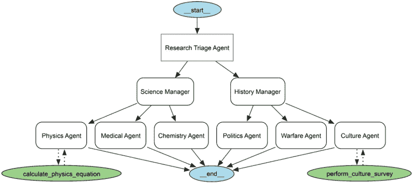
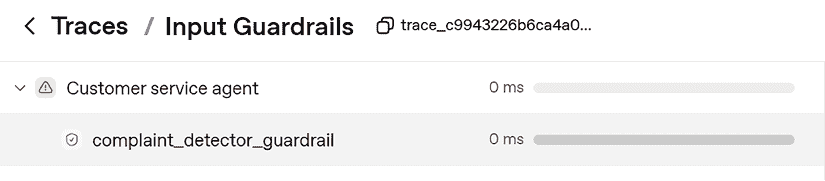
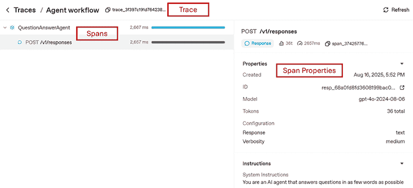
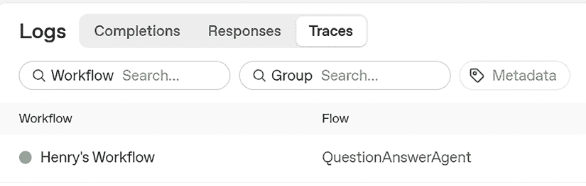
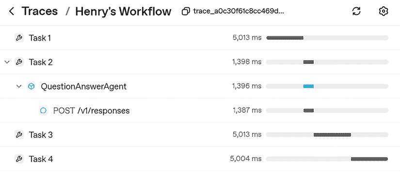
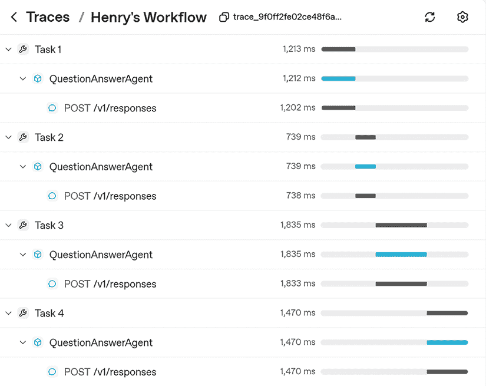
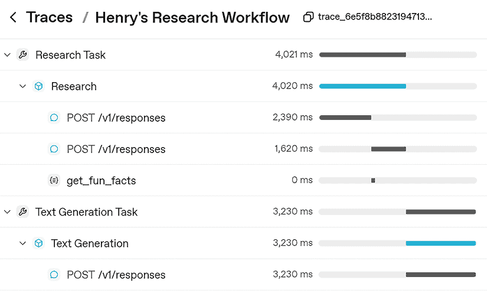

# 8 智能体系统管理

随着你的智能体系统复杂性增加，保持它们的可靠性和易理解性与构建核心逻辑同样重要。多智能体系统可能会变得难以推理，因为许多智能体、工具和交接（handoff）以非显的方式相互交互。为了管理这种复杂性，OpenAI Agents SDK 提供了强大的可视化、护栏、可观测性和测试功能。

以下是你将在本章学习到的内容：

*   **智能体可视化**：你将学习如何生成多智能体系统的图形图表，展示智能体、工具及其交互，以提高清晰度和调试效率。

*   **护栏 (Guardrails)**：你将看到如何实现输入和输出护栏，确保不、无关或违反策略的内容在进入或离开系统之前被拦截。

*   **日志、追踪和可观测性**：你将探索 `Traces` 模块如何记录模型调用、工具调用、交接和护栏触发，以及你如何添加自定义的追踪（traces）和跨（spans）。

*   **智能体测试**：你将学习智能体的端到端测试和单元测试方法，帮助即使在存在非确定性行为的情况下验证系统的可靠性。

在本章结束时，你将学会如何管理、监控和验证智能体系统。

## 技术要求

请遵循第 3 章中的详细步骤设置环境。

实际示例和每章完整代码可以通过配套仓库获取：[`github.com/PacktPublishing/Building-Agents-with-OpenAI-SDK`](https://github.com/PacktPublishing/Building-Agents-with-OpenAI-SDK)。

鼓励你克隆仓库，复用并调整代码示例，并在学习过程中参考它们。

## 智能体可视化

正如我们在前几章看到的，智能体可能涉及多个复杂的组件，特别是在多智能体系统中。由于智能体、工具、交接和 MCP 服务器的混合，这可能会变得难以理解。坦率地说，OpenAI Agents SDK 提供了一个可视化工具，可以为你的智能系统生成图形表示，展示智能体、工具及其关系。

让我们直接开始创建智能系统的可视化图。为了创建可视化图，我们必须首先安装依赖项。在终端中激活环境，然后运行以下命令安装依赖：

```
$ pip install "openai-agents[viz]"
```

之后，让我们回到之前章节中创建的层级智能体系统。我们还将为该智能体系统添加一些工具，观察它们是如何被可视化的。创建一个名为 `visualization.py` 的 Python 文件并运行以下代码，从创建工具开始：

```python
from agents import Agent, Runner, SQLiteSession, trace, function_tool
from agents.extensions.visualization import draw_graph
### 创建工具
@function_tool
def calculate_physics_equation(equation):
    pass
@function_tool
def perform_culture_survey(goal):
    pass
```

在这里，我们定义了示例工具：一个用于计算物理方程，另一个用于执行文化调查。它们稍会被挂载到相关的智能体。

接下来，定义特定的领域智能体：

```python
# 创建我们的代理
### 专业的科学代理
physics_agent = Agent(name="Physics Agent", instructions="Answer questions about physics.", tools=[calculate_physics_equation])
chemistry_agent = Agent(name="Chemistry Agent", instructions="Answer questions about chemistry.")
medical_agent = Agent(name="Medical Agent", instructions="Answer questions about medical science.")
### 专业的历史代理
politics_agent = Agent(name="Politics Agent", instructions="Answer questions about political history.")
warfare_agent = Agent(name="Warfare Agent", instructions="Answer questions about wars and military history.")
culture_agent = Agent(name="Culture Agent", instructions="Answer questions about cultural history.", tools=[perform_culture_survey])
```

此部分创建了科学和历史子代理。其中一些代理关联了工具，而另一些则仅依赖指令。

现在，创建管理代理来协调它们各自的领域：

```python
# 具有向各自领域交接能力的管理代理
science_manager = Agent(
    name="Science Manager",
    instructions="管理科学相关的查询并将其路由到适当的子代理。",
    handoffs=[physics_agent, chemistry_agent, medical_agent]
)
history_manager = Agent(
    name="History Manager",
    instructions="管理历史相关的查询并将其路由到适当的子代理。",
    handoffs=[politics_agent, warfare_agent, culture_agent]
)
```


# 管理代理与分拣代理

管理代理充当协调员。它们本身不回答问题，而是将任务路由给正确的专业代理。

最后，定义顶层分拣代理并可视化图表：

```python
# 顶层分拣代理
triage_agent = Agent(
    name="Research Triage Agent",
    instructions="分拣用户问题并判断其与科学还是历史相关，并进行相应的路由。",
    handoffs=[science_manager, history_manager]
)
# 绘制代理图
draw_graph(triage_agent, filename="graph_visualization")
```

该代理位于顶部，接收用户问题，并决定将查询转发给哪个管理代理。来自 `agents.extensions.visualization` 类的 `draw_graph` 函数接收任何代理作为输入，绘制多代理系统可视化图，并将其保存到项目根目录下，命名为 `graph_visualization.png`：



图 8.1: 可视化图示例

**快速提示**：需要查看此图像的高分辨率版本？请在下一代 Packt Reader 中打开此书，或在 PDF/ePub 版本中查看。

**购买此书将免费赠送**下一代 Packt Reader**。扫描二维码或访问 [`packtpub.com/unlock`](https://packtpub.com/unlock)，然后使用搜索栏通过名称查找此书。双检显示的版本以确保你获得的是正确的版本。


在可视化图中，代理被绘制为方框（节点），工具被绘制为椭圆，箭头表示交互（实线箭头表示代理之间的交接，虚线箭头表示代理到工具的调用）。图中总有一个起始节点和一个或多个结束节点，决定了代理流的可能路径。

这个工具（双关语）对于大型多代理系统的管理、清晰化和调试非常有用。通过检查此可视化图，我们可以验证系统结构是否符合预期。例如，如果我们预期某个工具应该被连接或某个代理有一个未显示的交接，图表将迅速揭示任何缺失的配置。此外，它还可以作为合作伙伴、利益相关者或系统未来维护者的宝贵文档，为他们提供代理交互的概述。

# 护栏 (Guardrails)

`Guardrails` 是另一个实 OpenAI Agents SDK 原，通过执行验证检查来辅助多代理系统。这些检查可以在用户输入传递给代理系统时执行，也可以在代理输出传输给用户时执行。

在代理系统中拥有护栏的好处是它可以使其更具韧性。它们充当保护层，确保无效、不或不受理想的输入输出在引起问题之前被拦截。这有助于防止有害响应、强制合规规则并保持一致的用户体验。在更复杂的系统中，护栏还可以作为保持代理符合组织政策和特定领域限制的方法，而不会让主代理过载验证逻辑。在实践中，这意味着你的代理可以专注于其核心任务，而护栏则处理边界情况、策略执行和安全考量。

输入和输出护栏使用相似的模式：

1. 我们必须首先定义一个返回 `GuardrailFunctionOutput` 对象的护栏函数。它还可以接收上下文、触发护栏的代理以及用户的提示词/代理输出作为输入。`GuardrailFunctionOutput` 包含一个 `tripwire_triggered` 布尔值，该值指示是否执行了护栏触发器。

2. 在护栏函数内部，我们必须包含逻辑来判断我们的护栏触发器是否应该被激活。在这里我们可以使用硬编码逻辑（例如，如果用户提示词包含“负”一词，我们应该触发触发器并停止代理）或基于代理的逻辑（例如，我们创建另一个代理，其唯一工作是推理是否应该触发触发器）。

3. 最后，我们必须优雅地处理触发器（抛出一个特定的异常）并向用户输出内容。

我们将首先查看输入护栏，然后转向输出护栏。

# 输入护栏

将输入护栏想象成机场登机口的空乘人员，确保只有持票乘客进入飞机，其他人都不行。这些护栏当了第一道防线，确保只有相关的用户提示词被传递给你的代理系统，其他统行。例如，你可能会使用输入护栏来检测用户的请求是否违反了使用策略，或者检查请求是否是代理不应该处理的内容。防止滥用代理系统可以节省大量资金，因为你可以在查询运行代理系统之前拦截它们，从而节省 Token 和处理成本。

让我们回到之前章节中创建的客户服务示例，并为其添加一个输入护栏。现在，我们将根据一些非常简单的逻辑强制触发触发器，例如，如果提示词包含“投诉”一词（实际上，可以是任何词）。

## 创建一个工具

```python
@function_tool()
def get_order_status(orderID: int) -> str:
    """
    根据订单 ID 返回订单状态
    Args:
        orderID (int) - 客户订单的 ID
    Returns:
        string - 客户订单的状态消息
    """
if orderID in (100, 101):
        return "Delivered"
elif order_ID in (200, 201):
        return "Delayed"
elif orderID in (300, 301):
        return "Cancelled"
```

现在，我们来定义我们的防护栏（guardrail）。此函数会检查用户的提示词（prompt）是否包含“complaint”（投诉）一词，如果是，它将触发触发器（tripwire）：

```python
# 创建一个防护栏
@input_guardrail
def complaint_detector_guardrail(
    ctx: RunContextWrapper[None],
    agent: Agent,
    prompt: str | list[TResponseInputItem]
) -> GuardrailFunctionOutput:
    tripwire_triggered = False
if "complaint" in prompt:
         tripwire_triggered = True
return GuardrailFunctionOutput(
        output_info="The word Complaint has been detected",
        tripwire_triggered=tripwire_triggered,
    )
```

工具和防护栏都就绪后，我们现在可以定义代理（agent）。注意看防护栏是如何通过 `input_guardrails` 参数附加到 agent 上的：

```python
# 定义一个 agent
agent = Agent(name="Customer service agent",
              instructions="你是一个 AI Agent，帮助为当地报纸公司回答客户查询",
              model="gpt-4o",
              tools=[get_order_status],
              input_guardrails=[ complaint_detector_guardrail])
```

最后，我们用一个简单的循环将它们整合起来并与 agent 交互。防护栏将在输入传递给 agent 之前检查每一个输入：

```python
with trace("Input Guardrails"):
    while True:
        question = input("You: ")
        result = Runner.run_sync(agent, question)
        print("Agent: ", result.final_output)
```

让我们按照之前设定的模式，分析这里的输入防护栏功能。首先，我们定义了一个防护栏函数（`complaint_detector_guardrail`），它接受 `RunContextWrapper`、agent 和用户的提示词。该函数必须始终返回一个 `GuardrailFunctionOutput` 对象，指示是否触发了触发器。

其次，在函数内部，我们编写了检测逻辑。在这个示例中，我们检查提示词中是否出现了“complaint”单词。如果是，`tripwire_triggered` 标记将设置为 `True`，防护栏报告其已触发。注意，这是非常简单的防护栏逻辑。传统上，在这里你可能需要更复杂的逻辑来（例如）扫描违反策略的行为或恶意输入。

最后，当触发器被触发时，SDK 会抛出一个 `InputGuardrailTripwireTriggered` 异常。这会中断正常的执行流，防止 agent 处理请求，转而显示错误。目前该错误没有被处理，因此不会产生良好的客户体验，但它仍然实现了我们的预期结果。

让我们尝试一下。运行程序并输入以下消息：

```text
You: What's the status of my order? My order ID is 200
Agent: The status of your order with ID 200 is: Delayed. If you have any further questions or need assistance, please let me know!
```

触发器没有被触发，因为用户的提示词中不包含“complaint”单词。让我们再次尝试并故意触发器：

```text
You: I have a complaint
InputGuardrailTripwireTriggered error
```

在这里，我们可以看到系统抛出了 `InputGuardrailTripwireTriggered` 错误并停止了执行。现在，让我们修改脚本以更优雅地处理触发器异常。可以通过在代码末尾添加以下内容：

```python
...
with trace("Input Guardrails"):
    while True:
        try:
            question = input("You: ")
            result = Runner.run_sync(agent, question)
            print("Agent: ", result.final_output)
        except InputGuardrailTripwireTriggered:
            print ("The tripwire has been triggered. Please call us instead to register complaints.")
```

然后，重试我们之前的提示词：

```text
You: I have a complaint
The tripwire has been triggered. Please call us instead to register complaints.
```

在这里，我们可以看到触发器仍然被触发，我们的 agent 执行停止了，但异常被优雅地处理，并向用户显示了一条友好的消息。

我们还可以在 `Traces` 模块看到输入防护栏：



图 8.2: Traces 模块中的输入防护栏

## 注意

注意的是，输入防护栏仅对多代理系统中的第一个 agent 执行。这意味着它们充当整个工作流的初始网关，在用户输入流向其他 agent 之前对其进行筛选。

在这个示例中，触发输入防护栏触发器的逻辑相当基础。例如，如果客户使用了“complaint”以外的单词，触发器将无法被触发。

让我们更新之前的示例并使防护栏逻辑更加复杂。创建一个名为 `input_guardrail.py` 的新 Python 文件并运行以下代码。首先，导入必要的包并设置环境：

```python
# 必要的导入
import os
from dotenv import load_dotenv
from agents import Agent, Runner, trace
from agents import GuardrailOutput, InputGuardrailTripwireTriggered, input_guardrail, RunContextWrapper, TResponseInputItem
from pydantic import BaseModel
# 从 .env 文件加载环境变量
load_dotenv()
# 获取 API key
api_key = os.getenv("OPENAI_API_KEY")
```

接下来，创建一个检查状态的简单工具。这与之前的相同，但现在它将作为客服工作流的一部分：

```python
# 创建一个工具
@function_tool()
def get_order_status(orderID: int) -> str:
    """
    根据订单 ID 返回订单状态
    Args:
        orderID (int) - 客户订单的 ID
    Returns:
        string - 客户订单的状态消息
    """
if orderID in (100, 101):
        return "Delivered"
elif orderID in (200, 201):
        return "Delayed"
elif orderID in (300, 301):
        return "Cancelled"
```

现在，让我们定义一个防护栏 agent 使用 Pydantic 模型来指示提示词是否与客户服务相关：

```python
class GuardrailTrueFalse(BaseModel):
    is_relevant_to_customer_service_orders: bool
```

有了这个模型，我们现在可以创建防护栏 agent。它的唯一工作是判断用户的提示词是否与客户服务相关：

```python
# 创建一个防护栏 agent
guardrail_agent = Agent(
    name="Guardrail check",
    instructions="你是一个 AI agent，检查用户的提示词是否与回答客服和订单相关问题",
    output_type=GuardrailTrueFalse,
)
```

接下来是防护栏函数本身。该函数运行防护栏 agent，如果提示词不相关则触发触发器：

```python
# 创建防护栏
@input_guardrail
async def relevant_detector_guardrail(
    ctx: RunContextWrapper[None],
    agent: Agent,
    prompt: str | list[TResponseInputItem]
) -> GuardrailFunctionOutput:

    result = await Runner.run(guardrail_agent, input=prompt)
    tripwire_triggered = False
if result.final_output.is_relevant_to_customer_service_orders == False:
         tripwire_triggered = True
return GuardrailFunctionOutput(
        output_info="The word Complaint has been detected",
        tripwire_triggered=tripwire_triggered
    )
```

最后，让我们定义主客户服务代理，挂载防护栏并在简单的循环中运行它：

```python
# 定义一个代理
agent = Agent(name="Customer service agent",
              instructions="You are an AI Agent that helps respond to customer queries for a local paper company",
              model="gpt-4o",
              tools=[get_order_status],
              input_guardrails=[relevant_detector_guardrail])
with trace("Input Guardrails"):
    while True:
        try:
            question = input("You: ")
            result = Runner.run_sync(agent, question)
            print("Agent: ", result.final_output)
        except InputGuardrailTripwireTriggered:
            print ("This comment is irrelevant to customer service.")
```

让我们检查一下这里做了哪些更改。首先，我们不再使用硬编码的关键词检查，而是依赖另一个代理（`guardrail_agent`）来评估用户的输入。该代理配置了清晰的指令，用于判断提示是否与客户服务和订单查询相关，且其输出使用 Pydantic 模型（`GuardrailTrueFalse`）进行类型化。


其次，在`relevant_detector_guardrail`函数中，我们使用用户的输入异步调用`guardrail_agent`。然后检查结果：如果代理指示提示不相关，我们将`tripwire_triggered`标志标记为`True`。这使得防护栏变得更加灵活，因为它可以处理广泛的措辞或意图，而不是依赖单一的关键词匹配。

总体而言，这种模式要健壮且可扩展得多，因为它允许你使用轻量级、廉价的模型进行过滤和验证，同时将更强大（且成本更高）的模型留给处理实际的客户交互。

如果我们运行程序并询问与客户服务无关的问题，它会停止执行并告诉我们此评论与客户服务无关：

```
You: What's the meaning of life?
This comment is irrelevant to customer service
```

### 注意

这里有一个微小但重要的调整是防护栏函数被定义为`async`。这是必要的，因为防护栏本身在异步调用另一个代理（`Runner.run`）。在实践中，这意味着每当防护栏函数调用其他代理时，你就需要使用异步防护栏函数。

现在我们已经熟悉了输入防护栏，让我们把注意力转向输出防护栏。

## 输出防护栏

输出防护栏的作用类似，但它们验证的不是进入你的代理系统的内容，而是验证输出的内容。可以将它们想象成空乘人员，确保乘客有序下机，并确保没有不安全的物品离开飞机。在实践中，输出防护栏在代理响应返回给用户之前作为最后一个检查点。它们使你的代理系统能够执行约束条件，例如格式合规性、敏感数据脱敏或确保输出符合政策指南。

在我们的客户支持场景中，假设我们确保代理的最终响应始终包含一个有效的交付订单状态声明（例如，“您的订单 #5474 正在送途中，将于明天到达。”）。如果代理输出了无关的内容（例如没有状态详情的道歉，或者更糟糕的幻觉），我们希望系统在它到达客户之前将其拦截。

与输入防护栏类似，输出防护栏被实现为返回`GuardrailFunctionOutput`对象的函数，其逻辑用于判断是否触发了触发器。如果输出无效或不安全，触发器将阻止响应到达用户。区别在于，由于输出可以是结构化对象（如果代理定义了`output_type`），防护栏函数会接收该输出对象。

让我们来看一个示例。创建一个名为`output_guardrail_agent.py`的新 Python 文件并运行以下程序。我们首先导入所需的模块并加载环境变量：

```python
### 必要的导入
import os
from dotenv import load_dotenv
from agents import Agent, Runner, function_tool, trace
from agents import GuardrailFunctionOutput, OutputGuardrailTripwireTriggered, output_guardrail, RunContextWrapper
from pydantic import BaseModel
### 从 .env 文件加载环境变量
load_dotenv()
### 访问 API key
api_key = os.getenv("OPENAI_API_KEY")
```

接下来，我们为输出定义了简单的 Pydantic 模型：

```python
class MessageOutput(BaseModel):
    response: str
class GuardrailTrueFalse(BaseModel):
    is_relevant_to_customer_service: bool
```

该代理检查主代理的响应是否适用于客户服务：

```python
### 创建一个防护栏代理
guardrail_agent = Agent(
    name="Guardrail check",
    instructions="You are an AI agent that checks if the agent response is relevant to answering a customer service question and not hallucinating",
    output_type=GuardrailTrueFalse
)
```

然后我们编写强制防护栏的函数：

```python
### 创建防护栏
@output_guardrail
async def relevant_detector_guardrail(
    ctx: RunContextWrapper[None],
    agent: Agent,
    output: MessageOutput
) -> GuardrailFunctionOutput:

    result = await Runner.run(guardrail_agent, input=output)
    tripwire_triggered = False
if result.final_output.is_relevant_to_customer_service == False:
         tripwire_triggered = True
return GuardrailFunctionOutput(
        output_info="",
        tripwire_triggered=tripwire_triggered
    )
```

在这里，我们定义了一个故意会产生“幻觉”的客户服务代理，以展示防护栏如何捕捉输出：

```python
### 定义一个代理
agent = Agent(name="Customer service agent",
              instructions="You are an AI Agent that outputs song lines and poems", # 强制模型产生幻觉并触发输出防护栏
              output_guardrails=[relevant_detector_guardrail])
```

最后，我们在循环中运行代理并捕获触发防护栏的情况：

```python
with trace("Output Guardrails"):
    while True:
        try:
            question = input("You: ")
            result = Runner.run_sync(agent, question)
            print("Agent: ", result.final_output)
        except OutputGuardrailTripwireTriggered:
            print ("The agent system did not produce an output. Please try again")
```

在这个示例中，我们创建了一个输出防护栏。我们为`relevant_detector_guardrail`函数装饰了`@output_guardrail`，这意味着该防护栏会在代理生成响应后运行。在防护栏内部，我们使用代理的输出异步调用防护栏代理。如果结果显示响应无效，防护栏将通过抛出`OutputGuardrailTripwireTriggered`异常来停止执行。

如果触发器触发，异常会被捕获，我们不会向用户显示代理幻觉或无关的响应，而是显示安全的备消息：“代理系统没有产生输出。请重试。”

如果我们运行程序，无论输入什么，都会触发输出防护栏，因为我们已经配置让代理故意产生幻觉：

```
You: what's the status of my return?
The agent system did not produce an output. Please try again
```

输出护栏（Output guardrails）可以针对多种场景进行定制。它们可以被用于确保每个响应都包含清晰且有效的订单状态，验证结果是否符合特定的模式（schema），或者自动移除敏感细节（如个人身份信息）。通过在流水线的最末端应用这些检查，你可以确保响应完全你应用程序所需的精确标准。

将输出护栏想象成最后的安全防护网。即使系统的早期组件表现得不可预测，这些护栏也能确保最终返回给用户的内容是安全的、合规的符合业务需求的。

## 日志、追踪与可观测性

管理代理（agents）不仅意味着实施护栏，还意味着拥有良好的观测性基础设施，以完全理解你的代理正在做什么。OpenAI Agents SDK 通过强大的`Traces`模块记录代理运行期间的事件序列（模型调用、工具调用、交接、护栏触发等）。

所有代理运行都会自动启用追踪，并可以通过 OpenAI 仪表板进行访问。这为调试和监控提供了一个开箱即用的解决方案，能够捕捉丰富的事件集。这些记录的事件作为跨度（spans）存储在运行的整个追踪（trace）中。理解追踪（traces）和跨度（spans）之间的区别很有用：

- **Trace (追踪)**：代表你的代理系统的一个完整执行流。它就像是针对特定用户提示从开始到结束发生的所有事件的时间线。与一次运行相关事件都分组在此追踪下。

- **Span (跨度)**：追踪中的单个事件或操作，具有开始时间和结束时间。跨度可以嵌套，并且还可以包含对调试有用的额外属性数据。

将追踪看作一次用户请求的完整执行过程，而将跨度看作该执行过程中的各个步骤。

追踪和跨度模型是非常强大的：这意味着你可以追踪复杂的序列，并查看哪些操作花费了多少时间以及它们是如何相互相关的。例如，你可以看到整个追踪耗时 3.2 秒，其中 1.5 秒是 LLM 在思考，0.5 秒是数据库工具调用，以此此类推。

`Traces dashboard`提供了这些事件的可视化序列，可以展开查看细节，如提示词或工具的输入/输出。这在开发过程中非常有用，可以逐步查看代理内部执行的操作。

让我们来看一个例子。创建一个名为`basic_trace.py`的新 Python 文件并运行以下程序：

```python
from agents import Agent, Runner
from dotenv import load_dotenv
load_dotenv()
### 创建一个代理
agent = Agent(
    name="QuestionAnswerAgent",
    instructions="You are an AI agent that answers questions in as few words as possible"
)
result = Runner.run_sync(agent, "Where is the Eiffel Tower?")
print(result.final_output)
```

在不编写任何额外代码的情况下，SDK 在`Traces`模块中自动完成了完成了日志记录。如果我们打开`Traces dashboard`，可以看到追踪和相应的跨度：



图 8.3：Traces 模块中的跨度

现在，让我们通过自定义追踪、自定义跨度以及将追踪和跨度分组，增加日志和可观测性的复杂性。

## 自定义追踪和跨度

使用`trace`函数可以为追踪自定义属性（例如自定义名称）。追踪调用中的任何内容（代码执行、代理运行等）都将记录在该追踪下。让我们来看一个例子。创建一个名为`custom_trace.py`的 Python 脚本，输入以下代码：

```python
from agents import Agent, Runner, trace
from dotenv import load_dotenv
load_dotenv()
### 创建一个代理
agent = Agent(
    name="QuestionAnswerAgent",
    instructions="You are an AI agent that answers questions in as few words as possible"
)
with trace("Henry's Workflow"):
    result = Runner.run_sync(agent, "Where is the Eiffel Tower?")
    print(result.final_output)
```

在这里，我们为追踪提供了名为“Henry’s Workflow”的自定义名称。这将使我们能够更容易在`Traces`模块中找到该追踪：



图 8.4：Traces 模块中的日志

注意，你也可以`traces.start()`和`traces.finish()`，但不建议这样做。

正如我们之前讨论过的，跨度会自动为代理交接和工具调用等操作创建，但在多代理系统中，创建自己的自定义跨度来记录某些特定内容可能是很有用的。这里的处不仅在于日志记录，你还可以看到跨度花费了多长时间。

要创建自定义跨度，我们可以直接使用 SDK 的`custom_span`函数。创建一个名为`custom_span.py`的新 Python 文件并运行以下程序：

```python
from agents import Agent, Runner, trace, custom_span
from dotenv import load_dotenv
import time
load_dotenv()
### 创建一个代理
agent = Agent(
    name="QuestionAnswerAgent",
    instructions="You are an AI agent that answers questions in as few words as possible"
)
with trace("Henry's Workflow"):
    with custom_span("Task 1"):
        time.sleep(5)
    with custom_span("Task 2"):
        result = Runner.run_sync(agent, "Where is the Eiffel Tower?")
    with custom_span("Task 3"):
        time.sleep(5)
    with custom_span("Task 4"):
        time.sleep(5)
```

在这个示例中，我们创建了五个自定义跨度，每个都有不同的名称。目前，自定义跨度要么执行代理运行，要么睡眠五秒。由于这些自定义跨度，我们可以在`Traces dashboard`中看到与之相关的日志：



图 8.5：Traces module 中的任务

你可以将自定义跨度放在代理系统的各个位置。这有助于将复杂的工作流分解为更小的步骤。通过策略性地添加跨度，你可以精确定时间花费在哪里。

## 多追踪分组

你可能希望将多次代理运行合并到一个追踪中。默认情况下，分别调用两次`Runner.run`将产生独立的追踪，但在语义上，你可能认为它们是一个工作流的一部分。我们可以使用`trace()`上文管理器将它们联系在一起。

创建一个名为`multiple_agents_in_one_trace.py`的新 Python 文件并运行以下程序：

```python
from agents import Agent, Runner, trace, custom_span
from dotenv import load_dotenv
import time
load_dotenv()
### 创建一个代理
agent = Agent(
    name="QuestionAnswerAgent",
    instructions="You are an AI agent that answers questions in as few words as possible"
)
with trace("Henry's Workflow"):
    with custom_span("Task 1"):
        result = Runner.run_sync(agent, "Where is the Statue of Liberty?")
    with custom_span("Task 2"):
        result = Runner.run_sync(agent, "Where is the Eiffel Tower?")
    with custom_span("Task 3"):
        result = Runner.run_sync(agent, "Where is the Notre Dame?")
    with custom_span("Task 4"):
        result = Runner.run_sync(agent, "Where is the Burj Khalifa?")
```

在`Traces module`中，所有这些运行现在都将属于同一个追踪（而不是独立的追踪）。



图 8.6：Traces module 中的多个任务

这也可以发生在不同的 Python 程序之间，通过在 traces 调用中传递一个唯一的`trace_id`。创建一个名为`multiple_agents_in_one_trace_2.py`的新 Python 文件，并运行程序三次以模拟三次调用，从而在 Traces（追踪）模块中看到它们。


进入`/path/to/xxx`目录，找到`xxx.json`。

在表达式`cvar = avar + bvar`中，加法运算符（`+`）将`avar`与`bvar`相加，得到它们的和`cvar`

在`List.of(arg0, arg1, arg2)`中，`List`接口的工厂方法`of()`接受一系列的元素，返回包含它们的只读列表。

之后我们这样调用`cmd`命令：`cmd arg0 arg1 arg2`。

```
if (condVar > someVal) {console.log("xxx")}
```

---

以下是排版后的内容：

[content]
# 使用 OpenAI Agents SDK 构建智能体系统

在深入代码示例之前，让我们先建立一个基础。本章将涵盖智能体系统的管理、监控和验证。

## 追踪与跨度

首先，我们创建一个简单的代理，并为其添加追踪和自定义跨度。

```python
from agents import Agent, Runner, trace, custom_span
from dotenv import load_dotenv
import time

load_dotenv()

# 创建一个代理
agent = Agent(
    name="QuestionAnswerAgent",
    instructions="你是一个 AI 代理，尽可能用少的语言回答问题"
)

with trace("Henry's Workflow", trace_id="A1B2C3"):
    with custom_span("Task 1"):
        result = Runner.run_sync(agent, "Where is the Statue of Liberty?")
```

由于我们传递了`trace_id`参数，我们现在可以根据意愿多次独立运行该程序，它仍然会在 Traces 模块中被分组在一个 trace 下：


图 8.7：Traces 模块中相同 trace ID 下的任务

这对于长时间运行或分布式工作流非常有益，因为流程的不同部分可能在不同的时间甚至在不同的机器上执行。通过分配相同的`trace_id`值，你可以将来自多个会话的活动缝合为一个贯的 trace，更容易查看工作流的完整生命周期。

就像 traces 一样，span（跨度）也可以分组。spans 甚至可以嵌套。假设你有一个执行两个主要任务的代理工作流：研究和文本生成。每个部分都可以有自己的代理集和工具调用。通过自定义 spans，这些活动可以分组，以便它们在 Traces 模块中以“组合”的形式出现。

创建一个名为`nested_spans.py`的新 Python 文件并运行以下程序：

```python
from agents import Agent, Runner, trace, custom_span, function_tool
from dotenv import load_dotenv
import time

load_dotenv()

@function_tool
def get_fun_facts():
    return "The Eiffel Tower is in Paris"

@function_tool
def clean_up_poem(poem_string: str):
    return poem_string.upper()

# 创建研究代理
research_agent = Agent(
    name="Research",
    instructions="You are an AI agent that performs research",
    tools=[get_fun_facts]
)

# 创建文本生成代理
text_generation_agent = Agent(
    name="Text Generation",
    instructions="You are an AI agent that pertakes research that's performed and writes a poem",
    tools=[clean_up_poem]
)

with trace("Henry's Research Workflow"):
    with custom_span("Research Task"):
        result = Runner.run_sync(research_agent, "The Eiffel Tower")
    with custom_span("Text Generation Task"):
        result = Runner.run_sync(text_generation_agent,
            result.final_output)
    print(result.final_output)
```

这会将研究和文本生成任务分别分组。



图 8.8：Traces 将多个对象分到一起

这意味着你可以更容易地找到这些任务并看到它们花费多长时间，这对于调试和管理非常有用。

## 禁用追踪

有时，你可能想要禁用追踪。这可能是因为监管要求不保留任何日志或数据，或者可能存在某些你不希望存储在日志中的敏感材料。在这种情况下，你可以通过在 Python 脚本顶部放置以下代码来禁用追踪，该代码设置了`OPENAI_AGENTS_DISABLE_TRACING`环境变量：

```python
import os
os.environ["OPENAI_AGENTS_DISABLE_TRACING"] = "1"
```

## 代理测试

代理管理的另一个重要方面是测试，这对于确认其按预期运行并随时间推移保持可靠至关重要。当代理连接到更广泛的工作流或直接暴露给终端用户时，这一点变得更加关键。挑战在于，代理的行为通常不可预测且具有非确定性（相同的输入可以产生不同的输出），使得代理比传统软件更难验证。幸运的是，OpenAI Agents SDK 提供了结构化的方法，为测试过程带来严谨性和一致性。

我们将讨论两种类型测试测试类型：

- 端到端测试（End-to-end testing）：整个代理系统是否按预期运行？
- 单元测试（Unit testing）：整个代理系统中的某个组件是否按预期运行？

那么，让我们开始吧！

## 端到端测试

端到端测试评估代理系统何时产生理想的输出。对于我们的客户支持代理，端到端测试可能涉及模拟真实的用户问题，并查看代理是否返回了帮助性的答案、使用了正确的工具或恰当地执行了交接。

传统上，这涉及定义输入和预期输出，并验证我们的系统是否产生了预期输出。然而，由于代理系统及其非确定性，事实证明这是困难的，但并非不可能。一种方法是由人工验证代理系统是否产生了理想输出。另一种更自动的方法是让 LLM（甚至是另一个代理）来判断代理系统是否产生了理想输出。

让我们写一个简单的脚本，为之前编写的客户服务代理进行端到端测试：一个返回状态的客户服务代理。创建一个名为`test_to_end.py`的 Python 脚本并编写以下代码。我们首先导入所需的模块并加载环境变量：

```python
# 必要的导入
import os
from dotenv import load_dotenv
from agents import Agent, Runner, function_tool
from pydantic import BaseModel

# 加载环境变量
load_dotenv()

# 获取 API key
api_key = os.getenv("OPENAI_API_KEY")
```

接下来，我们定义一个给定 ID 后返回状态的工具：

```python
# 创建工具
@function_tool(
        name_override="Get Status of Current Order",
        description_override="根据 ID 返回订单状态",
        docstring_style="Args: 格式的整数"
)
def get_order_status(orderID: int) -> str:
    """
    根据 ID 返回订单状态
    Args:
        orderID (int) - 客户订单 ID
    Returns:
        string - 客户订单的状态消息
    """
if orderID in (100, 101):
        return "Delivered"
elif orderID in (200, 201):
        return "Delayed"
elif orderID in (300, 301):
        return "Cancelled"
```

现在，我们将此工具封装到简单的客户服务代理中：

```python
# 定义代理
agent = Agent(name="Customer service agent",
              instructions="你是一个 AI 代理，帮助回复本地纸公司的客户查询",
              model="gpt-4o",
              tools=[get_order_status])
```

让我们通过询问订单 200 的状态来测试代理：

```python
# 运行逻辑框架
result = Runner.run_sync(agent, "What's the status of my order? My Order ID is 200")

# 打印结果
print(result.final_output)
```

我们知道这个代理利用`function_tool`返回订单状态。现在，让我们为这个代理系统构建一些端到端测试。这从为每个场景定义输入和预期输出开始。然后，我们将编写一个脚本，遍历每个场景，使用输入运行代理系统，然后将代理系统的输出与预期输出进行比较。

### 创建 Scenario 类

```python
# create Scenario class
class Scenario(BaseModel):
    scenario: str
    input: str
    expected_output: str

list_of_scenarios = [
    Scenario(
        scenario="Delivered example",
        input="Hi there, could you check my customer order? It's 101",
        expected_output="The order is delivered"
    ),
    Scenario(
        scenario="Delayed",
        input="My order ID is two hundred, why has my package not been delivered yet?",
        expected_output="The order is delayed"
    ),
    Scenario(
        scenario="Order does not exist",
        input="What's the status of my Order? Its number is 400",
        expected_output="No status or order can be found"
    )
]
```

我们需要一个简单的输出类型（`True`/`False`）和一个专用的测试智能体来评估结果：

```python
# create output type
class OutputTrueFalse(BaseModel):
    test_succeeded: bool

# create testing agent
testing_agent = Agent(name="Testing agent",
              instructions="You are an AI Agent that tests expected outputs from desired outputs of an agentic AI system",
              output_type=OutputTrueFalse)
```

最后，遍历每个场景并检查智能体是否产生了预期的结果：

```python
# Run test
for scenario in list_of_scenarios:
    print(f"Running scenario {scenario.scenario}")
    result = Runner.run_sync(testing_agent, f"Input: {scenario.input} ||| Expected Output: {scenario.expected_output}")
    print(result.final_output)
    print('---')
```

如果运行运行这个程序，它将遍历每个场景并执行端到端测试（由智能体或 LLM 为我们执行比较）：

```
Running scenario Delivered example
test_succeeded=True
---
Running scenario Delayed
test_succeeded=True
---
Running scenario Order does not exist
test_succeeded=True
---
```

现在，如果对对智能体系统进行了更改，只需重新运行它，它将执行相同的测试。

由于所有测试都成功了，这表明智能体成功使用了工具并将结果包含在响应中。如果测试失败，可能意味着智能体没有调用工具（可能是提示词问题）或格式化答案不符合意料。在实际场景中，您将分析失败原因以改进智能体（可能调整指令或工具实现）。

## 单元测试

单元测试评估系统中特定行为或组件的性能。对于智能体系统，这可能意味着确保某些工具正在被调用、某些智能体被正确移交、某些护栏（guardrails）被触发等。为了做到这一点，我们可以利用 SDK 的`result`和`context`对象并检查它们，以确保某些预期得到满足。

让我们来看一个示例，在之前示例的脚本基础上进行扩展。假设我们想要测试在调用智能体时`function_tool`是否真的被调用了。为了做到这一点，我们可以检查`result`对象并验证`function_tool`中的`get_order_status`函数是否确实被调用。在之前的脚本中添加以下代码：

```python
from agents import ToolCallItem

# Run a unit test to check if the function_tool was called
result = Runner.run_sync(agent, "Please provide me the status of order 101")

# Inspect items in the result
items = result.new_items
print("Tool calls made during this run:")
for item in items:
    if isinstance(item, ToolCallItem):
        print(f"- {item.raw_item.name} was called")

# Assert that get_order_status was called
if any(item.raw_item.name == "get_order_status" for item in items if isinstance(item, ToolCallItem)):
    print("get_order_status was called as expected")
else:
    print("get_order_status was not called")
```

在此代码段中，我们对客服智能体进行了简单的查询，然后检查`result`对象的`new_items`属性。这让我们能够确切看到智能体决定调用哪些工具。通过检查`get_order_status`工具是否出现在此列表中，我们可以确认智能体的控制逻辑按预期工作。在这种情况下，我们确实确认了`get_order_status`被调用了：

```
Tool calls made during this run:
- get_order_status was called
get_order_status was called as expected
```

这样的单元测试非常有价值，因为它们让你对智能体行为的特定方面充满信心。与其只验证最终输出，您可以检查中间步骤，例如是否调用了正确的工具、是否发生了正确的智能体移交，或者是否触发了护栏。这种细粒度的控制有助于定位问题，并确保您的系统在持续迭代时保持可靠性。

# 总结

在本章中，我们关注了如何对使用 OpenAI Agents SDK 构建的智能体系统进行管理、监控和验证。我们从可视化开始，学习了如何生成显示智能体、工具和移交流程的图表，使系统架构更容易理解和调试。然后，我们引入了输入和输出护栏，它们作为保护层来执行策略并防止不安全或相关的交互。从那里，我们探索了`Traces`模块，它记录了每次运行的追踪（traces）和跨（spans），让你对智能体的内部行为有详细的洞察。最后，我们查看了测试，包括端到端测试和单元测试，以系统地验证智能体的可靠性。

