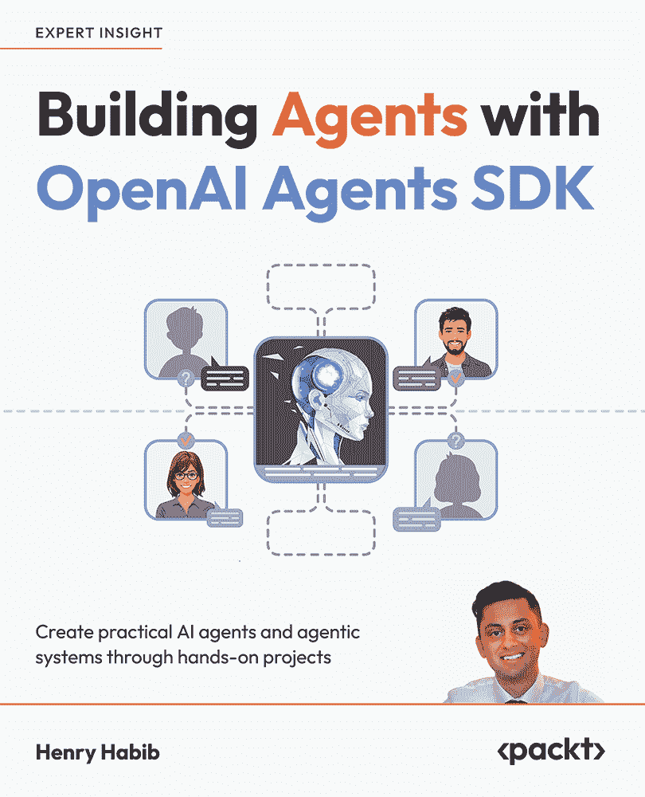

# OpenAI Agents SDK 构建构建指南

*致 Soniya, Booboo, Mom, Dad, Maheen, Karan, Riri 和 Cece。*

*– Henry*

# 贡献者

# 关于作者

Henry Habib 为财富 500 强企业提供分析和运营方面的建议，特别关注构建智能 AI 驱动的解决方案、工具和代理，以产生影响并提高生产力。

他教授关于如何为工作构建 AI 代理和自动化以及其他生成式 AI 主题的在线课程，积累了超过 40 万学生的网络。他还为企业和政府组织提供技术课程。作为无代码和生成式 AI 革命的倡导者，他相信现在任何人无需任何深层技术技能即可创建强大智能的应用程序来实现工作自动化。

他还运营`The Intelligent Worker`，这是一个教授职场人士如何利用生成式 AI、无代码、自动化等技术提高效率的平台，提供课程和免费通讯邮件。他也是许多大型财富 500 强组织的生成式 AI 演讲师。

作为讲师，Henry 热衷于学生如何在任何与生成式 AI、自动化、无代码、数据和生产力相关的课题上取得成功。他通过创建引人入胜且实用的课程并随时准备回答任何问题来实现这一点。

Henry 与妻子住在加拿大多伦多，空闲时喜欢构建随机的 AI 应用和打网球。

# 关于评审员

Sankara Reddy Thamma 是一位资深解决方案架构师、技术交付专家和 AI 创新者，拥有超过 15 年的经验，在银行、医疗保健、公用事业和制造业等行业推动了大规模企业现代化、云迁移和 AI 驱动的自动化计划。他的技术专长涵盖遗留大型机、IBM DataStage、大数据生态系统、Snowflake、Databricks、代理 AI 和多云平台（AWS、Azure 和 GCP），并结合对云现代化和遗留现代化的深厚造诣，使其成为转型复杂企业格局值得信赖的领导者。

他贡献的核心是对代理 AI 的变革性愿景。除了企业成果外，Thamma 在推进 AI 和技术社区方面发挥着积极作用。他是 IEEE 的高级成员，在 AI、机器学习、生成式 AI 和数据工程等领域担任同行评审员做出贡献。他的贡献扩展到技术出版领域，担任 Packt Publishing 和 Manning Publications 的技术书籍评审员，同时支持领先的 AI 日志和编辑委员会。他的专业知识在全球范围内获得认可，在英国和印度获得了基于代理的加速器进行智能代码转换的专利。

作为一名已发表的研究人员，他在 IEEE、Springer 和 Scopus 期刊上发表过著作，内容涵盖了安全提示词工程、神经可视化和医疗保健中的应用 AI 等主题。他将尖端研究与应用企业解决方案相结合的能力，使其在理论与实践的交汇点处于独特地位。

# 订阅免费电子书

新框架、不断演变的架构、研究发布、生产分解——`AI_Distilled` 将噪音过滤，为实际操作 LLM 和生成式 AI 系统的工程师和研究人员提供一份每周简报。现在订阅即可获得免费电子书，以及帮助您保持专注并掌握资讯的每周见解。

在 [`packt.link/8Oz6Y`](https://packt.link/8Oz6Y) 订阅或扫描下方的二维码。

