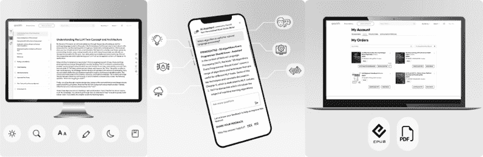

# 前言

*使用 OpenAI Agents SDK 构建代理*的出现正值 AI 以及我们工作方式发生重大转变的时期。第一浪潮是 ChatGPT，这是一种消费级应用的大语言模型（`LLM`），它为所有人提供了生成和处理自然语言的强大新方法。现在，我们正在进入下一个阶段：AI 代理。与围绕僵性、确定规则（如“如果 X，则 Y”）构建的传统软件不同，代理可以处理模糊性，适应不断变化的目标，并通过步骤推理来完成任务。它们不仅限于回答问题；它们可以计划、编排工作流、检索和合成信息、使用外部工具，甚至相互协作。通过这样做，它们开始承担曾认为只有人类才能完成。这种转型仍处于早期。

`OpenAI Agents SDK` 处于这场变革的核心。它为从简单助手到复杂多代理系统的构建、部署和管理提供了一个实用且最佳的框架。就像 Microsoft PowerPoint 是构建幻灯片演示的平台一样，`OpenAI Agents SDK` 将成为开发者和技术爱好者构建 AI 代理和代理系统的标准。

本书是你掌握这项技能的指南。它采用了实战、基于示例的方法。我们从开始学习代理的解剖结构、其优缺点以及 `OpenAI Agents SDK` 如何工作。然后，深入研究 SDK 的每项功能，例如工具、内存、知识、多代理交接和防护措施。最后，我们将所学知识结合，构建一个完整的端到端实用 AI 代理解决方案。

到结束时，你不仅在理论上理解了 AI 代理，还通过 `OpenAI Agents SDK` 构建了端到端的代理系统。你不仅能够回答“什么是 AI 代理？”的问题，还能在实践中设计和实施 AI 代理。学习最好的方法是构建，而这本书正是为了让你开始构建 AI 代理而写的。

本书分为三个部分：

- `Part 1`, `AI Agents`，为本书的其他部分奠定了概念和实践基础。我们首先定义什么是智能体（Agent），它如何与传统的机器人或 API 客户端不同，以及为什么智能体已成为软件、数据和业务流程自动化的一种极具吸引力的模式。随后，我们将构建一个 AI 智能体的心理模型，你可以在贯本书中使用：智能体的大脑（模型）、智能体的手和眼睛（工具接口）以及参考教科书（内存和知识），所有这些都在显式约束和护栏下运行。然后，我们将学习构建 AI 智能体的最佳框架核心组件——`OpenAI Agents SDK`。

- `Part 2`, `OpenAI Agents SDK` 是本书的技术核心。在这里，我们从“理念上的智能体”转向“工程化的智能体”，使用 `OpenAI Agents SDK` 作为我们的主要工具。每一章都会深入深化一种特定的能力以及 `OpenAI Agents SDK` 的原语集。对于每个组件，我们都会讨论理论，然后将其应用于示例和演示中，以构建实用的 AI 智能体和智能体系统。具体而言，我们将通过工具扩展智能体（从简单函数到托管工具和作为工具的智能体）、添加内存和知识检索、构建带有有意交接的多智能体系统，并学习如何管理智能体系统。

- `Part 3`, `Build AI Agents` 是本书的关键部分。在这里，我们将使用 `OpenAI Agents SDK` 组装一个端到端的智能体系统，不是孤立的功能，而是作为一个贯的应用程序。我们将之前介绍的组件（工具、内存和检索、会话、模型和上下文管理、护栏、多智能体编排等）并将它们集成到具有清晰输入输出的生产级应用程序和工作流中。

# 本书适合读者

如果你是一名软件开发者、顾问或渴望利用 AI 智能体力量的技术专业人士，那么本书就是为你设计的。无论你是探索最新 AI 框架的 `Python` 开发者，还是对工作流自动化好奇的业务分析师，亦或是寻求构建实用 AI 驱动解决方案的效率爱好者，本书都将赋予你将想法转化为运行的 AI 智能体和智能体系统的技能。

我们假设你对 `Python` 编程概念有基本的了解，并且对 `APIs`、开发环境和云服务等技术工具表示熟悉。你不需要具备先 AI 或机器学习的经验，因为这些概念是循序渐进的。

读完本书，你将同时拥有使用 `OpenAI Agents SDK` 设计、实现和扩展 AI 智能体的概念基础和实践经验，从简单的智能体转向复杂的、能够产生现实影响的多智能体系统。

# 本书涵盖内容

- `Chapter 1`, `Introduction to AI Agents` 解释了什么是 AI 智能体以及为什么它们代表了如此强大的任务自动化范式。它为理解它们在现代工作流中的作用奠定了基础。

- `Chapter 2`, `Introduction to OpenAI Agents SDK` 介绍了 `OpenAI Agents SDK` 的架构、核心概念和原语，为你提供了处理基于智能体的系统的基础。

- `Chapter 3`, `Environment Setup and Developing Your First Agent` 将带你设置开发环境并从零开始构建简单的智能体，提供了进入智能体开发的实用第一步。

- `Chapter 4`, `Agent Tools and MCPs` 展示了如何通过工具扩展智能体（从自定义 `Python` 函数到 OpenAI 托管工具），同时涵盖了智能体如何通过“模型上下文协议”（`MCP`）进行交互。

- `Chapter 5`, `Memory and Knowledge` 展示了如何通过集成对话历史和向量数据库为智能体提供内存和检索能力，使其能够有效使用过去的上下文和外部文档。

- `Chapter 6`, `Multi-Agent Systems and Handoffs` 探索了智能体之间的协作，包括它们如何将任务移交给专门的子智能体以解决复杂的多个步骤问题。

- `Chapter 7`, `Model and Context Management` 涵盖了自定义底层 `LLMs` 及其设置以微调智能体行为的技术。

- `Chapter 8`, `Agent System Management` 重点关注操作实践，如监控、可观测性、护栏和策略执行，以确保智能体可靠安全地运行。

- `Chapter 9`, `Building AI Agents and Agentic Systems` 通过引导你构建完整的、现实世界的智能体解决方案将所有内容整合在一起，将工具、内存、交接和系统管理结合成凝聚的应用程序。

# 从书中获得最大收益

如果你记住以下几点，学习过程将会更容易：

- **理论**：我们通常会从解释特定概念和原语背后的理论开始。

- **示例**：我们将用完整的端到端示例来说明每个概念，以确保你可以有效使用所学的所有概念。

- **项目**：在书的最后，我们将所学的所有内容应用于完整的端到端 AI 智能体和智能体系统构建中。

- **深度思考**：思考如何使用 AI 智能体和 `OpenAI Agents SDK` 来解决你的问题。

以下是你需要的软件/硬件列表：

| 本书涵盖的软件/硬件 | 系统要求 |
| :--- | :--- |
| Python 3.10 或更高 | Windows, macOS 或 Linux |
| OpenAI API key | |

## 下载示例代码

本书的代码包托管在 GitHub 上： [`github.com/PacktPublishing/Building-Agents-with-OpenAI-Agents-SDK`](https://github.com/PacktPublishing/Building-Agents-with-OpenAI-Agents-SDK)。我们从丰富的书籍和视频目录中也提供了可用代码包，地址为 [`github.com/PacktPublishing`](https://github.com/PacktPublishing)。快去看看吧！

## 下载彩色图片

我们还提供了一个书中使用的截图/图表的彩色 PDF 文件。你可以在这里下载： [`packt.link/gbp/978180612012`](https://packt.link/gbp/978180612012)。

## 使用规范

书中使用了多种文本规范。

`文本中代码`: 表示代码单词、数据库表名、文件夹名、文件名、扩展名、路径、虚拟 URL、用户输入和 X 句。例如，“我们随后调用 `Runner.run_sync` 函数，传递新创建的 `agent` 对象以及 `input_context`，在这种情况下，它是客户可能会的问题”。

代码块设置如下：

```python
from agents import Agent, Runner, CodeInterpreterTool
from agents.tool import CodeInterpreter
### 实例化工具
tool_config = CodeInterpreter(
    container={"type":"auto"},
    type="code_interpreter"      
)
codetool = CodeInterpreterTool(tool_config=tool_config)
```

**粗体**：表示新术语、重要词汇或你在屏幕上看到的文字，例如菜单或对话框中的文字。例如：“通常情况下，你有一个控制工作流的智能体（通常称为**编排器**）和一组被调用以执行特定任务的智能体（通常称为**执行者**）。”

## 关于 AI 使用的免责声明

作者承认使用了 ChatGPT 等尖端 AI 技术，其唯一目的是优化语言表达、头脑风暴、完善清晰度并为书中提供通用帮助，从而确保读者拥有流畅的阅读体验。需要注意的是，内容本身由作者编写并由专业出版团队进行编辑。

# 与我们联系

我们随时欢迎读者的反馈！

- **一般反馈**：请向 `feedback@packtpub.com` 发送邮件，并在邮件主题中注明书名。如果您对本书的任何方面有任何疑问，请发送邮件至 `questions@packtpub.com` 联系我们。

- **错误勘正**：尽管我们已尽力确保内容的准确性，但错误在所难免。如果您在书中发现错误，如能向我们报告，我们将不胜感激。请访问 [`www.packtpub.com/submit-errata`](http://www.packtpub.com/submit-errata)，点击 `Submit Errata` 并填写表单。

- **盗版问题**：如果您在互联网上发现我们作品的任何形式的非法复制版，如果您能向我们提供地址或网站名称，我们将不胜感激。请通过 `copyright@packtpub.com` 联系我们并附上材料链接。

- **如果您兴趣成为作者**：如果您在某个领域拥有专长，并对编写或贡献书籍感兴趣，请访问 [`authors.packtpub.com/`](http://authors.packtpub.com/)。

# 加入我们的 Discord 和 Reddit 社区

您并不是唯一一个在碎片化工具、持续更新和不明确的最佳实践中摸索的人。加入一个不断发展的专业人士社区，交流未记录在文档中的见解。

| 通过我们作者提供的更新、讨论和幕后见解保持关注。加入我们的 Discord 空间： [`packt.link/z8ivB`](https://packt.link/z8ivB) 或扫描以下二维码： | 与同行交流，分享想法并讨论现实世界的生成式 AI（GenAI）挑战。在 Reddit 上关注我们： [`packt.link/0rExL`](https://packt.link/0rExL) 或扫描以下二维码： |

# 您的书籍附带专属福利 - 如何解锁

## 立即解锁本书的专属福利

扫描此二维码或访问 [`packtpub.com/unlock`](https://packtpub.com/unlock)，然后按书名搜索本书。确保版本是正确的。 |  |

- **注意**：在开始之前请准备好您的购买发票。



使用我们的下一代阅读器增强阅读体验：

-  **多设备进度同步**：通过无缝进度同步从任何设备进行学习。

-  **高亮与笔记**：将您的阅读转化为持久的知识。

-  **书签**：随时回顾您最重要的学习内容。

-  **深色模式**：切换到深色或深褐色模式，以最小眼睛疲劳专注于阅读。

使用我们的 AI 助手（测试版）更智能地学习：

-  **总结**：总结关键章节或整个章节。

-  **AI 代码解释**：在下一代 Packt Reader 中，点击每个代码块上方的 `Explain`按钮获取 AI 驱动的代码解释。

**注意**：AI 助手是下一代 Packt Reader 的一部分，仍处于测试阶段。

随时随地学习：

 使用无 DRM 的 PDF 和 ePub 版本离线访问内容——兼容您喜欢的电子阅读器。

# 解锁您的书籍专属福利

您的书籍附带以下专属福利：

-  下一代 Packt Reader

-  AI 助手（测试版）

-  无 DRM 的 PDF/ePub 下载

如果您尚未解锁，请使用以下指南。该过程仅需几分钟，且只需操作一次。

# 如何通过三个简单步骤解锁这些福利

## 第 1 步

准备好本书的购买发票，因为您在第 3 步中需要它。如果您收到的是纸质发票，请用手机扫描并准备好 PDF、JPG 或 PNG 格式。

关于查找发票的更多帮助，请访问 [`www.packtpub.com/unlock-benefits/help`](https://www.packtpub.com/unlock-benefits/help)。


**注意**：您是直接从 Packt 购买的这本书吗？您不需要发票。完成第 2 步后，您可以直接进入专属内容。

## 第 2 步

扫描此二维码或访问 [`packtpub.com/unlock`](https://packtpub.com/unlock)。

在打开的页面上（如果您使用的是电脑，页面将类似于图 0.1），按书名搜索本书。确保您选择了正确的版本。

## 第 3 步

登录您的 Packt 账户或免费创建一个新账户。登录后，上传您的发票。格式可以是 PDF、PNG 或 JPG，大小不能超过 10 MB。按照屏幕上的剩余指令完成操作。

如果您遇到困难并需要帮助，访问 [`www.packtpub.com/unlock-benefits/help`](https://www.packtpub.com/unlock-benefits/help) 查看有关查找发票的详细常见问题。以下二维码将带您进入帮助页面。

# 分享您的想法

读完本书后，我们想听听您的想法！请[点击此处直接进入亚马逊评论页](https://packt.link/r/1806112000)为本书提供您的反馈。

您的评论对我们以及技术社区至关重要，并将帮助我们确保交付优质内容。
