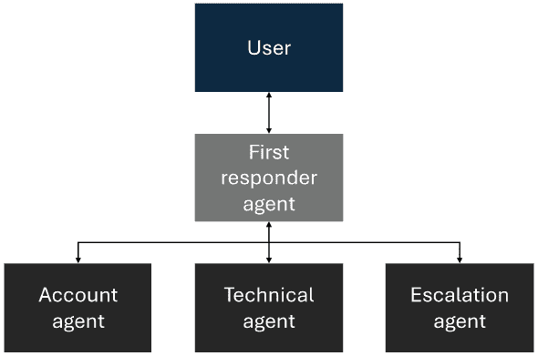
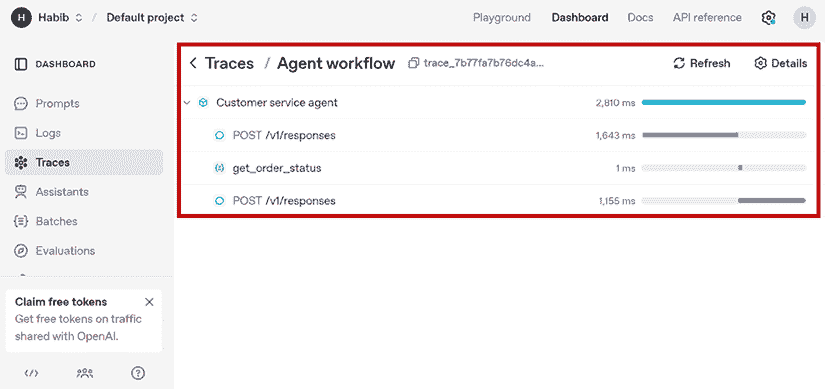
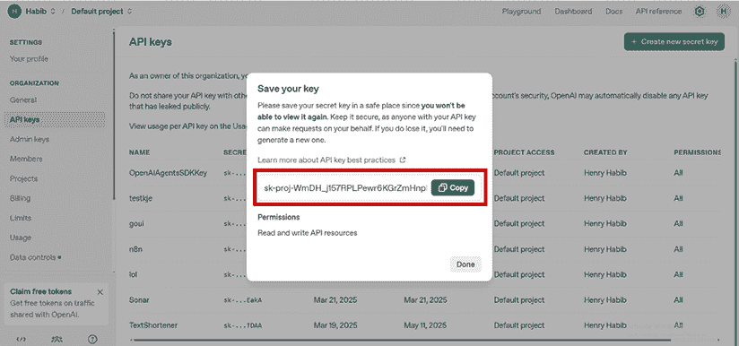
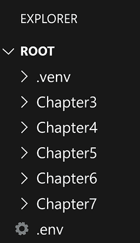
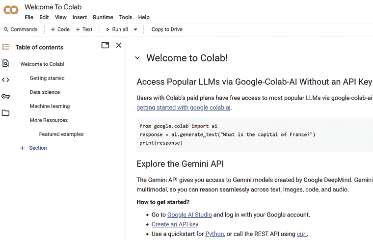
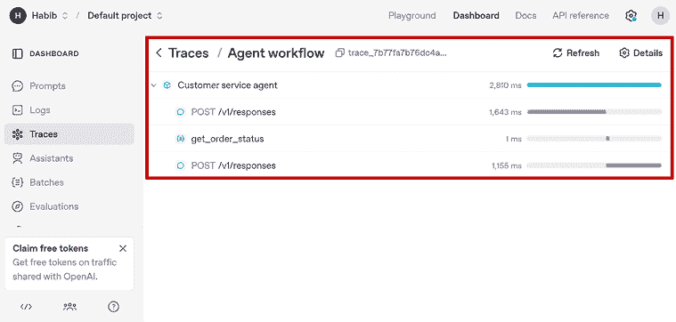
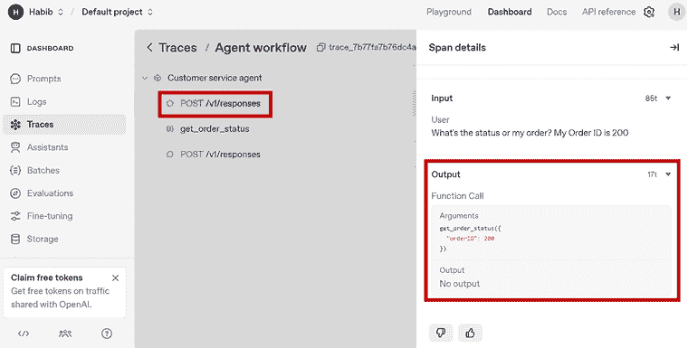
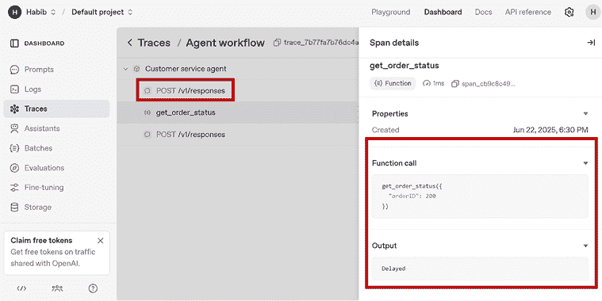

# 第一部分

## AI 智能体

第一部分为本书的内容奠定了概念和实践基础。我们首先定义什么是智能体、它与传统的机器人或 API 客户端有什么区别，以及为什么智能体成为跨软件、数据和业务流程的一种极具吸引力的模式。随后，我们将构建一个贯穿全书的 AI 智能体模型：智能体的大脑（模型）、智能体的手和眼睛（工具接口）以及参考书（内存和知识），所有这些都在显式的约束和边界内运行。我们将学习构建 AI 智能体的最佳框架的核心：`OpenAI Agents SDK`。

这一部分非常务实。在建立了“为什么”和“是什么”之后，我们将让您进入实践。您将安装先决条件、搭建最小项目并启动您的第一个工作智能体。

本部分包含以下章节：

- *第 1 章，AI 智能体简介*

- *第 2 章，OpenAI Agents SDK 简介*

- *第 3 章，环境搭建与开发您的第一个智能体*

AI 代理正在改变我们的工作方式。软件通常创建的是确定性的（如果 *X*，则 *Y*）且僵化的系统，这些系统无法处理歧义或适应不同的目标——但这种情况正在改变。随着**大语言模型**（**LLMs**）的进步，人们正在创建能够独立推理步骤并采取行动以完成目标的智能系统。这些 AI 代理正在承担越来越多以前被认为只有人类才能完成的工作，而这才刚刚开始。

读完这本书，你将成为通过`OpenAI Agents SDK`创建 AI 代理的专家。学习这一点的最佳方法是亲手实践，开始使用该框架构建 AI 代理系统。然而，在此之前，我们需要从最基础的层面开始，回答这个问题：“什么是 AI 代理？”

本章将涵盖你回答该问题需要的所有知识，更重要的是，它为我们在书中其余部分的构建奠定了基础。我们将*准确地*解释什么是 AI 代理，以及它与传统系统的区别。这很重要，因为许多读者经常会将 AI 代理与复杂的应用程序（如聊天机器人或欺诈检测系统）混淆。在开始构建它们之前，理解 AI 代理系统是如何运作的至关重要。我们将探索 AI 代理在生产力之外的实际应用。最后，我们将介绍构建 AI 代理时可用的不同设计模式和框架，并理解为什么`OpenAI Agents SDK`是大多数生产系统的务实之选。

以下是第一章将涵盖的内容：

* AI 代理系统概述及其与更传统的系统相比的优缺点
* AI 代理的实际应用
* AI 代理是如何构建的，通过理解其解剖结构以及用于构建它们的不同设计/框架模式

在本引言章节结束时，我们将对每个现实世界中的 AI 代理如何组装的建立一个强有心理蓝图，这将成为我们开始构建自己的代理时的指南针。

## 技术要求

本章将从理论角度对 AI 代理进行概述，以便在开始构建之前建立良好的基础。因此，我们将在本章中不任何代码或开发任何应用程序。然而，为了跟进并完成书中范围内讨论的练习和项目，请确保你的开发环境中已完成以下设置：

* **操作系统**：Windows 10/11、macOS 或基于 Linux 的发行版（推荐使用 Ubuntu）。
* **Python 版本**：Python 3.8 或更高版本。你可以通过终端或命令提示符中运行`python --version`来验证 Python 版本。
* **OpenAI 账户**：在`https://platform.openai.com/signup`注册。
* **OpenAI API key**：通过创建 OpenAI 账户获取。你需要它来利用`OpenAI Agents SDK`。
* **代码编辑器**：VS Code、PyCharm 或你喜欢的任何 IDE/编辑器。

在整书中，实际示例和每章的完整代码将通过相应的 GitHub 仓库提供：`https://github.com/PacktPublishing/Building-Agents-with-OpenAI-Agents-SDK`。

```
https://github.com/PacktPublishing/Building-Agents-with-OpenAI-Agents-SDK
```

鼓励你克隆该仓库，复用并适配提供的代码示例，并在学习章节时根据需要参考它。

## AI 代理概述

在深入探索 AI 代理之前，我们必须首先对 AI 代理到底是什么建立直观的理解，它从根本上与传统软件有何不同，以及这带来了哪些优缺点。这是困难的，因为存在不同的定义，而且这些定义通常随着技术的进步而演变。通过预先明确关键概念——包括其智能自主性、推理能力和自适应问题解决等优点——我们可以为理解其实际应用和构建方法铺路。

### 什么是 AI 代理？

**AI 代理**是一种*能够通过感知周围世界并采取行动来独立运行以完成特定目标的智能系统*。AI 代理的关键区别特征包括：它能够从广泛且有时具有歧义的目标进行思考和推理，能够创建完成该目标的计划，并能够使用一组可以与世界交互的工具自主地完成该目标。

这与其他传统的软件系统形成鲜明对比，传统系统是确定性的（即它们根据预定义的计划遵循严格指令集），并且在遇到计划之外的情况时无法推理。相反，AI 代理可以**观察**其环境，对需要做什么进行**推理**，并以连续的方式采取**行动**。

AI 代理通过将 LLM 的智能和推理能力与通过标准化 API 调用行动相结合来实现这一点。让我们通过一个简单的类比来探索 AI 代理的概念和优势，以巩固理解并将其与经典的软件自动化框架区分开。

### 通过简单的类比理解 AI 代理

想象你是一家五星级餐厅的主厨，你需要培训两个初级厨师，*Carlos* 和 *Adam*。Carlos 就像传统的自动化软件系统或模型，而 Adam 就像一个 AI 代理。你*训练*这两个厨师的方式以及这两个厨师*运行*的方式是完全不同的。

Carlos 需要你教教他准备每道菜时具体要做什么。如果你在教他做煎姆蛋，你必须教他如何打开冰箱、拿一个鸡蛋、打开炉子、倒一些油、打鸡蛋等等。每一步都必须细致地定义并展示给 Carlos 看。当要求做煎姆蛋时，Carlos 会完全按照原样执行任务，完美无缺。

Adam 的工作方式不同，更像人类。你不是给他提供预定义的步骤，而是向他展示如何在厨房周围执行动作——这是如何从冰箱中取出食材，这是如何操作炉子的，这些是烹饪的基础知识，等等。当要求做煎姆蛋时，Adam 依靠他的推理能力和被赋予的一组工具/知识来完成该任务，而不是遵循预定义的步骤。

Carlos 和 Adam 都是出色的厨师，但都有不同的优缺点。特别是，Adam 可以应对复杂性和歧义性。因为他能够推理并被教导如何执行通用动作，他可以做的不仅仅是煎姆蛋——理论上他可以做各种食物，因为所有食物都使用相同的动作。

这作为 AI 代理与经典自动化软件/模型之间的完美类比。简而言之，*赋予 AI 代理的智能自主性使其能够执行一系列无法复制的多样歧义任务*。

**注意**

必须说明，智能自主性也意味着需要安全措施。如果代理的“大脑”（AI 模型）信息不准确，自主代理可能会做出错误的决定。我们稍将讨论如何引导和约束代理（通过提示词指令和护栏），以确保其自主性是以负责任的方式行使。这里的关键结论是，AI 代理带来了智能的、以目标为导向的独立性，这它们与传统的自动化系统区分开来。

### AI 代理与传统系统的优缺点

上述类比描述了 AI 代理除了`拥抱复杂性`的能力外，它们与其他系统相比的关键区别和优势。Adam 具有`目标导向的自主性`，这让他能够烹饪不仅仅是煎饼；他可以制作炒蛋、水煮蛋，甚至是单面蛋。事实上，只要他的动作集足以执行该任务，Adam 就能创造出他未经过显式训练的新型/新颖作品。如果合适，Adam 还可以以另一种顺序完成任务。

Adam 展现了推理能力，这意味着他可以进行`自适应问题解决`，这使他能够执行以下操作，而这对 Carlos 来说是不可能的：

* 改变烹饪风格以满足客户需求——Adam 可以做出程度较软或较硬的煎饼，因为他知道让食物在灶上停留时间越长，就会越干。
* 如果缺少食材，Adam 可以折中方案并查看是否有任何替代方案。他能够处理现实世界中的模糊性并从中成长。

Carlos 会发现这些任务是不可能的，因为他只接受过训练，只能以一种方式烹饪，且无法进行其他推理。如果有任何外部因素阻止他打开冰箱或打开炉灶，Carlos 将无法进行并停滞，而 Adam 则可以适应。

然而，AI 代理模型也存在缺点，对于某些用例，这些缺点可能巨大且影响巨大，以至于它们不是最佳选择。Adam 的大脑由 LLM 驱动，容易产生`幻觉`，这意味着 AI 代理可能会产生幻觉并执行无意义的行为。这可能导致，例如，Adam 做了一道牛排，但自信地声称它是豆腐（这可能给素食主义者带来糟糕的结果）。Adam 可能会采取新颖且未见的方法来完成任务（`鲁莽的冒险`），有时会损害其目的。例如，他可能会发现保持炉持续开启会导致烹饪更快，但没有意识到这是危险的，并可能会烧掉餐厅。AI 代理通常选择自己的路径来实现目标，这可能不是最优化或理想的路径。

Adam 还必须花时间进行推理，这意味着他天生速度较慢且消耗更多能量。事实上，AI 代理的资源消耗可能比其传统软件对应高 100 倍，耗时更长。最后，Adam 还可能难以解释他采取某些行动的推理原因（`缺乏可解释性`），这是许多深度学习模型中常见的缺点。

现在我们理解了什么是 AI 代理以及它的优缺点，我们可以推论它与其他传统系统相比的实际应用。

## AI 代理的实际应用

AI 代理不仅仅是一个时尚的理念——它们正在成为公司利用 AI 解决实际问题的核心。特别是，AI 代理的早期采用者正在组织的各个层级使用它们，从销售产品和解决问题的面向客户 AI 代理角色，到内部生产力（如软件开发或研究）。

### 生产力提升

AI 代理最明显且最直接的动力是提高生产力，主要通过替代或增强传统软件系统无法替代或增强的人类工作。通过自主处理这些任务，AI 代理释放了人类，让他们专注于更高层次、更具战略性和创造性的工作。

以客户支持为例。传统上，客户支持中心可能需要几十或数百名人类代理来处理查询。传统的软件系统可能会用来自树状层次问答组合的自动聊天机器人来取代，但它们的影响是有限的，因为它们无法采取行动且难以处理模糊性。传统系统可能回答*我如何重置密码？*，但难以处理*你能查看我最近的一笔交易并告诉我在哪里买的吗，然后为我处理退货并同时向我的会计师发送确认邮件吗？*。拥有正确架构和工具的 AI 代理可以轻松解决这些查询，并在必要时引入人类。事实上，预计 AI 在不久的未来将处理 95% 的客户服务（`https://www.tidio.com/blog/ai-customer-service-statistics/`）。

软件开发也是 AI 代理密集活跃的典型功能。众所周知，`GitHub Copilot` 等 AI 编码助手已证明能帮助开发者完成任务的速度快 55%，并帮助开发者*保持心流*，他们报告说，编码时的挫败感减少了 60%（`https://github.blog/news-insights/research/research-quantifying-github-copilots-impact-on-developer-productivity-and-happiness`）。AI 代理更进了一步。现在有几家公司正在创建完全自主的 AI 代理，它们可以在整个开发周期中解决代码中的错误并构建新功能（理解用户需求、编写代码、测试代码、管理拉请求、更新 Jira 以及与经理沟通）。`GitHub Copilot` 之外的示例还包括 `Devin` 和 `Cursor`。

还有针对特定领域的 AI 代理，旨在提高特定任务（如人事、法律等）或行业（银行、零售等）的生产力。例如，在人力资源领域，AI 代理可以自动化候选筛选、预测员工流失率并个性化入职流程。在法律领域，`MinterEllison` 等公司部署了 `Lantern` 等 AI 工具来加速文档审查，每小时处理数千份文档——比人类审查员快得多。在银行领域，`JPMorgan Chase` 等机构利用 AI 代理通过自动化个性化投资建议和相关研究来增强客户服务。

总体而言，AI 代理通过执行或增强人类任务充当了生产力的催化剂。

### 更好的交互性

AI 代理从根本上改变了我们与计算机交互的方式。传统上，大多数交互遵循固定模式，必须由熟悉该领域的专家执行。例如，考虑一个在零售业工作的经理。分析他们的商店销售情况与其他商店的对比，需要一位专门的数据分析师，能够将经理的请求转换为可以在数据库上运行的`SQL query`。或者，这种请求可以通过相同任务的更高抽象来完成，例如与 `Power BI` 或 `Excel` 交互，但这仍然要求经理熟悉这些工具（以及所有相关的菜单、表单等）。

然而，AI 代理完全消除了这一障碍。AI 代理通过自然语言接收用户请求，并包含执行`SQL queries`的必要工具。`LLM` 可以完全将用户请求转换为所需的`SQL query`，并向用户解释结果。通过这种方式，经理可以直接与数据交互。

这不仅限于文本；AI 代理正不断变得更加多模态，能够与语音和视觉交互。例如，支持语音的 AI 代理允许医生口述笔记并自动编写发送给患者药房的处方。零售商正在使用视觉功能审核货架，自动订购更多库存并在货架为空时指示员工补货。

总而言之，AI 智能体正在推动从`工具`到`伙伴`的转变。软件不再要求用户去适应（学习其界面并以僵化的方式输入数据），而是由软件适应用户，从而消除了整个学习障碍及其相关的摩擦。

### 新兴业务

AI 智能体不仅在提高生产力和交互性；整个全新的业务和策略正基于 AI 智能体被构建。一个很好的类比是互联网。互联网让某些任务变得更快——例如，写电子邮件比通过邮寄发送实体信件快得多。它还创造了完全全新的业务模式，如电子商务、数字市场、在线服务等。

例如，像 `Jasper.ai` 和 `Copy.ai` 这样的企业已经出现，它们提供了专门设计的 AI 智能体驱动型平台，能够自主生成营销内容、社交媒体帖子和销售文案。这些由 AI 驱动的解决方案使能够能够加速内容创建，减少营销费用，并将信息传递规模扩大到远超传统方法实现的水平。

## AI 智能体的构建方法论

现在我们已经从概念上理解了 AI 智能体及其实际应用，我们来讨论 AI 智能体的解剖结构，并解释设计和构建它们的逐步阶段方法。理解这种解剖结构将帮助我们系统地设计和实现智能体，从而确保每个组件都得到考虑并正常运行。

### AI 智能体的解剖结构

AI 智能体遵循典型的模式，可以分解为三个基本组件。具体来说，AI 智能体的解剖结构包含以下内容：

* **模型 (Model)**：这是操作的`大脑`。它解释输入、对操作进行推理并生成输出。通常，这是一个带有系统指令和控制逻辑框架的 LLM，使其能够进行推理和迭代。
* **工具接口 (Tooling interface)**：这是`手和眼睛`。它赋予智能体行动的能力，例如通过 API 或本地函数调用发送电子邮件或搜索网络。
* **记忆与知识 (Memory and knowledge)**：这是`参考教科书`。它包含了帮助 AI 智能体执行任务的信息，如数据库、文档等。

### 模型

所有智能 AI 智能体都由一个`底层模型`驱动，使它们能够理解输入、创建行动计划、生成行动输入、审查行动响应，并迭代该过程直到实现目标。核心模型在技术上并不非要是 LLM——它可以是任何遵循我们之前描述的`观察(observe)`、`推理(reason)`和`行动(act)`原则的系统。但在实践中，这通常是一个强大的 LLM，例如 OpenAI 的 `GPT-4o` 模型或 Google Gemini 的 `2.5 Pro` 模型。

模型充当 AI 智能体的大脑，这意味着选择正确 LLM 的重要性不言而喻。在决定使用哪个模型时，有几个因素需要考虑。在尝试使用 LLM 执行任何任务时，存在以下权衡：

* **成本 (Cost)**：LLM 的成本差异巨大，通常按 token（或词块）的美元金额表示。基础模型比专门微调的重型推理模型便宜得多。
* **延迟 (Latency)**：LLM 的响应速度各不相同，这不仅取决于 LLM 的架构，还取决于 LLM 在何处以及如何托管。
* **性能 (Performance)**：这个因素无疑是最多样化的。由于 LLM 的泛滥，存在许多根据用例而异的优势。某些 LLM 擅长编程任务，而另一些在创意练习中表现更好。某些 LLM 是多模态的——它们不仅可以输入和输出文本，还可以图像、视频和音频。LLM 在上下文窗口方面也不同，这决定了它们一次可以读取或写入多少内容。


# 偏见与注意

## 偏见 (Bias)

`LLM` 在知识和倾向上也存在差异，在决定为你的 `AI` 智能体选择什么模型时，需要理解这一点。许多模型具有知识截止日期（即它们只“知道”到特定日期的事件），如果我们正在创建一个回溯近期事件的 `AI` 智能体，这可能会带来麻烦。此外，`LLM` 可能具有政治或信息方面的倾向，这可能会在无意中（或有时是有意的）偏斜它们的回答。一个例子是 `DeepSeek`，根据《卫报》报道，它具有明显的亲中国倾向（`https://www.theguardian.com/technology/2025/jan/28/we-tried-out-deepseek-it-works-well-until-we-asked-it-about-tiananmen-square-and-taiwan`）。

**注意**

性能和偏见的某些方面（例如知识截止日期和政治倾向）可以通过`检索增强生成` (`RAG`)、细致的提示词或训练后改进等策略来解决。这些将在稍后介绍。

## 模型与指令

请注意，驱动 `AI` 智能体的模型并非为每个 `AI` 智能体专门构建或训练的。相反，这些是通用的预训练模型，只是被赋予了特殊指令来得像智能体。也就是说，`ChatGPT`、旅行规划 `AI` 智能体、`GitHub Copilot` 和客户服务 `AI` 智能体之间的底层模型可能共享相同的底层模型 `OpenAI GPT-4o`。这些应用之间的区别不在模型，而是提供给模型的指令以及模型与其他组件的交互方式。

这些“指令”通过定义一个`系统提示词 (system prompt)` 来提供给模型。系统提示词告诉模型如何行动并驱动其底层行为。`AI` 智能体性能的大多数调试都是通过调整其系统提示词，以获得更理想的结果。一个很好的类比是，当你写一个系统提示词时，你正在定义模型的身份和目的。因此，提供准确且细致的系统提示词非常重要。

# 控制逻辑框架

`AI` 智能体的另一个关键方面是`控制逻辑框架`，它是智能体迭代观察、推理和行动的能力，直到实现预定目标。这种循环并不一定由模型本身完成；相反，是智能体框架代码强制模型运行此循环。这通常集成在 `AI` 智能体的模型组件中，伪代码总结如下：

```
读取用户目标并创建行动计划
对于计划中的每个步骤：
    创建行动输入
    执行行动
    获取结果
    将结果加入记忆
    如有必要或未实现目标则修改行动计划
    如果目标实现：
        向用户返回输出
```

智能体框架在实际方法上有所不同，存在多种变体，但大多数都遵循上述的高层规划和执行结构。常见的包括思维链 (`CoT`) 和 `ReAct`。事实上，某些框架甚至让智能体生成答案，然后进行第二轮处理，由智能体（作为裁判）评估第一个智能体的答案和逻辑。

# 工具与交互

`AI` 代理与其他应用程序交互的机制，是通过为 `AI` 代理提供一个在这些应用程序中`如何执行以及何时执行动作的框架`。例如，一个辅助电子邮件工具的 `AI` 代理框架可能包含以下动作（再次用伪代码表示）：

```
Action #1: Send an email
    Description: 向用户发送电子邮件
    Parameters: to_email_address, email_subject, email_body
Action #2: List all emails
    Description: 列出所有邮件，包括 email_id
    Parameters: search_term (optional)
Action #3: Read an email
    Description: 返回邮件内容
    Parameter: email_id
```

当使用这些工具创建 `AI` 代理时，其模型和控制逻辑框架将决定何时使用这些动作，并为这些动作确定正确的输入值。

例如，一个 `AI` 代理可能被分配一项任务：找到所有与 `coffee expansion proposal`（咖啡扩张提案）相关的邮件，对它们进行总结，并将摘要发送给用户的经理。在这种情况下，`AI` 代理将首先调用 `List all emails` 动作，搜索词为 `coffee expansion proposal` 或类似内容；使用 `Read an email` 动作读取这些邮件；使用 `LLM` 进行进行总结；最后使用 `Send an email` 动作发送摘要。

将这些工具注册到 `AI` 代理的行为取决于所 fact 使用的代理框架。然而，在所有情况下，`AI` 代理都可以执行以下操作：

**表现出对这些工具存在性的感知** – 通常通过自动将工具名称、定义和参数添加到模型的系统提示词（system prompt）中来实现。

**执行工具动作** – 通常通过所选的代理框架自动完成。这些可以是客户端上的 `function calls` 形式（即运行 `AI` 代理的机器也包含了工具动作的逻辑），也可以是服务器端机器上的 `API calls`（服务器包含工具动作的逻辑，`AI` 代理只需向服务器调用以执行这些动作）。

**接收工具动作的输出并将其传递给模型** – 同样，这通常是通过所选的代理框架自动完成的。

我们之前定义 `AI` 代理为能够与外部世界进行迭代交互以实现目标。从本质上说，这意味着工具接口（即 `AI` 代理与外部世界交互的方式）是一个关键组件。正因如此，编写工具（编写逻辑、提供详细指令和输入参数、将其注册到 `AI` 代理、确定动作的正确选择和粒度、错误处理、如何向 `AI` 代理暴露它们等）是书中的核心模块，我们专门用了一个章节来讨论。

# 记忆与知识

回想一下我们将 `AI` 代理称为智能系统。

关于 `AI` 代理的记忆和知识是两个独立但相关的概念。两者的目的都是根据用户的整体请求为模型提供相关的上下文。这提升了 `AI` 代理的智能性和有效性。让我们讨论每个概念，以及它们如何在机械上被使用以为 `AI` 代理提供更多上下文。

**记忆**指的是 `AI` 代理`记住与用户当前及之前交互中的相关信息`。通常有两种类型的记忆，将在接下来的小节中讨论。

## 工作记忆

**工作记忆**是存储在 `AI` 代理`当前会话`的交互历史记录中的信息。最好在传统的聊天语境中考虑这一点。假设你问 `ChatGPT` `太阳有多热？`，它给出了回答。你在同一次次会话中的下一条消息是 `它有多大？`。`ChatGPT` 足够智能，能够理解你的随后的请求与太阳有关，因为在它的工作历史中包含了你之前的交互/聊天内容。

从机制上讲，最近的聊天被保留在发送给模型的 prompt 中，以便 `LLM` 始终能够并在理解用户请求的上下文。这就是为什么你可以提后续问题，而这些基于聊天的系统可以正确回答。请注意，将工作记忆注入到系统指令中也是非常常见的。

工作记忆是有限制的。例如，`GPT-4o` 可能只能处理 `128K` tokens，超过此限制后，早期的消息会被弃，新的会被添加。根据使用的代理框架，可以使用上下文窗口或滑动窗口等策略来保留最相关的近期信息。

## 长期记忆

**长期记忆**是存储自 `AI` 代理之前会话交互历史中的信息。这使得 `AI` 代理能够从经典的`无状态`体验（每个请求的处理都独立于之前的交互）转变为`有状态`体验（每个请求都受到从之前交互中检索到的信息的影响）。从消费者角度来看被认为是智能的 `AI` 代理通常具有某种长期记忆实现。例如，考虑一个帮助你写邮件的 `AI` 代理。

从机制上讲，这是通过 `AI` 代理将交互中的信息存储在数据库中实现的，之后它可以再次读取，这两者都可以通过工具交互完成。例如，`AI` 代理可能具有以下工具，使其能够存储和召回记忆：

```
Action #1: Store information
    Description: 存储关于用户的重要信息
    Parameters: information
Action #2: Read information
    Description: 获取关于用户的重要信息
```

记忆和知识的实现取决于所选的代理框架和模型。在大多数情况下，工作记忆和训练知识是典型的——启用这些组件不需要额外的功能。然而，长期记忆或相关知识确实需要专门的工具，这会增加 `AI` 代理的复杂性。这些方面将在专门的章节中讨论。

**知识**指的是 `AI` 代理从存储的知识库中`召回相关信息`。与记忆不同，召回的信息不是生成自与用户的交互，而是来自知识源。这些包括文档、数据库、文件、文本语料库等。通常有两种类型的知识，将在接下来的小节中讨论。

## 训练知识

**训练知识**指的是通过训练数据固有存储在模型中的信息。例如，所有 `LLM` 都能轻松回答 `太阳有多大？`这个问题，因为回答该问题的信息存在于 `LLM` 训练的语料中。这也被被称为`通用知识`。它是 `LLM` 由于其训练方式而拥有的“内置”知识。

`LLM` 的训练知识通常是其最大的优势之一——能够在几秒钟内召回海量的有用通用知识并使其适应用户的请求是非常强大的。然而，从 `AI` 代理的角度来看，这并没有很大帮助。`AI` 代理通常不是为了召回通用知识；连接到聊天交互的 `LLM` 可以更好地实现这一目的。此外，`LLM` 无法召回训练知识截止日期之后的信息，也无法召回非公开信息——这是构建高效且有影响力的 `AI` 代理所需的元素。事实上，我们通常会在生成响应时刻意指示模型忽略任何训练知识。

相反，`AI` 代理应该能够实时检索与用户请求相关的特定上下文信息。这就是另一种知识非常有帮助的地方。

## 检索知识

`Retrieved knowledge`（检索知识）指的是根据用户请求，从知识库中实时检索的信息。与在模型训练时就已经确定且固定不变的训练知识不同，检索知识是动态且具有自适应性的。知识库可以是文档、数据库等。这里的关键因素是，在 `AI` 智能体运行期间，只有基于用户上下文的 relevant 信息会被检索并添加到模型中。

在实现机制上，这是通过类似于长期记忆的工具来实现的。这些工具为 `AI` 智能体提供了检索机制，例如向量数据库（使用 `RAG` 模式）、结构化 `API`、文件库搜索（如 `SharePoint` 或 `Google Drive`）以及 `web search`（网络搜索）。`AI` 智能体利用用户的输入在这些来源中搜索相关文档或记录，然后将它们作为上下文提供给模型以生成响应。

将检索知识集成到 `AI` 智能体中有许多益处。特别是，`AI` 智能体可以执行以下操作：

* 使用最新或专有内容回答问题

* 提供引用或参考文献以实现追溯性（相比之下，`LLM` 极难通过其训练知识提供来源）

这种相关知识对于使 `AI` 智能体变得有用且产生影响力至关重要。考虑一个担任组织人力资源角的 `AI` 智能体。它回答有关组织休假政策、福利、病假等问题的唯一方法就是通过知识检索方法。销售 `AI` 智能体可能会搜索公司的 `customer relationship management`（`CRM`）系统，以查找用户询问的客户的备注。

# 设计模式

现在我们已经了解了 `AI` 智能体的构造，可以根据它们在处理模型、工具接口以及内存和知识组件方面的不同，区分不同的设计和实现模式。

所有 `AI` 智能体设计模式都包含核心三个组件，但在实现这些组件的方式上有所不同。特别是，它们的区别取决于它们如何控制控制逻辑框架（我们之前讨论过的）以及其工具的复杂程度。这些包括 `ReAct`、`CoT`、`planner-executor` 以及 `hierarchical/multi-agent`（分层/多智能体）。

## CoT

`CoT`（思维链）简单地鼓励模型在生成最终答案之前产生逐步的推理轨迹。对其的字面解释是：告诉某人思考问题，创建一个解决该问题的计划，然后采取步骤来解决它。`CoT` 的一个局限性是它无法采取行动，更重要的是，它无法根据行动的结果调整其计划。

## ReAct (Reasoning + Acting)

`ReAct`（推理+行动）是我们之前用伪代码提到并描述的模式。这种设计模式强制 `AI` 智能体对问题进行迭代推理，并选择采取的工具或行动，将结果反馈回持续循环，直到实现目标。`ReAct` 与 `CoT` 的区别在于它能够行动并根据该行动的结果调整计划。这最适用于需要推理并与工具交互以解决复杂任务的真实世界智能体。这种模式通常是大多数传统 `AI` 智能体的首选。

## Planner-execution

`planner-execution`（规划-执行）模式将执行规划的系统与执行执行的系统分开。智能体首先生成一个高层计划，然后由另一个智能体（或多个智能体）执行该计划中的每个任务。这种模式对于非常长期的复杂任务，或可以很容易模块化并委托给子智能体的任务非常。

## Hierarchical/multi-agent

`hierarchical/multi-agent`（分层/多智能体）模式将任务分配给多个在该特定领域或任务上具有专家水平的专门智能体。这种模式还可以以分布式的方式工作，这意味着系统可以同时完成任务，而不是顺序完成。该系统类似于普通公司，包含一个经理（`CEO`），他将任务委托给具有自己领域的专业工人（`CMO`、`COO`、`CFO` 等）。

例如，如果我们构建一个解决客户投诉的 `AI` 智能体，可能会有一个智能体接收投诉并产生行动计划，然后由专门的智能体来执行这些任务，每个智能体都有自己的模型、工具基础设施以及内存和知识（例如，可以查询客户信息的客户智能体、审查政策的合规智能体，以及为客户起草回复的响应智能体）。

**注意**

这些模式并不是互斥的。事实上，大多数真实世界的智能体（特别是那些使用接下来简要讨论的框架构建的）倾向于根据任务的复杂性和可用工具混合这些方法。例如，`OpenAI Agents SDK` 框架结合了 `ReAct` 和 `hierarchical/multi-agent` 模式。

除了设计模式，公司还构建了不同的框架来开发和部署 `AI` 智能体，这些框架根据所使用的设计模式及其功能集而异。这些包括 `OpenAI Agents SDK`、`LangChain`、`LangGraph`、`AutoGen`、`AutoGPT` 和 `Crew AI`。

总体而言，`OpenAI Agents SDK` 因其极简性和灵活性而脱颖而出。它包含一种强大的无关架构，可以结合强大的 `OpenAI` 组件（如 `web search` 或 `computer use`）和自定义工具。它具有非常有用的集成追踪、护栏以及其他企业级安全和观测功能，这些是其他框架具备的。最后，它是一个持续受到关注和增长的开源项目——例如它在模块发布几周后添加了 `Model Context Protocol`（`MCP`）集成。

# 总结

在本章中，我们学习了 `AI` 智能体、它们的实际应用及其构建方法。

`AI` 智能体是智能系统，能够通过推理、规划以及通过工具与世界交互来独立实现目标。与需要严格、预定义指令的传统自动化系统不同，`AI` 智能体可以处理模糊性，并根据整体目标动态调整其步骤和行动。

`AI` 智能体通过增强或替代传统人类完成的工作来帮助组织更快工作。它们还让个人能够无缝地与工具和数据直接交互。最后，组织正在利用 `AI` 智能体架构创建全新的业务。

`AI` 智能体的核心构造由以下部分组成：模型、工具接口以及内存和知识组件。设计模式指导这些组件如何协同工作。例如，`ReAct` 允许智能体在每个行动步骤进行推理和调整，而多智能体系统通过将任务分配给专门的子智能体来提高效率。

一个 `SDK`，或`软件开发包`，是一组精选的库、工具和文档，让开发者能够站在他人的肩膀上。我非常喜欢这个（带点俏说的）定义，因为它用通俗易懂的话描述了每个开发者对 `SDK` 的渴望：写更少的代码。良好的 `SDK` 可以消除接线、配置和样板代码的繁琐工作，让开发者能够专注于让其应用程序脱颖出的特性。

`OpenAI Agents SDK` 用于构建 `AI` 代理（agents），其简洁性非常优人。它没有让你面对自定义配置语言或迷复杂的类层次结构，而是提供了一组清晰的原始语——`agents`、`runners`、`tools`、`handoff`、`guardrails` 和 `tracing`——这些都是用地道的 `Python` 实现的。通过这六个构建块（你甚至可以称它们为积木块），你可以在几分钟内启动一个单代理或多代理原型。

在第二章中，你将学习以下内容：

* **OpenAI Agents SDK 的设计原则**，包括最小抽象和多代理编排框架——Python 风格、灵活且可扩展

* **构成 SDK 的核心原始语**，包含每个原始语的详细示例以及如何使用它们

当你完成这一章时，你将不仅知道每个原始语的作用，还会理解为什么 `SDK` 的极简主义架构是一个实用的启动平台，帮助你快速且可靠地构建出本书其余部分将引导你构建的代理系统。

# 技术要求

在整本书中，每一章的实用示例和完整代码将通过附带的 `GitHub` 仓库提供：[`github.com/PacktPublishing/Building-Agents-with-OpenAI-Agents-SDK`](https://github.com/PacktPublishing/Building-Agents-with-OpenAI-Agents-SDK)。

我们鼓励你克隆该仓库，复用并适配提供的代码示例，并在学习章节时根据需要参考它。

# OpenAI Agents SDK 的设计特性

`OpenAI Agents SDK` 的设计考虑了几个关键原则，旨在易用性与开发者的灵活性之间取得平衡。理解这些设计选择将有助于理明为什么 `SDK` 将是这样工作的（以及它与其他解决方案有何不同）。

## 构建 AI 代理的框架

在高级层次，`OpenAI Agents SDK` 构建 `AI` 代理的方式与使用 Web 框架（如 `Django`、`Ruby on Rails` 等）构建网站的方式相同。这些框架抽象了 `AI` 代理开发和编排的低级部分。这使得开发者能够专注于更高层的影响力逻辑，并尽可能地部署代理，而无需担心脚手架代码。

通过 `SDK`，我们可以用几行 `Python` 代码创建一个代理：

```python
agent = Agent(name="Assistant", instructions="You are an AI agent",
    model="gpt-4o")
result = Runner.run_sync(agent, "Tell me a joke")
print(result.final_output)
```


这个示例使用 OpenAI GPT-4o 模型实例化了一个基础 AI 代理，并带有一些基础的系统指令。使代理能够进行迭代思考的控制逻辑框架已经嵌入到代理内部，这是框架带来的直接结果。然后，我们在用户查询上运行代理，并打印模型的输出。

**注意**

到此为止，我们引入代码是为了理解实现 SDK 的简单性和易用性。要实际运行代码，需要安装并导入必要的库，我们将在下一章中详细介绍。

如果没有 SDK，编排这些内容将显著需要数千行代码，更不用说为了创建一个 OpenAI Agents SDK 自动提供的追踪和日志系统而额外需要的数千行代码了。

OpenAI Agents SDK 的设计旨在解决构建不仅需要文本生成的 LLM 驱动流程时面临的固有挑战。这些挑战包括让模型对多步问题进行推理、与外部数据源和 API 交互（工具使用），以及在多个 AI 实体之间协调动作。

### 多代理编排

作为子集，该框架还允许开发者构建多代理解决方案。事实上，这是该框架的前身 `Swarm` 的原始目的（其核心思想是你可以以群集的方式产生一系列代理来完成任务）。这里的想法是，对于特定任务，你不能让一个代理完成一切。相反，你拥有一个*代理团队*，每个代理都专精某项任务，并在必要时相互*交接（*hand off*）委托。

想象一个客户支持工作流：



图 2.1：客户支持工作流

让我们分解并讨论一下代理工作流：

*   **首次响应代理**：接听、理解问题、执行简单的 FAQ 请求，并在根据需要交接给其他代理
*   **账户代理**：可以查询客户订单和状态
*   **技术代理**：可以修复用户身份验证漏洞并为客户设置新的连接线
*   **升级代理**：在最后的手段下引入人工参与

每个代理都专注于自己的领域，但对终端用户来说，体验感觉像是一次单一、连贯的对话。所有的上下文传递、角色切换和错误处理都发生在 SDK 的编排层中（通过一个名为 `handoffs` 的原始语完成）。你只需配置一次交接路由，让框架完成编排即可。这只需要几行代码：

```python
account_agent = Agent(name="Account agent")
technical_agent = Agent(name="Technical agent")
escalation_agent = Agent(name="Escalation agent")
first_responder_agent = Agent(
    name="First Responder",
    handoffs=[account_agent, technical_agent, escalation_agent]
)
```

## 最小抽象

OpenAI Agents SDK 背后的指导哲学之一是“用少的原始语实现快速上手”。SDK 没有引入层层又层的新类，而是给了我们一套简短易记的词汇。现实地，如果你能记住核心原始语及其工作原理，你就掌握了该框架的 80%。

这些原始语包括：`agents`、`runner`、`tools`、`handoffs`、`guardrails` 和 `tracing`。我们将在下一节深入探讨这些每一个框架，而本书的结构刻意模仿了这些原始语——因为通过每一个一个是学习该框架的最佳方式。

本质上就是这样。没有隐藏的元语言，也没有你看不见的生成代码的不透明运行时。你用纯 Python 将代理组装在一起，用 `@function_tool` 装饰几个函数，然后点击 `run`。这很重要，因为它提供了一个快速上手的体验：大多数开发者可以在午饭时间浏览一下文档或示例笔记本，并在下午构建出一个可以运行的原型。

这个 SDK 更像是一个轻量级库而不是一个庞大的框架，但这种特性也有一些权衡。与 `LangChain` 等其他综合框架不同，OpenAI Agents SDK 本身并不提供成百上千种文档加载器或内存存储器的即用集成；这些概念需要用户自行开发。

## Python 风格、可扩展且开源

OpenAI Agents SDK 使用 Python 编写并使用流利的 Python 通。没有需要斗争的 YAML 配置文件，没有需要记忆的私有作用域，也没有隐藏真实工作的元编程魔法。代理只是一个 Python 对象，工具只是一个带有特殊装饰器的普通 Python 函数。你使用每天使用的 Python 语言结构来编排它们。这使得对于 Python 开发者来说非常有用且简单，并与其他广喜的 `Flask` 和 `Pydantic` 等极简主义库有相似之处。

OpenAI Agents SDK 的默认构造已“开箱即用”，但同时也刻意留了可扩展性。你可以用自己的组件热替换任何特定的构造模块：

- 智能体对象中使用的 `model` 可以更换为任何 LLM，例如本地部署的 LLAMA 模型（前提是符合 `Chat Completions` 标准，该标准是 OpenAI 在与基础 LLM 交互时开发的标准协议；我们将在 `第 10 章` 中详细讨论这一点）。我们之前讨论过，该框架完全完全模型无关的。
- 此框架中的 `tools` 只是添加了装饰器的 Python 函数，这意味着它们可以随时轻松切换为另一个 Python 函数或托管的 API 调用，包括连接到 MCP 服务器。
- `tracing` 默认发送到 OpenAI 内部的 `Traces` 仪表板，也可以连接到任何遥测工具，如 `Azure Monitor Logs` 或 `DataDog`。

从技术上讲，甚至智能体执行循环也是模块化的。高层运行器（`runner`）处理重试、步骤限制和并发调用，但高级用户可以跳过它，在现有的事件循环或任务队列中直接驱动低级原语。

例如，高级用户与其调用 `Runner.run_sync(agent, input)`，不如使用 `agent.run_step(...)` 方法手动逐步步进智能体的执行逻辑，或者使用 `agent.get_initial_state()` 和 `agent.step(...)` 控制循环。这在需要将智能体执行与其他异步操作交替进行的环境中特别有用（例如在 FastAPI 路由内部），允许对时序、并发或资源管理进行完全控制。

最后，该 SDK 是开源的，这意味着该框架受益于完全的透明度以及不断增长的开发者群体，他们持续改进该框架并使其更具韧性。

总的来说，OpenAI Agents SDK 提供了一个精简且符合 Python 风格的框架，专门为简化和加速复杂 AI 代理（`agents`）的创建与编排而设计。通过提供极简但强大的抽象（智能体 `agents`、运行器 `runners`、工具 `tools`、交接 `handoffs`、护栏 `guardrails` 和追踪 `tracing`），该 SDK 使开发者能够无需与过多的样板代码或隐藏配置作斗，快速构建复杂的多智能体解决方案。它的可扩展性以及与现有 Python 结构的兼容性，使得在创建 AI 智能体时既能实现快速部署，又能进行深度定制。

# 核心原语 (Core primitives)

正如我们之前提到的，OpenAI Agents SDK 引入了一些核心概念（通常称为 `primitives`），我们可以使用它们来构建智能体系统。这些是使用该 SDK 构建任何智能体驱动应用的构建区块。

为了理解什么是原语，假设你正在设计一个机器人助手来帮助管理智能家居。助手应该能够关闭灯光、调整温度器、响应语音命令，并在窗户未关闭时通知你。与其从零开始构建一切，SDK 给了你一小组基础组件：一个用于定义智能体知道什么（`state`），一个用于定义它可以做什么（`tools`），一个用于定义它如何思考（`policy`），等等。这些就是 `primitives`。你像组装机器的不同零件一样组合它们，从而创建一个完备的智能体。

将原语想象成乐高套装中的乐高积木。它们是你构建任何东西时使用的最小标准单元。SDK 之后可能会包含预设的配方（类似于乐高说明书），但积木本身就是原语。

## 智能体 (Agent)

`agent` 原语是 OpenAI Agents SDK 最基础的概念。它本质上充当 LLM 外围的一个高度可配置的封装，使其具有“代理性”（即为其提供人设或 `system instructions`、工具接口，以及其自主决策和追求目标所需的其他设置）。当使用 `agent` 原语实例化智能体时，它具有以下配置：

- **Name (名称)**：智能体的名称，通常仅用于标识识别。
- **Instructions (指令)**：这些与我们在上一章讨论的系统提示词（`system prompt`）相同；它们为 LLM 提供关于其角色、目标、行为和人设的指南。
- **Model (模型)**：驱动智能体智能的底层 LLM。
- **Tools (工具)**：智能体可以调用以获取答案的工具列表。
- **Handoffs (交接)**：智能体可以委托的其他智能体列表。

这是一个智能体实例化的示例：

```
Customer_service_agent = Agent(
    name="Customer Service Agent",
    model="gpt-4o",
    instructions="""
        你是一个 AI 代理，负责以积极乐观的方式解决客户问题。
    """,
    tools=[get_account_information, refund_customer_payment,
        track_customer_order],
)
```

**Note**

`Agent` 类还可以接收其他有用参数，如护栏（`guardrails`）、输出类型等。这些将在后续章节中介绍。

意乎情的是，这些组件的大部分与我们在上一章讨论的 AI 智能体结构相匹配。这种可配置性使得开发者能够快速启动特定的智能体，以适应大型应用程序中的特定角色或任务。

该智能体既可以用自然语言响应，也可以调用它被赋予工具之一。值得注意的是，该 SDK 提供单一的 `Agent` 类，而不是某些框架为每种智能体类型拥有不同的类。在这里，智能体的行为完全取决于之前的配置。

## Runner

这个原语是智能体背后的引擎。在上一章中，我们讨论了成功代理应用的一个关键要素是其迭代和自主解决问题的能力（即它可以根据接收到的进一步输入做出决策并改变，以实现目标）。这种智能体循环功能已内置在该原语中。`Runner`（有时称为 `Agent Loop`）是与 LLM 交互、管理工具调用、决定下一步做什么以及重复该过程的循环过程。

回想一下，我们在以下伪代码中对这一系列操作进行了泛化：

```
读取目标并创建行动计划
对于计划中的每个步骤：
    创建行动输入
    执行行动
    获取结果
    将结果加入内存
    必要或未实现目标时修改行动计划
    如果目标已实现：
        将输出返回给用户
```

通过自动化这一核心逻辑，智能体循环显著简化了开发者的任务。它抽象了 LLM 交互和工具使用的低级编排，让开发者能够专注于通过指令定义智能体的高层行为，并通过工具定义其所需的能力，而不是深陷执行循环的机制中。管理这种推理循环在历史上一直是构建代理式 AI 最困难的部分之一（开发者必须捕获模型的思维链并自己实现循环逻辑）。

要调用运行原语，只需调用 `Runner` 类中的 `run` 方法：

```
result = await Runner.run(agent, "我的订单号是 XYZ - 帮我查查订单在哪里")
```

**Note**

`Runner.run()` 有一个非常有用的参数 `max_turns`，它可以限制智能体可以进行的循环次数。通过限制边界，`max_turns` 充当了安全阀，防止因错误的配置或不可解决的任务而导致无限循环。我们将在后续章节中详细介绍这一点。

`tool`（工具）原语是 OpenAI Agents SDK 中的核心概念，并且在简单性方面堪称“部署得当”。在我看来，它是该 SDK 最“美丽”的特性之一。任何 Python 函数都可以通过添加特定的工具装饰器来转换为 `tool`。该装饰器能够让智能体的 LLM 能够通过其名称、文档字符串（`docstring`）和参数自动隐式地理解该 `tool`。如果智能体的 LLM 决定调用该工具，LLM 将自动创建调用它时所需的必要参数/架构（`schema`）。

例如，我们可以创建一个根据订单 ID 返回订单状态的 Python 函数，并使用相关装饰器将其添加为一种工具。该装饰器会自动解析函数的文档字符串和参数，并将它们作为系统指令提供给 LLM，以便智能体知道它自己拥有哪些工具、可以做什么以及应该提供哪些输入参数。以下是创建工具的代码：

```python
Customer_service_agent = Agent(
    instructions="""
        你是一个 AI 智能体，以积极乐融的方式帮助解决客户问题。
    """,
    tools=[get_order_status],
)
@function_tool
def get_order_status(order_id: str) -> str:
    """根据 order_id 获取订单状态
    Args:
        order_id: 订单的 order_id
    """
## 调用 API 获取订单状态
return order_status
```

请注意，OpenAI Agents SDK 还允许开发者实例化用户定义函数之外的其他类型工具——托管工具（`hosted tools`）和作为工具的智能体（`agents as tools`）：

*   **托管工具 (Hosted tools)**：这些是由 OpenAI 具体提供并托管的内置工具。它们包含了你可能希望智能体拥有的常用工具，例如搜索网页、搜索文件、生成图像等。它们还包括连接到本地计算机 shell/终端的能力，或通过托管的**模型上下文协议** (`MCP`) 服务器的功能。
*   **作为工具的智能体 (Agents as tools)**：这些是你之前实例化的智能体，然后被转换为工具。然而，在实践中这种情况很少见，因为调用智能体通常是通过交接（`handoff`）实现的，交接更像是上下文的传递。

## 交接 (Handoff)

`handoff` 原语控制了智能体委托或转移控制权给其他智能体的机制。这使得多智能体编排成为可能，并且是该 SDK 前身 Swarm 的基础功能之一。智能体可以针对特定任务进行专门化，而交接允许你拥有一个专门的智能体系统（每个智能体都有自己的的人设和工具）来解决目标，而不是让智能体控制一切。

想象你正在创建一个创建研究报告的智能体。Agent A 专门负责制定研究计划。它将该计划传递给 Agent B，Agent B 搜索网络、提炼发现，然后将总结交给 Agent C，Agent C 专门负责接收发现并根据所需的规格创建最终报告。Agents SDK 平滑地管理每一次交接。通过以下方式可以使用该原语轻松创建这种架构：

```python
research_plan_agent = Agent(name="Research plan agent")
web_search_agent = Agent(name="Web search agent")
final_report_agent = Agent(name="Final report agent")
research_report_agent = Agent(
    name="Research report agent",
    handoffs=[research_plan_agent, web_search_agent, final_report_agent]
)
```

智能体交接（`agent handoff`）与工具调用（`tool calling`）之间的区别是什么？

*   **上下文转移 (Transfer of context)**：在交接期间，SDK 将必要的上下文（如对话历史，而不是预定义的硬性参数）传递给下一个智能体，让工作不中断地进行。
*   **控制权转移 (Transfer of control)**：交接让另一个“驱动器”接管整体目标，而不是“外包”特定的子任务。被“调用”的智能体可以调用自己的工具，然后根据需要交接给另一个智能体。

## 护栏 (Guardrails)

`Guardrails`（护栏）是 SDK 中的一种原语，作为对用户输入和智能体输出执行验证的安全机制。它们的实例化方式与工具相同（例如，在自定义 Python 函数上指定指定的装饰器），并根据你定义的逻辑触发。例如，我们可以设置一个护栏，确保用户是在询问我们的客户服务智能体客户问题，而不是随机内容。

```python
@input_guardrail
async def input_guardrail(
    ctx: RunContextWrapper[None], agent: Agent,
 input: str | list[TResponseInputItem]
) -> GuardrailFunctionOutput:
    # 判断输入是否与客户服务查询相关的逻辑
    if is_customer_service_query:
        return GuardrailFunctionOutput(
        output_info = "这是一个客户查询问题",
        tripwire_triggered = False,
    )
    else:
        return GuardrailFunctionOutput(
        output_info = "这不是一个客户查询问题",
        tripwire_triggered = True,
    )
```

如果护栏未能通过任何验证，将触发“触发表”（`tripwire`），并在 Python 中抛出特定的错误类型。此错误可以用任何需要的方式进行处理。例如，你可能希望该错误触发向用户发送消息，告知他们这不是对智能体的有效使用方式，或者故意停止任何后续执行并返回错误代码。


```python
try:
    await Runner.run(agent, "宇宙的意义是什么?")
    except InputGuardrailTripwireTriggered:
        print("请输入与客户服务相关的查询，而不是随机问题")
```

AI 智能体中的护栏概念非常重要，但很少被讨论。例如，你可能希望运行护栏，因为执行任何智能体或工具在计算上都是昂贵的。

**注意**

护栏通常以嵌入了验证规则的装饰 Python 函数的形式存在。这些可以应用于用户的初始输入或智能体的输出。然而，这些函数本身可以调用另一个智能体来检查候选输入或输出。这意味着你不仅可以将智能体作为工具，还可以作为护栏。

## 追踪 (Tracing)

`tracing` 原允许允许通过捕获和记录运行期间的详细执行流来观察和调试智能体系统。追踪就像智能体推理循环的飞行记录器。这包含了智能体做的每一个决策、工具调用、中间消息和交接。如果没有追踪，理解智能体如何以及为什么得出结果是非常困难，特别是在复杂的多智能体工作流中。

SDK 提供了一个手动使用的内置追踪工具，但更常见的方法是通过 SDK 集成的追踪系统自动启用。该系统可以将轨迹持久化到本地或发送到远程追踪后端，例如 OpenAI 的内置 UI 或你自己的观测设置。

让我们来看一个简单的例子。假设我们想调试客户服务智能体接收用户请求时的行为：

```python
From agents import Runner, enable_tracing
await Runner.run(agent, "请取消我的最后一个订单。")
```

一旦启用追踪，SDK 将捕获并记录以下内容：

* 初始用户输入和系统指令
* 模型的内部推理（思考）
* 任何工具的调用（带有参数和输出）
* 任何触发的交接（带有完整的上下文）
* 返回给用户的最终响应

所有这些都可以在 OpenAI Traces UI 或你偏好的 UI（如 DataDog）中查看：



### 图 2.2：通过追踪捕获并记录详细执行流

### 注意

追踪（Tracing）与护栏（guardrails）结合使用时格外强大。例如，当护栏触发器被激活时，追踪允许你精确捕获是什么输入导致了问题，以及到那时为止了哪些步骤。这使得在敏感应用程序中调优智能体或验证业务逻辑变得简单得多。

# 总结

在本章中，我们深入探讨了 OpenAI Agents SDK 及其特殊之处。我们看到了它极简主义的抽象哲学如何剥离样板代码，让纯 Python 代码发挥作用，同时仍然强大到足以创建复杂的智能体和多智能体解决方案。我们还看到了它是如何完全开源的，邀请了社区审查并实现了大量的扩展。

随后，我们查看了构成 SDK 的核心原语。特别是，我们关注了以下内容：

* **Agent (智能体)**：一个将 LLM 转换为自主智能体的轻量级封装。它带有名称、系统指令、可选的工具带以及一个用于潜在交接的同伴智能体列表。
* **Runner (运行器)**：驱动智能体迭代推理循环的执行引擎，处理重试并强制执行限制以防止无限循环。
* **Tools (工具)**：普通的 Python 函数（或托管的 API/智能体），经过装饰后，模型可以发现它们的用途、构建有效的参数，并在需要时恰好地调用它们。
* **Handoffs (交接)**：一种编排机制，允许智能体将控制权（以及完整的对话上下文）委托另一个智能体，从而实现优雅的多智能体工作流。
* **Guardrails (护栏)**：封装循环每一步的策略检查，确保输出、工具调用和交接保持在业务和合规边界内。
* **Tracing (追踪)**：对每个提示、响应和工具调用的自动、结构化日志——对于调试、可观察性和事后分析至关重要。

有了这些像乐高积木一样的原语，我们只需几行代码就能在几分钟内快速搭建实用的智能体。在下一章中，我们将设置环境并创建第一个智能体，将所有这些概念付诸实践。

# 订阅获取免费电子书

新框架、演进中的架构、研究发布、生产环境分析——AI_Distilled 将噪音过滤为面向一线操作 LLM 和生成式 AI 系统的工程师和研究人员的每周简报。现在订阅即可获得一本免费电子书，以及帮助你保持专注和获取资讯的每周见解。

在`https://packt.link/8Oz6Y`订阅或扫描下方二维码。


# 3 环境设置与开发你的第一个智能体

时候到了。我们可以开始大显身手，构建我们的第一个 AI 智能体了。虽然 OpenAI Agents SDK 相对直观，但我们首先需要确保环境配置恰当，并理解一些与 SDK 相关的基础 Python 概念。一个运行的环境是书中其他所有内容的启动台，从编写和运行智能体到测试工具、调试追踪以及编排多智能体工作流。

以下是你将在本章中学习到的内容：

* **环境设置**：我们将安装 Python、设置虚拟环境、安装`openai-agents` SDK 并安全地配置你的 OpenAI API 密钥。我们还将通过运行测试脚本来验证你的环境已就绪。
* **开发前提**：该 SDK 围绕我们需要注意的 Python Python 概念构建，包括类型提示、文档字符串字面量、装饰器、异步编程（`async`/`await`）以及用于结构化数据验证的 Pydantic 库。在我们构建工具以及智能体之间交互数据时，这些是必要的。
* **构建你的第一个 AI 智能体**：设置完成后，我们将创建第一个真实的智能体（它是一个客服助手），然后逐步增强它。我们将添加一个工具来处理订单状态查询，然后引入到用于客户留存的专门智能体的交接。本节将整个开发循环付诸行动，涵盖了我们之前讨论的**控制逻辑框架**的内部机制。

在本章中，我们将开始编码。在本章结束时，你将拥有一个功能完整的 SDK 环境、对 SDK 依赖的 Python 概念有基本的理解，以及一个可以接收输入、调用工具并将控制权交给其他智能体的真实运行 AI 智能体。让我们开始吧。

## 技术要求

在整书中，每一章的实用示例和完整代码将通过附的 GitHub 仓库提供：`https://github.com/PacktPublishing/Building-Agents-with-OpenAI-Agents-SDK`。

鼓励你克隆该仓库，复用并适配提供的代码示例，并在推进章节学习时根据需要参考它。

## 环境设置

使用 OpenAI Agents SDK 的第一步是成功设置你的环境，包括安装 SDK 并配置你的系统以运行它。我们将涵盖前提条件、如何使用虚拟环境设置项目，以及如何在 Windows 和 macOS 上安装 SDK。我们还需要获取 OpenAI API 密钥并确保它可以被安全地存储和访问。遵循这些步骤将有助于避免常见的安装问题，并确认你的环境已准备好开发。

### 注意

本章介绍了如何为了在本地运行 SDK 而设置环境。如果你无法在本地运行 SDK（可能是由于你的机器上缺少前提条件）或不希望这样做，那么书中涵盖的大部分内容可以使用 Google Colab 进行远程运行。如果你想采用这种方法，请跳至标题为 *Alternative methods: Google Colab* 的章节

## Python 版本与依赖

如之前所述，OpenAI Agents SDK 构建在 Python 之上。这意味着你的机器必须安装了 Python，特别是 Python 3.9 或更高版本。将你所需的 Python 实例放在你的`PATH`变量中（如果你在 Windows 上）也是非常有用的，这样`python`命令就可以你的 PowerShell/命令提示符中可用。

要验证你的机器上 Python 安装是否正确，请根据你的操作系统打开相应的控制台环境。如果你在 Windows 10 上，通常是 PowerShell 或命令提示符；如果你在 Windows 11 或 macOS 上，则是 Terminal。未来，这将简称为你的控制台。

打开你的控制台并输入以下命令。这将返回 Python 版本。验证它是否高于 3.9。如果不是或命令返回错误，请按照`https://www.python.org/downloads/`上对应操作系统的安装说明进行。输入此命令：

```
$ python – version
>>> Python 3.10.6
```

## 项目目录、虚拟环境与安装

清晰且组织良好的项目结构是构建可维护应用程序的第一步。在书中，每个示例将位于自己不同的项目文件夹中，组织在章节文件夹内，并且都在一个中央根目录内。随着我们的项目在书中变得复杂，拥有一个专用的目录对于管理智能体、工具和配置文件是至关重要的。

创建所需的项目文件夹，使其看起来如下配置。这代表了从根目录到章节的路径：

```
Root
└─ Chapter3
└─ Chapter4
```

你可以手动创建这些文件夹，也可以在控制台终端中使用`mkdir`命令。

由于我们将安装`openai-agents`库，因此必须创建一个虚拟环境，将 SDK 与你的其他 Python 项目隔离开。要创建虚拟环境，请确保你处于根目录，并在控制台终端中输入以下命令：

```
$ python -m venv .venv
```

这将创建一个新的虚拟环境，所有内容都包含你的`.venv`文件夹中。接下来，我们必须激活虚拟环境，以便我们后续所有的 Python 语句都能通过虚拟环境中的 Python 解释器（以及其中安装的库）运行。

在 macOS 上，请使用以下命令：

```
source .venv/bin/activate
```

在 Windows 上，使用此命令：

```
.venv/Scripts/activate
```

激活后，你的提示符通常会加上环境名称（例如`.venv`）。这意味着你安装的任何 Python 包或运行的任何命令将使用这个隔离环境。请注意，在任何新的终端会话中运行代码之前，你都需要激活虚拟环境。每当本书要求你`activate your virtual environment`时，意味着运行这些命令将终端置于此隔离环境中。

接下来，我们将使用 Python 的包管理器`pip`，通过在控制台终端中运行以下命令来下载并安装 OpenAI Agents SDK：

```
$ pip install openai-agents
```

此命令将下载并安装 SDK 及其所有依赖项。你应该能看到控制台输出结束于`Successfully installed openai-agents`，这表明该库已安装。此时，你已经拥有了 Python、虚拟环境以及开始构建智能体（agents）所需的所有库——下一步是设置 OpenAI 的 API 访问。

## 注册 OpenAI API 并设置 API Key

为了使用 OpenAI 的大语言模型（`LLMs`），你需要一个拥有正余额的 OpenAI 账户以及一个 OpenAI API Key。API 密钥作为将你的 API 请求与账户关联的唯一标识符。

按照以下步骤生成 OpenAI API Key：

1. 访问[`platform.openai.com/`](https://platform.openai.com/)并注册账户或登录现有账户。请注意，你需要一个有效的电子邮件地址。
2. 从右上菜单选择`Settings`，然后从左侧菜单选择`Billing`。填写你的支付详情，然后选择`Add to credit balance`。输入`$10`为你的 OpenAI API 积分余额充值 10 美元。
3. 接下来，从左侧菜单选择`API keys`并选择`Create secret key`。为此 API Key 命名，例如`OpenAIAgentsSDKKey`并选择`Default`项目。然后选择`Create secret key`生成你的私有 OpenAI API Key。
4. 此时，你将看到你的 OpenAI Key 以及`Save your key`提示。注意，这是你查看和复制 API Key 的唯一机会——之后，你将无法再次从 OpenAI 获取它。点击`Copy`按钮将 API Key 复制到剪贴板，然后暂时将其粘贴到机器上的某处（例如`.txt`文件）。
5. 下图显示了 OpenAI 平台仪表板中的 API Key 管理界面：



图 3.1：OpenAI UI 中的

生成密钥后，下一步是保护它。这对于保护你的账户免受未经授权的使用至关重要。

**注意**

此 API Key 是你 OpenAI 账户的身份验证层。因此，你必须像密码一样对待此 API Key 并采取相应的安全措施。不要共享它或将其提交到任何开放仓库中。从技术上讲，任何拥有此 API Key 的人都可以代表你操作并消耗你的 API 积分。正因如此，我们始终使用环境变量来处理 API Key，而不是显式写入。

由于此 API Key 最终授予了对你账户的权限，即使在本地开发期间也对其进行保护。最好的方法是在项目根目录下创建一个`.env`文件，用于存储 API Key。在`.env`文件中，输入以下内容并将其替换为你的 OpenAI API Key：

```
OPENAI_API_KEY="sk-..."
```

接下来，你必须安装`python-dotenv`以将存储在`.env`文件中的环境变量加载到你的应用程序中。在根目录中打开控制台终端，激活环境，并运行以下命令：

```
$ pip install python-dotenv
```

你完成后的根目录看起来如下：

```
Root
└─ .venv
└─ .env
└─ Chapter3
└─ Chapter4
└─ ...
```

这是 CLI 环境的截图：



图 3.2：CLI 环境

**注意**

如果你怀疑他人拥有你的密钥或你不小心泄露了它，可以随时返回 OpenAI 撤销密钥。只需返回 OpenAI 账户，进入`API keys`，并选择要禁用的 API Key 附近的`Revoke`。

## 验证环境设置

现在让我们整合所有内容，并验证是否可以使用 SDK 初始化并运行智能体。创建一个名为`Chapter3`的新文件夹，在该目录下创建一个名为`verify_environment_setup.py`的新文件并输入以下内容：

```python
import os
from dotenv import load_dotenv
from agents import Agent, Runner
## 从.env 文件加载环境变量
load_dotenv()
### 获取 API key
api_key = os.getenv("OPENAI_API_KEY")
## 检查 API Key 是否可用：
if not api_key:
    print("Error: OPENAI_API_KEY not found. 请在你的.env 文件中设置它
else:
    print("API Key loaded.")
    # 创建智能体并运行
    agent = Agent(name="Echo Agent", instructions="Return the words 'Setup successful'")
    result = Runner.run_sync(agent, "Run setup")
    print(result.final_output)
```

在下一节中，我们将探索另一种远程环境。

## 替代方法：Google Colab

如果你不想搭建本地开发环境，或者你在没有管理员权限的设备上工作，`Google Colab`提供了一个方便且基于云的替代方案。它允许你在 Jupyter Notebook 风格的环境中运行 Python 代码，而无需你进行任何配置。

要在 Colab 中使用 OpenAI Agents SDK，请遵循以下步骤：

1. 在[`colab.research.google.com/`](https://colab.research.google.com/)注册账户并新建笔记本：



图 3.3：Google Colab UI

2. 系统已经为你安装了 Python，但你仍然需要安装 OpenAI Agents SDK。在第一个代码单元格顶部，运行以下命令安装 SDK：

```
!pip install openai-agents
```

3. 通过将 OpenAI API key 存储在环境变量中设置你的密钥：

```python
import os
os.environ["OPENAI_API_KEY"] = "your-api-key-here"
```

4. 现在你可以导入 SDK 并开始使用了。按照本节的说明导入所有所需的库。

5. 如果你的笔记本涉及多个文件（例如从单独的 Python 模块加载工具或代理），请使用 Colab 的`Files`（文件）面板来上传它们。

在 Colab 中运行 SDK 支持我们书中涵盖的几乎所有工作流，并且具有易于分享和复制的优点。虽然对于涉及本地系统资源或自定义网络的高级用例可能存在某些局限，但 Colab 对于大多数代理开发场景都是足够的。

在下一节中，我们将通过深入研究驱动 SDK 的核心原语，探索如何创建和构建你的第一个真实代理。

## 开发前提

要使用 OpenAI Agents SDK，你需要的不仅仅是一个可以运行的安装和环境。该 SDK 在设计时考虑了特定的 Python 风格架构模式，熟悉这些原则将使使用 SDK 变得简单得多。在本节中，我们将快速介绍使用 SDK 所需的三个关键 Python 原则。

请注意，这并不是一个详尽的 Python 教程。学习 Python 基础不是本课程的范围。不过，本节将使你与书中整个 SDK 示例中所使用的技术保持一致。


## Python 函数架构

SDK 通过 Python 代码使用，因此你将编写自己的函数（可能也可能是类）来扩展代理的功能。例如，`Agents SDK` 允许你将工具定义为简单的 Python 函数，代理可以调用这些函数。因此，你应该熟悉如何创建和使用 Python 函数：

```python
### 一个 Python 函数示例
def echo(message):
    return f"Message: {message}"
```

此外，这里需要掌握的最重要概念是 Python 函数周围的架构，例如类型提示（type hints）、文档字符串（docstrings）和装饰器（decorators）——这些都被 `OpenAI Agents SDK` 广泛使用：

* **类型提示（Type hints）**：Python 支持可选的类型提示（也称为类型注解），可用于指定 Python 函数输入和输出的变量类型。`OpenAI Agents SDK` 将类型提示作为框架的功能性部分。例如，当你创建一个自定义工具时，SDK 会检查你的函数的类型提示并将其传递给 LLM，使其能够准确理解你的工具期望的参数以及参数格式。在接下来的示例中，类型提示指定了函数的预期输入是整数，输出是字符串。

* **文档字符串（Docstrings）**：文档字符串是直接位于函数定义之后的字符串，其目的是记录该函数的作用、输入和输出。在 `OpenAI Agents SDK` 的语境中，文档字符串作为元数据，可以帮助 LLM 更好地理解函数（或工具）的功能。请注意，这在技术上不是强制要求的，但对于正确的 AI 代理可解释性非常有帮助。

* **装饰器（Decorators）**：装饰器是高阶函数，用于封装另一个函数以修改或增强其行为。在 `OpenAI Agents SDK` 的语境中，装饰器通常用于将函数标记为工具（例如 `@function_tool`），并添加元数据，如工具名称、描述或参数模式。

下面的代码段展示了一个完整的示例，将所有三个元素（装饰器、类型提示和文档字符串）整合在一个与 `OpenAI Agents SDK` 兼容的工具函数中：

```python
@function_tool # 装饰器
def get_order_status(orderID: int) -> str: # 类型提示
    """ 
    根据订单 ID 返回订单状态
    Args:
        orderID (int) - 客户订单的 ID
    Returns:
        string - 客户订单的状态消息
    """
    if orderID in (100, 101):
        return "Delivered"
    elif orderID in (200, 201):
        return "Delayed"
    elif orderID in (300, 301):
        return "Cancelled"
```

理解如何使用这些元素正确构建你的函数将使你的代理工具更具可读性、可维护性并与 SDK 的内置功能兼容。

## Python 异步编程

大多数现代 Python 程序是“同步”的，这意味着程序中的每一步都按顺序逐个执行。简而言之，在开始某一步之前，上一步必须成功完成。这与“异步”编程形成对比，异步编程并发处理操作，而幸运的是 Python 也通过 `asyncio` 库和 `async`/`await` 命令支持这种特性。

`OpenAI Agents SDK` 同时提供了同步和异步运行代理的方法。然而，运行代理的首选方式是异步，特别是对于复杂的用例（例如运行多个代理或工具）。代理工作流是异步的，花费大量时间等待外部操作，如 API 调用、工具执行、LLM 响应等。为了高效地管理这些并让你的代理能够同时做多件事，`OpenAI Agents SDK` 使用了 Python 的异步特性而不会阻塞整个程序。

Python 异步编程的基础可以总结如下：

* 使用 `async def` 代替传统的 `def` 语句定义 `async` 函数

* `async` 函数必须通过在执行前加 `await` 来调用

* `async` 函数只能由其他 `async` 函数或事件循环调用

* 可以使用 `asyncio.run()` 命令在 Python 中创建事件循环

**注意**：对于书中涵盖的许多示例，使用同步调用实际上是可以的，因为（至少在开始阶段）我们不会处理多代理查询、多工具调用或流式输出。然而，理解 `async` 的工作原理并优先运行 `async` 仍然是一件好事，因为 SDK 的设计初衷就是为了利用这一特性。

随着章节的深入，你将遇到同步和异步模式。牢固掌握 Python `async` 模型将帮助你更好地理解代理交互在底层是如何协调的以及如何更高效地扩展你的工作流。

## Python Pydantic 数据验证

`Pydantic` 是一个用于数据验证的全面 Python 库。简而言之，该库允许开发者定义一种数据结构（称为模型），该库会自动验证特定的数据输入是否符合该数据结构。

`OpenAI Agents SDK` 在多种不同方式中使用 `Pydantic`：

- **工具的结构化输入**：在构建工具时，不仅可以像之前讨论的那样使用类型提示来定义预期输入参数，还可以使用 `Pydantic` 数据结构模型。这允许 SDK 在将输入传递给函数之前对其进行验证，并提供一个 LLM 在调用工具时可以理解并遵循的清晰模式（schema）。

- **代理的结构化输出**：你可以在 `Pydantic` 中定义一个数据结构并将其设置为代理的预期输出。通过这种方式，你可以确保从代理接收到的任何输出都始终符合你设置的 `Pydantic` 数据模型结构。这意味着你的输出遵循一致的结构化格式，这对于下游处理或 API 响应非常理想。

- **代理执行中的护栏（Guardrails）**：`Pydantic` 模型也可以用于代理的逻辑中，通过护栏功能在执行期间强制执行约束。代理工作流中的某一步骤在继续下一个决策之前可能需要数据验证或护栏检查，在此处使用 `Pydantic` 有助于捕捉任何错误（通过使用护栏触发器）。

以下代码段演示了如何定义一个结构化的 `Pydantic` 模型并将其作为 OpenAI 工具的输入，实现自动验证和模式清晰化：

```python
from pydantic import BaseModel, Field
from openai import OpenAI
from openai.agent import tool
## Step 1: 使用 Pydantic 定义结构化输入
class PersonInput(BaseModel):
    name: str = Field(..., description="人的全名")
    age: int = Field(..., ge=0, le=150, description="人的年龄（岁为单位）")
    email: str = Field(..., description="人的电子邮件地址")
## Step 2: 使用 @function_tool 装饰器创建工具
@function_tool
def process_person(input: PersonInput) -> str:
    """处理人的信息并返回摘要。"""
    return f"{input.name} is {input.age} years old. Contact: {input.email}"
```

了解 `Pydantic` 的知识对于理解 SDK 如何确保数据可靠性很有帮助。从技术上来说，使用 `Agents SDK` 并不需要成为 `Pydantic` 专家，但能够识别何时该使用 `Pydantic` 模型而不是普通的类型提示会有帮助。在复杂代理交换结构化数据的情况下，可以使用 `Pydantic` 模型来定义这些结构。

## 开发你的第一个 AI 代理

现在我们的环境已经配置好，并且理解了核心的 Python 开发概念，是时候进入最令人兴奋的部分：构建并执行我们的第一个 AI 代理了。我们将首先运行代理，然后逐步分析它，检查输出以及代理所经历的内部阶段。之后，我们将为代理添加更多复杂度（例如：集成工具、使用多个代理等），使其变得更加复杂。其结构所示：


图 3.4: 代理组件

### 一个简单的客户服务代理

假设我们正在构建一个客户服务代理，该代理可以供我们公司处理客户请求。在 `Chapter3` 文件夹下创建一个名为 `customer_service_agent.py` 的新 Python 文件，并编写定义代理、提供输入以及运行代理所需的代码。

以下代码段演示了如何使用 `OpenAI Agents SDK` 创建并执行一个基础客户服务代理：

```python
### 必要的导入
import os
from dotenv import load_dotenv
from agents import Agent, Runner
### 从 .env 文件加载环境变量
load_dotenv()
### 获取 API 密钥
api_key = os.getenv("OPENAI_API_KEY")
### 定义代理
agent = Agent(name="Customer service agent",
              instructions="你是一个 AI 代理，帮助本地纸张公司回复客户查询",
              model="gpt-4o")
### 运行控制逻辑框架
result = Runner.run_sync(agent, "我如何取消订单？")
### 打印结果
print(result.final_output)
```

在激活环境并运行此文件后，你将获得以下输出：

```
要取消订单，请直接联系我们的客户服务团队。您可以通过电话 [您的电话号码] 或发送电子邮件 [您的电子邮件地址] 与我们联系。请务必准备好订单号，以便我们快速为您提供帮助。
```

**注意**

在这个特定的示例中，代理正尝试对客户的查询做出最佳响应，由于 LLM 的概率性质，你看到的响应可能会有所不同。

让我们逐步分析：

1. 我们首先加载了在 Python 中构建和运行代理所需的所有库和环境变量；这与我们在本章之前章节中所做的类似。

2. 然后我们实例化了一个名为 `agent` 的新 `Agent` 类，并定义了它的三个参数：`name`、`instructions` 和 `model`。这些构成了代理**系统提示词（system prompt）**的一部分，我们在书中之前已经定义过，即它是告诉代理模型如何行动并驱动其底层行为的提示词。在这种情况下，它是为了指示代理充当客户支持代理，回复本地纸张公司的客户查询。

3. 然后我们调用了 `Runner.run_sync` 函数，传入新创建的 `agent` 对象以及 `input_context`（在这种情况下，这是一个客户可能会提出的问题）。在底层，这个 `Runner` 类负责我们之前在第 1 章中描述的控制逻辑框架。它根据 `agent` 的定义，结合 `input_context`，接收 LLM 的响应，然后开始循环：

    - 如果 LLM 返回它认为是最终的输出，则返回结果并结束循环。

    - 如果 LLM 返回一个想要执行的操作，无论是调用工具还是交接（handoff），`Runner` 类都会执行这些工具调用，追加输出并重新运行代理循环。这个过程将持续到实现目标（或超过指定的最大迭代次数）。

4. 然后，`Runner.run_sync` 返回一个 `RunResult` 对象，可以对其进行解析。最后显示 `final_output`。

在这种情况下，代理的复杂程度非常简单。它只是调用带有系统提示词和输入提示词的 LLM，然后返回响应。因此，在我们的第一个案例中，循环运行了一次：

- 调用 LLM，系统提示词为 `你是一个 AI 代理，帮助本地纸张公司回复客户查询`，输入提示词为 `我如何取消订单？`。

- LLM 返回了 `final_output`（这是一个对象，因此不想执行交接或调用工具）。

- 循环结束，因为它是最终输出，结果显示给用户。

在添加更多复杂度之前，理解这个循环非常重要。记住，无论代理变得多复杂，`Runner` 都会在 LLM 输出的驱动下，每一步都持续进行这种推理。SDK 的优势在于它为我们抽象了很大一部分过程。

## 添加工具

我们将首先添加一个工具，允许代理根据订单 ID 查看订单交付状态。这通常通过数据库查询完成，但为了简单起见，我们将硬编码逻辑。函数或工具的底层复杂度并不重要；SDK 为我们完成的是为代理提供关于是否调用工具、创建工具输入、运行工具以及解释工具输出的决策能力。

我们必须先从 `agents` 类中进行额外的导入：

```python
from agents import Agent, Runner, function_tool
```

让我们在 agent 定义的正上方添加以下代码段：

```python
### 创建一个工具
@function_tool
def get_order_status(orderID: int) -> str:
    """
    根据订单 ID 返回订单状态
    """
    if orderID in (100, 101):
        return "Delivered"
    elif orderID in (200, 201):
        return "Delayed"
    elif orderID in (300, 301):
        return "Cancelled"
```

然后，我们通过为 `tools` 添加另一个参数来修改 agent 的定义：

```python
### 定义一个 agent
agent = Agent(name="Customer service agent",
              instructions="你是一个 AI Agent，负责帮助本地报纸公司回答客户的查询",
              model="gpt-4o",
              tools=[get_order_status])
```

最后，我们编辑 `input_context` 以使 prompt 与我们刚刚添加的工具相关：

```python
result = Runner.run_sync(agent, "我的订单状态如何？我的订单 ID 是 200")
```

运行我们的新 Python 程序后，输出如下：

```
您的 ID 为 200 的订单目前延迟了。如果您有任何其他问题或需要帮助，请随时告诉我！
```

在这个示例中，我们为客户服务 agent 添加了一个名为 `get_order_status` 的工具。为了将该工具添加到 agent 中，我们需要做两件事：

1. 我们为自定义的 Python 函数添加了 `@function_tool` 装饰器。该装饰器会告知 SDK 工具的名称、参数、目的和返回类型，这些都是通过函数的类型提示（type hints）和文档字符串（docstrings）完成的。这一点非常重要：任何 Python 函数只要被装饰了 `@function_tool` 类装饰器，就可以变成被 agent 调用的工具。

2. 我们将函数名称添加到一个列表中，并在实例化 `agent` 对象时将其传递给 `tools` 参数。

完成这些操作后，agent 就可以根据其整体目标和收到的输入任务来决定是否使用该工具。在我们的案例中，用户显式地询问了订单状态并提供了一个订单 ID。

在控制逻辑框架循环期间，LLM 并没有返回 `final_output`（对象）。相反，它被提供了名为 `get_order_status` 的工具（及其元数据），并决定在循环中必须执行该工具，同时将 `orderID` 输入参数设置为 `200`。`Runner` 类随后使用输入执行该函数，并将函数的输出（`Delayed`）添加到 agent 的 `input_context`（对象）中，开始下一次循环迭代。此时，LLM 获取的不仅是原始用户输入（例如 `我的订单 200 状态如何？`），还有函数的输出（例如 `订单已延迟`）。随后，LLM 构造出一个 `final_output` 消息，并将其显示给用户。

这里的系列步骤可能会让人感到困惑，但它们是可以可视化的。事实上，OpenAI 对每一次 agent 运行都维护着一份非常详尽的日志，显示了每一次 LLM 调用、工具执行和交接（handoff）——这被称为 `trace`（追踪记录）。要找到我们最近一次 agent 调用的 trace，请按照以下步骤操作：

1. 访问 [`platform.openai.com/`](https://platform.openai.com/) 并使用之前登录的相同账户（即你生成 API key 的账户）进行登录。

2. 从右上菜单选择 `Dashboard`，然后从左侧菜单选择 `Traces`。

3. 选择 `Created` 时间最晚的 trace。你应该能看到一个如下所示的 trace：



图 3.5：OpenAI UI 中的追踪示例，显示不同的步骤

此 trace 告诉了你关于 agent 运行所需的所有信息，你可以点击 trace 中的每一个单独步骤来获取更多详细信息。在我的案例中，我看到 `Runner` 类首先使用我们之前描述的系统 prompt 和输入 prompt 调用了 LLM。该 LLM 调用的结果是执行一个函数调用，并将 `"orderID": 200` 作为输入参数。



图 3.6：OpenAI UI 中的追踪示例，显示第一步的详情

1. 然后，调用了 `get_order_status` 工具，该工具返回了字符串 `Delayed`。




## 图 3.7：OpenAI UI 中的追踪示例，显示第二步的详情

1. 最后，进行了最后一次 LLM 调用，输入为（``我的订单状态如何？`` ``我的订单 ID 是 200`` 以及 ``函数调用 get_order_status("orderID": 200) 返回 Delayed``）。LLM 返回了 ``您的 ID 为 200 的订单目前延迟了。如果您有任何其他问题或需要帮助，请随时告诉我！``，这正是我们之前看到的。

## 添加交接（handoff）

OpenAI Agents SDK 的一个有用功能是允许 agent 将任务交给另一个 agent。如果你希望进行多编排或 agent 专业化，这将会非常有用。例如，你可能希望将一个问题分解为由不同 agent 处理的任务。在我们的示例中，如果客户想要取消订单，我们可能希望我们的 agent 将任务交给另一个专门负责留存的 agent。

### 创建留存 agent

让我们创建一个专门负责客户留存的 agent。首先，创建一个专门处理客户留存问题的 agent：

```python
### 定义留存 agent
customer_retention_agent = Agent(
    name="Customer Retention Agent",
    instructions="你是一个 AI agent，负责响应想要注销账户的客户并留住他们的业务。要非常有礼貌、亲切。合适的提供最高 10%的折扣",
    model="gpt-4.1"
)
```

### 为主 agent 添加交接

然后，为我们的原始 agent 添加一个新的名为 ``handoffs`` 的列表参数，并将新创建的 agent 加入其中。

```python
# 定义一个 agent
agent = Agent(name="Customer service agent",
              instructions="你是一个 AI Agent，负责帮助本地报纸公司回答客户的查询",
              model="gpt-4o",
              tools=[get_order_status],
              handoffs=[customer_retention_agent])
```

**注意**

值得知道的是，仅仅 agent 可以访问某个工具并不意味着 agent 就会使用它。事实上，决策是根据用户请求的上下文做出的。如果用户询问的是 ``我如何修改密码？``，那么它就不需要调用 ``get_order_status`` 工具了。

```
对于您的订单反复延迟，我深表歉意。我理解这种经历让您感到多么沮丧和失望，我希望能够补救。
虽然我知道您正在考虑取消，但我非常希望能有机会为您补偿。作为对您耐心的感谢，我可以为您的订单提供 10% 的折扣，并且将亲自监控您的订单，以确保不再出现任何问题。
如果您仍然倾向于取消，我完全尊重您的决定并立即协助处理。请告诉您希望如何进行——您的满意度对我们至关重要！
```

在这种情况下，我们创建了两个智能体：之前那个担任客服经理的智能体，以及另一个名为 ``customer_retention_agent`` 的智能体，专门负责客户留存。客服经理智能体处理客户的任何请求，然后是回复查询、调用 ``get_order_status`` 工具，或者将任务移交给客户留存智能体。

在这个示例中，在控制逻辑框架循环期间，LLM 再次没有返回 ``final_output``。相反，它决定将任务和上下文传递给另一个智能体。SDK 中的 ``Runner`` 类看到这一点，并将上下文切换到另一个智能体（使用相同的用户问题）。然后，该智能体现在“接管”，处理用户请求并产生最终答案。

这一系列步骤也可以在该流的追踪中看到：


图 3.9：OpenAI UI 中的追踪示例，显示所有步骤

这种多智能体设置可以扩展到许多智能体和复杂的路由逻辑。这里的强大在于，每个智能体都可以拥有自己的人设和能力，而你通过交接机制让模型决定哪个智能体是合适的。SDK 的作用是根据模型输出的指示，无缝将控制权（包括任何对话历史）从一个智能体传递给另一个智能体。

# 总结

在本章中，我们搭建了使用 OpenAI Agents SDK 所需的环境。我们在隔离的 Python 环境中安装了 SDK，配置了 OpenAI API 密钥，并通过运行一个最小智能体验证了我们的设置。

我们还涵盖了 SDK 高度依赖的关键 Python 构造。我们讨论了类型提示（type hints）和文档字符串（docstrings）如何提供 LLM 用于解释您工具的元数据，以及装饰器如何将函数标记为可调用工具。然后，我们学习了 Python 中的异步执行以及为什么它对智能体相关重要。最后，我们查看了 Pydantic 模型如何验证结构化的输入和输出。

随后，我们构建了第一个真实的智能体，它是一个简单的客服助手，然后通过添加工具和交接扩展了它的功能。我们添加了一个新工具，当客户想要订单状态时，智能体可以执行该工具。我们通过创建一个类型良好且文档齐全的自定义 Python 函数（``get_order_status``）来实现此点，然后对其添加了 ``@function_tool`` 装饰器。

接着，我们通过创建多个智能体并允许它们相互交接，引入了多智能体编排是如何运作的。在我们的示例中，我们创建了一个专门负责留存的客户智能体，如果需要，我们的主智能体可以将其移交。

在每项增强中，我们都讨论了 SDK 的控制逻辑框架如何在后台处理推理、工具执行和智能体切换，让您能够用最少的代码构建复杂的自适应系统。

我们对 AI 智能体和 SDK 的了解仅浅于表面。在下一章中，我们将深入探讨构建和集成 AI 智能体工具。

| 立即解锁此书的专属福利：扫描此二维码或访问 [packtpub.com/unlock](https://packtpub.com/unlock)，然后按名称搜索此书。 |  |

| *注意：在开始之前请准备好您的购买发票。* | |
