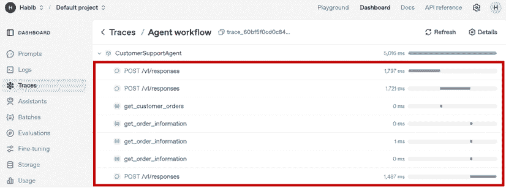
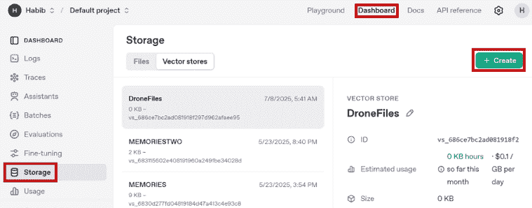
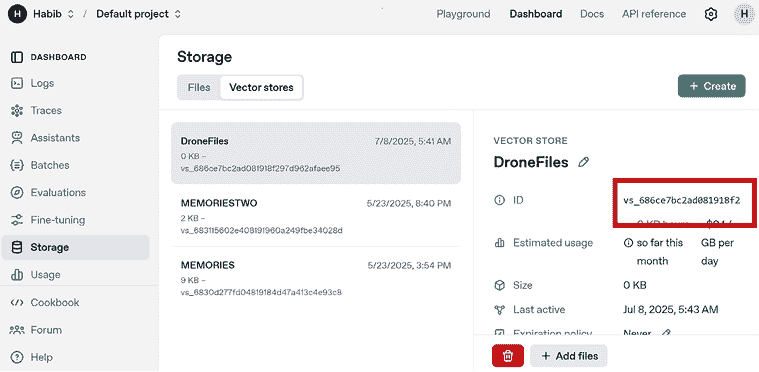
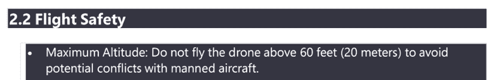
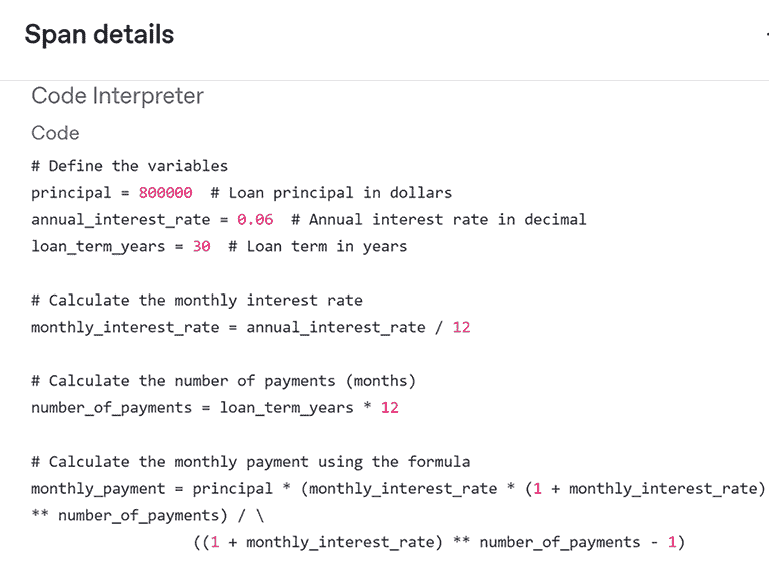
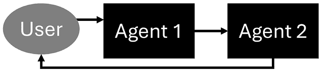
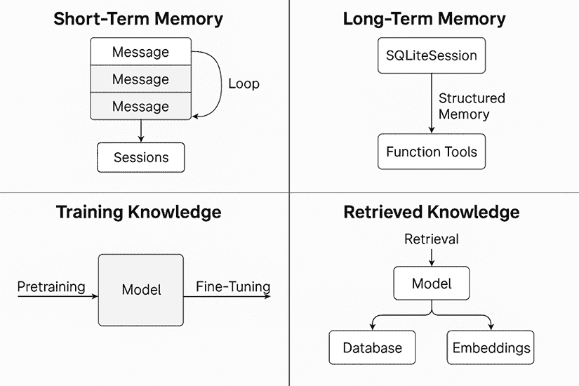
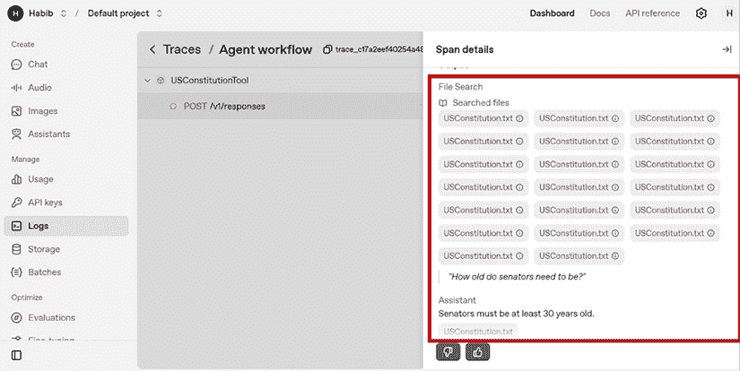

# 4：智能体工具与 MCP

现在我们已经构建了第一个运行的 AI 智能体，现在是时候给它一些真实的能力了。在本章中，我们将超越基础知识，深入探讨 OpenAI Agents SDK 中最重要的元素之一：工具。``工具`` 是让智能体与外部世界交互的基础，例如查询数据库、调用 API、执行计算、生成内容，甚至与其他智能体交互。

以下是你将在本章中学习到的：

* **自定义工具**：学习如何定义 Python 函数并使用 ``@function_tool`` 装饰器将其注册为工具。我们将探索如何配置工具元数据、使用 Pydantic 验证输入以及控制如何向智能体描述工具。

* **智能体工具行为**：通过利用 ``tool_choice`` 和 ``tool_use_behavior`` 等参数，理解如何影响智能体何时以及如何使用工具。

* **OpenAI 托管工具**：使用 OpenAI 的内置工具，如 ``WebSearchTool``、``FileSearchTool`` 和 ``CodeInterpreterTool`` 来扩展智能体能力。

* **作为工具的智能体**：学习如何将整个智能体变为可调用，实现模块化编排和分层工作流。

* **MCP**：连接到外部 MCP 服务器以检索工具，而不是自己构建。

在本章结束时，你将能够为智能体配备强大的能力，从简单的算术到实时 API 访问，从生成图像到查询向量数据库，并连接外部 MCP 服务器。你还将能够控制智能体如何使用工具。让我们开始吧。

## 技术要求

请遵循 *第 3 章* 中的详细步骤设置你的环境。

在本书中，每章的实用示例和完整代码将通过附带的 GitHub 仓库发布：https://github.com/PacktPublishing/Building-Agents-with-OpenAI-Agents-SDK](https://github.com/PacktPublishing/Building-Agents-with-OpenAI-Agents-SDK)。

鼓励你克隆仓库，复用并调整提供的代码示例，并在学习各章节时随时参考。

## 使用 Python 函数使用自定义工具

在本节中，我们将探索如何使用 ``OpenAI Agents SDK`` 中的 ``Python`` 函数来定义和配置自定义工具。提醒一下，工具是智能体能力的核心部分，它们使智能体能够超越其内部知识，执行诸如获取数据、处理用户请求或触发操作等任务。我们将从使用 ``@function_tool`` 装饰器定义简单工具开始，然后过渡更高级的功能，例如重写工具参数以及使用 ``Pydantic`` 模型进行复杂的输入验证。

### 定义新工具

正如我们在上一章中讨论的，OpenAI Agents SDK 提供了一个 ``@function_tool`` 装饰器，可以将任何 Python 函数转换为智能体可以调用的工具。例如，我们将回到上一章中编写的代码，该代码创建一个简单的工具并使用该工具调用智能体：

```
### 必要的导入
import os
from dotenv import load_dotenv
from agents import Agent, Runner, function_tool

### 从 .env 文件加载环境变量
load_dotenv()

### 访问 API key
api_key = os.getenv("OPENAI_API_KEY")

### 创建一个工具
@function_tool
def get_order_status(orderID: int) -> str:
    """ 
    根据订单 ID 返回订单状态
    Args:
        orderID (int) - 客户订单的订单 ID
    Returns:
        string - 客户订单的状态消息
    """
    if orderID in (100, 101):
        return "Delivered"
    elif orderID in (200, 201):
        return "Delayed"
    elif orderID in (300, 301):
        return "Cancelled"

### 定义一个智能体
agent = Agent(name="Customer service agent",
              instructions="你是一个 AI 智能体，帮助当地报纸公司回答客户查询",
              model="gpt-4o",
              tools=[get_order_status])

### 运行控制逻辑框架
result = Runner.run_sync(agent, "我的订单状态如何？我的订单 ID 是 200")

### 打印结果
print(result.final_output)
```

通过对任何 Python 函数使用装饰器，SDK 分别从函数的名称（``get_order_status``）、描述（``Returns the order status given an order ID``）和其输入模式（``orderID: int``）推断出工具名称、目的和插入参数。清晰且人类可读的名称和文档字符串（docstring）非常重要，因为智能体在决定是否使用该工具时会这些描述。它应该解释工具的作用以及预期的输入（包括单位或格式）。在这种情况下，我们不需要手动编写 JSON 模式；SDK 会根据函数签名生成它。

然而，如果需要，可以通过重写函数的默认特性来显式地定义这些工具参数。以下是一个示例：

```
### 创建一个工具
@function_tool(
        name_override="Get Status of Current Order",
        description_override="根据客户订单 ID 返回订单状态",
        docstring_style="Args: Order ID in Integer format"
)
def get_order_status(orderID: int) -> str:
    """ 
    根据订单 ID 返回订单状态
    Args:
        orderID (int) - 客户订单的订单 ID
    Returns:
        string - 客户订单的状态消息
    """
    if orderID in (100, 101):
        return "Delivered"
    elif orderID in (200, 201):
        return "Delayed"
    elif orderID in (300, 301):
        return "Cancelled"
```

通常，这样做是为了让开发者对智能体如何表示和解释工具拥有更多控制权。例如，``name_override`` 参数允许你定义一个比从函数本身导出的更具描述性或更友好的名称。当函数名称过于通用，或者表达不足以让智能体准确推断其目的时，这特别有用。

当工具行为模糊、需要强制执行本地化或格式标准，或者多个工具具有相似结构但在智能体必须区分的细微方面有所不同时，这种级别的显式控制可能非常有价值。

**注意**

``@function_tool`` 装饰器同时支持同步和异步函数。如果你的函数使用 ``async def``，SDK 将正确处理它，智能体将能够自动等待其结果。当你的工具与外部 API、数据库或其他异步工作流交互时，这种灵活性非常有用。

## 智能体和工具行为

智能体自主决定何时调用工具以及调用哪个工具。我们之前已经讨论过，此决策由控制逻辑框架中的 LLM 做出，该框架是由 ``Runner`` 类管理的决策树循环。在循环的每个周期中，会发生以下情况：

1. ``Runner`` 类将当前的消息列表发送给 LLM。

2. LLM 回复“最终答案”或“工具调用”（为了简单起见，我们现在假设只有这两种选项）。

3. 如果响应是“工具调用”，Runner 类执行相应的 Python 函数，并将它们的基于字符串的输出附加到消息历史中，然后重复循环直到产生最终答案。

默认情况下，模型将决定是否以及何时使用工具。然而，我们最终可以影响工具决策步骤，在某些特定用例中，我们可能需要这样做。SDK 通过几个设置为开发者提供了控制权。

### 工具选择

其中一个设置是 ``ModelSettings.tool_choice`` 参数，它赋予了我们控制模型方法的能力：

- ``auto``: 模型自行决定是否调用工具以及调用哪一个（默认）。

- ``required``: 强制模型使用工具。

- ``none``: 防止模型使用工具

当你想要刻意控制智能体的行为时，修改此设置非常有用。例如，如果你创建一个必须从数据库检索数据且从不依赖其内部知识的智能体，你可以将 ``tool_choice`` 设置为 ``required``，这将确保智能体每次调用工具。

在以下示例中，我们显式将 ``tool_choice`` 设置为 ``required``，以确保模型必须使用 ``get_order_status`` 工具。这保证了所有响应都来自可靠源。

```
from agents import Agent, Runner, function_tool, ModelSettings

@function_tool
def get_order_status(orderID: int) -> str:
    if orderID in (100, 101):
        return "Delivered"
    elif orderID in (200, 201):
        return "Delayed"
    elif orderID in (300, 301):
        return "Cancelled"

agent = Agent(
    name="Strict customer service agent",
    instructions="你是一个客户智能体，必须使用后端系统检查订单状态。不要猜测。",
    model="gpt-4o",
    tools=[get_order_status],
    model_settings=ModelSettings(tool_choice="required")
)

result = Runner.run_sync(agent, "你能检查订单 ID 为 101 的状态吗？")
print(result.final_output)
```

这增强了智能体行为的准确性和信任度。如果没有可用工具适用于该任务，且要求使用工具（``tool_choice="required"``），模型将抛出错误或拒绝回答，因为它不被允许在不使用工具的情况下回答。这确保了所有输出都基于可靠的、显式定义的逻辑。

SDK 还允许你指定特定的工具名称，例如 ``tool_choice="get_weather"``。这将强制模型调用该特定工具而不调用其他工具。在孤立地验证或测试单个工具，或者当你为了一致性和控制力而完全跳过模型的工具选择逻辑时，这是一个非常实用的选项。

### 工具使用行为


Agent 和工具行为中的另一个关键设置是名之其实传的`Agent.tool_use_behavior`，它控制在工具被调用并返回其输出*之后*会发生什么。该设置的选项如下：

*   `run_llm_again`: 在工具执行后，agent 将输出作为控制逻辑框架的一部分返回给 LLM，然后 LLM 决定是否已经达到了可以返回最终答案的“最终输出”结儿状态。这使得模型能够解释工具的输出，并根据用户的问题在文中创建回复。这是默认选项。

*   `stop_on_first_tool`: 第一个工具输出被视为“最终响应”，不再进行后续的模型调用。

*   `agent.StopAtTools.stop_at_tool_names`: 一个字符串列表，代表我们希望 agent 停止运行并直接使用工具输出响应的工具列表。

这些选项允许你根据任务构建出行为更具确定性或更灵活的 agent。例如，`stop_on_first_tool`选项在工具输出即答案时（例如，如数据库响应、计算结果等）特别有用——在任何地方，将输出回传给 LLM 都没有意义的。

如果你有一组工具，当这些工具被触发时应该立即终止 agent 的执行并原样返回工具输出，那么最后一个选项就会很有用。这可能符合前述描述，也可能是我们希望 agent 停止执行的“触发点”（例如，用户要求联系经理）。

以下是`agent.StopAtTools.stop_at_tool_names`选项的一个用例示例。在这里，我们的客服 agent 拥有一个执行敏感操作的工具（例如生成发票），此时直接显示工具输出以保持准确性、格式或法律措辞更好：

```python
from agents import Agent, Runner, function_tool, StopAtTools
@function_tool
def create_invoice(orderID: int) -> str:
    return f"Invoice for Order {orderID}: $123.45 (Generated on 2025-07-05)"
agent = Agent(
    name="Invoice generator agent",
    instructions="Generate and return an invoice when requested.",
    model="gpt-4o",
    tools=[create_invoice],
    stop=StopAtTools.stop_at_tool_names(["create_invoice"])
)
result = Runner.run_sync(agent, "Please create an invoice for Order 300")
print(result.final_output)
```

在这个示例中，agent 调用`create_invoice`工具并直接返回原始输出字符串，而经过任何额外的 LLM 处理。这保留了工具输出的原始内容。

## 使用 Pydantic 处理复杂工具输入

我们在上一章中讨论过，SDK 支持使用`Pydantic`处理复杂的工具输入，并讨论了它的优势，即在数据验证方面的优势。作为提醒，你不再在输入参数中使用如`str`或`int`等简单类型提示，而是可以定义一个 Pydantic`BaseModel`对象来表示分级或详细的输入结构。当作为函数参数使用时，SDK 将整个模型视为单个参数，自动生成相应的嵌套 JSON schema。这使得 LLM 更容易理解并调用具有正确输入 schema 的复杂输入工具。

让我们来测试一下，并通过一个具体的示例。延续我们的客服主题，假设我们想创建一个处理退款的工具。问题是，处理退款需要复杂的输入：订单 ID、客户电子邮件、原因等。为了增加复杂性，工具应该能够一次处理多个退款。在这种情况下，让我们定义一个`BaseModel`类名为`RefundRequest`：

```python
from pydantic import BaseModel, List
class RefundRequest(BaseModel):
    order_id: str
    customer_email: str
    reason: str
    requests: List[str]
```

现在我们已经完成了定义，可以将`RefundRequest`作为输入传递给我们的自定义函数。

```python
@function_tool
def process_refund(request: RefundRequest) -> str:
    """处理退款请求并返回确认"""
    # 这里是与内部系统的交互逻辑
    return f"订单 {request.order_id} 的退款请求已提交。确认信息将发送至 {request.customer_email}."
```

当 agent 决定使用`process_refund`时，它从 schema 中知道请求是一个`RefundRequest`对象列表，每个对象都需要三个字段。模型的结构对 LLM 可见。

使用 Pydantic 进行结构化输入在处理涉及多个字段、可选参数或重复对象的真实工作流时特别强大。

此外，它还有一个优势是`非 LLM 输入验证`。如果 LLM 幻觉并传递了格式错误的数据，SDK 将抛出错误来捕捉问题。你可以捕获此错误，使你的应用程序更加健壮。这在定义上非确定性的 agent-LLM 交互中特别有用。

例如，假设模型错误地省略了一个必需字段，或为某个值提供了错误的类型（可能是由于幻觉）。假设它提交了以下 JSON：

```json
{
  "order_id": 12345,
  "customer_email": "customer@example.com"
}
```

此负载缺少所需的`reason`字段，并且将`order_id`类型类型整数而非字符串。当 SDK 尝试从这些数据实例化`RefundRequest`模型时，它将自动抛出 Pydantic 的`ValidationError`对象。

## 自定义工具示例

现在我们已经讨论了如何定义新工具以及配置其 agent 调用行为，让我们将其投入实际应用，并完整构建几个具体的示例。每个示例都是一个可以运行的独立脚本（假设你已经成功配置了环境）。

### 算术计算工具

我们将创建的第一个带有工具的 agent 是执行算术计算的 agent，这是 LLM 非常容易产生幻觉的问题。事实上，数学运算不应由 LLM 执行。因此，我们将构建一个调用执行数学运算工具的 agent。

在这种情况下，我们将构建一个计算贷款还款额的 agent。创建一个名为`mortgage_agent.py`的新 Python 脚本，代码如下：

```python
# Required 导入
from dotenv import load_dotenv
from agents import Agent, Runner, function_tool

# 从 .env 文件加载环境变量
load_dotenv()

@function_tool
def calculate_mortgage(
    principal_amount: float, annualized_rate: float, number_of_years: int
) -> str:
    """
    此函数计算贷款还款额。

    Args:
        principal_amount: 贷款金额。
        annual_rate: 百分比形式的年利率。
        years: 贷款期限（年）。
    Returns:
        一条说明每月还款金额的消息。
    """
    monthly_rate = (annualized_rate / 100) / 12
    months = number_of_years * 12
    payment = principal_amount * (monthly_rate) / (1 - (1 + monthly_rate) ** -months)
    print(payment)
    return f"${payment:,.2f}."

# 定义一个使用贷款计算器工具的代理
mortgage_agent = Agent(
    name="MortgageAdvisor",
    instructions=("你是一个贷款助手"),
    tools=[calculate_mortgage]
)

# 使用一个示例问题运行代理
result = Runner.run_sync(mortgage_agent, "如果我借$800,000，利率为 6%，期限 30 年，我的每月还款是多少？")
print(result.final_output)
```

在这个脚本中，`calculate_mortgage`被装饰为一个自定义工具。它接受三个输入并返回一个带有格式化贷款金额的字符串。

当运行此脚本时，代理应该识别出用户的问题是关于计算贷款还款的，并使用相应的参数调用`calculate_mortgage`工具。工具将计算金额（每月约 4,796.84），然后将输出发送给 LLM。LLM 然后将输出一条完整的消息作为最终答案。

在我的情况下，最终答案如下：

但注意，由于 LLM 是非确定性的，你可能会看到略有不同的输出（但还款金额应该是相同的，因为它是由工具计算的）。

现在，让我们调整代码，始终强制代理调用工具，并返回工具的输出而不是再次调用 LLM。我们将添加两个参数：`tool_use_behavior="stop_on_first_tool"`和`ModelSettings.tool_choice="required"`。这是更新后的代理实例化：

```python
# 添加导入
from agents import Agent, Runner, function_tool
# 定义一个使用贷款计算器工具的代理
mortgage_agent = Agent(
    name="MortgageAdvisor",
    instructions=("你是一个贷款助手"),
    tools=[calculate_mortgage],
    tool_use_behavior="stop_on_first_tool",
    model_settings=ModelSettings(
        tool_choice="required"
    )
)
```

运行此代码将跳过 LLM 的任何进一步推理或重写。相反，代理将直接返回工具产生的结果作为最终输出。我们可能希望这样做以保证响应的确定性和可审计性，特别是在准确性至关重要的场景中，例如贷款申请。它还通过减少循环中 LLM 的次数来提高性能。

这个示例展示了拥有工具的明显益处：计算是精确的，代理不需要依赖其训练过的知识（这可能会导致——而且事实上，它正因此犯算术错误而闻名）。

### 外部 API 调用工具

我们将制作的下一个自定义工具使用外部 API 调用。API 是连接不同程序和资源的连接器。Gmail API 允许你读取电子邮件、发送电子邮件和查看日历邀请。Airbnb API 允许你查找 Airbnb 房源、发布房源或发送消息。API 还用于访问实时数据，例如客户记录、天气信息或加密货币价格。

在这个示例中，我们将创建一个获取比特币美元（USD）当前价格的工具。创建一个名为`crypto_pricing_agent.py`的新 Python 脚本，代码如下：

```python
import requests
from agents import Agent, Runner, function_tool
# 创建工具
@function_tool
def get_price_of_bitcoin() -> str:
    """获取比特币的价格."""
    url = "https://api.coingecko.com/api/v3/simple/price?ids=bitcoin&vs_currencies=usd"
    response = requests.get(url)
    price = response.json()["bitcoin"]["usd"]
    return f"${price:,.2f} USD."
# 创建代理
crypto_agent = Agent(
    name="CryptoTracker",
    instructions="你是一个加密货币助手。使用工具获取实时数据。",
    tools=[get_price_of_bitcoin]
)
# 使用一个示例提示运行代理
result = Runner.run_sync(crypto_agent, "比特币的价格是多少？")
print(result.final_output)
```

在这个示例中，我们创建了一个 Python 函数`get_price_of_bitcoin`，它通过`requests`库调用`CoinGecko API`（一个用于加密货币价格免费公共 API）。当代理调用工具时，工具调用 API，从 API 接收到的信息随后传回给代理。

运行此代理将始终带我们获得比特币的最新价格。在写作时，输出为：

```
比特币当前价格为 $108,575
```

这是因为它可以将加密货币字符串列表作为输入传递给 Python 函数。为了实现这一点，我们必须使用 Pydantic 模型。让我们定义以下 Pydantic 模型：

```python
from pydantic import BaseModel
from typing import List

class Crypto(BaseModel):
    """coin_ids: 加密货币名称列表"""
    coin_ids: List[str]
```

接下来，我们必须更新工具以添加 Pydantic 模型作为输入，并对逻辑进行修改：

```python
# 创建工具
@function_tool
def get_crypto_prices(crypto: Crypto) -> str:
    """获取一组加密货币的当前价格。
    Args:
        crypto: 一个包含 coin_ids 的对象（例如 bitcoin, ethereum, litecoin）
    """
    ids = ",".join(crypto.coin_ids)
    url = f"https://api.coingecko.com/api/v3/simple/price?ids={ids}&vs_currencies=usd"
    response = requests.get(url)
    data = response.json()
    return str(data)

# 创建代理
crypto_agent = Agent(
    name="CryptoTracker",
    instructions="你是一个加密货币助手。使用工具获取实时数据。获取加密货币价格时，所有请求仅调用一次工具。",
    tools=[get_crypto_prices]
)
```

有了这个结构，LLM 看到一个清晰的模式：一个包含必需字段`coin_ids`的对象，其必须是字符串列表。SDK 将自动验证传递的数据是否符合此结构。例如，如果我们现在修改提示词为“比特币和以太坊的价格是多少？”并运行脚本，它会回答：

```
{'bitcoin': {'usd': 108575.0}, 'ethereum': {'usd': 2534.56}}
```

通过使用此类工具，代理可以访问模型训练数据范围之外的实时信息。这有效地扩展了模型的能力，使其对实时环境具有动态的感知能力。

### 数据库查询工具

在之前的示例中，我们演示了工具如何处理精确计算和实时 API 访问。另一个强大的用例是让代理查询结构化的内部数据源（如数据库），而无需硬编码查询语句或依赖模型编写原始 SQL。相反地，我们可以将逻辑封装在一个连接数据库的工具中。这类似于 API 调用。

让我们构建一个简单的代理，它通过查询客户支持数据库来检索最近的支持工单。为了实现这一点，我们将使用 Python 字典来模拟一个数据库，以避免对真实数据库连接的需要，但在连接到真实数据库时，相同的结构也是通适的。

创建一个名为`database_query.py`的新脚本并运行以下代码：


```python
from agents import Agent, Runner, function_tool
from pydantic import BaseModel
from typing import List
```

### 创建模拟数据库

```python
TICKETS_DB = {
    "henry@gmail.com": [
        {"id": "TCKT-001", "issue": "Login not working",
            "status": "resolved"},
        {"id": "TCKT-002", "issue": "Password reset failed",
            "status": "open"},
    ],
    "tom@gmail.com": [
        {"id": "TCKT-003", "issue": "Billing error",
            "status": "in progress"},
    ]
}
```

### 定义 Pydantic 模型

```python
class CustomerQuery(BaseModel):
    email: str
```

### 定义执行数据库查询的工具

```python
@function_tool
def get_customer_tickets(query: CustomerQuery) -> str:
    """根据邮箱检索客户的最近支持工单."""
    tickets = TICKETS_DB.get(query.email.lower())
    if not tickets:
        return f"No tickets found for {query.email}."
    response = "\n".join(
        [f"ID: {t['id']}, Issue: {t['issue']}, Status: {t['status']}"
for t in tickets]
    )
    return f"Tickets for {query.email}:\n{response}"
```

### 创建代理

```python
support_agent = Agent(
    name="SupportHelper",
    instructions="You are a customer support agent. Use tools to fetch user support history when asked about their tickets.",
    tools=[get_customer_tickets]
)
```

### 运行代理

```python
result = Runner.run_sync(support_agent, "Can you show me the ticket history for henry@gmail.com?")
print(result.final_output)
```

在这个例句中，我们定义了一个`CustomerQuery` Pydantic 模型，它强制执行了预期的输入结构。`get_customer_tickets` 函数使用此输入在模拟支持数据库的模拟字典中查找工单。

当代理接收到类似“Can you show me the ticket history for henry@gmail.com?” 这样的提示词时，它会正确地提取邮箱，将其传递给工具，并返回一个格式良好的工单摘要：

```python
Here is the ticket history for henry@gmail.com:
1\. **ID:** TCKT-001
   - **Issue:** Login not working
   - **Status:** Resolved
2\. **ID:** TCKT-002
   - **Issue:** Password reset failed
   - **Status:** Open
```

这种模式适用于许多企业级用例，例如查找客户数据、查询库存数据库等。

### 链式工具调用

代理背后的 LLM 不仅可以决定是否使用工具以及何时使用，还可以根据需要决定调用工具的顺序。这在代理必须执行多步操作，并将第一次工具调用的输出作为第二次工具调用的输入时，显得尤为有用。如果需要，代理还可以多次调用同一个工具。

例如，接上我们的客户服务主题，我们有一个名为`get_customer_orders`的工具（检索特定客户 ID 的所有订单）以及另一个名为`get_order_information`的工具（检索特定订单 ID 的状态）。创建一个名为`tool_chaining.py`的新 Python 脚本，包含以下代码：

```python
### 必要的导入
from typing import List
from pydantic import BaseModel
from agents import Agent, Runner, function_tool

### 定义第一个工具以获取给定客户的所有订单
@function_tool
def get_customer_orders(customer_id: str) -> str:
    """
    检索与给定客户 ID 关联的所有订单 ID。
    Args:
        customer_id: 客户 ID
    """
    ### 伪实现
    if customer_id == "CUST123":
        return ["ORD001", "ORD002", "ORD003"]

### 定义第二个工具以获取特定订单的状态
@function_tool
def get_order_information(order_id: str) -> str:
    """
    获取特定订单的详细信息。
    """
    ### 伪实现
    status_map = {
        "ORD001": "Shipped",
        "ORD002": "Processing",
        "ORD003": "Delivered"
    }
    return f"Order {order_id} is currently {status_map.get(order_id, 'Unknown')}."

### 定义代理
customer_service_agent = Agent(
    name="CustomerSupportAgent",
    instructions="You are a customer service assistant.",
    tools=[get_customer_orders, get_order_information]
)

### 运行代理
result = Runner.run_sync(customer_service_agent, "Please check the status of my orders? My customer ID is CUST123.")
print(result.final_output)
```

在这个例句中，代理能够链式调用工具。当被询问订单状态时，它首先调用`get_customer_orders`获取订单列表，然后针对每个 ID 顺序调用`get_order_information`。这种多步推理完全由 LLM 的控制框架驱动，我们可以通过`Traces`模块验证这一系列操作：



图 4.2：Traces 模块中的列表

这展示了代理跨工具进行多步推理并进行后续调用的能力。你不需要手动编写工作流；SDK 会进行编排。

### OpenAI 托管工具

使用 OpenAI 构建的 SDK 的优势在于，它提供了一系列强大且预构建的工具。这些工具只需要极少的设置；它们完全托管在服务器上（类似于 LLM 同样托管在 OpenAI 服务器上）。它们还会不断更新，这意味着在调用这些工具时可以使用最新的技术。

**注意**

OpenAI 托管工具像模型调用一样，会产生 Token 费用。当模型调用其中一个工具时，工具调用以及模型与工具之间传递任何数据都会计入 Token。

托管工具包含在 OpenAI 的响应框架中。当你通过 Agents SDK 指定托管工具时，模型会感知这些工具，并像处理自定义 Python 函数一样调用它们。目前可用的托管工具如下表所示：

| 托管工具 | 功能 |
| :--- | :--- |
| `WebSearchTool` | 在网络上进行实时以最新信息 |
| `FileSearchTool` | 通过向量库进行文件信息搜索和检索 |
| `ImageGenerationTool` | 生成图像 |
| `CodeInterpreterTool` | 在沙箱 Python 执行环境中运行 |
| `ComputerTool` | 打开计算机/浏览器实例并执行任务 |
| `LocalShellTool` | 在本地机器上执行 Shell 命令 |

表 4.1：OpenAI 托管工具及其用途

总而言之，对于 OpenAI 托管的工具已经涵盖的用例，创建自定义工具通常没有意义。例如，`WebSearchTool` 在搜索和查询网页方面表现出色，因此，“重复造轮”并编写我们自己的 Python 函数来实现这一功能是没意义的。使用这些工具只需导入类、实例化它、定义一组输入并将其传递给智能体（agent）即可。

我们将介绍每一个 OpenAI 托管的工具，讨论它们的用例、参数，并创建一个利用这些工具的智能体。

## WebSearchTool

`WebSearchTool` 允许智能体执行网页搜索。它是最容易实现的工具之一。事实上，我的大多数企业级智能体都有这个工具，以防用户询问智能体未经过训练的信息。该工具在处理有关最新进展、时间敏感型事实或任何需要实时数据的查询时效果最好。

该工具接受两个可选输入：

* `user_location`：返回特定位置的搜索结果。你可以使用`UserLocation`格式指定位置，它是一个包含`type`、`country`、`city`和`region`键的字典。如果你有答案会随位置变化的查询，这将非常有用，例如：“哪里有奶茶最好喝？”

* `search_context_size`：指定每个网站检索的信息量（以及搜索多少个网站）。你可以指定“low”（低）、“medium”（中）或“high”（高）。默认选项是“medium”。

让我们开始使用这个工具吧。我们将创建一个为我们执行简单网页搜索查询的智能体。首先创建一个名为`web_search_tool.py`的新 Python 文件并复制以下代码：

```python
from agents import Agent, Runner, WebSearchTool

### Instantiate the tool
websearchtool = WebSearchTool()

### Create an agent
agent = Agent(
    name="WebTool",
    instructions="You are an AI agent that answers web questions. Answer in one sentence.",
    tools=[websearchtool]
)

result = Runner.run_sync(agent, "Who won the 2025 Stanley Cup?")
print(result.final_output)
```

运行该代码将得到以下输出：

```python
佛罗里达黑豹队获得了 2025 年斯坦丹利杯，以六局击败了埃德蒙顿油人队，获得了他们的连续第二个冠军。([reuters.com](https://www.reuters.com/sports/florida-panthers-beat-edmonton-oilers-game-6-win-second-straight-stanley-cup-2025-06-18/?utm_source=openai))
```

在这个示例中，智能体可以访问可以在互联网搜索答案的工具。当工具被调用时，OpenAI 将对该查询执行网页搜索，读取结果（可能是新闻文章甚至是维基百科页面），并返回带有相关信息的文本片段。智能体获取这些信息并为用户制定答案。

如果我们没有`WebSearchTool`运行同一个智能体，它无法提供答案，因为这条信息不在它的训练数据中：*我无法提供实时信息或有关 2025 年发生事件的详情*。

接下来，我们将为`WebSearchTool`类添加一个位置参数。让我们调整智能体来搜索信息，假设他们在加拿大的多伦，并询问前三家意大利餐厅：

```python
from agents import Agent, Runner, WebSearchTool

### Instantiate the tool
websearchtool = WebSearchTool(user_location={
            "type": "approximate",
            "country": "CA",
            "city": "Toronto",
            "region": "Ontario",
        })

### Create an agent
agent = Agent(
    name="WebTool",
    instructions="You are an AI agent that answers web questions. Answer in one sentence.",
    tools=[websearchtool]
)

result = Runner.run_sync(agent, "What are the top 3 Italian restaurants?")
print(result.final_output)
```

输出结果如下：

```python
### Output
根据最近的赞誉和评论，多伦多的排名前三意大利餐厅是：
1\. **Don Alfonso 1890**: 位于威斯汀海港城堡酒店的 38 层，该餐厅自 2022 年以来一直保留着米其林星级，并于 2022 年被 50 Top Italy 评为（意大利以外）世界最佳意大利餐厅。([en.wikipedia.org](https://en.wikipedia.org/wiki/Don_Alfonso_1890?utm_source=openai))
2\. **Osteria Giulia**: 位于 Yorkville，Osteria Giulia 自 2022 年以来一直拥有米其林星级，并在 2024 年加拿大 100 最佳餐厅名单中排名第 17。([en.wikipedia.org](https://en.wikipedia.org/wiki/Osteria_Giulia?utm_source=openai))
3\. **DaNico**: 同样拥有米其林星，DaNico 在 2025 年加拿大 100 最佳餐厅中排名第 59。([en.wikipedia.org](https://en.wikipedia.org/wiki/DaNico?utm_source=openai))
```

通过这种方式，我们用不到 15 行代码就创建了一个基于网络的智能体。没有其他 SDK 能让你以如此少的投入获得如此的功能。

## FileSearchTool

`FileSearchTool` 允许智能体查询文档向量存储。最常见的用例是查询内部知识库或大型文本语料。在本章中，我们仅演示如何使用该工具，但在未来的章节中将深入探讨。

要使用此工具，你必须先将文件上传到 OpenAI 平台并创建向量存储。此过程发生在 SDK 本身之外。

按照以下步骤创建向量存储：

1. 从右上角选择 **Dashboard**（仪表），然后选择 **Storage**（存储），最后切换到 **Vector stores**（向量存储）。



图 4.3：OpenAI 仪表中的存储页面

2. 选择 **Create**（创建）创建一个新的向量存储。输入如`DroneFiles`的向量存储名称。

3. 向下滚动并选择 **+ Add files**（添加文件）向向量存储添加文件。

4. 上传`droneManual.pdf`文件（可以在仓库的*第 4 章* 下找到）。将其命名为`DroneManual.pdf`并为 **Purpose** 选择`user_data`。然后，选择 **Attach**（附加）。

5. 我们上传的 PDF 现在已添加到新的向量存储中，且所有启用 RAG 的相关操作（如生成嵌入等）已完成。同样，后续章节将详细详细介绍这一点。

6. 复制并保存你刚刚创建的向量存储的向量存储 ID。



图 4.4：OpenAI 仪表中的向量存储 ID

现在我们已经有了向量存储 ID，可以将其作为`FileSearchTool`类的输入。事实上，该工具接收以下关键输入：

* `vector_store_ids`: 这是一个必需的输入，代表在调用此工具时要搜索的向量库 ID 列表。请注意，提供给`Agents SDK`的 OpenAI API 密钥必须指向拥有该向量库访问权限账户（否则你将遇到权限错误）。

* `max_num_results`: 一个整数，代表要返回的搜索结果数量。

* `include_search_results`: 一个布尔值，决定是否在工具输出中包含搜索结果的全文。

我们将创建一个利用我们刚刚创建的新向量库的智能体。让我们先创建一个名为`file_search_tool.py`的新 Python 文件，并复制以下代码：


# 智能体工具与 MCP 协议

## `FileSearchTool`

以下代码展示了如何使用 `FileSearchTool` 从向量库中检索信息：

```python
from agents import Agent, Runner, FileSearchTool
### 实例化工具
filesearchtool = FileSearchTool(
    vector_store_ids=['vs_686ce7bc2ad081918f297d962afaee95']
) # 替换为你自己的向量库 ID
### 创建智能体
agent = Agent(
    name="WebTool",
    instructions="You are an AI agent that answers questions from the listed vector stores. Answer in one sentence.",
    tools=[filesearchtool]
)
result = Runner.run_sync(agent, "How high can you fly this drone?")
print(result.final_output)
```

运行此脚本将得到以下答案，该智能体是从我们上传的手册中提取的：

```python
### Output
The drone can be flown up to a maximum altitude of 60 feet (20 meters).
```



通过这种方式，`FileSearchTool` 使智能体能够根据提供的书面材料为其回答的依据。智能体不再仅仅依赖 LLM 的预训练知识，而是能够从你自己的内部文档中获取相关信息。

## `ImageGenerationTool`

`ImageGenerationTool` 使智能体能够根据文本提示创建图像。这通常连接到 OpenAI 的图像生成服务。集成此工具后，智能体可以响应诸如“生成一张大象图像”之类的提示。通常，最常见的用例是生成视觉效果（产品模型、演示、设计等）。

在输入方面，`ImageGenerationTool` 类接受一个 `ImageGeneration` 对象作为 `tool_config` 参数，在其中你可以指定图像的大小、质量、格式、压缩和背景。你必须指定类型，目前该类型始终等于 `image_generation`。

让我们构建可以生成图像的智能体。创建一个名为 `image_generation_tool.py` 的新 Python 文件，并复制以下代码：

```python
from agents import Agent, Runner, ImageGenerationTool
from agents.tool import ImageGeneration
### 实例化工具
tool_config = ImageGeneration(
    type="image_generation",      
)
imagetool = ImageGenerationTool(tool_config=tool_config)
### 创建智能体
agent = Agent(
    name="ImageTool",
    instructions="You are an AI agent that generates images.",
    tools=[imagetool]
)
result = Runner.run_sync(agent, "Generate an image of an elephant.")
print(result.final_output)
```

运行此脚本将获得指向以下图像的 URL：


图 4.5：运行上述代码后生成的输出

**注意**
你可能会遇到 `PermissionDeniedError` 对象。如果发生这种情况，请按照说明在 OpenAI 平台设置中验证你的组织。

在此工具中，OpenAI 的服务器将为该提示生成图像，并返回图像托管的 URL。然后你可以通过工作流来获取该图像、将其保存到某处或发送给某人。该工具非常适合创意或视觉任务。例如，智能体可以动态创建数据可视化（通过描述生成图表图像）或仅为回答配插。

**注意**
图像生成比文本输出更容易产生幻觉。生成的图像可能不准确，甚至与输入提示逻辑上不一致。

## `CodeInterpreterTool`

`CodeInterpreterTool` 使智能体能够在沙箱环境中编写并执行 Python 代码。该工具对于任何数据分析或计算任务都极其有用。我们之前讨论过数学计算应该由工具来执行（而不是 LLM，因为存在幻觉风险），并且我们之前已经通过构建一个计算每月抵押贷款还款额的自定义 Python 函数实现了这一点。`CodeInterpreterTool` 更进了一步：它不需要定义抵押贷款还款的实际公式，该工具可以根据简单的提示推导出自己的公式，然后执行该代码。

此工具在沙箱环境中执行代码。因此，该工具在使用前需要初始化一个容器对象。它可以自动创建（工具在运行时创建自己的容器），也可以显式创建（你使用 OpenAI 端点创建容器然后传递容器 ID）。在这种情况下，为了简单起见，我们选择了 `auto` 选项。

让我们直接进入示例。创建一个名为 `code_interpreter_tool.py` 的新文件并运行以下代码：

```python
from agents import Agent, Runner, CodeInterpreterTool
from agents.tool import CodeInterpreter
### 实例化工具
tool_config = CodeInterpreter(
    container={"type":"auto"},
    type="code_interpreter"      
)
codetool = CodeInterpreterTool(tool_config=tool_config)
### 创建智能体
agent = Agent(
    name="CodeTool",
    instructions="You are an AI agent that writes and runs code to answer questions.",
    tools=[codetool]
)
result = Runner.run_sync(agent, "What is my monthly payment for $800,000 at 6% for 30 years?")
print(result.final_output)
```

运行此代码将得到以下输出：

```
The monthly payment for $800,000 at 6% over 30 years is approximately $4,796.40.
```

为了得出答案，智能体调用了 `CodeInterpreterTool` 并编写了代码，在容器中运行，然后将答案传回 LLM。

事实上，我们可以通过查看 Traces 模块来验证这一点



图 4.6：Traces 模块中的 Code Interpreter 输出

**注意**
容器中可以执行的代码有固有的限制，例如处理配额、可以安装的 Python 库等。要查看完整列表，请访问 [`platform.openai.com/docs/tools-code-interpreter`](https://platform.openai.com/docs/tools-code-interpreter)。

`CodeInterpreterTool` 使智能体能够处理计算、数据处理或生成图表等输出的任务，纯 LLM 在这些任务上可能会遇到困难或速度缓慢。这就像是给智能体配备了一个智能数据分析师。

# 智能体工具模式

Agents SDK 中最强大的架构模式之一是可以使用*整个智能体作为另一个智能体的工具*。这被称为 `agent-as-tool pattern`（智能体工具模式），它允许智能体以分层化的方式协同工作。通常，你有一个控制工作流的智能体（通常称为 `orchestrator`协调器），以及一组被调用以完成特定任务的智能体（通常称为 `workers` 工作者）。

工作者智能体作为模块化组件运行，每个都有自己的系统提示词（system prompts）、推理过程甚至工具。从协调器的角度来看，它们被调用的方式与其他任何传统工具无异。无论协调器调用的是 Python 自定义工具、OpenAI 托管的工具还是智能体，其方式都是相同的。

## 交接（`Handoff`）与智能体工具模式

注意，`agent-as-tool pattern` 与 `handoffs`（交接）有本质区别，我们将在稍后的章节中详细介绍后者。在交接模式中，一个智能体会会将控制权完全委托另一个智能体，如*图 4.7* 所示。一旦发生交接，第二个智能体将完全接管任务或对话，直到任务完成或它选择将控制权交回：


图 4.7：智能体工具模式

在 `agent-as-tool pattern` 中，协调智能体保留对整个工作流的完全控制权，并简单调用另一个智能体来处理特定的子任务，如*图 4.8* 所示：



图 4.8：交接模式

一个很好的例子是你拨打客服热线。客服经理可以将你转接到另一个部门以继续对话（这就是交接模式），也可以让你稍等，同时他们向同事询问/收集必要信息，然后在完成后回来与你通电话（这就是 `agent-as-tool pattern`）。

这两种编排模式在 SDK 中都完全支持，并可以组合使用以处理更复杂的工作流。我们需要考虑的关键权衡是控制权：交接提供了模块化的自主性，而智能体工具模式则需要考虑控制权。

在以下情况下你应该选择交接模式：

- 它非常适合进入工作者的领域
- 需要通过工作者来完成任务
- 不需要中间的监督

相比之下，在以下情况下你应该选择 `agent-as-tool pattern`：

- 保持对话的中心化控制非常重要
- 工作者的输入需要被汇总为答案

这两种方法都有自己的优缺点，选择哪种取决于你的工作流需要多程度的可见性。

## 功能性

SDK 允许你通过 `as_tool()` 将任何智能体转换为工具，这会返回一个 `FunctionTool` 对象。在调用 `as_tool()` 时，你需要为智能体指定名称和描述，这对于协调智能体决定何时调用至关重要。

让我们来看一个示例。创建一个名为 `agents_as_tool.py` 的 Python 并运行以下代码：

```python
from agents import Agent, Runner, WebSearchTool, CodeInterpreterTool
from agents.tool import CodeInterpreter
### 实例化工具
websearchtool = WebSearchTool()
### 创建工作者智能体
location_agent = Agent(
    name="LocationAgent",
    instructions="你是一个通过网络搜索获取城市经纬度的智能体。",
    tools=[websearchtool]
)
### 实例化工具
tool_config = CodeInterpreter(
    container={"type":"auto"},
    type="code_interpreter"
)
codetool = CodeInterpreterTool(tool_config=tool_config)
### 创建另一个工作者智能体
distance_calculator_agent = Agent(
    name="DistanceCalculatorAgent",
    instructions="你是一个编写并运行 Python 代码计算两个经纬度之间距离的智能体。",
    tools=[codetool]
)
### 创建协调智能体
agent = Agent(
    name="Agent",
    instructions="你是一个计算地点距离的智能体。使用 Location Agent 获取经纬度。使用 Distance Agent 计算距离。",
    tools=[
        location_agent.as_tool(
            tool_name="LocationAgent",
            tool_description="返回特定位置的经纬度"
        ),
        distance_calculator_agent.as_tool(
            tool_name="DistanceCalculatorAgent",
            tool_description="计算两个经纬度点之间的距离"
        )]
)
result = Runner.run_sync(agent, "多伦多和温哥华之间的直线距离是多少？")
print(result.final_output)
```

让我们逐步分析这段代码。

首先，我们创建了两个智能体：

- `LocationAgent`：其唯一目标是通过 `WebSearchTool` 获取给定城市的经纬度。
- `DistanceCalculatorAgent`：配备了 `CodeInterpreterTool`，允许它编写并执行 Python 代码来计算距离。

重要的部分是对这些智能体调用 `.as_tool()`。这会将每个智能体封装成可调用的工具，并为其分配 `tool_name` 参数和 `tool_description` 参数，以便协调智能体能够判断何时以及如何调用它们。这些名称和描述起了关键作用。

最后，我们创建了一个协调智能体。它的指令引导它使用工作智能体（已封装为工具）来完成更大的目标：计算城市之间的距离。当我们使用输入查询“多伦多和温哥华之间的直线距离是多少？”运行此智能体时，系统会在后台链式调用工具。首先，调用了两次 `LocationAgent`（一次针对多伦多，一次针对温哥华）。然后，`DistanceCalculatorAgent` 处理这些坐标计算出最终结果。

这个 `final_output` 对象包含了正确的答案：

```
多伦多和温哥华之间的直线距离约为 3363.64 公里。
```

# MCP 协议

代理化 AI（Agentic AI）开发仍然处于新阶段，但正在迅速流行。随着开发者开始构建更多的智能体和工具，并没有标准化的方法将工具连接到智能体；每个 SDK 的实现方式都不同。我们已经熟悉 `Agents SDK` 如何将工具连接到智能体，但这与 `LangGraph` 或 `CrewAI` 等框架有显著差异。这非常困难——如果你在 `Agents SDK` 中构建了一个出色的工具，很难将其迁移到其他框架。此外，如果别人已经为另一个框架创建了执行 `X` 的工具，那么再开发一个执行 `X` 的工具就没有意义了。

因此，需要一种标准的协议来定义工具与智能体之间的连接，并适用于所有 SDK，`MCP` 就此诞生了。

## 什么是 `MCP`？

MCP 是一种标准化协议，定义了 AI 代理如何发现和调用托管在本地或外部服务器上的工具。可以将 `MCP` 想象为 AI 代理及其工具的通用适配器或 `USB-C` 接口。遵循这一标准，工具提供者可以开发一个 `MCP server`，它可以插入到任何兼容 `MCP` 的主机（例如使用 `Agents SDK` 构建的智能体），从而确保不同模型和框架之间的互操作性。

MCP 的主要优势在于为工具营造了一个即插即用的生态系统。开发者可以为自己的数据库实现一次 `MCP server`，它将立即兼容来自 `OpenAI`、`Anthropic` 或任何支持该协议的供应商的代理。不需要额外的集成。

**注意**
MCP 是一个非常广泛的话题。单单 `MCP` 就可以写一整本书。虽然我们将展示如何使用 `Agents SDK` 连接到 `MCP server`，但我们不会深入介绍整个协议。那超出了本书的范围。

## 将 `MCP server` 作为工具添加

`Agents SDK` 能够轻松地从 `MCP server` 消费工具。你只需要实例化与服务器的连接，并将其作为工具传递给你的智能体。`Agents SDK` 将自动处理连接，查询服务器的可用工具，并将它们提供给智能体。

**注意**
在与外部 `MCP servers` 一工作时，考虑安全和隐私影响至关重要。应该强制身份验证，以确保只有授权的智能体才能访问提供的工具，并且速率限制可以帮助你的系统和 `MCP server` 免受误用或意外过载的影响。你还应该留意数据暴露（即：如果没有适当的保护措施，发送敏感输入或接收来自外部 `MCP tools` 的未过滤输出可能会引入风险）。

让我们来看示例。创建一个新的 Python 脚本 `mcp_tool.py` 并运行以下代码：


```python
from agents import Agent, Runner, HostedMCPTool
from agents.tool import Mcp

### 创建工具
tool_config = Mcp(
        server_label="CryptocurrencyPriceFetcher",
        server_url="https://mcp.api.coingecko.com/sse",
        type="mcp",
        require_approval="never"
    )
mcp_tool = HostedMCPTool(tool_config=tool_config)

### 创建智能体
agent = Agent(
    name="Crypto Agent",
    instructions="You are an AI agent that returns crypto prices.",
    tools=[mcp_tool]
)
result = Runner.run_sync(agent, "What's the price of bitcoin?")
print(result.final_output)
```

在代码中，我们没有自己创建一个调用 API 并返回最新比特币价格的工具，而是利用了由 `Coin Gecko` 构建的 `MCP server`，它包含了我们可能需要的所有工具。我们不需要创建自定义函数；只需利用 `Coin Gecko` 已经创建的工具。

让我们分解一下。`Mcp` 配置指定了工具的标签、服务器的 URL、工具类型（`"mcp"`）以及 `require_approval` 设置，后者告诉智能体在使用工具之前是否需要提示人类批准。在例子中，我们将 `require_approval` 设置为 `"never"`，这意味着智能体可以自主调用该工具。`server_url` 参数是 `Coin Gecko` 的 `MCP server` 端点，你可以在他们的网站上找到它。该 URL 应该指向一个有效的、符合 MCP 的端点，实时提供工具定义。

当我们定义智能体时，将 `MCP tool` 添加到它的工具参数列表中。由于 `MCP server` 在技术上可能包含多个工具（例如，一个用于比特币价格，另一个用于以太坊等），智能体可以对可用选项进行推理，并为任务选择正确的工具。

当运行智能体时，在后台，智能体将用户消息发送给 LLM，LLM 评估消息并决定调用来自 `MCP server` 的工具。`SDK` 处理使用正确的参数调用工具并将结果传回给 LLM，然后 LLM 返回最终答案。

**注意**

实际的工具逻辑不在你的本地机器上执行。请求被发送到 `MCP server`，由它远程托管并运行该工具。你的机器上不会发生任何处理，类似于你进行 API 调用。

简而言之，将 `MCP` 与 `Agents SDK` 集成通过允许智能体无缝访问标准化的外部工具和服务生态系统，开启了强大的新功能。

# 总结

在本章中，我们通过将智能体连接到工具（自定义、托管、智能体和外部服务器），赋予了智能体执行实际工作的能力。我们从 `@function_tool` 的自定义 Python 工具开始，展示了如何注册和描述工具，以便智能体能够理解并使用它们。我们探索了如何通过 `tool_choice` 和 `tool_use_behavior` 参数影响工具决策逻辑。

随后，我们构建了多个真实的工具和智能体，使用了四种不同的范式：通过 Python 函数的自定义工具、通过 `OpenAI` 的托管工具、作为工具的智能体以及通过 `MCP` 的外部服务器工具。

有了这些模式，你现在拥有了构建智能体所需的所有技能，它们不仅能够理解和推理，还能采取行动、连接实时系统并与外部服务无缝集成。

在下一章中，我们将探索如何管理智能体的知识和记忆。



图 5.1：记忆与知识模式

在本章结束时，你将学会如何让智能体（agents）更智能，并能够进行有意义的对话、记住偏好并在需要时访问外部数据源。让我们开始吧。

## 技术要求

请遵循第三章中的详细步骤设置你的环境。

在本书中，每个章节的实用示例和完整代码将通过附的 GitHub 仓库提供：[`github.com/PacktPublishing/Building-Agents-with-OpenAI-Agents-SDK`](https://github.com/PacktPublishing/Building-Agents-with-OpenAI-Agents-SDK)。

鼓励你克隆该仓库，复用并调整提供的代码示例，并在阅读章节时根据需要参考它。

## 工作内存

正如之前讨论的，`working memory`（也称为`短期记忆`）是存储在 AI 智能体当前会话交互历史中的信息。我们之前给出的例子是：工作内存让你能够先问“太阳有多热？”，然后问“它有多大？”，而智能体可以确定第二个请求中的“它”指的是太阳。

到目前为止，所有的 AI 智能体都没有通过这个测试；它们对记忆没有任何概念。事实上，到目前为止，所有的 AI 智能体都是`stateless`（无状态）的，这意味着它们不会保留来自之前交互的任何信息。每个智能体都被视为一个完全全新的系统，对之前发生过的事情没有任何记忆。无状态系统在大多数计算机系统中很常见。例如，大多数 API 作为一个独立且隔离的事务运行（它们不会记住你之前问过什么，也不会用此决定下一次输出）。`Stateful`（有状态）系统则是相反的；它们维护之前交互的信息并用它产生未来的输出。例如，你的 Netflix 页面是有状态的：它记得你之前看过的的内容并推荐类似的电影。记忆让 AI 智能体从无状态系统变为有状态系统。

如何在无状态和有状态的 AI 智能体之间选择？这取决于它的用途。对话型 AI 智能体（即聊天机器人）需要多步输入或在回答中需要上下文，因此必须是有状态的系统。例如，一个没有记忆的聊天机器人会让用户感到非常沮丧。另一方面，如果 AI 智能体的用途是简单的、常规的、单次的、重复的且不学习的，那么无状态系统就可以了。请注意，创建有状态的 AI 智能体是有成本的：管理内存的开销，本章的一半内容都在致力于此。

## 管理输入和响应

给智能体提供记忆最基本的方法是手动操作。记得智能体是通过 `Runner` 类执行的，该类接受一个 `input` 参数：

```python
Runner.run_sync(agent, "How hot is the sun?")
```

`input` 参数可以是字符串（这是我们目前为止所做的），也可以是 `ResponseInputItem` 对象的列表。`ResponseInputItem` 对象是跟踪消息的 OpenAI 标准规范。每条消息都有一个 `"role"` 和一个 `"content"` 字段。如果你以前用过 OpenAI API，那么这对你来说应该很熟悉。以下是一个 `ResponseInputItem` 对象的示例：

```python
{"role": "user", "content": "How hot is the sun?"}
```

`"role"` 字段可以取三个可能的值：

*   `"system"`：作为 LLM 整体指令集的作用的消息
*   `"user"`：用户提交的消息，其优先级低于系统消息
*   `"assistant"`：由 LLM 生成的消息

为了给智能体提供记忆，我们可以简单地将 `ResponseInputItem` 对象添加到运行中的列表中，并在每次调用智能体时将该列表传递给 `Runner` 类。让我们测试一下。创建一个名为 `memory_tracking_messages_simple.py` 的新文件并运行以下代码：

```python
from agents import Agent, Runner

### 创建智能体
agent = Agent(
    name="QuestionAnswer",
    instructions="You are an AI agent that answers questions.",
)

# 创建空列表（这将包含消息）
messages = []

### 初始消息
messages.append({"role": "user", "content": "How hot is the sun?"})

### 调用智能体
result = Runner.run_sync(agent, messages)
print(result.final_output)

# 将响应添加到消息列表
messages.append({"role": "assistant", "content": result.final_output})

# 将第二个问题添加到消息列表
messages.append({"role": "user", "content": "How big is it?"})

### 调用智能体
result = Runner.run_sync(agent, messages)
print(result.final_output)
```

**快速提示**：使用 **AI Code Explainer** 和 **Quick Copy** 功能增强你的编码体验。在下一代 Packt Reader 中打开此书。点击 **Copy** 按钮 (**1**) 快速快速将代码复制到你的编码环境中，或点击 **Explain** 按钮 (**2**) 让 AI 助手向你解释一段代码。

**下一代 Packt Reader** 随书免费赠送。

让我们浏览这段代码段，看看智能体在处理第二条消息时如何记住用户的第一条消息。我们首先创建名为 `messages` 的空列表，它将包含历史。然后我们添加了用户的第一个消息：“太阳有多热？”这条消息被传递给 `run_sync()` 函数，模型给出了温度相关的回答。该答案存储在 `result.final_output` 变量中，我们随后将其添加回消息历史，但这次标记为 `"assistant"` 角色，因为它是模型的输出。接下来，我们添加了用户的后续问题：“它有多大？”此时，消息历史有三项：

*   原始问题（太阳有多热？）
*   模型的响应
*   用户的第二个问题（它有多大？）

通过再次将整个消息列表传递给 `run_sync()` 方法，模型可以获取之前的对话内容，并能够正确确定第二个问题中的“它”指的是第一条消息中的“太阳”。我们的响应看起来如下：

```text
## 第一条响应
太阳的温度在不同区域有所不同：
1. **核心**：约 1500 万摄氏度（2700 万华氏度）。
2. **表面（光球层）**：约 5500 摄氏度（9932 华氏度）。
3. **日冕**：范围在 100 万到 300 万摄氏度之间（180 万到 540 万华氏度）。
核心是发生核聚变的地方，产生太阳的能量，而日冕是外层大气，温度惊讶地比表面高得多。

## 第二条响应
太阳的直径约为 139 万公里（864 万英里）。它大约是地球直径的 109 倍，占据太阳系总质量的 99% 以上。
```

我们实际上可以让之前的代码段变得更加动态，使得用户消息不再是硬编码的，并且用户能够提交多条消息，就像真实的聊天一样。

为了实现这一点，我们可以使用 Python 原生的 `input` 和 `while` 循环功能。创建一个名为 `memory_tracking_messages_simple_loop.py` 的新文件并运行以下代码：

```python
from agents import Agent, Runner

### 创建 agent
agent = Agent(
    name="QuestionAnswer",
    instructions="You are an AI agent that answers questions.",
)

messages = []
while True:
    question = input("You: ")
    messages.append({"role": "user", "content": question})
    result = Runner.run_sync(agent, messages)
    print("Agent: ", result.final_output)
    messages.append({"role": "assistant", "content": result.final_output})
```

该程序会向你索要一个提示词（prompt），你可以直接在运行 Python 程序的终端中输入。它随后会给出 agent 的响应并询问你下一个提示词，同时维护其消息历史。现在，我们已经将 agent 从单次交互系统转变为可以记住之前消息的多轮对话系统（假设在同一个会话中）。我们通过添加循环来实现，在每次迭代中都会发生以下操作：

- 用户输入提示词。
- 提示词作为 `ResponseInputItem` 对象添加到名为 `messages` 的运行中的 `ResponseInputItem` 对象列表中。
- `messages` 对象通过 `Runner` 类传递给 agent。
- 模型输出作为 `ResponseInputItem` 添加到 `messages` 中。

此循环会一直持续，直到遇到错误或用户强制退出程序（通过点击 `Ctrl` + `C`）。这里是一个对话示例，证明 agent 具有记忆（因为它记得我在第一次对话中提到的名字）：

```text
You: My name is Henry
Agent: Nice to meet you, Henry! How can I assist you today?
You: What's my name?
Agent: Your name is Henry.
```

**Note**

你可能会好奇，如果 `messages` 列表无限增长会怎样？这最终不会变成一个问题吗？这是一个很好的问题，是的，消息历史的增长是需要考虑的。别担心，我们将在本章的晚些时候介绍处理该问题的策略。

SDK 还提供了一个从 `result` 对象返回消息列表的函数，让手动对话管理变得更加容易。`result.to_input_list()` 函数返回一个 `ResponseInputItem` 对象列表，随后你可以向其中添加额外的 `ResponseInputItem` 对象。这使得代码变得整洁了一些（但功能仍然相同），如下所示：

```python
from agents import Agent, Runner

### 创建 agent
agent = Agent(
    name="QuestionAnswer",
    instructions="You are an AI agent that answers questions.",
)

messages = []
while True:
    question = input("You: ")
    messages.append({"role": "user", "content": question})
    result = Runner.run_sync(agent, messages)
    print("Agent: ", result.final_output)
    messages = result.to_input_list()
```

在实践中，这种技术构成了有状态对话代理的基础。从这里开始，可以在上面叠加更高级的记忆技术，以实现跨会话的记忆化、提取结构化数据、调整记忆以及处理大型对话，但一切都始于跟踪对话历史。

## 使用 Sessions 进行对话管理

OpenAI Agents SDK 提供了一种名为 `Sessions` 的对话管理原语。它充当类，允许你自动存储、召回和编辑对话中的消息。这意味着你不需要手动调用 `.to_input_list()` 函数或手动管理对话消息；SDK 会帮你处理好。`Sessions` 类需要一个输入：一个代表会话唯一标识符的字符串，称为 `session_id`。

让我们修改之前的脚本并为其添加会话。创建一个名为 `conversations_with_sessions.py` 的新文件并运行以下代码：

```python
from agents import Agent, Runner, SQLiteSession

### 创建 agent
agent = Agent(
    name="QuestionAnswer",
    instructions="You are an AI agent that answers questions.",
)

### 创建会话
session = SQLiteSession("first_session")

while True:
    question = input("You: ")
    result = Runner.run_sync(agent, question, session=session)
    print("Agent: ", result.final_output)
```

运行这段代码后（如你所见，它要简单得多），让我们再次尝试我们的测试用例：

```text
You: My name is Henry
Agent: Nice to meet you, Henry! How can I assist you today?
You: What's my name?
Agent: Your name is Henry.
```

在这种情况下，对话历史通过 `Sessions` 类进行管理。与其手动添加消息或调用 `.to_input_list()`，不如说 `session` 对象在后台跟踪整个交互历史。


`Sessions` 在管理多个用户或对话时特别有用。通过为每个交互线程使用唯一的 `session_id` 值，代理可以维护独立的内存上下文。例如，你可能根据用户名和对话 ID 生成 `session_id` 值，确保每个用户或对话都有自己相互隔离的历史。

这为构建真正有状态的代理奠定了基础。请注意，`SQLiteSession` 默认情况下是内存中的（不跨重启持久化）。我们将在长期记忆部分讨论如何将会话持久化到磁盘。但在之前，我们必须解决大型线程的问题。

## 管理大型对话

为什么管理大型线程对代理来说是个问题？代理是由 LLM 驱动的。LLM 有一个核心问题是**上下文窗口**（即 LLM 一次只能接收和处理特定数量的字符或“标记”）。如果对话持续进行，简单地追加每条消息最终会达到这个限制，此时提示词变得过大而无法处理。

然而，即使没有这个技术限制，管理大型对话线程也是重要的。长提示词和上下文会显著降低速度并增加成本。因此，通过丢弃或压缩旧信息来管理短期记忆很重要。我们将讨论两种解决此问题的模式：滑动窗口和消息总结。

### 滑动窗口

**滑动窗口**是最简单且成本效益最高的记忆策略。它通过仅保留消息日志中最近的 *N* 条消息来工作，作为一个先进先出的（**FIFO**）队列。随着新消息到来，旧消息会被丢弃，确保提示词保持在模型的限制范围内。

这种方法适用于只需要短期记忆的代理，例如专注于解决单个查询线程的客户服务代理，但它确实存在忘记会话早期引入的重要信息的风险。例如，如果用户在对话早期分享了关键信息（如姓名、目标或限制），而窗口大小太小，代理可能会完全丢失这些信息。

### 消息总结

更高级的策略是**消息总结**，这意味着这种方法不是遗忘旧消息，而是将它们压缩成一个在整个会话期间持续的简要摘要。这允许代理在长对话中保留关键事实、决策或用户偏好，实际上桥接了短期和长期记忆。

总结通常涉及以下内容：

*   持续监控消息历史的大小，如果超过特定阈值，则收集最旧的 `N` 条消息。

*   将最旧的 `N` 条消息传递给 LLM，并使用提示词对其总结。

*   在消息日志用最旧的 `N` 条消息替换为摘要后的回复。由于摘要输出的长度小于最旧 `N` 条消息的长度，这有效地缩短了消息日志的上下文窗口。

这种方法允许代理在不超出 token 限制的情况下保留长期上下文。当然，这里的权衡是高昂的成本和延迟，因为每个摘要任务都需要额外额外的 LLM 调用。在实践中，许多代理会结合使用这两种模式：使用滑动窗口移除旧消息，并使用摘要链以压缩的形式保留较早的上下文。

短期记忆的核心在于让代理在单个会话中具备感知能力。使用 OpenAI Agents SDK，通过 `Sessions` 类启用这一点是最直接的。然而，它也存在局限性，要让这种内存具有可扩展性（不超出上下文限制），需要周全策略，例如滑动窗口或消息摘要。

以下是一个滑动窗口模式的示例：

```python
from agents import Agent, Runner
from collections import deque
### 创建代理
agent = Agent(
    name="QuestionAnswer",
    instructions="You are an AI agent that answers questions."
)
# 滑动窗口大小（仅保留最近的 5 条消息）
WINDOW_SIZE = 5
messages = deque(maxlen=WINDOW_SIZE)
while True:
    question = input("You: ")
    messages.append({"role": "user", "content": question})
    # 仅使用最近的 N 条消息运行代理
    result = Runner.run_sync(agent, list(messages))
    print("Agent:", result.final_output)
    messages.append({"role": "assistant", "content": result.final_output})
```

接下来，我们将探索长期记忆，并查看代理如何跨会话或在长时间保留信息。

## 长期记忆

**长期记忆**是代理在多个会话中很一段时间内记住相关细节的能力。这种“超能力”让代理能够跨多个会话保留和检索信息。它是创建真正具有状态的、个性化的且持久的 AI 体验的基础。这有时被认为是 AI 代理与人类代理之间的终极“障碍”，因为人类代理可以自然地记住重要的事实、偏好或过去的对话，并将它们分配给每一个人，而 AI 代理通常在这方面很困难。

我们之前在单会话的语境讨论过无状态和有状态的区别。这同样扩展到多会话交互。没有长期记忆的代理在会话之间本质上是无状态的。没有长期记忆的 AI 代理无法记住用户名、过去的偏好或已完成的任务等信息，即使在关闭或重启后也是如此。例如，如果用户告诉客户服务代理“我更希望我的订单发送到后门而不是前门”，然后在一周后返回，具备长期记忆的代理可以主动将所需的送货方式设置为“后门”。

让代理拥有长期记忆的关键在于**记忆存储与检索**。这是将代理的记忆存储在持久化状态中，以便日后检索的想法。有很多不同的模式可以实现这一目标，我们将在本节中介绍。

### 持久化消息日志

建立长期记忆最简单的模式也是最直观的：只需在代理会话结束时将消息日志的全部内容存储在某处，然后在代理重启时检索它。Agents SDK 提供了一种实现此功能的机制，使用了之前讨论过的 `Sessions` 类（`SQLiteSession`）。该类不仅可以接受会话 ID，还可以接受 `db_path` 参数，可以在其中输入计算机上的文件位置，它将自动保存并加载消息日志到本地机器的 SQL 数据库。

让我们来看一个示例。创建一个名为 `ltm_sessions.py` 的新 Python 文件并运行以下代码：

```python
from agents import Agent, Runner, SQLiteSession
### 创建代理
agent = Agent(
    name="QuestionAnswer",
    instructions="You are an AI agent that answers questions.",
)
### 创建会话
session = SQLiteSession("first_session", db_path="messages.db")
while True:
    question = input("You: ")
    result = Runner.run_sync(agent, question, session=session)
    print("Agent: ", result.final_output)
```

在这种情况下，我们为 `session` 对象添加了 `db_path` 参数，这告诉 Agents SDK 将对话存储在我们的本地机器，并在代理重新实例化时再次加载对话。我们可以通过运行程序、传递信息、退出程序、再次运行程序并查看代理是否记得这些信息来测试这是否有效。

让我们运行程序并告诉代理我们的名字：

```text
You: Hello, I'm Henry
Agent: Hi Henry! What would you like to talk about today?
```

接下来，点击 `Ctrl` + `C` 退出程序。之后，重新运行程序并询问我的名字：

```text
You: What's my name?
Agent:  You mentioned your name is Henry. How can I assist you further?
```

通过这种方式，我们创建一个具有长期记忆的代理。它还会记住你如何与它交互，因为它在你的本地机器上存储了消息日志，并在每次启动程序时加载它。你可能会在运行代码的根目录下看到一个 `messages.db` 文件；这就是保存消息日志的地方。使用内置 `session` 对象进行持久化的用处是它是无缝的，换句话说，你不需要为存储聊天记录实现自己的文件格式或数据库模式。然而，这种模式确实有一些明显的局限性，即随着会话数量或对话长度的增加，存储和加载完整的消息日志可能会变得效率低下。此外，正如我们之前讨论的，消息日志可能会膨胀到 LLM 因为上下文窗口限制而无法再次处理。

### 结构化记忆检索

**结构化记忆检索**利用工具调用（tool-calling）来解决代理记忆问题。具体来说，这种模式关注以下概念：

*   代理不是存储每一条消息，而是访问一个工具，只存储用户共享的重要信息

*   代理不是加载每一条消息，而是访问一个工具，只检索并加载相关的片段信息

这样，代理在某个会话中的提示词和消息日志就可以保持整洁，但如果模型认为它应该咨询长期记忆（例如，用户询问“之前”或在过去的会话中提到的内容），它就可以调用该函数来获取相关信息。

让我们来看一个示例。创建一个名为 `ltm_structured_memory_call.py` 的新 Python 文件。首先，我们将初始化内存文件。在这里我们检查是否已存在 JSON 文件。如果没有，我们将创建一个带有默认结构：

```python
from agents import Agent, Runner, function_tool
import os
import json
### 如果 JSON 文件不存在，则创建
FILENAME = 'memory.json'
memory_default = {
    "user_profile": [],
    "order_preferences": [],
    "other": []
}
if not os.path.exists(FILENAME):
    with open(FILENAME, 'w') as f:
        json.dump(memory_default, f, indent=4)
        print(f"Created '{FILENAME}' with default data.")
else:
    print(f"'{FILENAME}' already exists.")
```

接下来，我们将定义一个用于保存记忆片段的工具。此函数允许智能体在 JSON 文件中存储重要事实：

```python
@function_tool
def save_memory(memory_type: str, memory: str) -> str:
    """
    将记忆保存到记忆存储中。
    Args:
        memory_type: 要存储的记忆类型。在 user_profile, order_preferences 或 other 之间选择。
        memory: 要保存的记忆
    """
with open(FILENAME, 'r') as f:
        data = json.load(f)
    data[memory_type].append(memory)

    with open(FILENAME, 'w') as f:
        json.dump(data, f, indent=4)
    print(f"Memory ({memory}) saved")
    return f"Memory ({memory}) saved"
```

我们还会创建一个加载记忆的函数。此函数从 JSON 记忆存储器中检索相关事实：

```python
@function_tool
def load_memory(memory_type: str) -> str:
    """
    从记忆存储中加载一组记忆。
    Args:
        memory_type: 要加载的记忆类型。在 user_profile, order_preferences 或 other 之间选择。
    """
with open(FILENAME, 'r') as f:
        data = json.load(f)
    return "|".join(data[memory_type])
```

最后，我们创建智能体，赋予其访问工具的权限，并运行交互循环：

```python
### 创建智能体
agent = Agent(
    name="QuestionAnswer",
    instructions="你是一个回答问题的 AI 智能体。你可以访问两个工具，允许你保存和加载记忆。当你学到一个重要事实时，请保存记忆。当问及关于用户的问题时，请加载记忆。",
    tools=[save_memory, load_memory]
)
while True:
    question = input("You: ")
    result = Runner.run_sync(agent, question)
    print("Agent: ", result.final_output)
```

让我们分析一下这段代码中发生了什么，从保存和加载记忆的两个函数工具开始。

`save_memory` 函数允许智能体在特定类别下（如 `user_profile` 或 `order_preferences`）存储重要事实。该函数将信息写入本地 `memory.json` 文件，并将新信息片段追加到相关部分。例如，如果用户说：“*我更倾向于前门送货*”，智能体可以调用 `save_memory("user_profile", "Prefers deliveries through the front door")`，该事实将被添加到持久化存储中。在这种情况下，持久化存储仅仅是一个本地 JSON 文件，但也可以同样轻松作为数据库。

另一方面，`load_memory` 函数旨在检索之前存储的事实。当用户引用之前对话中的偏好或细节时，例如问道：“*我的送货偏好是什么？*”，智能体可以调用 `load_memory("order_preferences ")` 来从该类别中获取并总结相关的存储事实。

这些函数为智能体提供了一种结构化且轻量级的长期记忆机制。智能体并不存储完整的消息转录，而是保留重要且可重用的提炼见解。这比保留每一条消息日志具有更强的扩展性。它也符合人类思考记忆的方式。想象一下，你和朋友聊天，他们告诉你有*他们喜欢吃寿司*。在这种情况下，你不会简单地记住整个对话转录。相反，你只是“记录”了*他们喜欢寿司*这个重要信息，并将其“存储”在你的记忆中。

让我们通过示例来尝试。运行代码后，输入以下内容：

```
You: I like to have orders sent to the office
Memory (User prefers orders to be sent to the office.) saved
Agent: Got it! I'll remember that you prefer to have orders sent to the office.
```

智能体识别出这是一个有用的偏好，将调用 `save_memory` 工具。如果你打开 `memory.json`，甚至可以看到这一点：

```json
{
    "user_profile": [
    ],
    "order_preferences": [
        "User prefers orders to be sent to the office."
    ],
    "other": []
}
```

现在，退出当前会并重新运行之前的 Python 程序开启新会，然后询问智能体我们的偏好：

```
You: Where do I like my orders sent?
Agent: You like your orders sent to the office.
```

在这种情况下，智能体调用了 `load_memory` 工具来检索 `order_preferences` 下的所有记忆。它找到了相关信息并提供了正确的回答。

这种结构化的长期记忆方法更具扩展性、语义上更精确，并且避免了超出上下文窗口限制的陷阱。它为更高级的记忆系统奠定了基础，在这些系统中，事实可以被嵌入和索引。

**注意**

我们在这里实现的结构化记忆模式对于简单场景简单有效。然而，随着你的智能体随时间积累更多事实（或者如果你需要支持模糊搜索），这种基础的键值方法可能会变得局限。这就是向量数据库和语义嵌入大显用场的地方。与其将事实存储在 JSON 文件中，你可以将每个记忆表示为向量，并进行语义搜索。我们稍后会讨论这一概念。

当你构建更复杂的智能体时，你可能希望结合这些长期记忆模式（持久消息日志和结构化记忆），而 OpenAI SDK 足够灵活同时支持两者。

## 训练知识

如所述，**训练知识**指的是通过训练数据固有存储在模型中的信息。每个大语言模型（LLM）最初都带有源自其初始训练的海量数据集（通常是大型文本语料）。模型拥有固有知识的好处在于知识本身具有以下优势：

- **检索速度快**：由于固有知识固化在模型权重中，模型可以非常快速地检索信息，仅限于 LLM 的计算速度。

- **覆盖范围广**：由于训练数据是海量的（互联网语料），固有知识可以非常详细地涵盖许多主题。

改变模型固有知识的过程被称为**微调**（fine-tuning）。与引导模型现有知识的提示或检索技术不同，微调通过在精选的数据集上重新训练模型来直接重塑模型。此过程更新了模型的权重，使其能够采用以前无法良好处理的新术语、模式或行为。结果是一个在特定领域或任务上更专业、更准确的模型。

让我们以医疗领域为例。像 GPT-4o 这样的通用型 LLM 可能理解广泛的健康主题，但在被要求解释复杂报告或根据细致指南建议治疗方案时，可能会表现不从心。通过在结构化患者记录和医生笔记的数据集上对模型进行微调，我们可以创建一个定制的模型，能够回答更细致的健康问题。

微调适用于医学等领域，在这些领域中领域知识至关重要，准确性直接影响结果。然而，它存在一些严重的局限性和缺点：

* `计算密集型（且昂贵）`：微调需要大量的计算资源和 GPU 时间，特别是在处理高容量模型时。虽然市场上有一些微调服务选项，但即使是它们也可能贵得令人接受（通常训练一个模型的成本从 10,000 美元起，这还不包括托管模型的费用）。


## 检索知识的实现

*   **缺乏灵活性**：一旦模型完成微调，它就必须与“基础”模型分开维护。当新知识出现或基础模型更新时，整个微调过程必须重新开始。
*   **知识混合**：在微调时，加入的知识可能会“混合”或反驳模型最初训练时使用的其他信息。结果是模型可能会变得困惑，并在优先考虑其训练数据中的信息时提供自相矛盾的陈述。从技术上讲，无法保证`LLM`会优先考虑其经过微调的信息。

因此，对于许多实际应用，特别是那些不需要如此严格领域控制的应用，使用替代方案（如提示工程或检索增强生成）通常更高效，我们将在接下来讨论这些。

### 检索知识

如前所述，`retrieved knowledge`指的是根据用户请求从知识库中实时检索的信息。与训练知识（在模型训练时是静态且固定的）不同，检索到的知识对于对话上下文是动态的。其模式如下：

1.  用户提出一个需要外部知识的问题。
2.  代理系统从知识源检索与该问题相关的数据。这是通过工具调用实现的，工具调用可以搜索数据库、文本文件、嵌入文档的向量存储、搜索引擎 API 等。
3.  然后将检索到的信息输入到`LLM`中。
4.  `LLM`生成一个结合或基于检索到的信息的答案。

这会将外部知识整合到代理中。在这种语境下，“外部”知识指的是任何并非本质上存储在模型训练权重中的信息。

回想一下，我们已经在第 4 章中创建了利用检索知识的代理。在我们创建的许多示例代理中，我们使用了为用户检索相关信息的工具。例如，这里是我们创建的一个在被提问时会检索比特币价格的代理：

```python
import requests
from agents import Agent, Runner, function_tool

# 创建工具
@function_tool
def get_price_of_bitcoin() -> str:
    """获取比特币价格."""
    url = "https://api.coingecko.com/api/v3/simple/price?ids=bitcoin&vs_currencies=usd"
    response = requests.get(url)
    price = response.json()["bitcoin"]["usd"]
    return f"${price:,.2f} USD."

# 创建代理
crypto_agent = Agent(
    name="CryptoTracker",
    instructions="你是一个加密货币助手。使用工具获取实时数据。",
    tools=[get_price_of_bitcoin]
)

# 使用示例提示运行代理
result = Runner.run_sync(crypto_agent, "What's the price of Bitcoin?")
print(result.final_output)
```

这里是另一个从数据库中检索知识的示例：

```python
from agents import Agent, Runner, function_tool
from pydantic import BaseModel
from typing import List

# 创建模拟数据库
TICKETS_DB = {
    "henry@gmail.com": [
        {"id": "TCKT-001", "issue": "Login not working",
            "status": "resolved"},
        {"id": "TCKT-002", "issue": "Password reset failed",
            "status": "open"},
    ],
    "tom@gmail.com": [
        {"id": "TCKT-003", "issue": "Billing error",
            "status": "in progress"},
    ]
}

# 定义 Pydantic 模型
class CustomerQuery(BaseModel):
    email: str

# 定义执行数据库查询的工具
@function_tool
def get_customer_tickets(query: CustomerQuery) -> str:
    """根据邮箱检索客户最近的工单."""
    tickets = TICKETS_DB.get(query.email.lower())
    if not tickets:
        return f"No tickets found for {query.email}."
    response = "\n".join(
        [f"ID: {t['id']}, Issue: {t['issue']}, Status: {t['status']}"
            for t in tickets]
    )
    return f"Tickets for {query.email}:\n{response}"

# 创建代理
support_agent = Agent(
    name="SupportHelper",
    instructions="你是一个客户支持代理。在被问及其工单时，使用工具获取用户的支持历史。",
    tools=[get_customer_tickets]
)

# 运行代理
result = Runner.run_sync(support_agent, "Can you show me the ticket history for henry@gmail.com?")
print(result.final_output)
```

这两个示例都遵循了我们之前提出的模式，如下：

1.  **用户发起请求且代理检索信息**：在两个示例中，用户都提出了一个超出其训练范围的问题。这包括实时数据（例如比特币价格）或用户特定信息（例如支持历史）。代理检测到它无法通过内置知识回答问题。它调用了检索工具：
    *   在`CryptoTracker`示例中，代理使用对`Gecko API`的 HTTP 调用
    *   在`SupportHelper`示例中，代理根据电子邮件地址执行模拟数据库查询
2.  **检索外部知识**：工具以结构化格式（例如 API 的 JSON 响应，或数据库中的工单列表）检索相关信息，并将检索到的数据传回模型。
3.  **LLM 整合信息**：然后 LLM 使用这些输入生成一个反映该知识的自然语言回复。

在我们继续之前，请注意，我们将对该主题进行简化的概述，而不是讨论其背后深且复杂的数学概念。若要从更详细的角度了解嵌入（embeddings）的工作原理，请参考此书：[`www.packtpub.com/en-mx/product/vector-search-for-practitioners-with-elastic-9781805121022/chapter/chapter-1-introduction-to-vectors-and-embeddings-2/section/chapter-1-introduction-to-vectors-and-embeddings-ch02lvl1sec02?srsltid=AfmBOoqKY6Vgqv9_MDNW5p4mDEXQBdQXQWFt9fRFM63RMebJWEWx8ide`](https://www.packtpub.com/en-mx/product/vector-search-for-practitioners-with-elastic-9781805121022/chapter/chapter-1-introduction-to-vectors-and-embeddings-2/section/chapter-1-introduction-to-vectors-and-embeddings-ch02lvl1sec02?srsltid=AfmBOoqKY6Vgqv9_MDNW5p4mDEXQBdQXQWFt9fRFM63RMebJWEWx8ide)。

首先，让我们定义一下术语。

`Embeddings`（嵌入）是文本的数值表示。将其想象为一种秘密语言，其语法是数字列表，且只有机器能理解。这些嵌入捕捉了单词、句子甚至整篇文档的精髓。例如，以下句子的嵌入列如下所示（这仅用于说明）：

| **Sentence** | **Embedding** |
| :--- | :--- |
| I like apples | `[3432, 75, 32, …, 76, 980]` |
| I like bananas | `[85, 1, 4, …, 695, 47]` |
| This is very difficult | `[5, 596, 1254, …, 7, 1]` |
| This is like fitting a square peg into a round hole | `[5, 4, 365, …, 748, 9]` |

表 5.1：示例嵌入

由于嵌入捕捉了文本的“意义”或“精髓”，两个关于相同主题或含义相似的文本将产生非常相似的向量。例如，`I like apples`的嵌入与`I like bananas`的嵌入相比，会比与随机内容（如：`All legislative Powers herein granted shall be vested in a Congress of the United States, which shall consist of a Senate and House of Representatives`）更相似。这就是语义搜索大显身手的地方。

`Semantic search`（语义搜索）通过使用语义含义（换句话说，即比较它们的嵌入）而不是比较关键词来比较两段文本的过程。我们通过计算两个嵌入在向量空间中的距离来比较它们，这被称为`cosine similarity`（余弦相似度）。`Cosine similarity`衡量两个向量之间角度的余弦值，结果是一个 0 到 1 之间的数字。

数学原理在这里并不重要；其含义是：余弦相似度越高，两个文本的语义关系就越紧密：

*   `Cosine similarity close to 1`：文本非常相似，或具有相似的上下文或含义
*   `Cosine similarity close to 0`：文本不相关

以下是不同文本嵌入之间的余弦相似度：

| **Test** | **Base text** | **Comparison text** | **Cosine similarity of embeddings** |
| :--- | :--- | :--- | :--- |
| 1 | I like apples | I like bananas | `0.90` |
| | | All legislative Powers herein granted shall be vested in a Congress of the United States, which shall consist of a Senate and House of Representatives | `0.71` |
| 2 | This is very difficult | I’m fitting a square peg into a round hole | `0.88` |
| | | All legislative Powers herein granted shall be vested in a Congress of the United States, which shall consist of a Senate and House of Representatives | `0.64` |

表 5.2：不同文本嵌入之间的余弦相似度表

在表中，你可以看到，通过余弦相似度，文本`I like apples`与文本`I like bananas`的语义相似性高于其与《美国宪法》摘录的相似性。`This is very difficult`与`I’m fitting a square peg into a round hole`的情况也是如此。在这个例子中，这两段文本没有任何关键词，但它们在语义上是相似的，因此具有非常高的余弦相似度分数。

最后，我们有`vector stores`（向量存储），它们仅仅是针对存储文本及其嵌入而优化的数据库。简单的数据库可能存储类似表格结构的数据，而向量存储存储的是这些大型嵌入向量。向量存储还有另一个特殊属性：当新文档添加到向量存储中时，数据库会自动将文本`chunks`（分块）为较小的片段，为每个块生成嵌入，并对其进行`indexes`（索引，即与支持快速检索的字典一起存储），以便进行快速相似搜索。这种`chunk and index step`是启用语义搜索所必需的。每个块通常包含数百个 token 的文本，并使用专用模型进行嵌入。

现在我们理解了这些术语，让我们讨论一下在对非结构化数据执行 RAG 模型时，这一切是如何工作的：文档摄取和检索。

### 文档摄取 (Document ingestion)

在我们检索任何内容之前，首先需要准备知识库。这涉及到将原始文本转换为适用于语义搜索的格式。摄取过程通常如下：

1.  `Chunking`（分块）：原始文档被分成较小的片段（块）。
2.  `Generate embeddings`（生成嵌入）：每个块通过嵌入模型生成向量。
3.  `Store in a vector store`（存储在向量存储中）：这些嵌入及其关联的块存储在已索引的向量存储中。

### 检索 (Retrieval)

一旦文档摄取完毕，我们就有了所需的全部信息。根据查询动态检索数据的过程如下：

1.  `Embed the query`（嵌入查询）：当用户提交问题时，系统首先使用相同的嵌入模型将查询转换为嵌入。
2.  `Perform a semantic search`（执行语义搜索）：向量存储使用`cosine similarity`将查询嵌入与块嵌入进行比较。此步骤通常返回前 *N* 个语义相关的块。

之后，由之前描述的`augment`和`generate`步骤接续。区别在于在`retrieve`步骤中，输出是语义相似的块，而不是 API 调用的加密货币价格或数据库查询的状态。

### 在 Agents SDK 中使用向量存储和 FileSearchTool

幸运的是，OpenAI Agents SDK 自动处理非结构化文本的 RAG 过程，涵盖文档摄取和检索部分，因此你不需要手动操作。让我们通过一个示例，首先创建一个向量存储：

1.  访问平台 [`platform.openai.com/`](https://platform.openai.com/) 并登录。
2.  从右上角选择`Dashboard`，然后选择`Storage`，再切换到`Vector stores`。
3.  选择`Create`创建新的向量存储。输入向量存储名称`USConstitution`。
4.  滚动并通过`+ Add files`向向量存储添加文件。
5.  上传`USConstitution.txt`文件（可以在仓库的第五章下找到）。将其命名为`USConstitution.txt`并为`Purpose`选择`user_data`。然后，选择`Attach`。
6.  我们上传的 TXT 文件现在已成功添加到我们的新的向量存储库中，所有启用 RAG 的相关操作（如生成嵌入、索引等）都已完成。
7.  复制并保存你刚刚创建的新的向量存储库 ID。

既然我们已经创建了向量存储库，让我们使用 Agents SDK 通过`FileSearchTool`进行检索，我们在上一节中详细介绍过该工具。提醒一下，该类接受向量存储库 ID 列表作为输入，它会自动搜索并检索正确的分块，然后将其传递给 LLM 进行增强。使用我们在上一节中构建的向量存储库，我们可以构建一个通过引用`USConstitution`文件来回答问题的智能体。

创建一个名为`us_constitution_agent.py`的新 Python 文件并运行以下代码：

```python
from agents import Agent, Runner, FileSearchTool, SQLiteSession

# 实例化工具
filesearchtool = FileSearchTool(
    vector_store_ids=['vs_687ed4bb479c81919b530ab152f373d8']
) # 替换为你自己的向量存储库 ID

# 创建智能体
agent = Agent(
    name="USConstitutionTool",
    instructions="你是一个 AI 智能体，回答来自列出的向量存储库的问题，其中包含《美国宪法》。用一句话回答。",
    tools=[filesearchtool]
)

# 创建会话
session = SQLiteSession("first_session")
while True:
    question = input("You: ")
    result = Runner.run_sync(agent, question, session=session)
    print("Agent: ", result.final_output)
```

运行此程序后，你可以提问任何问题，智能体将对其给定的向量存储库执行 RAG 以回答问题，例如：

```
You: 议员需要多大年龄？
Agent:  议员必须至少 30 岁。
```

事实上，你可以通过进入该智能体运行的`Traces`模块查看 RAG 搜索返回的所有分块：



图 5.3: OpenAI Dashboard logs

通过这种方式，Agents SDK 自动化了文档摄取和检索过程，让你只需几行代码即可为智能体添加检索知识的能力。然而，了解背后正在发生什么仍然有用，这样你就能理解该过程及其局限性。

## 局限性


为智能体添加检索知识具有某些局限性和陷阱，特别是使用非结构化数据时。以下是非结构化数据可能出现的三个最常见问题：

- **问题模糊**：如果用户问“你们的退货政策是什么？”，他们是在询问在线订单、店内退货还是特定产品？这可能导致智能体产生错误的答案。
- **未找到相关信息**：有时知识库中没有答案。此时智能体可能会产生幻觉并胡造内容。
- **冲突或多源信息**：如果来自 `retrieval` 步骤的信息不一致（例如，两个文档说不同的退货窗口），智能体可能会忽略其中一个。

总的来说，构建任何基于知识的智能体意味着要注意上述陷阱，并理解即使是最好的 AI 智能体也可能陷入其中。与任何依赖于真实世界信息的系统一样，可能会出现间隙、矛盾或误解。然而，由于具备了记忆和知识，我们现在拥有了一个强大得多的智能体：它记得上下文并可以引入外部事实，使其成为一个强大的智能体。

# 总结

在本章中，我们为智能体配备了两个实用的技能集，使其变得更加智能：记忆和知识。

我们首先实现了短期记忆，手动跟踪消息历史，并使用 `Sessions` 类支持多轮对话。我们通过引入滑动消息窗口和消息摘要技术，解决了上下文窗口增长的挑战。

接下来，我们探索了长期记忆。我们使用带有文件支持的数据库的 `SQLiteSession` 使智能体记忆在会话之间保持持久化，并通过工具调用（tool-calling）引入了结构化记忆召回。这种方法使智能体只存储最相关的事实，在减少内存膨胀的同时提高了召回准确性。

然后我们查看了两种不同类型的模型知识：

- **训练知识**：在模型初始训练期间“刻入”到模型中的静态信息。
- **检索知识**：在运行时通过工具调用获取的动态的、特定于语境的数据。我们探索了 RAG 模式，即智能体从 API、数据库或知识库中提取外部数据，并将其输入 LLM 以生成知情的响应。

通过这些模式，你的智能体现在可以持有记忆、保留用户特定的上下文，并根据需要引入相关知识，使其在真实世界应用中的真正实用性更近了一步。

在下一章中，我们将重点转向多智能体系统，其中多个专门的智能体可以协作完成更复杂的任务。

| 立即解锁此书的专属福利 | 扫描此二维码或访问 [`packtpub.com/unlock`](https://packtpub.com/unlock)，然后按书名搜索此书。 |  |

| **注意**：在开始之前准备好你的购买发票。 |
