# 8 智能体系统管理

随着你的智能体系统复杂性增加，保持它们的可靠性和易理解性与构建核心逻辑同样重要。多智能体系统可能会变得难以推理，因为许多智能体、工具和交接（handoff）以非显的方式相互交互。为了管理这种复杂性，OpenAI Agents SDK 提供了强大的可视化、护栏、可观测性和测试功能。

以下是你将在本章学习到的内容：

*   **智能体可视化**：你将学习如何生成多智能体系统的图形图表，展示智能体、工具及其交互，以提高清晰度和调试效率。

*   **护栏 (Guardrails)**：你将看到如何实现输入和输出护栏，确保不、无关或违反策略的内容在进入或离开系统之前被拦截。

*   **日志、追踪和可观测性**：你将探索 `Traces` 模块如何记录模型调用、工具调用、交接和护栏触发，以及你如何添加自定义的追踪（traces）和跨（spans）。

*   **智能体测试**：你将学习智能体的端到端测试和单元测试方法，帮助即使在存在非确定性行为的情况下验证系统的可靠性。

在本章结束时，你将学会如何管理、监控和验证智能体系统。

## 技术要求

请遵循第 3 章中的详细步骤设置环境。

实际示例和每章完整代码可以通过配套仓库获取：[`github.com/PacktPublishing/Building-Agents-with-OpenAI-SDK`](https://github.com/PacktPublishing/Building-Agents-with-OpenAI-SDK)。

鼓励你克隆仓库，复用并调整代码示例，并在学习过程中参考它们。

## 智能体可视化

正如我们在前几章看到的，智能体可能涉及多个复杂的组件，特别是在多智能体系统中。由于智能体、工具、交接和 MCP 服务器的混合，这可能会变得难以理解。坦率地说，OpenAI Agents SDK 提供了一个可视化工具，可以为你的智能系统生成图形表示，展示智能体、工具及其关系。

让我们直接开始创建智能系统的可视化图。为了创建可视化图，我们必须首先安装依赖项。在终端中激活环境，然后运行以下命令安装依赖：

```
$ pip install "openai-agents[viz]"
```

之后，让我们回到之前章节中创建的层级智能体系统。我们还将为该智能体系统添加一些工具，观察它们是如何被可视化的。创建一个名为 `visualization.py` 的 Python 文件并运行以下代码，从创建工具开始：

```python
from agents import Agent, Runner, SQLiteSession, trace, function_tool
from agents.extensions.visualization import draw_graph
### 创建工具
@function_tool
def calculate_physics_equation(equation):
    pass
@function_tool
def perform_culture_survey(goal):
    pass
```

在这里，我们定义了示例工具：一个用于计算物理方程，另一个用于执行文化调查。它们稍会被挂载到相关的智能体。

接下来，定义特定的领域智能体：

```python
# 创建我们的代理
### 专业的科学代理
physics_agent = Agent(name="Physics Agent", instructions="Answer questions about physics.", tools=[calculate_physics_equation])
chemistry_agent = Agent(name="Chemistry Agent", instructions="Answer questions about chemistry.")
medical_agent = Agent(name="Medical Agent", instructions="Answer questions about medical science.")
### 专业的历史代理
politics_agent = Agent(name="Politics Agent", instructions="Answer questions about political history.")
warfare_agent = Agent(name="Warfare Agent", instructions="Answer questions about wars and military history.")
culture_agent = Agent(name="Culture Agent", instructions="Answer questions about cultural history.", tools=[perform_culture_survey])
```

此部分创建了科学和历史子代理。其中一些代理关联了工具，而另一些则仅依赖指令。

现在，创建管理代理来协调它们各自的领域：

```python
# 具有向各自领域交接能力的管理代理
science_manager = Agent(
    name="Science Manager",
    instructions="管理科学相关的查询并将其路由到适当的子代理。",
    handoffs=[physics_agent, chemistry_agent, medical_agent]
)
history_manager = Agent(
    name="History Manager",
    instructions="管理历史相关的查询并将其路由到适当的子代理。",
    handoffs=[politics_agent, warfare_agent, culture_agent]
)
```


# 管理代理与分拣代理

管理代理充当协调员。它们本身不回答问题，而是将任务路由给正确的专业代理。

最后，定义顶层分拣代理并可视化图表：

```python
# 顶层分拣代理
triage_agent = Agent(
    name="Research Triage Agent",
    instructions="分拣用户问题并判断其与科学还是历史相关，并进行相应的路由。",
    handoffs=[science_manager, history_manager]
)
# 绘制代理图
draw_graph(triage_agent, filename="graph_visualization")
```

该代理位于顶部，接收用户问题，并决定将查询转发给哪个管理代理。来自 `agents.extensions.visualization` 类的 `draw_graph` 函数接收任何代理作为输入，绘制多代理系统可视化图，并将其保存到项目根目录下，命名为 `graph_visualization.png`：

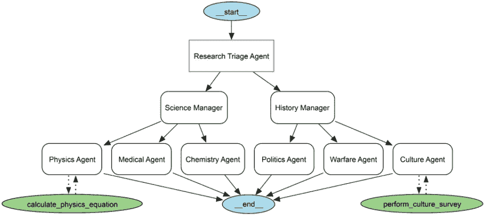

图 8.1: 可视化图示例

**快速提示**：需要查看此图像的高分辨率版本？请在下一代 Packt Reader 中打开此书，或在 PDF/ePub 版本中查看。

**购买此书将免费赠送**下一代 Packt Reader**。扫描二维码或访问 [`packtpub.com/unlock`](https://packtpub.com/unlock)，然后使用搜索栏通过名称查找此书。双检显示的版本以确保你获得的是正确的版本。


在可视化图中，代理被绘制为方框（节点），工具被绘制为椭圆，箭头表示交互（实线箭头表示代理之间的交接，虚线箭头表示代理到工具的调用）。图中总有一个起始节点和一个或多个结束节点，决定了代理流的可能路径。

这个工具（双关语）对于大型多代理系统的管理、清晰化和调试非常有用。通过检查此可视化图，我们可以验证系统结构是否符合预期。例如，如果我们预期某个工具应该被连接或某个代理有一个未显示的交接，图表将迅速揭示任何缺失的配置。此外，它还可以作为合作伙伴、利益相关者或系统未来维护者的宝贵文档，为他们提供代理交互的概述。

# 护栏 (Guardrails)

`Guardrails` 是另一个实 OpenAI Agents SDK 原，通过执行验证检查来辅助多代理系统。这些检查可以在用户输入传递给代理系统时执行，也可以在代理输出传输给用户时执行。

在代理系统中拥有护栏的好处是它可以使其更具韧性。它们充当保护层，确保无效、不或不受理想的输入输出在引起问题之前被拦截。这有助于防止有害响应、强制合规规则并保持一致的用户体验。在更复杂的系统中，护栏还可以作为保持代理符合组织政策和特定领域限制的方法，而不会让主代理过载验证逻辑。在实践中，这意味着你的代理可以专注于其核心任务，而护栏则处理边界情况、策略执行和安全考量。

输入和输出护栏使用相似的模式：

1. 我们必须首先定义一个返回 `GuardrailFunctionOutput` 对象的护栏函数。它还可以接收上下文、触发护栏的代理以及用户的提示词/代理输出作为输入。`GuardrailFunctionOutput` 包含一个 `tripwire_triggered` 布尔值，该值指示是否执行了护栏触发器。

2. 在护栏函数内部，我们必须包含逻辑来判断我们的护栏触发器是否应该被激活。在这里我们可以使用硬编码逻辑（例如，如果用户提示词包含“负”一词，我们应该触发触发器并停止代理）或基于代理的逻辑（例如，我们创建另一个代理，其唯一工作是推理是否应该触发触发器）。

3. 最后，我们必须优雅地处理触发器（抛出一个特定的异常）并向用户输出内容。

我们将首先查看输入护栏，然后转向输出护栏。

# 输入护栏

将输入护栏想象成机场登机口的空乘人员，确保只有持票乘客进入飞机，其他人都不行。这些护栏当了第一道防线，确保只有相关的用户提示词被传递给你的代理系统，其他统行。例如，你可能会使用输入护栏来检测用户的请求是否违反了使用策略，或者检查请求是否是代理不应该处理的内容。防止滥用代理系统可以节省大量资金，因为你可以在查询运行代理系统之前拦截它们，从而节省 Token 和处理成本。

让我们回到之前章节中创建的客户服务示例，并为其添加一个输入护栏。现在，我们将根据一些非常简单的逻辑强制触发触发器，例如，如果提示词包含“投诉”一词（实际上，可以是任何词）。

## 创建一个工具

```python
@function_tool()
def get_order_status(orderID: int) -> str:
    """
    根据订单 ID 返回订单状态
    Args:
        orderID (int) - 客户订单的 ID
    Returns:
        string - 客户订单的状态消息
    """
if orderID in (100, 101):
        return "Delivered"
elif order_ID in (200, 201):
        return "Delayed"
elif orderID in (300, 301):
        return "Cancelled"
```

现在，我们来定义我们的防护栏（guardrail）。此函数会检查用户的提示词（prompt）是否包含“complaint”（投诉）一词，如果是，它将触发触发器（tripwire）：

```python
# 创建一个防护栏
@input_guardrail
def complaint_detector_guardrail(
    ctx: RunContextWrapper[None],
    agent: Agent,
    prompt: str | list[TResponseInputItem]
) -> GuardrailFunctionOutput:
    tripwire_triggered = False
if "complaint" in prompt:
         tripwire_triggered = True
return GuardrailFunctionOutput(
        output_info="The word Complaint has been detected",
        tripwire_triggered=tripwire_triggered,
    )
```

工具和防护栏都就绪后，我们现在可以定义代理（agent）。注意看防护栏是如何通过 `input_guardrails` 参数附加到 agent 上的：

```python
# 定义一个 agent
agent = Agent(name="Customer service agent",
              instructions="你是一个 AI Agent，帮助为当地报纸公司回答客户查询",
              model="gpt-4o",
              tools=[get_order_status],
              input_guardrails=[ complaint_detector_guardrail])
```

最后，我们用一个简单的循环将它们整合起来并与 agent 交互。防护栏将在输入传递给 agent 之前检查每一个输入：

```python
with trace("Input Guardrails"):
    while True:
        question = input("You: ")
        result = Runner.run_sync(agent, question)
        print("Agent: ", result.final_output)
```

让我们按照之前设定的模式，分析这里的输入防护栏功能。首先，我们定义了一个防护栏函数（`complaint_detector_guardrail`），它接受 `RunContextWrapper`、agent 和用户的提示词。该函数必须始终返回一个 `GuardrailFunctionOutput` 对象，指示是否触发了触发器。

其次，在函数内部，我们编写了检测逻辑。在这个示例中，我们检查提示词中是否出现了“complaint”单词。如果是，`tripwire_triggered` 标记将设置为 `True`，防护栏报告其已触发。注意，这是非常简单的防护栏逻辑。传统上，在这里你可能需要更复杂的逻辑来（例如）扫描违反策略的行为或恶意输入。

最后，当触发器被触发时，SDK 会抛出一个 `InputGuardrailTripwireTriggered` 异常。这会中断正常的执行流，防止 agent 处理请求，转而显示错误。目前该错误没有被处理，因此不会产生良好的客户体验，但它仍然实现了我们的预期结果。

让我们尝试一下。运行程序并输入以下消息：

```text
You: What's the status of my order? My order ID is 200
Agent: The status of your order with ID 200 is: Delayed. If you have any further questions or need assistance, please let me know!
```

触发器没有被触发，因为用户的提示词中不包含“complaint”单词。让我们再次尝试并故意触发器：

```text
You: I have a complaint
InputGuardrailTripwireTriggered error
```

在这里，我们可以看到系统抛出了 `InputGuardrailTripwireTriggered` 错误并停止了执行。现在，让我们修改脚本以更优雅地处理触发器异常。可以通过在代码末尾添加以下内容：

```python
...
with trace("Input Guardrails"):
    while True:
        try:
            question = input("You: ")
            result = Runner.run_sync(agent, question)
            print("Agent: ", result.final_output)
        except InputGuardrailTripwireTriggered:
            print ("The tripwire has been triggered. Please call us instead to register complaints.")
```

然后，重试我们之前的提示词：

```text
You: I have a complaint
The tripwire has been triggered. Please call us instead to register complaints.
```

在这里，我们可以看到触发器仍然被触发，我们的 agent 执行停止了，但异常被优雅地处理，并向用户显示了一条友好的消息。

我们还可以在 `Traces` 模块看到输入防护栏：

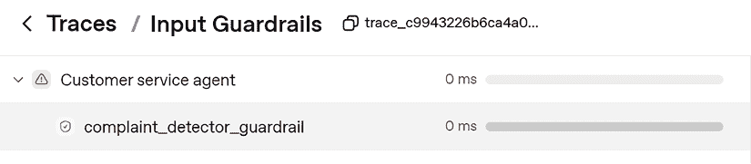

图 8.2: Traces 模块中的输入防护栏

## 注意

注意的是，输入防护栏仅对多代理系统中的第一个 agent 执行。这意味着它们充当整个工作流的初始网关，在用户输入流向其他 agent 之前对其进行筛选。

在这个示例中，触发输入防护栏触发器的逻辑相当基础。例如，如果客户使用了“complaint”以外的单词，触发器将无法被触发。

让我们更新之前的示例并使防护栏逻辑更加复杂。创建一个名为 `input_guardrail.py` 的新 Python 文件并运行以下代码。首先，导入必要的包并设置环境：

```python
# 必要的导入
import os
from dotenv import load_dotenv
from agents import Agent, Runner, trace
from agents import GuardrailOutput, InputGuardrailTripwireTriggered, input_guardrail, RunContextWrapper, TResponseInputItem
from pydantic import BaseModel
# 从 .env 文件加载环境变量
load_dotenv()
# 获取 API key
api_key = os.getenv("OPENAI_API_KEY")
```

接下来，创建一个检查状态的简单工具。这与之前的相同，但现在它将作为客服工作流的一部分：

```python
# 创建一个工具
@function_tool()
def get_order_status(orderID: int) -> str:
    """
    根据订单 ID 返回订单状态
    Args:
        orderID (int) - 客户订单的 ID
    Returns:
        string - 客户订单的状态消息
    """
if orderID in (100, 101):
        return "Delivered"
elif orderID in (200, 201):
        return "Delayed"
elif orderID in (300, 301):
        return "Cancelled"
```

现在，让我们定义一个防护栏 agent 使用 Pydantic 模型来指示提示词是否与客户服务相关：

```python
class GuardrailTrueFalse(BaseModel):
    is_relevant_to_customer_service_orders: bool
```

有了这个模型，我们现在可以创建防护栏 agent。它的唯一工作是判断用户的提示词是否与客户服务相关：

```python
# 创建一个防护栏 agent
guardrail_agent = Agent(
    name="Guardrail check",
    instructions="你是一个 AI agent，检查用户的提示词是否与回答客服和订单相关问题",
    output_type=GuardrailTrueFalse,
)
```

接下来是防护栏函数本身。该函数运行防护栏 agent，如果提示词不相关则触发触发器：

```python
# 创建防护栏
@input_guardrail
async def relevant_detector_guardrail(
    ctx: RunContextWrapper[None],
    agent: Agent,
    prompt: str | list[TResponseInputItem]
) -> GuardrailFunctionOutput:

    result = await Runner.run(guardrail_agent, input=prompt)
    tripwire_triggered = False
if result.final_output.is_relevant_to_customer_service_orders == False:
         tripwire_triggered = True
return GuardrailFunctionOutput(
        output_info="The word Complaint has been detected",
        tripwire_triggered=tripwire_triggered
    )
```

最后，让我们定义主客户服务代理，挂载防护栏并在简单的循环中运行它：

```python
# 定义一个代理
agent = Agent(name="Customer service agent",
              instructions="You are an AI Agent that helps respond to customer queries for a local paper company",
              model="gpt-4o",
              tools=[get_order_status],
              input_guardrails=[relevant_detector_guardrail])
with trace("Input Guardrails"):
    while True:
        try:
            question = input("You: ")
            result = Runner.run_sync(agent, question)
            print("Agent: ", result.final_output)
        except InputGuardrailTripwireTriggered:
            print ("This comment is irrelevant to customer service.")
```

让我们检查一下这里做了哪些更改。首先，我们不再使用硬编码的关键词检查，而是依赖另一个代理（`guardrail_agent`）来评估用户的输入。该代理配置了清晰的指令，用于判断提示是否与客户服务和订单查询相关，且其输出使用 Pydantic 模型（`GuardrailTrueFalse`）进行类型化。


其次，在`relevant_detector_guardrail`函数中，我们使用用户的输入异步调用`guardrail_agent`。然后检查结果：如果代理指示提示不相关，我们将`tripwire_triggered`标志标记为`True`。这使得防护栏变得更加灵活，因为它可以处理广泛的措辞或意图，而不是依赖单一的关键词匹配。

总体而言，这种模式要健壮且可扩展得多，因为它允许你使用轻量级、廉价的模型进行过滤和验证，同时将更强大（且成本更高）的模型留给处理实际的客户交互。

如果我们运行程序并询问与客户服务无关的问题，它会停止执行并告诉我们此评论与客户服务无关：

```
You: What's the meaning of life?
This comment is irrelevant to customer service
```

### 注意

这里有一个微小但重要的调整是防护栏函数被定义为`async`。这是必要的，因为防护栏本身在异步调用另一个代理（`Runner.run`）。在实践中，这意味着每当防护栏函数调用其他代理时，你就需要使用异步防护栏函数。

现在我们已经熟悉了输入防护栏，让我们把注意力转向输出防护栏。

## 输出防护栏

输出防护栏的作用类似，但它们验证的不是进入你的代理系统的内容，而是验证输出的内容。可以将它们想象成空乘人员，确保乘客有序下机，并确保没有不安全的物品离开飞机。在实践中，输出防护栏在代理响应返回给用户之前作为最后一个检查点。它们使你的代理系统能够执行约束条件，例如格式合规性、敏感数据脱敏或确保输出符合政策指南。

在我们的客户支持场景中，假设我们确保代理的最终响应始终包含一个有效的交付订单状态声明（例如，“您的订单 #5474 正在送途中，将于明天到达。”）。如果代理输出了无关的内容（例如没有状态详情的道歉，或者更糟糕的幻觉），我们希望系统在它到达客户之前将其拦截。

与输入防护栏类似，输出防护栏被实现为返回`GuardrailFunctionOutput`对象的函数，其逻辑用于判断是否触发了触发器。如果输出无效或不安全，触发器将阻止响应到达用户。区别在于，由于输出可以是结构化对象（如果代理定义了`output_type`），防护栏函数会接收该输出对象。

让我们来看一个示例。创建一个名为`output_guardrail_agent.py`的新 Python 文件并运行以下程序。我们首先导入所需的模块并加载环境变量：

```python
### 必要的导入
import os
from dotenv import load_dotenv
from agents import Agent, Runner, function_tool, trace
from agents import GuardrailFunctionOutput, OutputGuardrailTripwireTriggered, output_guardrail, RunContextWrapper
from pydantic import BaseModel
### 从 .env 文件加载环境变量
load_dotenv()
### 访问 API key
api_key = os.getenv("OPENAI_API_KEY")
```

接下来，我们为输出定义了简单的 Pydantic 模型：

```python
class MessageOutput(BaseModel):
    response: str
class GuardrailTrueFalse(BaseModel):
    is_relevant_to_customer_service: bool
```

该代理检查主代理的响应是否适用于客户服务：

```python
### 创建一个防护栏代理
guardrail_agent = Agent(
    name="Guardrail check",
    instructions="You are an AI agent that checks if the agent response is relevant to answering a customer service question and not hallucinating",
    output_type=GuardrailTrueFalse
)
```

然后我们编写强制防护栏的函数：

```python
### 创建防护栏
@output_guardrail
async def relevant_detector_guardrail(
    ctx: RunContextWrapper[None],
    agent: Agent,
    output: MessageOutput
) -> GuardrailFunctionOutput:

    result = await Runner.run(guardrail_agent, input=output)
    tripwire_triggered = False
if result.final_output.is_relevant_to_customer_service == False:
         tripwire_triggered = True
return GuardrailFunctionOutput(
        output_info="",
        tripwire_triggered=tripwire_triggered
    )
```

在这里，我们定义了一个故意会产生“幻觉”的客户服务代理，以展示防护栏如何捕捉输出：

```python
### 定义一个代理
agent = Agent(name="Customer service agent",
              instructions="You are an AI Agent that outputs song lines and poems", # 强制模型产生幻觉并触发输出防护栏
              output_guardrails=[relevant_detector_guardrail])
```

最后，我们在循环中运行代理并捕获触发防护栏的情况：

```python
with trace("Output Guardrails"):
    while True:
        try:
            question = input("You: ")
            result = Runner.run_sync(agent, question)
            print("Agent: ", result.final_output)
        except OutputGuardrailTripwireTriggered:
            print ("The agent system did not produce an output. Please try again")
```

在这个示例中，我们创建了一个输出防护栏。我们为`relevant_detector_guardrail`函数装饰了`@output_guardrail`，这意味着该防护栏会在代理生成响应后运行。在防护栏内部，我们使用代理的输出异步调用防护栏代理。如果结果显示响应无效，防护栏将通过抛出`OutputGuardrailTripwireTriggered`异常来停止执行。

如果触发器触发，异常会被捕获，我们不会向用户显示代理幻觉或无关的响应，而是显示安全的备消息：“代理系统没有产生输出。请重试。”

如果我们运行程序，无论输入什么，都会触发输出防护栏，因为我们已经配置让代理故意产生幻觉：

```
You: what's the status of my return?
The agent system did not produce an output. Please try again
```

输出护栏（Output guardrails）可以针对多种场景进行定制。它们可以被用于确保每个响应都包含清晰且有效的订单状态，验证结果是否符合特定的模式（schema），或者自动移除敏感细节（如个人身份信息）。通过在流水线的最末端应用这些检查，你可以确保响应完全你应用程序所需的精确标准。

将输出护栏想象成最后的安全防护网。即使系统的早期组件表现得不可预测，这些护栏也能确保最终返回给用户的内容是安全的、合规的符合业务需求的。

## 日志、追踪与可观测性

管理代理（agents）不仅意味着实施护栏，还意味着拥有良好的观测性基础设施，以完全理解你的代理正在做什么。OpenAI Agents SDK 通过强大的`Traces`模块记录代理运行期间的事件序列（模型调用、工具调用、交接、护栏触发等）。

所有代理运行都会自动启用追踪，并可以通过 OpenAI 仪表板进行访问。这为调试和监控提供了一个开箱即用的解决方案，能够捕捉丰富的事件集。这些记录的事件作为跨度（spans）存储在运行的整个追踪（trace）中。理解追踪（traces）和跨度（spans）之间的区别很有用：

- **Trace (追踪)**：代表你的代理系统的一个完整执行流。它就像是针对特定用户提示从开始到结束发生的所有事件的时间线。与一次运行相关事件都分组在此追踪下。

- **Span (跨度)**：追踪中的单个事件或操作，具有开始时间和结束时间。跨度可以嵌套，并且还可以包含对调试有用的额外属性数据。

将追踪看作一次用户请求的完整执行过程，而将跨度看作该执行过程中的各个步骤。

追踪和跨度模型是非常强大的：这意味着你可以追踪复杂的序列，并查看哪些操作花费了多少时间以及它们是如何相互相关的。例如，你可以看到整个追踪耗时 3.2 秒，其中 1.5 秒是 LLM 在思考，0.5 秒是数据库工具调用，以此此类推。

`Traces dashboard`提供了这些事件的可视化序列，可以展开查看细节，如提示词或工具的输入/输出。这在开发过程中非常有用，可以逐步查看代理内部执行的操作。

让我们来看一个例子。创建一个名为`basic_trace.py`的新 Python 文件并运行以下程序：

```python
from agents import Agent, Runner
from dotenv import load_dotenv
load_dotenv()
### 创建一个代理
agent = Agent(
    name="QuestionAnswerAgent",
    instructions="You are an AI agent that answers questions in as few words as possible"
)
result = Runner.run_sync(agent, "Where is the Eiffel Tower?")
print(result.final_output)
```

在不编写任何额外代码的情况下，SDK 在`Traces`模块中自动完成了完成了日志记录。如果我们打开`Traces dashboard`，可以看到追踪和相应的跨度：

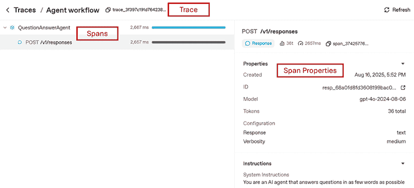

图 8.3：Traces 模块中的跨度

现在，让我们通过自定义追踪、自定义跨度以及将追踪和跨度分组，增加日志和可观测性的复杂性。

## 自定义追踪和跨度

使用`trace`函数可以为追踪自定义属性（例如自定义名称）。追踪调用中的任何内容（代码执行、代理运行等）都将记录在该追踪下。让我们来看一个例子。创建一个名为`custom_trace.py`的 Python 脚本，输入以下代码：

```python
from agents import Agent, Runner, trace
from dotenv import load_dotenv
load_dotenv()
### 创建一个代理
agent = Agent(
    name="QuestionAnswerAgent",
    instructions="You are an AI agent that answers questions in as few words as possible"
)
with trace("Henry's Workflow"):
    result = Runner.run_sync(agent, "Where is the Eiffel Tower?")
    print(result.final_output)
```

在这里，我们为追踪提供了名为“Henry’s Workflow”的自定义名称。这将使我们能够更容易在`Traces`模块中找到该追踪：

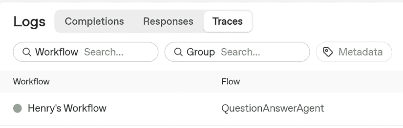

图 8.4：Traces 模块中的日志

注意，你也可以`traces.start()`和`traces.finish()`，但不建议这样做。

正如我们之前讨论过的，跨度会自动为代理交接和工具调用等操作创建，但在多代理系统中，创建自己的自定义跨度来记录某些特定内容可能是很有用的。这里的处不仅在于日志记录，你还可以看到跨度花费了多长时间。

要创建自定义跨度，我们可以直接使用 SDK 的`custom_span`函数。创建一个名为`custom_span.py`的新 Python 文件并运行以下程序：

```python
from agents import Agent, Runner, trace, custom_span
from dotenv import load_dotenv
import time
load_dotenv()
### 创建一个代理
agent = Agent(
    name="QuestionAnswerAgent",
    instructions="You are an AI agent that answers questions in as few words as possible"
)
with trace("Henry's Workflow"):
    with custom_span("Task 1"):
        time.sleep(5)
    with custom_span("Task 2"):
        result = Runner.run_sync(agent, "Where is the Eiffel Tower?")
    with custom_span("Task 3"):
        time.sleep(5)
    with custom_span("Task 4"):
        time.sleep(5)
```

在这个示例中，我们创建了五个自定义跨度，每个都有不同的名称。目前，自定义跨度要么执行代理运行，要么睡眠五秒。由于这些自定义跨度，我们可以在`Traces dashboard`中看到与之相关的日志：

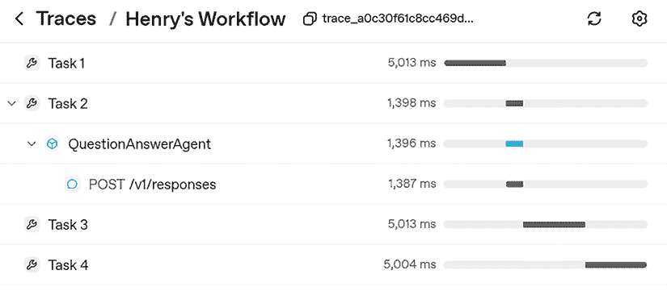

图 8.5：Traces module 中的任务

你可以将自定义跨度放在代理系统的各个位置。这有助于将复杂的工作流分解为更小的步骤。通过策略性地添加跨度，你可以精确定时间花费在哪里。

## 多追踪分组

你可能希望将多次代理运行合并到一个追踪中。默认情况下，分别调用两次`Runner.run`将产生独立的追踪，但在语义上，你可能认为它们是一个工作流的一部分。我们可以使用`trace()`上文管理器将它们联系在一起。

创建一个名为`multiple_agents_in_one_trace.py`的新 Python 文件并运行以下程序：

```python
from agents import Agent, Runner, trace, custom_span
from dotenv import load_dotenv
import time
load_dotenv()
### 创建一个代理
agent = Agent(
    name="QuestionAnswerAgent",
    instructions="You are an AI agent that answers questions in as few words as possible"
)
with trace("Henry's Workflow"):
    with custom_span("Task 1"):
        result = Runner.run_sync(agent, "Where is the Statue of Liberty?")
    with custom_span("Task 2"):
        result = Runner.run_sync(agent, "Where is the Eiffel Tower?")
    with custom_span("Task 3"):
        result = Runner.run_sync(agent, "Where is the Notre Dame?")
    with custom_span("Task 4"):
        result = Runner.run_sync(agent, "Where is the Burj Khalifa?")
```

在`Traces module`中，所有这些运行现在都将属于同一个追踪（而不是独立的追踪）。

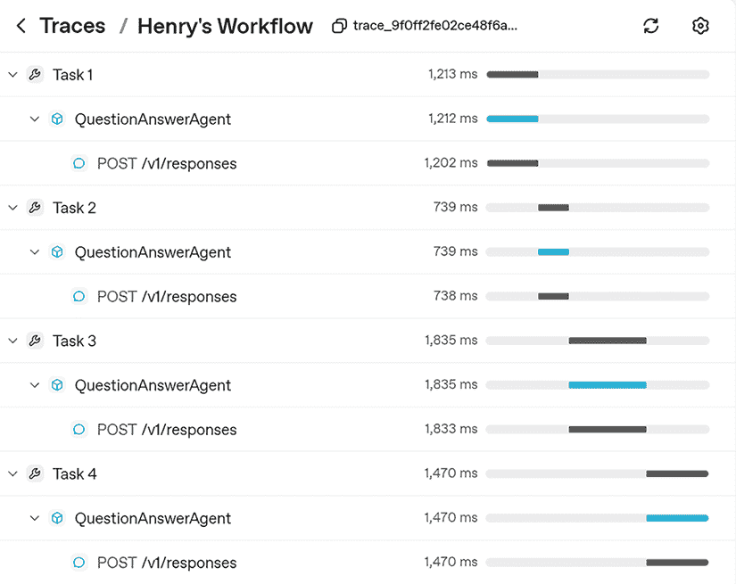

图 8.6：Traces module 中的多个任务

这也可以发生在不同的 Python 程序之间，通过在 traces 调用中传递一个唯一的`trace_id`。创建一个名为`multiple_agents_in_one_trace_2.py`的新 Python 文件，并运行程序三次以模拟三次调用，从而在 Traces（追踪）模块中看到它们。


进入`/path/to/xxx`目录，找到`xxx.json`。

在表达式`cvar = avar + bvar`中，加法运算符（`+`）将`avar`与`bvar`相加，得到它们的和`cvar`

在`List.of(arg0, arg1, arg2)`中，`List`接口的工厂方法`of()`接受一系列的元素，返回包含它们的只读列表。

之后我们这样调用`cmd`命令：`cmd arg0 arg1 arg2`。

```
if (condVar > someVal) {console.log("xxx")}
```

---

以下是排版后的内容：

[content]
# 使用 OpenAI Agents SDK 构建智能体系统

在深入代码示例之前，让我们先建立一个基础。本章将涵盖智能体系统的管理、监控和验证。

## 追踪与跨度

首先，我们创建一个简单的代理，并为其添加追踪和自定义跨度。

```python
from agents import Agent, Runner, trace, custom_span
from dotenv import load_dotenv
import time

load_dotenv()

# 创建一个代理
agent = Agent(
    name="QuestionAnswerAgent",
    instructions="你是一个 AI 代理，尽可能用少的语言回答问题"
)

with trace("Henry's Workflow", trace_id="A1B2C3"):
    with custom_span("Task 1"):
        result = Runner.run_sync(agent, "Where is the Statue of Liberty?")
```

由于我们传递了`trace_id`参数，我们现在可以根据意愿多次独立运行该程序，它仍然会在 Traces 模块中被分组在一个 trace 下：


图 8.7：Traces 模块中相同 trace ID 下的任务

这对于长时间运行或分布式工作流非常有益，因为流程的不同部分可能在不同的时间甚至在不同的机器上执行。通过分配相同的`trace_id`值，你可以将来自多个会话的活动缝合为一个贯的 trace，更容易查看工作流的完整生命周期。

就像 traces 一样，span（跨度）也可以分组。spans 甚至可以嵌套。假设你有一个执行两个主要任务的代理工作流：研究和文本生成。每个部分都可以有自己的代理集和工具调用。通过自定义 spans，这些活动可以分组，以便它们在 Traces 模块中以“组合”的形式出现。

创建一个名为`nested_spans.py`的新 Python 文件并运行以下程序：

```python
from agents import Agent, Runner, trace, custom_span, function_tool
from dotenv import load_dotenv
import time

load_dotenv()

@function_tool
def get_fun_facts():
    return "The Eiffel Tower is in Paris"

@function_tool
def clean_up_poem(poem_string: str):
    return poem_string.upper()

# 创建研究代理
research_agent = Agent(
    name="Research",
    instructions="You are an AI agent that performs research",
    tools=[get_fun_facts]
)

# 创建文本生成代理
text_generation_agent = Agent(
    name="Text Generation",
    instructions="You are an AI agent that pertakes research that's performed and writes a poem",
    tools=[clean_up_poem]
)

with trace("Henry's Research Workflow"):
    with custom_span("Research Task"):
        result = Runner.run_sync(research_agent, "The Eiffel Tower")
    with custom_span("Text Generation Task"):
        result = Runner.run_sync(text_generation_agent,
            result.final_output)
    print(result.final_output)
```

这会将研究和文本生成任务分别分组。

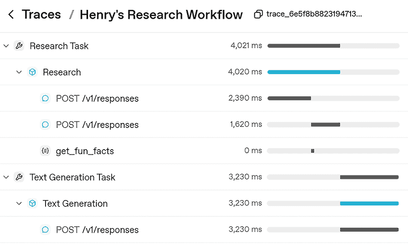

图 8.8：Traces 将多个对象分到一起

这意味着你可以更容易地找到这些任务并看到它们花费多长时间，这对于调试和管理非常有用。

## 禁用追踪

有时，你可能想要禁用追踪。这可能是因为监管要求不保留任何日志或数据，或者可能存在某些你不希望存储在日志中的敏感材料。在这种情况下，你可以通过在 Python 脚本顶部放置以下代码来禁用追踪，该代码设置了`OPENAI_AGENTS_DISABLE_TRACING`环境变量：

```python
import os
os.environ["OPENAI_AGENTS_DISABLE_TRACING"] = "1"
```

## 代理测试

代理管理的另一个重要方面是测试，这对于确认其按预期运行并随时间推移保持可靠至关重要。当代理连接到更广泛的工作流或直接暴露给终端用户时，这一点变得更加关键。挑战在于，代理的行为通常不可预测且具有非确定性（相同的输入可以产生不同的输出），使得代理比传统软件更难验证。幸运的是，OpenAI Agents SDK 提供了结构化的方法，为测试过程带来严谨性和一致性。

我们将讨论两种类型测试测试类型：

- 端到端测试（End-to-end testing）：整个代理系统是否按预期运行？
- 单元测试（Unit testing）：整个代理系统中的某个组件是否按预期运行？

那么，让我们开始吧！

## 端到端测试

端到端测试评估代理系统何时产生理想的输出。对于我们的客户支持代理，端到端测试可能涉及模拟真实的用户问题，并查看代理是否返回了帮助性的答案、使用了正确的工具或恰当地执行了交接。

传统上，这涉及定义输入和预期输出，并验证我们的系统是否产生了预期输出。然而，由于代理系统及其非确定性，事实证明这是困难的，但并非不可能。一种方法是由人工验证代理系统是否产生了理想输出。另一种更自动的方法是让 LLM（甚至是另一个代理）来判断代理系统是否产生了理想输出。

让我们写一个简单的脚本，为之前编写的客户服务代理进行端到端测试：一个返回状态的客户服务代理。创建一个名为`test_to_end.py`的 Python 脚本并编写以下代码。我们首先导入所需的模块并加载环境变量：

```python
# 必要的导入
import os
from dotenv import load_dotenv
from agents import Agent, Runner, function_tool
from pydantic import BaseModel

# 加载环境变量
load_dotenv()

# 获取 API key
api_key = os.getenv("OPENAI_API_KEY")
```

接下来，我们定义一个给定 ID 后返回状态的工具：

```python
# 创建工具
@function_tool(
        name_override="Get Status of Current Order",
        description_override="根据 ID 返回订单状态",
        docstring_style="Args: 格式的整数"
)
def get_order_status(orderID: int) -> str:
    """
    根据 ID 返回订单状态
    Args:
        orderID (int) - 客户订单 ID
    Returns:
        string - 客户订单的状态消息
    """
if orderID in (100, 101):
        return "Delivered"
elif orderID in (200, 201):
        return "Delayed"
elif orderID in (300, 301):
        return "Cancelled"
```

现在，我们将此工具封装到简单的客户服务代理中：

```python
# 定义代理
agent = Agent(name="Customer service agent",
              instructions="你是一个 AI 代理，帮助回复本地纸公司的客户查询",
              model="gpt-4o",
              tools=[get_order_status])
```

让我们通过询问订单 200 的状态来测试代理：

```python
# 运行逻辑框架
result = Runner.run_sync(agent, "What's the status of my order? My Order ID is 200")

# 打印结果
print(result.final_output)
```

我们知道这个代理利用`function_tool`返回订单状态。现在，让我们为这个代理系统构建一些端到端测试。这从为每个场景定义输入和预期输出开始。然后，我们将编写一个脚本，遍历每个场景，使用输入运行代理系统，然后将代理系统的输出与预期输出进行比较。

### 创建 Scenario 类

```python
# create Scenario class
class Scenario(BaseModel):
    scenario: str
    input: str
    expected_output: str

list_of_scenarios = [
    Scenario(
        scenario="Delivered example",
        input="Hi there, could you check my customer order? It's 101",
        expected_output="The order is delivered"
    ),
    Scenario(
        scenario="Delayed",
        input="My order ID is two hundred, why has my package not been delivered yet?",
        expected_output="The order is delayed"
    ),
    Scenario(
        scenario="Order does not exist",
        input="What's the status of my Order? Its number is 400",
        expected_output="No status or order can be found"
    )
]
```

我们需要一个简单的输出类型（`True`/`False`）和一个专用的测试智能体来评估结果：

```python
# create output type
class OutputTrueFalse(BaseModel):
    test_succeeded: bool

# create testing agent
testing_agent = Agent(name="Testing agent",
              instructions="You are an AI Agent that tests expected outputs from desired outputs of an agentic AI system",
              output_type=OutputTrueFalse)
```

最后，遍历每个场景并检查智能体是否产生了预期的结果：

```python
# Run test
for scenario in list_of_scenarios:
    print(f"Running scenario {scenario.scenario}")
    result = Runner.run_sync(testing_agent, f"Input: {scenario.input} ||| Expected Output: {scenario.expected_output}")
    print(result.final_output)
    print('---')
```

如果运行运行这个程序，它将遍历每个场景并执行端到端测试（由智能体或 LLM 为我们执行比较）：

```
Running scenario Delivered example
test_succeeded=True
---
Running scenario Delayed
test_succeeded=True
---
Running scenario Order does not exist
test_succeeded=True
---
```

现在，如果对对智能体系统进行了更改，只需重新运行它，它将执行相同的测试。

由于所有测试都成功了，这表明智能体成功使用了工具并将结果包含在响应中。如果测试失败，可能意味着智能体没有调用工具（可能是提示词问题）或格式化答案不符合意料。在实际场景中，您将分析失败原因以改进智能体（可能调整指令或工具实现）。

## 单元测试

单元测试评估系统中特定行为或组件的性能。对于智能体系统，这可能意味着确保某些工具正在被调用、某些智能体被正确移交、某些护栏（guardrails）被触发等。为了做到这一点，我们可以利用 SDK 的`result`和`context`对象并检查它们，以确保某些预期得到满足。

让我们来看一个示例，在之前示例的脚本基础上进行扩展。假设我们想要测试在调用智能体时`function_tool`是否真的被调用了。为了做到这一点，我们可以检查`result`对象并验证`function_tool`中的`get_order_status`函数是否确实被调用。在之前的脚本中添加以下代码：

```python
from agents import ToolCallItem

# Run a unit test to check if the function_tool was called
result = Runner.run_sync(agent, "Please provide me the status of order 101")

# Inspect items in the result
items = result.new_items
print("Tool calls made during this run:")
for item in items:
    if isinstance(item, ToolCallItem):
        print(f"- {item.raw_item.name} was called")

# Assert that get_order_status was called
if any(item.raw_item.name == "get_order_status" for item in items if isinstance(item, ToolCallItem)):
    print("get_order_status was called as expected")
else:
    print("get_order_status was not called")
```

在此代码段中，我们对客服智能体进行了简单的查询，然后检查`result`对象的`new_items`属性。这让我们能够确切看到智能体决定调用哪些工具。通过检查`get_order_status`工具是否出现在此列表中，我们可以确认智能体的控制逻辑按预期工作。在这种情况下，我们确实确认了`get_order_status`被调用了：

```
Tool calls made during this run:
- get_order_status was called
get_order_status was called as expected
```

这样的单元测试非常有价值，因为它们让你对智能体行为的特定方面充满信心。与其只验证最终输出，您可以检查中间步骤，例如是否调用了正确的工具、是否发生了正确的智能体移交，或者是否触发了护栏。这种细粒度的控制有助于定位问题，并确保您的系统在持续迭代时保持可靠性。

# 总结

在本章中，我们关注了如何对使用 OpenAI Agents SDK 构建的智能体系统进行管理、监控和验证。我们从可视化开始，学习了如何生成显示智能体、工具和移交流程的图表，使系统架构更容易理解和调试。然后，我们引入了输入和输出护栏，它们作为保护层来执行策略并防止不安全或相关的交互。从那里，我们探索了`Traces`模块，它记录了每次运行的追踪（traces）和跨（spans），让你对智能体的内部行为有详细的洞察。最后，我们查看了测试，包括端到端测试和单元测试，以系统地验证智能体的可靠性。

- *编排多智能体工作流*：接下来，我们将编排一个多智能体工作流来自动化个性化的客户触达。一个智能体将收集信息（来自数据库、过去的聊天记录和网络搜索），并将其传递给第二个智能体，由后者编写自定义电子邮件。此示例演示了智能体如何通过按顺序协作来完成从端到端的复杂任务。

在本章的末尾时，你将学会如何应用`OpenAI Agents SDK`从零开始构建真实的 AI 智能体系统。我们将整合之前章节中中学到的所有内容，包括工具、内存、会话和多智能体编排。这个最终项目将汇集你所学的所有知识，为你做好准备，使你能够在现实世界中创建自己的强大 AI 智能体。

## 技术要求

请遵循 *第 3 章*中列出的详细步骤来设置你的环境。


在本书中，每个章节的实用示例和完整代码已发布在本书的 GitHub 仓库中：[`github.com/PacktPublishing/Building-Agents-with-OpenAI-Agents-SDK`](https://github.com/PacktPublishing/Building-Agents-with-OpenAI-Agents-SDK)。

鼓励你克隆该仓库，复用并调整提供的代码样本，并在阅读本书的过程中根据需要参考它们。

## 构建一个客服员工 AI 智能体

我们的第一个案例研究涵盖了一个为名为 *PaperCo* 的虚拟公司提供的 AI 驱动客服聊天机器人。该公司向企业客户提供纸制品。

我们将构建的 AI 智能体将充当虚拟客服员工，处理客户问题、投诉和订单查询。它将整合我们之前讨论过的多个高级功能：

*   用于从数据库查询订单状态的函数工具
*   用于在公司政策文档中查找信息的向量搜索工具
*   用于忽略无关用户提示的输入护栏（`input guardrail`）
*   如果用户表达取消服务的意图，则交给专门的子智能体（留存智能体）

所有这些组件共同工作，创建一个健壮且交互式的聊天机器人，它既能检索事实性数据，又能智能地管理对话流。下图展示了其工作原理：

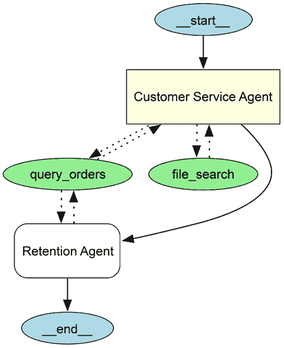

图 9.1: 智能体可视化

让我们来看这个 AI 智能体的每个组件：

*   **订单数据库和查询工具**：一个存储订单的 `SQLite` 数据库和一个智能体可以调用以查找订单状态的函数工具（`query_orders`）。工具强制客户在检索订单信息之前提供密钥（以确保信息安全）。
*   **知识库搜索工具**：一个基于文件的向量搜索工具（`file_search`），允许智能体从客服政策文档中检索答案（用于通用 `FAQ` 问题或公司政策信息）。
*   **输入护栏（相关性检查器）**：一个护栏智能体，用于检查用户查询并拦截与客户服务无关的查询（以防止离题请求）。之前的图中没有包含护栏。
*   **留存智能体**：一个专门负责“留存”场景的智能体。如果客户说他们想取消服务，该智能体将接管对话。它会以同理心处理这种情况并尝试留住客户（甚至提供激励）。
*   **主客服智能体**：用户交互的主要智能体（`"Customer Service Agent"`），即入口点。它使用上述工具和护栏，并知道何时交给留存智能体。该智能体通过会话维护跨轮对话的对话状态，因此它可以处理多轮对话。

这些部分共同构成了一个整体，展示了 AI 智能体如何作为一个胜任的客服员工。在接下来的章节中，我们将深入研究每个组件，探索如何逐步实现它们。

## 设置数据库

首先，我们需要一些数据供智能体运行。对于我们的示例，我们将创建一个小型 `SQLite` 数据库来存储订单信息，并预加载一些示例订单。

下面的设置脚本将创建一个 `SQLite` 数据库文件并在 `orders` 表中填充一些虚假订单记录。它还定义了两个测试查询函数来验证数据。

创建一个名为 `setup.py` 的新 Python 文件并运行以下程序：

```python
import sqlite3
### 设置 SQLite 数据库
conn = sqlite3.connect("paper_data.db")
cursor = conn.cursor()
### 如果 orders 表存在则删除
cursor.execute("DROP TABLE IF EXISTS orders")
### 创建 orders 表
cursor.execute("""
CREATE TABLE IF NOT EXISTS orders (
    order_id INTEGER PRIMARY KEY,
    authorization_key TEXT,
    order_status TEXT
)
""")
### 插入虚假订单数据
orders_data = [
    (1001, "154857", "shipped"),
    (1002, "154857", "processing"),
    (1003, "958542", "delivered"),
    (1004, "445720", "cancelled"),
]
cursor.executemany("INSERT OR IGNORE INTO orders (order_id, authorization_key, order_status) VALUES (?, ?, ?)", orders_data)
conn.commit()
conn.close()
```

在此代码中，我们使用 Python 创建了一个名为 `paper_data.db` 的新 `SQLite` 数据库文件和 `orders` 表。然后，我们插入了四个示例订单，每个订单都关联一个客户授权密钥。

## 设置向量存储

下一步是创建一个向量存储，其中包含智能体可以查询的客服信息。要完成此操作，请按照步骤操作：

1.  前往 OpenAI 平台 [`platform.openai.com/`](https://platform.openai.com/) 并使用与生成 API 密钥时相同的账户登录。
2.  选择右上角的 **Dashboard**，选择 **Storage**，切换到 **Vector stores**。

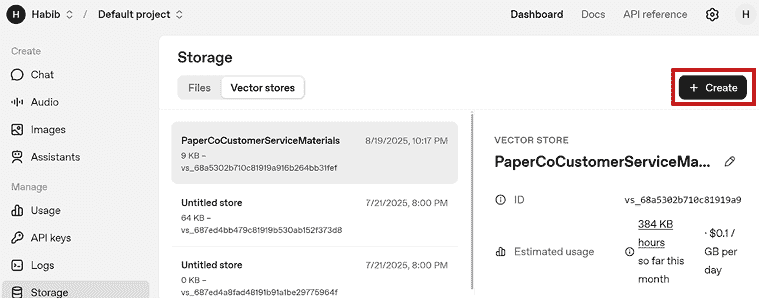

图 9.2: 向量存储

> **快速小贴**：需要此图的高分辨率版本吗？在 next-gen Pack Reader 中打开本书，或在 PDF 版本中查看。

> **next-gen Pack Reader** 随本书购买赠送。扫描二维码或访问 [`packtpub.com/unlock`](https://packtpub.com/unlock)，然后使用搜索栏按名称查找此书。双检显示的版本以确保获取正确的版本。


3.  点击 **Create** 创建一个新的向量存储。输入向量存储名称——例如 `PaperCoServiceMaterials`。
4.  向下滚动并通过 **Add files** 向向量存储添加文件。
5.  上传 **PaperCoServiceMaterials** 文件（可以在本书的 *第 4 章*GitHub 仓库中找到）。将其命名为 `PaperCoServiceMaterials.docx` 为 **Purpose** 字段选择 `user_data`。然后点击 **Attach**。
6.  我们上传的 `.docx` 文件已成功添加到新的向量存储中，所有与启用 `RAG`（如生成嵌入等）的相关操作已完成。
7.  复制并保存刚刚创建的向量存储 ID。该 ID 将出现在向量页的右上角。

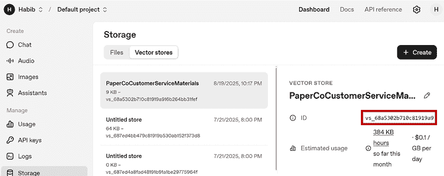

图 9.3: Storage 页面

在本节中，我们将设置一个包含客服材料的向量存储，AI 智能体将利用这些材料回答问题。

## 创建查询数据的函数工具

下一步是创建一个代理（`agent`）可以使用查询订单数据库的函数工具。正如我们之前学到的，`OpenAI Agents SDK` 允许我们通过封装 Python 函数来创建一个工具。在本文中，我们将定义一个名为 `query_orders` 的函数，它将在 `orders` 表上执行 SQL 查询并返回结果。该函数将使用 `@function_tool` 装饰器，使其成为代理可以访问的工具。重要的是，我们的 `query_orders` 工具将强制查询仅返回与给定授权密钥匹配的订单结果（防止 AI 访问它不应访问的订单）。

创建一个名为 `agent.py` 的 Python 文件并输入以下代码：

```python
from agents import ( 
    Agent, Runner, SQLiteSession, trace, 
    function_tool, FileSearchTool
)
import sqlite3
from agents import (
    GuardrailFunctionOutput, InputGuardrailTripwireTriggered, 
    input_guardrail, RunContextWrapper, TResponseInputItem
)
from pydantic import BaseModel
from dotenv import load_dotenv
from agents.extensions.visualization import draw_graph
load_dotenv()
@function_tool
def query_orders(sql_query: str, authorization_key: str):
    """
    在 orders 表上执行指定的 SQL 查询并返回结果。
    你必须提供 authorization_key。
    Table: orders
        order_id INTEGER PRIMARY KEY,
        authorization_key TEXT,
        order_status TEXT
    只有匹配提供的 authorization_key 的行可以被访问。
    """
    db_path = "paper_data.db"
try:
        conn = sqlite3.connect(db_path)
        cursor = conn.cursor()
        # 将用户的查询封装为由 authorization_key 过滤的子查询
        sub_query = f"(SELECT * FROM orders where authorization_key = {authorization_key}) a"
        filtered_query = sql_query.replace("orders", sub_query)
        cursor.execute(filtered_query)
        result = cursor.fetchall()
        conn.close()
        return result
    except Exception as e:
        return f"Error querying orders.db: {e}"
```

在这里，我们定义了带有两个参数的 `query_orders`：`sql_query`（包含代理想要执行的 SQL 查询字符串）和 `authorization_key`（应与客户授权密钥匹配的字符串）。函数连接到 `paper_data.db` 并执行 SQL 查询。

在函数内部，发生了一些巧妙的操作来强制执行检查：它获取传入的 SQL 查询，并将任何对 `orders` 表的引用替换为通过提供的 `authorization_key` 参数过滤的子查询。

换句话说，如果代理尝试运行诸如 `SELECT * FROM orders WHERE order_id = 1003` 的查询，该函数将将其转换为 `SELECT * FROM (SELECT * FROM orders WHERE authorization_key = 958542) a WHERE order_id = 1003`。通过这样，只有当订单具有匹配的授权密钥时，查询才会返回结果，从而防止了未经授权的数据访问。

> **注意**：虽然使用 `authorization_key` 过滤查询是一个非常有用的教学示例，但它不应被视为生产系统的最佳实践。在查询中硬编码或直接传递授权密钥会引入风险，例如 SQL 注入漏洞或密钥泄露。在真实的代理系统中，你通常会通过安全的身份验证和授权层（例如 `OAuth`、API 令牌、基于角色的访问控制）来存储和验证授权凭据。

## 创建向量库搜索工具

除了特定的订单查询外，我们的客户服务聊天机器人还应该处理通用问题。例如，用户可能会问“你们的退货政策是什么？”或提到某些需要参考公司指南的内容。为了让代理能够准确回答此类问题，我们将使用 `FileSearchTool`，这是一个由 OpenAI 托管的工具，可以搜索文档的向量库索引。我们已经创建了一个向量库，其中包含一个列出客户服务相关文档。

在 `agent.py` 中添加以下代码。这将使用向量库 ID 实例化 `FileSearchTool`，以便代理可以查询它：

```python
file_search_tool = FileSearchTool(
    vector_store_ids=['<在此输入你的向量库 ID>']
)
```

代理现在能够搜索向量库来回答问题了。

## 创建输入护栏（`input guardrail`）

我们还将添加一个输入护栏，以确保我们的代理系统不被误用。如果用户询问完全无关的问题（例如“给我讲个笑话”），我们的聊天机器人不应该尝试回答。为了处理这种情况，我们将包含一个输入护栏，它将拦截用户的问题并判断其是否与客户服务相关。

我们将通过创建一个轻量级分类代理（`guardrail_agent`）来实现，它的唯一工作是检查输入并输出一个布尔标记，指示该查询是否与客户服务相关。然后，我们将使用 `@input_guardrail` 装饰器将此检查插入我们的主代理中。如果护栏判断用户提示词不相关，它将抛出 `InputGuardrailTripwireTriggered` 异常，我们可以捕获该异常并优雅地处理离题查询。

让我们定义护栏代理和护栏函数。在 `agent.py` 脚本中添加以下代码：

```python
class GuardrailTrueFalse(BaseModel):
    is_relevant_to_customer_service: bool
### 创建护栏代理
guardrail_agent = Agent(
    name="Guardrail check",
    instructions="你是一个检查用户提示是否与客户服务相关的 AI 代理",
    output_type=GuardrailTrueFalse,
)
### 创建护栏
@input_guardrail
async def relevant_detector_guardrail(
    ctx: RunContextWrapper[None],
    agent: Agent,
    prompt: str | list[TResponseInputItem]
) -> GuardrailFunctionOutput:

    result = await Runner.run(guardrail_agent, input=prompt)
    tripwire_triggered = False
    if result.final_output.is_relevant_to_customer_service == False:
         tripwire_triggered = True
return GuardrailFunctionOutput(
        output_info="",
        tripwire_triggered=tripwire_triggered
    )
```

`relevant_detector_guardrail` 函数会在代理处理用户提示之前异步运行。简单来说，当用户说话时，护栏代理会对其分析。如果护栏代理判断查询不相关，就会触发“触发”，阻止主代理正常响应。

## 创建留存代理（`retention agent`）

接下来，我们需要设置一个留存代理。这是一个处理表示想要取消订单或不满的客户的专用代理。

我们将作为一个 `Agent` 实例定义留存代理，并赋予其特定的指令。在 `agent.py` 文件中添加以下代码：

```python
retention_agent = Agent(
    name="Retention Agent",
    instructions=(
        "你是一个留存代理。你的目标是鼓励客户不要取消服务，"
        "理解他们的痛点并对处境表示同情。如果客户坚持要取消，"
        "你可以向其账户提供高达 100 美元的积分额度作为留存激励。"
    ),
    tools=[query_orders],
)
```

我们的留存代理将非常有礼貌、富有同理心，并在需要时提供额度（最高 100 美元）来说服客户不要取消服务。

## 创建客户服务代理

此时，我们已经拥有了创建主客户服务代理所需的所有组件。该代理将整合到目前为止提到的所有内容（工具、护栏和交接）。在 `agent.py` 文件中添加以下代码：

```python
customer_service_agent = Agent(
    name="Customer Service Agent",
    instructions=(
        "Introduce yourself as the complaints agent."
        "Handle any customer complaints with empathy and clear next steps."
        "Use the file_search_tool to get general answers to questions"
        "For specific order related queries, you the query_orders function_tool"
        "To use the query_order tool, you will need the user's authorization key"
    ),
    tools=[query_orders, file_search_tool],
    input_guardrails=[relevant_detector_guardrail],
    handoffs=[retention_agent]
)
```


让我们来拆解一下这些参数：

- `name` 和 `instructions`：我们将客户服务智能体命名为`"Customer Service Agent"`，并指令它表现得投诉代理。我们给它的提示词（prompt）非常详细，并就何时使用某些工具以及何时进行交接（handoffs）提供了指导。我们还明确提到了在使用`query_orders`时需要授权密钥。
- `tools`：我们传递了`query_orders`和`file_search_tool`。这意味着智能体的 LLM 可以在推理过程中选择调用这些函数。
- `input_guardrails`：我们挂载了`relevant_detector_guardrail`。这意味着输入到该智能体的每个用户输入都将通过该守卫函数。如果守卫判断输入内容不相关，它将阻止智能体继续正常运行。
- `handoffs`：我们在列表中包含了`retention_agent`。通过这种方式，我们实际上创建了一个多智能体系统。如果对话需要留存专家，OpenAI Agents SDK 可以执行交接。

到此为止，我们的客户服务智能体已经完全定义好了。它拥有获取信息所需的工具、一个保持其运行不偏离轨迹的守卫，以及一个用于特定场景的备份智能体。现在，让我们为我们的智能体系统构建运行器（runner）。

## 构建运行器

在实际应用中，我们将此部署到聊天界面。在这里，我们将在终端中模拟交互循环。我们将使用`SQLiteSession`对象来维护对话状态（以便智能体在不同轮次之间记住上下文），并使用`Runner.run_sync()`方法在循环中处理用户输入。我们还将处理由守卫触发的异常，以便在用户询问范围之外的内容时通知他们。

在`agent.py`中添加以下代码：

```python
### 创建会话
session = SQLiteSession("session")
last_agent = customer_service_agent
with trace("Customer service agent"):
    while True:
        try:
            question = input("You: ")
            result = Runner.run_sync(last_agent, question, session=session)
            print("Agent: ", result.final_output)
            last_agent = result.last_agent
        except InputGuardrailTripwireTriggered:
            print ("This comment is irrelevant to customer service.")
```

我们现在准备好开始模拟我们的智能体系统了。

## 测试智能体

让我们测试一下智能体并开始模拟我们的智能体系统。首先，我们将尝试询问智能体一些与客户服务无关的问题，以验证它是否能成功触发守卫机制：

```
You: What's 5 + 15?
This comment is irrelevant to customer service.
```

现在，让我们询问智能体一个关于订单的问题。注意它主动向我们索要授权密钥：

```
You: What's the status of my order? It's 1002
Agent: To check the status of your order, I'll need your authorization key. Could you please provide that?
You: Sure, it's 154857
Agent: Your order with ID 1002 is currently in the "processing" status. If there's anything else you need or if you have any concerns, feel free to let me know!
```

此时，尝试问一个通用的客户服务问题并验证它可以执行向量搜索：

```
You: How much do I need to order to qualify for the bulk discount?
Agent: To qualify for a bulk discount, you need to place an order over $500\. This qualifies for a 5% discount which is applied automatically. If you need any further assistance, feel free to ask!
```

最后，要求智能体注销我们的账户，并观察向留存智能体的交接。我们还会看到它向我们发送了留存优惠：

```
You: I want to cancel my account
Agent: I'm sorry to hear you're considering canceling your account. Could you let me know what's prompting this decision? I'd love to help resolve any issues or concerns you might have. If there's something specific bothering you, maybe I can assist or find a suitable solution for you.
You: It's just too expensive
Agent: I understand how important it is to manage expenses. To help with that, I can offer you a $100 credit on your account, which can ease the cost a bit. Would that work for you?
```

我们所有的测试都成功了。这样，我们构建了一个全功能的 AI 智能体系统，它通过机器人充当客服员工。这个示例展示了一个协同使用多个高级功能的完整智能体。主智能体可以检索事实数据、搜索文档、维护上下文，甚至委托给专门的智能体，同时确保其处于自己的领域内。

在结束本节之前，让我们回过头思考一下我们刚刚构建的内容。你已经看到客户服务智能体如何将多个组件（查询数据的工具、检索文档的向量搜索、保持轨迹的守卫以及与专门智能体的交接）整合到一个协作系统中。这个示例很重要，因为它展示了如何编排 SDK 的不同功能来创建一个真实的智能体。

在下一节中，我们将在此基础上继续，使用 AI 智能体为*PaperCo*实现自动化工作流。

## 编排自动化多智能体工作流

我们的第二个案例研究展示了如何在工作流中使用 AI 智能体。我们的公司*PaperCo*希望定期向客户发送跟进邮件，关注他们的兴趣并微妙地推广产品优惠。与其手动研究每个客户并编写邮件，我们可以构建一个智能体系统来完成任务。

此工作流将涉及两个顺序执行的智能体：

- **客户研究智能体**：该智能体收集有关客户的信息——包括来自数据库的基本信息、最近的记录（以回想起兴趣或个人信息），甚至是与这些兴趣相关的最新新闻。

- **邮件创建智能体**：该智能体接收研究智能体汇总的信息，为客户生成一封简短且个性化的邮件，同时提到产品优惠。

下图显示了这些组件是如何组合的：

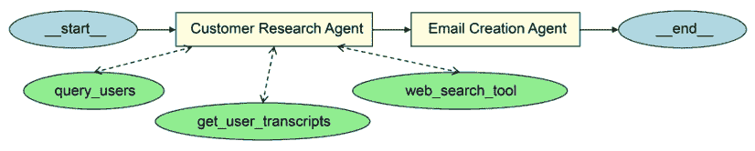

图 9.4：工作流组件图

让我们来看每个组件：

- **用户数据库和查询工具**：一个包含客户详细信息（姓名、电子邮件、位置等）的 SQLite 数据库，以及一个通过 ID 检索客户信息的`query_users`工具函数。

- **客户记录数据和检索工具**：一个包含客户过去对话记录的 JSON 文件，以及一个用于提取特定用户记录的`get_user_transcripts`工具。记录包含了客户在之前的聊天中提到的个人兴趣（例如他们喜欢的运动或食物）。

- **网络搜索工具**：一个允许智能体执行网络搜索的工具（`web_search_tool`）。智能体将使用它寻找与客户兴趣相关的最新信息（例如，如果客户喜欢某支球队，智能体可能会找到最近的比赛结果或关于该球队的新闻）。

- **客户研究代理（Customer research agent）**：一个使用上述工具来编制“客户画像”或简报的代理。它将输出一份摘要或相关信息的集合，用于个性化电子邮件。

- **邮件创建代理（Email creation agent）**：一个接收研究输出并生成实际电子邮件的代理。它被配置为生成结构化结果（包含主题和正文等字段），并将个性化元素（兴趣爱好或新闻）与营销信息（例如`PaperCo`的新优惠活动）相结合。该代理还将使用另一个更倾向于个性化写作的 GPT 模型。

我们还将创建一个简单的循环（编排工作流），它会遍历客户列表，为每个客户运行研究代理，然后在保存生成的邮件之前将结果传递给邮件代理。

*这些组件共同构成了一个完整的工作流，将零散的数据转换为精细的、个性化的客户电子邮件。在下一节中，我们将从设置客户数据库开始，它是研究代理工作的基础。*

## 设置客户数据库

与第一个示例一样，我们将从设置一些数据开始。为此，我们将创建一个名为`customer_details.db`的数据库，其中包含一个名为`users`表，用于存储基础客户信息（例如姓名、电子邮件、位置、业务类型和电话号码）。此示例的设置脚本将创建数据库并填充几个示例用户。

创建一个名为`setup.py`的新 Python 文件并运行以下代码设置数据库：

```python
import sqlite3
### 设置 SQLite 数据库
conn = sqlite3.connect("customer_details.db")
cursor = conn.cursor()
### 为客户详情创建 users 表
cursor.execute("""
CREATE TABLE IF NOT EXISTS users (
    user_id INTEGER PRIMARY KEY,
    first_name TEXT,
    last_name TEXT,
    email TEXT,
    location TEXT,
    business_type TEXT,
    phone_number TEXT
)
""")
### 插入虚假用户数据
users_data = [
    (1, "Emily", "Clark", "emily.clark@example.com", "New York", "Retail", "555-1234"),
    (2, "Michael", "Nguyen", "michael.nguyen@example.com", "San Francisco", "E-commerce", "555-5678"),
    (3, "Sophia", "Patel", "sophia.patel@example.com", "Chicago", "Wholesale", "555-8765"),
    (4, "David", "Martinez", "david.martinez@example.com", "Houston", "Manufacturing", "555-4321"),
]
cursor.executemany(
    "INSERT OR IGNORE INTO users (user_id, first_name, last_name, email, location, business_type, phone_number) VALUES (?, ?, ?, ?, ?, ?, ?)",
    users_data
)
conn.commit()
conn.close()
```

每个用户都有电子邮件和基础个人资料。这些细节可能用于为客户量身定制邮件，或者至少填充收件人字段。

## 设置转记录 JSON 文件

我们还需要一个名为`customer_transcripts.json`的 JSON 文件，其中包含每个客户的历史对话转记录。这些转记录基本上是之前的支持聊天日志，其中包含了客户提到他们的爱好或偏好的个人对话（这些是能够让邮件看起来更具个性化的细节细节）。

创建一个名为`customer_transcripts.json`的新文件，并从本书的 GitHub 仓库中复制该文件的内容：

```json
{
"conversations": [
{
"user_id": 1,
"date": "2024-06-01",
"transcripts": "Hi, I have a question about my order... (conversation with support agent)... I'm a big fan of the New York Knicks... (more chat)..."
},
{
"user_id": 2,
"date": "2024-06-02",
"transcripts": "Can I change my delivery address?... I'm a sushi fan... also I love the San Francisco Giants... (more chat)..."
},
    ...
  ]
}
```

每个对话日志都包含`user_id`、日期和一段合并的对话转记录。在这个示例中，我们可以看到用户 1 提到自己是纽约尼克斯队（篮球球队）的粉丝，而用户 2 则谈到了喜欢寿司以及是金山巨人队（棒球球队）的粉丝。

## 创建检索数据和搜索网页的函数工具

数据就绪后，我们需要创建代理可以用来获取这些数据的工具。我们将创建两个函数工具：

- `query_users`：在`users`表上运行 SQL 查询并获取用户信息

- `get_user_transcripts`：加载转记录 JSON 并提取给定用户的所有转记录，并将它们作为一个大字符串返回。

创建一个名为`agent.py`的新 Python 文件并输入以下代码来创建这两个函数工具：

```python
from agents import (
    Agent, Runner, SQLiteSession, trace, 
    function_tool, WebSearchTool
)
import sqlite3
from pydantic import BaseModel
from dotenv import load_dotenv
from agents.extensions.visualization import draw_graph
import json
load_dotenv()

@function_tool
def query_users(sql_query: str):
    """
    在 users 表上执行指定的 SQL 查询并返回结果。
    Table: users
    """
    db_path = "customer_details.db"
    try:
        conn = sqlite3.connect(db_path)
        cursor = conn.cursor()
        cursor.execute(sql_query)
        result = cursor.fetchall()
        conn.close()
        return result
    except Exception as e:
        return f"Error querying users: {e}"

@function_tool
def get_user_transcripts(user_id: int) -> str:
    """
    从 customer_transcripts.json 提取并返回给定 user_id 的所有转记录的长字符串。
    """
    json_path = "Chapter9/WorkflowAutomation/customer_transcripts.json"
    try:
        with open(json_path, "r", encoding="utf-8") as f:
            data = json.load(f)
        transcripts = [
                conv["transcripts"]
                for conv in data.get("conversations", [])
                if conv.get("user_id") == user_id
            ]
        return "\n\n".join(transcripts) if transcripts else ""
    except Exception as e:
        return f"Error reading transcripts: {e}"
```

*(注：此处根据上下文逻辑对翻译代码块进行了微调，以确保逻辑自洽，同时保持代码结构完整。)*

我们还将使用一个 OpenAI 托管的工具来启用我们的代理执行网页搜索。在`agent.py`文件中添加以下代码创建该工具：

```python
web_search_tool = WebSearchTool()
```

到此，我们已经拥有了构建代理所需的一切。

## 创建客户研究代理

现在，让我们创建此工作流中的第一个代理。该代理的工作是为邮件提供全面的上下文，然后生成一份包含以下信息的报告：

- 客户的基础详情（姓名、位置等）

- 从转记录中汲取的关于个人兴趣或笔记的摘要

- 与这些兴趣相关的、两个当前新闻事项或事实的摘要


让我们创建该代理。在`agent.py`中添加以下代码：

```python
customer_research_agent = Agent(
    name="Customer Research Agent",
    instructions=(
        "你是一个 AI 智能体，负责对客户进行研究以创建客户画像。"
        "给定一个客户 ID，你应该创建一个包含以下内容的客户报告："
        "- 获取客户详情"
        "- 读取关于客户兴趣的之前的客户转记录，用于个性化电子邮件"
        "- 针对其在转记录中记录的兴趣点，总结最新新闻（搜索网络）"
    ),
    tools=[web_search_tool, query_users, get_user_transcripts]
)
```

在这个智能体中，`instructions`（指令）是至关重要的。在这里，我们解释了它的角色，然后列出了所需的特定任务。我们还包含了我们创建的所有工具。

## 创建邮件创建智能体

该智能体将接收来自研究智能体的输出作为输入，并生成实际的电子邮件。为了确保邮件结构良好（易于发送），我们将让该智能体生成带有特定字段的`JSON`对象：收件人邮箱、发件人邮箱、主题和邮件正文（我们可以用`HTML`生成正文）。

我们将使用`Pydantic`模型来定义邮件预期的输出架构（例如`To`字段、`Subject`字段等）。通过向`agent.py`中添加以下代码来定义模型：

```python
class EmailOutput(BaseModel):
    to_email: str
    from_email: str
    subject: str
    html_email: str
```

现在，我们可以创建邮件智能体并告诉它使用这种输出类型：

```python
email_creation_agent = Agent(
    name="Email Creation Agent",
    instructions=(
        "你是一个 AI 智能体，通过生成电子邮件与 PaperCo 的客户保持联系。"
        "你的目标是根据另一个智能体提供的信息创建一个电子邮件。"
        "以微妙的方式使用这些信息，就像你正尝试与他们分享与其兴趣相关的新闻故事或个人特色一样。"
        "邮件的目标是亲切并与他们取得联系，同时也让他们知道我们在纸制品产品上的最新优惠。"
        "纸制品最新优惠包括一项高级订阅计划，所有订单均可享 90 折优惠。"
        "邮件应该非常简洁，只需几句话，并且直击主题"
    ),
    output_type=EmailOutput,
    model="gpt-4.1-2025-04-14"
)
```

在这个智能体中，我们将`output_type`设置为`EmailOutput`，这样智能体就会尝试输出符合`EmailOutput`架构的`JSON`。SDK 将通过`Pydantic`解析模型的输出，因此我们直接在 Python 中得到一个`EmailOutput`对象结果（具有易访问的字段）。

例如，假设研究智能体发现一位名为 Sarah 的客户最近提到了她对可持续办公用品的热。邮件创建智能体可能会输出类似的内容：

```json
{
  "to_email": "sarah@example.com",
  "from_email": "support@paperco.com",
  "subject": "关于环保用品的简短说明",
  "html_email": "<p>Hi Sarah,</p><p>我们看到可持续发展对你很重要，所以我们认为你会喜欢这篇关于环保办公趋势的最新文章。我们很高兴地分享，我们新的高级订阅计划让您的所有订单（包括我们的再生纸系列）都能享 10 折优惠。</p><p>Best,<br>PaperCo Team</p>"
}
```

这显示了智能体并非仅仅输出纯文本，而是将输出结构化为定义良好的、准备好发送的`JSON`对象。这样，开发者可以直接将其接入他们的邮件投递系统，而无需额外的解析或格式化。

我们还手动将模型调整为`GPT-4.1`。撰写一封将个人色彩与促销活动缝融合的良好邮件可能需要更强大的模型（如`GPT-4`）才能做好，因此我们显式选择了一个更长个性化写作的`GPT-4`变体。

## 编排工作流

最后，我们需要在一个脚本将两个智能体连接在一起，为每个客户运行工作流。为此，对于每个`user_id`，我们将执行以下操作：

1. 使用`user_id`作为输入运行`customer_research_agent`。这将返回一个包含画像/新闻摘要的结果。
2. 获取研究智能体的结果并将其作为输入传递给`email_creation_agent`。
3. 获取最终的邮件输出（将是一个`EmailOutput`对象）。
4. 将该输出保存到文件中。

向`agent.py`添加以下代码：

```python
for user_id in ["1", "2", "3", "4"]:
    with trace(f"Workflow automation agent for user: {user_id}"):
        result = Runner.run_sync(customer_research_agent, input=user_id)
        print(result.final_output)
        email = Runner.run_sync(email_creation_agent, result.final_output)
        print(email.final_output)
        # 将邮件写入新的 JSON 文件，标题等于 user_id
        with open(f"{user_id}.json", "w", encoding="utf-8") as f:
            json.dump(email.final_output.dict(), f, ensure_ascii=False,
                indent=2)
```

在这里，我们遍历`user_id`s（从`1`到`4`）。对于每一个 ID，我们将操作封装在`trace`中，这将帮助我们看到用户的操作。现在，我们有了测试所需的一切。

## 测试工作流

让我们运行程序并观察发生了什么。在这里，我们将查看`1`的结果。首先要提到的是`customer_research_agent`创建了关于该客户的报告。我们可以在**轨迹**模块中看到这一点：

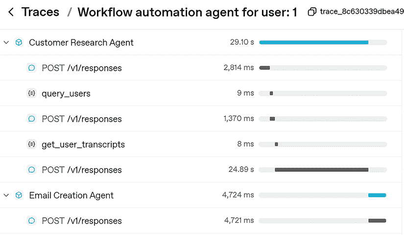

图 9.5：此工作流的轨迹

此智能体的输出如下：

```
客户画像：Emily Clark
个人信息：
姓名：Emily Clark
邮箱：emily.clark@example.com
...
客户兴趣：根据之前的互动，Emily 对篮球有浓厚兴趣，特别是纽约尼克的粉丝。她喜欢和朋友一起打球，并最近购买了运动鞋。此外，她在打球后喜欢吃意大利披萨。
与其相关的最新新闻：
Mikal Bridges 的续约：
2025 年 8 月 1 日，Mikal Bridges 与纽约尼克斯签署了为期四年、价值 1.5 亿美元的续约合同。该合同包括 2029-30 赛季的球员选择权和交易补偿条款，使其在六个月内不可被转会。通过接受略低于顶薪合同的薪水，Bridges 为尼克斯提供了额外的薪资灵活性以增强阵容。自 2024 年加入尼克斯以来，Bridges 一直是球队成功的关键，帮助他们进入了 25 年来的首次东区决赛。
```

随后，报告被馈送给下一个代理（`email_creation_agent`）。该代理获取报告并在生成`EmailOutput`对象之前创建一封个性化的电子邮件。然后，该对象被保存到名为`1.json`的文件中，如下：

```json
{
  "to_email": "emily.clark@example.com",
  "from_email": "hello@paperco.com",
  "subject": "Big Knicks News & Exclusive PaperCo Offer!",
  "html_email": "<p>Hi Emily,</p><p>Exciting times for Knicks fans—Mikal Bridges just signed a new contract extension, and Coach Mike Brown is now at the helm! With games heating up and sunny weather ahead, it's the perfect season for basketball.<p><p>在您为秋季准备之际，我们想与您分享最新的 PaperCo 高级订阅：每笔订单享 9 折优惠，让您的零售采购更加轻松。如果您想了解更多信息，请告诉我们！</p><p>保持活力，Go Knicks!<br/>The PaperCo Team</p>"
}
```

这种方式，我们有两个代理协作为该客户创建了一封个性化的推广电子邮件，以向其推销优惠。扩展此工作流有很多方法。例如，您可以使用工具让代理通过`简单邮件传输协议`（`SMTP`）工具自动发送电子邮件。您还可以创建另一个代理来决定目标客户。一旦您学会了如何以这种方式混合组合工具和代理，可能性就是无限的。

# 总结

在最后一个最后一个章节中，我们构建了两个全面的代理驱动解决方案，将您所有的技能汇聚了一起。首先，我们为`PaperCo`开发了一个客户服务聊天机器人，它结合了多种高级功能。它使用数据库工具进行订单查询（带有权限检查），使用知识库搜索查询常见问题（FAQ），设置输入相关性护栏，并将取消请求移交给专门的留存代理。接下，我们创建了一个工作流自动化系统来使客户外联邮件个性化。在在那个案例研究中，一个研究代理收集了每位客户的详细信息和兴趣（通过数据库查询、转录检索和网络搜索），然后将其交给电子邮件代理，由其生成了带有新产品优惠的定制消息。

回顾您在整本书中的旅程，您从理解什么是 AI 代理以及它们为什么重要开始。您学习了`OpenAI Agents SDK`的基础，设置了环境，并从零开始构建简单的代理。从那里开始，您通过工具和协议扩展了代理的能力，为它们提供了内存和检索机制，探索了多代理交接，并练习了模型和上下文的管理。您还学习了如何对您的系统进行监控、安全和治理，以便它们在生产环境中可靠地运行。这些步骤都为您在最后一个章节中组装的复杂端端系统做好了准备。

关键收获是，您现在拥有一套完整的工具包，用于构建可以处理有意义的真实世界任务的代理。您可以设计不仅响应单个提示词（prompt），而且与数据源集成、记忆上下文、与其他代理协作并在定义的策略内安全运行的代理。这种技能使您能够超越实验，迈向实地部署，无论您是在自动化重复的业务工作流、创建专门的助手，还是创新全新的应用程序。

最重要的是，您应该意识到这仅仅是一个开始。代理系统领域正在快速演进，您所获得的知识让您处于这场变革的最前沿。以`OpenAI Agents SDK`为基础，您完全有能力探索新架构、集成新兴工具并推向 AI 代理成就的边界。可能性是广阔的，下一代智能系统将由像您这样的构建者来塑造。

祝 AI 代理构建愉快！

## 立即解锁本书的专属福利

扫描此二维码或访问[`packtpub.com/unlock`](https://packtpub.com/unlock)，然后按书名搜索此书

**注意**：在开始之前请准备好您的购买发票。


[www.packtpub.com](https://www.packtpub.com)

订阅我们的在线数字图书馆，即可访问超过 7,000 本书和视频，以及行业领先的工具，帮助您规划个人发展并推进职业生涯。

# 为什么要订阅？

- 通过来自 4,000 多名行业专业人士实用电子书和视频，减少学习时间，投入更多时间编写代码
- 通过专为您定制的技能计划（Skill Plans）提高学习效率
- 每月获得一本免费电子书或视频
- 完全可检索，方便访问关键信息
- 内容可以复制粘贴、打印和书签标记

在[www.packtpub.com](https://www.packtpub.com)，您还可以阅读免费技术文章集，订阅一系列免费时事邮件，并接收 Packt 图书和电子书的专属折扣和优惠。

# 您可能感兴趣的其他书籍

如果您喜欢这本书，你可能对 Packt 的其他书籍感兴趣：


**AI Agents in Practice (实战 AI 代理)**

Valentina Alto

ISBN: 978-1-80580-135-1

- 构建代理组件，如 LLM、内存系统、工具集成和上下文管理
- 使用 LangChain 等框架开发生产就绪代理
- 使用编排（orchestration）创建有效的多代理系统
- 为特定行业实现代理
- 设计具有短期和长期记忆的代理架构
- 通过监控、护栏和人类监督实施负责任 AI
- 优化生产环境中的 AI 代理性能和成本


**Generative AI with LangChain (基于 LangChain 的生成式 AI)**

Ben Auffarth, Leonid Kuligin

ISBN: 1-83702014

- 使用 LangGraph 设计并实现多代理系统
- 实现在部署前识别问题的测试策略
- 部署可观测性和监控解决方案
- 构建带有重排序的代理式 RAG 系统
- 使用 LangGraph 和 MCP 构建可扩展的生产级 AI 代理
- 使用最新的 LLM 以及供应商，如 Google Gemini、Anthropic、Mistral、DeepSeek 和 OpenAI 的`o3-mini`
- 设计符合现代伦理实践的安全合规 AI 系统

# Packt 正在寻找您这样的作者

如果您有意成为 Packt 的作者，请访问[authors.packtpub.com](https://authors.packtpub.com)并立即申请。我们已经与成千上万像您这样的开发者和技术人员合作过，帮助他们向全球技术社区分享见解。您可以提交通用申请、申请我们正在招募作者的热门主题，或者提交自己的想法。

# 分享您的想法

现在您已经完成了 *Building Agents with OpenAI Agents SDK*，我们想听听您的想法！如果您是从亚马逊购买的书，请[点击此处直接进入该书的亚马逊评论页面](https://packt.link/r/1806112000)并分享您的反馈或在您购买的网站上评价。

您的评价对我们和技术社区至关重要，并将帮助我们确保交付优质内容内容

# 索引

符号

`@function_tool` 装饰器

A

代理即工具模式

功能

## 相比交接 92, 93

## 代理循环 28

## 代理原语 27, 28

## 代理 SDK

向量存储和`FileSearchTool`，使用 126-128

## 代理测试

端到端测试 203-207

单元测试 207, 208

代理可视化 178-180

## AI 代理 5

解剖 10

构建、框架 22

构建方法论 10

客户服务代理 48-51

开发 48

设计模式 16

交接，添加 55-57

多代理编排 23, 24

概述 4

实际应用 7

工具，添加 51-55

通过简单类比 5

## AI 代理，解剖

控制逻辑框架 12

长期记忆 14, 15

记忆与知识 14

模型 10, 11

检索到的知识 16

工具接口 12, 13

训练知识 15, 16

工作记忆 14

## AI 代理，设计模式

CoT 17

分级/多代理模式 17, 18

规划器-执行模式 17

ReAct 17

## AI 代理，实际应用

更好的交互性 9

企业 9

生产力提升 7, 8

## AI 代理，对比传统系统

优缺点 6, 7

## Anthropic API key

引用链接 171

## API key

设置 38

算术计算工具 70-72

增强步骤 122

## 自动化多代理工作流

组件 227

客户数据库，设置 228, 229

客户研究代理，创建 232

邮件代理，创建 233, 224

用于检索数据的函数工具 230-232

用于搜索的函数工具 230-232

编排 226, 234, 235

测试 235-237

JSON 记录，设置 229, 230

中心系统模式 151, 152

分级系统 152-156

链式工具调用 78-80

分块 125

`CodeInterpreter` 89-91

上下文管理 172

本地上下文 173, 174

控制逻辑框架 12

`Copy.ai` 9

余弦相似度 124

CoT 17

客户数据库

设置 228, 229

客户关系管理 (CRM) 16

客户研究代理

创建 232

客户服务代理

创建 223, 224

客户服务员工 AI 代理

构建 214-216

组件 215, 216

客户服务代理，创建 223, 224

数据库，设置 216, 217

用于查询数据的函数工具 219, 220

输入防护栏，创建 221, 222

留存代理，创建 222

运行器，构建 224

测试 225, 226

向量存储搜索工具，创建 221

向量存储，设置 217-219


# 自定义工具，使用 Python 函数

- 代理和工具行为 65-68
- 链式工具调用 78-80
- 使用 `Pydantic` 的复杂工具输入 68-70
- 定义 62-64
- 示例 70-78
- 使用 62

# D

- 数据库
  - 设置 216, 217
- 数据库查询工具 76-78
- 去中心化系统模式 156-159
- 群群系统 160-163

## 设计模式 16

- 确定性编排 133-136

## 开发前提，使用 OpenAI Agents SDK 44

# Python

- Python 异步编程 46, 47
- Python 函数架构 44-46
- Python `Pydantic` 数据验证 47, 48

# E

- 动态编排 136-139
- 邮件创建代理
  - 创建 233, 234
- 嵌入 123
- 涌现属性 160
- 端到端测试 203-207
- 环境搭建 36
  - API key，设置 38-40
  - Google Colab, 替代方法 43, 44
  - 安装 37, 38
  - 项目目录 37, 38
  - Python 版本与依赖 36, 37
  - 注册， OpenAI API 38-40
  - 验证 41-43
  - 虚拟环境 37, 38
- 外部 API 调用工具 73-76

# F

- `FileSearchTool` 84-87
- 微调 118
- 有限上下文窗口 110
- 先进先出 (FIFO) 110
- 函数工具
  - 创建，用于查询数据 219, 220

# G

- 通用知识 15
- 生成步骤 122
- `get_shipping_status` 函数 174
- Google Colab 43, 44
- 护栏原语 31, 32
- 护栏 181, 182
  - 输入护栏 182-190
  - 输出护栏 190-193

# H

- 交接 55, 141, 142
  - 定制 146-149
  - OpenAI Agents SDK 中的 139, 141
  - 多代理切换 143-145
  - 提示词 149-151
- 代理即工具 92, 93
- 交接原语 30, 31
- 层级/多代理模式 17, 18
- 层级系统 152-155

# I

- `ImageGenerationTool` 87, 88
- 输入护栏创建 221, 222
- 输入护栏 182-190

# J

- `Jasper.ai` 9

# L

- 大语言模型 (LLMs) 3, 39, 40
- `LiteLLM` 171
- 本地上下文 173, 174
- 日志 193-195
- 长期记忆 14, 15, 112
  - 持久消息日志 112-114
  - 结构化记忆检索 114-118

# M

- 记忆 14
- 记忆存储与检索 112
- 消息摘要 110, 111
- 模型 10
- 模型无关设计 165
- 模型上下文协议 (MCP) 18, 30, 97
  - 服务器，作为工具添加 97, 99
- 模型管理 166
  - 参数，修改 166-168
  - 设置 168-171
  - 第三方模型 171, 172
- 多代理编排 132
  - 确定性编排 133-136
  - 动态编排 136-139
  - 策略 132, 133
- 多代理模式 151
  - 中心化系统模式 151, 152
  - 去中心化系统模式 156-159
- 多代理系统 131
- 多个 span，组合在一起 198-202
- 多个 trace，组合在一起 198-202

# O

- 可观测性 193-195
- OpenAI Agents SDK 18
  - 特性，设计 22-26
  - 交接 139-141
  - 原语 26, 27
- OpenAI Agents SDK，原语
  - 代理原语 27, 28
  - 护栏原语 31, 32
  - 交接原语 30, 31
  - 运行器原语 28
  - 工具原语 29, 30

## 追踪 (Tracing)

- `tracing primitive` 32, 33

# OpenAI API

- 注册 38-40
- OpenAI 托管工具 80, 81
  - `CodeInterpreterTool` 89-91
  - `FileSearchTool` 84-87
  - `ImageGenerationTool` 87, 88
  - `WebSearchTool` 81-84

# P

- 输出护栏 190-193
- 规划器-执行模式 17
- `primitives` 26
- `Pydantic` 47
  - 使用，用于工具输入 68-70

# Python

- 异步编程 46, 47
- 函数架构 44-46
- `Pydantic` 数据验证 47, 48
- 版本与依赖 36, 37

# R

- 推理+行动 (ReAct) 17
- 留存代理
  - 创建 222
- 检索增强生成 (RAG) 11, 84, 122
  - 获取的知识 16, 119-122
  - 局限性 128, 129
  - 非结构化数据 123-125
- `Runner primitive` 28

# S

- 语义嵌入 84
- 语义搜索 124
- 会话 (Sessions)
  - 使用，用于对话管理 108, 109
- 短记忆 103
- 简单邮件传输协议 (SMTP) 工具 237
- 滑动消息窗口 110
- 软件开发包 (SDK) 21
- 跨度 (spans)
  - 自定义属性 195-197
- 有状态系统 103
- 无状态系统 103
- 结构化记忆提取 114-118
- swarm 智能系统 (swarm system) 160-163
- 系统提示词 11

# T

- 工具接口 12
- `tool primitive` 29, 30
- 追踪 (trace) 52
  - 自定义属性 195-197
  - 禁用 202
  - 仪表板 194
  - 模块 193
- 追踪 (tracing) 193
- `tracing primitive` 32, 33
- 训练 14, 16, 119, 122
- 转转录 229, 230

# U

- 单元测试 207, 208
- 非结构化数据 123-125
  - 文摄入 125
  - `FileSearchTool` 在 SDK 中使用 126-128
  - 检索 125
- 向量存储，在 SDK 中使用 126-128

# V

- 向量存储 84
  - 设置 217-219
- 向量搜索工具 221

# W

- `WebSearchTool` 81-84
- 工作记忆 14, 103
  - 聊天对话 106-108
  - 对话管理，使用会话 108, 109
  - 输入和响应管理 103-106
  - 长对话对话线程管理 110
    - 消息摘要 110, 111
    - 滑动消息窗口 110
